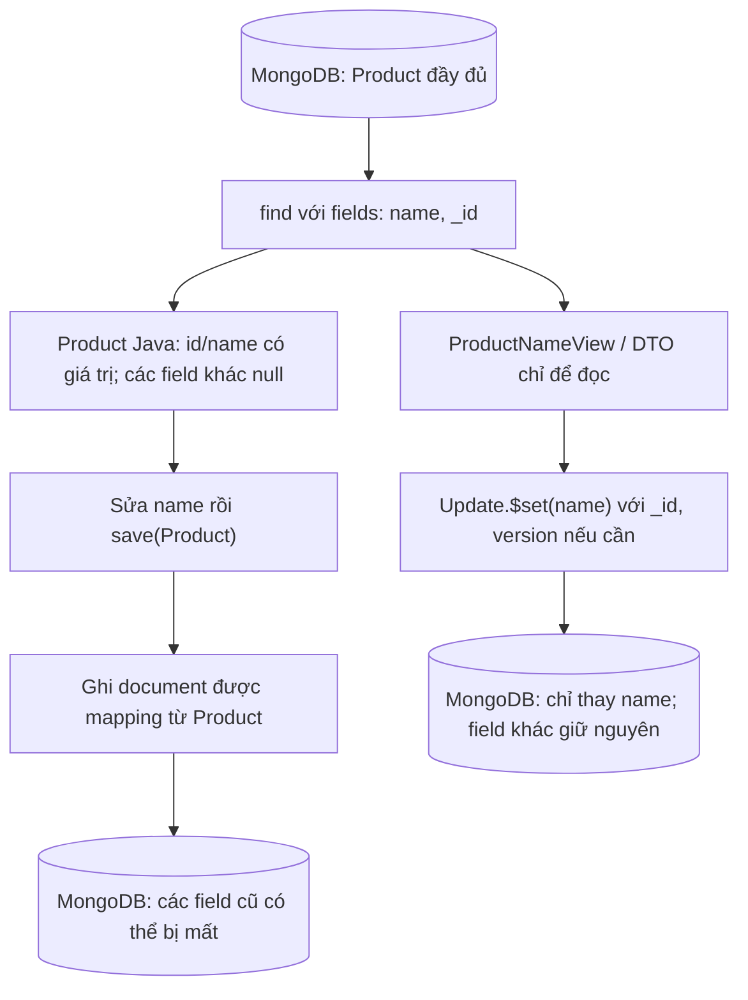

# Nguy cơ mất dữ liệu khi save entity chỉ được tải một phần

Trong **Spring Data MongoDB**, *projection* giúp một truy vấn chỉ lấy các trường cần dùng, giảm dữ liệu truyền qua mạng và hạn chế xử lý dư thừa khi xây dựng trang danh sách hoặc API đọc. Nhưng nếu ứng dụng ánh xạ kết quả projection vào **entity domain đầy đủ**, sửa một trường rồi gọi `save`, các trường **không được tải** có thể bị mất khỏi document đang lưu trong MongoDB.

Đây là một lỗi nguy hiểm vì lập trình viên có thể tin rằng `save` chỉ ghi những field vừa gọi setter. Trên thực tế, khi ghi một entity đã tồn tại và không có cơ chế version đặc biệt, `MongoTemplate.save` hoặc đường `save` tương ứng của repository thường gửi nội dung đã mapping để **thay thế document** (replace/upsert); nó **không suy ra danh sách field đã thay đổi trong Java**.

Bài học thuộc chương **Projection và DTO** của module `SPRING_DATA_MONGODB`. Ta sẽ tìm hiểu projection, cơ chế ghi của `MongoRepository`/`MongoTemplate`, cách phân biệt DTO đọc với entity ghi, cập nhật bằng `Update`/`$set`, optimistic locking, giao dịch, kiểm thử MongoDB thực và chẩn đoán hiện tượng dữ liệu biến mất. Mục tiêu là lựa chọn cách đọc/ghi **đúng nghĩa nghiệp vụ**, không chỉ làm cho truy vấn chạy được.

Sau bài này, bạn có thể:

- Giải thích vì sao object Java có field `null` không cho biết field đó **không được tải**, **bị thiếu trong database** hay **cố ý muốn xóa**.
- Tái hiện nguy cơ mất dữ liệu khi `Query.fields().include(...)` hoặc `@Query(fields = ...)` trả về entity rồi gọi `save`.
- Dùng **interface/class DTO projection** cho đường đọc, ngăn DTO bị hiểu là entity đầy đủ có thể ghi.
- Dùng `MongoTemplate.updateFirst`, `findAndModify`, update có điều kiện và `@Version` theo đúng trường hợp.
- Kiểm thử tình huống mất field trên database cô lập, kiểm tra BSON thô và lựa chọn chiến lược tránh lost update.

## 1. Hiểu đúng projection và thao tác save

**Projection** chỉ định những field MongoDB Server trả về hoặc kiểu đối tượng Spring Data dựng từ kết quả. **Save** có nghĩa ghi trạng thái entity về database. Hai thao tác độc lập, không tạo ra cơ chế tự động theo dõi field đã được chọn:



Đặc biệt, `_id` được MongoDB trả về mặc định trong phép *inclusion projection* nếu không loại trừ nó. Vì vậy object thiếu phần lớn dữ liệu vẫn có thể mang ID hợp lệ. Lời gọi `save` sau đó không nhất thiết thất bại: nó có thể xác định đúng document để ghi **nội dung thiếu field**.

| Khái niệm | Mục đích | Có phải entity đầy đủ để save không? |
| --- | --- | --- |
| Query projection: `{ name: 1 }` | Chỉ lấy tên (và `_id` mặc định) | **Không**; đây là dữ liệu một phần |
| Interface projection: `ProductNameView` | Trả một giao diện chỉ có field cần đọc | **Không**; nên giữ read-only |
| Record DTO: `ProductSummary` | Trả bản tóm tắt có hợp đồng riêng | **Không**; không phải snapshot đầy đủ để thay thế document |
| Entity `Product` được tải đầy đủ | Thực thể có các field được mapping | Có thể save, nhưng cần xét cạnh tranh và version |
| `Update.set("name", ...)` | Chỉ đặt một field tại server | Không thay thế document |
| `save(partialProduct)` | Ghi trạng thái object thiếu field | **Có nguy cơ mất dữ liệu** |

**Nguyên tắc:** dữ liệu được chọn để hiển thị không đồng nghĩa với dữ liệu đủ để ghi thay thế document. Projection và DTO nên là **ranh giới đọc**, còn write API nên diễn đạt chính xác field nào được phép thay đổi.

## 2. Dữ liệu mẫu và entity minh họa

Giả sử một sản phẩm có mã, tên, giá, tồn kho, mô tả và nhãn:

```javascript
// Collection: products
{
  _id: "P-100",
  sku: "BK-100",
  name: "Sổ tay",
  category: "BOOK",
  priceVnd: NumberLong("85000"),
  stock: 42,
  description: "Bìa cứng, giấy trắng",
  tags: ["office", "gift"],
  active: true
}
```

Entity Java tương ứng dùng Spring Data MongoDB:

```java
import java.util.List;
import org.springframework.data.mongodb.core.mapping.Document;
import org.springframework.data.mongodb.core.mapping.MongoId;

@Document(collection = "products")
public class Product {
    @MongoId
    private String id;
    private String sku;
    private String name;
    private String category;
    private Long priceVnd;
    private Integer stock;
    private String description;
    private List<String> tags;
    private Boolean active;

    protected Product() {}

    public Product(String id, String sku, String name, String category,
                   Long priceVnd, Integer stock, String description,
                   List<String> tags, Boolean active) {
        this.id = id;
        this.sku = sku;
        this.name = name;
        this.category = category;
        this.priceVnd = priceVnd;
        this.stock = stock;
        this.description = description;
        this.tags = tags;
        this.active = active;
    }

    public String getId() { return id; }
    public String getSku() { return sku; }
    public String getName() { return name; }
    public String getCategory() { return category; }
    public Long getPriceVnd() { return priceVnd; }
    public Integer getStock() { return stock; }
    public String getDescription() { return description; }
    public List<String> getTags() { return tags; }
    public Boolean getActive() { return active; }

    public void setName(String name) { this.name = name; }
    public void setPriceVnd(Long priceVnd) { this.priceVnd = priceVnd; }
    public void setStock(Integer stock) { this.stock = stock; }
}
```

Ta dùng các kiểu wrapper `Long`, `Integer`, `Boolean` để dễ quan sát field không có dữ liệu được đọc vào Java là `null`. Nếu sử dụng primitive `long`/`int`/`boolean`, giá trị mặc định có thể trở thành `0`/`false`, khiến lập trình viên càng khó biết field nào bị bỏ qua.

`@MongoId String id` giữ `_id` dưới dạng BSON String theo mapping mặc định, tránh nhầm chuỗi 24-hex với ObjectId. Quy tắc khác như converter tùy chỉnh hoặc `@Field` cần được tính vào kiểm thử của dự án.

Repository:

```java
import java.util.Optional;
import org.springframework.data.mongodb.repository.MongoRepository;
import org.springframework.data.mongodb.repository.Query;

public interface ProductRepository extends MongoRepository<Product, String> {

    @Query(
        value = "{ '_id' : ?0 }",
        fields = "{ 'name' : 1 }")
    Optional<Product> findNameOnlyEntityById(String id);
}
```

Phương thức trên **cố ý trả `Product` dù chỉ chọn field `name`**; đó chính là trường hợp cần tránh trong luồng ghi. `@Query(fields = ...)` là projection ở mức MongoDB query, không phải cam kết về *read-only entity*. Ví dụ này chỉ dùng để học và kiểm thử rủi ro.

## 3. Tái hiện mất dữ liệu: tải một phần rồi gọi save

### 3.1. Truy vấn projection chỉ lấy vài trường

Ví dụ gọi bằng `MongoTemplate`:

```java
import org.springframework.data.mongodb.core.MongoTemplate;
import org.springframework.data.mongodb.core.query.Criteria;
import org.springframework.data.mongodb.core.query.Query;

// Thực hiện trên database kiểm thử, không áp dụng vào dữ liệu thật.
Query query = Query.query(Criteria.where("_id").is("P-100"));
query.fields().include("name"); // _id vẫn được trả về theo mặc định.

Product partial = mongoTemplate.findOne(query, Product.class);
// partial.id == "P-100", partial.name == "Sổ tay"
// partial.sku, partial.stock, partial.description, partial.tags... == null
```

Ở đây `partial.getStock() == null` **không có nghĩa tồn kho trên server thực sự là null**. Nó chỉ cho biết object Java không có giá trị cho thuộc tính đó sau khi query không lấy field. Spring Data mapping một entity không tự gắn “danh sách các trường đã được đọc” để dùng khi save.

### 3.2. Save object thiếu field

Đoạn mã sau **minh họa lỗi cần tránh**, chỉ chạy trong test có dữ liệu giả và có thể reset:

```java
// SAI: Product chỉ chứa một phần dữ liệu, nhưng lại đem save.
Product partial = productRepository
        .findNameOnlyEntityById("P-100")
        .orElseThrow();

partial.setName("Sổ tay cao cấp");
productRepository.save(partial);
```

Với entity **không có `@Version`** ở ví dụ này, ID đã tồn tại nên repository thường đi theo nhánh `MongoOperations.save` cho document cũ. MongoDB có thể nhận một thao tác thay thế document bằng nội dung đã mapping từ `partial`. Khi đó dữ liệu có thể trở thành:

```javascript
// Minh họa hậu quả sau thao tác save trên partial Product.
{
  _id: "P-100",
  name: "Sổ tay cao cấp"
  // sku, category, priceVnd, stock, description, tags, active
  // không còn được giữ như document gốc.
}
```

Cách converter xử lý `null` có thể khiến field bị **bỏ hẳn** hoặc được ghi theo quy tắc null riêng; cả hai đều gây nguy cơ mất giá trị cũ. MongoDB không thể suy ra rằng các field vắng mặt trong object Java phải được giữ lại khi nhận lệnh thay thế document.

### 3.3. Phân biệt save và update ở mức BSON

Về ý nghĩa, hai thao tác dưới đây rất khác:

```javascript
// NGUY HIỂM: Thay thế document bằng bản chỉ có vài field.
db.products.replaceOne(
  { _id: "P-100" },
  { _id: "P-100", name: "Sổ tay cao cấp" }
);

// AN TOÀN HƠN CHO PATCH: Chỉ thay đúng field name.
db.products.updateOne(
  { _id: "P-100" },
  { $set: { name: "Sổ tay cao cấp" } }
);
```

Đây là ví dụ khái niệm với MongoDB Server, **không khẳng định mọi lệnh `save` đều được driver phát ra bằng đúng cú pháp trên**. Đường thực thi có thể phụ thuộc `isNew`, `@Version`, converter và phiên bản Spring Data. Điểm cần nhớ là **replace** và **`$set`** có phạm vi thay đổi khác nhau.

## 4. Vì sao lỗi khó phát hiện?

### 4.1. Dữ liệu không được tải và dữ liệu null khó phân biệt

Một field trong entity có giá trị `null` có thể có ít nhất ba nguyên nhân:

1. Document gốc không chứa field này.
2. Document có field nhưng **projection không chọn** nó.
3. Field được chọn và dữ liệu gốc là BSON `null`.

Chỉ nhìn `product.getDescription() == null` không phân biệt được ba tình huống đó. Nếu dùng DTO để cập nhật, ta còn phải phân biệt **client không gửi field** với **client muốn xóa field**. Đây là lý do không nên kết hợp mọi trường hợp vào một lời gọi `save`.

### 4.2. ID vẫn có thể đầy đủ nên save không báo lỗi

MongoDB thường trả `_id` dù projection chỉ yêu cầu `name`. Spring Data nhận được ID nên có thể xem entity không mới và ghi lại document theo khóa đó. Lỗi có thể âm thầm xảy ra: service nhận kết quả save thành công nhưng một API khác truy vấn `stock`, `priceVnd` hoặc `tags` sẽ thấy dữ liệu bị mất.

Nếu projection cố ý loại trừ `_id` và ID Java trở thành `null`, `repository.save` có thể coi entity là mới, tạo document khác hoặc lỗi; đó là **một kiểu sai khác**, không phải giải pháp an toàn.

### 4.3. DTO mỏng không nhất thiết tương ứng entity để ghi

Giả sử trang danh sách chỉ cần:

```json
{
  "id": "P-100",
  "name": "Sổ tay",
  "priceVnd": 85000
}
```

Nó là **hợp đồng đọc**. Nếu backend nhận lại object này rồi tạo `new Product(...)` với các field còn lại `null` và gọi `save`, backend đang giả định một bản tóm tắt là trạng thái toàn bộ document. Đó chính là lỗi thiết kế; muốn chỉnh sửa, hãy có command/DTO riêng cho thao tác sửa cụ thể.

### 4.4. Rủi ro lớn hơn khi dùng mapping tự động

Các thao tác như copy từ DTO sang entity bằng reflection, generic mapper hoặc `BeanUtils.copyProperties` có thể làm field chưa được cung cấp trở thành `null`/mặc định, rồi `save` thay thế những giá trị đang tồn tại. Việc thêm trường mới vào domain về sau cũng có thể khiến các API cũ làm mất trường đó nếu chúng tạo entity thiếu dữ liệu để ghi.

**Không coi “copy bỏ qua null” là lời giải đầy đủ**: nếu client cố ý yêu cầu xóa một field, việc bỏ qua null sẽ bỏ qua thao tác đó. Phải xác định rõ ngữ nghĩa *field không gửi*, *field gửi null để xóa*, và *field gửi giá trị mới*.

## 5. Giải pháp thứ nhất: dùng projection/DTO cho đường đọc

Khi truy vấn phục vụ danh sách, tìm kiếm hoặc thông tin tóm tắt, hãy **trả một kiểu chỉ chứa những giá trị ứng dụng thật sự cần**. Không truyền kiểu này vào `save` của repository domain.

### 5.1. Closed interface projection

Ví dụ một interface projection:

```java
public interface ProductListView {
    String getId();
    String getName();
    Long getPriceVnd();
}
```

Repository riêng cho use case đọc:

```java
import java.util.List;
import org.springframework.data.mongodb.repository.MongoRepository;

public interface ProductReadRepository
        extends MongoRepository<Product, String> {

    List<ProductListView> findByCategory(String category);
}
```

`ProductListView` chỉ yêu cầu `id`, `name` và `priceVnd`. Đây là **closed projection** vì tất cả accessor tương ứng với thuộc tính có thể xác định; Spring Data có thể tối ưu phần field được lấy tùy tính năng, kiểu projection và phiên bản.

```java
List<ProductListView> books = productReadRepository
        .findByCategory("BOOK");

for (ProductListView book : books) {
    System.out.println(book.getName());
}
```

Ý nghĩa quan trọng ở đây không chỉ là giảm response: **kiểu trả về không phải `Product`**. Người viết service không thể vô tình gọi `ProductRepository.save(book)` với `ProductListView` như một entity domain thông thường. Dù vậy, đừng cố chuyển interface projection thành `Product` thiếu field chỉ để gọi `save`.

Với dữ liệu danh sách lớn, nên bổ sung `Pageable`/`Slice` hoặc giới hạn truy vấn; projection không tự giới hạn số document. Projection cũng không phải cơ chế bảo vệ dữ liệu nhạy cảm: phải áp dụng phân quyền ở tầng query/service/API.

### 5.2. DTO dạng record

Một class-based DTO có thể biểu diễn kết quả đọc:

```java
public record ProductSummary(
        String id,
        String name,
        Long priceVnd
) {}
```

Spring Data có thể hỗ trợ **class-based projection** nếu tên tham số constructor và metadata mapping phù hợp với thuộc tính nguồn. Ví dụ repository:

```java
import java.util.List;
import org.springframework.data.mongodb.repository.MongoRepository;

public interface ProductSummaryRepository
        extends MongoRepository<Product, String> {

    List<ProductSummary> findByCategory(String category);
}
```

Record `ProductSummary` là **mô hình đọc**, không phải `@Document(collection = "products")`. Không nên khai báo thêm một repository để `save(ProductSummary)` như thể nó là entity đầy đủ của cùng collection. Nếu class projection trả ra từ truy vấn có cấu trúc phức tạp, alias field khác tên hoặc dùng aggregation, hãy kiểm thử việc mapping DTO theo đúng phiên bản Spring Data.

### 5.3. Open projection có thể không tiết kiệm field như dự đoán

Spring Data hỗ trợ biểu thức SpEL trong một số **open interface projection**, chẳng hạn getter tính toán từ `target`. Khi expression có khả năng truy cập những thuộc tính không biết trước, framework có thể **không tối ưu được việc chỉ lấy vài field**.

Do đó:

- **Closed projection:** thường dễ xác định thuộc tính cần đọc để tối ưu.
- **Open projection:** linh hoạt hơn nhưng cần xác minh lượng dữ liệu thực sự được truy vấn.
- **Entity trả về từ một query chỉ chọn vài field:** có nguy cơ nghiêm trọng nếu bị đưa vào `save`.

Không đánh giá hiệu quả projection chỉ bằng số getter của Java interface. Hãy quan sát truy vấn MongoDB được gửi và kích thước dữ liệu đọc.

## 6. Giải pháp thứ hai: cập nhật có mục tiêu với `$set`

Nếu người dùng muốn đổi **tên sản phẩm**, cách rõ nhất là phát lệnh **chỉ đổi `name`** tại MongoDB Server. Không cần tải cả entity và không đụng tới giá, tồn kho hay danh sách tag.

### 6.1. `MongoTemplate.updateFirst` cho PATCH

```java
import com.mongodb.client.result.UpdateResult;
import java.util.NoSuchElementException;
import org.springframework.data.mongodb.core.MongoTemplate;
import org.springframework.data.mongodb.core.query.Criteria;
import org.springframework.data.mongodb.core.query.Query;
import org.springframework.data.mongodb.core.query.Update;
import org.springframework.stereotype.Service;

@Service
public class ProductNameCommandService {
    private final MongoTemplate mongoTemplate;

    public ProductNameCommandService(MongoTemplate mongoTemplate) {
        this.mongoTemplate = mongoTemplate;
    }

    public void rename(String id, String newName) {
        if (newName == null || newName.isBlank()) {
            throw new IllegalArgumentException("Tên không được rỗng");
        }

        Query query = Query.query(Criteria.where("_id").is(id));
        Update update = new Update().set("name", newName);
        UpdateResult result = mongoTemplate.updateFirst(
                query, update, Product.class);

        if (result.getMatchedCount() == 0) {
            throw new NoSuchElementException(
                    "Sản phẩm không tồn tại: " + id);
        }
    }
}
```

Về phía MongoDB, ý nghĩa tương đương:

```javascript
db.products.updateOne(
  { _id: "P-100" },
  { $set: { name: "Sổ tay cao cấp" } }
);
```

`$set` chỉ thay trường `name`; các trường `sku`, `category`, `stock`, `description`, `tags` và `active` **được giữ nguyên**. `updateFirst` mặc định không upsert nên nếu không có document khớp, `matchedCount` là 0. `modifiedCount` có thể bằng 0 khi tên mới trùng với tên cũ, vì vậy kiểm tra `matchedCount` phù hợp hơn nếu muốn biết document có tồn tại.

**Giới hạn:** cập nhật chỉ một field giúp tránh ghi đè những field khác, nhưng **không ngăn hai request cùng sửa `name`** nếu cả hai không có điều kiện version. Nếu cần phát hiện tranh chấp cùng field, dùng optimistic locking hoặc điều kiện so sánh trạng thái.

### 6.2. Cập nhật nhiều field nhưng chỉ trong danh sách cho phép

Một command DTO có thể nêu rõ quyền cập nhật:

```java
public record RenameAndRepriceCommand(
        String name,
        Long priceVnd
) {}
```

Service có thể tạo update từng field:

```java
Update update = new Update()
        .set("name", command.name())
        .set("priceVnd", command.priceVnd());

mongoTemplate.updateFirst(
        Query.query(Criteria.where("_id").is(id)),
        update,
        Product.class);
```

Đây là đoạn minh họa bên trong một method đã có `mongoTemplate`, `id` và `command`. Phải xác thực tên, giá tiền, vai trò người gọi và quy tắc nghiệp vụ trước khi phát lệnh. Không xây `Update` bằng cách lặp qua **mọi tên field do client tự gửi** mà không có danh sách field được phép, vì có thể dẫn tới sửa `_id`, quyền truy cập, tenant hoặc các trường nội bộ.

### 6.3. Phân biệt “không gửi”, “đặt null” và “xóa field”

Ví dụ một endpoint PATCH có thể quy định:

| Payload | Ý nghĩa | Toán tử được chọn |
| --- | --- | --- |
| Không có thuộc tính `description` | Giữ mô tả cũ | **Không đưa field vào Update** |
| `"description": "Ghi chú mới"` | Cập nhật mô tả | `$set` |
| `"description": null` | Ghi giá trị BSON null, nếu nghiệp vụ cho phép | `$set: { description: null }` |
| Yêu cầu xóa mô tả rõ ràng | Loại bỏ field khỏi document | `$unset` |

Một ví dụ xóa field có chủ đích:

```java
Update update = new Update().unset("description");
mongoTemplate.updateFirst(
        Query.query(Criteria.where("_id").is("P-100")),
        update,
        Product.class);
```

MongoDB phân biệt **field vắng mặt** và **field có BSON null** trong một số truy vấn, index và validator. Vì vậy phải xác định ngữ nghĩa PATCH ngay từ hợp đồng API và thể hiện bằng toán tử phù hợp.

### 6.4. Dùng `findAndModify` khi cần nhận lại bản ghi

Thay vì thực hiện `updateFirst` rồi gọi `findById`, có thể dùng `findAndModify` để cập nhật và nhận document mới trong một thao tác trên một document:

```java
import org.springframework.data.mongodb.core.FindAndModifyOptions;
import org.springframework.data.mongodb.core.query.Criteria;
import org.springframework.data.mongodb.core.query.Query;
import org.springframework.data.mongodb.core.query.Update;

Product updated = mongoTemplate.findAndModify(
        Query.query(Criteria.where("_id").is(id)),
        new Update().set("name", newName),
        FindAndModifyOptions.options().returnNew(true),
        Product.class
);
```

Đây là đoạn code trong service có `mongoTemplate`, `id` và `newName`. Kết quả có thể là `null` khi không có document phù hợp. Với payload lớn, nếu API chỉ cần một vài field kết quả, phải cân nhắc projection phù hợp và lượng byte trả về; `findAndModify` không biến entity trả về thành “partial entity an toàn để save”.

## 7. Khi nào có thể tải đầy đủ rồi save?

Có những nghiệp vụ muốn thay **toàn bộ trạng thái của một aggregate nhỏ**. Khi đó việc đọc toàn bộ entity, áp dụng thay đổi theo quy tắc nghiệp vụ và `save` có thể hợp lý, miễn chấp nhận ngữ nghĩa ghi lại trạng thái đầy đủ:

```java
Product full = productRepository.findById("P-100")
        .orElseThrow();

full.setName("Tên mới");
productRepository.save(full);
```

Điều kiện tối thiểu:

1. Entity thực sự được **tải đầy đủ** theo mapping và yêu cầu nghiệp vụ, không phải bản do một projection field-level tạo ra.
2. Service chỉ thay đổi field được phép, không copy bừa DTO thiếu field vào entity.
3. Có cơ chế giải quyết **ghi đồng thời**: `@Version`, lệnh cập nhật có điều kiện hoặc logic nghiệp vụ khác.
4. Hiểu rằng các field mới/được ghi bởi hệ thống khác có thể không được mapping vào entity cũ, nên `save` có thể gây mất dữ liệu ngay cả khi ứng dụng tưởng đã “đọc đầy đủ”.

MongoDB không tự làm phép merge “giữ nguyên mọi field không xuất hiện trong Java object”. Nếu nhiều ứng dụng cùng ghi một collection nhưng sử dụng schema khác nhau, hãy ưu tiên update theo field hoặc thiết kế hợp đồng sở hữu dữ liệu rõ ràng.

## 8. `@Version` có ngăn mất dữ liệu do projection không?

**Không nhất thiết.** `@Version` hỗ trợ **optimistic locking**, tức phát hiện khi một bản ghi đã bị thay đổi kể từ lần đọc. Nó không có nghĩa Spring Data tự biết trường nào chưa được tải do projection.

### 8.1. Entity có version

Ví dụ độc lập với entity `Product` chưa có version ở trên:

```java
import org.springframework.data.annotation.Version;
import org.springframework.data.mongodb.core.mapping.Document;
import org.springframework.data.mongodb.core.mapping.MongoId;

@Document(collection = "versionedProducts")
public class VersionedProduct {
    @MongoId
    private String id;

    @Version
    private Long version;

    private String name;
    private Long priceVnd;
    private Integer stock;

    protected VersionedProduct() {}

    public String getId() { return id; }
    public Long getVersion() { return version; }
    public String getName() { return name; }
    public Long getPriceVnd() { return priceVnd; }
    public Integer getStock() { return stock; }

    public void setName(String name) { this.name = name; }
}
```

Khi repository lưu một entity versioned đã được tải đầy đủ, Spring Data có thể kèm điều kiện version trong thao tác ghi và tăng version sau khi thành công. Nếu một request khác đã cập nhật document lên version mới, thao tác save cũ sẽ không khớp và có thể ném `OptimisticLockingFailureException`.

### 8.2. Nếu projection không tải `version`

Giả sử `VersionedProduct` được tải chỉ với `_id` và `name`. Khi đó `version == null` trong Java dù database có version hợp lệ. Việc repository xác định một entity **còn mới hay đã tồn tại** có thể dựa trên `@Version`, nên lời gọi `save` có thể đi theo **đường insert**, dẫn tới duplicate key, hoặc gặp lỗi khác tùy cách gọi và mapping. Không được suy rằng `@Version` sẽ luôn bảo vệ một partial entity khỏi mọi lỗi.

Nếu projection **có tải `version`**, câu chuyện vẫn chưa kết thúc: optimistic locking chỉ xác nhận document chưa bị thay đổi theo version, nhưng **nội dung `Product` đem save vẫn thiếu `priceVnd`, `stock`...**. Một replace thành công với version đúng vẫn có thể làm mất các field đó.

| Trạng thái object | `@Version` giải quyết điều gì? | Rủi ro còn lại |
| --- | --- | --- |
| Entity đầy đủ, version đúng | Ghi nếu không có thay đổi version cạnh tranh | Những field ngoài mapping vẫn cần kiểm soát |
| Entity đầy đủ, version đã cũ | Phát hiện xung đột trong trường hợp cấu hình đúng | Service phải xử lý retry/conflict |
| Entity một phần, **thiếu version** | Có thể nhận diện nhầm là mới hoặc lỗi | Không đủ dữ liệu để save |
| Entity một phần, **có version** | Có thể phát hiện cập nhật cạnh tranh | Vẫn có thể mất các field không được tải nếu replace thành công |

**Kết luận:** `@Version` giải quyết bài toán **đã có ai sửa kể từ lần đọc không?**, còn `projection` đặt ra bài toán **object này có đủ thông tin để thay thế document không?**. Đây là hai vấn đề độc lập.

### 8.3. Kết hợp PATCH và kiểm tra version

Khi một endpoint chỉ sửa tên nhưng cần phát hiện người khác đã thay đổi document, hãy đưa **version kỳ vọng** vào điều kiện cập nhật, rồi tăng version nguyên tử:

```java
import com.mongodb.client.result.UpdateResult;
import org.springframework.dao.OptimisticLockingFailureException;
import org.springframework.data.mongodb.core.MongoTemplate;
import org.springframework.data.mongodb.core.query.Criteria;
import org.springframework.data.mongodb.core.query.Query;
import org.springframework.data.mongodb.core.query.Update;

// Method trong service đã inject MongoTemplate.
void renameIfUnchanged(
        MongoTemplate template,
        String id,
        long expectedVersion,
        String newName
) {
    Query query = Query.query(
            Criteria.where("_id").is(id)
                    .and("version").is(expectedVersion));

    Update update = new Update()
            .set("name", newName)
            .inc("version", 1);

    UpdateResult result = template.updateFirst(
            query, update, VersionedProduct.class);

    if (result.getMatchedCount() != 1) {
        throw new OptimisticLockingFailureException(
                "Document không tồn tại hoặc version đã thay đổi");
    }
}
```

Điều kiện `_id + version` và thao tác `$set + $inc` chạy trên **cùng một document**, nên nếu matched, update và tăng version có thể được áp dụng nguyên tử ở MongoDB Server. Với `MongoTemplate`, việc cập nhật trường có `@Version` có thể được quản lý tự động khi không chỉ định version trong `Update`; ở ví dụ này ta **đã tăng version một cách tường minh** nên phải giữ chiến lược version nhất quán trong toàn ứng dụng để tránh tăng hai lần hay bỏ qua version.

Lưu ý khi dùng version để kiểm tra kết quả ghi: write concern nên bảo đảm nhận được xác nhận cần thiết; ứng dụng cần phân biệt lỗi không tìm thấy, lỗi xung đột và lỗi kết nối theo hợp đồng API.

## 9. Truy vấn từ repository, `MongoTemplate` và aggregation

Không phải mọi dạng projection đều có cùng hành vi. Hãy đọc **đường đọc** trước khi quyết định dùng kết quả cho **đường ghi**:

| Đường đọc | Ví dụ | Kiểu kết quả nên dùng | Có nên gọi `save` trực tiếp? |
| --- | --- | --- | --- |
| Repository tìm entity đầy đủ | `findById(id)` | `Product` | Chỉ khi muốn lưu đầy đủ và đã xử lý đồng thời |
| Repository dùng `@Query(fields = ...)` | Chỉ lấy `name` | `ProductNameView` hoặc DTO | **Không** |
| `MongoTemplate` với `query.fields().include(...)` | Chỉ lấy `name` | DTO riêng hoặc xử lý read-only | **Không** với entity partial |
| Repository closed interface projection | `findByCategory(...)` | `ProductListView` | **Không** |
| Aggregation có `$project` | `name`, `priceVnd` | Summary DTO | **Không** |
| `findAndModify` với update theo field | `$set(name)` | `Product` hoặc DTO response | Bản thân update đã ghi; không save lại response vì thói quen |

### 9.1. Aggregation projection không biến dữ liệu thành entity đầy đủ

Ví dụ pipeline:

```javascript
db.products.aggregate([
  { $match: { active: true } },
  {
    $project: {
      _id: 1,
      name: 1,
      priceVnd: 1
    }
  },
  { $limit: 20 }
]);
```

Kết quả chỉ phù hợp cho hiển thị hoặc DTO chứa ba trường đó. Nếu chuyển kết quả thành `Product` rồi gọi `save`, các field `sku`, `stock`, `tags`... vẫn không hiện diện; quy tắc an toàn giống projection bằng `find`.

### 9.2. Projection giúp hiệu năng nhưng không thay thế index

Chọn ít field giúp giảm byte trả về, đặc biệt khi document có mô tả dài hoặc mảng lớn. Nhưng MongoDB Server vẫn cần thực thi filter và sort; nên tạo index dựa trên truy vấn chính. Ví dụ:

```javascript
// Truy vấn danh sách sản phẩm ACTIVE theo category, mới nhất trước.
db.products.createIndex({
  category: 1,
  active: 1,
  _id: -1
});

db.products.find(
  { category: "BOOK", active: true },
  { name: 1, priceVnd: 1 }
).sort({ _id: -1 }).limit(20);
```

Nếu có **covered query** phù hợp, server có thể đáp ứng một số truy vấn chỉ từ index mà không cần đọc toàn bộ document; nhưng điều đó phụ thuộc chính xác field được chọn (kể cả `_id`), filter, sort và cấu trúc index. Không suy rằng mọi projection đều trở thành covered query; hãy xác minh bằng `explain("executionStats")`.

### 9.3. Trường nhúng và tham chiếu cũng có thể biến mất

Nếu `Product` có `details` (embedded document) hoặc các field liên kết bằng ID, một phép projection chỉ lấy `name` rồi `save` có thể làm mất **cả object con** hay danh sách tham chiếu, không riêng những scalar như `priceVnd`. Đối với mảng phần tử, hãy dùng các toán tử update thích hợp như `$addToSet`, `$pull` hoặc update vị trí khi nghiệp vụ yêu cầu, thay vì ghi lại cả aggregate từ một snapshot thiếu dữ liệu.

Nếu entity có `@DocumentReference`/`@DBRef`, việc đọc một phần cũng có thể làm field liên kết không được nạp. Không coi lazy proxy hay lookup tham chiếu là lớp bảo vệ khỏi ghi đè: chúng chủ yếu quyết định **cách đọc**, còn save vẫn phải được thiết kế theo trạng thái đầy đủ và vòng đời reference.

## 10. Ghi đồng thời, transaction và reactive access

### 10.1. Partial save khác lost update nhưng có thể xuất hiện cùng lúc

Hai nguy cơ cần phân biệt:

- **Data loss do partial entity:** request chỉ đọc `name`, không đọc `stock` nhưng `save` ghi document thiếu field. **Ngay cả khi chỉ có một request** vẫn có thể làm mất dữ liệu.
- **Lost update do cạnh tranh:** hai request đều đọc dữ liệu, mỗi request sửa một phần rồi save; request đến sau có thể đè trạng thái được request trước lưu. Điều này có thể xảy ra **ngay cả khi cả hai đọc đầy đủ**, nếu không có version/điều kiện ghi.

`$set` chỉ cập nhật field được chọn giúp giảm nguy cơ ghi đè field không liên quan, trong khi `@Version`/compare-and-set giúp phát hiện cập nhật cạnh tranh. Hai kỹ thuật giải quyết hai lớp rủi ro khác nhau.

### 10.2. Transaction không tự bổ sung field bị thiếu

MongoDB transaction có thể bảo đảm tính nguyên tử của một nhóm thao tác nhiều document trên deployment hỗ trợ, nhưng một `save(partial)` nằm trong transaction vẫn có thể thay thế document bằng trạng thái thiếu field. Transaction **không chữa lỗi lựa chọn API ghi**.

Với một thao tác `$set` trên một document, MongoDB đã bảo đảm atomicity ở cấp document. Chỉ dùng transaction nhiều document khi ranh giới nghiệp vụ thực sự cần, với transaction manager cấu hình đúng và kiểm thử trên MongoDB topology phù hợp.

### 10.3. Reactive MongoDB cũng có cùng rủi ro

Với `ReactiveMongoRepository` và `ReactiveMongoTemplate`, thay đổi chủ yếu nằm ở mô hình publisher `Mono`/`Flux` và I/O không chặn. Nếu một entity được lấy bằng projection chỉ chứa vài field rồi đưa tới reactive `save`, **rủi ro mất field vẫn tồn tại**.

Một lựa chọn phù hợp hơn là reactive update theo field:

```java
import reactor.core.publisher.Mono;
import org.springframework.data.mongodb.core.ReactiveMongoTemplate;
import org.springframework.data.mongodb.core.query.Criteria;
import org.springframework.data.mongodb.core.query.Query;
import org.springframework.data.mongodb.core.query.Update;

Mono<Long> renameReactive(
        ReactiveMongoTemplate template,
        String id,
        String newName
) {
    return template.updateFirst(
            Query.query(Criteria.where("_id").is(id)),
            new Update().set("name", newName),
            Product.class
    ).map(result -> result.getMatchedCount());
}
```

Đoạn trên là method minh họa trong một class/service có import và validation phù hợp. Không gọi `block()` trên event loop để biến reactive thành blocking; việc chọn operator reactive không thay đổi ngữ nghĩa `$set`/replace ở MongoDB Server.

## 11. Kiểm thử tích hợp để phát hiện mất field

**Unit test mock repository không đủ** để kiểm tra dạng BSON được ghi lại khi save partial entity. Hãy dùng một MongoDB Server thực nhưng **cô lập** (ví dụ Testcontainers) và `@DataMongoTest` với Spring Boot 3.x để xác minh cả **hành vi nguy hiểm** lẫn **cách sửa**.

### 11.1. Kiểm thử tái hiện lỗi (chỉ trong môi trường test)

Ví dụ dưới đây dùng `Product` và `ProductRepository` ở mục 2. Test đầu tiên **cố ý gọi `save` trên entity thiếu field** để chứng minh hậu quả; không sao chép thao tác này vào nghiệp vụ production.

```java
import static com.mongodb.client.model.Filters.eq;
import static org.assertj.core.api.Assertions.assertThat;

import java.util.List;
import org.bson.Document;
import org.junit.jupiter.api.Test;
import org.springframework.beans.factory.annotation.Autowired;
import org.springframework.boot.test.autoconfigure.data.mongo.DataMongoTest;
import org.springframework.data.mongodb.core.MongoTemplate;
import org.springframework.data.mongodb.core.query.Criteria;
import org.springframework.data.mongodb.core.query.Query;
import org.springframework.data.mongodb.core.query.Update;

@DataMongoTest
class PartialProjectionSaveTest {

    @Autowired MongoTemplate template;
    @Autowired ProductRepository repository;

    private Product sample(String id) {
        return new Product(
                id, "BK-100", "Sổ tay", "BOOK",
                85_000L, 42, "Bìa cứng",
                List.of("office", "gift"), true);
    }

    private Document raw(String id) {
        return template.getCollection("products")
                .find(eq("_id", id))
                .first();
    }

    @Test
    void savingPartiallyLoadedEntityCanDropOtherFields() {
        template.insert(sample("TEST-PARTIAL-001"));

        Product partial = repository
                .findNameOnlyEntityById("TEST-PARTIAL-001")
                .orElseThrow();

        assertThat(partial.getId()).isEqualTo("TEST-PARTIAL-001");
        assertThat(partial.getName()).isEqualTo("Sổ tay");
        assertThat(partial.getStock()).isNull(); // Do không được tải.

        partial.setName("Sổ tay cao cấp");

        // CỐ Ý minh họa lỗi trong database test:
        repository.save(partial);

        Document after = raw("TEST-PARTIAL-001");
        assertThat(after).isNotNull();
        assertThat(after.getString("name"))
                .isEqualTo("Sổ tay cao cấp");
        assertThat(after).doesNotContainKeys(
                "sku", "stock", "priceVnd", "tags");
    }

    @Test
    void targetedUpdateKeepsAllUnchangedFields() {
        template.insert(sample("TEST-PATCH-001"));

        Query query = Query.query(
                Criteria.where("_id").is("TEST-PATCH-001"));

        template.updateFirst(
                query,
                new Update().set("name", "Sổ tay cao cấp"),
                Product.class);

        Document after = raw("TEST-PATCH-001");
        assertThat(after).isNotNull();
        assertThat(after.getString("name"))
                .isEqualTo("Sổ tay cao cấp");
        assertThat(after.getString("sku")).isEqualTo("BK-100");
        assertThat(after.getInteger("stock")).isEqualTo(42);
        assertThat(after.getString("description"))
                .isEqualTo("Bìa cứng");
        assertThat(after.getList("tags", String.class))
                .containsExactly("office", "gift");
    }
}
```

Test đã kiểm tra BSON raw bằng Java Driver để tránh việc ánh xạ lại `Product` che giấu field bị thiếu. Test đầu tiên chỉ đúng với mapping/converter và phiên bản Spring Data có hành vi thay thế document như đang minh họa; vì vậy hãy xem kết quả thực chạy trong dự án thay vì dựa vào suy đoán.

`@DataMongoTest` là test slice, **không tự tạo MongoDB Server trong mọi cấu hình**. Cần cung cấp một database test thật (có thể qua Testcontainers), đặt URI riêng và dọn dữ liệu hợp lý. Không dùng database chia sẻ hoặc production cho test cố ý làm mất field.

### 11.2. Các ca kiểm thử nên có thêm

| Tình huống | Điều cần xác minh |
| --- | --- |
| Query trả domain entity chỉ chọn `name` | Java object thiếu field khác; không được đưa vào `save` trong nghiệp vụ |
| Query trả `ProductListView` | Chỉ trả đúng thuộc tính cần đọc; không dùng làm đối tượng ghi |
| `updateFirst` đổi `name` | `stock`, `priceVnd`, `tags` và field chưa biết vẫn được giữ |
| `findAndModify` không tìm thấy ID | Service trả lỗi phù hợp, không tạo document ngầm nếu không bật upsert |
| PATCH không gửi `description` | Giữ nguyên field trên server |
| PATCH yêu cầu xóa `description` | `$unset` loại bỏ field; không nhầm với bỏ qua |
| Entity `@Version` nhưng projection thiếu version | Không được coi như entity đầy đủ để save |
| Entity `@Version` với version đúng nhưng thiếu field | Không cho save thay thế document nếu thiếu field |
| Hai request sửa `name` cùng lúc | Điều kiện version xử lý conflict nếu nghiệp vụ yêu cầu |
| Document có thêm field do dịch vụ khác ghi | PATCH chỉ thay field được phép, không xóa trường chưa được mapping |
| Nested object hoặc array chỉ tải một phần | Không được thay cả nested document bằng bản thiếu field |
| Reactive projection rồi save | Không tự mặc định an toàn vì dùng Mono/Flux |

## 12. Chẩn đoán khi dữ liệu biến mất sau update

Một tình huống thực tế: API đổi tên sản phẩm trả HTTP 200 nhưng sau đó frontend báo “giá và tồn kho tự nhiên bị xóa”. Đừng vội cho rằng MongoDB tự xóa field; hãy truy lại đường đọc/ghi:

1. **Xem tài liệu BSON trước và sau** trong môi trường có thể tái hiện. Tránh ghi log giá trị nhạy cảm. Kiểm tra field **vắng mặt** hay có `null`.
2. **Tìm query có projection** trong use case: `@Query(fields = ...)`, `query.fields().include/exclude`, aggregation `$project`, DTO mapping.
3. **Kiểm tra kiểu trả về**: repository trả `Product` hay `ProductListView`/`ProductSummary`? Có chuyển DTO trở lại thành entity không?
4. **Kiểm tra thao tác ghi**: `save`, `insert`, `replace`, `updateFirst`, `findAndModify` hay bulk operation? Chúng có ý nghĩa khác nhau.
5. **Xem `_id` và `@Version`**: ID có đúng kiểu BSON không? Entity thiếu version có bị coi là mới? Có lỗi cạnh tranh bị nuốt không?
6. **Kiểm tra mapping/converter và null handling**: field có `@Field`, custom converter, property được đánh dấu transient hay không?
7. **Kiểm tra luồng đồng thời**: request khác có ghi sau khi service đọc không? Xảy ra mất field do projection hay lost update do snapshot cũ?
8. **Viết test hồi quy** với MongoDB test thật: trước khi sửa phải tái hiện được, sau khi sửa phải giữ lại mọi field không liên quan.

### 12.1. Quan sát document thô bằng `mongosh`

```javascript
db.products.findOne({ _id: "P-100" });

// Chỉ dùng để xem field nào đang thực sự có trong BSON.
db.products.aggregate([
  { $match: { _id: "P-100" } },
  {
    $project: {
      name: 1,
      hasSku: { $ne: [{ $type: "$sku" }, "missing"] },
      hasStock: { $ne: [{ $type: "$stock" }, "missing"] },
      hasTags: { $ne: [{ $type: "$tags" }, "missing"] }
    }
  }
]);
```

`$type` trả về `"missing"` khi field không tồn tại trong biểu thức aggregation. Đây là cách kiểm tra field **vắng mặt**, khác với việc field hiện hữu có BSON `null`. Trước khi đổi hay chạy lại test, lưu ý MongoDB không tự khôi phục những field bị replace xóa; cần backup, sự kiện nguồn hoặc quy trình phục hồi dữ liệu nếu chúng đã mất trong production.

### 12.2. Kiểm tra truy vấn có thực sự tối ưu không?

Projection có thể giảm lượng byte trả về, nhưng chỉ khi query thực gửi đúng field và mapping không buộc đọc cả document. Xem execution plan:

```javascript
db.products.find(
  { category: "BOOK", active: true },
  { _id: 1, name: 1, priceVnd: 1 }
)
.limit(20)
.explain("executionStats");
```

Quan sát số document/index key quét và các stage. `explain` không chứng minh rằng entity trả về sẽ an toàn để `save`; đây là hai vấn đề **hiệu năng đọc** và **đúng đắn ghi** phải kiểm chứng riêng.

## 13. Bài tập tình huống

Một nền tảng bán hàng lưu document:

```javascript
{
  _id: "ORDER-1",
  status: "PENDING",
  customerId: "CUS-1",
  shippingAddress: { city: "Huế", street: "Đường Hoa" },
  lines: [
    { sku: "BK-001", quantity: 2, unitPriceVnd: NumberLong("85000") }
  ],
  totalVnd: NumberLong("170000"),
  version: NumberLong("4")
}
```

Trang quản trị chỉ cần `_id` và `status`; repository trả về entity `Order` bằng một projection `{status: 1}`. Nhân viên chọn “xác nhận đơn”, service đặt `status = "CONFIRMED"` rồi gọi `save(order)`.

**Câu hỏi:**

1. Những field nào có nguy cơ bị mất khi save entity chỉ có status?
2. Vì sao có `@Version` vẫn chưa đủ để đảm bảo an toàn?
3. Hãy đề xuất một command cập nhật `status` nhưng giữ nguyên địa chỉ, dòng hàng và tổng tiền.
4. Nếu chỉ cho phép xác nhận khi `status == "PENDING"` và `version == 4`, query/update phải kiểm tra điều gì?
5. Test nào sẽ phát hiện regression khi một lập trình viên vô tình thay `updateFirst` bằng `save`?

Một lời giải tham khảo cho câu 3 và 4:

```java
Query query = Query.query(
        Criteria.where("_id").is("ORDER-1")
                .and("status").is("PENDING")
                .and("version").is(4L));

Update update = new Update()
        .set("status", "CONFIRMED")
        .inc("version", 1);

UpdateResult result = mongoTemplate.updateFirst(
        query, update, Order.class);

if (result.getMatchedCount() != 1) {
    throw new IllegalStateException(
            "Đơn không tồn tại hoặc trạng thái/version đã thay đổi");
}
```

Đây là **đoạn trong method của service**, cần khai báo entity `Order` phù hợp, inject `mongoTemplate` và import các loại `Query`, `Criteria`, `Update`, `UpdateResult`. Điều kiện trạng thái/version cùng các toán tử cập nhật chạy nguyên tử trên một document; không cần tải lại toàn bộ địa chỉ/dòng hàng để sửa status.

Test hồi quy phải nạp document đầy đủ, gọi service xác nhận, rồi đọc **BSON thô** để kiểm tra `shippingAddress`, `lines` và `totalVnd` vẫn có nguyên giá trị. Nếu client có quyền xác nhận đơn, vẫn phải kiểm tra quyền thao tác ngoài việc khớp `_id`/version.

## 14. Checklist trước khi save entity

1. **Object sắp save đến từ đâu?** `findById` đầy đủ hay query/aggregation có projection?
2. **Có field nào không được tải không?** Thiếu field khác với field null hay field cố ý xóa.
3. **Mục tiêu là PATCH một vài field hay thay toàn bộ document?** Nếu PATCH, dùng `$set`, `$unset`, `$inc` hoặc toán tử phù hợp.
4. **DTO đọc có bị tái sử dụng làm DTO ghi không?** Tách model đọc/command ghi rõ ràng.
5. **Có custom converter, entity versioned, tham chiếu hoặc field nested không?** Kiểm tra tác động tới mapping và thao tác save.
6. **Cần kiểm soát ghi đồng thời không?** Chọn `@Version` hoặc điều kiện version trong update, không coi chúng là cơ chế bù field thiếu.
7. **API có xác định rõ null và field vắng mặt không?** Không copy payload mù quáng vào entity.
8. **Có field do hệ thống khác hoặc version ứng dụng khác quản lý không?** Tránh replace toàn bộ khi chỉ sở hữu một phần schema.
9. **Query có index và projection đúng không?** Đo hiệu năng đọc riêng với tính đúng đắn ghi.
10. **Đã có integration test MongoDB thực chưa?** Kiểm tra BSON raw trước/sau PATCH, tình huống thiếu field, version cũ và ghi đồng thời.

**Quy tắc ghi nhớ:** **Projection giúp đọc ít field hơn, không làm `save` trở thành “partial update”.** Không save một entity được tạo từ bản đọc một phần. Hãy dùng **DTO/interface projection cho đường đọc**, **command + `Update` theo field cho đường ghi**, và **version/điều kiện ghi để kiểm soát cạnh tranh**. Kiểm tra BSON thực trước/sau trên MongoDB test để bảo đảm các field không được sửa vẫn còn nguyên.
