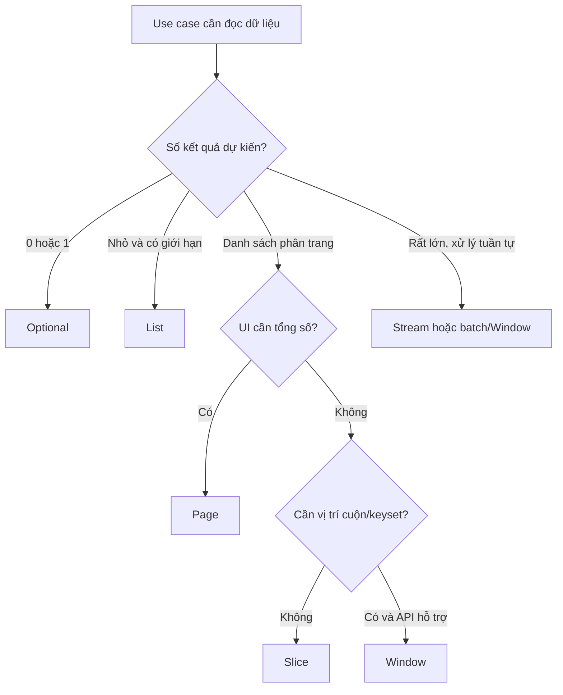

# Chọn Optional, List, Page, Slice, Stream hoặc Window theo hỗ trợ

## 1. Bài toán: không phải truy vấn nào cũng nên trả về List

Một ứng dụng quản lý đơn hàng dùng MongoDB có nhiều kiểu nhu cầu đọc: lấy đúng một đơn, hiển thị 20 đơn mới nhất, cho người dùng chuyển trang, xuất hàng trăm nghìn bản ghi hoặc đồng bộ dữ liệu theo từng đợt nhỏ. Nếu tất cả repository đều trả về `List<OrderDocument>`, chương trình có thể tải thừa dữ liệu, phải tự viết logic phân trang và khó kiểm soát bộ nhớ.

Trong **SPRING_DATA_MONGODB**, Spring Data MongoDB cung cấp `MongoRepository`, truy vấn dẫn xuất, `@Query` và `MongoTemplate` để kết nối, ánh xạ document và thao tác MongoDB. Các lựa chọn kiểu kết quả **Optional, List, Page, Slice, Stream và Window** biểu diễn những cam kết khác nhau về số phần tử, phân trang, trạng thái cursor và chi phí query. Việc chọn kiểu trả về là một phần của thiết kế access pattern, index, kiểm thử và hiệu năng, không chỉ là sở thích viết Java.

Chương **Phân trang và luồng** sẽ trả lời các câu hỏi:

1. Khi nào dùng `Optional<T>` thay vì trả entity hoặc danh sách?
2. Khi nào `List<T>` hợp lý, và làm thế nào giới hạn dữ liệu?
3. Vì sao `Page<T>` có thể tốn truy vấn đếm, còn `Slice<T>` chỉ cần thông tin còn trang sau?
4. `Stream<T>` liên quan gì đến cursor và tại sao phải đóng tài nguyên?
5. `Window<T>` và `ScrollPosition` khác offset pagination và server-side streaming ở điểm nào?
6. Làm sao chọn đúng API khi dự án dùng Spring Data MongoDB/driver phiên bản khác nhau?

**Nguyên tắc cốt lõi:** Bắt đầu từ hợp đồng nghiệp vụ: **0–1 kết quả, tập nhỏ hữu hạn, trang có tổng số, trang chỉ cần hasNext, luồng xử lý dài hoặc cửa sổ cuộn**. Sau đó mới chọn kiểu Java và index phù hợp.

## 2. So sánh nhanh sáu kiểu trả về

| Kiểu | Hợp đồng kết quả | Trường hợp phù hợp | Chi phí/lưu ý quan trọng |
| --- | --- | --- | --- |
| `Optional<T>` | Không có hoặc một phần tử | Tra cứu theo khóa duy nhất hoặc điều kiện tối đa một bản ghi | Không phù hợp nếu query có thể trả nhiều document |
| `List<T>` | Tập kết quả đã materialize | Danh sách nhỏ, có giới hạn rõ | Không có metadata phân trang; có nguy cơ tải quá nhiều |
| `Page<T>` | Nội dung trang cùng metadata tổng số | UI cần tổng số bản ghi/trang | Có thể phát sinh truy vấn count hoặc logic tính tổng |
| `Slice<T>` | Nội dung trang và biết còn trang sau không | Nút «Tải thêm», infinite scroll đơn giản | Không cung cấp tổng số; offset sâu vẫn tốn chi phí |
| `Stream<T>` | Xử lý tuần tự qua Java Stream | Export, batch đọc lớn, pipeline một lượt | Có thể giữ MongoDB cursor/tài nguyên; phải đóng |
| `Window<T>` | Một cửa sổ kết quả cùng vị trí tiếp tục | Scrolling theo offset/keyset trên API hỗ trợ | Cần `ScrollPosition`, sort ổn định; phụ thuộc phiên bản |

**Không có kiểu nào luôn tốt nhất.** Một `Page<T>` rất tiện cho màn hình quản trị cần «trang 3/42», nhưng việc đếm hàng triệu document có thể không cần thiết nếu giao diện chỉ có nút «Xem thêm». Một `Stream<T>` tránh tải tất cả kết quả vào một `List` nhưng không tự giải quyết nhu cầu hiển thị trang bất kỳ của người dùng.

### 2.1. Hai trục quyết định



Sơ đồ giúp chọn hướng khởi đầu. Sau đó phải xét tiếp dữ liệu biến động, offset sâu, tài nguyên cursor, concurrency, index và phiên bản thực tế.

## 3. Chuẩn bị dữ liệu mẫu và mô hình Java

Giả sử dịch vụ quản lý đơn hàng cho nhiều tenant. Một tenant cần xem đơn của mình, nhân viên kho cần xem đơn chờ giao và hệ thống xuất dữ liệu định kỳ.

### 3.1. Document mẫu trong mongosh

```javascript
db.orders.insertMany([
  {
    _id: "order-101",
    tenantId: "tenant-a",
    customerId: "customer-01",
    status: "READY_TO_SHIP",
    createdAt: ISODate("2026-11-18T08:00:00Z"),
    amountVnd: NumberLong("120000")
  },
  {
    _id: "order-102",
    tenantId: "tenant-a",
    customerId: "customer-02",
    status: "READY_TO_SHIP",
    createdAt: ISODate("2026-11-18T08:00:00Z"),
    amountVnd: NumberLong("150000")
  },
  {
    _id: "order-103",
    tenantId: "tenant-a",
    customerId: "customer-03",
    status: "SHIPPED",
    createdAt: ISODate("2026-11-19T10:00:00Z"),
    amountVnd: NumberLong("270000")
  },
  {
    _id: "order-104",
    tenantId: "tenant-b",
    customerId: "customer-04",
    status: "READY_TO_SHIP",
    createdAt: ISODate("2026-11-20T02:00:00Z"),
    amountVnd: NumberLong("320000")
  }
]);
```

Chỉ chạy trên collection thử nghiệm trống hoặc thay ID để tránh lỗi trùng khóa. Điểm cần quan sát: hai đơn `order-101` và `order-102` cùng `createdAt`, còn `order-104` thuộc tenant khác và không được xuất hiện trong danh sách của `tenant-a`.

### 3.2. Entity Java

```java
import java.time.Instant;
import org.springframework.data.mongodb.core.mapping.Document;
import org.springframework.data.mongodb.core.mapping.FieldType;
import org.springframework.data.mongodb.core.mapping.MongoId;

@Document(collection = "orders")
public record OrderDocument(
    @MongoId(FieldType.STRING) String id,
    String tenantId,
    String customerId,
    String status,
    Instant createdAt,
    long amountVnd
) {}
```

`@MongoId(FieldType.STRING)` giúp giữ `_id` là BSON String theo chủ đích. Tên property Java `id` tương ứng trường BSON `_id`. Khi viết truy vấn bằng `MongoTemplate` gắn `OrderDocument.class`, Spring Data dùng metadata để ánh xạ đường dẫn field.

Các ví dụ về repository bên dưới là **những biến thể độc lập** của hợp đồng đọc; không nên khai báo tất cả interface cùng tên hoặc tạo bean thừa chỉ để chạy các ví dụ trong một ứng dụng production.

## 4. Optional<T>: truy vấn có tối đa một kết quả

### 4.1. Tìm một đơn đúng ID và tenant

```java
import java.util.Optional;
import org.springframework.data.repository.Repository;

public interface OrderLookupRepository
    extends Repository<OrderDocument, String> {

    Optional<OrderDocument> findByTenantIdAndId(
        String tenantId,
        String id
    );
}
```

Ví dụ gọi:

```java
Optional<OrderDocument> maybeOrder =
    repository.findByTenantIdAndId("tenant-a", "order-101");

OrderDocument order = maybeOrder.orElseThrow(
    () -> new IllegalArgumentException("Không tìm thấy đơn phù hợp")
);
```

`repository` trong snippet là bean `OrderLookupRepository` đã được inject. Nếu không có kết quả, contract trả về `Optional.empty()`; nếu tìm thấy đúng một kết quả, `Optional.of(entity)`. Với phương thức `findByTenantIdAndId`, cặp điều kiện ràng buộc cả tenant và ID.

**Lưu ý về bảo mật:** Tham số `tenantId` phải đến từ authentication/authorization context đáng tin cậy, không phải giá trị tùy ý do client gửi.

### 4.2. Optional không có nghĩa «tự chọn một kết quả bất kỳ»

`Optional<T>` thích hợp khi thiết kế query có **tối đa một** document, ví dụ tìm theo `_id` hoặc một unique index được bảo đảm. Nếu query thực tế trả nhiều document mà repository được khai báo trả một entity/Optional, Spring Data có thể báo lỗi kiểu không duy nhất thay vì âm thầm chọn document đầu tiên.

Muốn «một đơn mới nhất» trong số nhiều đơn, hãy nói rõ:

```java
Optional<OrderDocument>
findFirstByTenantIdAndCustomerIdOrderByCreatedAtDescIdDesc(
    String tenantId, String customerId
);
```

`findFirst...OrderBy...` biểu đạt chính sách chọn bản ghi. Nếu dữ liệu có thể trùng thời điểm, thêm `IdDesc` làm khóa phá hòa. Không chọn theo «thứ tự tự nhiên» của collection.

### 4.3. Optional khác Mono

`Optional<T>` là container đồng bộ của Java cho kết quả 0–1. Với Spring Data MongoDB reactive, hợp đồng thường tương ứng `Mono<T>`, không phải `Optional<Mono<T>>`. Sự khác biệt giữa imperative và reactive được trình bày ở mục 12.

## 5. List<T>: kết quả hữu hạn đã materialize

### 5.1. Khi nào List hợp lý?

`List<T>` dễ sử dụng khi:

- Tập kết quả **nhỏ và có giới hạn** như 10 trạng thái cấu hình hoặc 20 đơn mới nhất.
- Caller muốn duyệt lại tập dữ liệu nhiều lần trong bộ nhớ.
- Không cần tổng số, hasNext hoặc vị trí tiếp tục.

Ví dụ một phương thức repository có giới hạn ngay trong tên:

```java
import java.util.List;
import org.springframework.data.repository.Repository;

public interface OrderRecentRepository
    extends Repository<OrderDocument, String> {

    List<OrderDocument>
    findTop20ByTenantIdAndStatusOrderByCreatedAtDescIdDesc(
        String tenantId, String status
    );
}
```

`Top20` giới hạn số phần tử được lấy. Có thể dùng `First20` với ý nghĩa giới hạn tương tự trong query derivation. Điều kiện tenant/status và thứ tự sort được xác định rõ.

### 5.2. List không có metadata trang

Khi nhận `List` 20 phần tử, caller không thể biết chắc **còn kết quả thứ 21 hay không** chỉ từ danh sách đó. Nếu một trang có đủ 20 phần tử, điều đó không đủ kết luận còn trang sau. Muốn thông tin `hasNext`, hãy dùng `Slice` hoặc `Window` (khi hỗ trợ), hoặc viết cơ chế lấy thêm một phần tử.

### 5.3. Rủi ro List không giới hạn

```java
// Tránh dùng cho collection lớn nếu không có giới hạn nghiệp vụ:
List<OrderDocument> findByTenantId(String tenantId);
```

Method này có thể đưa nhiều document vào bộ nhớ ứng dụng, gây tăng heap, latency và GC. MongoDB cursor ở bên dưới không làm cho `List` tự trở thành streaming: kết quả cuối cùng vẫn được materialize trước khi trả.

Ngay cả khi có `Pageable` trên một method trả `List`, kiểu trả về vẫn không cung cấp tổng số hay `hasNext`; giới hạn query phải được kiểm tra và test.

## 6. Page<T>: khi người dùng thực sự cần tổng số

### 6.1. Hợp đồng Page

`Page<T>` đại diện cho một trang và metadata như:

- `getContent()`: document của trang hiện tại.
- `getNumber()`: chỉ số trang, thông thường bắt đầu từ 0.
- `getSize()`: kích thước trang được yêu cầu.
- `getTotalElements()`: tổng số bản ghi khớp filter.
- `getTotalPages()`: tổng số trang theo kích thước.
- `hasNext()`: còn trang sau theo metadata trang.

Màn hình quản trị hiển thị «Trang 3/48» hoặc «Có 943 đơn hàng» có thể cần `Page<T>`.

### 6.2. Repository trả về Page

```java
import org.springframework.data.domain.Page;
import org.springframework.data.domain.Pageable;
import org.springframework.data.repository.Repository;

public interface OrderPageRepository
    extends Repository<OrderDocument, String> {

    Page<OrderDocument> findByTenantIdAndStatus(
        String tenantId,
        String status,
        Pageable pageable
    );
}
```

Gọi trang đầu:

```java
import org.springframework.data.domain.PageRequest;
import org.springframework.data.domain.Sort;

PageRequest request = PageRequest.of(
    0,
    20,
    Sort.by(
        Sort.Order.desc("createdAt"),
        Sort.Order.desc("id")
    )
);

Page<OrderDocument> page =
    repository.findByTenantIdAndStatus(
        "tenant-a", "READY_TO_SHIP", request
    );

System.out.println(page.getTotalElements());
System.out.println(page.getTotalPages());
```

Ở đây `repository` là bean `OrderPageRepository` đã được inject. Phần sort sử dụng property Java `id`; trong BSON, field tương ứng là `_id`.

### 6.3. Page có thể cần truy vấn count

Để biết tổng số, Spring Data có thể thực hiện thêm một truy vấn đếm theo filter. Một số cách triển khai có thể tối ưu bỏ qua count khi số kết quả đã đủ suy ra tổng (ví dụ trang cuối không đầy). Vì thế, câu nói chính xác là **Page có thể phát sinh thêm chi phí count**, không phải mọi lần gọi Page đều nhất định chạy đúng hai lệnh.

Với tập dữ liệu lớn, truy vấn count có thể là chi phí đáng kể, nhất là filter phức tạp. Nếu UI không hiển thị tổng số/trang, cân nhắc `Slice<T>`.

### 6.4. Tổng số không phải ảnh chụp nhất quán mặc định

Trong thời gian thực hiện truy vấn nội dung và truy vấn count, các document có thể được thêm/xóa. Đừng mặc định `Page.getTotalElements()` và `Page.getContent()` luôn mô tả **cùng một snapshot dữ liệu** khi có ghi đồng thời. Nếu nghiệp vụ cần một ảnh chụp nhất quán nghiêm ngặt, phải thiết kế isolation/read concern/transaction phù hợp với hệ thống, không thể chỉ đổi kiểu trả về thành `Page`.

## 7. Slice<T>: trang chỉ cần biết còn phần tiếp theo

### 7.1. Slice trả gì?

`Slice<T>` cung cấp nội dung hiện tại, chỉ số trang, kích thước và thông tin như `hasNext()`. Nó **không cam kết tổng số bản ghi** và không cung cấp `getTotalPages()` như Page.

Trong cơ chế phân trang thông dụng, hệ thống có thể yêu cầu `pageSize + 1` phần tử để xác định còn trang sau mà không cần count toàn bộ. Việc có chính xác một lệnh truy vấn hay cách tối ưu cụ thể vẫn phụ thuộc Spring Data MongoDB và phiên bản đang dùng.

### 7.2. Repository trả về Slice

```java
import org.springframework.data.domain.Pageable;
import org.springframework.data.domain.Slice;
import org.springframework.data.repository.Repository;

public interface OrderSliceRepository
    extends Repository<OrderDocument, String> {

    Slice<OrderDocument> findByTenantIdAndStatus(
        String tenantId,
        String status,
        Pageable pageable
    );
}
```

Sử dụng:

```java
var first = repository.findByTenantIdAndStatus(
    "tenant-a", "READY_TO_SHIP",
    PageRequest.of(
        0, 20,
        Sort.by(Sort.Order.desc("createdAt"), Sort.Order.desc("id"))
    )
);

for (OrderDocument item : first.getContent()) {
    System.out.println(item.id());
}
if (first.hasNext()) {
    var next = repository.findByTenantIdAndStatus(
        "tenant-a", "READY_TO_SHIP",
        first.nextPageable()
    );
}
```

Ví dụ giả định `repository` là bean `OrderSliceRepository` đã inject, và imports `PageRequest`, `Sort` như mục 6. Cơ chế `nextPageable()` tạo yêu cầu trang tiếp theo theo cùng cách phân trang.

### 7.3. Slice không tự giải quyết offset sâu

`PageRequest.of(5000, 20, sort)` tương đương yêu cầu bỏ qua rất nhiều document trước khi lấy 20 document kế tiếp. Dù không count tổng, server vẫn có thể phải đi qua lượng dữ liệu lớn để thực hiện offset. Khi người dùng liên tục cuộn sâu, cân nhắc **keyset scrolling** bằng `Window<T>` hoặc cơ chế cursor tự thiết kế.

Nếu ứng dụng cần nhảy trực tiếp đến «trang 120» thì offset pagination vẫn có ưu điểm; lựa chọn nên dựa trên nhu cầu UI, tải thực tế và tính ổn định mong muốn.

## 8. Stream<T>: xử lý tuần tự thay vì tải mọi phần tử vào List

### 8.1. Khi nào Stream hữu ích?

`Stream<T>` phù hợp với tác vụ cần duyệt lượng lớn dữ liệu một lần: export CSV, kiểm kê, xử lý ETL hoặc chuẩn bị batch. Một số phương thức streaming của Spring Data có thể sử dụng cursor giữ kết nối/tài nguyên trong thời gian đọc.

Ví dụ repository:

```java
import java.util.stream.Stream;
import org.springframework.data.repository.Repository;

public interface OrderStreamRepository
    extends Repository<OrderDocument, String> {

    Stream<OrderDocument> streamByTenantId(String tenantId);
}
```

Ví dụ sử dụng đúng vòng đời:

```java
try (Stream<OrderDocument> orders =
         repository.streamByTenantId("tenant-a")) {
    orders.forEach(order -> {
        // Xử lý từng bản ghi; tránh gom lại toàn bộ vào List.
        process(order);
    });
}
```

`repository` là bean `OrderStreamRepository`; `process(order)` là phương thức nghiệp vụ do ứng dụng triển khai. **Đóng Stream** bằng try-with-resources là điều quan trọng vì stream có thể gắn với MongoDB cursor và các tài nguyên liên quan. Không nên trả một Stream còn mở ra ngoài phạm vi service rồi hy vọng controller/serializer sẽ đóng đúng lúc.

### 8.2. Stream không phải thứ tự tùy ý

Nếu logic export đòi thứ tự, phải khai báo sort tường minh trong truy vấn; không giả định MongoDB trả dữ liệu theo thứ tự insert hay `_id`.

Ngoài ra, `Stream<T>` có thể vẫn sử dụng một số bộ đệm/cursor batch ở driver. «Streaming» không đồng nghĩa từng byte từ server đi vào Java mà không có bất kỳ buffer nào, cũng không bảo đảm bộ nhớ dùng là hằng số nếu pipeline gọi `collect(toList())` hoặc giữ lại kết quả trong cache.

### 8.3. MongoTemplate.stream và CloseableIterator

Với `MongoTemplate`, có thể dùng `stream` để quản lý cursor rõ ràng:

```java
import org.springframework.data.util.CloseableIterator;
import org.springframework.data.mongodb.core.query.Criteria;
import org.springframework.data.mongodb.core.query.Query;

Query query = Query.query(
    Criteria.where("tenantId").is("tenant-a")
);

try (CloseableIterator<OrderDocument> cursor =
         mongoTemplate.stream(query, OrderDocument.class)) {
    while (cursor.hasNext()) {
        OrderDocument order = cursor.next();
        process(order);
    }
}
```

Ví dụ giả định `mongoTemplate` đã inject và `process` tồn tại trong service. Một `CloseableIterator` cho phép đóng tài nguyên tường minh ngay cả khi processing throw exception.

### 8.4. Quản lý tài nguyên và lỗi giữa chừng

Khi streaming tập dữ liệu lớn:

- Giới hạn thời gian chạy, đánh giá cursor timeout và mạng không ổn định.
- Không giữ MongoDB cursor vô hạn để đợi một API ngoài phản hồi chậm.
- Xử lý backpressure ở tầng ứng dụng hoặc chia thành batch có checkpoint nếu tác vụ dài.
- Xác định **idempotency** nếu tác vụ lỗi và phải khởi động lại.
- Đảm bảo đóng stream/cursor trên cả đường thành công và exception.
- Tránh phụ thuộc vào lazy reference gây các truy vấn bổ sung cho từng phần tử.

Đối với export rất dài cần resume, **Window/keyset hoặc batch có checkpoint** có thể đáng tin cậy hơn một cursor mở liên tục. Stream không tự cung cấp vị trí resume bền vững sau khi process bị dừng.

## 9. Window<T>: một cửa sổ kết quả có vị trí tiếp tục

### 9.1. Window khác Page và Stream ở đâu?

`Window<T>` là khái niệm dùng với **Scroll API** của các phiên bản Spring Data hỗ trợ scrolling. Nó trả một tập kết quả **có giới hạn** và cung cấp cách lấy `ScrollPosition` để gọi cửa sổ kế tiếp.

Một Window:

- Không nhất thiết cung cấp tổng số toàn bộ kết quả như `Page`.
- Có thông tin như `hasNext()` và vị trí tại phần tử đã đọc.
- Cho phép **offset scrolling** hoặc **keyset scrolling**, tùy cách khởi tạo `ScrollPosition`.
- Không đồng nghĩa với một Java `Stream`/MongoDB cursor phải để mở xuyên suốt nhiều lần gọi.

**Điều kiện quan trọng:** `Window<T>` và `ScrollPosition` không phải API có mặt ở tất cả các thế hệ Spring Data MongoDB. Đặc biệt với dự án cũ, hãy kiểm tra phiên bản Spring Data Commons/MongoDB thực tế và chữ ký query method/`MongoTemplate.scroll(...)` trước khi sao chép ví dụ.

### 9.2. Một repository scrolling theo keyset

Trong phiên bản Spring Data MongoDB có hỗ trợ derived query trả về `Window<T>`, có thể khai báo:

```java
import org.springframework.data.domain.ScrollPosition;
import org.springframework.data.domain.Window;
import org.springframework.data.repository.Repository;

public interface OrderWindowRepository
    extends Repository<OrderDocument, String> {

    Window<OrderDocument>
    findFirst20ByTenantIdAndStatusOrderByCreatedAtDescIdDesc(
        String tenantId,
        String status,
        ScrollPosition position
    );
}
```

`First20` đặt kích thước tối đa của cửa sổ. Phần `OrderByCreatedAtDescIdDesc` tạo thứ tự ổn định theo `createdAt DESC, id DESC`. Khi Spring Data ánh xạ entity, `id` tương ứng BSON `_id`.

Đây là **ví dụ phụ thuộc khả năng của phiên bản**: nếu thư viện chưa hỗ trợ `Window`/scrolling cho repository MongoDB, dùng `Slice`/`Page` hoặc query thủ công với `MongoTemplate` ở phiên bản tương thích.

### 9.3. Lặp qua các cửa sổ

```java
ScrollPosition position = ScrollPosition.keyset();

while (true) {
    Window<OrderDocument> window =
        repository.findFirst20ByTenantIdAndStatusOrderByCreatedAtDescIdDesc(
            "tenant-a", "READY_TO_SHIP", position
        );

    if (window.isEmpty()) {
        break;
    }

    for (OrderDocument order : window) {
        process(order);
    }

    if (!window.hasNext()) {
        break;
    }

    position = window.positionAt(window.size() - 1);
}
```

`repository` là bean `OrderWindowRepository` đã inject; method `process` do ứng dụng cung cấp. `ScrollPosition.keyset()` biểu diễn điểm khởi đầu khi dùng keyset; `window.positionAt(...)` lấy vị trí gắn với **phần tử cuối đã xử lý**.

Ví dụ kiểm tra `window.isEmpty()` trước khi dùng `size()-1` để tránh truy cập chỉ số âm. Việc sử dụng position của phần tử cuối đúng theo contract scrolling giúp tránh lỗi lặp lại phần tử đầu của cửa sổ sau.

### 9.4. ScrollPosition.offset() khác PageRequest

`ScrollPosition.offset()` là vị trí bắt đầu cho **offset scrolling** trên Scroll API. Nó không phải `PageRequest.of(0, 20)` và không mang metadata tổng số trang. Các offset position tiếp theo thường được tạo từ kết quả của Window.

Điều cần nhớ là vị trí cuộn thường biểu diễn **điểm trước/sau một phần tử theo contract của Scroll API**, khác với «chỉ số trang» của Page. Khi tự tạo offset có số cụ thể, hãy kiểm tra semantics exclusive/start position của phiên bản để tránh lỗi lệch một phần tử. Với trang đầu, ưu tiên factory `ScrollPosition.offset()` thay vì tự đoán vị trí số.

## 10. Offset pagination và keyset scrolling khác nhau như thế nào?

### 10.1. Offset: bỏ qua N bản ghi

Truy vấn MongoDB điển hình:

```javascript
db.orders.find({
  tenantId: "tenant-a",
  status: "READY_TO_SHIP"
})
  .sort({ createdAt: -1, _id: -1 })
  .skip(10000)
  .limit(20);
```

Server phải xử lý vị trí của những bản ghi trước đó theo kế hoạch truy vấn; offset càng sâu càng có nguy cơ tốn công. Offset dễ dùng khi UI cần đến trang bất kỳ, nhưng không tối ưu tự nhiên cho việc cuộn vô tận tới hàng trăm nghìn phần tử.

### 10.2. Keyset: lấy các bản ghi sau khóa cuối đã xem

Giả sử trang trước kết thúc ở:

```text
createdAt = 2026-11-18T08:00:00Z
_id       = "order-102"
```

Khi sort **giảm dần** theo `createdAt` và `_id`, một truy vấn tiếp tục minh họa là:

```javascript
const lastCreatedAt = ISODate("2026-11-18T08:00:00Z");
const lastId = "order-102";

db.orders.find({
  tenantId: "tenant-a",
  status: "READY_TO_SHIP",
  $or: [
    { createdAt: { $lt: lastCreatedAt } },
    {
      createdAt: lastCreatedAt,
      _id: { $lt: lastId }
    }
  ]
})
  .sort({ createdAt: -1, _id: -1 })
  .limit(20);
```

Mệnh đề `$or` biểu diễn thứ tự từ điển theo cặp `(createdAt DESC, _id DESC)`: lấy bản ghi cũ hơn, hoặc có cùng thời gian nhưng ID đứng sau theo chiều giảm. Với `Window` keyset, framework có thể dựng điều kiện tương đương từ `ScrollPosition` và metadata sort thay vì developer phải viết tay.

**Điều kiện:** Sort phải ổn định, xác định đầy đủ đường đi tiếp tục và có giá trị khóa phù hợp. Nếu khóa sort có `null`/missing hoặc kiểu BSON trộn lẫn, keyset scrolling có thể không hoạt động đúng như kỳ vọng. Các thuộc tính dùng trong keyset phải được đọc/chiếu ra theo cách framework có thể trích xuất để tạo position kế tiếp.

### 10.3. Bảng quyết định

| Tiêu chí | Offset | Keyset |
| --- | --- | --- |
| Nhảy đến trang thứ N | Dễ hơn | Không tự hỗ trợ nhảy tùy ý |
| Cuộn tuần tự rất sâu | Có thể tốn công với `skip` lớn | Thường hiệu quả hơn nếu có index khớp |
| Cần khóa sort ổn định | Rất nên có | Bắt buộc để tiếp tục đúng vị trí |
| Dễ diễn giải cursor | Số offset | Các giá trị khóa cuối đã đọc |
| Dữ liệu thêm/xóa đồng thời | Có thể lặp/bỏ sót do dịch offset | Giảm một số vấn đề dịch offset; vẫn không phải snapshot |
| Dữ liệu bị sửa khóa sort | Có thể đổi vị trí | Có thể đổi vị trí và gây lặp/bỏ sót |
| Tổng số bản ghi | Không tự có | Không tự có |

**Keyset không phải snapshot isolation.** Nếu đơn hàng được chèn/xóa hoặc thay `createdAt` trong khi người dùng cuộn, danh sách giữa các lần gọi vẫn có thể thay đổi. Những yêu cầu nhất quán mạnh phải được thiết kế riêng.

## 11. Index và projection cho Page, Slice và Window

### 11.1. Index theo filter và thứ tự

Với query:

```javascript
db.orders.find({
  tenantId: "tenant-a",
  status: "READY_TO_SHIP"
})
  .sort({ createdAt: -1, _id: -1 })
  .limit(20);
```

Một index dự kiến:

```javascript
db.orders.createIndex(
  { tenantId: 1, status: 1, createdAt: -1, _id: -1 },
  { name: "ix_orders_tenant_status_recent" }
);
```

Hai field đầu được lọc equality, sau đó là các trường dùng để sắp xếp. Index này có thể hỗ trợ `Page`, `Slice` và `Window` cùng query shape. Chỉ số trang, kiểu kết quả và cách lấy tiếp theo **không tự tạo index mới**.

Không nên suy ra `Page`/`Slice`/`Window` luôn có cùng chi phí: `Page` có thể cần count, `Slice` có thể lấy thêm một bản ghi, và keyset Window có điều kiện tiếp tục dựa trên sort keys.

### 11.2. Giữ sort keys trong projection khi cuộn

Trang danh sách thường chỉ hiển thị ID, trạng thái và thời gian:

```java
import java.time.Instant;

public interface OrderSummary {
    String getId();
    String getStatus();
    Instant getCreatedAt();
}
```

Nếu dùng **keyset scrolling**, các trường cần cho sort và khóa duy nhất phải được framework lấy ra để trích xuất vị trí tiếp tục. Một projection chỉ lấy `status` nhưng bỏ `createdAt` và `id` có thể làm việc tạo keyset position thất bại hoặc không đúng. Khi tùy biến field selection, hãy kiểm tra BSON projection thực tế và thử cuộn nhiều cửa sổ liên tiếp.

### 11.3. Dùng explain để xác minh chi phí

```javascript
db.orders.find({
  tenantId: "tenant-a",
  status: "READY_TO_SHIP"
})
  .sort({ createdAt: -1, _id: -1 })
  .limit(20)
  .explain("executionStats");
```

Quan sát `winningPlan`, `IXSCAN`/`COLLSCAN`, `totalKeysExamined`, `totalDocsExamined`, `nReturned` và stage sort. Với offset lớn, so sánh `skip(10000)` với truy vấn keyset tương ứng trên dữ liệu thực tế. Đừng chỉ đo bằng collection có bốn bản ghi mẫu vì sự khác biệt hiệu năng sẽ không rõ.

## 12. Cách chọn khi dùng Reactive MongoDB

Spring Data MongoDB có hai hướng lập trình phổ biến:

| Imperative | Reactive tương ứng về ý định |
| --- | --- |
| `Optional<T>` | `Mono<T>` cho 0–1 kết quả |
| `List<T>` | `Flux<T>` cho chuỗi kết quả, có thể thu về List khi thật sự cần |
| `Page<T>` | Không mặc định thay bằng `Flux<T>` và vẫn có total count |
| `Slice<T>` | Cần API/cơ chế phân trang cụ thể; `Flux<T>` không tự có hasNext |
| `Stream<T>` | `Flux<T>` hỗ trợ xử lý bất đồng bộ/backpressure theo Reactive Streams |
| `Window<T>` | Khả năng scrolling reactive phụ thuộc phiên bản/module; kiểm tra API thực tế |

Ví dụ reactive repository:

```java
import org.reactivestreams.Publisher;
import reactor.core.publisher.Flux;
import reactor.core.publisher.Mono;
import org.springframework.data.mongodb.repository.ReactiveMongoRepository;

public interface ReactiveOrderRepository
    extends ReactiveMongoRepository<OrderDocument, String> {

    Mono<OrderDocument> findByTenantIdAndId(
        String tenantId, String id
    );

    Flux<OrderDocument>
    findFirst20ByTenantIdAndStatusOrderByCreatedAtDescIdDesc(
        String tenantId, String status
    );
}
```

Ví dụ import `Publisher` chỉ nhằm cho thấy hệ sinh thái Reactive Streams; interface này dùng `Mono` và `Flux`, không cần tự tạo thêm một Java `Stream`. Nếu muốn hợp đồng reactive hẹp, có thể thiết kế interface từ `ReactiveRepository` thay vì kế thừa toàn bộ CRUD.

### 12.1. Flux không tự cung cấp tổng số hoặc cursor resume

Một `Flux<OrderDocument>` cho phép xử lý dữ liệu theo luồng bất đồng bộ. Nhưng nó không tự đồng nghĩa với:

- Tổng số bản ghi trên mọi trang.
- `hasNext` của một trang có kích thước 20.
- Vị trí keyset có thể lưu để resume sau khi process dừng.
- Transaction/snapshot kéo dài qua nhiều lần subscribe.

Nếu UI cần tổng số, cần truy vấn count riêng hoặc một API phù hợp. Nếu cần checkpoint, thiết kế cursor/keyset hoặc pipeline xử lý batch tường minh. Đừng dùng `collectList()` trên một Flux không giới hạn rồi kết luận đã streaming tiết kiệm bộ nhớ.

### 12.2. Không trộn blocking và reactive tùy tiện

Tránh gọi `block()` để biến một pipeline reactive thành imperative ở các đường xử lý cần non-blocking, hoặc tạo `Stream<T>` rồi đưa sang reactive mà không quản lý cursor và vòng đời tài nguyên. Việc dùng `ReactiveMongoTemplate`, driver reactive và Flux phù hợp với toàn bộ application stack hơn các thao tác chuyển đổi chắp vá.

## 13. Trường hợp dùng MongoTemplate thay cho repository

Repository tiện khi query shape có thể mô tả rõ bằng method. `MongoTemplate` hữu ích khi bộ lọc/sort/projection được dựng động có kiểm soát, cần streaming cursor hoặc triển khai scroll API theo phiên bản hỗ trợ.

### 13.1. Lấy một danh sách có limit

```java
import org.springframework.data.domain.Sort;
import org.springframework.data.mongodb.core.query.Criteria;
import org.springframework.data.mongodb.core.query.Query;

Query query = Query.query(
    Criteria.where("tenantId").is("tenant-a")
        .and("status").is("READY_TO_SHIP")
);
query.with(Sort.by(
    Sort.Order.desc("createdAt"),
    Sort.Order.desc("id")
));
query.limit(20);

var orders = mongoTemplate.find(query, OrderDocument.class);
```

Đây là `List<OrderDocument>` có giới hạn, không có tổng số hay `hasNext`. Nếu muốn `Slice`, cần lấy thêm bản ghi hoặc dùng API repository cung cấp trực tiếp.

### 13.2. Nếu phiên bản hỗ trợ MongoTemplate.scroll

Trong thế hệ Spring Data MongoDB có Scroll API cho `MongoTemplate`, pattern có thể là:

```java
import org.springframework.data.domain.ScrollPosition;
import org.springframework.data.domain.Sort;
import org.springframework.data.domain.Window;
import org.springframework.data.mongodb.core.query.Criteria;
import org.springframework.data.mongodb.core.query.Query;

Query query = Query.query(
    Criteria.where("tenantId").is("tenant-a")
        .and("status").is("READY_TO_SHIP")
);
query.with(Sort.by(
    Sort.Order.desc("createdAt"),
    Sort.Order.desc("id")
));
query.limit(20);
query.with(ScrollPosition.keyset());

Window<OrderDocument> window =
    mongoTemplate.scroll(query, OrderDocument.class);
```

Sau đó dùng `window.hasNext()` và `window.positionAt(window.size() - 1)` khi tiếp tục. Với lần gọi tiếp theo, cần xây/cập nhật Query sao cho cùng filter, sort và limit, nhưng dùng vị trí mới thay vì luôn bắt đầu từ `ScrollPosition.keyset()`. Hãy kiểm tra hành vi của API `Query.with(ScrollPosition)` trong đúng phiên bản để tránh vô tình cộng dồn hai vị trí không mong muốn.

Nếu `MongoTemplate.scroll` chưa tồn tại ở phiên bản dự án, đừng cố gán kiểu `Window<T>` cho `find(...)`. Có thể chọn repository `Slice` hoặc viết keyset filter tường minh bằng Criteria như mục 10.

### 13.3. Page tự dựng đòi hỏi xác định câu count

Nếu service tự viết một `Page` bằng `MongoTemplate`, cần tách **query nội dung** (sort, skip, limit, projection) khỏi **query count** (cùng filter logic nhưng không mang giới hạn trang). Ví dụ về ý tưởng:

```java
Query filter = Query.query(
    Criteria.where("tenantId").is("tenant-a")
        .and("status").is("READY_TO_SHIP")
);

long total = mongoTemplate.count(filter, OrderDocument.class);

Query contentQuery = Query.query(
    Criteria.where("tenantId").is("tenant-a")
        .and("status").is("READY_TO_SHIP")
);
contentQuery.with(PageRequest.of(
    0, 20,
    Sort.by(Sort.Order.desc("createdAt"), Sort.Order.desc("id"))
));

var content = mongoTemplate.find(contentQuery, OrderDocument.class);
```

Ví dụ cần imports `PageRequest`, `Sort`, `Criteria` và `Query` như các mục trước. Nếu ứng dụng tự tạo `PageImpl`, phải xử lý tổng số và các thay đổi đồng thời theo nghiệp vụ; không giả định lấy count và content là một snapshot nguyên tử.

## 14. Những rủi ro khi dữ liệu thay đổi trong lúc phân trang

Giả sử tenant có 1.000 đơn, sắp theo `createdAt DESC, _id DESC`. Sau khi client lấy trang 1, một đơn mới được thêm vào đầu danh sách.

**Offset pagination:** Khi client gọi `skip(20)`, các vị trí có thể đã dịch. Bản ghi cuối trang 1 có thể xuất hiện lại ở trang 2 hoặc một bản ghi bị bỏ qua.

**Keyset scrolling:** Vì cursor dựa trên giá trị khóa cuối trang 1, một bản ghi mới có khóa lớn hơn cursor thường không làm dịch ranh giới tìm các bản ghi cũ hơn. Nhưng nếu document bị sửa trường sort, bị xóa hoặc business filter thay đổi (ví dụ status chuyển từ READY_TO_SHIP sang SHIPPED), kết quả vẫn có thể khác giữa các cửa sổ.

**Streaming cursor:** Việc giữ cursor không tự bảo đảm isolation/snapshot mạnh cho toàn bộ hoạt động xử lý, nhất là tác vụ dài. Không được hứa «mỗi bản ghi đúng một lần» chỉ vì dùng Stream hoặc Flux.

Nếu cần xuất toàn bộ dữ liệu theo một mốc cố định, cân nhắc một cutoff thời gian/ID, state snapshot hoặc cơ chế xử lý batch có checkpoint và idempotency; yêu cầu nhất quán cao có thể cần thiết kế transaction/read concern tùy môi trường.

## 15. Thiết kế API theo nhu cầu thật

| Use case | Khuyến nghị khởi đầu | Vì sao |
| --- | --- | --- |
| Xem một đơn theo khóa | `Optional<OrderDocument>` | Mô tả 0–1 kết quả |
| Hiển thị top 10 đơn mới nhất | `List<OrderDocument>` có `Top10` | Tập nhỏ, rõ giới hạn |
| Bảng admin có tổng số đơn/trang | `Page<OrderDocument>` | Cần total metadata |
| Nút «Xem thêm» theo trang nhỏ | `Slice<OrderSummary>` | Không cần truy vấn tổng số |
| Infinite scroll rất sâu, index thích hợp | `Window<OrderSummary>` với keyset nếu hỗ trợ | Có vị trí tiếp tục theo khóa |
| Export hàng trăm nghìn đơn | `Stream<OrderDocument>` hoặc batch keyset | Không materialize toàn bộ; cần quản lý tài nguyên |
| Dịch vụ reactive cần xử lý bất đồng bộ | `Mono<T>`/`Flux<T>` | Hợp đồng reactive, không tự có metadata page |
| Báo cáo tổng hợp doanh thu | Aggregation/projection thích hợp | Không nhất thiết tải từng document đầy đủ |

Đây không phải quy tắc tuyệt đối. Ví dụ export có yêu cầu resume tốt có thể dùng Window theo batch thay vì Stream; một báo cáo cần tổng số có thể dùng aggregation đếm riêng thay vì Page. Quyết định cuối cùng cần dựa trên tần suất, quy mô, SLA, tính nhất quán và các phiên bản API thực tế.

## 16. Kiểm thử từng hợp đồng kết quả

### 16.1. Kiểm thử Optional

- ID tồn tại đúng tenant → `Optional.isPresent()`.
- ID không tồn tại → `Optional.empty()`.
- ID ở tenant khác → không trả dữ liệu.
- Query chỉ nên trả một document; nếu nhiều kết quả, phát hiện sai contract thay vì chọn bừa.

### 16.2. Kiểm thử List

- `Top20` không trả quá 20 kết quả.
- Với dữ liệu nhiều hơn 20, danh sách tuân thứ tự đã khai báo.
- Không lấy dữ liệu tenant khác.
- Không có cam kết `hasNext` hoặc total metadata.

### 16.3. Kiểm thử Page

- `getContent()` đúng thứ tự và kích thước.
- `getTotalElements()` phù hợp dữ liệu test.
- Trang cuối, trang trống, trang ngoài phạm vi trả kết quả theo contract.
- Truy vấn count không bị lệch filter tenant/status.
- Benchmark xác định count có tốn chi phí đáng kể trong dữ liệu lớn hay không.

### 16.4. Kiểm thử Slice

- N phần tử và đúng N phần tử còn lại → `hasNext` phản ánh chính xác.
- Trang cuối có ít hơn N phần tử → không còn trang tiếp.
- Trang có đúng N bản ghi trên toàn dataset → không suy đoán có trang sau.
- Offset sâu và sort không ổn định được phát hiện qua test với nhiều dữ liệu.

### 16.5. Kiểm thử Stream

- Stream/cursor được đóng khi hoàn tất và khi `process` ném exception.
- Không tích lũy toàn bộ kết quả vào bộ nhớ.
- Có chính sách lỗi giữa chừng, retry và idempotency.
- Query có filter và sort phù hợp, tránh resolve reference cho mỗi phần tử khi không cần.

### 16.6. Kiểm thử Window

- Trang đầu khởi tạo bằng `ScrollPosition.keyset()` hoặc `offset()` đúng contract.
- Các cửa sổ nối tiếp không trùng/bỏ sót khi dữ liệu test **không đổi**.
- Hai bản ghi cùng `createdAt` được phân biệt bằng `id`.
- `positionAt(lastIndex)` chỉ gọi khi Window không rỗng.
- Projection có đủ keyset fields.
- Empty Window, cửa sổ cuối và `hasNext()` được xử lý.
- Kiểm tra behavior sau nâng cấp Spring Data, nhất là scroll API và mapping ID.

### 16.7. Ví dụ JUnit cho thứ tự và phân trang

Đoạn sau minh họa phần assertion khi repository và dataset test đã được khởi tạo; không phải class test hoàn chỉnh:

```java
import static org.junit.jupiter.api.Assertions.*;
import org.junit.jupiter.api.Test;
import org.springframework.data.domain.PageRequest;
import org.springframework.data.domain.Sort;

@Test
void sliceMustRespectTenantAndStableSort() {
    var first = sliceRepository.findByTenantIdAndStatus(
        "tenant-a",
        "READY_TO_SHIP",
        PageRequest.of(
            0, 2,
            Sort.by(Sort.Order.desc("createdAt"), Sort.Order.desc("id"))
        )
    );

    assertTrue(first.getContent().stream()
        .allMatch(order -> order.tenantId().equals("tenant-a")));
    assertTrue(first.getNumberOfElements() <= 2);
}
```

Trong test thực tế phải seed đủ bản ghi, xác nhận **thứ tự ID chính xác**, `hasNext` và trang kế tiếp, không chỉ kiểm tra kết quả nhỏ hơn size. Nếu dùng Testcontainers, cần tạo MongoDB test context và cleanup giữa các bài test.

## 17. Các lỗi thiết kế thường gặp

| Sai lầm | Tác động | Cách sửa |
| --- | --- | --- |
| Dùng `findAll()` trả `List` cho collection lớn | Heap/GC tăng, dữ liệu tải quá nhiều | Thêm limit, Slice/Window hoặc streaming |
| Dùng `Optional<T>` cho truy vấn có nhiều kết quả | Sai hợp đồng, có thể báo lỗi không duy nhất | Làm query unique hoặc dùng kiểu tập hợp |
| Dùng `Page<T>` dù UI không cần total | Có thể chịu chi phí count không cần | Dùng `Slice<T>` |
| Dùng `Slice<T>` rồi gọi `getTotalPages()` | API không cung cấp total | Chuyển Page hoặc truy vấn count riêng |
| Dùng `Stream<T>` rồi không đóng | Có thể giữ cursor/tài nguyên mạng | Try-with-resources |
| Dùng `Stream<T>` rồi `toList()` toàn bộ | Mất lợi ích streaming về bộ nhớ | Process theo phần tử hoặc batch |
| Dùng offset quá sâu | Query có thể phải đi qua nhiều bản ghi | Keyset/Window với index phù hợp |
| Sort chỉ theo `createdAt` | Bản ghi trùng timestamp có thứ tự không ổn định | Thêm khóa phá hòa như `_id` |
| Dùng keyset với sort field null/missing | Không thể trích xuất/so sánh cursor đáng tin | Chuẩn hóa dữ liệu và projection |
| Keyset chỉ trả projection thiếu sort key | Không dựng được vị trí tiếp tục | Trả đủ sort fields + ID |
| Coi Window là Java Stream | Nhầm quản lý tài nguyên/vị trí tiếp tục | Phân biệt cửa sổ và cursor |
| Coi `Flux` tự có Page metadata | Thiếu total/hasNext theo contract | Thiết kế query phân trang riêng |
| Dùng phương thức Scroll API ở version chưa hỗ trợ | Không biên dịch hoặc lỗi runtime | Kiểm tra dependency và dùng fallback phù hợp |
| Trang bị lặp khi dữ liệu thay đổi | Offset dịch hoặc sort keys bị sửa | Keyset/giới hạn snapshot, test concurrency |
| Dùng `findById` không kiểm tra tenant | Có thể lộ dữ liệu đa tenant | Query có tenant và xác thực quyền |

## 18. Bài thực hành có lời giải

### Bài 1 — Chọn Optional hay List

**Đề bài:** API lấy một đơn theo `_id` và tenant. Repository nên trả `Optional<OrderDocument>` hay `List<OrderDocument>`?

**Lời giải:** Chọn `Optional<OrderDocument>` vì ID trong collection là duy nhất, filter tenant chỉ thu hẹp thêm kết quả. Dùng `findByTenantIdAndId(...)` và kiểm tra tenant từ context đã xác thực.

### Bài 2 — Có cần Page để hiện nút «Xem thêm»?

**Đề bài:** UI lấy 20 đơn mỗi lần, chỉ cần biết còn đơn để hiển thị nút «Xem thêm»; không cần tổng số trang.

**Lời giải:** `Slice<OrderDocument>` hoặc `Window<OrderDocument>` nếu cần scrolling/keyset là lựa chọn hợp lý. `Page` có thể tốn count để tính metadata không dùng đến.

### Bài 3 — Vì sao top 20 trả đủ 20 nhưng chưa biết còn dữ liệu?

**Đề bài:** Method trả `List` từ `findTop20By...` luôn trả đúng 20 phần tử. Kết luận chắc chắn có trang sau được không?

**Lời giải:** Không. Có thể toàn bộ tập kết quả chỉ có đúng 20 bản ghi. Muốn `hasNext` thì cần cơ chế đọc thêm một phần tử hoặc kiểu hỗ trợ như `Slice`/`Window`.

### Bài 4 — Chẩn đoán offset sâu

**Đề bài:** Trang `PageRequest.of(5000, 20)` chậm trên collection vài triệu document. Chỉ thay Page bằng Slice có xử lý được không?

**Lời giải:** Không hoàn toàn. Slice bỏ yêu cầu total count nhưng vẫn có thể dùng offset và phải duyệt sâu. Với use case cuộn liên tục, xem xét keyset scrolling hoặc query tiếp tục theo `(createdAt, _id)`, kết hợp index và benchmark trên dữ liệu thật.

### Bài 5 — Xử lý Stream đúng vòng đời

**Đề bài:** Một job xuất 500.000 đơn; developer gọi `repository.streamByTenantId(...)` rồi trả Stream ra controller.

**Lời giải:** Điều này có nguy cơ kéo dài vòng đời MongoDB cursor và thiếu nơi đóng resource rõ ràng. Hãy tiêu thụ Stream trong phạm vi quản lý như try-with-resources, ghi dần vào output và có chiến lược lỗi/retry. Nếu job phải resume qua nhiều lần chạy, batch/keyset có checkpoint có thể phù hợp hơn.

### Bài 6 — Xây keyset query bằng tay

**Đề bài:** Sort `createdAt DESC, _id DESC`; cursor cuối là thời điểm `t` và ID `k`. Điều kiện trang kế tiếp là gì?

**Lời giải:** Giữ nguyên mọi filter nghiệp vụ, thêm:

```javascript
{
  $or: [
    { createdAt: { $lt: t } },
    { createdAt: t, _id: { $lt: k } }
  ]
}
```

Kết hợp `sort({ createdAt: -1, _id: -1 })` và `limit(20)`. Ví dụ giả định BSON types của `t` và `k` phù hợp dữ liệu, các sort keys không null và không bị thay đổi.

### Bài 7 — Tại sao Window bị lỗi khi dùng projection?

**Đề bài:** Repository trả về `Window<OrderSummary>` nhưng `OrderSummary` chỉ có `status`, trong khi sort theo `createdAt` và `id`.

**Lời giải:** Keyset scrolling cần lấy được các giá trị sort và khóa duy nhất để dựng `ScrollPosition`. Thêm `getCreatedAt()` và `getId()` vào projection hoặc thiết kế query để framework có đủ giá trị. Test nhiều cửa sổ liên tiếp.

### Bài 8 — Chuyển sang reactive

**Đề bài:** Một service dùng `ReactiveMongoRepository` và muốn trả kết quả không đồng bộ. Có nên trả `Stream<OrderDocument>` hay `Flux<OrderDocument>`?

**Lời giải:** Dùng `Flux<OrderDocument>` cho chuỗi kết quả reactive, `Mono<OrderDocument>` cho 0–1. Nhưng nếu cần tổng số trang hay cursor có thể resume, phải xây thêm hợp đồng thích hợp; Flux không mặc định cung cấp điều đó.

### Bài 9 — Cần tổng số chính xác khi có ghi đồng thời

**Đề bài:** Một màn hình Page hiển thị tổng số đơn; số lượng đơn thay đổi liên tục. Có thể coi `getTotalElements()` và nội dung trang là cùng một snapshot tuyệt đối không?

**Lời giải:** Không mặc định. Count và truy vấn nội dung có thể diễn ra riêng trong khi dữ liệu thay đổi. Nếu business cần nhất quán mạnh, phải thiết kế read concern/transaction hoặc phương pháp snapshot thích hợp; chỉ đổi kiểu trả về Page không giải quyết được.

## 19. Checklist trước khi quyết định kiểu kết quả

| Câu hỏi review | Gợi ý kiểm tra |
| --- | --- |
| Use case cho phép bao nhiêu kết quả? | 0–1, top N, nhiều trang hay toàn bộ dữ liệu |
| UI có cần tổng số/trang không? | Có thì Page; không thì Slice/Window |
| Có cần tiếp tục từ vị trí đã xử lý không? | Window/keyset hoặc batch có checkpoint |
| Có yêu cầu nhảy trực tiếp tới trang bất kỳ? | Offset/Pageable có thể phù hợp |
| Có nguy cơ lấy dữ liệu không giới hạn? | Limit, projection, Stream hoặc batch |
| Đã kiểm tra tenant/owner trong query chưa? | Filter và test authorization |
| Sort có ổn định và có ID tie-break không? | CreatedAt + _id cùng hướng phù hợp |
| Keyset fields có non-null và được projection không? | BSON thực tế và test Window |
| Có index khớp filter/sort không? | `explain("executionStats")` |
| Có nguy cơ dữ liệu thay đổi trong lúc đọc nhiều trang? | Test insert/delete/update sort field |
| Stream/cursor được đóng đúng không? | Try-with-resources và test exception |
| Reactive hay imperative? | Chọn Mono/Flux hoặc Optional/Stream theo stack |
| Version hiện tại có hỗ trợ Window/Scroll API? | Kiểm tra chữ ký và integration test |
| Có test cho trang rỗng/trang cuối/same timestamp? | Test case đủ dữ liệu và đúng kỳ vọng |

### Ghi nhớ

1. `Optional<T>` diễn tả **0–1**, còn `List<T>` là tập kết quả materialize nên phải có giới hạn rõ.
2. `Page<T>` có total metadata và có thể cần count; `Slice<T>` ưu tiên `hasNext`, tránh tổng số không cần thiết nhưng vẫn có thể bị giới hạn bởi offset.
3. `Stream<T>` phục vụ xử lý một lượt với tài nguyên cursor cần quản lý; nó không tự giải quyết phân trang/resume.
4. `Window<T>` phục vụ scrolling bằng `ScrollPosition` trong những phiên bản hỗ trợ; keyset cần sort ổn định, sort keys không null và projection đủ dữ liệu.
5. Index, bảo mật tenant, dữ liệu biến động và khả năng API của phiên bản là các yếu tố **đồng quan trọng** với kiểu trả về Java.
6. Hãy test tính đúng đắn của nhiều trang/cửa sổ trước, rồi đo hiệu năng bằng `explain` và workload đại diện.
