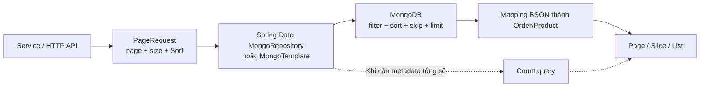

# Pageable, PageRequest và Sort

## 1. Mục tiêu bài học

Trong **Spring Data MongoDB**, truy vấn sản phẩm hay đơn hàng không nên trả toàn bộ collection mỗi lần người dùng mở trang danh sách. Cơ chế **phân trang** giúp giới hạn lượng dữ liệu cần đọc, còn **sắp xếp** quyết định thứ tự bản ghi. Spring Data cung cấp ba abstraction thường xuất hiện cùng nhau:

- `Pageable`: mô tả *yêu cầu* phân trang (số trang, kích thước trang, thứ tự).
- `PageRequest`: một implementation của `Pageable` dùng cách phân trang dựa trên **page number và offset**.
- `Sort`: tập hợp một hay nhiều quy tắc sắp xếp theo property.

Bài thuộc chương **Phân trang và luồng** của Spring Data MongoDB. Ví dụ nhất quán với ứng dụng **Mini Commerce** có `Product`, `Customer` và `Order`: hiển thị sản phẩm theo giá, lịch sử đơn theo khách, lọc đơn theo trạng thái và xuất dữ liệu theo lô. Các kiến thức này liên quan trực tiếp đến `MongoRepository`, `MongoTemplate`, query BSON, index, aggregation, transaction, reactive access, kiểm thử và chẩn đoán hiệu năng.

Sau bài học, người học có thể:

1. Tạo `PageRequest.of(page, size, sort)` đúng quy tắc **page bắt đầu từ 0**, size phải dương.
2. Phân biệt `Page<T>`, `Slice<T>`, `List<T>` và nhu cầu truy vấn `count`.
3. Kết hợp sort động, sort đa trường và ánh xạ property Java thành trường BSON.
4. Giải thích `skip`/`limit`, tác động của offset lớn và vì sao cần **sort ổn định**.
5. Áp dụng phân trang với repository hoặc `MongoTemplate`, trong cả ứng dụng đồng bộ và reactive.
6. Thiết kế whitelist trường sort, giới hạn page size và kiểm tra index bằng `explain("executionStats")`.
7. Nhận biết khi nào cần chuyển sang **keyset/cursor pagination** thay vì tiếp tục dùng offset.

**Điều kiện đầu vào:** Java, Spring Boot, `spring-boot-starter-data-mongodb`, MongoDB đang hoạt động, `@Document`, `@Id`, repository và `MongoTemplate`. Các đoạn mã dùng Java 17+; phần reactive sử dụng `spring-boot-starter-data-mongodb-reactive` thay cho starter đồng bộ.

## 2. Mô hình dữ liệu Mini Commerce

Giả sử có các document:

```json
{
  "_id": "order-104",
  "customerId": "customer-001",
  "status": "PLACED",
  "placedAt": { "$date": "2026-11-20T11:00:00Z" },
  "totalAmount": { "$numberDecimal": "259800.00" },
  "shippingAddressSnapshot": {
    "city": "TP Ho Chi Minh",
    "country": "VN"
  }
}
```

```json
{
  "_id": "prod-001",
  "sku": "LAP-001",
  "category": "phu-kien",
  "active": true,
  "unit_price": { "$numberDecimal": "129900.00" },
  "stock": 20
}
```

Đây là **MongoDB Extended JSON**: `$date` biểu diễn BSON Date, `$numberDecimal` biểu diễn BSON Decimal128. Với các ví dụ truy vấn bằng `mongosh`, dùng `ISODate("...")` và `NumberDecimal("...")` để truyền đúng kiểu dữ liệu.

Hai class Java tối giản tương ứng:

```java
package com.example.minicommerce.domain;

import java.math.BigDecimal;
import java.time.Instant;

import org.springframework.data.annotation.Id;
import org.springframework.data.mongodb.core.mapping.Document;
import org.springframework.data.mongodb.core.mapping.Field;
import org.springframework.data.mongodb.core.mapping.FieldType;

@Document(collection = "orders")
public class Order {
    @Id
    private String id;
    private String customerId;
    private String status;
    private Instant placedAt;

    @Field(targetType = FieldType.DECIMAL128)
    private BigDecimal totalAmount;

    public Order() {}

    public String getId() { return id; }
    public void setId(String id) { this.id = id; }
    public String getCustomerId() { return customerId; }
    public void setCustomerId(String customerId) {
        this.customerId = customerId;
    }
    public String getStatus() { return status; }
    public void setStatus(String status) { this.status = status; }
    public Instant getPlacedAt() { return placedAt; }
    public void setPlacedAt(Instant placedAt) {
        this.placedAt = placedAt;
    }
    public BigDecimal getTotalAmount() { return totalAmount; }
    public void setTotalAmount(BigDecimal totalAmount) {
        this.totalAmount = totalAmount;
    }
}
```

```java
package com.example.minicommerce.domain;

import java.math.BigDecimal;
import org.springframework.data.annotation.Id;
import org.springframework.data.mongodb.core.mapping.Document;
import org.springframework.data.mongodb.core.mapping.Field;
import org.springframework.data.mongodb.core.mapping.FieldType;

@Document(collection = "products")
public class Product {
    @Id
    private String id;
    private String sku;
    private String category;
    private boolean active;

    @Field(name = "unit_price", targetType = FieldType.DECIMAL128)
    private BigDecimal price;

    public Product() {}

    public String getId() { return id; }
    public void setId(String id) { this.id = id; }
    public String getSku() { return sku; }
    public void setSku(String sku) { this.sku = sku; }
    public String getCategory() { return category; }
    public void setCategory(String category) {
        this.category = category;
    }
    public boolean isActive() { return active; }
    public void setActive(boolean active) { this.active = active; }
    public BigDecimal getPrice() { return price; }
    public void setPrice(BigDecimal price) { this.price = price; }
}
```

Hai đoạn Java ở trên là **hai file riêng** trong package `com.example.minicommerce.domain`. Để học phân trang, `Order` đã lược bớt `OrderLine` và snapshot giao hàng, còn `Product` lược bớt các field khác. Các bài về mapping nhúng, aggregation hay transaction sẽ dùng phiên bản domain đầy đủ hơn.

## 3. Page, size và offset liên quan thế nào?

Với cách phân trang dựa trên offset, thứ tự được xác định bởi `Sort`, sau đó bỏ qua một số bản ghi và lấy tối đa `size` bản ghi:

```text
offset = page * size

page = 0, size = 3 -> offset = 0  -> phần tử 1, 2, 3
page = 1, size = 3 -> offset = 3  -> phần tử 4, 5, 6
page = 2, size = 3 -> offset = 6  -> phần tử 7, 8, 9
```

Ví dụ có 10 đơn đã sắp xếp giảm dần theo ngày đặt:

| PageRequest | Offset | Số bản ghi có thể lấy |
| --- | ---: | ---: |
| `PageRequest.of(0, 3)` | 0 | 3 |
| `PageRequest.of(1, 3)` | 3 | 3 |
| `PageRequest.of(2, 3)` | 6 | 3 |
| `PageRequest.of(3, 3)` | 9 | 1 |
| `PageRequest.of(4, 3)` | 12 | 0 |

**Quan trọng:** `page` trong `PageRequest` **bắt đầu từ 0**, không phải 1. Nếu REST API công khai số trang bắt đầu từ 1, tầng controller/service phải chuyển đổi một cách có kiểm tra trước khi gọi repository.

Trong MongoDB, biểu diễn tương đương ở `mongosh`:

```javascript
db.orders
  .find({ customerId: "customer-001" })
  .sort({ placedAt: -1, _id: -1 })
  .skip(20)
  .limit(10);
```

Lệnh trên tương ứng `page = 2`, `size = 10`: bỏ qua 20 bản ghi trong kết quả đã sắp xếp, lấy tối đa 10 bản ghi tiếp theo. Đây là **minh họa logic**; Spring Data và driver có thể biểu diễn filter, sort, skip, limit bằng các tham số của lệnh thay vì chuỗi `mongosh`.



## 4. Phân biệt Pageable, PageRequest, Sort, Page và Slice

### 4.1. Pageable là hợp đồng của yêu cầu

`Pageable` thuộc `org.springframework.data.domain`, mô tả:

- Số trang bằng `getPageNumber()`.
- Kích thước bằng `getPageSize()`.
- Offset bằng `getOffset()` (kiểu `long`).
- Sort bằng `getSort()`.
- Thông tin có phân trang hay không (`isPaged()` / `isUnpaged()`).

Ví dụ:

```java
import org.springframework.data.domain.Pageable;
import org.springframework.data.domain.PageRequest;

Pageable pageable = PageRequest.of(2, 10);

System.out.println(pageable.getPageNumber()); // 2
System.out.println(pageable.getPageSize());   // 10
System.out.println(pageable.getOffset());     // 20
```

`Pageable` là **interface**. `PageRequest` chỉ là implementation thông dụng. Nên khai báo tham số repository/service bằng `Pageable` để code không phụ thuộc cứng vào cách tạo object.

### 4.2. PageRequest tạo yêu cầu phân trang

```java
import org.springframework.data.domain.PageRequest;
import org.springframework.data.domain.Pageable;
import org.springframework.data.domain.Sort;

Pageable firstPage = PageRequest.of(0, 20);

Pageable secondPage = PageRequest.of(
    1, 20, Sort.by(Sort.Order.desc("placedAt")));

Pageable bySize = PageRequest.ofSize(25).withPage(3);
```

Cả ba đều là object cấu hình, **chưa thực hiện truy vấn**. `PageRequest` là immutable: đổi sort/page bằng API tương ứng sẽ trả object mới, không sửa object cũ.

| Trường hợp | Hành vi cần nhớ |
| --- | --- |
| `PageRequest.of(0, 20)` | Trang đầu, 20 bản ghi |
| `PageRequest.of(1, 20)` | Trang thứ hai, bỏ qua 20 bản ghi |
| `PageRequest.of(-1, 20)` | Không hợp lệ: page không được âm |
| `PageRequest.of(0, 0)` | Không hợp lệ: size phải lớn hơn 0 |
| `PageRequest.ofSize(25)` | Tạo yêu cầu với size 25 và page 0 |
| `Pageable.unpaged()` | Không giới hạn trang theo cách thông thường; không thích hợp cho API công khai không được kiểm soát |

Phân trang sâu có thể tốn tài nguyên ngay cả khi `size` nhỏ. Vì vậy không chỉ giới hạn `size` mà còn cân nhắc giới hạn `page` tối đa hoặc đổi cách phân trang cho khối lượng dữ liệu lớn.

### 4.3. Sort mô tả thứ tự

`Sort` cũng thuộc `org.springframework.data.domain`. Một `Sort` có thể chứa nhiều `Sort.Order`:

```java
import org.springframework.data.domain.Sort;

Sort newestFirst = Sort.by(
    Sort.Order.desc("placedAt"),
    Sort.Order.desc("id")
);

Sort cheapestFirst = Sort.by(
    Sort.Order.asc("price"),
    Sort.Order.asc("id")
);

Sort noOrdering = Sort.unsorted();
```

`asc` nghĩa là tăng dần, `desc` nghĩa là giảm dần. Có thể viết `Sort.by(Sort.Direction.DESC, "placedAt")` hoặc ghép với `and(...)`.

**Không có sort** thì MongoDB **không bảo đảm thứ tự mặc định ổn định** giữa các lần query. Trên một hệ thống nhiều lượt cập nhật, phân trang mà không sort có thể lặp/bỏ sót bản ghi ngay cả khi dữ liệu chưa quá lớn.

### 4.4. Page và Slice là kết quả, không phải yêu cầu

| Kiểu trả về | Chứa dữ liệu | Biết tổng bản ghi? | Biết còn trang tiếp? | Thường dùng |
| --- | --- | --- | --- | --- |
| `Page<T>` | Có | **Có** (`getTotalElements()`, `getTotalPages()`) | Có | UI hiển thị tổng số trang |
| `Slice<T>` | Có | **Không** yêu cầu tổng | Có (`hasNext()`) | Nút “Xem thêm” |
| `List<T>` | Có | Không | Không tự chứa metadata trang | Tác vụ chỉ cần tập bản ghi |
| `Stream<T>` | Dữ liệu được tiêu thụ tuần tự | Không | Theo iterator/cursor | Batch/đọc nhiều bản ghi khi API hỗ trợ |

`Page<T>` thường liên quan đến **count query** bổ sung để tính tổng, mặc dù hạ tầng có thể tối ưu bỏ đếm trong một số tình huống đã xác định được tổng từ số kết quả. Đừng mặc định mọi yêu cầu `Page` luôn chỉ gửi một lệnh MongoDB.

`Slice<T>` chỉ cần biết **có thêm dữ liệu** ngoài phần hiện tại, có thể thực hiện bằng cách lấy thêm một phần tử so với `size`, và thường tránh công việc tính tổng toàn collection.

`List<T>` kèm tham số `Pageable` có thể được giới hạn bằng skip/limit nhưng không cung cấp `hasNext()` hay tổng bản ghi. Muốn biết có trang tiếp phải tự định nghĩa một chiến lược khác.

## 5. Page chứa metadata gì?

Repository `Page<Order>` có thể dùng như sau:

```java
Page<Order> result =
    orderRepository.findByCustomerId("customer-001", pageable);

List<Order> orders = result.getContent();
long total = result.getTotalElements();
int totalPages = result.getTotalPages();
int currentPage = result.getNumber(); // zero-based
int pageSize = result.getSize();
int returnedCount = result.getNumberOfElements();
boolean hasNext = result.hasNext();
boolean isFirst = result.isFirst();
boolean isLast = result.isLast();
```

**Phân biệt:** `result.getSize()` là kích thước trang **được yêu cầu**; `getNumberOfElements()` là số bản ghi **thực tế được trả về**. Với trang cuối hoặc trang nằm ngoài phạm vi, hai giá trị có thể khác nhau.

Nếu có 23 đơn, page size 10:

| Page | `getNumberOfElements()` | `getTotalElements()` | `getTotalPages()` | `hasNext()` |
| --- | ---: | ---: | ---: | --- |
| 0 | 10 | 23 | 3 | true |
| 1 | 10 | 23 | 3 | true |
| 2 | 3 | 23 | 3 | false |
| 3 | 0 | 23 | 3 | false |

Các số liệu trên giả định không có ghi/xóa đồng thời trong quá trình thực hiện các truy vấn. Nếu collection thay đổi giữa query trang và query đếm, metadata có thể không phản ánh một snapshot tuyệt đối tại cùng một thời điểm. **Page không tự bật transaction/snapshot isolation**.

## 6. Repository: khai báo phương thức đúng hợp đồng phân trang

### 6.1. Repository đồng bộ

```java
package com.example.minicommerce.repository;

import java.util.List;

import org.springframework.data.domain.Page;
import org.springframework.data.domain.Pageable;
import org.springframework.data.domain.Slice;
import org.springframework.data.domain.Sort;
import org.springframework.data.mongodb.repository.MongoRepository;

import com.example.minicommerce.domain.Order;

public interface OrderRepository
        extends MongoRepository<Order, String> {

    Page<Order> findByCustomerId(
        String customerId, Pageable pageable);

    Slice<Order> findByCustomerIdAndStatus(
        String customerId, String status, Pageable pageable);

    List<Order> findByStatus(String status, Sort sort);
}
```

```java
package com.example.minicommerce.repository;

import java.util.List;

import org.springframework.data.domain.Page;
import org.springframework.data.domain.Pageable;
import org.springframework.data.domain.Sort;
import org.springframework.data.mongodb.repository.MongoRepository;

import com.example.minicommerce.domain.Product;

public interface ProductRepository
        extends MongoRepository<Product, String> {

    Page<Product> findByActiveTrueAndCategory(
        String category, Pageable pageable);

    List<Product> findByActiveTrueAndCategory(
        String category, Sort sort);
}
```

Hai interface này là **hai file Java riêng**. Spring Data phân tích phần điều kiện `ByCustomerId`, `ByCustomerIdAndStatus` hoặc `ByActiveTrueAndCategory` từ tên phương thức; `Pageable`/`Sort` là **tham số đặc biệt**, không được bind thành field equality. Repository proxy tạo filter, sort và giới hạn kết quả theo loại yêu cầu.

### 6.2. Gọi repository trong service

```java
import org.springframework.data.domain.Page;
import org.springframework.data.domain.PageRequest;
import org.springframework.data.domain.Pageable;
import org.springframework.data.domain.Sort;

Pageable pageable = PageRequest.of(
    0,
    20,
    Sort.by(
        Sort.Order.desc("placedAt"),
        Sort.Order.desc("id"))
);

Page<Order> page = orderRepository.findByCustomerId(
    "customer-001", pageable);

for (Order order : page.getContent()) {
    System.out.println(order.getId());
}
```

Truy vấn BSON logic:

```javascript
db.orders
  .find({ customerId: "customer-001" })
  .sort({ placedAt: -1, _id: -1 })
  .skip(0)
  .limit(20);
```

Khi cần `Page`, hệ thống còn cần biết tổng số document khớp điều kiện (ví dụ logic tương đương `countDocuments({ customerId: "customer-001" })`). Việc đếm chính xác và cách tối ưu phụ thuộc query execution của framework.

**Lưu ý:** `id` là **tên Java property**; vì nó mang `@Id`, trường thực tế để sắp xếp trong BSON là `_id`.

### 6.3. Sử dụng Slice khi không cần tổng trang

```java
Pageable request = PageRequest.of(
    0,
    20,
    Sort.by(
        Sort.Order.desc("placedAt"),
        Sort.Order.desc("id"))
);

Slice<Order> slice = orderRepository.findByCustomerIdAndStatus(
    "customer-001", "PLACED", request);

List<Order> current = slice.getContent();
boolean more = slice.hasNext();
Pageable next = slice.nextPageable();
```

Nếu đã ở slice cuối, `hasNext()` bằng false và không nên tiếp tục gọi trang kế. Phân biệt rõ đây là **offset-based Slice**, chưa phải keyset/cursor pagination: khi chuyển sang trang tiếp, offset vẫn có thể phải bỏ qua nhiều bản ghi.

## 7. Sắp xếp nhiều trường để có thứ tự ổn định

Giả sử ba đơn có cùng `placedAt`:

```text
order-101  2026-11-20T10:00:00Z
order-102  2026-11-20T10:00:00Z
order-103  2026-11-20T10:00:00Z
```

Nếu chỉ dùng `Sort.by(desc("placedAt"))`, MongoDB không bắt buộc trả ba đơn theo một thứ tự xác định vì giá trị trường sort bằng nhau. Khi một trang kết thúc giữa nhóm giá trị trùng, trang tiếp theo có thể bỏ sót hoặc lặp bản ghi nếu thứ tự thay đổi.

Giải pháp là thêm khóa phụ **duy nhất và nhất quán**:

```java
Sort stableSort = Sort.by(
    Sort.Order.desc("placedAt"),
    Sort.Order.desc("id")
);
```

BSON:

```javascript
{ placedAt: -1, _id: -1 }
```

Vì `_id` là duy nhất trong collection, cặp khóa (`placedAt`, `_id`) tạo ra thứ tự xác định cho các document tại thời điểm truy vấn. Nếu hệ thống dùng trường ID có kiểu BSON hỗn hợp, cần chuẩn hóa và xác định rõ ý nghĩa sort giữa các kiểu trước khi áp dụng chiến lược cursor.

**Thứ tự ổn định không đồng nghĩa snapshot cố định.** Ngay cả với khóa phụ duy nhất, việc thêm/xóa document hoặc sửa khóa sort giữa hai lần lấy trang có thể khiến offset dịch chuyển. Phần keyset bên dưới giải quyết được một phần vấn đề nhưng cũng không mặc nhiên tạo snapshot giao dịch.

### 7.1. Sort theo giá có @Field alias

Entity `Product` định nghĩa:

```java
@Field(name = "unit_price", targetType = FieldType.DECIMAL128)
private BigDecimal price;
```

Khi gọi repository:

```java
Sort byPrice = Sort.by(
    Sort.Order.asc("price"),
    Sort.Order.asc("id")
);

Page<Product> page = productRepository.findByActiveTrueAndCategory(
    "phu-kien",
    PageRequest.of(0, 20, byPrice));
```

MongoDB logic sau mapping:

```javascript
db.products
  .find({ active: true, category: "phu-kien" })
  .sort({ unit_price: 1, _id: 1 })
  .limit(20);
```

**Quy tắc:** code Spring Data nhận **property Java** `price`, còn raw MongoDB dùng trường BSON `unit_price`. Nếu dữ liệu cũ trộn BSON String/Double/Decimal128, kết quả sắp xếp có thể gây hiểu nhầm; nên chuẩn hóa kiểu trước khi kiểm thử sort và index.

### 7.2. Sort trên thuộc tính lồng nhau

Nếu `Order` có `shippingAddressSnapshot.city`, có thể sắp xếp bằng property path tương ứng:

```java
Sort byCity = Sort.by(
    Sort.Order.asc("shippingAddressSnapshot.city"),
    Sort.Order.asc("id")
);
```

Nếu entity sử dụng `@Field("ship_to")` cho property địa chỉ, hạ tầng mapping có thể chuyển đường dẫn sang `ship_to.city` trong BSON. Với custom converter hoặc tên field đặc biệt, kiểm thử filter và sort thực tế để tránh dùng nhầm tên Java/BSON.

### 7.3. Null, missing, collation và sort chữ

MongoDB có thứ tự sắp xếp theo **BSON types** và các quy tắc riêng cho trường null/missing. `Sort.NullHandling` trong Spring Data là một **hint** ở cấp abstraction; không nên mặc định MongoDB thực thi mọi lựa chọn null-first/null-last giống SQL.

Tương tự, muốn sắp xếp văn bản theo ngôn ngữ hoặc không phân biệt hoa thường, cần đánh giá **MongoDB collation** và index có collation tương ứng. Chỉ thêm `Sort.Order.ignoreCase()` không phải lúc nào cũng bảo đảm query sort đúng ngôn ngữ hoặc tận dụng index. Kiểm thử bằng bộ dữ liệu tiếng Việt có dấu và không dấu.

## 8. Tránh nhận Sort tùy ý từ người dùng

Một endpoint công khai có thể nhận:

```text
GET /customers/customer-001/orders?page=0&size=20&sort=placedAt,desc
```

Nhưng không được lấy bất kỳ chuỗi sort nào từ request rồi đưa thẳng vào repository. Có ba rủi ro:

1. Sort theo field không tồn tại hoặc field lồng sâu gây lỗi/hành vi khó đoán.
2. Sort theo field không có index làm truy vấn chậm hoặc tốn bộ nhớ.
3. API có thể lộ chi tiết schema nội bộ hoặc cho người dùng thử các field nhạy cảm.

Một service có thể dùng whitelist:

```java
package com.example.minicommerce.service;

import java.util.Map;

import org.springframework.data.domain.Page;
import org.springframework.data.domain.PageRequest;
import org.springframework.data.domain.Pageable;
import org.springframework.data.domain.Sort;
import org.springframework.stereotype.Service;

import com.example.minicommerce.domain.Order;
import com.example.minicommerce.repository.OrderRepository;

@Service
public class OrderHistoryService {

    private static final Map<String, String> SORTABLE_FIELDS = Map.of(
        "placedAt", "placedAt",
        "totalAmount", "totalAmount",
        "status", "status"
    );

    private final OrderRepository repository;

    public OrderHistoryService(OrderRepository repository) {
        this.repository = repository;
    }

    public Page<Order> list(
            String customerId,
            int page,
            int requestedSize,
            String requestedSort,
            String direction) {

        if (page < 0 || page > 1000) {
            throw new IllegalArgumentException("Invalid page");
        }

        if (requestedSize < 1) {
            throw new IllegalArgumentException("Invalid page size");
        }

        int size = Math.min(requestedSize, 100);
        String property = SORTABLE_FIELDS.get(requestedSort);

        if (property == null) {
            throw new IllegalArgumentException("Unsupported sort field");
        }

        Sort.Direction order;
        if ("asc".equalsIgnoreCase(direction)) {
            order = Sort.Direction.ASC;
        } else if ("desc".equalsIgnoreCase(direction)) {
            order = Sort.Direction.DESC;
        } else {
            throw new IllegalArgumentException("Unsupported sort direction");
        }

        Sort sort = Sort.by(
            new Sort.Order(order, property),
            Sort.Order.desc("id")
        );

        Pageable pageable = PageRequest.of(page, size, sort);

        return repository.findByCustomerId(customerId, pageable);
    }
}
```

Đây là ví dụ **service** (không phải controller HTTP đầy đủ). API production còn phải xác thực người dùng và kiểm tra quyền xem đơn của `customerId`. Phân trang, sort và validation không tự thực hiện phân quyền dữ liệu.

**Hai lưu ý:**

- Tham số `page > 1000` chỉ là **giới hạn minh họa**, không phải ngưỡng chuẩn. Chọn giới hạn theo dữ liệu và SLA thực tế.
- Nếu user chọn sort theo `id`, cần tránh thêm cùng `id` hai lần; service này chỉ cho phép ba trường khác ID và thêm ID làm tie-breaker. Nếu cho phép sort theo ID, hãy xây sort riêng để không lặp property.

Khi public API dùng trang bắt đầu từ 1, hãy kiểm tra đầu vào `page >= 1` rồi tạo `PageRequest.of(page - 1, size, sort)`. Ghi rõ quy ước trong API contract; đừng tự cộng/trừ nhiều lần ở những tầng khác nhau.

## 9. Phân trang bằng MongoTemplate

`MongoTemplate` là API đồng bộ cho query được xây động. Khi service có nhiều điều kiện tùy chọn, cách này có thể dễ đọc hơn nhiều repository method.

```java
import java.util.List;

import org.springframework.data.domain.Page;
import org.springframework.data.domain.PageImpl;
import org.springframework.data.domain.Pageable;
import org.springframework.data.mongodb.core.MongoTemplate;
import org.springframework.data.mongodb.core.query.Criteria;
import org.springframework.data.mongodb.core.query.Query;

public Page<Order> findOrders(
        String customerId,
        String status,
        Pageable pageable,
        MongoTemplate template) {

    Criteria criteria = Criteria.where("customerId").is(customerId)
        .and("status").is(status);

    Query dataQuery = new Query(criteria).with(pageable);
    List<Order> content = template.find(dataQuery, Order.class);

    // Query đếm riêng, không mang skip/limit.
    Query countQuery = new Query(
        Criteria.where("customerId").is(customerId)
            .and("status").is(status));
    long total = template.count(countQuery, Order.class);

    return new PageImpl<>(content, pageable, total);
}
```

Đây là **phương thức minh họa** đặt trong một service đã được Spring inject `MongoTemplate`; người học có thể đổi thiết kế thành constructor injection thay vì truyền template làm tham số.

Điều cần nhớ:

- `new Query(criteria).with(pageable)` thêm **skip, limit và sort** từ `Pageable`.
- `template.find(..., Order.class)` sử dụng mapping của entity.
- Query đếm cần giữ **cùng filter**, nhưng không nên mang paging skip/limit vào mục đích đếm tổng.
- `new PageImpl<>(content, pageable, total)` tạo metadata trang từ dữ liệu và tổng đã đếm.
- Nếu chỉ muốn `List<Order>`, bỏ count query để giảm chi phí.

Một biến thể có thể dùng `PageableExecutionUtils.getPage(...)` để trì hoãn hoặc tránh một số count query khi thông tin hiện có đã đủ. Không nên tự tối ưu đếm trước khi hiểu cách Spring Data vận hành trong phiên bản đang dùng.

### 9.1. Khi chỉ cần sort mà không cần page

```java
Query query = Query.query(
    Criteria.where("active").is(true)
).with(Sort.by(
    Sort.Order.asc("price"),
    Sort.Order.asc("id")
));

List<Product> products = mongoTemplate.find(
    query, Product.class);
```

Với dữ liệu lớn, **không** nên trả toàn bộ list chỉ vì không dùng `Pageable`. Thêm `query.limit(...)` hoặc xây chiến lược lấy theo lô. Với `Product`, Java property `price` được ánh xạ tới BSON `unit_price`.

## 10. Độ sâu offset ảnh hưởng hiệu năng và tính nhất quán

Giả sử endpoint tìm trang thứ 20.000, size 50:

```text
page   = 20000
size   = 50
offset = 1,000,000
```

MongoDB vẫn phải **đi qua hoặc bỏ qua** một lượng lớn kết quả phù hợp trước khi lấy 50 document của trang cần thiết. Có index hỗ trợ sort giúp giảm chi phí sắp xếp, nhưng **không loại bỏ toàn bộ chi phí của skip sâu**. Vì vậy page gần cuối có thể chậm hơn rất nhiều so với page đầu.

### 10.1. Khi dữ liệu thay đổi giữa hai trang

Ví dụ trang đầu đang có danh sách:

```text
order-104, order-103, order-102, order-101
```

Với `size = 2`:

```text
Trang 0: order-104, order-103
Trang 1: order-102, order-101
```

Nếu một đơn mới `order-105` được chèn lên đầu trước khi lấy trang 1, offset trang 1 vẫn là 2, nhưng dữ liệu lúc đó đã dịch:

```text
Danh sách mới: order-105, order-104, order-103, order-102, order-101
Trang 1 với skip(2): order-103, order-102
```

`order-103` bị **lặp** giữa hai trang và `order-101` bị dời sang trang tiếp theo. Sort ổn định bằng `_id` không tự sửa sự dịch chuyển do insert/delete khi dùng offset.

### 10.2. Nên dùng offset khi nào?

Offset/page number vẫn phù hợp khi:

- Dữ liệu có kích thước vừa phải hoặc người dùng chỉ xem một số trang đầu.
- UI yêu cầu nhảy đến **trang số N** và hiển thị tổng số trang.
- Count query và skip nằm trong giới hạn hiệu năng có thể chấp nhận.
- Thay đổi đồng thời không gây hậu quả lớn cho trải nghiệm.

Đối với lịch sử đơn hoặc feed liên tục được bổ sung dữ liệu, **cursor/keyset pagination** thường có ưu điểm rõ rệt.

## 11. Keyset/cursor pagination: phương án cho lịch sử đơn lớn

Keyset pagination không hỏi “bỏ qua 1 triệu bản ghi” mà hỏi “lấy các đơn **đứng sau** đơn cuối cùng của trang trước theo thứ tự đã chọn”.

Giả sử sort:

```javascript
{ placedAt: -1, _id: -1 }
```

Và trang trước kết thúc ở:

```text
lastPlacedAt = 2026-11-20T10:00:00Z
lastId       = "order-102"
```

Truy vấn trang tiếp theo có thể là:

```javascript
db.orders.find({
  customerId: "customer-001",
  $or: [
    { placedAt: { $lt: ISODate("2026-11-20T10:00:00Z") } },
    {
      placedAt: ISODate("2026-11-20T10:00:00Z"),
      _id: { $lt: "order-102" }
    }
  ]
})
.sort({ placedAt: -1, _id: -1 })
.limit(20);
```

Giải thích:

- Nếu `placedAt` **sớm hơn** giá trị cursor, document nằm sau cursor.
- Nếu `placedAt` **bằng** cursor, chỉ lấy `_id` nhỏ hơn ID cuối theo sort giảm dần.
- Cần giữ **filter, sort, hướng duyệt và kiểu BSON của cursor** nhất quán giữa các lần gọi.
- Các field dùng làm keyset nên **ổn định/không thay đổi**, có giá trị xác định và có khóa phụ duy nhất.

Một compound index thường đáng khảo sát:

```javascript
db.orders.createIndex({
  customerId: 1,
  placedAt: -1,
  _id: -1
});
```

Nếu cursor bao gồm `_id` dạng BSON ObjectId, token cursor và query phải bảo toàn kiểu đó; ví dụ phía trên sử dụng ID String như `"order-102"`. Không gửi cursor là một giá trị người dùng có thể tùy ý sửa để vượt qua filter tenant hoặc truy cập dữ liệu khác; cần xác minh quyền, dấu/token hoặc mã hóa phù hợp với API.

**Ưu điểm:** tránh skip sâu và giảm nhiều trường hợp dịch chuyển do chèn bản ghi trước cursor. **Giới hạn:** không thuận tiện cho nhảy ngay đến trang N và không tự cung cấp `totalPages`; cập nhật/xóa các giá trị khóa sort giữa các lượt đọc vẫn có thể gây sai lệch.

Spring Data còn có các abstraction scrolling như `ScrollPosition`/`Window<T>` trong những phiên bản hỗ trợ. Khi cần dùng chúng, kiểm tra phiên bản và API repository cụ thể; không nhầm một `PageRequest` offset với cursor `ScrollPosition`.

## 12. Query plan và index phục vụ filter + sort

### 12.1. Danh sách sản phẩm theo danh mục, giá tăng dần

Truy vấn:

```javascript
db.products
  .find({ active: true, category: "phu-kien" })
  .sort({ unit_price: 1, _id: 1 })
  .skip(0)
  .limit(20)
  .explain("executionStats");
```

Index gợi ý để thử:

```javascript
db.products.createIndex({
  active: 1,
  category: 1,
  unit_price: 1,
  _id: 1
});
```

### 12.2. Lịch sử đơn theo khách, mới nhất trước

```javascript
db.orders
  .find({ customerId: "customer-001" })
  .sort({ placedAt: -1, _id: -1 })
  .skip(0)
  .limit(20)
  .explain("executionStats");
```

Index gợi ý:

```javascript
db.orders.createIndex({
  customerId: 1,
  placedAt: -1,
  _id: -1
});
```

Đây là **index đề xuất để kiểm nghiệm**, không phải cấu hình bắt buộc cho mọi dự án. Kết quả tối ưu phụ thuộc phân bố dữ liệu, điều kiện lọc, số lượng document, tần suất ghi và các index đã có.

Khi xem `explain("executionStats")`, chú ý:

| Trường/khái niệm | Cần xem điều gì |
| --- | --- |
| `winningPlan` | Kế hoạch có dùng `IXSCAN`/`FETCH` hay `COLLSCAN` không? |
| `totalKeysExamined` | Bao nhiêu mục index đã được duyệt? |
| `totalDocsExamined` | Bao nhiêu document thật đã được kiểm tra? |
| `nReturned` | Số document trả về |
| `SORT` trong plan | Có bước sắp xếp đáng kể ngoài index hay không? |
| Deep skip | Số lượng mục phải bỏ qua tăng theo page, ngay cả khi index tốt? |

**Đừng chỉ nhìn page size nhỏ mà kết luận query rẻ.** Với `Page<T>` còn có thể phải đo query đếm. Kiểm tra cả latency, memory, số lần round-trip và tỷ lệ cache hit qua công cụ quan sát phù hợp.

### 12.3. Sort theo field không có index

`Sort.by("totalAmount")` có thể yêu cầu MongoDB sắp xếp tập kết quả lớn nếu thiếu index phù hợp. Với các trang “đơn giá trị cao nhất”, cần cân nhắc một index riêng hoặc thay đổi chiến lược lấy dữ liệu. Không tạo thêm hàng chục index cho mọi tổ hợp sort từ UI: mỗi index tốn dung lượng và chi phí update.

## 13. Projection giảm dữ liệu truyền đi

Phân trang giới hạn **số document**, còn projection giới hạn **field trả về**. Khi hiển thị danh sách đơn, có thể không cần toàn bộ `OrderLine`, địa chỉ và dữ liệu chi tiết.

Ví dụ:

```javascript
db.orders.find(
  { customerId: "customer-001" },
  {
    _id: 1,
    status: 1,
    placedAt: 1,
    totalAmount: 1
  }
)
.sort({ placedAt: -1, _id: -1 })
.limit(20);
```

Trong Spring Data, có thể khai báo **interface projection/DTO** hoặc dùng `Query.fields()` ở `MongoTemplate`. Không đọc entity bị cắt bớt field rồi `save()` như thể đó là object đầy đủ: thao tác thay thế document có nguy cơ xóa dữ liệu chưa được nạp. Projection phù hợp nhất với luồng **đọc**.

Sử dụng projection có thể giảm băng thông và mapping cost, nhưng nếu vẫn phải sort/filter trên tập dữ liệu lớn không có index, việc giảm field trả về **không tự xử lý** tất cả vấn đề hiệu năng.

## 14. Pagination với MongoDB reactive

Nếu dự án dùng `spring-boot-starter-data-mongodb-reactive`, bạn có thể khai báo repository:

```java
package com.example.minicommerce.repository;

import org.springframework.data.domain.Pageable;
import org.springframework.data.mongodb.repository.ReactiveMongoRepository;

import reactor.core.publisher.Flux;
import reactor.core.publisher.Mono;

import com.example.minicommerce.domain.Order;

public interface ReactiveOrderRepository
        extends ReactiveMongoRepository<Order, String> {

    Flux<Order> findByCustomerId(
        String customerId, Pageable pageable);

    Mono<Long> countByCustomerId(String customerId);
}
```

Gọi:

```java
Pageable request = PageRequest.of(
    0, 20,
    Sort.by(
        Sort.Order.desc("placedAt"),
        Sort.Order.desc("id"))
);

Flux<Order> orders =
    reactiveOrderRepository.findByCustomerId(
        "customer-001", request);

Mono<Long> total =
    reactiveOrderRepository.countByCustomerId("customer-001");
```

Trong repository reactive, kết quả thường là `Flux<T>`/`Mono<T>`, **không sử dụng `Page<T>` như một kết quả blocking có count tự động**. Nếu API cần tổng, hãy thiết kế rõ truy vấn đếm và cách kết hợp publisher; nếu không cần, trả các item trong một page/scroll sẽ gọn và nhẹ hơn.

Với `ReactiveMongoTemplate`:

```java
import org.springframework.data.mongodb.core.query.Criteria;
import org.springframework.data.mongodb.core.query.Query;

Query query = Query.query(
    Criteria.where("customerId").is("customer-001"))
    .with(request);

Flux<Order> orders =
    reactiveMongoTemplate.find(query, Order.class);
```

Reactive I/O diễn ra khi publisher được **subscribe**. Không dùng `.block()` trong event-loop WebFlux để biến reactive thành synchronous. Khi test, có thể dùng Reactor `StepVerifier`; với truy vấn cần hiển thị page, kiểm tra toàn bộ số lượng, thứ tự và completion signal.

**Phân biệt:** reactive driver giúp I/O non-blocking, nhưng không biến `skip(1_000_000)` thành một phép truy vấn hiệu quả; các vấn đề query plan, index và offset vẫn tồn tại.

## 15. Truy vấn nhiều dữ liệu: Stream không thay thế pagination

Đôi khi cần xuất toàn bộ đơn để tạo báo cáo nội bộ hoặc chạy batch. Có hai hướng:

1. **Đọc theo lô/page**: mỗi lần lấy một page nhỏ, xử lý rồi chuyển sang page tiếp theo hoặc dùng keyset.
2. **Streaming cursor**: một số API Spring Data MongoDB có thể truy cập kết quả theo `Stream<T>` hoặc cursor tương ứng; cần đóng tài nguyên đúng lúc.

Ví dụ khi ứng dụng sử dụng `MongoTemplate.stream(...)` đồng bộ:

```java
import java.util.stream.Stream;
import org.springframework.data.mongodb.core.query.Criteria;
import org.springframework.data.mongodb.core.query.Query;

Query query = Query.query(
    Criteria.where("status").is("PLACED"))
    .with(Sort.by(
        Sort.Order.asc("placedAt"),
        Sort.Order.asc("id")));

try (Stream<Order> orders = mongoTemplate.stream(
        query, Order.class)) {
    orders.forEach(order -> {
        // Xử lý từng Order; không tích lũy toàn bộ vào bộ nhớ.
        System.out.println(order.getId());
    });
}
```

**Ranh giới quan trọng:**

- Stream/cursor có thể giữ tài nguyên kết nối và server cursor trong thời gian duyệt; phải đóng (ví dụ `try-with-resources`).
- Không giữ stream mở xuyên suốt một HTTP request kéo dài hoặc qua các thao tác mạng chậm không kiểm soát.
- Đối với export lớn, phân lô theo keyset hoặc batch job có checkpoint thường dễ retry hơn là một stream kéo dài.
- Streaming không tự tạo transaction hoặc snapshot ổn định; cần lựa chọn cơ chế nhất quán riêng nếu nghiệp vụ yêu cầu.

## 16. Kiểm thử tích hợp: trang, count và thứ tự ổn định

Test bằng mock repository chỉ xác minh code gọi phương thức; nó không phát hiện query sort sai hay mapping `id → _id`. Hãy dùng MongoDB thật hoặc Testcontainers và database **riêng cho test**.

Ví dụ sau tạo bốn đơn cho một khách test. Hai đơn có cùng `placedAt` để chứng minh tie-breaker `_id`:

```java
package com.example.minicommerce;

import static org.junit.jupiter.api.Assertions.*;

import java.time.Instant;
import java.util.Date;
import java.util.List;

import org.bson.Document;
import org.junit.jupiter.api.Test;
import org.springframework.beans.factory.annotation.Autowired;
import org.springframework.boot.test.context.SpringBootTest;
import org.springframework.data.domain.Page;
import org.springframework.data.domain.PageRequest;
import org.springframework.data.domain.Pageable;
import org.springframework.data.domain.Sort;
import org.springframework.data.mongodb.core.MongoTemplate;

import com.example.minicommerce.domain.Order;
import com.example.minicommerce.repository.OrderRepository;

@SpringBootTest
class OrderPaginationIntegrationTest {

    @Autowired MongoTemplate template;
    @Autowired OrderRepository repository;

    @Test
    void pagesAreZeroBasedStableAndCounted() {
        String customer = "customer-pagination-test";
        var raw = template.getCollection("orders");
        Document customerFilter = new Document("customerId", customer);

        // Xóa riêng fixture của test; không dùng database production.
        raw.deleteMany(customerFilter);

        try {
            raw.insertMany(List.of(
                order("order-101", customer, "2026-11-20T09:00:00Z"),
                order("order-102", customer, "2026-11-20T10:00:00Z"),
                order("order-103", customer, "2026-11-20T10:00:00Z"),
                order("order-104", customer, "2026-11-20T11:00:00Z")
            ));

            Sort stable = Sort.by(
                Sort.Order.desc("placedAt"),
                Sort.Order.desc("id"));
            Pageable firstRequest = PageRequest.of(0, 2, stable);
            Pageable secondRequest = PageRequest.of(1, 2, stable);

            Page<Order> first =
                repository.findByCustomerId(customer, firstRequest);
            Page<Order> second =
                repository.findByCustomerId(customer, secondRequest);

            assertEquals(
                List.of("order-104", "order-103"),
                first.getContent().stream().map(Order::getId).toList());
            assertEquals(
                List.of("order-102", "order-101"),
                second.getContent().stream().map(Order::getId).toList());

            assertEquals(4L, first.getTotalElements());
            assertEquals(2, first.getTotalPages());
            assertTrue(first.hasNext());
            assertFalse(second.hasNext());
            assertEquals(0, first.getNumber());
            assertEquals(1, second.getNumber());
        } finally {
            raw.deleteMany(customerFilter);
        }
    }

    private static Document order(
            String id, String customer, String placedAt) {
        return new Document("_id", id)
            .append("customerId", customer)
            .append("status", "PLACED")
            .append("placedAt",
                Date.from(Instant.parse(placedAt)));
    }
}
```

Test trên chủ ý chỉ lưu một số field cần cho phân trang, do đó `totalAmount` có thể null; điều này hợp lệ cho bài test mapping/sort nhưng **không** thay thế test nghiệp vụ tạo đơn hàng. Ngoài ra cần cố định MongoDB test config, và không để những test khác cùng sửa `customer-pagination-test` đồng thời.

### 16.1. Ma trận kiểm thử nên có

| Trường hợp | Kỳ vọng |
| --- | --- |
| `page = 0`, `size = 2` | Hai kết quả đầu tiên theo sort |
| `page = 1`, `size = 2` | Hai kết quả tiếp theo, không lặp nếu dữ liệu không đổi |
| Hai đơn có `placedAt` bằng nhau | Sort phụ theo `id` tạo thứ tự dự đoán được |
| Trang cuối ít phần tử | `getNumberOfElements() < getSize()` |
| Trang vượt phạm vi | Nội dung rỗng, metadata không bị hiểu nhầm |
| `Page` | Trả tổng số bản ghi và tổng số trang |
| `Slice` | `hasNext()` đúng, không yêu cầu `getTotalPages()` |
| `size <= 0` hoặc `page < 0` | Service/`PageRequest` từ chối input |
| Sort field không nằm trong whitelist | API từ chối, không truyền thẳng vào repository |
| Sort `price` | Query dùng BSON `unit_price` theo `@Field` |
| Sort lồng như `shippingAddressSnapshot.city` | Query dùng đúng field BSON thực tế |
| Query với offset sâu | Quan sát latency và mức độ duyệt dữ liệu |
| Cursor qua các timestamp trùng nhau | Không bỏ sót theo cặp `placedAt`/`_id` |
| Insert mới giữa hai page offset | Có test mô tả nguy cơ dịch chuyển |
| Reactive pagination | `Flux` trả đúng thứ tự/kích thước, không `block()` |

## 17. Các lỗi thường gặp

| Triệu chứng | Nguyên nhân thường gặp | Cách xử lý |
| --- | --- | --- |
| Trang đầu tiên bị bỏ qua | Nhầm page đánh số từ 1 sang 0 | Chuyển đổi ở API boundary, kiểm tra `PageRequest.of(0, ...)` |
| `IllegalArgumentException` khi tạo PageRequest | `page < 0` hoặc `size <= 0` | Validate và giới hạn input |
| Trùng/bỏ sót đơn giữa các page | Thiếu sort ổn định hoặc dữ liệu dịch chuyển giữa truy vấn | Thêm tie-breaker duy nhất; dùng keyset khi phù hợp |
| Query trả trang không theo thứ tự mong muốn | Sort sai tên property hoặc sai hướng | Dùng tên Java property, kiểm tra BSON và `@Field` |
| Sắp xếp tiền sai | Giá lưu trộn String/Double/Decimal128 | Chuẩn hóa BSON Decimal128 và kiểm tra index |
| `Page` chậm hơn `List` | Công việc đếm hoặc metadata tổng số | Dùng `Slice`/`List` khi không cần tổng; đo count query |
| Trang sâu rất chậm | `skip` lớn | Đổi sang keyset/cursor cho luồng duyệt liên tục |
| `Sort.NullHandling` không hoạt động như mong đợi | Không phải store nào cũng hỗ trợ mọi hint | Xem thứ tự BSON và query thực tế, thiết kế rõ null/missing |
| Sort không phân biệt hoa thường sai | Collation/index không tương thích | Cấu hình collation phù hợp và test dữ liệu tiếng Việt |
| API bị query nặng do sort tự do | Không whitelist field hoặc page size | Whitelist, giới hạn page/size và index theo workload |
| MongoTemplate đếm sai tổng | Count query mang filter khác hoặc có paging không mong muốn | Dùng count query riêng, cùng điều kiện |
| Entity projection bị lưu làm mất field | Entity chỉ nạp một phần rồi `save` | Dùng DTO đọc, không save entity thiếu field |
| Phân trang reactive trả `Page<T>` không phù hợp | Nhầm hợp đồng blocking và reactive | Dùng `Flux` với `Pageable`, count `Mono<Long>` nếu cần |
| Stream làm cạn tài nguyên | Không đóng cursor hoặc xử lý quá lâu | `try-with-resources`, timeout, batch/checkpoint |
| Có index nhưng trang vẫn chậm | Index không khớp filter/sort hoặc skip sâu | Kiểm tra `explain` và phân bố dữ liệu |

## 18. Bài tập thực hành

**Bài tập 1 — Cú pháp phân trang.** Tạo các `PageRequest` cho trang 0, 1, 2 với size 10; tính offset dự kiến và đối chiếu với `getOffset()`. Giải thích vì sao `PageRequest.of(0, 0)` bị từ chối.

**Bài tập 2 — Danh sách sản phẩm.** Khai báo `ProductRepository.findByActiveTrueAndCategory(category, pageable)`, dùng `Sort.by(asc("price"), asc("id"))`. Chèn ba giá Decimal128, dự đoán thứ tự BSON `unit_price` và kiểm tra bằng `mongosh`.

**Bài tập 3 — Lịch sử đơn hàng.** Tạo bốn đơn cùng khách, trong đó có hai đơn trùng `placedAt`. Đọc page 0 và 1 với size 2, sort `placedAt DESC, id DESC`; xác nhận không lặp trong bộ dữ liệu bất biến.

**Bài tập 4 — Page so với Slice.** Tạo hai phương thức repository cùng filter nhưng khác kiểu trả về. So sánh `getContent()`, `hasNext()` và metadata `totalElements`; dùng quan sát database để kiểm tra có count query hay không.

**Bài tập 5 — Giới hạn input.** Triển khai API nhận page, size, sort/direction. Cho phép ba field sort, chặn size quá lớn, chặn page âm và không cho phép truy vấn tùy ý vào field nội bộ.

**Bài tập 6 — Hiệu năng.** Tạo tập dữ liệu test lớn hơn, so sánh trang đầu và trang sâu với `explain("executionStats")`. Thử compound index `{ customerId: 1, placedAt: -1, _id: -1 }` và ghi nhận số lượng khóa/document phải duyệt.

**Bài tập 7 — Cursor.** Dùng (`placedAt`, `_id`) của đơn cuối làm cursor; viết raw query tìm đơn cũ hơn theo sort giảm dần. Chèn đơn mới lên đầu rồi đối chiếu rủi ro trùng/bỏ sót giữa offset và keyset.

**Bài tập mở rộng — Reactive/batch.** Tạo `ReactiveOrderRepository` trả `Flux<Order>` với `Pageable`, kiểm thử bằng `StepVerifier`. Hoặc sử dụng `MongoTemplate.stream(...)` trên tập dữ liệu test để xử lý tuần tự và bảo đảm cursor được đóng.

### Câu hỏi tự kiểm tra

1. `Pageable`, `PageRequest` và `Sort` khác nhau về vai trò thế nào?
2. Với `page = 5` và `size = 25`, offset là bao nhiêu? Trang đầu bắt đầu từ số mấy?
3. Vì sao `Page<T>` có thể tốn thêm truy vấn đếm, còn `Slice<T>` thường không cần tổng số?
4. Vì sao sort chỉ bằng `placedAt` chưa đủ ổn định nếu nhiều đơn trùng timestamp?
5. Java `price` có `@Field("unit_price")`, vậy truyền tên nào vào `Sort` và MongoDB thực sự sort theo field nào?
6. Vì sao `skip` sâu vẫn có thể đắt dù có compound index tốt?
7. Keyset pagination cần token gồm những gì và điều kiện cursor cho sort giảm dần là gì?
8. Reactive MongoDB thay đổi kiểu trả về như thế nào nhưng không tự cải thiện truy vấn có offset lớn ra sao?
9. Tại sao API phải whitelist field sort và kiểm tra quyền truy cập đơn hàng của khách?
10. Khi nào nên dùng projection hoặc streaming thay cho việc đưa toàn bộ `Order` lên UI?

**Kết quả mong đợi:** người học tạo được một truy vấn phân trang an toàn, hiểu đúng zero-based page và metadata `Page`/`Slice`, sắp xếp ổn định theo nhiều trường, kiểm tra được BSON field/compound index, và biết khi nào nên chuyển từ offset sang cursor. Những kỹ năng này giúp triển khai truy vấn, aggregation, index, transaction, reactive access và chẩn đoán hiệu năng dữ liệu Spring Data MongoDB một cách có cơ sở.

## Tài liệu tham khảo

- [Spring Data Commons — Paging and Sorting](https://docs.spring.io/spring-data/commons/reference/repositories/query-methods-details.html): các tham số `Pageable`/`Sort`, giới hạn, paging và sorting.
- [Spring Data Commons API — PageRequest](https://docs.spring.io/spring-data/commons/docs/current/api/org/springframework/data/domain/PageRequest.html): zero-based page và các factory method.
- [Spring Data Commons API — Page, Slice, Sort](https://docs.spring.io/spring-data/commons/docs/current/api/org/springframework/data/domain/Page.html): metadata trang và các interface liên quan.
- [Spring Data MongoDB — Query Methods](https://docs.spring.io/spring-data/mongodb/reference/mongodb/repositories/query-methods.html): repository query với Pageable/Sort và reactive return types.
- [Spring Data MongoDB — Template Query Operations](https://docs.spring.io/spring-data/mongodb/reference/mongodb/template-query-operations.html): `MongoTemplate`, `Query` và thao tác sort/limit.
- [MongoDB — Cursor.skip()](https://www.mongodb.com/docs/manual/reference/method/cursor.skip/): ảnh hưởng hiệu năng và tính ổn định khi skip lớn.
- [MongoDB — Compound Indexes](https://www.mongodb.com/docs/manual/core/indexes/index-types/index-compound/): thiết kế index phục vụ filter và sort.
- [MongoDB — Explain Results](https://www.mongodb.com/docs/manual/reference/explain-results/): đọc `winningPlan` và `executionStats`.
