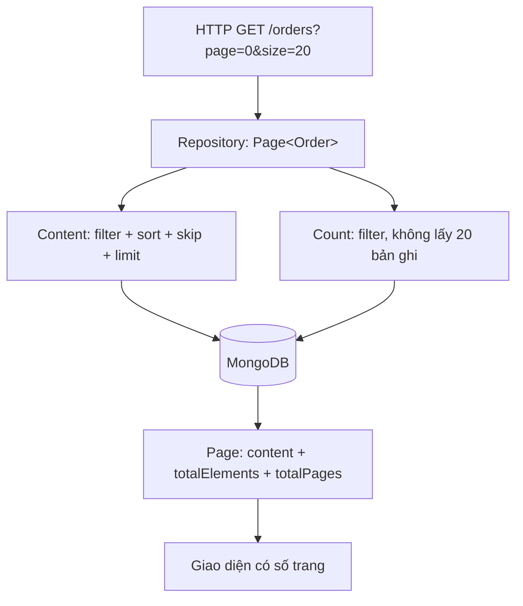
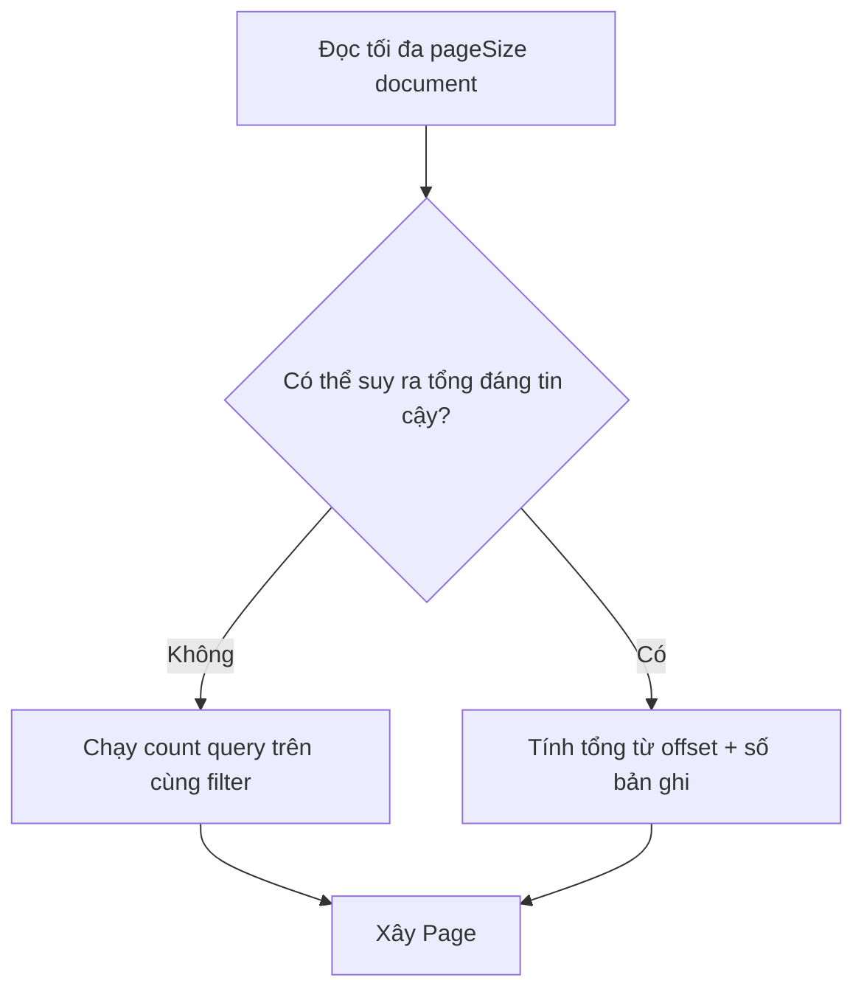

# Page, truy vấn count và chi phí tổng số kết quả

> **Chương:** Phân trang và luồng  
> **Module:** `SPRING_DATA_MONGODB` — sử dụng Spring Data MongoDB để kết nối, ánh xạ document và thao tác MongoDB bằng `MongoTemplate` hoặc repository. Bài học tập trung vào **Page**, cách tính **tổng số kết quả bằng count**, tác động tới index/hiệu năng, và cách chọn `Slice`, danh sách giới hạn, keyset pagination hoặc stream khi không cần tổng số. Những quyết định này liên quan đến truy vấn, aggregation, transaction, reactive access, kiểm thử và chẩn đoán tải dữ liệu.

## 1. Bài toán: 20 bản ghi và tổng cộng bao nhiêu bản ghi?

Giả sử màn hình quản trị hiển thị **20 đơn hàng mỗi trang**. Với filter `status = "PAID"` và `archived = false`, API có thể muốn trả:

```json
{
  "content": [
    { "id": "ORD-201", "status": "PAID" },
    { "id": "ORD-200", "status": "PAID" },
    { "id": "ORD-199", "status": "PAID" },
    { "id": "ORD-198", "status": "PAID" },
    { "id": "ORD-197", "status": "PAID" },
    { "id": "ORD-196", "status": "PAID" },
    { "id": "ORD-195", "status": "PAID" },
    { "id": "ORD-194", "status": "PAID" },
    { "id": "ORD-193", "status": "PAID" },
    { "id": "ORD-192", "status": "PAID" },
    { "id": "ORD-191", "status": "PAID" },
    { "id": "ORD-190", "status": "PAID" },
    { "id": "ORD-189", "status": "PAID" },
    { "id": "ORD-188", "status": "PAID" },
    { "id": "ORD-187", "status": "PAID" },
    { "id": "ORD-186", "status": "PAID" },
    { "id": "ORD-185", "status": "PAID" },
    { "id": "ORD-184", "status": "PAID" },
    { "id": "ORD-183", "status": "PAID" },
    { "id": "ORD-182", "status": "PAID" }
  ],
  "page": 0,
  "size": 20,
  "numberOfElements": 20,
  "totalElements": 202342,
  "totalPages": 10118,
  "hasNext": true
}
```

Đây là **ví dụ cấu trúc phản hồi**; một `Page` trả về từ Spring Data không mặc định serialize đúng từng tên trường như trên, và số `totalElements` được giả định để minh họa. Điểm then chốt là hai nhóm dữ liệu có nguồn gốc khác nhau:

1. **Content query** trả tối đa 20 document thuộc trang đang yêu cầu, theo filter và sort.
2. **Count query** xác định tổng số document phù hợp với filter, **không** chỉ đếm 20 document vừa tải.

Nếu giao diện chỉ cần nút **“Xem thêm”**, count toàn bộ dữ liệu có thể là chi phí không mang lại lợi ích tương xứng. Nếu giao diện cần **“Trang 1 / 10.118”**, tổng số lại là yêu cầu chức năng. Vì vậy, chọn `Page` hay `Slice` phải bắt đầu từ hợp đồng API, không chỉ từ tên kiểu trả về trong Java.



**Lưu ý quan trọng:** sơ đồ mô tả **hai công việc logic**, không khẳng định mỗi lần trả `Page` luôn thực thi đúng hai lệnh MongoDB. Spring Data có cơ chế tối ưu bỏ qua count khi có thể suy ra tổng số từ content, tùy tình huống và phiên bản.

## 2. Các khái niệm nền tảng: Pageable, PageRequest và Page

### 2.1. Trang được đánh số từ 0

Trong Spring Data, `PageRequest.of(page, size)` thường dùng **chỉ số trang bắt đầu từ 0**:

| Java | Ý nghĩa | Skip ở cấp MongoDB |
| --- | --- | --- |
| `PageRequest.of(0, 20)` | Trang đầu, 20 bản ghi | `0` |
| `PageRequest.of(1, 20)` | Trang thứ hai | `20` |
| `PageRequest.of(2, 20)` | Trang thứ ba | `40` |
| `PageRequest.of(10, 20)` | Trang thứ 11 | `200` |

Với offset pagination thông thường:

\[
\text{offset} = \text{pageNumber} \times \text{pageSize}
\]

`PageRequest` là một triển khai của `Pageable`; nó chứa số trang, kích thước và tùy chọn `Sort`. Nó **không tự thực thi truy vấn**. Repository hoặc template mới dùng các tham số này để xây lệnh MongoDB.

### 2.2. Những giá trị một Page cung cấp

Khi phương thức trả `Page<Order>`, phía gọi có thể truy cập:

| API | Ý nghĩa |
| --- | --- |
| `getContent()` | Danh sách entity của trang hiện tại. |
| `getNumber()` | Chỉ số trang hiện tại, bắt đầu từ 0. |
| `getSize()` | Kích thước trang được yêu cầu. |
| `getNumberOfElements()` | Số phần tử **thực tế** trong content hiện tại. |
| `getTotalElements()` | Tổng số phần tử khớp điều kiện theo cách Page được xây dựng. |
| `getTotalPages()` | Số trang tính từ total và page size. |
| `hasNext()` / `hasPrevious()` | Còn trang kế tiếp/trước theo thông tin phân trang. |
| `isFirst()` / `isLast()` | Trang đầu/cuối theo metadata hiện có. |

Nếu `totalElements = 45` và `size = 20`:

\[
\text{totalPages}=\left\lceil\frac{45}{20}\right\rceil=3
\]

Ba trang có chỉ số `0`, `1`, `2` và số bản ghi tối đa tương ứng là `20`, `20`, `5`. `getNumberOfElements()` của trang cuối là `5`, **không** phải `45`.

Đừng dùng `page.getContent().size()` để hiển thị tổng số đơn hàng trong hệ thống. Đó chỉ là lượng bản ghi đã tải trong một trang.

## 3. Xây dựng ví dụ Spring Data MongoDB hoàn chỉnh

### 3.1. Entity và collection

Giả sử mỗi đơn có thời điểm tạo, trạng thái và cờ lưu trữ:

```java
package demo.orders;

import java.math.BigDecimal;
import java.time.Instant;
import org.springframework.data.annotation.Id;
import org.springframework.data.mongodb.core.mapping.Document;
import org.springframework.data.mongodb.core.mapping.Field;
import org.springframework.data.mongodb.core.mapping.FieldType;

@Document(collection = "orders")
public record Order(
    @Id String id,
    String customerId,
    String status,
    boolean archived,
    Instant createdAt,
    @Field(targetType = FieldType.DECIMAL128) BigDecimal totalAmount
) {}
```

Ví dụ một document BSON ở MongoDB:

```json
{
  "_id": "ORD-201",
  "customerId": "CUST-42",
  "status": "PAID",
  "archived": false,
  "createdAt": { "$date": "2026-11-20T03:20:00Z" },
  "totalAmount": { "$numberDecimal": "1250.50" }
}
```

Kiểu `Instant` phù hợp để sắp xếp theo thời điểm tuyệt đối. Các ID `ORD-...` là chuỗi nghiệp vụ, tránh lẫn với BSON `ObjectId` trong phần minh họa keyset. Với hệ thống thật, hãy thống nhất kiểu `_id` trước khi xây cursor.

### 3.2. Repository trả Page

```java
package demo.orders;

import org.springframework.data.domain.Page;
import org.springframework.data.domain.Pageable;
import org.springframework.data.mongodb.repository.MongoRepository;

public interface OrderRepository extends MongoRepository<Order, String> {

    Page<Order> findByStatusAndArchivedFalse(
        String status,
        Pageable pageable
    );
}
```

Lời gọi:

```java
import org.springframework.data.domain.Page;
import org.springframework.data.domain.PageRequest;
import org.springframework.data.domain.Sort;

PageRequest pageable = PageRequest.of(
    0,
    20,
    Sort.by(Sort.Direction.DESC, "createdAt")
        .and(Sort.by(Sort.Direction.DESC, "id"))
);

Page<Order> page =
    orderRepository.findByStatusAndArchivedFalse("PAID", pageable);

var orders = page.getContent();
long total = page.getTotalElements();
int numberOfPages = page.getTotalPages();
boolean next = page.hasNext();
```

Tên phương thức `findByStatusAndArchivedFalse` là **derived query**: Spring Data chuyển `status` và `archived` thành điều kiện tương ứng. `Sort` dùng **tên property Java**; hệ thống mapping chuyển `id` thành BSON `_id` khi thích hợp.

### 3.3. Nội dung query thực tế

Với các field BSON của `Order` ở trên, truy vấn content có ý nghĩa tương đương:

```javascript
db.orders.find({
  status: "PAID",
  archived: false
}).sort({
  createdAt: -1,
  _id: -1
}).skip(0).limit(20);
```

Một count query riêng tương ứng:

```javascript
db.orders.countDocuments({
  status: "PAID",
  archived: false
});
```

Count không cần `skip(0)`/`limit(20)` và không cần sắp xếp để biết tổng số. Chính vì vậy việc đếm đúng tổng có thể phải xem xét nhiều document phù hợp hơn rất nhiều so với 20 document vừa đọc.

**Đừng hiểu ví dụ `mongosh` là nội dung lệnh driver chính xác theo từng phiên bản.** Spring Data và Java Driver có thể dùng aggregation-based count hoặc tối ưu khác; điều cần nắm là **ngữ nghĩa count theo filter**, không phải tên lệnh mạng cụ thể.

## 4. Count query diễn ra khi nào?

### 4.1. Page cần thông tin tổng số

Khi xây dựng `Page`, framework phải cung cấp `totalElements` và `totalPages` có ý nghĩa hợp lý. Trong những trường hợp không suy ra được tổng từ content, nó phải thực hiện **count theo filter**.

Ví dụ truy vấn trang đầu lấy đủ 20 document. Từ 20 document này, framework **không biết** liệu MongoDB có tổng cộng 20, 200 hay 2 triệu document phù hợp. Cần count nếu hợp đồng `Page` đòi tổng chính xác tại thời điểm thực thi.

Trình tự logic:



### 4.2. Trường hợp có thể bỏ qua count

Spring Data Commons có tiện ích `PageableExecutionUtils` giúp **trì hoãn lời gọi count** và chỉ gọi khi cần. Repository infrastructure của Spring Data có thể áp dụng cách tối ưu tương tự.

Trường hợp thường gặp:

- **Trang đầu** yêu cầu 20, chỉ nhận 7 bản ghi: có thể suy ra tổng là `7`, không cần một count khác.
- **Trang sau** có đủ 20 bản ghi: chưa biết còn bao nhiêu; thường vẫn cần count để xây `Page`.
- **Trang sau không rỗng** có ít hơn 20 bản ghi: trong điều kiện đọc bình thường có thể suy ra tổng là `offset + số bản ghi`.
- **Trang rất xa nhưng rỗng**: cần thận trọng; không thể tùy tiện suy ra tổng bằng `offset`. Framework có thể vẫn thực hiện count hoặc xử lý riêng.

Những nhánh tối ưu này phụ thuộc cách triển khai, phiên bản thư viện và trạng thái dữ liệu. **Không hứa rằng `Page` luôn bỏ qua count ở trang cuối, hoặc luôn thực hiện hai query.** Muốn biết ứng dụng thật có làm gì, phải quan sát command/metrics trên hệ thống đang chạy.

Ngoài ra, khi **dữ liệu đang thay đổi đồng thời**, suy ra tổng từ page ngắn không nhất thiết phản ánh một snapshot nhất quán toàn hệ thống; đây là giới hạn của pagination, không phải bug riêng của count optimization.

### 4.3. Gọi getTotalElements có kích hoạt count lúc đó không?

Đừng mặc định count chỉ chạy khi code gọi `page.getTotalElements()`. Một triển khai xây `Page` có thể đã tính total khi repository trả về; `PageableExecutionUtils.getPage(…)` cũng có thể gọi supplier count **trong lúc tạo Page** nếu cần, không đợi đến lúc getter được gọi.

Vì vậy, nếu API của bạn chỉ dùng `page.getContent()` nhưng method repository vẫn trả `Page<Order>`, ứng dụng **có thể đang trả phí count không cần thiết**. Khi không cần total, hãy chuyển kiểu kết quả sang `Slice`, `List` hoặc dùng mô hình cursor thích hợp.

## 5. Chi phí của countDocuments trên MongoDB

### 5.1. Count không miễn phí

`countDocuments(filter)` cần tính số document phù hợp điều kiện tại thời điểm thực thi. Khi filter match một tập lớn, việc đếm có thể cần:

- Duyệt nhiều **index entry** nếu dùng index phù hợp.
- Kiểm tra thêm document thật nếu điều kiện không được index cover đầy đủ.
- Quét collection nếu không có index hỗ trợ hoặc planner chọn collection scan.
- Phân tán tác vụ đếm qua nhiều shard trong sharded cluster, tùy cách định tuyến filter.

Một content query có `limit(20)` và index hỗ trợ sort đôi khi chỉ phải đi qua một đoạn ngắn của index. Count query cần tổng của **mọi document khớp filter**, nên có thể tốn tài nguyên CPU, I/O và thời gian hơn việc đọc 20 item.

### 5.2. Điều gì ảnh hưởng đến chi phí?

| Yếu tố | Tác động thường gặp |
| --- | --- |
| **Độ chọn lọc của filter** | Filter khớp ít document thường dễ đếm hơn filter khớp gần hết collection. |
| **Index đúng filter** | Giảm số document cần xem; vẫn có thể phải duyệt nhiều index entry. |
| **Kiểu toán tử** | Một số regex, biểu thức hoặc điều kiện khó index có thể gây scan lớn. |
| **Kích thước collection** | Đếm toàn bộ hoặc điều kiện rất rộng tăng chi phí theo quy mô dữ liệu. |
| **Sharding** | Nếu filter không có shard key phù hợp, có thể cần hỏi nhiều shard. |
| **Tải đồng thời** | Hàng trăm request cùng đòi total có thể tạo khối lượng count đáng kể. |
| **Transaction/read concern** | Ngữ nghĩa snapshot và tài nguyên phụ thuộc cấu hình; không tự có snapshot nhất quán khi dùng Page bình thường. |
| **Count liên tục** | Người dùng bấm từng trang, mỗi lần server có thể đếm lại cùng một tập dữ liệu. |

Không nên kết luận count nhanh chỉ vì thời gian thấp trên database local vài trăm dòng. Đo với dữ liệu và phân bố tương tự production, đồng thời quan sát index và mức cạnh tranh tài nguyên.

### 5.3. Xem explain cho count và content

Đối với content query:

```javascript
db.orders.find({
  status: "PAID",
  archived: false
}).sort({
  createdAt: -1,
  _id: -1
}).limit(20).explain("executionStats");
```

Đối với count logic, MongoDB có thể cho phép phân tích pipeline:

```javascript
db.orders.explain("executionStats").aggregate([
  { $match: { status: "PAID", archived: false } },
  { $count: "total" }
]);
```

Pipeline ở đây là **cách đo tác vụ đếm tương đương về ý nghĩa**, không khẳng định Spring Data luôn gửi đúng pipeline này. So sánh `winningPlan`, `totalKeysExamined`, `totalDocsExamined`, thời gian thực thi và số lượng bản ghi trung gian nếu có. Một lần `explain` không phản ánh đầy đủ độ trễ mạng, cache hay tải đồng thời; kết hợp log và application metrics.

## 6. Thiết kế index phục vụ content và count

Với truy vấn chính `status="PAID"`, `archived=false`, sort theo thời điểm và ID giảm dần, có thể cân nhắc index:

```javascript
db.orders.createIndex({
  status: 1,
  archived: 1,
  createdAt: -1,
  _id: -1
});
```

Ý nghĩa lựa chọn:

1. `status` và `archived` là điều kiện bằng, có thể đứng trước các field sắp xếp.
2. `createdAt` và `_id` hỗ trợ thứ tự ổn định cho content query.
3. Count query có thể tận dụng phần đầu index khi filter tương ứng, dù nó vẫn cần tính tổng giá trị khớp.

Đây là **ứng viên index**, không phải lời hứa MongoDB luôn chọn nó. Index có chi phí ghi, dung lượng và bảo trì. Nếu hệ thống có nhiều query shape khác, phải đo tổng thể workload rồi mới quyết định.

### 6.1. Vì sao thêm _id vào sort?

Nếu hai đơn có cùng `createdAt` và chỉ sort theo `createdAt`, thứ tự giữa chúng **không được xác định duy nhất**. Khi phân trang bằng `skip/limit`, hai request trang khác nhau có thể thấy thứ tự khác nhau ở những document trùng thời điểm, dẫn đến bỏ sót hoặc lặp lại phần tử.

Sort tổng quát:

```javascript
{ createdAt: -1, _id: -1 }
```

giúp có thứ tự quyết định rõ hơn trên dữ liệu hiện tại. Nó **không** khóa snapshot dữ liệu giữa các lần request: insert/delete trong lúc người dùng lật trang vẫn có thể làm vị trí của document thay đổi.

### 6.2. Index cho count có giống index cho content không?

Không phải lúc nào cũng giống nhau:

- **Content** cần lọc, sort và limit.
- **Count** chỉ cần lọc rồi đếm; sort không cần thiết.

Một index ngắn `{status: 1, archived: 1}` có thể phù hợp cho count, trong khi content có thêm `createdAt`/`_id`. Tuy nhiên giữ cả hai index có thể trùng lặp về prefix và tăng chi phí ghi. Thường cần kiểm tra xem index tổng hợp dài đã đáp ứng tốt cả hai công việc hay chưa trước khi thêm index thứ hai.

Với filter thay đổi theo từng user (ví dụ `customerId` hoặc tenant), thứ tự field trong index cần được thiết kế lại theo **filter thật và quyền truy cập dữ liệu**. Không sao chép nguyên index mẫu nếu ứng dụng có query shape khác.

## 7. Page so với Slice, List và các lựa chọn không cần total

### 7.1. Bảng so sánh

| Kiểu trả về | Có content? | Có totalElements/totalPages? | Khi thích hợp |
| --- | --- | --- | --- |
| `Page<T>` | Có | **Có** | UI bắt buộc hiển thị tổng số và số trang. |
| `Slice<T>` | Có | **Không** | UI chỉ cần biết còn trang tiếp theo. |
| `List<T>` với `Pageable` | Có | **Không** | Chỉ cần kết quả của một cửa sổ, không cần metadata. |
| `Window<T>`/scrolling | Có | **Không theo cách Page** | Duyệt tiến theo cursor/scroll position; kiểm tra hỗ trợ từng store/version. |
| `Stream<T>` | Có, đọc dần | **Không** | Xử lý nhiều bản ghi có kiểm soát tài nguyên cursor. |
| `Flux<T>` reactive | Có, bất đồng bộ | **Không tự có total** | Truy vấn reactive streaming, pagination theo cơ chế được hỗ trợ. |

Nếu API chỉ cần “20 đơn tiếp theo”, `Slice` thường là điểm bắt đầu hợp lý hơn `Page`.

### 7.2. Trả Slice từ repository

```java
import org.springframework.data.domain.Page;
import org.springframework.data.domain.Pageable;
import org.springframework.data.domain.Slice;
import org.springframework.data.mongodb.repository.MongoRepository;

public interface OrderRepository
        extends MongoRepository<Order, String> {

    Page<Order> findByStatusAndArchivedFalse(
        String status, Pageable pageable
    );

    Slice<Order> findSliceByStatusAndArchivedFalse(
        String status, Pageable pageable
    );
}
```

Với `Slice`, Spring Data có thể đọc tới **`pageSize + 1`** bản ghi để biết còn trang sau hay không. Nó không cần đếm toàn bộ document phù hợp chỉ để cung cấp `hasNext()`.

Ví dụ yêu cầu 20 bản ghi; nếu truy vấn tìm được ít nhất 21 document ở vùng hiện tại, Spring Data trả 20 phần tử và `hasNext = true`. Phần tử dư là tín hiệu còn dữ liệu, không nhất thiết được đưa vào `content`.

```java
Slice<Order> slice =
    orderRepository.findSliceByStatusAndArchivedFalse(
        "PAID",
        PageRequest.of(
            0, 20,
            Sort.by(Sort.Direction.DESC, "createdAt")
                .and(Sort.by(Sort.Direction.DESC, "id"))
        )
    );

var currentItems = slice.getContent();
boolean more = slice.hasNext();
```

**Đánh đổi:** không có `getTotalElements()` và `getTotalPages()`. Nếu UI yêu cầu số trang chính xác, `Slice` không thể cung cấp thông tin đó mà không thực hiện công việc đếm riêng.

### 7.3. List có Pageable

Một phương thức khác có thể trả `List<Order>` với `Pageable`:

```java
List<Order> findListByStatusAndArchivedFalse(
    String status, Pageable pageable
);
```

Kết quả chỉ chứa danh sách của vùng đang đọc, **không có tổng số** và thường không có `hasNext()`. Nếu ứng dụng muốn biết còn trang sau, cần lấy thêm một phần tử hoặc dùng `Slice` thay vì suy đoán “đủ 20 phần tử tức là chắc chắn còn dữ liệu”.

### 7.4. API có thể tách danh sách và số tổng

Một thiết kế thường phù hợp với hệ thống lớn:

- Endpoint `GET /orders?cursor=...&limit=20` trả content và `nextCursor`.
- Endpoint `GET /orders/count?...` hoặc dashboard summary riêng chỉ đếm khi người dùng thực sự cần.
- Nếu số total có thể hơi cũ, cân nhắc **cache**, thống kê định kỳ hoặc một số xấp xỉ được ghi nhãn rõ.

Không nên ngụy trang tổng số xấp xỉ thành `Page.getTotalElements()` chính xác nếu hợp đồng API yêu cầu chính xác. Khi tách endpoint, cần giải thích rõ hai phản hồi có thể được tính ở **hai thời điểm** khác nhau.

## 8. countDocuments so với estimatedDocumentCount

Trong MongoDB Java Driver, đây là hai khái niệm khác biệt:

| API | Filter tùy ý? | Ý nghĩa |
| --- | --- | --- |
| `collection.countDocuments(filter)` | **Có** | Đếm document phù hợp filter bằng phép đếm thực tế. |
| `collection.estimatedDocumentCount()` | **Không** | Ước tính tổng lượng document trong **cả collection** dựa trên metadata. |
| `MongoTemplate.count(query, Order.class)` | **Có** | API Spring Data đếm theo query, áp dụng mapping theo domain; chi tiết lệnh phụ thuộc phiên bản. |

Ví dụ với Java Driver qua `MongoTemplate`:

```java
import com.mongodb.client.MongoCollection;
import com.mongodb.client.model.Filters;
import org.bson.Document;

MongoCollection<Document> collection =
    mongoTemplate.getCollection("orders");

long filtered = collection.countDocuments(
    Filters.and(
        Filters.eq("status", "PAID"),
        Filters.eq("archived", false)
    )
);

long estimateWholeCollection =
    collection.estimatedDocumentCount();
```

**Không thay `filtered` bằng `estimateWholeCollection`**: estimate không áp dụng filter `status` và `archived`, lại có semantics metadata/ước tính. Đặt estimate vào `Page.totalElements` của một danh sách đã lọc sẽ tạo metadata sai.

### 8.1. Khi nào estimatedDocumentCount có ích?

Nó có thể hữu ích cho dashboard hiển thị **ước tính tổng document toàn collection** với nhãn phù hợp, khi điều kiện lọc không tồn tại và hệ thống chấp nhận sai số/độ trễ metadata. Nhưng nó **không giải quyết** yêu cầu đếm chính xác theo tenant, trạng thái, thời gian hay các filter tùy ý.

### 8.2. Với collection nhỏ, có cần tối ưu phức tạp?

Không nhất thiết. Với vài nghìn document và UI thật sự cần total, `Page` có thể đơn giản và đủ nhanh. Ưu tiên **đo** trước khi xây cache count hoặc cursor phức tạp. Quy tắc thiết kế là: chọn semantics đúng trước, tối ưu theo bằng chứng trên workload thực tế.

## 9. Tự xây Page bằng MongoTemplate và PageableExecutionUtils

Trong trường hợp cần query động mà tên repository quá dài, `MongoTemplate` giúp tách filter, sort và count rõ ràng.

### 9.1. Ví dụ service

```java
package demo.orders;

import java.util.List;
import org.springframework.data.domain.Page;
import org.springframework.data.domain.Pageable;
import org.springframework.data.mongodb.core.MongoTemplate;
import org.springframework.data.mongodb.core.query.Criteria;
import org.springframework.data.mongodb.core.query.Query;
import org.springframework.data.support.PageableExecutionUtils;
import org.springframework.stereotype.Service;

@Service
public class OrderPageService {

    private final MongoTemplate template;

    public OrderPageService(MongoTemplate template) {
        this.template = template;
    }

    public Page<Order> paidOrders(Pageable pageable) {
        Query contentQuery = paidFilter().with(pageable);
        List<Order> rows =
            template.find(contentQuery, Order.class);

        return PageableExecutionUtils.getPage(
            rows,
            pageable,
            () -> template.count(paidFilter(), Order.class)
        );
    }

    private Query paidFilter() {
        return Query.query(
            Criteria.where("status").is("PAID")
                .and("archived").is(false)
        );
    }
}
```

Đoạn này dùng `PageableExecutionUtils` (Spring Data Commons), với **supplier** chỉ gọi count khi cần theo quy tắc của tiện ích. Hàm `paidFilter()` tạo một `Query` mới cho mỗi lần, vì:

- Content query có thêm `skip`, `limit` và `sort` do `pageable` cung cấp.
- Count query chỉ dùng điều kiện `status` và `archived`; không vô tình đếm **một trang** thay vì toàn bộ tập phù hợp.
- Hai query có cùng filter về mặt nghiệp vụ nhưng giữ cấu hình phân trang riêng.

Trong thực tế, phải đảm bảo caller truyền `Pageable` có sort ổn định hoặc service chuẩn hóa sort. Nếu không, phân trang có thể không ổn định ngay cả khi count hoàn toàn chính xác.

### 9.2. Nếu muốn đếm chắc chắn ngay

Để minh họa cách tách đếm hoàn toàn tường minh:

```java
long total = template.count(paidFilter(), Order.class);
List<Order> rows =
    template.find(paidFilter().with(pageable), Order.class);

Page<Order> page = new PageImpl<>(rows, pageable, total);
```

Mẫu này giả định `PageImpl` đã được import từ `org.springframework.data.domain.PageImpl`. **Nó chủ động thực hiện count** và vì vậy không tận dụng việc trì hoãn supplier như `PageableExecutionUtils`. Thứ tự đếm trước rồi đọc không làm hai thao tác trở thành một snapshot nhất quán nếu không có cơ chế consistency phù hợp.

## 10. Vì sao skip/offset sâu còn gây vấn đề khác count?

Count là một chi phí, nhưng **bỏ qua nhiều document** (`skip`) cũng tốn tài nguyên.

Giả sử page size = 20 và người dùng nhảy tới trang số `5000` theo chỉ số 0:

```text
skip = 5000 × 20 = 100000
limit = 20
```

MongoDB thường vẫn phải tiến qua nhiều kết quả theo thứ tự đã chọn trước khi trả 20 document của trang sâu. Có index hỗ trợ sort sẽ tốt hơn việc sort toàn bộ dataset, nhưng không biến `skip(100000)` thành thao tác miễn phí.

Vì vậy, một endpoint `Page` dùng offset có thể có **hai nguồn chi phí**:

1. Content query với `skip` lớn.
2. Count query tính tổng số kết quả của filter.

Ngay cả khi chuyển sang `Slice` và bỏ count, endpoint vẫn có thể chậm trên trang rất sâu do `skip`. Khi chủ yếu duyệt tiến tuần tự, có thể cân nhắc **keyset/cursor pagination**.

## 11. Keyset pagination: tránh skip lớn khi chỉ cần trang tiếp

### 11.1. Ý tưởng

Sắp xếp đơn theo:

```javascript
{ createdAt: -1, _id: -1 }
```

Sau khi gửi 20 đơn đầu, server trả một cursor chứa `createdAt` và `_id` của **bản ghi cuối cùng**. Request tiếp theo chỉ lấy các bản ghi “nhỏ hơn” mốc đó trong thứ tự giảm dần.

Ví dụ biểu diễn bằng `mongosh` với các ID **BSON String** nhất quán:

```javascript
const cursorTime = ISODate("2026-11-20T03:20:00Z");
const cursorId = "ORD-099";

db.orders.find({
  status: "PAID",
  archived: false,
  $or: [
    { createdAt: { $lt: cursorTime } },
    { createdAt: cursorTime, _id: { $lt: cursorId } }
  ]
}).sort({
  createdAt: -1,
  _id: -1
}).limit(21);
```

Với page size = 20, request thử lấy 21 để biết có trang sau. Kết quả trả cho client tối đa 20 document; phần tử cuối của **20 document được trả** tạo cursor kế tiếp. Khi không có dòng thứ 21, `hasNext = false`.

### 11.2. Điều kiện tiên quyết

- Sort key phải **ổn định và có thứ tự xác định**; ghép `createdAt` với `_id` để xử lý các timestamp trùng nhau.
- Kiểu BSON của `_id` phải nhất quán; ví dụ ở đây dùng string, không giả định mọi document đều có `ObjectId`.
- `createdAt` không nên bị thay đổi sau khi đã dùng làm cursor; null/missing timestamps cần có chính sách.
- Có thể cần index phù hợp với filter + sort; dùng `explain` để đánh giá filter có `$or` trong workload thực tế.
- Cursor phải được mã hóa/truyền đi và **kiểm tra tính hợp lệ** ở server; không cho client tự sửa tenant/filter hay đọc vượt quyền.

Keyset giúp duyệt tiếp hiệu quả và ít nhạy hơn với insert ở đầu danh sách so với offset; nhưng **không đảm bảo snapshot cố định** khi dữ liệu bị sửa/xóa trong lúc duyệt. Nó cũng không thuận tiện cho “nhảy thẳng đến trang 5000”. Nếu UI bắt buộc số trang và nhảy trang tùy ý, offset + count vẫn có lý do tồn tại.

Spring Data Commons có các API scroll/window trong các phiên bản hỗ trợ, nhưng mức hỗ trợ và hành vi của MongoDB repository cần đối chiếu phiên bản. Không mặc định mọi bản Spring Data MongoDB đều có cùng API keyset scrolling.

## 12. Count và content không phải một snapshot nhất quán

Giả sử API thực thi hai thao tác:

```text
T1: find content → 20 đơn hàng
T2: một đơn bị xóa hoặc thêm bởi request khác
T3: count filter → tổng đã đổi
```

Khi đó response có thể chứa:

- Content phản ánh dữ liệu tại lúc `T1`.
- Total phản ánh dữ liệu tại lúc `T3`.

Đây không phải lỗi cú pháp query. **Page thông thường không tự mở transaction hay cố định snapshot giữa content và count.** Với nhiều hệ thống quản trị, total nhất thời chênh một vài bản ghi là chấp nhận được.

Nếu nghiệp vụ cần kết quả nhất quán mạnh giữa hai phép đọc, cần thiết kế transaction/read concern hoặc chiến lược snapshot thích hợp trên topology MongoDB hỗ trợ. Điều này tăng chi phí, phức tạp vận hành và không nên được kích hoạt chỉ để hiển thị một bảng phân trang thông thường.

### 12.1. Vấn đề bảo mật khi count

Filter của count phải bao gồm **mọi điều kiện truy cập** như content query: tenant, chủ sở hữu, soft delete, trạng thái và quyền hạn. Nếu content chỉ trả đơn của tenant A nhưng count lại đếm toàn collection, API vừa báo tổng sai vừa có thể **rò rỉ quy mô dữ liệu của tenant khác**.

Ví dụ nếu content filter là:

```javascript
{ tenantId: "T-1", status: "PAID", archived: false }
```

count cũng phải áp dụng đúng các điều kiện truy cập đó. Tốt nhất xây bộ lọc nghiệp vụ dùng chung theo kiểu an toàn, thay vì có hai nhánh tự nối điều kiện dễ lệch nhau.

## 13. Phân trang với reactive repository và stream

### 13.1. Reactive không tự có Page

Với stack reactive, `ReactiveMongoRepository` thường trả `Flux<T>`/`Mono<T>`; `Page<T>` không phải kiểu trả về được hỗ trợ theo cách tương tự repository imperative. Nếu muốn metadata tổng, thường cần **count riêng** và kết hợp bất đồng bộ.

Ví dụ method:

```java
import org.springframework.data.domain.Pageable;
import org.springframework.data.mongodb.repository.ReactiveMongoRepository;
import reactor.core.publisher.Flux;
import reactor.core.publisher.Mono;

public interface ReactiveOrderRepository
        extends ReactiveMongoRepository<Order, String> {

    Flux<Order> findByStatusAndArchivedFalse(
        String status, Pageable pageable
    );

    Mono<Long> countByStatusAndArchivedFalse(String status);
}
```

Nếu service muốn một DTO chứa `items` và `total`, có thể sử dụng các operator như `Mono.zip` để kết hợp kết quả `collectList()` và count. **Hai publisher này là hai công việc I/O logic riêng**, không tự có snapshot transaction chung. Việc chọn subscribe/concurrency/backpressure phải phù hợp với pipeline thực tế.

### 13.2. Stream không nên dùng để làm count bằng cách tải tất cả

Một repository imperative có thể hỗ trợ `Stream<Order>` để xử lý cursor:

```java
import java.util.stream.Stream;

// Ví dụ method trong OrderRepository:
Stream<Order> streamByStatusAndArchivedFalse(String status);
```

Khi dùng stream backed by database cursor, hãy đóng stream bằng **try-with-resources** theo hướng dẫn Spring Data:

```java
try (Stream<Order> stream =
         orderRepository.streamByStatusAndArchivedFalse("PAID")) {
    stream.forEach(this::processOrder);
}
```

`this::processOrder` là hàm xử lý nghiệp vụ do service tự định nghĩa. Không dùng `stream.count()` để thay một count query khi mục tiêu chỉ là tổng số, vì nó có thể phải đọc/truyền qua **tất cả document**. Dùng `countDocuments` cho số lượng cần chính xác hoặc tránh count khi yêu cầu API không cần.

Stream còn có rủi ro giữ connection/cursor quá lâu và bộ nhớ xử lý tăng nếu thu hết dữ liệu vào `List`. Với công việc batch, cân nhắc phân lô có cursor, timeout, retry/idempotency và quan sát tài nguyên.

## 14. Thiết kế API phù hợp với yêu cầu sản phẩm

### 14.1. Khi người dùng muốn điều hướng theo số trang

Một hợp đồng có thể dùng `Page`:

```json
{
  "content": [ { "id": "ORD-201" } ],
  "page": 0,
  "size": 20,
  "totalElements": 1043,
  "totalPages": 53
}
```

Ưu điểm: dễ tạo giao diện “1, 2, 3, …, 53”. Đánh đổi: tổng có chi phí count và không chắc cùng snapshot với content.

### 14.2. Khi người dùng chỉ muốn tải tiếp

Một hợp đồng `Slice` hoặc cursor:

```json
{
  "content": [ { "id": "ORD-201" } ],
  "hasNext": true,
  "nextCursor": "opaque-token"
}
```

`opaque-token` ở đây là **giá trị minh họa**, không phải cursor đã mã hóa thật. Token thực tế cần gắn với sort key, filter và quyền truy cập, có validation để không bị sửa nội dung. Với `Slice` offset-based, API có thể truyền `nextPage` thay vì `nextCursor`; hai cơ chế không hoàn toàn giống nhau.

### 14.3. Khi tổng chỉ để hiển thị tham khảo

Nếu UI hiển thị “khoảng 200 nghìn đơn”, hãy thiết kế một trường riêng như `estimatedTotal` và mô tả độ trễ, phạm vi, thời điểm tính. Đừng gọi `estimatedDocumentCount()` cho cả collection rồi gắn nhãn “số đơn đã thanh toán” — điều này sai filter.

## 15. Kiểm thử và đo đạc trước khi tối ưu

### 15.1. Tạo dữ liệu test có tính phân biệt

Tạo 23 document thỏa điều kiện `status=PAID` và `archived=false`, cùng ít nhất 5 document `PAID` nhưng `archived=true`, và 7 document trạng thái `PENDING`.

Khi gọi repository:

```java
PageRequest firstRequest = PageRequest.of(
    0, 10,
    Sort.by(Sort.Direction.DESC, "createdAt")
        .and(Sort.by(Sort.Direction.DESC, "id"))
);

Page<Order> first =
    orderRepository.findByStatusAndArchivedFalse(
        "PAID", firstRequest
    );

// Kỳ vọng trên dữ liệu đã chuẩn bị:
// first.getNumberOfElements() == 10
// first.getTotalElements() == 23
// first.getTotalPages() == 3
// first.hasNext() == true
```

Trang cuối:

```java
Page<Order> last =
    orderRepository.findByStatusAndArchivedFalse(
        "PAID", firstRequest.withPage(2)
    );

// Kỳ vọng:
// last.getNumberOfElements() == 3
// last.getTotalElements() == 23
// last.hasNext() == false
```

Với `Slice`, gọi cùng filter và page size, kiểm tra `hasNext()` mà **không** đòi `totalElements`.

### 15.2. Test count filter không bị lệch

Thêm một document ở tenant khác hoặc `archived=true`. Nếu content không trả document đó thì count cũng phải loại nó. Tương tự, với soft delete phải thêm điều kiện đồng nhất vào cả count và content. Những lỗi này có thể không bị phát hiện nếu chỉ test `getContent()`.

### 15.3. Đo số lệnh MongoDB thật

Ở môi trường test có kiểm soát, sử dụng command monitoring/metrics hoặc profiling phù hợp để xác nhận:

- Request `Page` nào có thêm công việc count?
- Có trường hợp count được bỏ qua nhờ trang kết quả ngắn?
- `Slice` có dùng cơ chế đọc dư một phần tử theo phiên bản đang chạy?
- Độ trễ của content query và count query là bao nhiêu?
- Query count có cùng filter, cùng tenant/soft-delete và kiểu BSON không?
- Index được dùng thế nào cho count so với content?

Đừng suy số lượng query chỉ từ **tên lệnh driver**; một số phiên bản hiện thực count qua aggregation. Hãy quan sát operation và dữ liệu trả về theo thực tế. Khi bật log, hạn chế ghi thông tin nhạy cảm của người dùng.

### 15.4. Mô phỏng cập nhật đồng thời

Trong một test riêng, xen kẽ thêm/xóa order giữa hai request trang hoặc giữa content và count. Xác nhận ứng dụng/API có cách xử lý metadata thay đổi và không mặc định thứ tự/trang luôn ổn định. Đây là vấn đề semantics của cơ sở dữ liệu đang thay đổi, không chỉ là cách viết `PageRequest`.

## 16. Bảng lỗi thường gặp

| Triệu chứng | Nguyên nhân có thể | Hướng khắc phục |
| --- | --- | --- |
| `getTotalElements()` lớn hơn số item trả về | Total đếm **toàn tập phù hợp**, content chỉ là một trang. | Phân biệt `getNumberOfElements()` và `getTotalElements()`. |
| API chỉ cần content nhưng database chạy count nặng | Repository trả `Page` dù UI không cần total. | Chuyển `Slice`, `List` hoặc cursor nếu phù hợp. |
| Page đầu nhanh, page sâu chậm | `skip` lớn; có thể thêm count/query sort. | Đánh giá keyset pagination và index phù hợp. |
| Count sai so với content | Hai query có filter khác nhau; tenant/soft delete thiếu ở count. | Dùng bộ lọc chung, test với dữ liệu bị loại. |
| Total thay đổi giữa hai lần bấm Next | Dữ liệu được insert/delete giữa các request. | Chấp nhận eventual UI, hoặc thiết kế snapshot nếu nghiệp vụ cần. |
| `getTotalPages()` bằng 0 | Không có document phù hợp nên total = 0. | UI xử lý danh sách rỗng thay vì ép trang đầu thành 1. |
| Query content nhanh, count chậm | Limit nhỏ nhưng count phải xét nhiều document. | Đo count riêng, kiểm tra index và nhu cầu total. |
| Có index nhưng vẫn scan lớn | Filter quá rộng, index chưa phù hợp hoặc count cần duyệt nhiều khóa. | Xem `explain("executionStats")`, không chỉ tên index. |
| Sort lúc lật trang không ổn định | Chỉ sort theo field có giá trị trùng; dữ liệu thay đổi. | Thêm tie-breaker `_id`, cân nhắc cursor. |
| Dùng `estimatedDocumentCount()` cho total sau filter | Estimate áp dụng **toàn collection**, không theo filter. | Dùng count chính xác hoặc đổi hợp đồng API thành estimated rõ ràng. |
| Test Page chạy nhưng production nặng | Test ít dữ liệu, thiếu phân bố/filter thực tế và tải đồng thời. | Benchmark với dữ liệu đại diện, đo metrics MongoDB. |
| Stream tiêu tốn connection lâu | Chưa đóng cursor, xử lý chậm hoặc collect toàn bộ. | Try-with-resources, batch, giám sát cursor. |

## 17. Bài thực hành

**Bối cảnh:** xây API danh sách hóa đơn/đơn hàng có trạng thái, thời điểm tạo, tổng tiền và cờ archived. Người dùng có hai màn hình: **trang quản trị có số trang** và **màn hình tải thêm**.

1. Tạo collection `orders` và entity `Order` theo ví dụ; chèn ít nhất 50 document với nhiều trạng thái, thời điểm và cờ archived.
2. Viết `Page<Order> findByStatusAndArchivedFalse(String status, Pageable pageable)`. Gọi trang 0, 1 và trang cuối với size = 10; kiểm tra total, totalPages và hasNext.
3. Viết `Slice<Order> findSliceByStatusAndArchivedFalse(...)`. So sánh phản hồi và số công việc MongoDB với `Page`.
4. Tạo index `{status: 1, archived: 1, createdAt: -1, _id: -1}` và quan sát `explain` của content query.
5. Đo tác vụ đếm `countDocuments({status:"PAID",archived:false})` với số lượng lớn hơn; giải thích vì sao index không bảo đảm count luôn rẻ.
6. Viết service `MongoTemplate` dùng `PageableExecutionUtils.getPage` với supplier count; xác nhận count filter không mang skip/limit.
7. Thử một trang có ít hơn page size, quan sát count có được tối ưu hay không trên phiên bản thư viện đang dùng.
8. So sánh offset trang sâu với cursor dựa trên `createdAt` và `_id`; nêu điều kiện cần để cursor ổn định.
9. Thêm/xóa một document trong lúc duyệt trang; giải thích vì sao total và content có thể không khớp một snapshot.
10. Đề xuất hai hợp đồng API: một có `totalElements/totalPages` cho quản trị, một có `hasNext/nextCursor` cho màn hình “tải thêm”.

### Câu hỏi tự đánh giá

- Vì sao `Page<Order>` có thể thực hiện thêm một count query ngoài content query?
- Trong trường hợp nào có thể suy ra total từ content mà không cần đếm?
- `getNumberOfElements()` khác `getTotalElements()` như thế nào?
- `Page` khác `Slice` ở metadata và chi phí count ra sao?
- Vì sao `estimatedDocumentCount()` không thể thay `countDocuments(filter)` cho danh sách đơn đã thanh toán?
- Vì sao thêm `_id` vào sort giúp phân trang ổn định hơn?
- Vì sao bỏ count vẫn chưa giải quyết được độ trễ `skip` ở trang sâu?
- Vì sao content và count có thể thấy hai trạng thái dữ liệu khác nhau?
- Khi nào nên dùng keyset/cursor, và khi nào offset + Page vẫn hợp lý?
- Trong ứng dụng reactive, làm sao có total nếu `Flux<Order>` tự nó không chứa tổng số?

## 18. Tổng kết và tài liệu đối chiếu

- **`Page<T>`** chứa content và metadata tổng; total có thể đòi truy vấn count tốn kém.
- **Count không bắt buộc luôn chạy**, vì Spring Data có thể suy ra total trong những trường hợp trang kết quả ngắn; cần đo trên phiên bản thực tế.
- **`Slice<T>`** phù hợp khi chỉ cần biết còn trang tiếp theo, tránh công việc total count.
- **`List<T>`, stream hoặc `Flux<T>`** không tự cung cấp total; chọn theo nhu cầu tải, xử lý và kiểu lập trình.
- **`countDocuments(filter)`** đếm theo filter; **`estimatedDocumentCount()`** ước tính toàn collection và không thay thế được tổng chính xác sau lọc.
- **Index phải phù hợp filter và sort**; count có thể vẫn phải duyệt nhiều index entry dù content query chỉ trả 20 item.
- **Offset sâu có chi phí riêng**; keyset/cursor giảm nhu cầu skip lớn khi duyệt tiến với sort key ổn định.
- **Hai phép đọc count và content không tự đồng bộ snapshot**, nên cần thiết kế consistency phù hợp yêu cầu nghiệp vụ.
- **Đúng quyền truy cập:** count và content phải có cùng điều kiện tenant, soft delete và visibility.

Nguồn tài liệu chính thức để đối chiếu theo phiên bản thực tế:

- [Spring Data MongoDB — Repository Query Methods](https://docs.spring.io/spring-data/mongodb/reference/mongodb/repositories/query-methods.html)
- [Spring Data MongoDB — Template Query Operations](https://docs.spring.io/spring-data/mongodb/reference/mongodb/template-query-operations.html)
- [Spring Data Commons — Repository Query Return Types](https://docs.spring.io/spring-data/commons/reference/repositories/query-return-types-reference.html)
- [Spring Data Commons — Scrolling](https://docs.spring.io/spring-data/commons/reference/repositories/scrolling.html)
- [MongoDB — countDocuments()](https://www.mongodb.com/docs/manual/reference/method/db.collection.countDocuments/)
- [MongoDB — estimatedDocumentCount()](https://www.mongodb.com/docs/manual/reference/method/db.collection.estimatedDocumentCount/)
- [MongoDB — cursor.skip()](https://www.mongodb.com/docs/manual/reference/method/cursor.skip/)
