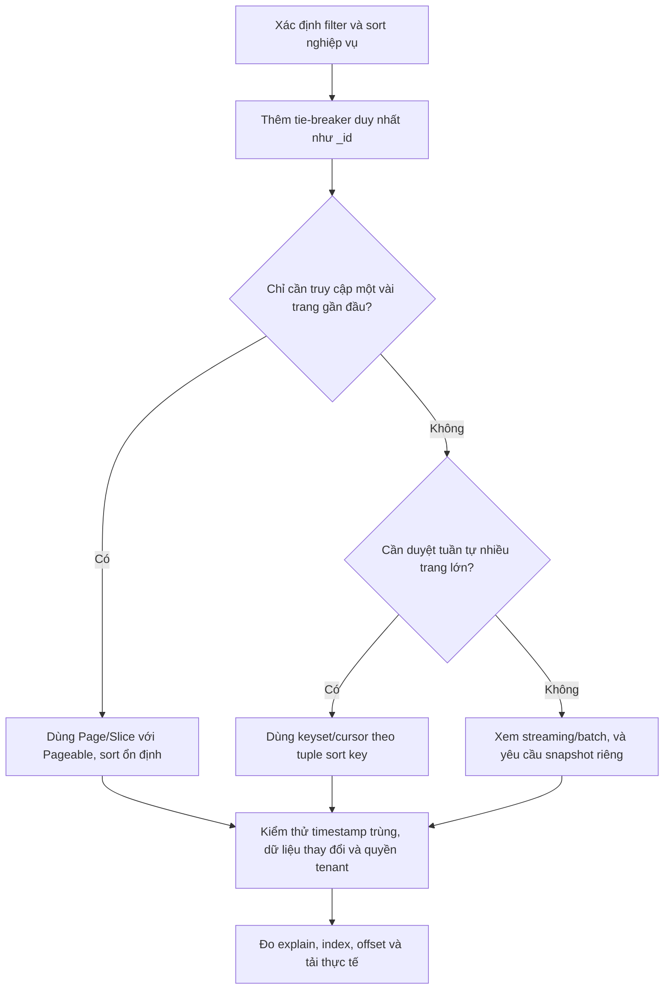

# Thứ tự ổn định khi nhiều document có cùng giá trị

Khi xây dựng API danh sách bằng **Spring Data MongoDB**, bạn thường sắp xếp theo thời điểm tạo, mức giá hoặc mức độ ưu tiên rồi phân trang bằng `Pageable`. Nếu nhiều document có cùng giá trị sắp xếp, chẳng hạn cùng `createdAt` đến mức mili giây, MongoDB không có nghĩa vụ trả các document đó theo một thứ tự cố định. Hệ quả là trang 1 và trang 2 có thể xuất hiện bản ghi trùng hoặc bỏ sót ngay cả khi biểu thức lọc không đổi.

Giải pháp nền tảng là xác định **thứ tự toàn phần** (*total ordering*): kết hợp trường sắp xếp nghiệp vụ với một **tie-breaker duy nhất**, thường là `_id`. Với một danh sách đơn hàng, sắp xếp `{ createdAt: -1, _id: -1 }` có ý nghĩa rõ hơn `{ createdAt: -1 }`: nếu hai đơn được tạo cùng thời điểm, `_id` quyết định đơn nào đi trước.

Bài thuộc chương **Phân trang và luồng** này áp dụng trực tiếp vào `MongoRepository`, `MongoTemplate`, truy vấn BSON, index và chiến lược duyệt dữ liệu theo cursor trong Spring Data MongoDB.

Sau bài học, bạn có thể:

- Giải thích vì sao `sort` theo một trường **không duy nhất** chưa tạo thứ tự ổn định.
- Dùng `_id` hoặc một khóa duy nhất phù hợp để phá hòa (*tie-break*).
- Đảm bảo `Pageable`, `Slice` và API cuộn/duyệt có thứ tự nhất quán.
- Viết truy vấn **keyset/seek pagination** với nhiều trường sort và so sánh đúng chiều.
- Thiết kế index ghép, kiểm tra `explain("executionStats")` và đánh giá chi phí của `skip`.
- Phân biệt **thứ tự xác định** với **ảnh chụp dữ liệu nhất quán khi có ghi đồng thời**.
- Kiểm thử các ca nhiều document trùng `createdAt`, giới hạn trang và dữ liệu mới xuất hiện.

## 1. Vì sao sort theo một field không đủ?

Giả sử có sáu document đơn hàng, được sắp xếp theo `createdAt` mới nhất trước:

| Document | `createdAt` (UTC) | `_id` rút gọn | Tổng tiền |
| --- | --- | --- | ---: |
| A | 2026-11-20 09:00:02.000 | 201 | 120.000 |
| B | 2026-11-20 09:00:01.000 | 102 | 80.000 |
| C | 2026-11-20 09:00:01.000 | 103 | 30.000 |
| D | 2026-11-20 09:00:01.000 | 104 | 200.000 |
| E | 2026-11-20 09:00:00.000 | 100 | 90.000 |
| F | 2026-11-20 08:59:59.000 | 099 | 50.000 |

Các giá trị `_id` trên chỉ là **nhãn rút gọn** phục vụ ví dụ; trong MongoDB, mỗi document thực tế có `_id` đúng BSON type. B, C và D cùng thời điểm tạo đến mili giây.

Truy vấn:

```javascript
db.orders.find({ tenantId: "T1" })
  .sort({ createdAt: -1 })
  .limit(3);
```

chắc chắn đặt A trước nhóm B/C/D và nhóm đó trước E/F, **nhưng không cam kết thứ tự trong nhóm B/C/D**. Một lần thực thi có thể ra A, B, D; lần khác có thể ra A, C, B. MongoDB không hứa giữ thứ tự insert hoặc `_id` cho các phần tử có cùng sort key nếu bạn không yêu cầu.

Với trang kích thước 2:

```javascript
db.orders.find({ tenantId: "T1" })
  .sort({ createdAt: -1 })
  .skip(0).limit(2); // Trang 1

db.orders.find({ tenantId: "T1" })
  .sort({ createdAt: -1 })
  .skip(2).limit(2); // Trang 2
```

Nếu thứ tự của B/C/D thay đổi giữa hai truy vấn, một document có thể xuất hiện ở cả hai trang, còn document khác chưa được trả về. Việc sort có cùng cú pháp ở hai request **không bảo đảm** hai lần chạy dùng cùng một thứ tự trong nhóm hòa.

### Quy tắc tổng quát

Một thứ tự sắp xếp được xác định hoàn toàn khi **hai document khác nhau trong tập kết quả không thể có cùng toàn bộ tuple sort key**. Nếu `createdAt` có thể trùng, dùng một tuple như:

```text
(createdAt, _id)
```

Trong một collection thông thường, `_id` là duy nhất; vì thế nếu hai document có cùng `createdAt`, chúng vẫn khác nhau theo `_id`. Không nên trông chờ ObjectId có thứ tự tạo chính xác tuyệt đối: `ObjectId` có timestamp độ phân giải giây, có thành phần random/counter và có thể được tạo ở các client khác nhau. Vai trò của `_id` ở đây là **khóa phá hòa duy nhất**, không phải nguồn thời gian nghiệp vụ đáng tin cậy hơn `createdAt`.

## 2. Thêm tie-breaker vào thứ tự sắp xếp

Với dữ liệu đơn hàng:

```javascript
db.orders.find({ tenantId: "T1" })
  .sort({ createdAt: -1, _id: -1 })
  .limit(3);
```

MongoDB so sánh theo thứ tự từ trái sang phải:

1. `createdAt` giảm dần: đơn mới hơn đi trước.
2. Nếu `createdAt` bằng nhau, `_id` giảm dần quyết định thứ tự.

Trong ví dụ bảng ở trên, nếu ID rút gọn tăng theo 102, 103, 104, thứ tự có thể hình dung là **A, D, C, B, E, F** (giả định quan hệ thứ tự của ID thật cũng tương ứng các nhãn). Với dữ liệu cụ thể ở phần thực hành, kết quả sẽ được kiểm chứng bằng ObjectId xác định.

### Phân biệt khóa nghiệp vụ và khóa phá hòa

| Sort key | Ưu điểm | Giới hạn |
| --- | --- | --- |
| `createdAt` | Tương ứng yêu cầu "mới nhất trước" | Nhiều document có thể có cùng giá trị |
| `price` hoặc `priority` | Diễn đạt nghiệp vụ | Dễ trùng, có thể bị cập nhật |
| `createdAt, _id` | Có thứ tự toàn phần nếu `_id` duy nhất | Cần giữ nhất quán chiều sort trong các request |
| `price, _id` | Phá hòa khi nhiều mức giá bằng nhau | Khi giá thay đổi giữa các lần duyệt, thứ tự cũng thay đổi |
| `createdAt, orderNo` | Có thể phù hợp nếu `orderNo` thực sự duy nhất | Phải có unique constraint thực và so sánh/collation nhất quán |

Nếu danh sách cần một cách sắp xếp khác, ví dụ `priority` giảm dần và `createdAt` tăng dần, hãy thêm `_id` để phá hòa:

```javascript
db.tasks.find({ tenantId: "T1" })
  .sort({ priority: -1, createdAt: 1, _id: 1 });
```

**Không có quy tắc bắt buộc tie-breaker phải giảm dần.** Hãy chọn chiều theo hợp đồng của API và giữ nguyên ở mọi lượt truy vấn, trong predicate cursor và trong index tương ứng.

### Tại sao `_id` có thể là lựa chọn hợp lý?

MongoDB yêu cầu document có `_id`, và collection thường có chỉ mục mặc định trên field này. Điều đó không có nghĩa mọi sort ghép có `_id` đều được index `_id_` hỗ trợ hiệu quả; nhiều query vẫn cần **compound index**. Nhưng `_id` là một khóa đã có sẵn, ổn định sau khi tạo và có tính duy nhất trong phạm vi collection.

Nếu dữ liệu gồm nhiều collection hợp nhất, output của aggregation hoặc hệ thống dùng khóa tùy biến, hãy kiểm tra tie-breaker có **duy nhất trong tập kết quả thực** hay không. Không áp đặt `_id` như khóa duy nhất trong một kết quả đã `$group` hoặc `$unwind` tạo nhiều hàng cho cùng một document.

## 3. Sắp xếp ổn định trong Spring Data MongoDB repository

### 3.1. Entity dùng trong bài

```java
import java.time.Instant;
import org.bson.types.ObjectId;
import org.springframework.data.annotation.Id;
import org.springframework.data.mongodb.core.mapping.Document;

@Document(collection = "orders_page_lab")
public class OrderRecord {
    @Id
    private ObjectId id;

    private String tenantId;
    private boolean deleted;
    private Instant createdAt;
    private String status;
    private long totalMinor;

    protected OrderRecord() {}

    public OrderRecord(
            String tenantId, boolean deleted,
            Instant createdAt, String status, long totalMinor) {
        this.tenantId = tenantId;
        this.deleted = deleted;
        this.createdAt = createdAt;
        this.status = status;
        this.totalMinor = totalMinor;
    }

    public ObjectId getId() { return id; }
    public String getTenantId() { return tenantId; }
    public Instant getCreatedAt() { return createdAt; }
    public boolean isDeleted() { return deleted; }
}
```

`@Id` ánh xạ property `id` của Java sang BSON `_id`. `Instant` thường được chuyển thành BSON Date; BSON Date lưu mốc thời gian ở mức mili giây, khiến nhiều giao dịch cùng thời điểm có thể trùng `createdAt`.

### 3.2. Repository nhận `Pageable`

```java
import org.bson.types.ObjectId;
import org.springframework.data.domain.Page;
import org.springframework.data.domain.Pageable;
import org.springframework.data.mongodb.repository.MongoRepository;

public interface OrderRecordRepository
        extends MongoRepository<OrderRecord, ObjectId> {

    Page<OrderRecord> findByTenantIdAndDeletedFalse(
        String tenantId, Pageable pageable);
}
```

Khi gọi repository, xây thứ tự rõ ràng:

```java
import org.springframework.data.domain.Page;
import org.springframework.data.domain.PageRequest;
import org.springframework.data.domain.Sort;

Sort stableSort = Sort.by(
    Sort.Order.desc("createdAt"),
    Sort.Order.desc("id")
);

PageRequest request = PageRequest.of(0, 20, stableSort);
Page<OrderRecord> page = repository.findByTenantIdAndDeletedFalse(
    trustedTenantId, request
);
```

Trong `Sort` của Spring Data, nên dùng **tên property Java** `id`; mapper sẽ chuyển sang `_id` khi truy vấn với domain class. Đảm bảo đúng tên thuộc tính nếu entity có `@Field` đổi tên trường BSON.

Đoạn ví dụ trên chỉ minh họa service có `repository` và `trustedTenantId` đã được xác định; không phải mã ứng dụng hoàn chỉnh. Trong API đa tenant, `tenantId` phải được xác minh theo phiên đăng nhập/quyền truy cập, không tin một tenant bất kỳ do client nhập.

### 3.3. `Page`, `Slice` và ý nghĩa

| Kiểu kết quả | Khi nên dùng | Lưu ý |
| --- | --- | --- |
| `Page<T>` | UI cần tổng số phần tử/tổng số trang | Có thể yêu cầu count query bên cạnh truy vấn dữ liệu |
| `Slice<T>` | UI chỉ cần biết còn trang tiếp không | Có thể tránh tính tổng chính xác, tùy implementation |
| `List<T>` với `Pageable` | Chỉ cần một danh sách giới hạn | Không có metadata tổng trang/hasNext như `Page` |
| Cursor/keyset | Duyệt nhiều trang liên tục, tránh offset lớn | Cần sort key ổn định và predicate "sau khóa cuối" |

Mọi kiểu kết quả trên vẫn cần **sort xác định** nếu bạn muốn thứ tự nhất quán. `Page` có tổng số bản ghi không tự sửa được lỗi sắp xếp hòa; `Slice` giảm công việc count nhưng cũng không tự thêm tie-breaker.

### 3.4. Không chấp nhận sort tùy ý mà không kiểm soát

Nếu API cho phép client chọn sort, hãy xây allowlist tên field và tự thêm khóa phá hòa:

```java
import org.springframework.data.domain.Sort;

public Sort stableSortFor(String requestedField, boolean descending) {
    String property = switch (requestedField) {
        case "created" -> "createdAt";
        case "total" -> "totalMinor";
        default -> throw new IllegalArgumentException("Sort không hợp lệ");
    };

    Sort.Direction direction = descending
        ? Sort.Direction.DESC : Sort.Direction.ASC;

    return Sort.by(
        new Sort.Order(direction, property),
        new Sort.Order(direction, "id")
    );
}
```

Client không nên được truyền tùy ý tên trường có thể làm lộ dữ liệu hoặc gây query chậm. Khi dùng `Pageable` được tạo tự động từ request, đảm bảo lớp service kiểm tra/chuẩn hóa sort thay vì mù quáng chuyển trực tiếp yêu cầu client tới repository.

## 4. `MongoTemplate`: lọc, sort, skip và limit rõ ràng

Khi cần kiểm soát query:

```java
import java.util.List;
import org.springframework.data.domain.Sort;
import org.springframework.data.mongodb.core.MongoTemplate;
import org.springframework.data.mongodb.core.query.Criteria;
import org.springframework.data.mongodb.core.query.Query;

public List<OrderRecord> readPage(
        MongoTemplate template, String trustedTenantId,
        int pageNumber, int pageSize) {

    if (pageNumber < 0 || pageSize < 1 || pageSize > 100) {
        throw new IllegalArgumentException("Phân trang không hợp lệ");
    }
    long offset = Math.multiplyExact(
        (long) pageNumber, (long) pageSize
    );

    Query query = Query.query(
        Criteria.where("tenantId").is(trustedTenantId)
                .and("deleted").is(false)
    );
    query.with(Sort.by(
        Sort.Order.desc("createdAt"),
        Sort.Order.desc("id")
    ));
    query.skip(offset);
    query.limit(pageSize);
    return template.find(query, OrderRecord.class);
}
```

Trong Spring Data MongoDB, `Query.skip(...)` dùng offset và `Query.limit(...)` giới hạn số document. Các giá trị `pageNumber`, `pageSize` phải được kiểm tra để tránh truy vấn quá lớn; nếu dùng `PageRequest`, cũng cần giới hạn mức page size ở biên API.

### 4.1. Offset có thứ tự ổn định vẫn có thể trôi trang

Tie-breaker giải quyết việc các document **hòa sort key** không có thứ tự xác định, nhưng **không khóa tập dữ liệu** giữa các request. Ví dụ:

1. Client đọc trang đầu tiên chứa A, D theo `createdAt DESC, _id DESC`.
2. Một đơn mới X được chèn vào đầu danh sách.
3. Client đọc trang hai bằng `skip(2)`, offset lúc này đã bị dịch.

Document D có thể xuất hiện lại hoặc một document khác bị bỏ qua. Đây là hiện tượng *page drift* do **dữ liệu thay đổi**, không phải do hai document có cùng `createdAt`.

| Vấn đề | Thứ tự có tie-breaker giúp gì? | Vẫn cần gì thêm? |
| --- | --- | --- |
| Nhiều document trùng `createdAt` | Quy định rõ thứ tự giữa chúng | Giữ sort đồng nhất mọi trang |
| Chèn/xóa document giữa hai lượt gọi `skip` | Không ngăn offset dịch chuyển | Cursor/keyset, giới hạn snapshot hoặc giải pháp riêng |
| Sort key của document thay đổi | Không ngăn document đổi vị trí | Thiết kế trường sort bất biến, quy trình đồng bộ hoặc snapshot |
| Phân trang qua nhiều request độc lập | Thứ tự xác định tại mỗi lượt query | Không mặc định có snapshot nhất quán xuyên request |

Để một lần xuất báo cáo dài bảo đảm tập dữ liệu không thay đổi xuyên suốt, có thể cần snapshot/read concern, transaction phù hợp hoặc chiến lược đóng băng danh sách ID theo yêu cầu nghiệp vụ. Một `Pageable` đơn thuần không cung cấp những đảm bảo đó.

## 5. Keyset/seek pagination: dùng khóa cuối thay cho offset

Khi client duyệt nhiều trang lớn, keyset pagination thường tránh chi phí `skip` lớn và giảm tình trạng trùng trang do chèn mới ở phía trước. Ý tưởng là: sau khi đã nhận document cuối của trang trước, trang sau chỉ đọc những document **đứng sau** tuple sort key đó.

Với sort giảm dần:

```javascript
{ createdAt: -1, _id: -1 }
```

và khóa cuối:

```text
lastCreatedAt = 2026-11-20T09:00:01.000Z
lastId        = ObjectId("...")
```

document tiếp theo phải thỏa:

```text
createdAt < lastCreatedAt
OR
(createdAt = lastCreatedAt AND _id < lastId)
```

**Vì cả hai trường đều giảm dần, dấu so sánh ở đây là nhỏ hơn (`$lt`).** Đối với sort tăng dần tương ứng, so sánh là lớn hơn (`$gt`). Với nhiều trường và chiều sort hỗn hợp, phải xây phép so sánh lexicographic phù hợp từng chiều.

### 5.1. Bộ lọc `mongosh`

```javascript
const lastCreatedAt = ISODate("2026-11-20T09:00:01.000Z");
const lastId = ObjectId("665f1f2a4b6c7d8e9f001234");

db.orders_page_lab.find({
  tenantId: "T1",
  deleted: false,
  $or: [
    { createdAt: { $lt: lastCreatedAt } },
    {
      createdAt: lastCreatedAt,
      _id: { $lt: lastId }
    }
  ]
})
.sort({ createdAt: -1, _id: -1 })
.limit(20);
```

Đây là **cấu trúc ví dụ**. Trong thao tác thật, `lastCreatedAt` và `lastId` phải lấy từ document cuối của trang trước, không dùng các giá trị ví dụ cố định. Nếu trang đầu tiên chưa có cursor, không thêm `$or`. Điều kiện tenant và soft delete nằm ở cấp cao nhất, **áp dụng cho cả hai nhánh**.

### 5.2. `MongoTemplate` với cursor đã được parse

```java
import java.time.Instant;
import java.util.List;
import org.bson.types.ObjectId;
import org.springframework.data.domain.Sort;
import org.springframework.data.mongodb.core.MongoTemplate;
import org.springframework.data.mongodb.core.query.Criteria;
import org.springframework.data.mongodb.core.query.Query;

public List<OrderRecord> readNext(
        MongoTemplate template,
        String trustedTenantId,
        Instant lastCreatedAt,
        ObjectId lastId,
        int size) {

    if (size < 1 || size > 100) {
        throw new IllegalArgumentException("size phải trong [1, 100]");
    }
    if ((lastCreatedAt == null) != (lastId == null)) {
        throw new IllegalArgumentException(
            "Cursor phải chứa đủ createdAt và id"
        );
    }

    Criteria scoped = new Criteria().andOperator(
        Criteria.where("tenantId").is(trustedTenantId),
        Criteria.where("deleted").is(false)
    );

    if (lastCreatedAt != null) {
        Criteria after = new Criteria().orOperator(
            Criteria.where("createdAt").lt(lastCreatedAt),
            new Criteria().andOperator(
                Criteria.where("createdAt").is(lastCreatedAt),
                Criteria.where("id").lt(lastId)
            )
        );
        scoped = new Criteria().andOperator(scoped, after);
    }

    Query query = new Query(scoped)
        .with(Sort.by(
            Sort.Order.desc("createdAt"),
            Sort.Order.desc("id")
        ))
        .limit(size);

    return template.find(query, OrderRecord.class);
}
```

`Criteria.where("id")` là property path Java và được mapper ánh xạ sang `_id` vì query gọi với `OrderRecord.class`. Với driver hoặc `mongosh`, phải viết `_id` trực tiếp.

**Chú ý:** khi BSON Date có độ phân giải mili giây, hãy giữ nguyên giá trị thời điểm đã đọc, tránh chuyển sang `LocalDateTime` rồi làm tròn hoặc áp dụng sai timezone trong cursor. `ObjectId` ở cursor cần parse đúng BSON type. Không bind cursor tùy ý như một đoạn JSON do client gửi.

### 5.3. Cursor là dữ liệu, không phải quyền

Cursor có thể được mã hóa (ví dụ base64url) từ cặp `lastCreatedAt` và `lastId`, kèm version/schema, thứ tự sort và thông tin filter cần thiết. Nhưng **base64 không phải mã hóa bảo mật hay chữ ký**. Nếu cursor do client cung cấp:

- Parse dữ liệu vào **kiểu cụ thể** (`Instant`, `ObjectId`); kiểm tra độ dài/format.
- Cố định hoặc xác nhận sort direction và filter của cursor khớp request.
- Lấy `tenantId` đáng tin cậy từ context server, không cho cursor tự thay tenant.
- Cân nhắc ký cursor (HMAC) nếu API cần chống sửa nội dung hoặc ràng buộc cursor vào filter/user.
- Không cho phép một cursor làm xuất hiện raw operator hay query field tùy ý.

Mục tiêu của cursor là xác định **vị trí duyệt**, không thay thế kiểm soát truy cập.

## 6. Keyset không phải snapshot: những trường hợp vẫn có thể bỏ sót hoặc trùng

Keyset giúp tránh phụ thuộc vào vị trí offset của những document **đã đứng trước cursor**. Nếu một đơn mới hơn được chèn lên đầu danh sách sau khi client đọc trang đầu, truy vấn seek dựa trên khóa cuối vẫn đi tiếp từ mốc trước, thay vì đếm lại `skip` từ đầu.

Tuy nhiên, keyset không tự bảo đảm một kết quả bất biến nếu:

- **Sort key thay đổi**: document đã đọc bị sửa `price` hoặc `priority`, di chuyển ra sau cursor và có thể xuất hiện lại.
- **Document chưa đọc bị sửa sort key**: nó di chuyển lên trước cursor và có thể không được đọc trong phiên duyệt hiện tại.
- **Document bị xóa hoặc thay đổi filter**: tập kết quả của các trang thay đổi.
- **Nhiều document bị chèn với sort key cũ**: tùy vị trí so với cursor, chúng có thể xuất hiện ở các trang sau.
- **Ứng dụng đổi định nghĩa sort/filter giữa chừng**: một cursor cũ không còn có ý nghĩa cho query mới.

Vì vậy, đối với feed đọc thông thường, việc duyệt theo cursor thường là một lựa chọn tốt nếu chấp nhận dữ liệu thay đổi. Với tác vụ xuất dữ liệu, kế toán hoặc đối soát yêu cầu **một tập kết quả được cố định**, cần thiết kế riêng về snapshot, ranh giới thời gian, watermark, transaction/read concern hoặc lưu danh sách khóa theo khả năng triển khai của hệ thống.

### 6.1. Chọn sort key ít thay đổi

`createdAt` thường ít bị sửa hơn `updatedAt`, `price` hoặc `priority`. Vì thế, khi yêu cầu "đơn mới nhất trước", `(createdAt, _id)` thường là lựa chọn thuận lợi cho keyset.

Nếu màn hình yêu cầu sort theo `updatedAt`, hãy xác nhận mong muốn khi một bản ghi đã đọc được cập nhật rồi **nhảy về đầu**. Tránh hứa với người dùng rằng cursor bảo đảm mỗi document chỉ xuất hiện đúng một lần xuyên nhiều phút cập nhật liên tục; đảm bảo đó cần thêm thiết kế.

### 6.2. Không bỏ qua trường hợp timestamp trùng nhau

Một sai lầm phổ biến là chỉ dùng:

```javascript
// SAI cho keyset nếu nhiều đơn có createdAt giống nhau.
db.orders_page_lab.find({
  tenantId: "T1",
  createdAt: { $lt: lastCreatedAt }
}).sort({ createdAt: -1 }).limit(20);
```

Nếu trang trước kết thúc giữa nhóm document cùng `createdAt`, điều kiện `$lt` này bỏ qua **mọi document còn lại trong nhóm**. Phải thêm nhánh `createdAt = lastCreatedAt AND _id < lastId` theo đúng thứ tự sắp xếp.

Ngược lại, chỉ dùng `createdAt <= lastCreatedAt` khiến document cuối của trang trước và các document đã đọc cùng timestamp có thể bị lấy lại. **So sánh lexicographic đủ hai trường** mới là cách diễn đạt đúng.

## 7. Thực hành `mongosh` với nhiều document trùng timestamp

Phần này tạo dataset trong collection `orders_page_lab` của database thử nghiệm, **không dùng dữ liệu sản xuất**. Mỗi lần chạy có marker riêng; để các lệnh nhất quán, chạy liên tiếp trong **một phiên `mongosh`**.

### 7.1. Tạo dữ liệu thử

```javascript
use spring_data_training

const lab = db.getCollection("orders_page_lab");
const runId = "pagination-streams-005-" + new ObjectId().toHexString();
const tenant1 = runId + "-T1";
const tenant2 = runId + "-T2";

const d0 = ISODate("2026-11-20T09:00:00.000Z");
const d1 = ISODate("2026-11-20T09:00:01.000Z");
const d2 = ISODate("2026-11-20T09:00:02.000Z");

const inserted = lab.insertMany([
  {
    runId: runId, tenantId: tenant1, label: "A",
    deleted: false, createdAt: d2, totalMinor: NumberLong("120000")
  },
  {
    runId: runId, tenantId: tenant1, label: "B",
    deleted: false, createdAt: d1, totalMinor: NumberLong("80000")
  },
  {
    runId: runId, tenantId: tenant1, label: "C",
    deleted: false, createdAt: d1, totalMinor: NumberLong("30000")
  },
  {
    runId: runId, tenantId: tenant1, label: "D",
    deleted: false, createdAt: d1, totalMinor: NumberLong("200000")
  },
  {
    runId: runId, tenantId: tenant1, label: "E",
    deleted: false, createdAt: d0, totalMinor: NumberLong("90000")
  },
  {
    runId: runId, tenantId: tenant1, label: "F",
    deleted: false,
    createdAt: ISODate("2026-11-20T08:59:59.000Z"),
    totalMinor: NumberLong("50000")
  },
  {
    runId: runId, tenantId: tenant2, label: "X",
    deleted: false, createdAt: d2, totalMinor: NumberLong("60000")
  },
  {
    runId: runId, tenantId: tenant1, label: "Z",
    deleted: true, createdAt: d2, totalMinor: NumberLong("70000")
  }
]);

print("runId=" + runId);
print("tenant1=" + tenant1);
print("Số document của phiên=" +
  lab.countDocuments({ runId: runId })); // Dự kiến: 8
```

Đoạn lệnh mặc định sinh ObjectId riêng cho từng bản ghi; không giả định chúng được sắp xếp theo thứ tự tên A/B/C/D. Điều chắc chắn là các ObjectId khác nhau và đủ để phá hòa khi `createdAt` trùng.

### 7.2. Quan sát một thứ tự xác định

```javascript
const commonFilter = {
  runId: runId,
  tenantId: tenant1,
  deleted: false
};

const stable = lab.find(commonFilter)
  .sort({ createdAt: -1, _id: -1 })
  .toArray();

printjson(stable.map(d => ({
  label: d.label,
  createdAt: d.createdAt,
  id: d._id
})));
```

Kết quả chứa đúng **6** bản ghi A–F, không có X (tenant khác) và Z (đã xóa mềm). Trong nhóm B/C/D có cùng `createdAt`, thứ tự phụ thuộc vào giá trị `_id` cụ thể nhưng được **quy định đầy đủ** bởi phép sort.

### 7.3. Duyệt bằng offset có tie-breaker

```javascript
const pageSize = 2;
const page0 = lab.find(commonFilter)
  .sort({ createdAt: -1, _id: -1 })
  .skip(0).limit(pageSize).toArray();

const page1 = lab.find(commonFilter)
  .sort({ createdAt: -1, _id: -1 })
  .skip(2).limit(pageSize).toArray();

const page2 = lab.find(commonFilter)
  .sort({ createdAt: -1, _id: -1 })
  .skip(4).limit(pageSize).toArray();

printjson({
  page0: page0.map(d => d.label),
  page1: page1.map(d => d.label),
  page2: page2.map(d => d.label)
});
```

Nếu không có ghi đồng thời, ghép ba trang trên cho cùng một danh sách 6 document theo thứ tự `stable`. Kiểm tra:

```javascript
const allPages = [...page0, ...page1, ...page2];
print(allPages.length); // 6
print(new Set(allPages.map(d => d._id.toHexString())).size); // 6
```

Điều này xác minh thứ tự trên **dataset đứng yên**. Nó không phải bằng chứng các trang sẽ bất biến nếu có insert/delete giữa các request.

### 7.4. Duyệt bằng keyset, kể cả khi trang cắt ngang nhóm hòa

```javascript
function seekAfter(lastDoc, limit) {
  const filter = {
    ...commonFilter,
    $or: [
      { createdAt: { $lt: lastDoc.createdAt } },
      {
        createdAt: lastDoc.createdAt,
        _id: { $lt: lastDoc._id }
      }
    ]
  };
  return lab.find(filter)
    .sort({ createdAt: -1, _id: -1 })
    .limit(limit)
    .toArray();
}

const seek0 = lab.find(commonFilter)
  .sort({ createdAt: -1, _id: -1 })
  .limit(2)
  .toArray();

const seek1 = seekAfter(seek0[seek0.length - 1], 2);
const seek2 = seekAfter(seek1[seek1.length - 1], 2);

const seekAll = [...seek0, ...seek1, ...seek2];
printjson(seekAll.map(d => d.label));

print(seekAll.length); // 6
print(new Set(seekAll.map(d => d._id.toHexString())).size); // 6
```

Do nhóm B/C/D có ba document cùng `createdAt` và mỗi trang chỉ có hai phần tử, ít nhất một ranh giới trang sẽ đi qua nhóm hòa. Hai nhánh trong `seekAfter` bảo đảm các document còn lại cùng timestamp không bị bỏ qua.

**Kiểm chứng thêm:** so sánh thứ tự `seekAll` với `stable`:

```javascript
const expectedIds = stable.map(d => d._id.toHexString());
const seekIds = seekAll.map(d => d._id.toHexString());
printjson({ equal: JSON.stringify(expectedIds) === JSON.stringify(seekIds) });
// Dự kiến: { equal: true } nếu tập dữ liệu không thay đổi.
```

### 7.5. Vì sao chỉ lọc `createdAt < lastCreatedAt` là sai?

```javascript
const firstCursor = seek0[seek0.length - 1];
const incorrectNext = lab.find({
  ...commonFilter,
  createdAt: { $lt: firstCursor.createdAt }
})
.sort({ createdAt: -1, _id: -1 })
.limit(2)
.toArray();

printjson({
  cursorTime: firstCursor.createdAt,
  nextIfOnlyDate: incorrectNext.map(d => d.label),
  nextWithTieBreaker: seek1.map(d => d.label)
});
```

Nếu trang cắt ngang nhóm B/C/D, bộ lọc chỉ theo ngày sẽ bỏ qua những phần tử cùng thời điểm còn chưa đọc. Bài tập này cho thấy sự khác biệt bằng kết quả thực tế; không cần giả định trước giá trị ObjectId được tạo.

### 7.6. Dọn đúng dữ liệu vừa tạo

Sau khi thực hành xong:

```javascript
const before = lab.countDocuments({ runId: runId });
print("Số document sẽ dọn: " + before);

const cleanup = lab.deleteMany({ runId: runId });
printjson({ deletedCount: cleanup.deletedCount });
```

Chỉ dọn bằng marker `runId` của phiên. Không dùng `deleteMany({})` hoặc `drop()` trên collection có thể chứa dữ liệu của người khác.

## 8. Compound index phục vụ filter và sort

Query thường xuyên:

```javascript
db.orders_page_lab.find({
  tenantId: "T1",
  deleted: false
}).sort({ createdAt: -1, _id: -1 }).limit(20);
```

có thể cân nhắc một index ghép:

```javascript
db.orders_page_lab.createIndex(
  {
    tenantId: 1,
    deleted: 1,
    createdAt: -1,
    _id: -1
  },
  { name: "idx_tenant_deleted_created_id" }
);
```

Ở đây `tenantId` và `deleted` là các trường **lọc equality**, theo sau là cặp field **sort**. Nếu query, hướng sort và tính chọn lọc phù hợp, index có thể giúp MongoDB trả dữ liệu theo thứ tự mà không cần một bước sort tốn bộ nhớ riêng.

**Đừng hiểu nhầm:** index mặc định `_id_` chỉ mục một trường `_id`, không thay thế hoàn toàn compound index cần lọc tenant và sort theo ngày. Mỗi index cũng tiêu tốn lưu trữ và chi phí cập nhật khi ghi, vì vậy nên đo theo workload thay vì tạo tất cả biến thể có thể nghĩ ra.

### 8.1. Đọc `explain("executionStats")`

```javascript
db.orders_page_lab.find({
  tenantId: "TENANT_THUC_TE",
  deleted: false
})
.sort({ createdAt: -1, _id: -1 })
.limit(20)
.explain("executionStats");
```

Thay `TENANT_THUC_TE` bằng tenant thực có dữ liệu. Quan sát:

| Thành phần | Câu hỏi kiểm tra |
| --- | --- |
| `winningPlan` | Có `IXSCAN` phù hợp không? Có stage `SORT` không? |
| `totalKeysExamined` | Đã duyệt bao nhiêu entry của index? |
| `totalDocsExamined` | Đã đọc bao nhiêu document? |
| `nReturned` | Có đúng số lượng và bộ lọc không? |
| `executionTimeMillis` | Số liệu theo điều kiện lần chạy; cần đo thêm để đánh giá thực tế |

`explain` trên một bộ dữ liệu tám document chưa chứng minh index tối ưu trong production. Cần dataset đại diện, tần suất query, hướng sort, giới hạn trang và điều kiện filter thực tế.

### 8.2. Offset lớn và keyset với index

Với `skip(100000)`, MongoDB thường vẫn phải duyệt/bỏ qua nhiều kết quả trước khi trả 20 document ở trang hiện tại, dù có index phù hợp. Keyset sử dụng điều kiện **đứng sau khóa cuối** để bắt đầu tại một đoạn nhỏ hơn của thứ tự index và có thể giảm đáng kể chi phí khi duyệt xa.

Tuy nhiên, `$or` ở keyset, điều kiện filter khác nhau, index và query planner có thể dẫn tới kế hoạch thực thi khác nhau. Đừng coi keyset lúc nào cũng nhanh hơn; cần `explain` và kiểm thử tải để xác minh.

### 8.3. Direction, collation và nullable field

- Với `{ createdAt: -1, _id: -1 }`, tạo index với chiều sort phù hợp; MongoDB cũng có thể duyệt index theo chiều ngược khi cấu trúc cho phép.
- Nếu sort theo String như `lastName`, collation có thể thay đổi cách so sánh (phân biệt hoa thường, dấu). Truy vấn và index phải sử dụng collation nhất quán khi yêu cầu.
- Nếu field sort thiếu hoặc có `null`, nhiều document có thể cùng key. `_id` vẫn phá hòa, nhưng keyset predicate so sánh với `null`/missing có nhiều trường hợp phức tạp; nên chuẩn hóa schema hoặc định nghĩa chính sách rõ ràng.
- Nếu sort theo **mảng**, giá trị dùng để sắp xếp phụ thuộc quy tắc của MongoDB và có thể không phù hợp với cursor đơn giản; hãy chọn scalar sort key rõ nghĩa nếu cần phân trang ổn định.

## 9. Phân trang và stream: cùng phải tuân thủ thứ tự

`stream` và `pagination` giải quyết hai vấn đề khác nhau:

- **Pagination** chia kết quả thành các phần có thể truy cập qua nhiều request, có thể cần tổng số trang hoặc cursor.
- **Streaming** đọc tuần tự dữ liệu từ cursor/luồng thay vì nạp toàn bộ tập kết quả vào một `List` lớn trên ứng dụng.

Không có cơ chế nào tự tạo thứ tự toàn phần. Khi dùng stream để xuất một danh sách có thứ tự hoặc chia thành nhiều lô, nếu mong kết quả xác định phải đặt sort rõ ràng **trên query MongoDB**.

### 9.1. `MongoTemplate.stream` cho truy cập đồng bộ

```java
import org.springframework.data.domain.Sort;
import org.springframework.data.mongodb.core.MongoTemplate;
import org.springframework.data.mongodb.core.query.Criteria;
import org.springframework.data.mongodb.core.query.Query;
import org.springframework.data.util.CloseableIterator;

public void consumeOrdered(
        MongoTemplate template, String trustedTenantId) {

    Query query = Query.query(
        Criteria.where("tenantId").is(trustedTenantId)
                .and("deleted").is(false)
    );
    query.with(Sort.by(
        Sort.Order.desc("createdAt"),
        Sort.Order.desc("id")
    ));

    try (CloseableIterator<OrderRecord> cursor =
             template.stream(query, OrderRecord.class)) {
        while (cursor.hasNext()) {
            OrderRecord order = cursor.next();
            // Xử lý từng document; tránh lưu toàn bộ vào bộ nhớ.
            process(order);
        }
    }
}
```

`process(order)` là method nghiệp vụ được ứng dụng triển khai; ví dụ nhằm thể hiện vòng lặp đọc. Cần **đóng `CloseableIterator`** để giải phóng tài nguyên cursor. Với tập dữ liệu rất lớn, còn phải cân nhắc thời gian giữ connection/cursor, khả năng bị timeout, giới hạn bộ nhớ trên server và cách phục hồi nếu tiến trình dừng giữa chừng.

Một stream với sort xác định trên **một lượt truy vấn** không tự đảm bảo ảnh chụp nhất quán nếu có các thao tác ghi đồng thời. Khi có yêu cầu "xuất chính xác cùng một tập bản ghi", cần chọn chính sách read consistency và workflow tương ứng.

### 9.2. Reactive access với `ReactiveMongoTemplate`

Với Reactive Spring Data MongoDB, lệnh `find` trả một `Flux`:

```java
import reactor.core.publisher.Flux;
import org.springframework.data.domain.Sort;
import org.springframework.data.mongodb.core.ReactiveMongoTemplate;
import org.springframework.data.mongodb.core.query.Criteria;
import org.springframework.data.mongodb.core.query.Query;

public Flux<OrderRecord> readOrderedReactive(
        ReactiveMongoTemplate template, String trustedTenantId) {

    Query query = Query.query(
        Criteria.where("tenantId").is(trustedTenantId)
                .and("deleted").is(false)
    );
    query.with(Sort.by(
        Sort.Order.desc("createdAt"),
        Sort.Order.desc("id")
    )).limit(100);

    return template.find(query, OrderRecord.class);
}
```

Sort được gửi xuống **MongoDB**, và giới hạn 100 document được đặt trong query. Không nên gọi thao tác sắp xếp phía Java trên một `Flux` lớn nếu mục tiêu là dùng index MongoDB và đọc tuần tự; cách đó có thể cần thu gom dữ liệu trong bộ nhớ.

Reactive backpressure giúp kiểm soát tốc độ tiêu thụ ở phía ứng dụng theo cơ chế tương ứng, nhưng không thay thế chiến lược phân trang dài hạn hoặc snapshot. Nếu muốn duyệt nhiều batch reactive, thiết kế cursor/keyset cho từng batch với khóa cuối giống quy tắc truy vấn đồng bộ.

### 9.3. Các lựa chọn trong Spring Data Scroll API

Một số phiên bản Spring Data hỗ trợ **scrolling** qua `Window<T>` và `ScrollPosition` (offset hoặc keyset). Khi sử dụng API này, cần kiểm tra khả năng hỗ trợ của phiên bản Spring Data MongoDB đang dùng, yêu cầu về projection và sort keys, cách trả vị trí `positionAt(...)` và điều kiện đọc trang tiếp theo.

Ngay cả khi framework hỗ trợ tạo keyset predicate tự động, bạn vẫn phải cung cấp **thứ tự ổn định, có khóa phá hòa**, đồng thời bảo đảm các giá trị key cần thiết xuất hiện trong đối tượng dùng để tính cursor. Tránh tự viết cursor dựa trên một field không duy nhất.

## 10. Kiểm thử tích hợp: nhiều document có cùng `createdAt`

Unit test chỉ xác nhận `Sort` chứa hai field chưa đủ. Hãy kiểm thử thực sự trên MongoDB với các document cùng timestamp, sau đó đối chiếu **tập ID và thứ tự** qua từng trang.

### 10.1. Các ca tối thiểu nên có

| Ca kiểm thử | Bố trí dữ liệu | Kết quả mong muốn |
| --- | --- | --- |
| Nhiều timestamp bằng nhau | 4 đơn có cùng `createdAt`, page size = 2 | Không bỏ sót/trùng khi dữ liệu đứng yên và sort có `_id` |
| Không có tie-breaker | Sort chỉ theo `createdAt` | Không dựa vào thứ tự của những document hòa trong assertion |
| Cắt ngang nhóm hòa | Nhóm 3 document cùng ngày nhưng chỉ còn 1 chỗ ở trang đầu | Keyset tiếp tục lấy phần tử còn lại cùng timestamp |
| Ranh giới tenant | T1 và T2 cùng timestamp | Truy vấn T1 không trả T2 ở bất kỳ trang nào |
| Soft delete | Một đơn `deleted = true` có timestamp mới nhất | Không xuất hiện ở các trang danh sách đang hoạt động |
| Sort direction | Đổi từ DESC sang ASC | So sánh keyset thay đổi từ `$lt` sang `$gt` |
| Dữ liệu thay đổi | Insert đơn mới giữa hai request offset | Thừa nhận nguy cơ page drift, không hứa snapshot |
| Field sort thiếu | Document không có `createdAt` | Hợp đồng dữ liệu phải xác định có cho phép không |
| Query plan | Tập dữ liệu đủ lớn, có/chưa có compound index | Đo `IXSCAN`/`SORT`, docs examined và độ trễ |

### 10.2. JUnit 5 + Spring Data MongoDB

Ví dụ sau dùng `@DataMongoTest` trong một ứng dụng Spring Boot có MongoDB riêng cho test. Nó tạo các document không bị trùng tenant với lần chạy khác và xóa chúng khi kết thúc. Mã phụ thuộc phiên bản Spring Boot/Spring Data MongoDB thực tế, nên cần cấu hình MongoDB thử nghiệm phù hợp trước khi chạy.

```java
import static org.junit.jupiter.api.Assertions.*;

import java.time.Instant;
import java.util.ArrayList;
import java.util.Comparator;
import java.util.List;
import java.util.UUID;
import org.bson.types.ObjectId;
import org.junit.jupiter.api.Test;
import org.springframework.beans.factory.annotation.Autowired;
import org.springframework.boot.test.autoconfigure.data.mongo.DataMongoTest;
import org.springframework.data.domain.PageRequest;
import org.springframework.data.domain.Sort;

@DataMongoTest
class StableOrderPageTest {

    @Autowired
    OrderRecordRepository repository;

    @Test
    void pagesAreDeterministicWhenTimestampsTie() {
        String tenant = "T-" + UUID.randomUUID();
        String otherTenant = "T-" + UUID.randomUUID();

        Instant sameTime =
            Instant.parse("2026-11-20T09:00:01Z");
        Instant newer =
            Instant.parse("2026-11-20T09:00:02Z");

        List<OrderRecord> inserted = repository.insert(List.of(
            new OrderRecord(tenant, false, newer, "ACTIVE", 100L),
            new OrderRecord(tenant, false, sameTime, "ACTIVE", 200L),
            new OrderRecord(tenant, false, sameTime, "ACTIVE", 300L),
            new OrderRecord(tenant, false, sameTime, "ACTIVE", 400L),
            new OrderRecord(tenant, false, sameTime, "ACTIVE", 500L),
            new OrderRecord(otherTenant, false, newer, "ACTIVE", 600L),
            new OrderRecord(tenant, true, newer, "ACTIVE", 700L)
        ));

        try {
            Sort sort = Sort.by(
                Sort.Order.desc("createdAt"),
                Sort.Order.desc("id")
            );

            List<ObjectId> actual = new ArrayList<>();
            for (int page = 0; page < 3; page++) {
                repository.findByTenantIdAndDeletedFalse(
                    tenant, PageRequest.of(page, 2, sort)
                ).forEach(order -> actual.add(order.getId()));
            }

            List<ObjectId> expected = inserted.stream()
                .filter(o -> tenant.equals(o.getTenantId()))
                .filter(o -> !o.isDeleted())
                .sorted(Comparator
                    .comparing(OrderRecord::getCreatedAt)
                    .thenComparing(OrderRecord::getId)
                    .reversed())
                .map(OrderRecord::getId)
                .toList();

            assertEquals(5, actual.size());
            assertEquals(expected, actual);
        } finally {
            repository.deleteAllById(
                inserted.stream().map(OrderRecord::getId).toList()
            );
        }
    }
}
```

Test kiểm tra cả **membership** và **thứ tự**: đúng 5 document của tenant cần đọc, các document khác tenant/đã xóa không được phép xuất hiện, và bốn document cùng thời điểm được phá hòa bằng ObjectId.

Nếu bạn chỉ assert "kết quả có 5 document" mà không so thứ tự ID qua ba trang, test có thể bỏ qua vấn đề thứ tự bất định. Trong những bài toán cần cursor, hãy bổ sung một test cho predicate lexicographic bằng cách lấy document cuối trang trước và so sánh toàn bộ chuỗi ID với một truy vấn sort đầy đủ.

**Giới hạn:** test này chạy trên dữ liệu đứng yên. Để quan sát page drift hoặc keyset khi có ghi đồng thời, tạo bài kiểm thử riêng với bước insert/update giữa các lần đọc, mô tả rõ điều gì được và không được bảo đảm.

## 11. Lỗi thường gặp và hướng xử lý

| Hiện tượng | Nguyên nhân có thể | Giải pháp |
| --- | --- | --- |
| Trang tiếp theo thiếu hoặc trùng document dù dữ liệu không đổi | Sort theo field không duy nhất | Thêm `_id` hoặc khóa phá hòa duy nhất và giữ sort cố định |
| Cùng query có nhiều document timestamp bằng nhau nhưng thứ tự dao động | BSON Date chỉ tới mili giây; sort không có tie-breaker | Sort theo `createdAt` rồi `_id` |
| Keyset bỏ sót document cùng ngày | Chỉ lọc `createdAt < lastCreatedAt` | Thêm nhánh `createdAt = lastCreatedAt AND _id < lastId` |
| Keyset lặp lại document cuối trang trước | Dùng `<=` hoặc `>=` không có tie-breaker | So sánh lexicographic nghiêm ngặt |
| Đảo thứ tự sort mà không đổi điều kiện seek | Dùng `$lt` cho sort tăng dần hoặc ngược lại | Chọn toán tử theo chiều của từng sort key |
| Trang offset trùng sau khi chèn dữ liệu mới | `skip` bị dịch do dataset thay đổi | Dùng keyset khi phù hợp hoặc snapshot nếu cần tập cố định |
| Một record đã đọc xuất hiện lại | Sort key bị cập nhật và document đổi vị trí | Chọn sort key bất biến hoặc thêm cơ chế xử lý trùng |
| Query chậm ở trang thứ 10000 | Offset quá lớn, quét/bỏ qua nhiều entry | Đo `explain`, cân nhắc keyset/scrolling |
| Query sort dù đã có index `_id_` | Filter + sort theo `createdAt` chưa được index hỗ trợ | Thiết kế compound index theo workload |
| Cursor không khớp request hiện tại | Client thay sort/filter/tenant trong lúc duyệt | Ràng buộc cursor với định nghĩa query và quyền hiện tại |
| Truy vấn raw sort theo `id` không đúng | BSON lưu `_id` chứ không phải `id` | Dùng `id` ở mapping Java, `_id` ở `mongosh`/driver raw |
| Kết quả sắp xếp tên không như dự kiến | Collation khác nhau giữa query và index | Thống nhất collation và kiểm tra plan |

## 12. Quy trình chọn chiến lược phân trang



Trước khi triển khai, hãy xác nhận:

1. **Sort key là gì?** Nó có thể trùng hoặc thay đổi sau khi tạo không?
2. **Tie-breaker có duy nhất?** Trong tập kết quả thực tế, không chỉ trong một entity đơn lẻ?
3. **Chiều sort thống nhất?** Repository, template, raw query và predicate keyset có cùng thứ tự không?
4. **Cần tổng số trang?** Nếu không, `Slice` hoặc cursor có thể phù hợp hơn `Page`.
5. **Có cần nhảy đến trang bất kỳ?** Offset dễ dùng hơn cursor cho truy cập ngẫu nhiên, nhưng chi phí trang sâu có thể cao.
6. **Dữ liệu có thay đổi liên tục?** Có chấp nhận page drift không, hay cần snapshot/đóng băng tập kết quả?
7. **Index hỗ trợ filter + sort?** Query plan có phải scan/sort nhiều không?
8. **Cursor có được kiểm soát?** Parse đúng kiểu, xác minh filter/tenant, giới hạn page size.

## 13. Bài tập tự luyện

**Bài 1 — Thứ tự hòa.** Có bảy đơn hàng, bốn đơn cùng `createdAt`. Giải thích vì sao `sort({createdAt:-1})` chưa đủ và viết sort để mọi cặp document có thứ tự xác định.

**Bài 2 — Repository.** Viết `findByTenantIdAndDeletedFalse(String, Pageable)` và code tạo `PageRequest` cho trang 0, kích thước 25, sort theo `createdAt DESC, id DESC`. Nếu entity dùng `@Id ObjectId id` thì sort property Java tên gì?

**Bài 3 — Offset drift.** Trang đầu có A,B,C. Sau đó chèn X mới nhất, rồi truy vấn trang hai bằng `skip(3)`. Hãy mô tả tại sao có thể thấy C lần nữa và vì sao thêm `_id` không tự loại bỏ vấn đề này.

**Bài 4 — Keyset DESC.** Viết bộ lọc nhận `lastCreatedAt`, `lastId` và chỉ trả các document đứng sau khóa cuối khi sort `{createdAt:-1,_id:-1}`. Giải thích vì sao phải dùng `$or` với hai nhánh.

**Bài 5 — Keyset ASC.** Chuyển `sort` ở bài 4 thành `{createdAt:1,_id:1}`. Đổi tất cả phép so sánh `$lt` thành đúng chiều và minh họa bằng ba document cùng timestamp.

**Bài 6 — Sort nhiều field khác chiều.** Một bảng công việc sort theo `priority DESC, dueAt ASC, _id ASC`. Viết predicate seek tương ứng cho một tuple cursor gồm ba giá trị. Chỉ rõ thứ tự ưu tiên so sánh và toán tử ở từng nhánh.

**Bài 7 — Index.** Với query `tenantId = T1`, `deleted = false` và sort `createdAt DESC, _id DESC`, đề xuất index ghép. Dùng `explain("executionStats")` xem số key/document đã quét và sort stage.

**Bài 8 — Stream và reactive.** Viết một đoạn `MongoTemplate.stream` đóng cursor đúng cách hoặc `ReactiveMongoTemplate.find` với query có sort xác định. Giải thích vì sao một luồng không tự cung cấp snapshot xuyên các request.

**Bài 9 — Integration test.** Tạo ít nhất năm document, bốn document cùng `createdAt`, page size = 2. Khẳng định hợp nhất các trang có đúng tập ID và đúng thứ tự so sánh theo `(createdAt, _id)`.

**Bài 10 — Cursor an toàn.** Thiết kế cursor gồm timestamp, ID, version và sort direction; mô tả cách xác minh nó thuộc cùng filter/tenant và vì sao base64 chưa đủ để ngăn client sửa cursor.

### Ghi nhớ

**Sort theo field không duy nhất không tạo thứ tự ổn định.** Với MongoDB và Spring Data MongoDB, hãy thêm một **tie-breaker duy nhất** — thường `_id` — vào sort, ví dụ `createdAt DESC, _id DESC`. Dùng cùng thứ tự trong `Pageable`, `MongoTemplate`, stream và cursor. Với keyset, bộ lọc phải so sánh **toàn bộ tuple khóa** theo đúng chiều, không chỉ `createdAt`. Thứ tự xác định giải quyết vấn đề document cùng giá trị, còn việc dữ liệu chèn/xóa/sửa giữa các trang là bài toán nhất quán riêng cần được thiết kế và kiểm thử.
