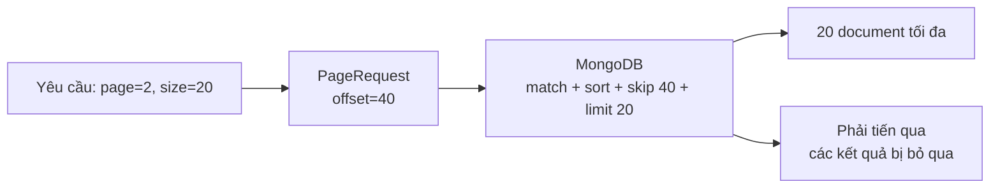

# Offset pagination và chi phí skip trên dữ liệu lớn

## 1. Mục tiêu: lấy một trang dữ liệu mà không tải cả collection

Trong Spring Data MongoDB, các phương thức như `findAll()` có thể trả toàn bộ document trong một collection. Với trang danh sách đơn hàng có hàng triệu bản ghi, ứng dụng hiếm khi cần đọc tất cả. Thông thường màn hình chỉ hiển thị 20–50 đơn mỗi lần, có bộ lọc và thứ tự rõ ràng.

**Offset pagination** là cách chia trang dựa trên **vị trí** trong tập kết quả đã sắp xếp: bỏ qua `offset` document rồi lấy tối đa `limit` document. Trong MongoDB, cơ chế cơ bản tương ứng với `skip()` và `limit()`. Spring Data MongoDB cung cấp `Pageable`/`PageRequest` và truy vấn `MongoTemplate` để sử dụng cơ chế này.

Bài học hướng tới năm năng lực:

1. Giải thích `page`, `size`, `offset`, `skip` và `limit`; biết Spring Data dùng trang bắt đầu từ **0**.
2. Viết truy vấn offset pagination bằng `MongoRepository` và `MongoTemplate`.
3. Phân tích vì sao **skip ở trang sâu vẫn tốn công duyệt dữ liệu**, dù có index.
4. Phân biệt `Page`, `Slice`, tổng số phần tử, sort ổn định và tác động của ghi đồng thời.
5. Biết khi nào nên giữ offset pagination và khi nào chuyển sang **keyset/cursor pagination**.

Điểm cần nhớ ngay: **index giúp MongoDB tìm đúng thứ tự, nhưng không biến `skip(100000)` thành thao tác nhảy tới phần tử thứ 100001 với chi phí không đổi**.

## 2. Mô hình đơn hàng làm ví dụ

Giả sử hệ thống quản lý đơn của nhiều cửa hàng. Collection `orders` có các field:

| Property Java | Field MongoDB | Vai trò |
| --- | --- | --- |
| `id` | `_id` | ID duy nhất trong collection |
| `tenantId` | `tenant_id` | Xác định cửa hàng sở hữu đơn |
| `status` | `status` | Trạng thái đơn, ví dụ `PAID` |
| `createdAt` | `created_at` | Thời điểm tạo |
| `totalMinor` | `total_minor` | Giá trị theo đơn vị tiền nhỏ nhất |

Các truy vấn danh sách trong bài luôn lọc theo `tenant_id` và `status`. Điều này vừa phù hợp nghiệp vụ, vừa tránh dùng `findAll(Pageable)` để vô tình đọc dữ liệu của cửa hàng khác.

### Document BSON mẫu

```javascript
// Collection: orders; các ID là BSON String.
{
  _id: "ORD-0007",
  tenant_id: "SHOP-A",
  status: "PAID",
  created_at: ISODate("2026-11-07T08:00:00Z"),
  total_minor: NumberLong("450000")
}
```

Ta dùng thứ tự **`created_at DESC, _id DESC`**: đơn mới nhất đứng trước, nếu hai đơn trùng thời điểm thì so sánh ID để tạo thứ tự xác định. Trong một collection, `_id` là duy nhất nên là khóa phụ thuận tiện.



## 3. Công thức offset và ý nghĩa của `skip`

Với số trang được đánh từ 0:

\[
\text{offset} = \text{pageNumber} \times \text{pageSize}
\]

| Tham số | Giá trị | Ý nghĩa |
| --- | --- | --- |
| `page = 0`, `size = 20` | `offset = 0` | Lấy các kết quả ở vị trí 1–20 |
| `page = 1`, `size = 20` | `offset = 20` | Bỏ qua 20 kết quả, lấy tối đa 20 kết quả tiếp |
| `page = 5`, `size = 20` | `offset = 100` | Bỏ qua 100 kết quả đã sắp xếp |
| `page = 5000`, `size = 20` | `offset = 100000` | Bỏ qua 100.000 kết quả trước khi trả trang |

Truy vấn tương ứng trong `mongosh`:

```javascript
db.orders.find({
  tenant_id: "SHOP-A",
  status: "PAID"
})
.sort({ created_at: -1, _id: -1 })
.skip(40)
.limit(20)
```

Về ngữ nghĩa, MongoDB lọc ra các đơn đủ điều kiện, áp dụng thứ tự rồi loại bỏ `40` kết quả đầu và trả tối đa `20` kết quả sau đó. Không được đồng nhất `skip(40)` với “đi thẳng tới khóa có giá trị thứ 40” mà không cần duyệt các khóa ở trước.

### `skip` không giống phần tử thứ `n` của Java List

Trong Java, truy cập `list.get(100000)` trên `ArrayList` là truy cập theo chỉ số trên một cấu trúc đã được giữ trong bộ nhớ. MongoDB phải xác định **những document nào thỏa filter và đúng thứ tự sort** trước khi biết 100.000 kết quả đầu cần bỏ qua. Index có thể giảm công việc lọc/sắp xếp, nhưng số lượng kết quả phải vượt qua vẫn tăng theo offset.

Với `skip(N).limit(K)`, một kế hoạch index scan thuận lợi vẫn thường phải tiến qua xấp xỉ **`N + K` vị trí đủ điều kiện** để trả trang, ngoại trừ các tối ưu/đặc điểm query plan cụ thể. Con số `totalKeysExamined` thực tế không nhất thiết bằng đúng `N + K`, vì còn phụ thuộc bộ lọc và cách thực thi.

## 4. Entity và Repository trong Spring Data MongoDB

Ví dụ sử dụng Spring Boot 3.x, Java 17 trở lên, MongoDB có dữ liệu được nạp vào database `order_pagination_demo`. Dependency Maven cơ bản:

```xml
<dependency>
    <groupId>org.springframework.boot</groupId>
    <artifactId>spring-boot-starter-data-mongodb</artifactId>
</dependency>
```

Và kết nối cục bộ minh họa:

```properties
spring.data.mongodb.uri=mongodb://localhost:27017/order_pagination_demo
```

### Entity `PurchaseOrder`

```java
package com.example.orders;

import java.time.Instant;
import org.springframework.data.mongodb.core.mapping.Document;
import org.springframework.data.mongodb.core.mapping.Field;
import org.springframework.data.mongodb.core.mapping.FieldType;
import org.springframework.data.mongodb.core.mapping.MongoId;

@Document(collection = "orders")
public class PurchaseOrder {

    @MongoId(FieldType.STRING)
    private String id;

    @Field("tenant_id")
    private String tenantId;

    private String status;

    @Field("created_at")
    private Instant createdAt;

    @Field("total_minor")
    private long totalMinor;

    protected PurchaseOrder() {}

    public PurchaseOrder(
            String id, String tenantId, String status,
            Instant createdAt, long totalMinor) {
        this.id = id;
        this.tenantId = tenantId;
        this.status = status;
        this.createdAt = createdAt;
        this.totalMinor = totalMinor;
    }

    public String getId() { return id; }
    public String getTenantId() { return tenantId; }
    public String getStatus() { return status; }
    public Instant getCreatedAt() { return createdAt; }
    public long getTotalMinor() { return totalMinor; }
}
```

`@MongoId(FieldType.STRING)` yêu cầu lưu ID theo BSON String; `@Field` ánh xạ tên property Java sang field BSON có dấu gạch dưới. Repository và `MongoTemplate` có metadata entity có thể nhận tên Java như `tenantId`, `createdAt` và `id`; trong `mongosh`, cần sử dụng `tenant_id`, `created_at` và `_id`.

### Repository với `Pageable`

```java
package com.example.orders;

import org.springframework.data.domain.Page;
import org.springframework.data.domain.Pageable;
import org.springframework.data.mongodb.repository.MongoRepository;

public interface PurchaseOrderRepository
        extends MongoRepository<PurchaseOrder, String> {

    Page<PurchaseOrder> findByTenantIdAndStatus(
        String tenantId, String status, Pageable pageable);
}
```

Hàm `findByTenantIdAndStatus` là **derived query**: Spring Data dựng filter trên hai property của `PurchaseOrder`. `Pageable` thêm sort, skip và limit. Trong ứng dụng thực tế, `tenantId` nên lấy từ ngữ cảnh quyền truy cập đã được xác thực, không lấy tùy ý từ request rồi tin rằng người dùng có quyền xem tenant đó.

### Lấy một trang với `PageRequest`

```java
import org.springframework.data.domain.Page;
import org.springframework.data.domain.PageRequest;
import org.springframework.data.domain.Pageable;
import org.springframework.data.domain.Sort;

Sort newestFirst = Sort.by(
    Sort.Order.desc("createdAt"),
    Sort.Order.desc("id")
);

Pageable pageable = PageRequest.of(2, 20, newestFirst);

Page<PurchaseOrder> result =
    purchaseOrderRepository.findByTenantIdAndStatus(
        "SHOP-A", "PAID", pageable);

System.out.println("Offset: " + pageable.getOffset()); // 40
System.out.println("Số đơn trang này: " + result.getNumberOfElements());
System.out.println("Tổng đơn khớp filter: " + result.getTotalElements());
System.out.println("Còn trang sau? " + result.hasNext());
```

Lưu ý `PageRequest.of(2, 20, ...)` là **trang thứ ba** vì trang bắt đầu từ 0. Với MongoDB, truy vấn dữ liệu thường tương đương bộ lọc theo tenant/status, sort, `skip(40)` và `limit(20)`; implementation và những tối ưu hóa đếm phụ thuộc phiên bản Spring Data.

## 5. `Page`, `Slice` và chi phí đếm tổng

Hai yêu cầu UI thường bị nhầm:

- “Hiển thị trang 3/240; tổng cộng bao nhiêu đơn?” cần **tổng số kết quả**.
- “Đây là 20 đơn tiếp theo; còn nút Xem thêm không?” chỉ cần biết **có trang sau**.

Với Spring Data:

| Kiểu trả về | Nội dung | Metadata chính | Lưu ý chi phí |
| --- | --- | --- | --- |
| `Page<T>` | Danh sách tối đa `pageSize` | `totalElements`, `totalPages`, số trang, `hasNext` | Có thể cần thêm phép đếm tổng theo filter |
| `Slice<T>` | Danh sách tối đa `pageSize` | Số trang và `hasNext` | Có thể xác định trang sau mà không cần đếm tổng, tùy implementation |
| `List<T>` | Danh sách kết quả | Không có metadata tổng/trang | Không tự có total hoặc `hasNext` |

Ví dụ repository dùng `Slice` **với một tên method khác** để tránh hai method chỉ khác kiểu trả về:

```java
import org.springframework.data.domain.Pageable;
import org.springframework.data.domain.Slice;

public interface PurchaseOrderRepository
        extends MongoRepository<PurchaseOrder, String> {

    Page<PurchaseOrder> findByTenantIdAndStatus(
        String tenantId, String status, Pageable pageable);

    Slice<PurchaseOrder> findSliceByTenantIdAndStatus(
        String tenantId, String status, Pageable pageable);
}
```

Ở đây `findSliceBy...` dùng một **đoạn mô tả** trước `By` để phân biệt tên method; Spring Data vẫn phân tích điều kiện từ phần `ByTenantIdAndStatus`. Khi sử dụng, cần kiểm tra tính tương thích của mẫu method trong phiên bản Spring Data cụ thể. Chỉ tạo **một** interface `PurchaseOrderRepository` chứa những phương thức cần dùng, không tạo nhiều bản trong cùng project.

Khi sử dụng `Slice`:

```java
Slice<PurchaseOrder> slice =
    purchaseOrderRepository.findSliceByTenantIdAndStatus(
        "SHOP-A", "PAID", PageRequest.of(0, 20, newestFirst));

boolean nextAvailable = slice.hasNext();
```

Với một implementation hỗ trợ Slice, framework có thể đọc `pageSize + 1` bản ghi để quyết định có trang sau, thay vì phải lấy tổng số toàn bộ kết quả. Điều này **không xóa chi phí offset**: ở trang thứ 5.000, database vẫn phải vượt qua số phần tử ở trước. Tính năng Page/Slice và query count cần được xác minh với Spring Data đang dùng; không đồng nhất “ít hơn một truy vấn count” với “đã giải quyết bài toán deep pagination”.

### Count và dữ liệu thay đổi đồng thời

Ngay cả khi `Page` có tổng `totalElements` chính xác ở thời điểm chạy truy vấn count, dữ liệu có thể được chèn/xóa giữa lần lấy nội dung và lần đếm. Khi không có snapshot/transaction thích hợp, đừng mặc định `getTotalElements()` và danh sách trang luôn phản ánh **cùng một thời điểm bất biến**.

Nếu màn hình chỉ cần nút “Xem thêm”, việc bỏ yêu cầu hiển thị “Trang 1/5000” có thể giúp API đơn giản hơn. Đôi khi sản phẩm thực sự không cần tổng chính xác theo thời gian thực.

## 6. Đo chi phí của trang sâu bằng `explain("executionStats")`

Để kiểm chứng điểm nghẽn, tạo bộ dữ liệu thử đủ lớn trong **môi trường kiểm thử**, có index phù hợp, rồi so sánh các độ sâu khác nhau. Không chạy thử quét lớn trên production nếu chưa kiểm soát tác động.

Một index ứng viên cho filter và thứ tự:

```javascript
db.orders.createIndex(
  { tenant_id: 1, status: 1, created_at: -1, _id: -1 },
  { name: "orders_tenant_status_created_id" }
)
```

Đây là cách đặt hai điều kiện bằng (`tenant_id`, `status`) trước hai khóa sort. MongoDB có thể dùng index để phục vụ lọc theo tenant/status và lấy dữ liệu theo thứ tự `created_at DESC, _id DESC`, thay vì phải sắp xếp tất cả kết quả sau quét.

### Truy vấn trang đầu

```javascript
db.orders.find({
  tenant_id: "SHOP-A",
  status: "PAID"
})
.sort({ created_at: -1, _id: -1 })
.skip(0)
.limit(20)
.explain("executionStats")
```

### Truy vấn trang thứ 5.001

```javascript
db.orders.find({
  tenant_id: "SHOP-A",
  status: "PAID"
})
.sort({ created_at: -1, _id: -1 })
.skip(100000)
.limit(20)
.explain("executionStats")
```

Nếu có ít nhất 100.020 document khớp filter, truy vấn thứ hai phải **bỏ qua 100.000 kết quả** rồi mới trả 20 document. Ngay cả khi MongoDB sử dụng index rất tốt, thường vẫn cần tiến qua rất nhiều index entry ở trước vị trí trang.

Những số liệu cần ghi nhận:

| Chỉ số từ explain | Cách diễn giải |
| --- | --- |
| `winningPlan` | Kế hoạch thực thi và index được chọn |
| `IXSCAN` | Có quét index; vẫn cần xem quét **bao nhiêu khóa** |
| `SORT` | Có phải sort riêng thay vì tận dụng thứ tự index hay không |
| `totalKeysExamined` | Tổng số index key database đã duyệt |
| `totalDocsExamined` | Tổng số document đã đọc; có thể thấp khi index đáp ứng nhiều việc |
| `nReturned` | Số document thực sự được trả |
| `executionTimeMillis` | Thời gian thực thi quan sát được trong lần đo |

Một kết quả điển hình có thể là: trang đầu đọc ít khóa, trang sâu đọc rất nhiều khóa để trả cùng 20 document. **Không đưa ra tỷ lệ chính xác hay khẳng định `totalKeysExamined = skip + limit` cho mọi query plan**: số khóa đã duyệt còn chịu ảnh hưởng bởi filter, index, kế hoạch và cơ chế tối ưu của MongoDB.

### Vì sao `IXSCAN` vẫn có thể chậm?

`IXSCAN` chỉ có nghĩa MongoDB đang quét index, **không phải mọi index scan đều có chi phí O(1)**. Nếu phần lớn thời gian dành để tiến qua các khóa bị skip, thêm index đã đúng có thể không giải quyết được trang rất sâu. Khi đó phải xem lại giao diện truy cập: người dùng có thực sự cần nhảy thẳng tới trang 5.001 hay chỉ cần xem thêm bản ghi sau một điểm đã biết?

## 7. Thứ tự ổn định không có nghĩa các trang là snapshot

Phân trang offset chỉ có ý nghĩa khi tập kết quả có **thứ tự xác định**. Một truy vấn không dùng `sort` không được bảo đảm trả document theo thứ tự chèn hay `_id`. Chỉ `sort({ created_at: -1 })` cũng chưa đủ khi nhiều đơn có cùng `created_at`: MongoDB được phép trả chúng theo những thứ tự khác nhau.

Giải pháp cho vấn đề hòa khóa sort là thêm một trường duy nhất:

```javascript
db.orders.find({ tenant_id: "SHOP-A", status: "PAID" })
  .sort({ created_at: -1, _id: -1 })
  .skip(20)
  .limit(20)
```

**Với cùng một tập document và cùng giá trị field sort**, cặp `(created_at, _id)` tạo thứ tự xác định. Tuy nhiên, điều đó **không bảo đảm hai request lấy hai trang nhìn thấy cùng một phiên bản dữ liệu**.

### Chèn một đơn mới giữa hai lần gọi

Giả sử tất cả đơn được sắp mới đến cũ theo ID, và mỗi trang có ba bản ghi.

| Thời điểm | Danh sách theo thứ tự giảm dần | Trang truy vấn | Kết quả |
| --- | --- | --- | --- |
| Trước khi chèn | O7, O6, O5, O4, O3, O2 | Trang 0: `skip(0).limit(3)` | O7, O6, O5 |
| Sau khi chèn O8 ở đầu | O8, O7, O6, O5, O4, O3, O2 | Trang 1: `skip(3).limit(3)` | O5, O4, O3 |

**O5 xuất hiện ở cả hai trang**. Nguyên nhân là offset đếm lại từ đầu trên tập kết quả **đã thay đổi**, không phải do MongoDB sắp xếp sai.

### Xóa một đơn giữa hai lần gọi

Nếu trang đầu đã trả `O7, O6, O5` nhưng sau đó `O7` bị xóa, danh sách còn `O6, O5, O4, O3, O2`. Lời gọi trang tiếp theo dùng `skip(3)` sẽ bắt đầu ở `O3`, **bỏ lỡ O4**.

Những vấn đề này cũng có thể xảy ra khi:

- Một document đổi `status` và rời khỏi/đi vào tập kết quả đang lọc.
- `created_at` hoặc một field sort khác bị sửa, khiến document đổi vị trí.
- User chuyển trang trong lúc hệ thống có nhiều thao tác ghi.

Với giao diện quản trị cho phép nhảy trang ngẫu nhiên, những thay đổi nhỏ đôi khi được chấp nhận. Với luồng xuất báo cáo, quét toàn bộ dữ liệu hoặc xử lý batch yêu cầu không lặp/không thiếu, **không nên dùng offset trên dữ liệu liên tục thay đổi mà không có chiến lược nhất quán**.

## 8. Bảo vệ API trước offset và pageSize quá lớn

`PageRequest` là một công cụ phân trang, không phải **cơ chế bảo vệ tài nguyên**. Nếu một client được phép gửi `page=50000000&size=1000`, ứng dụng có thể tạo truy vấn rất tốn tài nguyên hoặc gặp lỗi do offset quá lớn với API/driver cụ thể.

Tầng service nên thực hiện cả kiểm tra kỹ thuật lẫn giới hạn nghiệp vụ:

- `page` phải không âm, `size` phải dương.
- Có **giới hạn size tối đa**, ví dụ 100.
- Có **ngưỡng offset tối đa** cho các API dùng skip, hoặc chuyển sang cursor khi vượt ngưỡng.
- Bộ lọc theo tenant và quyền xem dữ liệu không được điều khiển tùy ý bởi caller.
- Sort phải thuộc danh sách field được phép và có khóa phụ duy nhất.
- Áp dụng giới hạn timeout/quota phù hợp khi triển khai để tránh một truy vấn quá đắt gây ảnh hưởng những request khác.

### Service offset có kiểm tra

```java
package com.example.orders;

import org.springframework.data.domain.Page;
import org.springframework.data.domain.PageRequest;
import org.springframework.data.domain.Sort;
import org.springframework.stereotype.Service;

@Service
public class OrderPageService {

    private static final int MAX_SIZE = 100;
    private static final long MAX_OFFSET = 10_000;

    private final PurchaseOrderRepository orders;

    public OrderPageService(PurchaseOrderRepository orders) {
        this.orders = orders;
    }

    public Page<PurchaseOrder> listPaidOrders(
            String authorizedTenantId, int page, int size) {
        if (authorizedTenantId == null || authorizedTenantId.isBlank()) {
            throw new IllegalArgumentException("Tenant không hợp lệ");
        }
        if (page < 0 || size < 1 || size > MAX_SIZE) {
            throw new IllegalArgumentException("Thông số trang không hợp lệ");
        }

        long offset = (long) page * size;
        if (offset > MAX_OFFSET) {
            throw new IllegalArgumentException(
                "Trang quá sâu; hãy dùng cursor pagination");
        }

        Sort sort = Sort.by(
            Sort.Order.desc("createdAt"),
            Sort.Order.desc("id")
        );

        return orders.findByTenantIdAndStatus(
            authorizedTenantId,
            "PAID",
            PageRequest.of(page, size, sort)
        );
    }
}
```

`MAX_OFFSET = 10_000` ở đây chỉ là **chính sách minh họa**, không phải giới hạn cứng của MongoDB. Đặt ngưỡng dựa trên dữ liệu/độ trễ đo được và yêu cầu sản phẩm. `(long) page * size` giúp tránh phép nhân số nguyên `int` tràn trước khi so ngưỡng.

Ở một hệ thống đa tenant, `authorizedTenantId` cần được lấy từ ngữ cảnh xác thực và quyền của người dùng, không đơn thuần là tham số do người dùng gửi.

## 9. Keyset/cursor pagination: đi tiếp sau một bộ khóa

Với giao diện “Xem thêm”, người dùng thường không cần biết “đây là trang số 8.212” mà chỉ muốn nhận những đơn **sau document cuối của trang trước**. Khi đó, keyset/cursor pagination là phương án đáng cân nhắc.

Khác với offset:

- **Offset:** “Bỏ qua 100.000 document đầu rồi lấy 20”.
- **Keyset:** “Sau đơn có `created_at = T` và `_id = I`, lấy 20 đơn tiếp theo”.

Với thứ tự `created_at DESC, _id DESC`, điều kiện “đứng sau cursor” là:

\[
created\_at < T\quad\text{hoặc}\quad
(created\_at = T \land \_id < I)
\]

Ở đây, `T` và `I` là giá trị của **document cuối trang trước**; dấu so sánh nhỏ hơn khớp với cả hai khóa được sắp giảm dần.

### Thực hiện bằng `mongosh`

Giả sử trang trước kết thúc bằng đơn `ORD-0050` tại thời điểm `2026-11-10T08:00:00Z`:

```javascript
const lastCreatedAt = ISODate("2026-11-10T08:00:00Z");
const lastId = "ORD-0050";

db.orders.find({
  tenant_id: "SHOP-A",
  status: "PAID",
  $or: [
    { created_at: { $lt: lastCreatedAt } },
    { created_at: lastCreatedAt, _id: { $lt: lastId } }
  ]
})
.sort({ created_at: -1, _id: -1 })
.limit(20)
```

MongoDB có thể sử dụng index phù hợp để tìm một khoảng khóa sau cursor mà **không cần bỏ qua lại tất cả kết quả từ đầu**. Tùy dạng điều kiện `$or`, độ phân bố dữ liệu và query planner, hiệu quả thực tế khác nhau; cần kiểm tra bằng explain chứ không mặc định mọi truy vấn keyset đều rẻ.

### Ví dụ `MongoTemplate` với cursor

Đoạn mã dưới đây là một service minh họa sử dụng các property Java `createdAt` và `id`. Với `PurchaseOrder.class`, Spring Data ánh xạ chúng thành `created_at` và `_id` trong BSON:

```java
package com.example.orders;

import java.time.Instant;
import java.util.List;
import org.springframework.data.domain.Sort;
import org.springframework.data.mongodb.core.MongoTemplate;
import org.springframework.data.mongodb.core.query.Criteria;
import org.springframework.data.mongodb.core.query.Query;
import org.springframework.stereotype.Service;

@Service
public class OrderCursorService {

    private final MongoTemplate template;

    public OrderCursorService(MongoTemplate template) {
        this.template = template;
    }

    public CursorPage next(
            String authorizedTenantId,
            Instant lastCreatedAt,
            String lastId,
            int pageSize) {

        if (authorizedTenantId == null || authorizedTenantId.isBlank()) {
            throw new IllegalArgumentException("Tenant không hợp lệ");
        }
        if (pageSize < 1 || pageSize > 100) {
            throw new IllegalArgumentException("Page size không hợp lệ");
        }
        if ((lastCreatedAt == null) != (lastId == null)) {
            throw new IllegalArgumentException(
                "Cursor cần đồng thời cả thời gian và ID");
        }

        Criteria base = new Criteria().andOperator(
            Criteria.where("tenantId").is(authorizedTenantId),
            Criteria.where("status").is("PAID")
        );

        Criteria filter = base;
        if (lastCreatedAt != null) {
            Criteria afterCursor = new Criteria().orOperator(
                Criteria.where("createdAt").lt(lastCreatedAt),
                new Criteria().andOperator(
                    Criteria.where("createdAt").is(lastCreatedAt),
                    Criteria.where("id").lt(lastId)
                )
            );
            filter = new Criteria().andOperator(base, afterCursor);
        }

        Query query = Query.query(filter)
            .with(Sort.by(
                Sort.Order.desc("createdAt"),
                Sort.Order.desc("id")
            ));

        // Lấy thêm 1 bản ghi để xác định có trang sau.
        query.limit(pageSize + 1);
        List<PurchaseOrder> fetched =
            template.find(query, PurchaseOrder.class);

        boolean hasNext = fetched.size() > pageSize;
        List<PurchaseOrder> items = List.copyOf(
            fetched.subList(0, Math.min(pageSize, fetched.size())));

        PurchaseOrder last = items.isEmpty()
            ? null
            : items.get(items.size() - 1);

        return new CursorPage(
            items,
            last == null ? null : last.getCreatedAt(),
            last == null ? null : last.getId(),
            hasNext
        );
    }

    public record CursorPage(
        List<PurchaseOrder> items,
        Instant nextCreatedAt,
        String nextId,
        boolean hasNext
    ) {}
}
```

Khi gọi lần đầu, truyền `lastCreatedAt = null` và `lastId = null`. Nếu response có `hasNext = true`, client có thể truyền cặp khóa của document cuối trang để lấy tiếp. Trong API thực tế, thường đóng gói cặp đó thành một **cursor token có phiên bản và kiểm tra tính hợp lệ** thay vì để client tự sửa hai tham số.

**Những giới hạn vẫn còn:**

- Cursor phải gắn với **cùng filter và cùng thứ tự sắp xếp**; đổi sort hoặc tenant giữa hai trang có thể cho kết quả sai.
- Khóa sort như `created_at` nên có ngữ nghĩa tương đối bất biến trong khoảng đời document; nếu khóa thay đổi, phần tử có thể chuyển vị trí.
- Cursor không tạo snapshot: nếu tài liệu mới xuất hiện hoặc bị xóa, kết quả phản ánh tập dữ liệu tại lúc truy vấn. Keyset thường giảm lặp/thiếu do chèn ở *đầu* danh sách, nhưng không bảo đảm duyệt đúng một bản ghi một lần trong mọi kịch bản cập nhật.
- Nếu chỉ lấy trang sau khi `hasNext = true`, cặp khóa cuối phải tồn tại và được xác nhận; không coi cursor là token phân quyền.
- `created_at` và `_id` phải dùng **đúng BSON type**. Đoạn ví dụ dùng `Instant` và ID String; nếu trong database dùng ObjectId, điều kiện và phép so sánh ID cần thay đổi theo mô hình.

## 10. So sánh offset và keyset trên workload thực tế

| Tiêu chí | Offset: `skip + limit` | Keyset: cursor theo khóa |
| --- | --- | --- |
| Giao diện | Trang 1, 2, 3…; dễ nhảy đến trang bất kỳ | “Xem thêm”, cuộn liên tục |
| Đầu vào | Page number, page size | Cursor + page size |
| Truy vấn trang sâu | Phải bỏ qua nhiều kết quả ở trước | Tìm theo khoảng khóa sau cursor |
| Tận dụng index | Hữu ích cho filter/sort nhưng không loại bỏ việc skip sâu | Có thể hiệu quả với index khớp filter/sort và khoảng khóa |
| Tính ổn định khi chèn trước đầu danh sách | Có thể lặp hoặc thiếu document giữa các request | Thường ít bị dịch vị trí do chèn ở đầu hơn |
| Nhảy ngẫu nhiên đến trang số 500 | Thuận tiện | Không trực tiếp nếu không có cursor ở trang đó |
| Tổng số trang | Dễ kết hợp `Page`/count | Thường không cần total, hoặc tính riêng |
| Độ phức tạp triển khai | Đơn giản, có sẵn `PageRequest` | Cần sort ổn định, cursor và logic filter |

**Lựa chọn thực dụng:** trang quản trị với tập dữ liệu nhỏ/vừa và khả năng nhảy trang có thể giữ offset. Feed, timeline, danh sách biến động nhanh, xuất dữ liệu theo lô lớn hoặc truy vấn trang sâu nên cân nhắc keyset, đồng thời đánh giá yêu cầu snapshot nếu cần nhất quán nghiêm ngặt.

## 11. Offset pagination trong reactive repository

Ứng dụng dùng **reactive access** có thể khai báo `ReactiveMongoRepository`. Nguyên tắc về filter, sort, `skip`, `limit` và index **không thay đổi** chỉ vì Java trả về `Flux` hoặc `Mono`.

```java
package com.example.orders;

import org.springframework.data.domain.Pageable;
import org.springframework.data.mongodb.repository.ReactiveMongoRepository;
import reactor.core.publisher.Flux;

public interface ReactivePurchaseOrderRepository
        extends ReactiveMongoRepository<PurchaseOrder, String> {

    Flux<PurchaseOrder> findByTenantIdAndStatus(
        String tenantId, String status, Pageable pageable);
}
```

Ví dụ giới hạn 20 đơn trên trang đầu:

```java
import org.springframework.data.domain.PageRequest;
import org.springframework.data.domain.Sort;
import reactor.core.publisher.Flux;

Flux<PurchaseOrder> firstTwenty =
    reactivePurchaseOrderRepository.findByTenantIdAndStatus(
        "SHOP-A",
        "PAID",
        PageRequest.of(
            0, 20,
            Sort.by(
                Sort.Order.desc("createdAt"),
                Sort.Order.desc("id")
            )
        )
    );
```

Luồng `Flux` phát kết quả khi được subscribe; nó không có sẵn `totalElements`/`totalPages` như `Page` của repository đồng bộ. Nếu cần tổng số kết quả, có thể có một truy vấn count riêng rồi ghép dữ liệu/metadata thành response thích hợp. Không nên dựa vào việc reactive tự giảm độ phức tạp của `skip(100000)`: MongoDB vẫn thực thi cùng ý nghĩa bỏ qua nhiều kết quả trước khi trả trang.

### Backpressure không giải quyết deep skip

Reactor cho phép bên nhận điều tiết nhu cầu phần tử (*backpressure*) trong luồng, giúp giới hạn cách dữ liệu được tiêu thụ tại một số giai đoạn. Nhưng backpressure **không đồng nghĩa MongoDB có thể nhảy qua offset sâu với chi phí thấp**. Nó cũng không thay thế filter, sort, limit và index phía server.

Không dùng `findAll().collectList()` để tải toàn bộ collection rồi thực hiện `skip`/`take` ở Java khi nhu cầu thực tế là truy vấn phân trang; nên truyền `Pageable` hoặc dùng `ReactiveMongoTemplate` để giới hạn ngay trong MongoDB. Tránh gọi `block()` trên thread phục vụ request reactive.

## 12. Duyệt dữ liệu lớn: phân trang khác với streaming

Một nhu cầu khác là xuất hàng triệu đơn sang hệ thống phân tích. Lúc này API không phục vụ “trang số 2” mà cần **duyệt dữ liệu theo lô hoặc theo luồng** với bộ nhớ có giới hạn.

Các lựa chọn:

| Cách làm | Khi nên cân nhắc | Điều cần bảo đảm |
| --- | --- | --- |
| Vòng lặp offset PageRequest | Tập hữu hạn nhỏ/vừa, giao diện cần nhảy trang | Tránh offset sâu, xử lý thay đổi dữ liệu |
| Keyset theo (`createdAt`, `id`) | Quét dữ liệu lớn theo thứ tự cố định | Cursor, filter nhất quán, chiến lược retry |
| `MongoTemplate.stream(...)` | Xử lý tuần tự result set mà không nạp toàn bộ vào List | Đóng cursor, xử lý lỗi và giới hạn thời gian |
| Reactive stream từ truy vấn có cursor | Pipeline không chặn luồng, cần điều tiết nhu cầu | Backpressure, timeout và quản lý subscription |
| Pipeline aggregation/batch chuyên dụng | Tổng hợp hoặc chuyển đổi dữ liệu khối lượng lớn | Đo tài nguyên MongoDB, index, phân vùng công việc |

### Đọc tuần tự với `MongoTemplate.stream`

API `MongoTemplate.stream` có thể tạo một `CloseableIterator` để duyệt kết quả truy vấn mà không giữ toàn bộ result set thành `List` trong Java:

```java
import org.springframework.data.domain.Sort;
import org.springframework.data.mongodb.core.query.Criteria;
import org.springframework.data.mongodb.core.query.Query;
import org.springframework.data.util.CloseableIterator;

Query query = Query.query(
    Criteria.where("tenantId").is("SHOP-A")
        .and("status").is("PAID")
);
query.with(Sort.by(
    Sort.Order.desc("createdAt"),
    Sort.Order.desc("id")
));

try (CloseableIterator<PurchaseOrder> cursor =
         mongoTemplate.stream(query, PurchaseOrder.class)) {
    cursor.forEachRemaining(order -> {
        // Xử lý từng đơn, không tích lũy toàn bộ vào một List lớn.
        System.out.println(order.getId());
    });
}
```

Đoạn này thuộc service đã inject `MongoTemplate`. Vì iterator có thể giữ tài nguyên của cursor MongoDB, **phải đóng** khi hoàn tất hoặc gặp lỗi. Streaming còn cần chính sách timeout, xử lý kết quả chậm, giới hạn thời gian và phục hồi khi mất kết nối.

Một cursor đang được duyệt không mặc nhiên cung cấp **snapshot nhất quán tuyệt đối** nếu collection tiếp tục thay đổi. Nếu nghiệp vụ yêu cầu đọc tập dữ liệu “tại một thời điểm”, cần thiết kế mức read concern/transaction/snapshot hoặc cơ chế đánh dấu thời điểm rõ ràng phù hợp với hạ tầng MongoDB đang dùng. Thay offset bằng stream không tự giải quyết mọi yêu cầu consistency.

### Một lưu ý về tailable cursor

Trong MongoDB, *tailable cursor* thường dành cho **capped collection** và kiểu theo dõi dữ liệu mới xuất hiện; nó không phải cách thay thế thông thường cho trang số 100. Không nên nhầm “luồng kết quả query”, “reactive publisher” và “tailable cursor”: chúng có vòng đời và mục tiêu khác nhau.

## 13. Kiểm thử chức năng phân trang

Để bảo đảm API hoạt động đúng, kiểm thử với **MongoDB thật trong môi trường test cô lập** (có thể dùng Testcontainers). Một bộ fixture nhỏ giúp xác nhận logic trang, thứ tự và filter, nhưng **không thể chứng minh đặc tính hiệu năng trên hàng triệu bản ghi**.

Ví dụ kiểm thử với Spring Boot 3.x:

```java
package com.example.orders;

import java.time.Instant;
import java.util.List;
import org.junit.jupiter.api.BeforeEach;
import org.junit.jupiter.api.Test;
import org.springframework.beans.factory.annotation.Autowired;
import org.springframework.boot.test.autoconfigure.data.mongo.DataMongoTest;
import org.springframework.data.domain.Page;
import org.springframework.data.domain.PageRequest;
import org.springframework.data.domain.Sort;

import static org.assertj.core.api.Assertions.assertThat;

@DataMongoTest
class PurchaseOrderPaginationTest {

    @Autowired
    PurchaseOrderRepository orders;

    private Sort sort;

    @BeforeEach
    void seedIsolatedDatabase() {
        // Chỉ dùng trên database test cô lập.
        orders.deleteAll();

        Instant t1 = Instant.parse("2026-11-01T08:00:00Z");
        Instant t2 = Instant.parse("2026-11-02T08:00:00Z");
        Instant t3 = Instant.parse("2026-11-03T08:00:00Z");

        orders.insert(List.of(
            new PurchaseOrder("O1", "SHOP-A", "PAID", t1, 100),
            new PurchaseOrder("O2", "SHOP-A", "PAID", t2, 200),
            new PurchaseOrder("O3", "SHOP-A", "PAID", t3, 300),
            new PurchaseOrder("O4", "SHOP-A", "PAID", t3, 400),
            new PurchaseOrder("O5", "SHOP-A", "DRAFT", t3, 500),
            new PurchaseOrder("O6", "SHOP-B", "PAID", t3, 600)
        ));

        sort = Sort.by(
            Sort.Order.desc("createdAt"),
            Sort.Order.desc("id")
        );
    }

    @Test
    void firstPageUsesFilterAndStableSort() {
        Page<PurchaseOrder> page =
            orders.findByTenantIdAndStatus(
                "SHOP-A", "PAID",
                PageRequest.of(0, 2, sort)
            );

        assertThat(page.getContent())
            .extracting(PurchaseOrder::getId)
            .containsExactly("O4", "O3");
        assertThat(page.getTotalElements()).isEqualTo(4);
        assertThat(page.hasNext()).isTrue();
    }

    @Test
    void secondPageSkipsExactlyTwoMatchingRows() {
        Page<PurchaseOrder> page =
            orders.findByTenantIdAndStatus(
                "SHOP-A", "PAID",
                PageRequest.of(1, 2, sort)
            );

        assertThat(page.getContent())
            .extracting(PurchaseOrder::getId)
            .containsExactly("O2", "O1");
        assertThat(page.hasNext()).isFalse();
    }
}
```

Đây là một ví dụ dự kiến chạy với repository/ entity đã khai báo và database test được cấu hình trước; `@DataMongoTest` không tự bảo đảm một MongoDB phù hợp đã sẵn sàng. Lệnh `deleteAll()` **xóa dữ liệu của collection** và tuyệt đối không chạy trên production hay database dùng chung.

### Bộ ca kiểm thử nên bổ sung

1. **`page = 0`, `size = 1`**: trả đúng document mới nhất.
2. **Trang sau cuối**: trả rỗng, không gây exception khi tham số hợp lệ.
3. **Sort có giá trị hòa:** hai document cùng `createdAt` phải sắp bằng khóa phụ `id`.
4. **Tenant khác:** không bao giờ trả document ngoài `authorizedTenantId`.
5. **Trạng thái khác:** document `DRAFT` không xuất hiện khi filter `PAID`.
6. **Tham số sai:** `page < 0`, `size = 0`, `size` vượt ngưỡng và offset quá sâu bị từ chối ở service.
7. **Chèn/xóa giữa hai request:** mô phỏng tình huống lặp/bỏ sót để mô tả rõ giới hạn offset; kiểm thử cursor nếu đã triển khai.
8. **Trang lớn trên dữ liệu đại diện:** đo `explain` và thời gian/độ trễ nhiều lần, không suy diễn từ fixture 6 đơn.

## 14. Những lỗi phổ biến và hướng xử lý

| Hiện tượng | Nguyên nhân thường gặp | Hướng xử lý |
| --- | --- | --- |
| Trang 1 đã bỏ qua 20 bản ghi | Nhầm page bắt đầu từ 1 | Dùng `PageRequest.of(0, 20, ...)` cho trang đầu |
| Trang sâu càng chậm dù có `IXSCAN` | `skip` vẫn phải vượt qua nhiều index entry | Dùng cursor/keyset nếu không cần nhảy trang bất kỳ |
| Document bị lặp ở trang kế tiếp | Có insert trước vị trí offset hoặc sort chưa xác định đầy đủ | Thêm khóa sort duy nhất, cân nhắc keyset |
| Thiếu document giữa hai trang | Có delete hoặc thay đổi filter/sort giữa hai request | Xác định yêu cầu consistency, xem xét keyset/snapshot |
| `Page` chậm hơn mong đợi | Ngoài query trang, có thể cần count | Xem cần total không; đánh giá `Slice` hoặc count riêng |
| `findAll()` gây nhiều bộ nhớ | Ứng dụng tải toàn bộ collection | Query có limit/page, streaming hoặc batch |
| Thêm index nhưng query vẫn sort riêng | Thứ tự field/chiều index không phù hợp filter/sort | Kiểm tra `explain` và cân nhắc compound index |
| Sort theo `createdAt` nhưng index `createdAt` không giúp | Field BSON thực là `created_at` | Dùng tên BSON thật khi tạo index bằng `mongosh` |
| Tính offset bị tràn `int` | Nhân page và size bằng `int` trước khi kiểm tra | Dùng `long` để tính, giới hạn offset ở API |
| Đọc sai tenant | Tenant lấy tùy ý từ request | Áp đặt scope theo xác thực, phân quyền và filter |
| Cursor trả sai trang | Đổi bộ lọc/sort, thiếu khóa phụ hoặc so sánh sai chiều | Ràng buộc cursor với filter, sort và kiểu BSON |
| Dùng backpressure nhưng trang sâu vẫn chậm | Backpressure không loại bỏ skip ở MongoDB | Cần sửa mô hình truy vấn, không chỉ thay kiểu Java trả về |

## 15. Checklist thiết kế và tự luyện tập

### Checklist trước khi đưa vào production

1. **Xác định trải nghiệm:** người dùng cần nhảy đến trang bất kỳ, hay chỉ cuộn/xem thêm?
2. **Chọn filter:** tenant, trạng thái và các điều kiện nghiệp vụ phải được thực hiện tại MongoDB.
3. **Chọn sort ổn định:** có khóa phụ duy nhất như `_id`; định nghĩa hướng và kiểu BSON.
4. **Giới hạn input:** page, size, offset và sort input hợp lệ; báo lỗi rõ khi vượt ngưỡng.
5. **Kiểm soát chi phí count:** chỉ dùng tổng số khi giao diện cần; cân nhắc `Slice` hoặc cách khác.
6. **Thiết kế index:** so sánh thứ tự index với filter/sort, đo bằng `explain("executionStats")`.
7. **Đánh giá concurrency:** insert, delete, đổi status hoặc trường sort giữa các trang có thể ảnh hưởng kết quả.
8. **Chọn phương án khi dữ liệu lớn:** keyset/cursor, stream hay batch theo nhu cầu, không ép mọi use case qua offset.
9. **Kiểm thử:** trên database test cô lập và dữ liệu đại diện, bao gồm trang sâu và thời điểm có ghi đồng thời.
10. **Giám sát:** đo độ trễ p95/p99, số khóa/document xét duyệt, tỉ lệ lỗi và kích thước kết quả.

### Bài tập 1: tính offset

Một API dùng `PageRequest.of(4, 25, sort)`. **Hỏi:** Bỏ qua bao nhiêu kết quả? **Đáp án:** `4 × 25 = 100`; đây là trang thứ năm theo cách đánh số bắt đầu từ 0.

### Bài tập 2: index có giải quyết hoàn toàn skip không?

MongoDB sử dụng index `{ tenant_id: 1, status: 1, created_at: -1, _id: -1 }` cho truy vấn `skip(100000).limit(20)`. **Hỏi:** Có chắc chỉ duyệt 20 khóa index không?

**Đáp án:** Không. Index giúp lọc/sắp xếp nhưng truy vấn vẫn cần vượt qua nhiều kết quả bị bỏ qua. Số `totalKeysExamined` thực tế phải được xác minh bằng explain.

### Bài tập 3: `Page` hay `Slice`?

Giao diện chỉ có nút “Xem thêm”, không hiển thị tổng số trang. **Hỏi:** Vì sao `Slice` đáng cân nhắc?

**Đáp án:** Vì nó chỉ cần biết còn kết quả sau hay không, có thể tránh chi phí đếm tổng. Tuy nhiên, ở trang sâu, cơ chế offset/skip vẫn tốn tài nguyên.

### Bài tập 4: dữ liệu thay đổi

Trang đầu trả `O7, O6, O5`; sau đó một đơn `O8` mới được chèn vào đầu danh sách. Trang 1 dùng `skip(3)`. **Hỏi:** Vì sao `O5` có thể lặp lại?

**Đáp án:** Vì offset được áp lên tập kết quả đã có `O8` ở đầu, nên phần tử vị trí thứ tư giờ là `O5`. Thứ tự sort xác định không tạo snapshot giữa các request.

### Bài tập 5: điều kiện keyset giảm dần

Với thứ tự `created_at DESC, _id DESC` và cursor `(T, I)`, **hỏi** điều kiện chọn bản ghi tiếp theo?

**Đáp án:** `created_at < T` hoặc `(created_at = T và _id < I)`, giữ nguyên filter và sort của trang trước.

### Bài tập 6: phân quyền

Một API nhận `tenantId` trong query string rồi trả `Page<Order>` theo tenant đó. **Hỏi:** Dùng `Pageable` đã đủ bảo vệ dữ liệu chưa?

**Đáp án:** Chưa. `Pageable` chỉ giới hạn số lượng và thứ tự. Tenant phải được xác định/xác thực theo quyền người dùng, và các điều kiện quyền phải nằm trong đường truy vấn phù hợp.

**Kết luận:** Offset pagination với `PageRequest` và MongoDB `skip + limit` rất dễ triển khai, phù hợp các danh sách nhỏ/vừa và giao diện cần nhảy trang. Nhưng **chi phí skip tăng theo độ sâu**, dù index đã hỗ trợ lọc và sort. Hãy dùng sort có khóa phụ duy nhất, giới hạn đầu vào, đo `explain`, cân nhắc chi phí count và hiểu tác động của dữ liệu thay đổi giữa các request. Với truy vấn sâu hoặc feed lớn, **keyset/cursor pagination** và các chiến lược streaming/batch thường đáng đánh giá hơn việc tăng offset mãi.
