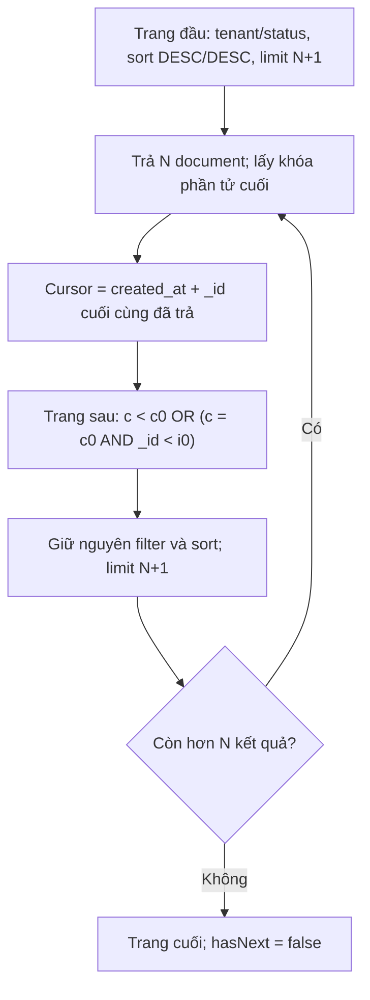

# Keyset pagination bằng điều kiện và chỉ mục phù hợp

Trong **Spring Data MongoDB**, phân trang không chỉ là gọi `findAll(PageRequest.of(page, size))`. Khi collection lớn hoặc người dùng liên tục cuộn qua các bản ghi mới, **keyset pagination** (còn gọi *seek pagination* hay *cursor-based pagination* theo giá trị khóa) thường là lựa chọn tốt hơn việc tăng `skip` theo số trang. Nó dùng **khóa sắp xếp của phần tử cuối trang trước** để viết điều kiện tìm trang kế tiếp, đồng thời tận dụng compound index phù hợp.

Bài này thuộc chương **Phân trang và luồng** của module **SPRING_DATA_MONGODB**. Chúng ta sẽ tự thiết kế API duyệt bài viết theo `createdAt DESC, _id DESC`, xây truy vấn bằng `MongoTemplate`, chọn index theo tenant/status và điều kiện seek, mã hóa cursor, xử lý các thay đổi đồng thời, đọc trang trước, chẩn đoán `explain` và kiểm thử bằng MongoDB thật. Cần phân biệt **cursor phân trang dùng trên API** với **server-side cursor** của MongoDB Java Driver: hai khái niệm có liên quan nhưng không giống nhau.

## 1. Vì sao offset pagination trở nên đắt?

Ví dụ một API liệt kê bài viết đã xuất bản:

```javascript
db.posts.find({
  tenant_id: "T1",
  status: "PUBLISHED"
})
.sort({ created_at: -1, _id: -1 })
.skip(100000)
.limit(20);
```

`skip(100000)` có nghĩa server cần đi qua lượng lớn vị trí kết quả trước khi trả 20 document của trang hiện tại. Ngay cả khi index hỗ trợ filter và sort, offset tăng sâu thường làm tăng lượng công việc quét/bỏ qua; chi phí không nhất thiết là hằng số chỉ vì `limit(20)`.

Trong Spring Data:

```java
Pageable page = PageRequest.of(
    5000,
    20,
    Sort.by(Sort.Order.desc("createdAt"), Sort.Order.desc("id"))
);
Page<Post> result = postRepository.findByTenantIdAndStatus(
    "T1", "PUBLISHED", page
);
```

Đoạn trên là ví dụ mô hình offset với repository có khai báo `findByTenantIdAndStatus(..., Pageable)`. `Page` còn có thể chạy thêm truy vấn count để biết tổng số phần tử; `Slice` có thể tránh tổng count nhưng **không tự biến page 5000 thành keyset**. Keyset thay số thứ tự trang bằng **mốc sau phần tử cuối cùng của trang đã đọc**.

| Tiêu chí | Offset (`skip/limit`) | Keyset (seek/cursor) |
| --- | --- | --- |
| Định vị trang | Theo vị trí `page * size` | Theo giá trị khóa của một bản ghi neo |
| Trang sâu | Thường cần bỏ qua nhiều kết quả | Có thể tìm vùng khóa tiếp theo qua index |
| Số trang bất kỳ | Dễ nhảy đến trang 500 | Không tự nhảy được đến một trang tùy ý |
| Bản ghi mới chèn phía đầu | Có thể đẩy vị trí, gây trùng/lệch | Thường không làm đổi mốc đã lấy, nếu khóa sort ổn định |
| Hiển thị tổng trang | Phù hợp khi có `count` | Thường trả `hasNext`, không cần tổng số |
| Yêu cầu index | Index cho filter/sort rất hữu ích | **Index cho filter, sort và điều kiện seek càng quan trọng** |

Keyset không phải giải pháp “trang nào cũng O(1)”: database vẫn có chi phí lập kế hoạch, duyệt index, đọc document, filter và truyền dữ liệu. Ưu thế nằm ở việc không phải tăng `skip` tuyến tính theo số trang đã đi qua, khi query và index phù hợp.

## 2. Bắt đầu từ một thứ tự toàn phần, ổn định

Giả sử collection `posts` lưu:

```javascript
{
  _id: ObjectId("674000000000000000000005"),
  tenant_id: "T1",
  status: "PUBLISHED",
  created_at: ISODate("2026-11-19T09:00:00Z"),
  title: "Bài viết mới"
}
```

Một cách sắp xếp thường gặp là mới nhất trước:

```javascript
db.posts.find({ tenant_id: "T1", status: "PUBLISHED" })
  .sort({ created_at: -1 });
```

Nhưng `created_at` có thể trùng nhau (ví dụ nhiều bài đăng trong cùng một mili giây). Nếu chỉ sort theo `created_at`, các bản ghi có cùng timestamp không có thứ tự phụ **được bảo đảm** giữa các lần truy vấn; lấy mốc thời gian cuối trang rồi lọc `created_at < mốc` sẽ **bỏ sót** những bài cùng thời gian chưa được trả.

Cách sửa là bổ sung khóa duy nhất `_id`:

```javascript
.sort({ created_at: -1, _id: -1 })
```

Thứ tự này có tính quyết định khi từng document có `created_at` xác định và `_id` duy nhất. Với khóa sort kiểu BSON Date và ObjectId, hai điều kiện so sánh có thể dùng cùng một bộ giá trị neo.

**Bất biến quan trọng:** trong suốt quá trình phân trang, một bản ghi không nên tự thay đổi `created_at` hoặc `_id`. `_id` là bất biến trong MongoDB, nhưng ứng dụng phải chủ động coi `created_at` là ngày tạo cố định. Nếu sort theo `updatedAt`, `score` hoặc trạng thái thường xuyên đổi, keyset vẫn có thể trùng/bỏ sót bản ghi khi giá trị di chuyển giữa các trang.

## 3. Công thức seek cho hai khóa giảm dần

Đặt `c` là `created_at`, `i` là `_id`; một document ở sau mốc `(c0, i0)` trong thứ tự **giảm dần cả hai** nếu:

```text
c < c0
HOẶC
(c == c0 VÀ i < i0)
```

Bộ lọc MongoDB của trang kế tiếp:

```javascript
const lastCreatedAt = ISODate("2026-11-19T09:00:00Z");
const lastId = ObjectId("674000000000000000000004");

db.posts.find({
  tenant_id: "T1",
  status: "PUBLISHED",
  $or: [
    { created_at: { $lt: lastCreatedAt } },
    {
      created_at: lastCreatedAt,
      _id: { $lt: lastId }
    }
  ]
})
.sort({ created_at: -1, _id: -1 })
.limit(21);
```

Với page size 20, ví dụ lấy **21 document** để biết còn trang tiếp hay không; chỉ trả tối đa 20 document cho client. Phần tử thứ 21 là *lookahead*, không phải phần tử tạo cursor.



Chính dấu so sánh nghiêm ngặt `<` giúp không trả lại bản ghi neo ở trang kế. Nếu dùng `<=`, phần tử cuối trang trước có thể xuất hiện lại ở đầu trang kế.

### Ví dụ có timestamp trùng nhau

Giả sử thứ tự dữ liệu đã lọc là:

| Vị trí theo sort | `created_at` | `_id` (đuôi hex) |
| --- | --- | --- |
| 1 | 09:00 | `...0005` |
| 2 | 09:00 | `...0004` |
| 3 | 09:00 | `...0003` |
| 4 | 08:00 | `...0002` |
| 5 | 07:00 | `...0001` |

Với `size = 2`, trang đầu trả `...0005`, `...0004`, sau đó cursor neo tại `(09:00, ...0004)`. Trang hai trả `...0003`, `...0002`; trang ba trả `...0001`.

Nếu chỉ dùng `created_at < 09:00`, trang hai sẽ bắt đầu tại `...0002` và bỏ sót `...0003`. Đây là lý do **phải đưa khóa tie-breaker vào cả sort, cursor và điều kiện seek**.

## 4. Chọn compound index phù hợp

Với workload luôn lọc `tenant_id` và `status` bằng phép bằng, sau đó sắp xếp `created_at DESC, _id DESC`, index đề xuất ban đầu là:

```javascript
db.posts.createIndex(
  {
    tenant_id: 1,
    status: 1,
    created_at: -1,
    _id: -1
  },
  { name: "posts_by_tenant_status_seek" }
);
```

Đây là một ứng viên theo nguyên tắc **equality → sort/range → tie-breaker**:

1. `tenant_id: 1`, `status: 1`: thu hẹp phạm vi document của tenant và trạng thái được chọn.
2. `created_at: -1`: cho phép đi qua mốc thời gian theo chiều giảm dần.
3. `_id: -1`: thứ tự duy nhất trong các document cùng timestamp và hỗ trợ điều kiện so sánh thứ hai.

MongoDB có thể duyệt index theo hướng ngược lại trong những trường hợp tương thích; khi sort trộn chiều, cần thiết kế direction index phù hợp **toàn bộ mẫu sort**, không đoán từ một trường. Điều kiện `$or` của seek có thể khiến query planner tạo nhiều nhánh index scan hoặc giai đoạn xử lý khác; **index phù hợp không bảo đảm tuyệt đối mọi explain đều không có SORT**. Phải kiểm tra trên phiên bản MongoDB và phân bố dữ liệu thực.

| Truy vấn thực tế | Index cần xem xét |
| --- | --- |
| Luôn theo tenant + status, sort createdAt và id | `{tenant_id:1, status:1, created_at:-1, _id:-1}` |
| Chỉ theo tenant, không có status | `{tenant_id:1, created_at:-1, _id:-1}` có thể phù hợp hơn |
| Lọc trạng thái không cố định, nhiều điều kiện khác | Đánh giá lại thứ tự index trên thống kê thực |
| Sort theo `created_at ASC, _id ASC` | Có thể tận dụng duyệt ngược index DESC/DESC khi điều kiện tương thích |
| Sort theo `score DESC, _id ASC` | Cần xem xét index có hướng mixed tương ứng và cursor mixed-direction |

Không tạo một index cho mọi biến thể filter/sort theo bản năng: mỗi index làm tăng chi phí ghi, dung lượng và bảo trì. Tập trung vào những access pattern quan trọng đã được đo.

## 5. Khai báo entity trong Spring Data MongoDB

Một entity tối thiểu:

```java
import java.time.Instant;
import org.bson.types.ObjectId;
import org.springframework.data.annotation.Id;
import org.springframework.data.mongodb.core.mapping.Document;
import org.springframework.data.mongodb.core.mapping.Field;

@Document("posts")
public class Post {
    @Id
    private ObjectId id;

    @Field("tenant_id")
    private String tenantId;

    private String status;

    @Field("created_at")
    private Instant createdAt;

    private String title;

    public Post() {}

    public ObjectId getId() { return id; }
    public String getTenantId() { return tenantId; }
    public String getStatus() { return status; }
    public Instant getCreatedAt() { return createdAt; }
    public String getTitle() { return title; }
}
```

Trong query Spring Data đi cùng `Post.class`, dùng tên **property Java**: `tenantId`, `createdAt`, `id`. `MappingMongoConverter` ánh xạ chúng thành `tenant_id`, `created_at`, `_id`. Khi thao tác trực tiếp bằng mongosh, dùng tên **BSON thật**.

`createdAt` nên được tạo tại thời điểm lưu bài và không sửa về sau; không dựa vào timestamp của ObjectId để suy ra đúng thời gian nghiệp vụ. MongoDB BSON Date có độ chính xác **mili giây**: nếu Java `Instant` chứa nano giây, cần lấy cursor từ **giá trị entity đã đọc từ MongoDB** hoặc chuẩn hóa thời điểm trước khi lưu, để phép so sánh ranh giới không bị lệch.

## 6. Viết Keyset Pagination bằng MongoTemplate

Thay vì dùng `PageRequest.of(pageNumber, size)`, một service sẽ nhận **cursor** gồm `createdAt` và `id` của phần tử đã trả cuối cùng.

Các record dùng chung:

```java
import java.time.Instant;
import java.util.List;
import org.bson.types.ObjectId;

record PostCursor(Instant createdAt, ObjectId id) {}

record PostWindow(
    List<Post> content,
    boolean hasNext,
    PostCursor nextCursor
) {}
```

Service tạo query đầu tiên hoặc query tiếp nối:

```java
import java.util.List;
import org.springframework.data.domain.Sort;
import org.springframework.data.mongodb.core.MongoTemplate;
import org.springframework.data.mongodb.core.query.Criteria;
import org.springframework.data.mongodb.core.query.Query;

public class PostFeedService {
    private final MongoTemplate template;

    public PostFeedService(MongoTemplate template) {
        this.template = template;
    }

    public PostWindow load(
            String tenantId,
            String status,
            PostCursor after,
            int size) {

        if (size < 1 || size > 100) {
            throw new IllegalArgumentException("size phải trong khoảng 1..100");
        }

        Criteria base = Criteria.where("tenantId").is(tenantId)
                .and("status").is(status);
        Criteria filter = base;

        if (after != null) {
            Criteria seek = new Criteria().orOperator(
                Criteria.where("createdAt").lt(after.createdAt()),
                new Criteria().andOperator(
                    Criteria.where("createdAt").is(after.createdAt()),
                    Criteria.where("id").lt(after.id())
                )
            );
            filter = new Criteria().andOperator(base, seek);
        }

        Query query = Query.query(filter)
            .with(Sort.by(
                Sort.Order.desc("createdAt"),
                Sort.Order.desc("id")))
            .limit(size + 1);

        List<Post> fetched = template.find(query, Post.class);
        boolean hasNext = fetched.size() > size;

        List<Post> content = hasNext
            ? List.copyOf(fetched.subList(0, size))
            : List.copyOf(fetched);

        PostCursor next = hasNext
            ? new PostCursor(
                content.get(content.size() - 1).getCreatedAt(),
                content.get(content.size() - 1).getId())
            : null;

        return new PostWindow(content, hasNext, next);
    }
}
```

Trong Spring app thực tế, có thể thêm `@Service` hoặc khai báo `PostFeedService` thành bean, rồi inject vào controller. Code chỉ cần `MongoTemplate` đồng bộ, không phụ thuộc `Pageable` hoặc `skip`.

**Các điểm cần quan sát khi đọc code:**

- `base` luôn giới hạn `tenantId` và `status` ở **mọi trang**; không lấy filter chỉ từ cursor.
- Trang đầu truyền `after = null`, chỉ áp dụng filter và sort; trang sau thêm `seek`.
- `new Criteria().andOperator(base, seek)` giữ logic `base AND (createdAt < c0 OR (createdAt = c0 AND id < i0))`.
- `Sort.Order.desc("id")` được mapping tới BSON `_id: -1`; `Criteria.where("id")` cũng ánh xạ `_id`.
- Lấy `size+1` để nhận biết `hasNext`, **nhưng không trả phần tử lookahead**.
- `nextCursor` được tạo từ **phần tử cuối nằm trong `content`**, không lấy từ phần tử dư.
- Khi không còn trang kế, trả `nextCursor = null`. Nếu muốn hỗ trợ lấy lại từ một trang bất kỳ, API có thể giữ cursor gần nhất ngay cả khi `hasNext=false`, nhưng phải định nghĩa hợp đồng rõ ràng.

Độ chính xác của keyset không phụ thuộc `findAll()` hay `Page.getTotalPages()`. Nó phụ thuộc **sort và điều kiện seek trùng nhau**, dữ liệu anchor không bị biến đổi và index phù hợp.

## 7. Thiết kế nextCursor cho API HTTP

Không nên yêu cầu frontend gửi cả một biểu thức MongoDB `$or`. API chỉ cần trả token chứa khóa cuối trang:

```json
{
  "items": [
    {
      "id": "674000000000000000000005",
      "title": "Bài viết mới",
      "createdAt": "2026-11-19T09:00:00Z"
    }
  ],
  "hasNext": true,
  "nextCursor": "opaque-token"
}
```

Đây là **ví dụ hình dạng response**; `opaque-token` là ký hiệu minh họa, không phải token có thể decode được.

### 7.1. Mã hóa khóa neo

Ví dụ chuyển `PostCursor` thành Base64 URL-safe. Dùng epoch milliseconds giúp thống nhất với độ chính xác BSON Date; dùng `ObjectId.toHexString()` giữ đúng định danh:

```java
import java.nio.charset.StandardCharsets;
import java.time.Instant;
import java.util.Base64;
import org.bson.types.ObjectId;

final class PostCursorCodec {
    private PostCursorCodec() {}

    static String encode(PostCursor cursor) {
        String body = cursor.createdAt().toEpochMilli()
                + ":" + cursor.id().toHexString();
        return Base64.getUrlEncoder().withoutPadding()
                .encodeToString(body.getBytes(StandardCharsets.UTF_8));
    }

    static PostCursor decode(String token) {
        if (token == null || token.isBlank() || token.length() > 256) {
            throw new IllegalArgumentException("Cursor không hợp lệ");
        }
        try {
            byte[] bytes = Base64.getUrlDecoder().decode(token);
            String text = new String(bytes, StandardCharsets.UTF_8);
            String[] parts = text.split(":", -1);
            if (parts.length != 2 || !ObjectId.isValid(parts[1])) {
                throw new IllegalArgumentException("Cursor không hợp lệ");
            }
            return new PostCursor(
                Instant.ofEpochMilli(Long.parseLong(parts[0])),
                new ObjectId(parts[1])
            );
        } catch (IllegalArgumentException | java.time.DateTimeException ex) {
            throw new IllegalArgumentException("Cursor không hợp lệ", ex);
        }
    }
}
```

Code trên minh họa **định dạng token**, chưa phải bảo mật production. Base64 **không mã hóa bí mật và không chống sửa đổi**: người dùng có thể decode/chỉnh epoch hoặc ObjectId. Trong API thực tế nên:

1. Đóng gói thêm **phiên bản schema cursor** và phạm vi filter/sort (ví dụ tenant, status, hoặc fingerprint của chúng).
2. Ký bằng **HMAC** hoặc dùng token được backend quản lý khi cần bảo vệ tính toàn vẹn, và kiểm tra hạn sử dụng nếu phù hợp.
3. Lấy tenant từ **ngữ cảnh xác thực/ủy quyền**, không tin tenant tự ghi trong token; tiếp tục áp dụng điều kiện tenant trong query.
4. Giới hạn kích thước, parse chặt chẽ, trả HTTP **400** cho token lỗi và không đưa stack trace parser ra client.
5. Không cho client thay `sort`, `status`, `size` hay filter với cùng một cursor nếu hệ thống chưa định nghĩa rõ cách tương thích.

Cursor là **mốc để tiếp tục duyệt**, không phải session hay transaction, và không tự bảo đảm snapshot.

## 8. Cần làm gì khi muốn trang trước?

Với thứ tự trả về `created_at DESC, _id DESC`, trang **sau** dùng `<`. Muốn lấy các bản ghi **đứng trước** phần tử đầu của trang hiện tại, dùng dấu **`>`**, đổi hướng sort khi đọc những bản ghi gần nhất, rồi đảo danh sách trước khi trả:

```javascript
// beforeCreatedAt / beforeId là khóa của phần tử đầu trang hiện tại.
db.posts.find({
  tenant_id: "T1",
  status: "PUBLISHED",
  $or: [
    { created_at: { $gt: beforeCreatedAt } },
    {
      created_at: beforeCreatedAt,
      _id: { $gt: beforeId }
    }
  ]
})
.sort({ created_at: 1, _id: 1 })
.limit(21);
```

Nếu kích thước trang là 20, query trên lấy tối đa 21 bản ghi **gần nhất về phía trước**, ở chiều tăng dần. Dùng `size+1` để xác định còn trang trước, chỉ giữ 20 bản ghi gần nhất rồi **đảo thứ tự trong Java** về DESC/DESC. Đừng chỉ đổi dấu so sánh thành `>` mà vẫn sort DESC: như vậy dễ lấy các bản ghi xa anchor thay vì trang liền kề.

Nếu ứng dụng không cần quay lại bằng keyset, có thể chỉ hỗ trợ nút **Xem tiếp**. Đôi khi thiết kế một chiều đơn giản hơn và đủ cho news feed/infinite scroll.

### Quy tắc tổng quát cho sort hỗn hợp

Nếu sort là `score DESC, _id ASC`, điều kiện “sau” là:

```text
score < score0
HOẶC
(score = score0 VÀ _id > id0)
```

Mỗi thành phần trong bộ tuple dùng phép so sánh **theo chiều riêng của nó**. Không thể sao chép nguyên predicate `<, <` của DESC/DESC sang những mẫu sort khác.

## 9. Những thay đổi đồng thời làm gì với từng trang?

Keyset giúp giảm hiện tượng lệch vị trí do insert phía đầu, nhưng **không mang tính snapshot tự động**.

| Thay đổi trong khi người dùng cuộn | Điều có thể xảy ra |
| --- | --- |
| Bài mới có `created_at` lớn hơn anchor của trang trước | Bài đó nằm trước mốc, thường không xuất hiện ở trang kế; hợp lý với “feed tại lúc bắt đầu cuộn” |
| Bài mới được backdate vào vùng phía sau anchor | Có thể xuất hiện trong trang kế |
| Xóa một bài chưa hiển thị | Bài đó không còn được trả |
| Cập nhật `created_at` hoặc `score` làm bản ghi đổi vị trí | Có nguy cơ trùng/bỏ sót giữa các trang |
| Đổi `status` từ PUBLISHED sang DRAFT | Bản ghi có thể biến mất khỏi tập lọc |
| Đổi tenant hoặc quyền truy cập | Service phải áp dụng phân quyền mới; không dùng cursor cũ như giấy phép truy cập |

Nếu cần “đóng băng kết quả tại một thời điểm”, có thể áp dụng **high-water mark** trên thời gian tạo bất biến ngay từ trang đầu, lưu mốc đó trong cursor và ràng buộc các trang sau. Cách này có thể chặn bài mới hơn mốc, nhưng **không ngăn được** cập nhật/xóa document cũ hoặc insert backdated; nó không phải snapshot thật. Để có snapshot nhất quán mạnh hơn cần xem xét mô hình dữ liệu, snapshot riêng hoặc ngữ nghĩa read concern/transaction phù hợp với hạ tầng MongoDB. Không giữ một transaction dài xuyên hàng trăm request cuộn trang chỉ để tạo cảm giác ổn định.

Một cách thực dụng là **bất biến sort key + ID duy nhất + filter ổn định + cursor được xác thực**. Nhiều API feed chấp nhận tính nhất quán theo sự thay đổi tự nhiên của dữ liệu.

## 10. Dùng keyset có bắt buộc bỏ MongoRepository?

**Không.** Có thể khai báo repository query với điều kiện seek và áp dụng `Sort`/`Pageable` để giới hạn, hoặc dùng Spring Data `Window<T>` và `ScrollPosition` trong những phiên bản hỗ trợ scrolling/keyset. Tuy nhiên, hợp đồng chính xác và mức độ hỗ trợ phương thức tùy phiên bản Spring Data MongoDB.

Ví dụ repository thể hiện rõ điều kiện `$or` ở phía JSON:

```java
import java.time.Instant;
import java.util.List;
import org.bson.types.ObjectId;
import org.springframework.data.domain.Pageable;
import org.springframework.data.mongodb.repository.MongoRepository;
import org.springframework.data.mongodb.repository.Query;

interface PostSeekRepository extends MongoRepository<Post, ObjectId> {
    @Query("{ 'tenantId': ?0, 'status': ?1, '$or': [" +
           "{ 'createdAt': { '$lt': ?2 } }," +
           "{ 'createdAt': ?2, 'id': { '$lt': ?3 } }" +
           "] }")
    List<Post> findAfter(
        String tenantId,
        String status,
        Instant anchorTime,
        ObjectId anchorId,
        Pageable limitAndSort
    );
}
```

Đặt `Pageable` ở **page 0** với sort và kích thước:

```java
Pageable firstWindow = PageRequest.of(
    0, size + 1,
    Sort.by(Sort.Order.desc("createdAt"), Sort.Order.desc("id"))
);
```

Ở ví dụ này, `Pageable` được dùng **chỉ để truyền limit + sort**, không phải tăng `pageNumber`. Với trang đầu không có anchor, cần phương thức/nhánh truy vấn riêng. Để đọc trạng thái `hasNext` mà không cần count, dùng `List<Post>` và chiến lược lấy thêm một phần tử.

Spring Data scroll API (nếu phiên bản hiện tại hỗ trợ) giúp đóng gói keyset position thành `ScrollPosition` và kết quả `Window<T>`; vẫn cần thứ tự ổn định, index đúng và kiểm tra cách query được sinh. Việc sử dụng `Stream<T>` từ repository cũng không đồng nghĩa keyset: một stream có thể duyệt **server cursor** liên tục, cần đóng tài nguyên đúng cách, và không tự hỗ trợ resume từ khóa cuối giữa các request HTTP.

## 11. Reactive pagination và backpressure

Trong ứng dụng WebFlux, `ReactiveMongoTemplate` trả `Flux<Post>`, nhưng vẫn cần query keyset đúng. `Flux` không tự thay `skip` bằng seek và **backpressure không tối ưu một truy vấn thiếu index**.

Giả sử có sẵn hàm tạo `Query` giống phần 6:

```java
import reactor.core.publisher.Mono;
import org.springframework.data.mongodb.core.ReactiveMongoTemplate;
import org.springframework.data.mongodb.core.query.Query;

Mono<List<Post>> loadWindow(
        ReactiveMongoTemplate reactiveTemplate,
        Query keysetQuery) {
    // keysetQuery đã có filter, sort và limit(size+1).
    return reactiveTemplate.find(keysetQuery, Post.class)
        .collectList();
}
```

Ở đây `collectList()` chỉ an toàn trong phạm vi **query đã bị giới hạn bằng `size+1`**, không dùng cho một `Flux` không giới hạn. Tầng service cần xử lý `hasNext` và `nextCursor` tương tự bản đồng bộ, rồi trả `Mono<PageResponse>`. Không dùng `block()` trong WebFlux event loop, và không tự `subscribe()` rồi trả response trước khi truy vấn hoàn tất.

## 12. Kiểm tra index bằng explain và metrics

Bắt đầu với filter thực và keyset anchor điển hình:

```javascript
db.posts.find({
  tenant_id: "T1",
  status: "PUBLISHED",
  $or: [
    { created_at: { $lt: ISODate("2026-11-19T09:00:00Z") } },
    {
      created_at: ISODate("2026-11-19T09:00:00Z"),
      _id: { $lt: ObjectId("674000000000000000000004") }
    }
  ]
})
.sort({ created_at: -1, _id: -1 })
.limit(21)
.explain("executionStats");
```

Đọc những chỉ số sau:

- **`winningPlan`**: có index scan phù hợp (`IXSCAN`) hay collection scan (`COLLSCAN`)? Có stage `SORT` không? Với `$or`, kiểm tra toàn bộ cây plan, không chỉ tầng trên cùng.
- **`totalKeysExamined`**: bao nhiêu key index được quét so với số document trả về?
- **`totalDocsExamined`**: bao nhiêu document thật được đọc để lọc?
- **`nReturned`**: tối đa `size+1` với query có limit.
- **Thời gian và tải**: đo p50/p95/p99 latency, connection pool, số page request và số byte trả về dưới tải đại diện.

Đặt kỳ vọng có căn cứ: query trang sâu khi dùng `skip` có thể phải bỏ qua lượng lớn record; keyset với index phù hợp thường đọc quanh vùng khóa neo. Nhưng cùng dữ liệu và filter, index không phù hợp hoặc `$or` bị lên plan kém vẫn có thể làm truy vấn chậm.

Lưu ý: `explain` sử dụng trên một lệnh `find` mô phỏng filter và sort là công cụ chẩn đoán, không thay thế benchmark ứng dụng Spring Data thực tế. Cần đo thêm BSON mapping, network latency và kích thước document.

## 13. Integration test để bắt lỗi trùng/bỏ sót

Unit test trên một danh sách Java đã sort **không chứng minh** Spring Data mapping `createdAt` sang `created_at` hoặc MongoDB dùng điều kiện `$or` đúng. Hãy chèn raw BSON và đọc bằng `MongoTemplate` trên database test cô lập.

Ví dụ test với Spring Boot test slice và AssertJ:

```java
import static org.assertj.core.api.Assertions.assertThat;

import java.time.Instant;
import java.util.Date;
import java.util.List;
import java.util.UUID;
import org.bson.Document;
import org.bson.types.ObjectId;
import org.junit.jupiter.api.Test;
import org.springframework.beans.factory.annotation.Autowired;
import org.springframework.boot.test.autoconfigure.data.mongo.DataMongoTest;
import org.springframework.data.mongodb.core.MongoTemplate;

@DataMongoTest
class PostKeysetIntegrationTest {
    @Autowired MongoTemplate template;

    @Test
    void shouldNotSkipItemsSharingTheSameTimestamp() {
        String tenant = "test-" + UUID.randomUUID();
        String otherTenant = "test-" + UUID.randomUUID();

        Date newer = Date.from(Instant.parse("2026-11-19T09:00:00Z"));
        Date older = Date.from(Instant.parse("2026-11-19T08:00:00Z"));

        ObjectId a = new ObjectId("674000000000000000000001");
        ObjectId b = new ObjectId("674000000000000000000002");
        ObjectId c = new ObjectId("674000000000000000000003");
        ObjectId d = new ObjectId("674000000000000000000004");
        ObjectId e = new ObjectId("674000000000000000000005");
        ObjectId unrelated = new ObjectId();

        template.getCollection("posts").insertMany(List.of(
            raw(a, tenant, "PUBLISHED", older),
            raw(b, tenant, "PUBLISHED", older),
            raw(c, tenant, "PUBLISHED", newer),
            raw(d, tenant, "PUBLISHED", newer),
            raw(e, tenant, "PUBLISHED", newer),
            raw(unrelated, otherTenant, "PUBLISHED", newer)
        ));

        PostFeedService service = new PostFeedService(template);

        PostWindow p1 = service.load(tenant, "PUBLISHED", null, 2);
        PostWindow p2 = service.load(
            tenant, "PUBLISHED", p1.nextCursor(), 2);
        PostWindow p3 = service.load(
            tenant, "PUBLISHED", p2.nextCursor(), 2);

        assertThat(ids(p1.content())).containsExactly(e, d);
        assertThat(ids(p2.content())).containsExactly(c, b);
        assertThat(ids(p3.content())).containsExactly(a);

        assertThat(p1.hasNext()).isTrue();
        assertThat(p2.hasNext()).isTrue();
        assertThat(p3.hasNext()).isFalse();
        assertThat(p3.nextCursor()).isNull();
    }

    private static Document raw(
            ObjectId id, String tenant, String status, Date at) {
        return new Document("_id", id)
            .append("tenant_id", tenant)
            .append("status", status)
            .append("created_at", at)
            .append("title", "Bài kiểm thử");
    }

    private static List<ObjectId> ids(List<Post> posts) {
        return posts.stream().map(Post::getId).toList();
    }
}
```

Bài test dùng MongoDB thật nhưng môi trường **phải được cô lập** (ví dụ Testcontainers). IDs được chọn cố định để kiểm chứng tie-breaker; phải đảm bảo chúng không tồn tại trong database test đã dùng trước đó, hoặc thiết kế test chạy trên database mới cho mỗi lần chạy. Không sử dụng collection production.

Các ca kiểm thử cần bổ sung:

1. Trang đầu ít hơn `size`, hoặc collection rỗng: `hasNext=false`, `nextCursor=null`.
2. Có nhiều bản ghi cùng `createdAt`, kể cả qua ranh giới trang: **không trùng/không thiếu ID**.
3. Cùng sort key nhưng tenant/status khác: dữ liệu ngoài scope không lọt vào.
4. Cursor sai định dạng hoặc timestamp sai: API báo lỗi đầu vào rõ ràng.
5. Thay filter hoặc sort giữa các request: token bị từ chối hoặc được kiểm tra tương thích.
6. Dữ liệu có `created_at=null` hoặc field thiếu: thống nhất chính sách loại trừ hay xử lý trước khi dùng keyset.
7. Bản ghi mới được chèn giữa hai trang: hành vi phải phù hợp hợp đồng consistency đã định.
8. `explain("executionStats")` trên lượng dữ liệu lớn cho biết query dùng index, tránh scan/bỏ qua bất thường.

## 14. Những lỗi triển khai phổ biến

| Lỗi | Hậu quả | Khắc phục |
| --- | --- | --- |
| Chỉ sort theo `createdAt`, không có `_id` | Bỏ sót hoặc trùng bản ghi khi timestamp trùng | Thêm tie-breaker duy nhất vào sort, seek và cursor |
| Dùng `createdAt < anchor` mà bỏ nhánh bằng timestamp | Bỏ qua document cùng timestamp chưa đọc | `createdAt < c0 OR (createdAt = c0 AND _id < id0)` |
| Đặt `$lte` ở trang kế | Trả lại phần tử anchor | Dùng dấu so sánh nghiêm ngặt |
| Tăng `PageRequest.of(pageNumber,...)` ở mọi trang | Vẫn là offset pagination | Giữ page 0 cho truy vấn có limit, thêm predicate seek |
| Dùng sort Java khác index MongoDB | Đọc chậm, có thể có blocking sort | Align sort/filter với compound index và đo explain |
| Cursor từ phần tử lookahead | Có thể làm mất bản ghi đầu trang kế | Neo ở phần tử cuối **đã trả** |
| Lấy `Instant.now()` làm cursor | Không phản ánh vị trí đã đọc | Dùng `createdAt` và `id` của record cuối thực tế |
| Chuyển BSON Date sang chuỗi rồi cắt precision tùy tiện | Mốc seek lệch, trùng/bỏ sót | Giữ mili giây theo dữ liệu đã lưu |
| Tin Base64 là token bảo mật | Client có thể sửa mốc/đọc nội dung | Ký HMAC, gắn filter/scope và validate |
| Không lọc tenant ở trang sau | Có nguy cơ đọc dữ liệu tenant khác | Áp dụng tenant từ auth ở **mọi trang** |
| Đổi trạng thái hoặc sort key giữa các trang | Record có thể di chuyển và trùng/bỏ sót | Sort key bất biến, phân tích consistency requirement |
| Dùng `Flux` mà không có limit | Đọc rất nhiều dữ liệu rồi gom RAM | Limit server-side trước khi `collectList()` |

## 15. Tự đánh giá và thực hành

**1.** Vì sao `sort({created_at:-1})` chưa đủ cho keyset?  
**Đáp án:** nhiều document có thể cùng timestamp; thêm `_id` để xác định thứ tự duy nhất.

**2.** Với sort `created_at DESC, _id DESC`, trang kế phải dùng điều kiện nào?  
**Đáp án:** `created_at < c0 OR (created_at = c0 AND _id < id0)`.

**3.** Nếu cần trả đúng 20 item và biết còn trang sau, nên yêu cầu bao nhiêu item?  
**Đáp án:** 21; dùng phần tử thứ 21 để đặt `hasNext=true`, nhưng neo cursor ở item thứ 20.

**4.** Tại sao index `{tenant_id:1, status:1, created_at:-1, _id:-1}` hợp lý?  
**Đáp án:** hai field đầu phục vụ equality, hai field sau phục vụ thứ tự và predicate seek của feed.

**5.** Keyset có bảo đảm snapshot giữa các request không?  
**Đáp án:** không. Insert/update/delete có thể xảy ra; cần xác định quy tắc consistency riêng.

**6.** Trong Spring Data, `Pageable` có thể dùng cho keyset không?  
**Đáp án:** có thể dùng ở **page 0** để truyền limit/sort cùng query seek, nhưng tăng page index vẫn sinh offset; `Window`/`ScrollPosition` có thể hỗ trợ trực tiếp tùy phiên bản.

**7.** API cho frontend gửi `ObjectId` và timestamp có an toàn về phân quyền không?  
**Đáp án:** không; phải kiểm soát tenant/quyền từ server và bảo vệ tính toàn vẹn token khi cần.

**8.** Vì sao keyset không đồng nghĩa `Stream<T>` hoặc `Flux<T>`?  
**Đáp án:** stream/publisher mô tả cách tiêu thụ kết quả, còn keyset là cách **định vị** tập kết quả tiếp theo bằng khóa sắp xếp.

**Bài thực hành:** viết endpoint `GET /posts?size=20&cursor=...` cho một tenant xác định từ xác thực. Dùng `PostFeedService` theo bài, DTO trả `items/hasNext/nextCursor`, test timestamp trùng nhau và tenant isolation, áp dụng index đề xuất, rồi so sánh `explain`/latency giữa trang sâu bằng `skip` và keyset trên ít nhất một tập dữ liệu đủ lớn để thấy khác biệt.

**Kết luận:** keyset pagination hiệu quả khi **filter có scope**, **thứ tự có khóa phụ duy nhất**, **seek predicate dùng đúng chiều so sánh**, và **compound index khớp access pattern**. Trong Spring Data MongoDB, `MongoTemplate` cho phép viết đầy đủ điều kiện đó; repository/scroll API có thể là lớp tiện ích. Tính chính xác của trang phụ thuộc vào khóa neo và sự ổn định của dữ liệu, còn hiệu năng phải được xác minh bằng `explain` và đo tải thực tế.
