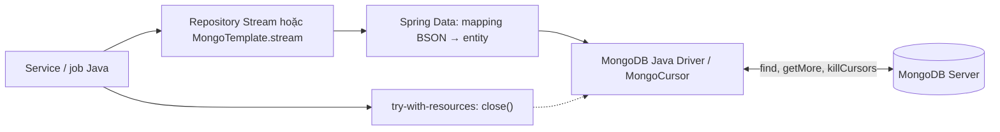
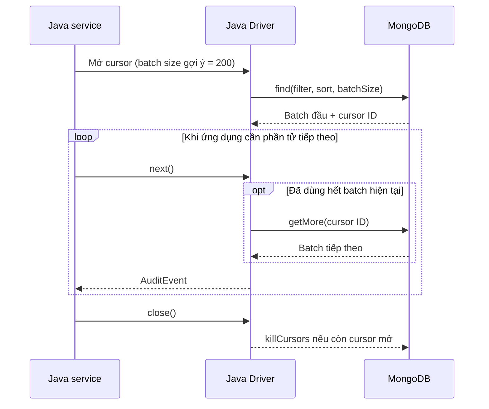
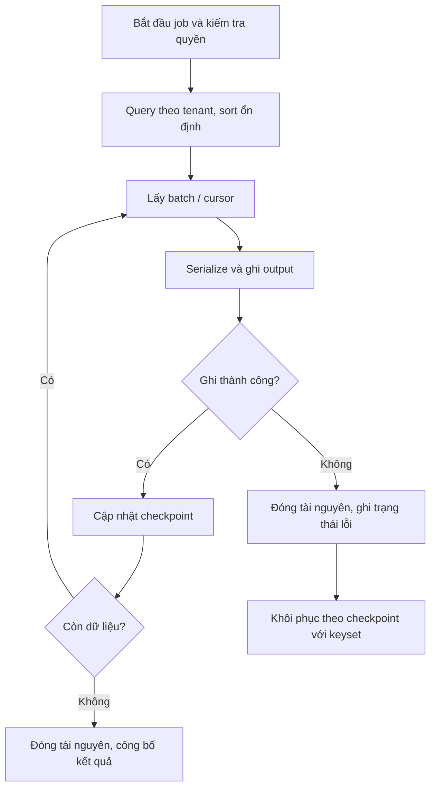

# Java Stream, cursor và đóng tài nguyên đúng hạn

Khi một collection MongoDB có hàng triệu document, gọi `findAll()` để nhận toàn bộ dữ liệu rồi xử lý trong Java có thể làm tăng bộ nhớ, thời gian phản hồi và lượng dữ liệu truyền qua mạng. **Spring Data MongoDB** hỗ trợ đọc kết quả từng phần thông qua **cursor** và các API như `Stream<T>` của repository hoặc `MongoTemplate.stream(...)`. Cách này giúp ứng dụng xử lý tuần tự mà không nhất thiết phải giữ mọi document cùng lúc trong RAM.

Nhưng việc stream dữ liệu cũng mang theo trách nhiệm: **cursor là tài nguyên sống**, có thể giữ trạng thái ở MongoDB Server, kết nối và bộ đệm của driver. Nếu không đóng khi hoàn tất, khi có exception hoặc khi dừng sớm, ứng dụng có thể làm tăng số cursor mở, giữ kết nối lâu và suy giảm khả năng phục vụ các request khác. Một Java `Stream` không mặc nhiên được đóng chỉ vì đã gọi một terminal operation.

Bài học thuộc chương **Phân trang và luồng** của module `SPRING_DATA_MONGODB`. Ta sẽ phân biệt Java Stream trong bộ nhớ với cursor MongoDB, thực hành repository và `MongoTemplate`, dùng `try-with-resources`, chọn batch size, xử lý xuất dữ liệu, so sánh phân trang offset/keyset và reactive `Flux`, rồi kiểm thử/chẩn đoán tài nguyên.

Sau bài học, bạn có thể:

- Giải thích quan hệ giữa `MongoDB Server`, `Java Driver`, `MongoCursor`, Spring Data và `java.util.stream.Stream`.
- Phân biệt `findAll().stream()` với stream được **tạo trực tiếp từ truy vấn MongoDB**.
- Sử dụng `try-with-resources` cho repository `Stream<T>` và `CloseableIterator<T>` của `MongoTemplate`.
- Hiểu các tình huống **dừng sớm, exception, xử lý chậm, batch size và timeout**.
- Chọn stream, `Page`/`Slice` hoặc keyset pagination phù hợp với mục tiêu.
- Thiết kế xử lý dữ liệu lớn có giới hạn tài nguyên, kiểm soát quyền truy cập và khả năng khôi phục sau lỗi.

## 1. Cursor MongoDB nằm ở đâu trong luồng xử lý?



Khi truy vấn cần trả nhiều document, MongoDB có thể gửi **batch đầu tiên** rồi cung cấp **cursor** để client yêu cầu batch tiếp theo (`getMore`). Java Driver giúp nhận dữ liệu từng batch và chuyển BSON; Spring Data ánh xạ BSON thành entity. Java `Stream` là **giao diện tiêu thụ dữ liệu** trong ứng dụng, còn cursor là **nguồn kết quả và tài nguyên bên dưới**.

| Khái niệm | Vai trò | Cần lưu ý |
| --- | --- | --- |
| `List<T>` từ `findAll()` | Đã materialize toàn bộ kết quả được trả về | Có thể chiếm nhiều heap nếu kết quả lớn |
| `list.stream()` | Java Stream trên collection trong bộ nhớ | **Không mở cursor MongoDB mới**; không biến truy vấn cũ thành streaming |
| `Stream<T>` trả về từ query method repository | Cho phép tiêu thụ kết quả truy vấn theo stream | **Phải đóng** để giải phóng tài nguyên gắn với query |
| `CloseableIterator<T>` từ `MongoTemplate.stream(...)` | Iterator để đọc dần kết quả theo cursor | **Phải đóng** trong mọi nhánh xử lý |
| `MongoCursor<T>` của Java Driver | Cursor trực tiếp của driver MongoDB | `AutoCloseable`; dùng `try-with-resources` |
| `Flux<T>` từ reactive repository/template | Publisher theo Reactive Streams | Không phải `java.util.stream.Stream`; vòng đời qua subscription, completion/cancellation |

Một cursor **không đồng nghĩa toàn bộ kết quả đã có trong RAM**. Tuy nhiên, từng batch vẫn chiếm bộ đệm, việc mapping vẫn tạo object Java, và các phép xử lý phía client có thể tự materialize dữ liệu. Stream chỉ hữu ích khi **pipeline tiêu thụ có giới hạn**.

## 2. Ví dụ dữ liệu nhật ký sự kiện

Giả sử ứng dụng cần xuất nhật ký hoạt động của một tenant. Collection `auditEvents` gồm nhiều document, mỗi document có ID, loại sự kiện, thời điểm và một thông điệp ngắn.

```javascript
// Collection: auditEvents
{
  _id: "EVT-0001",
  tenantId: "TENANT-A",
  type: "LOGIN",
  createdAt: ISODate("2026-11-20T00:00:00Z"),
  message: "Đăng nhập thành công"
}
{
  _id: "EVT-0002",
  tenantId: "TENANT-A",
  type: "LOGIN",
  createdAt: ISODate("2026-11-20T00:00:01Z"),
  message: "Đăng nhập từ ứng dụng"
}
```

Entity Java dùng Java 17+ và Spring Data MongoDB:

```java
import java.time.Instant;
import org.springframework.data.mongodb.core.mapping.Document;
import org.springframework.data.mongodb.core.mapping.MongoId;

@Document(collection = "auditEvents")
public record AuditEvent(
        @MongoId String id,
        String tenantId,
        String type,
        Instant createdAt,
        String message
) {}
```

`@MongoId String id` được chọn để giữ ID nghiệp vụ dạng BSON String, không vô tình chuyển một chuỗi trông như ObjectId. Trong ứng dụng thật, hãy thống nhất kiểu BSON của ID, kiểu thời gian và index với dữ liệu đang có.

Một index phù hợp cho query “sự kiện LOGIN của tenant, tăng dần theo thời gian và ID”:

```javascript
db.auditEvents.createIndex({
  tenantId: 1,
  type: 1,
  createdAt: 1,
  _id: 1
});
```

Index giúp lọc và đọc có thứ tự. Sắp xếp theo `createdAt` rồi thêm `_id` làm khóa phụ vì nhiều sự kiện có thể cùng thời điểm; **không dựa vào thứ tự tự nhiên của collection** để viết job có checkpoint.

## 3. Phân biệt `findAll().stream()` và stream từ database

### 3.1. Cách làm dễ gây tốn bộ nhớ

```java
import java.util.List;

List<AuditEvent> all = auditEventRepository.findAll();

all.stream()
        .filter(event -> "LOGIN".equals(event.type()))
        .forEach(event -> process(event));
```

`findAll()` đã tải kết quả query thành danh sách trước khi Java `Stream` được tạo. `filter` phía Java **không đẩy điều kiện `type` xuống MongoDB**; mọi document trong danh sách đều đã được đọc. Với collection lớn, code có thể tốn hàng trăm MiB hoặc nhiều hơn.

Thậm chí viết một dòng:

```java
auditEventRepository.findAll().stream().forEach(this::process);
```

vẫn không trở thành cursor streaming. Điểm quyết định không phải có chữ `stream` trong Java, mà là **repository/query đã trả về loại gì trước đó**.

### 3.2. Stream trực tiếp từ query method của repository

Khai báo repository có method trả về `Stream<AuditEvent>`:

```java
import java.util.stream.Stream;
import org.springframework.data.mongodb.repository.MongoRepository;

public interface AuditEventRepository
        extends MongoRepository<AuditEvent, String> {

    Stream<AuditEvent>
    findByTenantIdAndTypeOrderByCreatedAtAscIdAsc(
            String tenantId, String type);
}
```

Spring Data diễn giải filter và sort từ tên method rồi cung cấp stream kết quả. Với `tenantId = "TENANT-A"` và `type = "LOGIN"`, ý nghĩa query giống:

```javascript
db.auditEvents.find({
  tenantId: "TENANT-A",
  type: "LOGIN"
}).sort({
  createdAt: 1,
  _id: 1
});
```

Kết quả query có thể rất dài, nhưng application tiêu thụ tuần tự mà không cần tạo `List<AuditEvent>` chứa tất cả document. Đừng nhầm điều này với bảo đảm “không tốn bộ nhớ”: driver và pipeline vẫn giữ từng batch và object đang xử lý.

### 3.3. Quy tắc bắt buộc: `try-with-resources`

```java
import java.util.stream.Stream;
import org.springframework.stereotype.Service;

@Service
public class AuditExportService {
    private final AuditEventRepository repository;

    public AuditExportService(AuditEventRepository repository) {
        this.repository = repository;
    }

    public void exportLogins(String tenantId) {
        try (Stream<AuditEvent> events =
                repository.findByTenantIdAndTypeOrderByCreatedAtAscIdAsc(
                        tenantId, "LOGIN")) {

            events.forEach(this::writeOneEvent);
        }
    }

    private void writeOneEvent(AuditEvent event) {
        // Minh họa: ghi một event vào sink đã kiểm soát.
        // Cần giới hạn tài nguyên và xử lý lỗi của sink thật.
        System.out.println(event.id());
    }
}
```

`Stream` triển khai `AutoCloseable`. Khi thoát khối `try`, Java gọi `close()` kể cả khi callback ném exception. Với Stream sinh từ query MongoDB, việc đóng này cho phép tầng Spring Data/driver giải phóng tài nguyên cursor. Hãy giữ **toàn bộ thao tác tiêu thụ** trong khối `try`.

**Không nên** viết:

```java
// Sai: trả Stream ra khỏi scope quản lý cursor.
public Stream<AuditEvent> getEvents(String tenantId) {
    try (Stream<AuditEvent> stream =
            repository.findByTenantIdAndTypeOrderByCreatedAtAscIdAsc(
                    tenantId, "LOGIN")) {
        return stream; // Stream đã đóng trước khi caller dùng!
    }
}
```

Nếu thật sự muốn truyền stream cho tầng khác, hãy thiết kế **hợp đồng sở hữu rõ ai đóng và ở đâu**; thường đơn giản hơn khi service tự tiêu thụ cursor rồi ghi kết quả theo chunk/stream response trong vòng đời được quản lý.

## 4. `MongoTemplate.stream(...)` và `CloseableIterator<T>`

`MongoTemplate` phù hợp khi query cần điều kiện động, projection, sort, limit và batch size. Phương thức `stream` trả về `CloseableIterator<T>` của Spring Data:

```java
import org.springframework.data.domain.Sort;
import org.springframework.data.mongodb.core.MongoTemplate;
import org.springframework.data.mongodb.core.query.Criteria;
import org.springframework.data.mongodb.core.query.Query;
import org.springframework.data.util.CloseableIterator;

public class AuditCursorReader {
    private final MongoTemplate template;

    public AuditCursorReader(MongoTemplate template) {
        this.template = template;
    }

    public long processLogins(String tenantId) {
        Query query = Query.query(
                Criteria.where("tenantId").is(tenantId)
                        .and("type").is("LOGIN"));

        query.with(Sort.by(
                Sort.Order.asc("createdAt"),
                Sort.Order.asc("id")));
        query.cursorBatchSize(200);

        long processed = 0;
        try (CloseableIterator<AuditEvent> cursor =
                template.stream(query, AuditEvent.class)) {
            while (cursor.hasNext()) {
                AuditEvent event = cursor.next();
                validateAndWrite(event);
                processed++;
            }
        }
        return processed;
    }

    private void validateAndWrite(AuditEvent event) {
        // Xử lý có giới hạn bộ nhớ, không tích lũy mọi event.
    }
}
```

`CloseableIterator<T>` hỗ trợ `hasNext()`/`next()` nên thích hợp với xử lý tuần tự có vòng đời rõ ràng. `query.cursorBatchSize(200)` **gợi ý batch size** cho cursor; nó **không giới hạn tổng số document** cần đọc. Phải dùng `query.limit(n)` hoặc dừng theo điều kiện nghiệp vụ nếu chỉ muốn một số lượng tối đa.

**Quan trọng:** ngay cả khi `hasNext()` trả false sau khi đọc hết, vẫn giữ `try-with-resources` như một quy tắc nhất quán. Khi callback lỗi, `return` sớm hoặc nhận một request hủy bỏ, khối `try` mới bảo đảm `close()` được gọi.

### 4.1. Giới hạn kết quả ngay trên server

Nếu chỉ muốn tối đa 500 sự kiện:

```java
Query query = Query.query(
        Criteria.where("tenantId").is("TENANT-A"));
query.with(Sort.by(Sort.Order.asc("createdAt"),
                   Sort.Order.asc("id")));
query.limit(500);
query.cursorBatchSize(100);

try (CloseableIterator<AuditEvent> cursor =
        template.stream(query, AuditEvent.class)) {
    while (cursor.hasNext()) {
        handle(cursor.next());
    }
}
```

Đây là đoạn code trong service có `template` và `handle` đã định nghĩa. `limit(500)` là giới hạn query ở server, còn `cursorBatchSize(100)` định hướng kích thước batch; cả hai **không thay thế nhau**. Nếu dự án cần giới hạn tổng số byte của output, phải thêm quy tắc payload/streaming ở tầng ứng dụng, không chỉ giới hạn số document.

### 4.2. Projection khi đọc lượng lớn

Nếu job chỉ cần `id` và `createdAt`, có thể giảm field được truyền:

```java
query.fields()
        .include("id")
        .include("createdAt");
```

Việc ánh xạ kết quả vào `AuditEvent` trong tình huống này sẽ tạo một **entity thiếu field**, chỉ phù hợp cho đọc. **Không được gọi `save` trên entity chỉ được nạp một phần**, vì có thể làm mất các field khác trong document (nếu save thay thế nội dung đã mapping). Nếu cần projection hiệu quả và kiểu an toàn, hãy dùng DTO riêng hoặc xử lý BSON/projection với mapping có chủ đích.

## 5. Những lúc cursor phải được đóng, kể cả khi chưa đọc hết

Một câu trả lời đúng về streaming không chỉ có `forEach` hoặc `while (hasNext)`. Phải biết điều gì xảy ra nếu luồng xử lý **không đọc đến cuối**.

### 5.1. Kết thúc bình thường

```java
try (Stream<AuditEvent> stream =
        repository.findByTenantIdAndTypeOrderByCreatedAtAscIdAsc(
                tenantId, "LOGIN")) {
    stream.forEach(this::process);
} // close() được gọi tại đây.
```

Ngay cả khi stream đã tiêu thụ hết, `try-with-resources` là cách thể hiện rõ quyền sở hữu và không phụ thuộc chi tiết liệu driver/server đã tự giải phóng một phần tài nguyên ở cuối cursor.

### 5.2. Dừng sớm khi đủ dữ liệu

```java
try (Stream<AuditEvent> stream =
        repository.findByTenantIdAndTypeOrderByCreatedAtAscIdAsc(
                tenantId, "LOGIN")) {

    stream.limit(10).forEach(this::process);
} // Đóng stream gốc dù chưa tiêu thụ mọi bản ghi.
```

`limit(10)` trong Java Stream là thao tác của **pipeline phía client**, không đồng nghĩa với query có `limit(10)` gửi xuống MongoDB. Driver có thể đã nhận một batch lớn hơn 10 document. Nếu giới hạn được biết trước và ổn định, **đẩy limit xuống query** thường rõ ràng và tiết kiệm tài nguyên hơn.

### 5.3. Có exception trong quá trình xử lý

```java
try (Stream<AuditEvent> stream =
        repository.findByTenantIdAndTypeOrderByCreatedAtAscIdAsc(
                tenantId, "LOGIN")) {

    stream.forEach(event -> {
        validate(event);
        writeToOutput(event); // Có thể ném exception.
    });
}
// Nếu validate()/writeToOutput() ném exception,
// Stream.close() vẫn được gọi khi thoát khối try.
```

`try-with-resources` giúp đóng cursor, nhưng **không rollback những output đã ghi** trước exception. Nếu đây là job xuất CSV hoặc đẩy sự kiện sang hệ khác, cần chính sách xử lý file dở dang, checkpoint, retry/idempotency và thông báo lỗi.

### 5.4. Những cách dùng dễ rò rỉ tài nguyên

```java
// SAI: không có close, nhất là khi findFirst() dừng sớm.
AuditEvent found = repository
        .findByTenantIdAndTypeOrderByCreatedAtAscIdAsc(tenantId, "LOGIN")
        .findFirst()
        .orElse(null);

// SAI: terminal operation không tự gọi Stream.close().
long total = repository
        .findByTenantIdAndTypeOrderByCreatedAtAscIdAsc(tenantId, "LOGIN")
        .count();

// SAI VỀ MỤC TIÊU BỘ NHỚ: materialize tất cả event.
List<AuditEvent> events;
try (Stream<AuditEvent> stream =
        repository.findByTenantIdAndTypeOrderByCreatedAtAscIdAsc(
                tenantId, "LOGIN")) {
    events = stream.toList(); // cursor đóng, nhưng List có thể rất lớn.
}
```

`count()` trong Java Stream **duyệt các phần tử phía client**, không phải một lệnh đếm tối ưu của MongoDB. Nếu chỉ cần số lượng, dùng repository `countByTenantIdAndType(...)` hoặc `MongoTemplate.count(...)`. Nếu chỉ cần document đầu tiên, dùng derived query `findFirstBy...` với sort/limit server thay vì mở một stream dài.

Ngoài `toList()`, các phép `sorted()`, một số kiểu `distinct()` hoặc `collect(...)` có thể giữ một phần lớn dữ liệu trong bộ nhớ; `parallel()` không phù hợp với việc dùng một cursor tuần tự chung và callback có side effect. Hãy giữ pipeline đơn giản, xử lý từng phần tử và kiểm soát bộ nhớ của bước downstream.

### 5.5. Không gửi cursor sang tác vụ chạy sau

Không nên tạo cursor trong một method rồi trao nó cho callback asynchronous, queue không giới hạn, hoặc thread khác mà **không làm rõ ai chịu trách nhiệm đóng**. Cursor và entity mapping có vòng đời gắn với nguồn dữ liệu và trạng thái xử lý.

Nếu API trả nội dung dạng stream về client, quá trình đọc phải được quản lý theo **vòng đời response**: khi client ngắt kết nối hoặc việc ghi response thất bại, code phải hủy/đóng nguồn. Không giữ một stream mở trong biến static, cache hoặc HTTP session.

## 6. Cursor batch size, tài nguyên và timeout

### 6.1. `batchSize` không phải số lượng document cuối cùng

MongoDB có thể trả nhiều batch khi client duyệt cursor:



`batchSize = 200` là **yêu cầu/hướng dẫn cho số document mỗi batch**, không phải cam kết driver luôn nhận chính xác 200. MongoDB còn bị giới hạn bởi kích thước response, loại query, version và nhiều yếu tố thực thi. Batch có thể nhỏ hơn, và việc chọn batch lớn không mặc nhiên làm mọi query nhanh hơn.

| Batch tương đối nhỏ | Batch tương đối lớn |
| --- | --- |
| Có thể tăng số lần `getMore`/round-trip | Có thể giảm số round-trip |
| Bộ đệm driver thấp hơn trong một số workload | Có thể tiêu thụ thêm RAM và áp lực GC |
| Phù hợp khi mỗi document lớn hoặc xử lý từng bản ghi chậm | Phù hợp khi mỗi document nhỏ, network latency cao |
| Có thể tăng tổng thời gian do quá nhiều request | Có thể gây truyền byte dư khi dừng sớm |

Hãy đo độ trễ, throughput, kích thước BSON trung bình, peak heap, GC và số lần `getMore` trên dữ liệu tương tự production. Không có một giá trị batch size đúng cho mọi hệ thống.

### 6.2. Cursor timeout, session và xử lý chậm

Cursor MongoDB có thể bị server đóng sau khi **không được dùng trong một khoảng thời gian**; vòng đời còn phụ thuộc phiên làm việc (session), driver và các timeout đã cấu hình. Nếu một job xử lý một bản ghi mất rất lâu trước khi gọi `next()`, cursor có thể hết hạn dù Java object vẫn còn giữ reference.

Trong một số trường hợp có thể dùng tùy chọn `noCursorTimeout`, nhưng đây **không phải giải pháp mặc định**: cursor vẫn có thể chịu ràng buộc session và các tài nguyên khác, đồng thời tăng nguy cơ cursor bị bỏ quên. Thường tốt hơn là **giảm thời gian giữ cursor**, xử lý theo batch có checkpoint hoặc tách đọc khỏi xử lý nặng bằng một hàng đợi **có giới hạn**.

Đừng tăng mọi timeout lên vô hạn để “tránh lỗi” khi nguyên nhân thực tế là job đọc quá chậm, index kém hoặc stream không được đóng.

### 6.3. Kết nối và thao tác dài

Cursor dùng tài nguyên phía server và driver; trong một số trường hợp (như transaction, phiên/luồng xử lý đặc biệt) còn có ràng buộc về kết nối/session. Không giả định mỗi cursor **luôn giữ cố định một connection** trong toàn bộ thời gian sống: điều này phụ thuộc driver, topology và loại thao tác. Nhưng việc mở hàng loạt cursor không kiểm soát vẫn gây áp lực tài nguyên.

Nếu một endpoint đồng thời cho nhiều khách hàng xuất hàng triệu record, cần có giới hạn:

- **Số job export chạy đồng thời**, mỗi tenant/user có quota và thời gian tối đa.
- **Kích thước/tổng số bản ghi** và thời gian xuất; có thể xuất thành file tạm khi tác vụ quá dài.
- **Phân quyền theo tenant** đưa xuống query, không lọc tenant sau khi đã kéo dữ liệu về.
- **Xử lý hủy** khi request bị ngắt hoặc job bị dừng.
- **Giám sát** số cursor đang mở, connection pool, query chậm, heap, GC và băng thông.

## 7. Chọn Stream, Page, Slice hay keyset pagination

Không phải mọi tác vụ đọc nhiều document đều nên dùng một cursor kéo dài. Một trang danh sách và một job export có mục tiêu khác nhau.

| Mục tiêu | Lựa chọn thường phù hợp | Lý do |
| --- | --- | --- |
| Trang UI 20–50 document và cần tổng số trang | `Page<T>` với `Pageable` | Có content và metadata tổng số, nhưng count có thể tốn chi phí |
| Trang UI chỉ cần biết còn trang sau không | `Slice<T>` | Không nhất thiết phải chạy truy vấn count |
| Đọc đến N bản ghi đầu theo sort | Derived query `TopN`/`FirstN` hoặc query `limit` | Giới hạn phía server |
| Job export/đọc tuần tự liên tục | Repository `Stream<T>` hoặc `MongoTemplate.stream` | Đọc dần, giảm nhu cầu materialize tất cả |
| Job dài, cần khôi phục sau lỗi và chia nhỏ thời gian | **Keyset/seek pagination** và checkpoint | Mỗi query độc lập, không giữ một cursor xuyên suốt |
| Đồng bộ liên tục các thay đổi | Change streams hoặc kỹ thuật chuyên biệt tùy bài toán | Khác hoàn toàn với việc duyệt một query hữu hạn |

### 7.1. Offset pagination qua repository

```java
import org.springframework.data.domain.Page;
import org.springframework.data.domain.Pageable;
import org.springframework.data.mongodb.repository.MongoRepository;

public interface AuditPageRepository
        extends MongoRepository<AuditEvent, String> {

    Page<AuditEvent> findByTenantIdAndType(
            String tenantId, String type, Pageable pageable);
}
```

Gọi:

```java
import org.springframework.data.domain.Page;
import org.springframework.data.domain.PageRequest;
import org.springframework.data.domain.Sort;

Page<AuditEvent> page = repository.findByTenantIdAndType(
        "TENANT-A",
        "LOGIN",
        PageRequest.of(
                0,
                20,
                Sort.by(Sort.Order.asc("createdAt"),
                        Sort.Order.asc("id"))));
```

Ở đây `repository` là `AuditPageRepository` được inject trong service. `PageRequest.of(0, 20)` yêu cầu trang đầu với kích thước 20. `Page` có thể cần phép đếm để cung cấp tổng; một số trường hợp framework có thể suy ra count mà không truy vấn thêm. Khi chỉ cần “còn trang sau không”, `Slice` phù hợp hơn vì tránh yêu cầu tính tổng số bản ghi.

Khi số trang tăng sâu, cách dùng `skip`/`limit` có thể làm server phải bỏ qua nhiều document. Ngoài chi phí, nếu document mới được chèn/xóa giữa các lần tải trang, offset dễ gây **trùng hoặc bỏ sót**.

### 7.2. Keyset pagination với cặp `createdAt` và `_id`

Keyset (seek pagination) không hỏi “bỏ qua 100.000 record”, mà hỏi “lấy record **sau khóa cuối đã xử lý**”. Với sort tăng dần `createdAt, _id`, điều kiện kế tiếp là:

```javascript
// Biết lastCreatedAt và lastId từ bản ghi cuối trang trước.
db.auditEvents.find({
  tenantId: "TENANT-A",
  type: "LOGIN",
  $or: [
    { createdAt: { $gt: ISODate("2026-11-20T00:00:01Z") } },
    {
      createdAt: ISODate("2026-11-20T00:00:01Z"),
      _id: { $gt: "EVT-0002" }
    }
  ]
})
.sort({ createdAt: 1, _id: 1 })
.limit(200);
```

Điều kiện `$or` bảo đảm cả trường hợp **nhiều event có cùng `createdAt`**. Không dùng mỗi `createdAt > lastCreatedAt` vì sẽ bỏ sót những document đồng thời gian với bản ghi cuối trang trước.

Ví dụ Spring Data `MongoTemplate`:

```java
import java.time.Instant;
import java.util.List;
import org.springframework.data.domain.Sort;
import org.springframework.data.mongodb.core.MongoTemplate;
import org.springframework.data.mongodb.core.query.Criteria;
import org.springframework.data.mongodb.core.query.Query;

public class AuditKeysetReader {
    private final MongoTemplate template;

    public AuditKeysetReader(MongoTemplate template) {
        this.template = template;
    }

    public List<AuditEvent> nextPage(
            String tenantId,
            Instant lastCreatedAt,
            String lastId
    ) {
        Criteria filter = Criteria.where("tenantId").is(tenantId)
                .and("type").is("LOGIN");

        if (lastCreatedAt != null && lastId != null) {
            Criteria after = new Criteria().orOperator(
                    Criteria.where("createdAt").gt(lastCreatedAt),
                    new Criteria().andOperator(
                            Criteria.where("createdAt").is(lastCreatedAt),
                            Criteria.where("_id").gt(lastId)
                    )
            );
            filter = new Criteria().andOperator(filter, after);
        }

        Query query = Query.query(filter)
                .with(Sort.by(Sort.Order.asc("createdAt"),
                              Sort.Order.asc("id")))
                .limit(200);

        return template.find(query, AuditEvent.class);
    }
}
```

Đây là ví dụ cho **ID chuỗi và createdAt bất biến**; khi chọn field khác phải đối chiếu kiểu BSON, collation và thứ tự index. Trang đầu dùng `lastCreatedAt/lastId = null`; các trang sau dùng cặp khóa của **record cuối đã xử lý thành công**, không phải record mới chỉ được tải vào RAM.

Keyset cho phép mỗi batch đóng request/cursor rồi mở query mới, dễ kiểm soát thời gian và retry hơn một cursor khổng lồ. Tuy nhiên nó **không tự cung cấp một snapshot bất biến**: nếu dữ liệu bị sửa/xóa/chèn trong lúc quét, vẫn có thể khác biệt. Với job cần tái lập chính xác, nên quy định cutoff thời gian, khóa bất biến, checkpoint và mô hình nhất quán phù hợp.

## 8. Reactive `Flux` không phải Java `Stream`

Ứng dụng dùng **ReactiveMongoRepository** hoặc **ReactiveMongoTemplate** có thể nhận `Flux<AuditEvent>` thay vì Java `Stream<AuditEvent>`. Hai API khác nhau về cách tiêu thụ, backpressure, vòng đời và quản lý tài nguyên:

| Java Stream/cursor blocking | Reactive `Flux` |
| --- | --- |
| `Iterator.next()`/`Stream.forEach()` gọi và chờ kết quả | Subscriber nhận tín hiệu dữ liệu theo Reactive Streams |
| Quản lý bằng `try-with-resources` và `close()` | Vòng đời do subscription, completion, error và **cancellation** điều khiển |
| Thread dùng API blocking có thể bị chờ I/O | Driver reactive cung cấp mô hình I/O không chặn phù hợp |
| `limit()` của Java là toán tử phía client | `take(n)` yêu cầu tối đa n phần tử rồi hủy upstream |
| Không nên dùng `parallel()` trên một cursor chung | Các toán tử `flatMap`/`concatMap` cần kiểm soát concurrency/backpressure |

Ví dụ reactive repository:

```java
import reactor.core.publisher.Flux;
import org.springframework.data.mongodb.repository.ReactiveMongoRepository;

public interface ReactiveAuditEventRepository
        extends ReactiveMongoRepository<AuditEvent, String> {

    Flux<AuditEvent>
    findByTenantIdAndTypeOrderByCreatedAtAscIdAsc(
            String tenantId, String type);
}
```

Service trả một `Flux` với số bản ghi được giới hạn:

```java
import reactor.core.publisher.Flux;
import org.springframework.stereotype.Service;

@Service
public class ReactiveAuditReadService {
    private final ReactiveAuditEventRepository repository;

    public ReactiveAuditReadService(
            ReactiveAuditEventRepository repository) {
        this.repository = repository;
    }

    public Flux<AuditEvent> firstHundredLogins(String tenantId) {
        return repository
                .findByTenantIdAndTypeOrderByCreatedAtAscIdAsc(
                        tenantId, "LOGIN")
                .take(100);
    }
}
```

Trong một reactive pipeline thông thường, client/driver xử lý giải phóng tài nguyên khi publisher **hoàn tất, gặp lỗi hoặc bị hủy**. Không dùng `try-with-resources` quanh `Flux` vì `Flux` không phải Java Stream. Nhưng ứng dụng phải **quản lý subscription** đúng vòng đời: khi HTTP client hủy request, subscriber/job bị dừng, phải để cancellation lan truyền xuống nguồn dữ liệu.

Các sai lầm hay gặp:

- Gọi `collectList()` trên luồng có hàng triệu event rồi mong rằng vẫn tiết kiệm bộ nhớ.
- Gọi `block()` trong event loop, làm mất ưu điểm non-blocking.
- Dùng `flatMap` không giới hạn cho tác vụ ghi chậm, tạo áp lực tải cao. Nếu yêu cầu tuần tự, dùng `concatMap` hoặc đặt giới hạn concurrency rõ ràng.
- Giữ subscription sống vô thời hạn mà không có chính sách ngắt, timeout hoặc backpressure.

### 8.1. Tailable cursor và change stream là trường hợp đặc biệt

Một query `find` thường có **tập kết quả hữu hạn**. Tailable cursor (trên capped collection) hoặc MongoDB change stream có thể chờ dữ liệu mới trong thời gian dài và mang vòng đời khác. Không dùng chúng như cơ chế “phân trang” thông thường.

Với luồng sống lâu, phải thiết kế riêng cách **hủy, reconnect, resume token (với change stream), giới hạn tài nguyên và theo dõi lỗi**. Không tái sử dụng một cursor đọc lịch sử hữu hạn như một dịch vụ subscription không có điểm dừng.

## 9. Job xuất dữ liệu an toàn và có thể khôi phục

Một job export 2 triệu document có thể thất bại ở giữa vì mất kết nối tới output, disk đầy hoặc worker bị dừng. `try-with-resources` đóng cursor đúng hạn, nhưng **không tự khôi phục công việc đã xử lý**.

Thiết kế một job đáng tin cậy thường có:

1. **Ranh giới dữ liệu:** tenant, loại event, khoảng thời gian và quyền truy cập đã được xác định.
2. **Thứ tự ổn định:** `createdAt + _id` hoặc khóa khác có tổng thứ tự rõ ràng.
3. **Xử lý từng phần:** stream tuần tự với output có giới hạn; tránh `toList()` toàn bộ.
4. **Checkpoint:** chỉ lưu khóa cuối sau khi phần output tương ứng **đã ghi thành công**.
5. **Retry idempotent:** tránh nhân đôi khi export được thử lại; có thể tạo file tạm và công bố file hoàn chỉnh theo cơ chế riêng.
6. **Giới hạn và hủy:** giới hạn số job đồng thời, thời gian, dung lượng và chuyển trạng thái `FAILED/CANCELLED` khi cần.
7. **Tài nguyên:** đóng cursor khi xử lý kết thúc, bị hủy hoặc gặp exception; đóng/flush output theo đúng sở hữu.



Nếu mỗi document cần gọi một dịch vụ mạng mất vài giây, giữ cùng cursor suốt hàng giờ dễ gặp timeout và tạo áp lực tài nguyên. Khi đó nên đọc **các trang keyset kích thước vừa phải**, đóng query sau mỗi batch và lưu checkpoint, thay vì giữ một cursor đang chờ trong khi xử lý ngoài MongoDB.

### 9.1. HTTP streaming và client ngắt kết nối

Khi ứng dụng xuất CSV qua một HTTP response dạng streaming, việc đọc MongoDB và ghi socket nên nằm **trong cùng callback/luồng công việc có lifecycle rõ ràng**. Nếu client đóng kết nối, thao tác ghi có thể ném `IOException`; ứng dụng phải thoát scope và đóng cursor, không tiếp tục đọc cả triệu document.

Không nên thiết kế một controller trả raw `Stream<AuditEvent>` rồi hy vọng JSON serializer/framework luôn tự gọi `close()`. Nếu framework có hỗ trợ streaming response, cần kiểm tra callback nào **sở hữu cursor**, việc cleanup khi client hủy và cách timeout/exception được quản lý.

Đối với một file lớn cần tải lại nhiều lần, có thể xuất bằng job nền **do hệ thống ứng dụng quản lý** sang object storage rồi trả trạng thái và liên kết tải khi sẵn sàng, thay vì giữ một HTTP connection với MongoDB cursor mở hàng giờ. Cần thiết kế quota, quyền truy cập và dọn file tạm.

### 9.2. Không giữ transaction đọc quá dài khi không cần

Transaction MongoDB trên deployment hỗ trợ có thời hạn, chi phí tài nguyên và ràng buộc session. Nếu chỉ **xuất dữ liệu để báo cáo**, không mặc nhiên bọc cả vòng đọc nhiều giờ bằng `@Transactional`. Một transaction cũng không biến một nguồn dữ liệu liên tục thay đổi thành export tái lập vô hạn thời gian.

Nếu cần snapshot nhất quán cho một báo cáo pháp lý/tài chính, hãy xác định yêu cầu thực tế về read concern, snapshot/transaction, thời gian tối đa và phương án xuất dữ liệu được kiểm thử trên topology phù hợp. Đừng coi một Java Stream là cơ chế giao dịch.

## 10. Kiểm thử cursor và quản lý tài nguyên

Một test đơn thuần mock `AuditEventRepository` và trả `Stream.of(...)` có thể kiểm tra logic xử lý, nhưng **không chứng minh** MongoDB tạo cursor thật hay tài nguyên đã được giải phóng đúng. Nên dùng **MongoDB test instance cô lập** (ví dụ Testcontainers) và `@DataMongoTest` để kiểm tra mapping, query, thứ tự và API stream.

### 10.1. Test Spring Data MongoDB với `Stream<T>`

Ví dụ với Spring Boot 3.x, Java 17+ và test database riêng:

```java
import static org.assertj.core.api.Assertions.assertThat;

import java.time.Instant;
import java.util.List;
import java.util.stream.Stream;
import org.junit.jupiter.api.BeforeEach;
import org.junit.jupiter.api.Test;
import org.springframework.beans.factory.annotation.Autowired;
import org.springframework.boot.test.autoconfigure.data.mongo.DataMongoTest;
import org.springframework.data.domain.Sort;
import org.springframework.data.mongodb.core.MongoTemplate;
import org.springframework.data.mongodb.core.query.Criteria;
import org.springframework.data.mongodb.core.query.Query;
import org.springframework.data.util.CloseableIterator;

@DataMongoTest
class AuditStreamIntegrationTest {

    @Autowired AuditEventRepository repository;
    @Autowired MongoTemplate template;

    @BeforeEach
    void prepare() {
        // Chỉ dùng database test cô lập; không chạy trên production.
        template.remove(new Query(), AuditEvent.class);
        template.insertAll(List.of(
                event("EVT-1", "TENANT-A", "LOGIN", "2026-11-01T00:00:00Z"),
                event("EVT-2", "TENANT-A", "LOGIN", "2026-11-01T00:00:01Z"),
                event("EVT-3", "TENANT-A", "LOGOUT", "2026-11-01T00:00:02Z"),
                event("EVT-4", "TENANT-B", "LOGIN", "2026-11-01T00:00:03Z")
        ));
    }

    private AuditEvent event(
            String id, String tenant, String type, String time
    ) {
        return new AuditEvent(
                id, tenant, type, Instant.parse(time), "Test");
    }

    @Test
    void repositoryStreamFiltersAndSorts() {
        try (Stream<AuditEvent> stream =
                repository.findByTenantIdAndTypeOrderByCreatedAtAscIdAsc(
                        "TENANT-A", "LOGIN")) {

            List<String> ids = stream.map(AuditEvent::id).toList();
            assertThat(ids).containsExactly("EVT-1", "EVT-2");
        }
    }

    @Test
    void templateCursorCanStopEarlyAndStillClose() {
        Query query = Query.query(
                Criteria.where("tenantId").is("TENANT-A")
                        .and("type").is("LOGIN"));
        query.with(Sort.by(Sort.Order.asc("createdAt"),
                           Sort.Order.asc("id")));
        query.cursorBatchSize(1);

        try (CloseableIterator<AuditEvent> cursor =
                template.stream(query, AuditEvent.class)) {

            assertThat(cursor.hasNext()).isTrue();
            assertThat(cursor.next().id()).isEqualTo("EVT-1");
            // Dừng sớm; tự động gọi close khi ra khỏi khối try.
        }
    }
}
```

Test này chứng minh **lọc/sắp xếp đúng** và code có cấu trúc `try-with-resources`, nhưng không trực tiếp đo mọi resource của driver/server. Khi cần xác minh cleanup chuyên sâu, có thể dùng **test về lời gọi `close()`** trên wrapper/spy thích hợp hoặc quan sát cursor metrics và command monitoring trong môi trường test độc lập.

`@DataMongoTest` không tự bảo đảm đã có MongoDB Server; hãy cung cấp MongoDB test instance thật, mapping và dependency phù hợp với dự án. Không chạy `template.remove(new Query(), ...)` với database dùng chung.

### 10.2. Test những tình huống lỗi

| Tình huống | Điều cần kiểm tra |
| --- | --- |
| Query không có kết quả | Iterator không có phần tử; close vẫn được gọi |
| Có 2 document, batch size = 1 | Đọc đủ hai phần tử qua các batch |
| Callback ném exception ở event thứ hai | Scope `try` kết thúc và cursor được đóng |
| Dừng sau 10 document | Không giữ cursor mở; không materialize toàn collection |
| Method trả Stream ra ngoài scope đã đóng | Test phát hiện cách dùng stream sai lifecycle |
| Input tenant không được phép | Không tạo query đọc dữ liệu ngoài tenant |
| Sắp xếp có bản ghi trùng `createdAt` | Khóa `_id` bảo đảm thứ tự ổn định |
| Bật keyset, dừng rồi tiếp tục | Không bỏ qua/thêm lặp ở dữ liệu test tĩnh |
| Client hủy export hoặc sink ghi lỗi | Trả trạng thái phù hợp và đóng nguồn |
| Nhiều job chạy đồng thời | Không vượt giới hạn connection/cursor/heap đã cấu hình |

Kiểm thử với dữ liệu 2–4 document chưa đủ để suy ra hiệu năng của hàng triệu document. Để đánh giá batch size và memory footprint, dùng tập dữ liệu giả có kích thước BSON, số lượng và phân phối filter gần thực tế.

## 11. Chẩn đoán hiệu năng và cursor mở quá lâu

Khi một job đọc dữ liệu lớn chậm hoặc ứng dụng hết kết nối, hãy phân biệt **query MongoDB chậm**, **network/driver chậm**, **mapping Java tốn CPU** và **bước xử lý đầu ra chậm**. Cùng biểu hiện “stream treo” có thể đến từ nhiều nguyên nhân.

### 11.1. Kiểm tra filter, sort và index

Với ví dụ đang dùng:

```javascript
db.auditEvents.getIndexes();

db.auditEvents.find({
  tenantId: "TENANT-A",
  type: "LOGIN"
})
.sort({ createdAt: 1, _id: 1 })
.limit(200)
.explain("executionStats");
```

Hãy quan sát query plan (ví dụ `IXSCAN`/`COLLSCAN`), số document và index key đã duyệt, có stage sort tốn chi phí hay không, thời gian thực thi trên server và số kết quả. Nếu không có index hỗ trợ cả filter lẫn sort, server có thể phải duyệt nhiều dữ liệu hoặc sắp xếp tốn tài nguyên trước khi trả batch đầu.

`explain("executionStats")` không đo đầy đủ thời gian serialize sang Java, thời gian chờ sink xuất file hay việc client giữ cursor sau đó. Khi cần chẩn đoán end-to-end, phải đo thêm thời gian ứng dụng xử lý mỗi batch, số document/giây và mức sử dụng heap.

### 11.2. Quan sát cursor và connection pool

Với quyền giám sát phù hợp, một số phiên bản MongoDB cung cấp thông tin cursor trong server status:

```javascript
// Cần quyền giám sát phù hợp; không phải mọi môi trường đều cho phép.
db.serverStatus().metrics.cursor.open;
```

Quan sát số cursor đang mở và xu hướng theo thời gian. Một cursor mở trong thời gian có request export thực sự hoạt động **không mặc nhiên là leak**; ngược lại, số lượng cursor mở tăng liên tục sau khi request đã kết thúc có thể gợi ý vấn đề cleanup. Các chỉ số server không luôn gắn trực tiếp một cursor với một method Java cụ thể.

Từ phía ứng dụng, kết hợp:

- MongoDB Java Driver **command monitoring** cho `find`/`getMore`/`killCursors` khi cần phân tích chuyên sâu.
- Metrics pool kết nối, timeout, số request export đồng thời và thời gian mỗi job.
- Heap/GC, số record xử lý, số byte xuất, độ trễ xử lý từng record.
- Log sự kiện start/end/error/cancel của job **không chứa credential hoặc nội dung dữ liệu nhạy cảm**.

Nếu `MongoCursor` đã bị server đóng do timeout hoặc lỗi mạng, client có thể nhận exception khi tiếp tục `next()`. Không giả định chỉ gọi lại `next()` trên cùng cursor là có thể phục hồi; phải bắt đầu **truy vấn mới** từ checkpoint hợp lệ nếu nghiệp vụ cho phép.

### 11.3. Các lỗi phổ biến và cách sửa

| Sai lầm | Hậu quả | Cách sửa |
| --- | --- | --- |
| `findAll().stream()` trên collection lớn | Toàn bộ kết quả được materialize trước khi stream | Dùng repository query trả `Stream<T>` hoặc `MongoTemplate.stream` |
| Dùng `Stream.findFirst()` rồi bỏ stream | Cursor có thể không được đóng đúng lúc | Dùng `try-with-resources`; nếu chỉ cần một record, dùng `findFirstBy...` |
| Chỉ gọi `forEach` mà không `close` | Terminal operation không tự hứa đóng resource | Bọc nguồn stream trong `try-with-resources` |
| Gọi `stream.toList()` trên hàng triệu document | Heap tăng dù nguồn là cursor | Xử lý tuần tự, batch có giới hạn hoặc xuất trực tiếp |
| Giữ cursor mở khi gọi API ngoài rất chậm | Cursor idle, timeout và tốn tài nguyên | Xử lý theo trang/chunk rồi đóng query; checkpoint |
| Tăng batch size vô hạn | Bộ đệm/memory cao và truyền dư khi dừng sớm | Đo workload, điều chỉnh batch hợp lý |
| Chỉ sort theo thời gian có thể trùng | Không có thứ tự ổn định khi tiếp tục job | Thêm `_id` hoặc khóa phụ duy nhất |
| Phân trang offset quá sâu | Quét/bỏ qua nhiều record, dễ trùng/bỏ sót khi dữ liệu đổi | Dùng keyset pagination với khóa bất biến khi phù hợp |
| Trả `Stream` từ scope đã đóng | Caller nhận nguồn hết hiệu lực | Tiêu thụ trong cùng resource scope |
| Dùng `parallel()` trên cursor một lần | Khó quản lý cursor, thứ tự và side effect | Đọc tuần tự; tách xử lý hậu kỳ bằng hàng đợi có giới hạn |
| Dùng `Page` cho job export chỉ cần dữ liệu | Có thể trả thêm tổng số và tạo chi phí count | Dùng stream hoặc `Slice`/keyset tùy yêu cầu |
| Dùng `Flux.collectList()` với dữ liệu rất lớn | Tích lũy mọi phần tử trong bộ nhớ | Giữ pipeline reactive streaming, kiểm soát backpressure |
| Chỉ tăng `noCursorTimeout` khi stream lỗi | Có thể giữ cursor mồ côi lâu hơn | Đóng đúng hạn, giảm thời gian xử lý, dùng checkpoint |
| Dùng projection entity rồi `save` lại | Nguy cơ mất trường không được tải | Dùng DTO đọc và update theo field cho đường ghi |

## 12. Bài tập thực hành: xuất lịch sử đơn hàng

Một dịch vụ thương mại điện tử lưu 8 triệu document trong collection `orders`. Mỗi document có `tenantId`, `status`, `createdAt`, `_id`, `totalVnd` và danh sách `lines`. Một nhân viên được phép xuất **đơn hàng `PAID` trong một khoảng thời gian** thành CSV.

Yêu cầu:

1. Không được tải toàn bộ 8 triệu document vào RAM.
2. Chỉ xuất các field `_id`, `createdAt`, `totalVnd` và `status`; không tải `lines` nếu không cần.
3. Phải lọc tenant **ngay tại truy vấn MongoDB**, không lọc sau khi đọc.
4. Khi người dùng hủy tải hoặc ổ đĩa đầy, phải dừng và giải phóng tài nguyên.
5. Job có thể được khôi phục từ document cuối cùng đã ghi thành công.
6. Truy vấn phải có thứ tự xác định và index phù hợp.

### 12.1. Phương án A: stream trong một lần chạy ngắn

Thiết kế query bằng `MongoTemplate`:

```java
import java.time.Instant;
import org.springframework.data.domain.Sort;
import org.springframework.data.mongodb.core.query.Criteria;
import org.springframework.data.mongodb.core.query.Query;

Query query = Query.query(
        Criteria.where("tenantId").is(tenantId)
                .and("status").is("PAID")
                .and("createdAt").gte(fromInclusive).lt(toExclusive));

query.fields()
        .include("id")
        .include("createdAt")
        .include("totalVnd")
        .include("status");

query.with(Sort.by(Sort.Order.asc("createdAt"),
                   Sort.Order.asc("id")));
query.cursorBatchSize(200);
```

Đây là đoạn thân của một method service có `tenantId`, `fromInclusive`, `toExclusive` được xác thực. Kết quả có thể được stream sang một **DTO chỉ đọc** hoặc class mapping phù hợp, không nên dùng entity partial để `save`. `toExclusive` giúp dễ định nghĩa ranh giới thời gian nửa mở `[from, to)`.

Ví dụ DTO chỉ phục vụ xuất dữ liệu, không ánh xạ thành một `@Document` domain để ghi lại:

```java
import java.time.Instant;
import org.springframework.data.annotation.Id;

public record OrderExportRow(
        @Id String id,
        Instant createdAt,
        Long totalVnd,
        String status
) {}
```

`@Id` trong DTO giúp Spring Data nhận diện `_id` khi ánh xạ kết quả. Các thuộc tính và kiểu trong DTO phải khớp dữ liệu BSON thực tế; không dùng DTO này để `save` vào collection `orders`.

Trong scope cùng quản lý cursor và output:

```java
try (CloseableIterator<OrderExportRow> cursor =
        mongoTemplate.stream(query, OrderExportRow.class, "orders")) {

    while (cursor.hasNext()) {
        OrderExportRow row = cursor.next();
        writeCsvRow(row); // Phải escape CSV và xử lý lỗi output.
    }
}
```

`OrderExportRow` là DTO chỉ đọc được định nghĩa ở trên. Tên collection được truyền tường minh trong overload `MongoTemplate.stream(Query, Class<T>, String)`. Phần export phải xác thực quyền tenant, kiểm tra giới hạn thời gian, và bảo đảm writer/output cũng được đóng/flush đúng với chủ sở hữu. Khi sink phát sinh exception, scope `try` đóng cursor.

### 12.2. Phương án B: xử lý theo batch có checkpoint

Với job nhiều giờ, có thể thay cursor liên tục bằng trang keyset:

- Sort theo `createdAt ASC, _id ASC`; checkpoint là cặp `lastCreatedAt/lastId`.
- Query mỗi lượt tối đa 200–1.000 document tùy kích thước và khả năng xử lý.
- Ghi xong một batch hoặc từng record theo cơ chế output tin cậy rồi **mới cập nhật checkpoint**.
- Khi lỗi, đọc tiếp theo điều kiện `createdAt > lastCreatedAt` hoặc `createdAt = lastCreatedAt AND _id > lastId`.
- Đặt giới hạn thời gian `toExclusive` ổn định cho một phiên export, đồng thời hiểu rằng chỉnh sửa/xóa dữ liệu cũ vẫn ảnh hưởng kết quả nếu không dùng snapshot.

Phương án này cho phép mỗi query kết thúc sớm và dễ kiểm soát thời gian giữ cursor hơn, đổi lại phải xây dựng **trạng thái job, retry và idempotency** có chủ đích.

### 12.3. Index cần cân nhắc

```javascript
db.orders.createIndex({
  tenantId: 1,
  status: 1,
  createdAt: 1,
  _id: 1
});
```

Index phục vụ equality trên tenant/status và range/sort theo createdAt + ID. Phải xác minh bằng `explain` trên dữ liệu đại diện, tránh tạo index chỉ vì ví dụ nêu ra. Nếu query còn filter khác hoặc chọn trường sắp xếp khác, thiết kế index cũng phải điều chỉnh.

**Câu hỏi mở:** nếu client muốn xuất “tất cả đơn hàng đã thanh toán trong tháng trước, đúng theo trạng thái tại thời điểm bắt đầu job”, chỉ dùng cursor hoặc keyset có đủ không? **Chưa đủ để bảo đảm snapshot như yêu cầu.** Phải chọn mô hình snapshot/read concern hoặc cơ chế chốt dữ liệu theo thời điểm và xử lý thay đổi phù hợp với giới hạn của MongoDB deployment.

## 13. Checklist trước khi triển khai streaming

1. **Nguồn dữ liệu có thực sự streaming không?** `MongoTemplate.stream` hoặc repository `Stream<T>` khác `findAll().stream()`.
2. **Ai sở hữu tài nguyên?** Có `try-with-resources` cho cursor/Stream của query chưa?
3. **Dừng sớm và exception xử lý thế nào?** Mọi đường return/error/hủy đều đóng nguồn hay chưa?
4. **Query có filter tenant, điều kiện và sort ở server không?** Không kéo dữ liệu thừa rồi mới lọc ở Java.
5. **Có index phù hợp không?** Đã đo `explain`, batch round-trip và memory footprint chưa?
6. **Batch size, số job đồng thời và giới hạn output bao nhiêu?** Có bảo vệ connection pool/heap không?
7. **Có cần tổng số, phân trang UI hay checkpoint?** Chọn `Page`/`Slice`, Stream hoặc keyset theo nhiệm vụ.
8. **Sắp xếp có khóa phụ duy nhất chưa?** Dùng `createdAt + _id` hoặc quy ước tương đương.
9. **Nếu lỗi giữa chừng, retry có an toàn không?** Checkpoint dựa trên dữ liệu đã được ghi thành công, không chỉ đã đọc.
10. **Có dùng reactive không?** Đừng nhầm `Flux` với Java Stream; quản lý subscription/cancellation/backpressure.
11. **Projection có làm entity thiếu field không?** Đừng save bản ghi chỉ được tải một phần.
12. **Đã kiểm thử với MongoDB thật và quan sát cleanup chưa?** Bao phủ dừng sớm, lỗi output, timeout, query order và tải đồng thời.

**Quy tắc ghi nhớ:** **Java Stream không tự biến dữ liệu đã tải thành truy vấn streaming và không tự đóng cursor sau terminal operation.** Với Spring Data MongoDB, hãy mở nguồn `Stream<T>`/`CloseableIterator<T>` trong `try-with-resources`, xử lý tuần tự với bộ nhớ có giới hạn, đẩy filter/sort/limit xuống MongoDB Server và đóng tài nguyên đúng vòng đời. Với job dài cần retry, **keyset pagination + checkpoint** thường an toàn vận hành hơn việc giữ một cursor mở quá lâu; với reactive `Flux`, hãy quản lý subscription và cancellation thay vì dùng `close()` của Java Stream.
