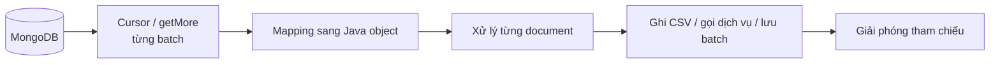
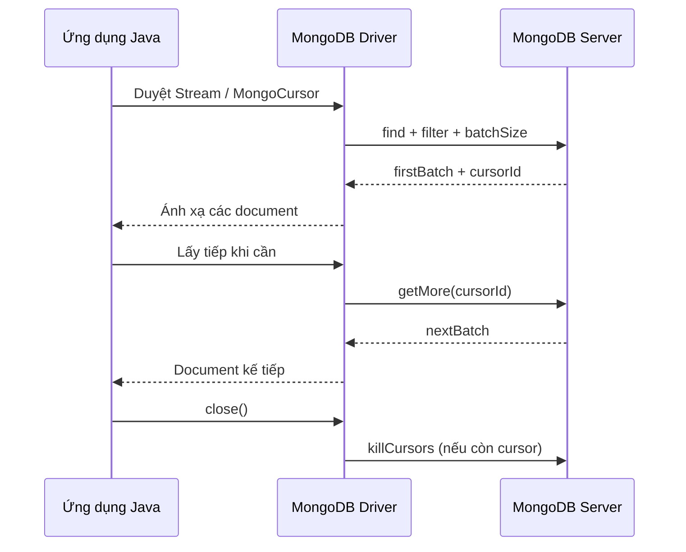

# Batch size, giới hạn kết quả và kiểm soát bộ nhớ

> **Chương:** Phân trang và luồng  
> **Module:** `SPRING_DATA_MONGODB` — sử dụng Spring Data MongoDB để kết nối, ánh xạ document và thao tác MongoDB qua `MongoTemplate` hoặc repository. Bài học giải thích cơ chế **cursor**, **batch size**, **limit**, các cách đọc dữ liệu tăng dần để kiểm soát bộ nhớ, và liên hệ với truy vấn, aggregation, index, transaction, reactive access, kiểm thử và chẩn đoán hiệu năng.

## 1. Bài toán: xuất một triệu đơn hàng mà không làm đầy heap

Giả sử hệ thống phải xuất 1.000.000 đơn hàng sang CSV. Mỗi document chứa ID, trạng thái, thời điểm, tổng tiền, địa chỉ và một số dòng hàng. Cách làm đơn giản nhất:

```java
List<Order> orders = mongoTemplate.find(
    Query.query(Criteria.where("status").is("PAID")),
    Order.class
);

for (Order order : orders) {
    writeCsvRow(order);
}
```

Đoạn này có một vấn đề: `MongoTemplate.find(…)` trả về **`List<Order>`** nên toàn bộ kết quả có thể được materialize vào bộ nhớ JVM trước khi vòng lặp xử lý. MongoDB Driver có thể tải dữ liệu **theo từng batch từ server**, nhưng danh sách do ứng dụng tạo vẫn tiếp tục lớn dần.

Nếu mỗi object tiêu tốn trung bình 10 KiB trong heap sau khi ánh xạ, một triệu bản ghi có thể chiếm xấp xỉ:

\[
1.000.000 \times 10\,\mathrm{KiB}
\approx 9{,}54\,\mathrm{GiB}
\]

Đây chỉ là **ví dụ giả định**, không phải kích thước thật của `Order`. Trên thực tế còn có object header, String, collection, buffer của driver, tham chiếu, data structure trung gian và garbage collection. Ứng dụng có heap 512 MiB có thể gặp `OutOfMemoryError` sớm hơn nhiều.

Giải pháp không phải chỉ giảm `batchSize`, mà cần thiết kế cách **đọc, xử lý và giải phóng** dữ liệu:



Mục tiêu là giữ lượng dữ liệu đang được giữ lại trong bộ nhớ **có giới hạn**, đồng thời không tạo quá nhiều round trip hoặc làm server phải thực hiện những phép sort/aggregation tốn bộ nhớ.

## 2. Phân biệt ba khái niệm dễ nhầm: limit, batchSize và page size

| Cơ chế | Nó kiểm soát điều gì? | Không bảo đảm điều gì? |
| --- | --- | --- |
| **`limit(N)`** | Số document **tối đa** mà một truy vấn có thể trả. | Không bảo đảm dữ liệu chỉ dùng N × kích thước nhỏ; không chia thành nhiều trang cho API. |
| **`batchSize(B)`** | Số document **tối đa mỗi batch** server gửi cho cursor, còn bị chặn bởi giới hạn kích thước BSON response. | Không giới hạn **tổng** số document của truy vấn; không tự làm danh sách Java nhỏ hơn. |
| **`pageSize(P)`** | Số phần tử của một trang trong cơ chế `Pageable`/`Page`/`Slice`. | Không nhất thiết là batch size trên network; `Page` còn có thể phát sinh count query. |
| **`skip(K)`** | Bỏ qua K document đầu theo thứ tự truy vấn. | Không giảm chi phí duyệt qua K kết quả trước khi lấy trang sâu. |
| **Projection** | Những field được server trả về cho mỗi document. | Không tự hạn chế số document, trừ khi kết hợp limit/filter. |

Ví dụ trong `mongosh`:

```javascript
db.orders.find({ status: "PAID" })
  .sort({ createdAt: 1, _id: 1 })
  .limit(5)
  .batchSize(2);
```

Query trên có **tối đa 5 document tổng cộng**. Với dữ liệu đủ nhỏ và server trả theo batch size đã yêu cầu, các đợt mạng có thể mang 2, 2 và 1 document. `batchSize(2)` **không có nghĩa** query chỉ trả 2 document. Tùy cách cursor được tiêu thụ, driver, server hoặc giới hạn kích thước, số batch thực tế có thể khác với cách chia minh họa.

Ngược lại:

```javascript
// Không có limit: có thể đọc toàn bộ tập kết quả.
db.orders.find({ status: "PAID" }).batchSize(100);
```

Batch size là điều chỉnh cách **truyền** kết quả, không phải một giới hạn an toàn cho toàn bộ thao tác nghiệp vụ. Nếu ứng dụng vẫn gọi `toArray()` hoặc tạo `List` từ toàn bộ cursor, bộ nhớ vẫn có thể tăng theo số document.

## 3. MongoDB cursor hoạt động như thế nào?

### 3.1. Initial batch, cursor ID và getMore

Khi thực hiện `find` hoặc `aggregate`, MongoDB có thể trả:

1. Một batch kết quả đầu tiên.
2. Một **cursor ID** để client lấy tiếp các document còn lại.
3. Các batch sau qua lệnh `getMore` khi driver cần thêm dữ liệu.



Theo tài liệu MongoDB, **batch đầu mặc định** của truy vấn `find` thông thường tối đa **101 document hoặc 16 MiB**, tùy giới hạn nào đến trước. Các đợt `getMore` sau có giới hạn kích thước response tới **16 MiB**; khi có chỉ định batch size thì server còn giới hạn theo số document được yêu cầu. Cách xử lý cursor trên sharded cluster và các kiểu truy vấn đặc biệt có chi tiết riêng, vì vậy nên quan sát command thực tế thay vì mặc định mọi đợt luôn có đúng N document.

**16 MiB cần hiểu theo hai ngữ cảnh:** MongoDB cũng giới hạn kích thước **một BSON document** thông thường ở 16 MiB; đồng thời response batch của cursor có giới hạn kích thước tương ứng. Đừng suy từ `batchSize(100)` rằng server sẽ luôn gửi đủ 100 document nếu từng document lớn.

### 3.2. Batch size nhỏ hay lớn: đánh đổi

| Batch size | Ưu điểm có thể có | Rủi ro có thể có |
| --- | --- | --- |
| Nhỏ, ví dụ 20 | Ít document trong mỗi batch; phù hợp khi xử lý từng item chậm hoặc mỗi document lớn. | Nhiều `getMore` hơn, tăng network round trip và overhead. |
| Trung bình, ví dụ 100–500 | Điểm bắt đầu hợp lý cho nhiều job; cân bằng số đợt và lượng dữ liệu nhận. | Vẫn cần đo theo kích thước document và concurrency. |
| Lớn, ví dụ vài nghìn | Có thể giảm số lần gọi `getMore` với document nhỏ. | Buffer lớn hơn, áp lực heap/network, batch vẫn chịu giới hạn kích thước response. |

Không có một batch size tối ưu cho mọi workload. Một document chỉ có 3 field khác rất nhiều document chứa các mảng lồng nhau. Độ trễ mạng, số worker, tính toán sau đọc và cách driver prefetch đều tác động.

### 3.3. Batch size 0 và các giá trị đặc biệt

Ở mức **lệnh MongoDB trực tiếp**, `batchSize: 0` có thể yêu cầu tạo cursor với **first batch rỗng**. Trong API `Query.cursorBatchSize(int)` của Spring Data, tài liệu API diễn giải giá trị `0` theo quy ước riêng (không đặt giới hạn batch) và giá trị âm có semantics đặc biệt liên quan cursor một batch.

Vì các tầng API có thể diễn giải khác nhau, **đừng dùng 0 hoặc số âm để “tối ưu” theo suy đoán**. Trong bài thực hành này dùng **số nguyên dương**, ví dụ `cursorBatchSize(100)`. Nếu cần các tùy chọn cursor đặc biệt, kiểm tra API và lệnh thực tế trên đúng phiên bản đang chạy.

## 4. Giới hạn kết quả trong Spring Data MongoDB

### 4.1. Query.limit với MongoTemplate

Giả sử entity:

```java
package demo.orders;

import java.time.Instant;
import org.springframework.data.annotation.Id;
import org.springframework.data.mongodb.core.mapping.Document;

@Document(collection = "orders")
public record Order(
    @Id String id,
    String status,
    String customerId,
    Instant createdAt,
    String note
) {}
```

Tạo query:

```java
import org.springframework.data.domain.Sort;
import org.springframework.data.mongodb.core.query.Criteria;
import org.springframework.data.mongodb.core.query.Query;

Query query = Query.query(Criteria.where("status").is("PAID"))
    .with(Sort.by(Sort.Direction.DESC, "createdAt")
        .and(Sort.by(Sort.Direction.DESC, "id")))
    .limit(100)
    .cursorBatchSize(25);

List<Order> topOrders = mongoTemplate.find(query, Order.class);
```

Kết quả có tối đa **100** `Order`; `25` chỉ là batch size được cấu hình để truyền kết quả. Vì số lượng đã bị giới hạn, trả về `List` trong trường hợp này **có thể chấp nhận được** nếu mỗi document có kích thước được kiểm soát. Tuy nhiên, 100 document cực lớn vẫn có thể gây áp lực heap.

`limit(0)` theo ngữ nghĩa MongoDB thông thường nghĩa là **không đặt giới hạn số kết quả**; không dùng nó với suy nghĩ “không lấy document nào”. Để trả danh sách rỗng theo yêu cầu nghiệp vụ, xử lý tại tầng service thay vì gửi một query không giới hạn.

### 4.2. Skip + limit không phải batch size

```java
Query query = Query.query(Criteria.where("status").is("PAID"))
    .with(Sort.by(Sort.Direction.DESC, "createdAt")
        .and(Sort.by(Sort.Direction.DESC, "id")))
    .skip(1000)
    .limit(100)
    .cursorBatchSize(20);
```

Query yêu cầu **bỏ qua 1.000 document**, sau đó lấy tối đa **100** kết quả; batch size **20** chỉ điều chỉnh những đợt kết quả chuyển về client. Batch nhỏ không làm `skip(1000)` trở thành truy vấn nhẹ và không thay thế index hỗ trợ sort.

Nếu chỉ duyệt tiến với dữ liệu lớn, cân nhắc cursor/keyset pagination có sort key ổn định thay vì liên tục tăng offset. Khi dữ liệu thay đổi trong lúc duyệt, cả offset lẫn cursor đều cần chính sách consistency/checkpoint phù hợp.

### 4.3. Derived query giới hạn bằng Top và First

Với repository:

```java
import java.util.List;
import org.springframework.data.mongodb.repository.MongoRepository;

public interface OrderRepository extends MongoRepository<Order, String> {
    List<Order> findTop50ByStatusOrderByCreatedAtDesc(String status);
    List<Order> findFirst10ByCustomerIdOrderByCreatedAtDesc(String customerId);
}
```

`Top50` và `First10` là **giới hạn tổng số document** của derived query, không phải cursor batch size. Nếu muốn trả toàn bộ dữ liệu để làm batch job, nên tránh ngầm hiểu `findAll()` trả dần và giữ bộ nhớ nhỏ: `findAll()` trả `List` nên có thể materialize tập lớn.

Repository cũng có thể nhận `Pageable` và trả `Slice<T>`/`Page<T>`; đây là lựa chọn tốt cho API phân trang. Với job xử lý số lượng lớn, streaming hoặc duyệt từng trang/chunk thường có ý nghĩa hơn, nhưng cần kiểm tra snapshot, sort và retry.

## 5. Stream với MongoTemplate: đọc dần và đóng cursor

### 5.1. Sử dụng MongoTemplate.stream

Khi cần duyệt hàng trăm nghìn document mà không tích lũy tất cả vào một `List`, `MongoTemplate.stream(Query, Class<T>)` trả về Java `Stream<T>` bọc quanh cursor của MongoDB Driver.

```java
import java.util.stream.Stream;
import org.springframework.data.domain.Sort;
import org.springframework.data.mongodb.core.query.Criteria;
import org.springframework.data.mongodb.core.query.Query;

Query query = Query.query(Criteria.where("status").is("PAID"))
    .with(Sort.by(Sort.Direction.ASC, "createdAt")
        .and(Sort.by(Sort.Direction.ASC, "id")))
    .cursorBatchSize(100);

try (Stream<Order> stream = mongoTemplate.stream(query, Order.class)) {
    stream.forEach(order -> processOne(order));
}
```

`processOne(order)` là hàm nghiệp vụ do service định nghĩa (ghi dòng CSV, chuẩn hóa dữ liệu hoặc phát một thông điệp); đoạn trên giả định `mongoTemplate` đã được inject. **Try-with-resources là bắt buộc về mặt vận hành**: đóng `Stream` để giải phóng cursor cả khi xử lý dừng sớm hoặc có exception.

`Stream` không tự đảm bảo bộ nhớ O(1), vì:

- Driver vẫn giữ buffer của batch đang đọc.
- Mapping từ BSON sang Java tạo object, String và collection theo cấu trúc document.
- Hàm `processOne` có thể giữ reference trong cache, list hoặc queue riêng.
- Các thao tác Java như `collect(toList())` hay `sorted()` có thể giữ lượng dữ liệu rất lớn.

Hãy kiểm soát toàn **pipeline** thay vì chỉ chọn API `stream`.

### 5.2. Dừng sớm vẫn phải đóng cursor

```java
try (Stream<Order> stream = mongoTemplate.stream(query, Order.class)) {
    stream.limit(500).forEach(this::processOne);
}
```

`Stream.limit(500)` là một **thao tác phía Java** (trên stream đã mở), không nhất thiết biến thành `limit(500)` ở query phía MongoDB. Nó có thể kết thúc việc tiêu thụ sau 500 phần tử nhưng cursor ban đầu vẫn đã được thiết lập để tìm nhiều document. Muốn giới hạn tổng kết quả ngay trên server, dùng **`Query.limit(500)`**.

Nếu người đọc chỉ cần 500 document, nên kết hợp `Query.limit(500)` và `try-with-resources` để giảm công việc phía server và đóng sạch tài nguyên khi kết thúc.

### 5.3. Không để stream thoát khỏi phạm vi tài nguyên

Ví dụ nguy hiểm:

```java
// Không nên trả Stream mở từ service rồi để caller tùy ý giữ lâu.
public Stream<Order> getOrders() {
    return mongoTemplate.stream(new Query(), Order.class);
}
```

Caller có thể quên `close()`, đóng quá muộn hoặc xử lý trên thread khác ngoài ngữ cảnh transaction/session mà code kỳ vọng. Với API HTTP bình thường, nên để service **điều khiển vòng đời** cursor và chỉ trả DTO/trang kết quả hoặc ghi ra response bằng một quy trình streaming được quản lý rõ ràng.

Một service xử lý batch có thể nhận một `Consumer<Order>` hoặc trực tiếp ghi ra `Writer` và đảm nhận `try-with-resources`. Trong hệ thống production, bổ sung timeout, cancellation, xử lý lỗi I/O và chính sách retry/checkpoint.

## 6. Stream từ repository và raw MongoDB Java Driver

### 6.1. Repository method trả Stream

```java
import java.util.stream.Stream;
import org.springframework.data.mongodb.repository.MongoRepository;

public interface OrderStreamRepository
        extends MongoRepository<Order, String> {

    Stream<Order> streamByStatusAndCustomerId(
        String status, String customerId
    );
}
```

Khi sử dụng:

```java
try (Stream<Order> orders =
         orderStreamRepository.streamByStatusAndCustomerId(
             "PAID", "CUST-42")) {
    orders.forEach(this::processOne);
}
```

Tùy phiên bản Spring Data, repository có cơ chế stream query từ MongoDB; cần đóng `Stream` và đối chiếu repository query return types trên đúng phiên bản. Stream từ repository không làm `count` hoặc `aggregation` xuất hiện nếu code không yêu cầu, nhưng những phép mapping và server-side filter/sort vẫn có chi phí.

### 6.2. Raw Java Driver: MongoCursor

Trong một số job cần tối ưu thấp hơn tầng mapping domain:

```java
import com.mongodb.client.MongoCollection;
import com.mongodb.client.MongoCursor;
import com.mongodb.client.model.Filters;
import org.bson.Document;

MongoCollection<Document> collection =
    mongoTemplate.getCollection("orders");

try (MongoCursor<Document> cursor = collection
        .find(Filters.eq("status", "PAID"))
        .projection(new Document("_id", 1)
            .append("status", 1)
            .append("createdAt", 1))
        .batchSize(100)
        .limit(1000)
        .iterator()) {
    while (cursor.hasNext()) {
        Document raw = cursor.next();
        processRaw(raw);
    }
}
```

`processRaw` là hàm nghiệp vụ nhận `Document`. Driver thấp hơn không tự áp dụng mọi quy tắc đổi tên property của `MappingMongoConverter`; cần dùng **tên BSON thật** trong filter/projection, ví dụ `_id` thay vì property Java `id`.

`MongoCursor` là tài nguyên có vòng đời riêng. Dùng `try-with-resources` giúp gọi `close()` khi kết thúc bình thường, dừng sớm hoặc ném exception. Đừng nghĩ rằng driver tự giải phóng ngay lập tức chỉ vì object Java hết tham chiếu; server cursor có cơ chế timeout, nhưng không nên dùng timeout thay cho đóng chủ động.

## 7. Batch size không thay cho “batch xử lý” hoặc bulk write

Trong hệ thống, từ *batch* có thể mang ba nghĩa hoàn toàn khác nhau:

| Loại batch | Ví dụ | Vai trò |
| --- | --- | --- |
| **Cursor fetch batch** | `Query.cursorBatchSize(100)` | Đọc tối đa 100 document mỗi đợt response, còn phụ thuộc giới hạn byte. |
| **Application processing chunk** | Cứ 200 item thì flush file/checkpoint | Giới hạn công việc và bộ nhớ của tầng nghiệp vụ. |
| **Bulk write batch** | Gom 500 `UpdateOneModel` rồi gọi `bulkWrite` | Gộp thao tác ghi để giảm round trip và quản lý lỗi. |

Không có bảo đảm ba kích thước này phải bằng nhau. Ví dụ có thể **fetch 100**, **xử lý/flush 200**, **ghi bulk 500**, tùy workload. Điều quan trọng là mỗi bộ đệm đều phải có ngưỡng rõ ràng và số worker chạy đồng thời có kiểm soát.

### 7.1. Một chunk 200 item ở tầng ứng dụng

```java
import java.util.ArrayList;
import java.util.List;
import java.util.stream.Stream;

List<Order> chunk = new ArrayList<>(200);

try (Stream<Order> stream = mongoTemplate.stream(query, Order.class)) {
    for (Order order : (Iterable<Order>) stream::iterator) {
        chunk.add(order);
        if (chunk.size() >= 200) {
            flushChunk(chunk);
            chunk.clear();
        }
    }
    if (!chunk.isEmpty()) {
        flushChunk(chunk);
        chunk.clear();
    }
}
```

`flushChunk(List<Order>)` là hàm nghiệp vụ giả định, **phải xử lý đồng bộ hoặc sao chép phần dữ liệu cần giữ**. Nếu nó đẩy nguyên tham chiếu tới `chunk` vào hàng đợi bất đồng bộ rồi vòng lặp gọi `clear()`, consumer có thể nhìn thấy danh sách đã bị xóa. Với xử lý async, nên truyền bản sao bất biến như `List.copyOf(chunk)`, và **giới hạn số batch đang chờ**; nếu không, queue vẫn có thể tăng vô hạn.

Trong ví dụ này, bộ nhớ của riêng `chunk` bị chặn ở 200 entity, nhưng **không** bao gồm buffer của driver, overhead object, tài nguyên xử lý và những queue bên ngoài. Cần đo heap thực tế trong integration/load test.

### 7.2. “Đúng một lần” không tự xuất hiện khi chia batch

Khi job đã xử lý 3.000 bản ghi rồi lỗi mạng, câu hỏi là lần chạy sau bắt đầu ở đâu. Cursor không tự là một cơ chế checkpoint bền vững qua restart. Nếu dữ liệu đang được ghi trong lúc job chạy, scan có thể gặp thêm thay đổi.

Cách tiếp cận phù hợp cho export/ETL lớn:

- Chọn thứ tự duyệt ổn định, ví dụ `createdAt` và `_id`.
- Lưu checkpoint theo **last processed key** sau khi chunk đã xử lý thành công.
- Thiết kế idempotency nếu retry có thể đọc lại một số document.
- Nếu cần snapshot nhất quán với dữ liệu đã thay đổi, thiết kế quy tắc snapshot/transaction hoặc xuất từ dữ liệu bất biến; batch size không giải quyết consistency.

## 8. Kiểm soát bộ nhớ theo kích thước document và concurrency

### 8.1. Ước tính sơ bộ

Một mô hình gần đúng để bắt đầu tính budget:

\[
M_{\text{đang giữ}}
\approx C \times B \times S \times H
+ M_{\text{queue}} + M_{\text{khác}}
\]

Trong đó:

- `C` là số cursor/worker **đọc đồng thời**;
- `B` là batch size trung bình trong client;
- `S` là kích thước BSON trung bình của document (byte);
- `H` là hệ số phóng đại do ánh xạ object, String, collection và buffer (phải **đo**, không có hằng số chung);
- `M_queue` là bộ nhớ trong các chunk, hàng đợi và dữ liệu ghi đang chờ;
- `M_khác` bao gồm bộ nhớ ứng dụng, cache, JVM runtime và các tác vụ khác.

Ví dụ mang tính minh họa: `C=4`, `B=200`, `S=30 KiB`, `H≈2` tạo riêng phần document/buffer cỡ **46,9 MiB**. Nếu mỗi worker còn có hàng đợi 10 chunk × 500 item, phần queue mới có thể lớn hơn nhiều. **Không lấy công thức này làm giới hạn cứng**; phải đo bằng heap metrics, allocation profiling và tải giống production.

### 8.2. Cách giảm peak memory hiệu quả hơn chỉ chỉnh batchSize

1. **Lọc sớm**: thêm `Criteria`/filter MongoDB để không truyền dữ liệu ngoài phạm vi nghiệp vụ.
2. **Projection**: chỉ lấy những field thật sự cần, tránh truyền mảng lớn hoặc text/blob không dùng.
3. **Đặt giới hạn**: dùng `limit` cho API top-N; với full export, dùng stream và checkpoint.
4. **Giới hạn concurrency**: số job và số thao tác downstream chạy cùng lúc phải có bound.
5. **Giới hạn queue**: không chuyển một stream hữu hạn thành hàng đợi vô hạn bằng việc submit task nhanh hơn tốc độ xử lý.
6. **Flush đầu ra theo chunk**: không xây một `StringBuilder` khổng lồ hay `List<DTO>` trước khi tạo CSV/JSON.
7. **Giảm kích thước object Java**: có thể dùng DTO/projection, tránh ánh xạ toàn bộ graph nếu không cần.
8. **Đo và điều chỉnh**: theo dõi peak heap, GC, batch round trips, thời gian xử lý mỗi document và throughput.

### 8.3. Projection bằng MongoTemplate

Nếu job CSV chỉ cần ID, thời điểm và trạng thái:

```java
Query query = Query.query(Criteria.where("status").is("PAID"))
    .with(Sort.by("createdAt").ascending())
    .cursorBatchSize(100);

query.fields()
    .include("id")
    .include("createdAt")
    .include("status");
```

**Lưu ý:** projection sang `Order` đầy đủ như record ở mục 4 có thể khiến các property bị loại nhận giá trị mặc định hoặc gặp vấn đề khi materialize, tùy kiểu domain và creator. Với job production, hãy sử dụng **projection type hoặc DTO riêng** có đúng các field cần đọc, và kiểm thử đọc dữ liệu thực tế. Khi xem lệnh MongoDB thô, trường ID nằm ở BSON `_id` chứ không phải `id`.

`Query.fields().include(...)` ở tầng Spring Data có thể áp dụng mapping theo domain; với Java Driver thô, dùng `"_id"` rõ ràng.

## 9. Reactive access: backpressure không có nghĩa batchSize

### 9.1. Tạo Flux từ ReactiveMongoTemplate

`ReactiveMongoTemplate.find(…)` trả `Flux<Order>` để xử lý theo hướng reactive:

```java
import reactor.core.publisher.Flux;
import org.springframework.data.mongodb.core.query.Criteria;
import org.springframework.data.mongodb.core.query.Query;

Query query = Query.query(Criteria.where("status").is("PAID"))
    .cursorBatchSize(100);

Flux<Order> flux = reactiveMongoTemplate.find(query, Order.class);
```

Reactive stream thường được thực thi khi có **subscription**, không phải chỉ khi tạo biến `flux`. Các tín hiệu `request(n)`/backpressure điều phối nhu cầu giữa publisher và subscriber, nhưng **không có phép đồng nhất cứng `request(1) = 1 document ở mỗi lệnh getMore`**. Reactive MongoDB Driver, batch buffer và prefetch có chiến lược riêng.

### 9.2. Giới hạn số thao tác downstream đồng thời

Giả sử mỗi order được lưu sang một hệ thống khác bằng một hàm reactive:

```java
import reactor.core.publisher.Mono;

Mono<Void> completed = reactiveMongoTemplate
    .find(query, Order.class)
    .flatMap(order -> archiveOne(order), 4)
    .then();
```

`archiveOne(order)` là hàm giả định trả `Mono<?>` hoàn thành khi order được xử lý. Tham số **`4`** của `flatMap` giới hạn số inner publisher đang được xử lý đồng thời; không có nghĩa MongoDB batch size cũng là 4. Với job buộc giữ thứ tự, cân nhắc `concatMap` nhưng cần đo throughput và prefetch.

Không gọi `block()` trên mỗi item trong event loop. Không gom `collectList()` cho toàn bộ tập hàng triệu document nếu mục tiêu là streaming. Cũng không nên dùng `onBackpressureBuffer()` không giới hạn vì nó có thể chuyển áp lực phía downstream thành heap tăng không kiểm soát.

### 9.3. Cancel và cleanup

Khi subscriber hủy subscription, reactive driver sẽ cố giải phóng cursor và các tài nguyên liên quan theo lifecycle của nó. Tuy nhiên, ứng dụng vẫn cần:

- Truyền cancellation khi HTTP client ngắt kết nối hoặc job bị hủy.
- Tránh `subscribe()` thủ công rồi bỏ mất `Disposable` trong một service quản lý job.
- Xác định timeout, retry và chính sách xử lý lỗi từng document.
- Giới hạn concurrency/queue và quan sát MongoDB connection pool.

Nếu dữ liệu cần được xử lý không mất bản ghi khi lỗi, thiết kế checkpoint/idempotency; `Flux` và `batchSize` không cung cấp bảo đảm xử lý đúng-một-lần.

## 10. Server-side memory: batch nhỏ không cứu được query sort sai

Một bẫy quan trọng: batch size chỉ giới hạn **khối lượng kết quả truyền về một đợt**, không tự hạn chế công việc **trước khi có kết quả**.

Ví dụ:

```javascript
db.orders.find({ status: "PAID" })
  .sort({ createdAt: -1 })
  .batchSize(20);
```

Nếu thiếu index hỗ trợ filter + sort, MongoDB có thể phải xử lý một tập dữ liệu lớn để sắp xếp trước khi trả batch đầu. Giảm `batchSize(20)` thành `batchSize(2)` **không làm sort trên server biến mất**. Phải xem query plan, index và số document cần sắp xếp.

### 10.1. Index cho filter + sort

Một index ứng viên:

```javascript
db.orders.createIndex({
  status: 1,
  createdAt: -1,
  _id: -1
});
```

Với query tương ứng:

```javascript
db.orders.find({ status: "PAID" })
  .sort({ createdAt: -1, _id: -1 })
  .limit(100)
  .explain("executionStats");
```

So sánh `totalDocsExamined`, `totalKeysExamined`, stage sort, và số bản ghi trả về. Index không nhất thiết phù hợp cho mọi filter; cần cân nhắc workload thật và chi phí ghi.

### 10.2. Aggregation: $group, $sort và $lookup

Một aggregation có `$group`, `$sort` hoặc `$lookup` có thể tạo ra dữ liệu trung gian lớn. Ví dụ:

```javascript
db.orders.aggregate([
  { $match: { status: "PAID" } },
  { $group: { _id: "$customerId", orderCount: { $sum: 1 } } },
  { $sort: { orderCount: -1 } },
  { $limit: 100 }
], { cursor: { batchSize: 50 } });
```

`cursor.batchSize = 50` ở pipeline trên điều chỉnh **batch của output**, không có nghĩa `$group` chỉ giữ 50 nhóm trong bộ nhớ trước khi tổng hợp. Nếu aggregation cần thêm bộ nhớ, MongoDB có các cơ chế và cấu hình dùng disk cho stage phù hợp; việc cho phép spill sang disk (ví dụ `allowDiskUse` theo phiên bản) là một quyết định vận hành có chi phí I/O, không phải thay thế index hoặc giới hạn cardinality.

Ở phía Spring Data, có `MongoTemplate.aggregateStream(…)` để trả stream kết quả aggregation thay vì buộc tất cả vào list; cũng cần đóng stream. Khi chẩn đoán, nên xem `explain` cho pipeline và memory/disk metrics của server.

## 11. Cursor lifecycle, timeout và transaction

### 11.1. Cursor có tài nguyên ở cả client và server

Một cursor chưa tiêu thụ hết có thể giữ trạng thái trên server. Khi ứng dụng không gọi `close()`, MongoDB có cơ chế dọn cursor theo timeout, nhưng ứng dụng không nên dựa vào nó. Những dấu hiệu cần quan sát:

- Số cursor mở tăng bất thường.
- Connection pool bị sử dụng cao khi nhiều stream xử lý lâu.
- `getMore` nhiều và độ trễ tăng.
- GC/heap tăng do dữ liệu trong queue hoặc các buffer được giữ lâu.
- Export chậm vì downstream ghi CSV quá chậm hoặc client không còn đọc.

**Không bật `noCursorTimeout()` một cách máy móc** để tránh lỗi timeout. Tùy chọn này có thể làm cursor sống lâu hơn và tăng rủi ro rò rỉ tài nguyên nếu job treo hoặc không đóng. Nếu thật sự cần job kéo dài, thiết kế timeout/cancellation, checkpoint và giới hạn concurrency.

### 11.2. Stream trong transaction không luôn là lựa chọn tốt

Multi-document transaction yêu cầu MongoDB topology hỗ trợ và Spring Data transaction manager phù hợp. Giữ một transaction mở suốt quá trình xuất hàng triệu bản ghi có thể tạo áp lực tài nguyên, thời gian transaction và xử lý lỗi.

**Không tự động mở transaction dài chỉ để giữ cursor export.** Nếu cần snapshot nhất quán, đánh giá yêu cầu với DBA và kiến trúc: snapshot/backup phù hợp, mốc thời gian bất biến, event log hoặc transaction ngắn có chiến lược checkpoint. Ngược lại, với báo cáo chấp nhận dữ liệu thay đổi trong lúc xuất, ghi rõ semantics đó và dùng thứ tự duyệt có kiểm soát.

### 11.3. Tailable cursor và change stream là trường hợp khác

Tailable cursor dùng cho capped collection; change stream lắng nghe thay đổi trên deployment đáp ứng yêu cầu của MongoDB. Chúng có thể phát sinh chuỗi dữ liệu kéo dài thay vì một truy vấn hữu hạn. Khi dùng reactive change stream/tailable query cần chính sách retry/resume token, quản lý subscription và tốc độ xử lý riêng.

Bài này tập trung vào **đọc một tập dữ liệu hữu hạn** để tìm kiếm, xuất dữ liệu hoặc xử lý batch; đừng lấy logic `limit`/cursor thông thường áp dụng nguyên xi cho một luồng cập nhật không kết thúc.

## 12. Quy trình chẩn đoán và đo batch size đúng cách

### 12.1. Đo cả throughput, latency và memory

Một thử nghiệm có ý nghĩa nên giữ cùng tập dữ liệu và filter, rồi thay batch size theo một số mức như 25, 100, 500 và 1000. Quan sát:

| Chỉ số | Câu hỏi cần trả lời |
| --- | --- |
| Document/s | Batch lớn hơn có thực sự tăng throughput? |
| Time to first document | Có cần hiển thị kết quả sớm hay ưu tiên tổng throughput? |
| Số lệnh `getMore` | Batch nhỏ làm tăng round trip tới mức nào? |
| Tổng byte truyền | Projection/filter có giảm network traffic không? |
| Peak heap và GC | Mapping/queue/batch đang giữ bao nhiêu object? |
| Connection pool utilization | Có quá nhiều cursor/worker đang mở cùng lúc không? |
| CPU/server query plan | Có COLLSCAN, blocking sort, disk spill không? |
| Downstream latency | Ghi file, HTTP hay bulk write mới là nút thắt? |
| Error/cancellation | Job dừng sớm có đóng cursor và giải phóng tài nguyên không? |

Đừng chỉ thay `batchSize` rồi nhìn tổng thời gian một lần chạy. Cần warmup thích hợp, lặp thí nghiệm, dữ liệu đại diện và kiểm tra việc hệ thống khác sử dụng cùng MongoDB.

### 12.2. Quan sát lệnh find/getMore

MongoDB Driver có **CommandListener/command monitoring**; trong môi trường test, có thể bật listener phù hợp để ghi nhận số lần `find`, `getMore`, `killCursors` và thời gian lệnh. Tránh log dữ liệu nhạy cảm hoặc toàn bộ nội dung document trong production.

Trong `mongosh`, thử:

```javascript
db.orders.find({ status: "PAID" })
  .sort({ createdAt: 1, _id: 1 })
  .batchSize(25)
  .limit(100);
```

Đo query plan theo index:

```javascript
db.orders.find({ status: "PAID" })
  .sort({ createdAt: 1, _id: 1 })
  .limit(100)
  .explain("executionStats");
```

`explain("executionStats")` giúp phân tích các stage và mức quét dữ liệu, **không tự cung cấp đầy đủ thống kê số `getMore` của một lần Java stream xử lý**. Vì vậy cần kết hợp command monitoring của driver và metrics JVM.

### 12.3. Ước tính bộ nhớ bằng dữ liệu thật

Lấy một mẫu document có kích thước đại diện:

```javascript
db.orders.aggregate([
  { $match: { status: "PAID" } },
  { $limit: 1000 },
  { $project: { sizeBytes: { $bsonSize: "$$ROOT" } } },
  { $group: {
      _id: null,
      avgBytes: { $avg: "$sizeBytes" },
      maxBytes: { $max: "$sizeBytes" }
  } }
]);
```

Phép đo này ước tính **kích thước BSON**, không phải kích thước object Java trên heap. Nếu sample đầu không đại diện (đơn mới nhỏ, đơn cũ có mảng dài), cần lấy mẫu phù hợp nhiều phân khúc và theo dõi phân vị cao, không chỉ trung bình. Không dùng phép ước tính này để kết luận heap chắc chắn đủ; hãy load test.

## 13. Kiểm thử integration với MongoDB thật

Một test tốt không chỉ xác nhận kết quả query, mà còn kiểm tra rằng chương trình **xử lý từng bản ghi** và **giải phóng cursor** khi kết thúc sớm hoặc ném lỗi.

### 13.1. Dữ liệu test

Chuẩn bị 230 document `Order`, trong đó 200 document có `status = "PAID"`, 30 document ở trạng thái khác. Gán `createdAt` và ID khác nhau. Với truy vấn `limit(120)`, `cursorBatchSize(25)`, mong đợi:

- Tổng item được xử lý qua stream **tối đa 120**.
- Thứ tự theo sort đã khai báo.
- Các item ngoài filter không xuất hiện.
- Cursor được đóng sau khi vòng xử lý kết thúc.

Chỉ từ số bản ghi trả về **không suy ra chính xác số lần `getMore`**, vì server, driver và cách tiêu thụ batch có thêm các chi tiết thực thi.

### 13.2. Ví dụ test về limit

```java
import static org.assertj.core.api.Assertions.assertThat;

import java.util.concurrent.atomic.AtomicInteger;
import java.util.stream.Stream;
import org.junit.jupiter.api.Test;
import org.springframework.data.mongodb.core.query.Criteria;
import org.springframework.data.mongodb.core.query.Query;

@Test
void streamHonorsServerSideLimit() {
    Query query = Query.query(Criteria.where("status").is("PAID"))
        .limit(120)
        .cursorBatchSize(25);

    AtomicInteger processed = new AtomicInteger();
    try (Stream<Order> stream = mongoTemplate.stream(query, Order.class)) {
        stream.forEach(order -> processed.incrementAndGet());
    }

    assertThat(processed.get()).isEqualTo(120);
}
```

Đoạn test là **method trong lớp integration test** được cấu hình `mongoTemplate`, có dữ liệu seed như mục 13.1; nó không phải file Java độc lập. Nếu chỉ có ít hơn 120 document khớp điều kiện, kết quả phải bằng số document thực tế, vì `limit` là **giới hạn trên**.

### 13.3. Test dừng sớm và exception

Thêm test chủ động ném exception sau vài item rồi xác nhận `try-with-resources` vẫn đóng stream. Nếu muốn kiểm chứng ở mức lệnh MongoDB, gắn `CommandListener` vào MongoClient test để quan sát `killCursors` hoặc tài nguyên cursor theo điều kiện có cursor còn sống; không mặc định mọi lần đóng đều phát sinh `killCursors` (cursor có thể đã được đọc hết).

Ví dụ có scope đúng:

```java
try (Stream<Order> stream = mongoTemplate.stream(query, Order.class)) {
    stream.limit(3).forEach(order -> {
        if ("ORD-002".equals(order.id())) {
            throw new IllegalStateException("Fail in test");
        }
    });
}
// Dù có exception, compiler tạo finally để gọi stream.close().
```

Khi muốn assert exception bằng JUnit/AssertJ, đặt đoạn `try` trong lambda của `assertThatThrownBy`. Nếu seed không có `ORD-002` trong ba item đầu, cần điều chỉnh điều kiện test để bảo đảm nhánh lỗi được chạy.

### 13.4. Kiểm tra tình huống quá tải

Tạo dữ liệu có mảng dài ở một tỷ lệ document nhất định, bật 1/2/4 worker và đổi batch size. Theo dõi:

1. Bộ nhớ heap đỉnh; số và thời gian GC.
2. Latency từ khi bắt đầu đến bản ghi đầu tiên.
3. Throughput document/s và số `getMore`.
4. Tỉ lệ lỗi timeout, pool exhausted và cancelled cursor.
5. Kích thước queue nghiệp vụ khi downstream cố ý chạy chậm.

Nếu số worker tăng làm heap, queue hoặc connection pool tăng quá nhanh, ưu tiên **giảm concurrency/giới hạn queue** trước khi thử nâng batch size.

## 14. Bảng lỗi thường gặp

| Biểu hiện | Nguyên nhân thường gặp | Hướng xử lý |
| --- | --- | --- |
| Gọi `find(…)` với `cursorBatchSize(50)` vẫn OutOfMemoryError | `find` trả `List` chứa toàn bộ kết quả; batch size không giới hạn tổng. | Dùng `limit` hoặc `stream` và tránh collect toàn bộ. |
| Chỉ muốn 100 item nhưng query đọc hàng triệu | Chỉ đặt batchSize, không đặt limit. | Dùng `Query.limit(100)` hoặc derived `Top100`. |
| getMore quá nhiều, throughput thấp | Batch rất nhỏ so với kích thước document và network latency. | Tăng batch dần, đo latency/heap. |
| Heap tăng khi đã dùng stream | Downstream tích lũy list/cache/queue, hoặc nhiều cursor chạy song song. | Giới hạn chunk, concurrency và queue; profile memory. |
| Query chậm dù batch rất nhỏ | Không có index, blocking sort, aggregation $group/$lookup nặng. | Xem `explain`, thiết kế index/pipeline. |
| Không thấy thêm document sau lần đầu | Đã dùng `limit` nhỏ, hết cursor hoặc có filter sai. | Phân biệt tổng limit, batch size và filter. |
| Job hủy nhưng MongoDB cursor còn mở | Stream/cursor không được đóng khi dừng sớm. | Try-with-resources, cancel/dispose, đo open cursors. |
| API trang sâu chậm | `skip` lớn dù đã chỉnh batch size. | Cân nhắc keyset/cursor pagination với index và sort ổn định. |
| Dữ liệu xuất bị trùng khi retry | Không có checkpoint/idempotency, dữ liệu đang thay đổi. | Lưu last processed key sau khi chunk thành công; kiểm soát retry. |
| Stream qua HTTP bị giữ lâu và pool cạn | Client đọc chậm hoặc không ngắt đúng; cursor giữ connection/tài nguyên. | Timeout, cancellation và giới hạn số export song song. |
| Reactive pipeline dùng `collectList()` rồi thiếu bộ nhớ | Flux được gom hết thành một list. | Xử lý theo phần tử/chunk có bound và giới hạn flatMap concurrency. |
| Batch nhỏ nhưng vẫn có kết quả lớn | Mỗi document rất lớn; 16 MiB là giới hạn byte, không phải bảo đảm lượng heap nhỏ. | Projection, tách dữ liệu lớn, đo kích thước BSON/Java object. |

## 15. Thực hành: xây export CSV ổn định

**Bối cảnh:** dịch vụ lưu đơn hàng cần xuất tối đa 100.000 đơn `PAID` từ một mốc thời gian, định dạng CSV với ba cột `id`, `createdAt`, `status`. Đây là job có kết quả hữu hạn, không phải change stream.

1. Khai báo entity `Order` và seed dữ liệu test. Chọn index phù hợp filter `status` và sort `createdAt, _id`.
2. Viết query `MongoTemplate` có `Criteria.where("status").is("PAID")`, sort `createdAt` rồi `_id`, `limit(100000)` và `cursorBatchSize(100)`.
3. Thực thi qua `mongoTemplate.stream(query, Order.class)` trong `try-with-resources`. Viết từng dòng ra `BufferedWriter`; **không gom toàn bộ data thành List hoặc StringBuilder**.
4. Chạy cùng truy vấn với `batchSize` 25, 100, 500; đo thời gian, peak heap, GC và số `getMore`. Giải thích kết quả theo kích thước document và latency.
5. Thử đặt `batchSize(100)` nhưng bỏ `limit` trong môi trường test và dùng `mongoTemplate.find`; quan sát vì sao bộ nhớ tăng.
6. Thử một projection chỉ lấy `id`, `createdAt`, `status` qua DTO phù hợp; so sánh tổng byte truyền và heap.
7. Tạo một failure giữa chừng, xác minh cursor đóng và job ghi checkpoint sau chunk thành công.
8. Nâng số job đồng thời từ 1 lên 4, đặt giới hạn queue và kiểm tra connection pool; không chỉ so throughput tổng.
9. Thay thử `sort({createdAt: 1})` bằng query thiếu index rồi xem `explain`; chứng minh batch nhỏ không giải quyết blocking sort.
10. Nếu cần hỗ trợ retry sau restart, bổ sung cursor theo `createdAt + _id` và idempotency, mô tả tính nhất quán khi đơn hàng mới được thêm trong lúc export.

### Câu hỏi tự kiểm tra

- `limit(100)` khác `cursorBatchSize(100)` ở điều gì?
- Vì sao `MongoTemplate.find(Query.cursorBatchSize(50))` vẫn có thể khiến heap đầy?
- Số lượng `getMore` phụ thuộc những yếu tố gì ngoài batch size?
- Vì sao cần đóng `Stream` ngay cả khi ứng dụng chỉ đọc vài document rồi dừng?
- Vì sao `Stream.limit(500)` và `Query.limit(500)` không hoàn toàn tương đương?
- Tại sao một ứng dụng có 5 cursor mỗi cursor batch size 200 có thể tiêu thụ nhiều bộ nhớ hơn một ứng dụng có 1 cursor batch size 500?
- Khi `$sort` không có index, batch size nhỏ có giúp server tránh xử lý tập dữ liệu lớn không?
- Reactive backpressure và MongoDB cursor batch có quan hệ gì, vì sao chúng không phải cùng một con số?
- Khi nào nên dùng projection/DTO thay vì materialize nguyên entity?
- Duyệt dữ liệu hàng triệu bản ghi theo cursor cần bổ sung gì nếu phải phục hồi sau crash?

## 16. Ghi nhớ và tài liệu tham khảo

- **`limit`** giới hạn tổng số document; **`batchSize`** điều chỉnh số document trả mỗi đợt; **`Pageable`** giải quyết phân trang của API. Ba cơ chế không thay thế nhau.
- Cursor trả kết quả bằng các batch qua `find`/`getMore`; batch chịu giới hạn số document và kích thước byte, không nhất thiết đầy đúng N phần tử.
- `MongoTemplate.find` trả `List`, nên **batchSize nhỏ không đủ để chặn heap** khi kết quả rất lớn.
- `MongoTemplate.stream`, repository `Stream` và Java Driver `MongoCursor` hỗ trợ duyệt tăng dần nhưng phải **đóng cursor**, tránh phép toán tích lũy và giới hạn queue/concurrency.
- “Batch truyền kết quả”, “chunk xử lý” và “bulk write” là ba tầng độc lập. Chọn kích thước theo nhu cầu và đo đạc.
- **Projection, filter, limit, index và xử lý streaming** thường quan trọng hơn việc chỉ điều chỉnh một giá trị batch size.
- **Reactive Flux có backpressure**, nhưng `request(n)` không phải cấu hình trực tiếp số document trên mỗi `getMore`; giữ pipeline không blocking và có giới hạn concurrency.
- **Aggregation/sort có thể tốn bộ nhớ server** trước khi kết quả được trả; cần giải quyết bằng query plan, index và thiết kế pipeline, không chỉ batch size.
- Export lâu dài cần **checkpoint, idempotency và chính sách consistency**; cursor không tự là một giao dịch hay bản chụp dữ liệu bất biến.

Nguồn chính thức để đối chiếu API và hành vi theo phiên bản ứng dụng:

- [Spring Data MongoDB — Query API: cursorBatchSize](https://docs.spring.io/spring-data/mongodb/reference/api/java/org/springframework/data/mongodb/core/query/Query.html)
- [Spring Data MongoDB — MongoTemplate API: stream và aggregateStream](https://docs.spring.io/spring-data/mongodb/reference/api/java/org/springframework/data/mongodb/core/MongoTemplate.html)
- [Spring Data MongoDB — Template Query Operations](https://docs.spring.io/spring-data/mongodb/reference/mongodb/template-query-operations.html)
- [Spring Data MongoDB — Repository Query Methods](https://docs.spring.io/spring-data/mongodb/reference/mongodb/repositories/query-methods.html)
- [MongoDB — cursor.batchSize()](https://www.mongodb.com/docs/manual/reference/method/cursor.batchsize/)
- [MongoDB — Cursors and Cursor Batches](https://www.mongodb.com/docs/manual/core/cursors/)
- [MongoDB Java Sync Driver — Access Data From a Cursor](https://www.mongodb.com/docs/drivers/java/sync/current/crud/query-documents/cursor/)
- [MongoDB — Explain Results](https://www.mongodb.com/docs/manual/reference/explain-results/)
