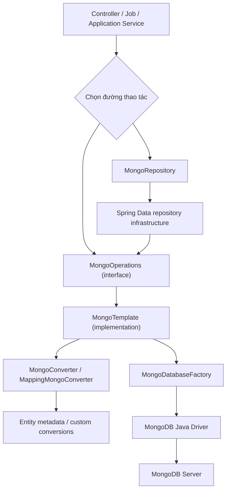

# Vai trò của MongoOperations và MongoTemplate

## 1. Vì sao cần hiểu hai thành phần này?

Trong Spring Data MongoDB, repository giúp viết các thao tác phổ biến bằng interface, chẳng hạn `findByTenantIdAndStatus(...)`. Tuy nhiên, khi cần cập nhật một trường có điều kiện, ghép nhiều tiêu chí truy vấn động, dùng aggregation, tạo index hoặc kiểm soát kết quả ghi, người phát triển thường phải làm việc gần với MongoDB hơn. **`MongoOperations` và `MongoTemplate`** là cặp API trung tâm giải quyết nhu cầu đó.

Bài thuộc chương **MongoTemplate** của module **SPRING_DATA_MONGODB**, theo phạm vi học kết nối, ánh xạ document và thao tác MongoDB qua `MongoTemplate` hoặc repository; đồng thời thiết kế truy vấn, aggregation, index, transaction, reactive access, kiểm thử và chẩn đoán hiệu năng dữ liệu.

Sau bài này, bạn có thể:

1. Phân biệt **`MongoOperations` là hợp đồng giao diện** và **`MongoTemplate` là implementation chủ yếu** trong Spring Data MongoDB imperative.
2. Giải thích các tầng từ service đến mapping converter, Java driver và MongoDB server.
3. Chọn repository hay template theo access pattern, thay vì áp dụng một cách máy móc.
4. Dùng `MongoOperations` để viết truy vấn, insert, save, update, delete, aggregation và quản lý index có kiểm soát.
5. Biết khi nào cần transaction, projection, stream hoặc phiên bản API reactive.
6. Kiểm thử tính đúng đắn của BSON/query và đo hiệu năng thay vì xem cú pháp chạy được là đủ.

Trong các ví dụ, Java 17+ và Spring Data MongoDB theo API hiện đại được sử dụng. Tên phương thức, tùy chọn và cấu hình nâng cao cần được đối chiếu với phiên bản Spring Data, MongoDB driver, Spring Boot và server thực tế trước khi triển khai.

## 2. Vai trò cốt lõi: interface và implementation

Hai kiểu đều nằm trong package:

```java
import org.springframework.data.mongodb.core.MongoOperations;
import org.springframework.data.mongodb.core.MongoTemplate;
```

**`MongoOperations`** là interface mô tả các thao tác MongoDB được Spring Data hỗ trợ trong mô hình lập trình imperative. Nó quy định các phương thức như `find`, `findOne`, `findById`, `insert`, `save`, `updateFirst`, `updateMulti`, `remove`, `aggregate`, `count` và khả năng truy cập các operation chuyên biệt.

**`MongoTemplate`** là implementation thông dụng của `MongoOperations`. Nó phối hợp:

- `MongoDatabaseFactory` để truy cập MongoDB database thông qua driver.
- `MongoConverter`, thường là `MappingMongoConverter`, để chuyển object Java qua lại BSON.
- Metadata ánh xạ: `@Document`, `@Id`/`@MongoId`, `@Field`, chuyển đổi kiểu và collection.
- Các thành phần query/update mapping, callback, cấu hình giao dịch và tùy chọn thao tác.



Sơ đồ mô tả kiến trúc ở mức khái niệm: implementation của repository cũng sử dụng cơ chế thao tác/mapping Spring Data; không phải mọi repository method nhất thiết đi qua đúng cùng chuỗi hàm nội bộ. Quan trọng là repository và template **cùng hệ sinh thái ánh xạ**, không phải hai công nghệ database khác nhau.

### 2.1. Tại sao inject interface?

Trong service, ưu tiên khai báo phụ thuộc:

```java
import org.springframework.data.mongodb.core.MongoOperations;
import org.springframework.stereotype.Service;

@Service
public class OrderQueryService {
    private final MongoOperations mongo;

    public OrderQueryService(MongoOperations mongo) {
        this.mongo = mongo;
    }
}
```

Điều này cho thấy service cần **khả năng thao tác MongoDB**, không nhất thiết cần biết implementation cụ thể. Khi ứng dụng có một bean `MongoTemplate` (hoặc bean compatible `MongoOperations`), Spring có thể inject theo interface. Nếu ứng dụng cấu hình nhiều database/template, phải dùng `@Qualifier` hoặc cơ chế chọn bean rõ ràng; không mặc định Spring tự chọn đúng database.

Inject `MongoTemplate` trực tiếp cũng hợp lệ khi code cần chức năng đặc thù của class, nhưng không cần làm vậy cho các phương thức đã có trong `MongoOperations`.

## 3. So sánh MongoOperations, MongoTemplate, MongoRepository và driver

| Tiêu chí | `MongoOperations` | `MongoTemplate` | `MongoRepository` | MongoDB Java driver |
| --- | --- | --- | --- | --- |
| Bản chất | Interface | Implementation của interface | API repository | API driver MongoDB |
| Mức trừu tượng | Operations theo domain entity | Điều phối operations và mapping | CRUD/query qua method | Collection/BSON/driver-level |
| Truy vấn động | Có | Có | Có giới hạn qua method/custom impl | Có, tự xây BSON |
| Ánh xạ `@Field`/`@Document` | Qua implementation | Qua converter/context | Qua Spring Data infrastructure | Không tự hiểu Spring annotation |
| Update một phần | `Update`/`Query` | Thực thi operations | Có thể dùng annotated/custom update theo phiên bản | `updateOne`/`updateMany` |
| Aggregation | Có API | Thực thi pipeline | Có thể dùng `@Aggregation` tùy phiên bản | Aggregation bằng BSON |
| Index | `indexOps(...)` | Có | Không phải điểm mạnh của repository CRUD | `createIndex` |
| Thích hợp | Service/adapter yêu cầu operations | Implementation Spring quản lý | Query phổ biến, hợp đồng hẹp | Nhu cầu driver đặc biệt |

Không cần loại bỏ repository để sử dụng MongoTemplate: hai cách thường **bổ sung nhau**. Repository phục vụ read model hoặc CRUD đơn giản; template phục vụ query động, cập nhật có điều kiện và pipeline phức tạp.

**Lưu ý bảo mật:** Dù dùng API nào, code vẫn phải tự kiểm tra tenant/owner và quyền truy cập. Converter, repository hay template không tự xác thực người dùng.

## 4. Cấu hình kết nối và khởi tạo bean

### 4.1. Với Spring Boot

Trong ứng dụng Spring Boot có dependency Spring Data MongoDB và cấu hình kết nối hợp lệ, Boot thường auto-configure client, database factory, converter và `MongoTemplate`. Ví dụ cấu hình dành cho môi trường local:

```yaml
spring:
  data:
    mongodb:
      uri: mongodb://localhost:27017/order_lab
```

Trong thực tế, URI phải đến từ secrets/configuration an toàn; thiết lập TLS, authentication, pool, timeout và topology đúng môi trường. Không commit password vào source hoặc tài liệu chia sẻ.

Một service có thể yêu cầu `MongoOperations` như ở mục 2. Điều này giúp tránh tự tạo `MongoClient`/`MongoTemplate` trong mỗi request. MongoDB client nên được chia sẻ, tận dụng connection pool và được đóng theo vòng đời ứng dụng.

### 4.2. Khởi tạo MongoTemplate thủ công khi thực sự cần

Với một `MongoDatabaseFactory` đã được cấu hình:

```java
import org.springframework.context.annotation.Bean;
import org.springframework.context.annotation.Configuration;
import org.springframework.data.mongodb.MongoDatabaseFactory;
import org.springframework.data.mongodb.core.MongoOperations;
import org.springframework.data.mongodb.core.MongoTemplate;

@Configuration
class MongoTemplateConfiguration {

    @Bean
    MongoOperations orderMongoOperations(MongoDatabaseFactory factory) {
        return new MongoTemplate(factory);
    }
}
```

Đây là ví dụ minh họa construction, **không phải cấu hình phải thêm vào mọi ứng dụng Boot**. Khi tự thay bean mặc định, cần đánh giá converter, callbacks, custom conversions, transaction infrastructure và khả năng phát sinh nhiều bean cùng type. Nếu ứng dụng đã có `MongoTemplate` auto-configured, tạo thêm bean có thể khiến injection bị mơ hồ.

### 4.3. Nhiều database/template

Trong hệ thống kết nối nhiều database, có thể tồn tại nhiều `MongoTemplate` với factory khác nhau. Lúc đó:

- Gắn tên bean cụ thể và dùng `@Qualifier` ở service.
- Chỉ định repository package sử dụng template thích hợp qua cấu hình repository.
- Kiểm thử rằng mọi thao tác của một nghiệp vụ vào đúng database.
- Không dùng database name nhận trực tiếp từ request của client mà không có quy tắc tenant và authorization rõ ràng.

Một `MongoTemplate` thường an toàn để tái sử dụng giữa các thread sau khi cấu hình xong. Không nên sửa cấu hình của template toàn cục trong quá trình xử lý từng request.

## 5. Thiết lập mô hình domain xuyên suốt

Ví dụ quản lý đơn hàng nhiều tenant, với trạng thái và version phục vụ cập nhật cạnh tranh:

```java
import java.time.Instant;
import org.springframework.data.annotation.Version;
import org.springframework.data.mongodb.core.mapping.Document;
import org.springframework.data.mongodb.core.mapping.FieldType;
import org.springframework.data.mongodb.core.mapping.MongoId;

@Document(collection = "orders")
public record OrderDocument(
    @MongoId(FieldType.STRING) String id,
    String tenantId,
    String customerId,
    OrderStatus status,
    Instant createdAt,
    Instant updatedAt,
    long totalAmountVnd,
    @Version Long version
) {}

enum OrderStatus {
    NEW, PAID, READY_TO_SHIP, SHIPPED, CANCELLED
}
```

Ý nghĩa:

- `@Document(collection = "orders")` xác định collection mặc định.
- `@MongoId(FieldType.STRING)` giữ BSON `_id` kiểu String theo chủ đích.
- `status` được lưu theo cơ chế mapping enum.
- `@Version` là metadata cho optimistic locking trên những đường thao tác thích hợp; nó khác với trường ID.
- `createdAt` và `updatedAt` là dữ liệu nghiệp vụ/audit. Không mặc nhiên được cập nhật chỉ vì `MongoTemplate` được gọi.

Document mẫu minh họa:

```javascript
{
  _id: "order-2026-0101",
  tenantId: "tenant-a",
  customerId: "customer-01",
  status: "READY_TO_SHIP",
  createdAt: ISODate("2026-11-19T09:00:00Z"),
  updatedAt: ISODate("2026-11-19T09:00:00Z"),
  totalAmountVnd: NumberLong("250000"),
  version: NumberLong("0")
}
```

Giá trị `version` và sự hiện diện của type metadata (chẳng hạn `_class`) phụ thuộc cách document được tạo, mapping và phiên bản. Đây là mẫu để hình dung, không phải cam kết mọi insert sẽ sinh BSON byte-for-byte giống hệt.

## 6. Đường đi của một lệnh qua MongoOperations

Khi gọi:

```java
mongo.findById("order-2026-0101", OrderDocument.class);
```

quá trình có thể hình dung theo các bước:

1. Xác định entity type và collection tương ứng, mặc định là `orders`.
2. Dựa trên metadata để ánh xạ ID Java và đường dẫn query sang trường BSON `_id`.
3. Chuyển giá trị query phù hợp với kiểu BSON được cấu hình.
4. Gửi thao tác `find` qua MongoDB Java driver tới server.
5. Nhận BSON document, dùng `MongoConverter` dựng `OrderDocument`.
6. Trả về kết quả hoặc `null` theo contract của phương thức template.

Repository `findById` thường trả `Optional<T>`, còn `MongoOperations.findById(...)` trả kiểu entity nullable (và có annotation nullability tương ứng tùy version). Đây là khác biệt **API contract** đáng chú ý: không sao chép code `Optional.orElseThrow()` của repository rồi áp vào kết quả template mà không kiểm tra null.

### 6.1. Java property khác tên BSON vật lý

Giả sử thêm:

```java
@org.springframework.data.mongodb.core.mapping.Field("order_no")
String orderNo;
```

Trong truy vấn có context `OrderDocument.class`, `Criteria.where("orderNo")` được ánh xạ sang `order_no`. Driver thô và mongosh phải dùng tên thực tế `order_no`. Template **giúp ánh xạ**, không tự đoán được một field đã đổi tên ngoài metadata.

## 7. Đọc dữ liệu: findById, findOne, find, exists và count

### 7.1. Tìm theo ID

```java
OrderDocument order =
    mongo.findById("order-2026-0101", OrderDocument.class);

if (order == null) {
    // Không tìm thấy; xử lý theo hợp đồng nghiệp vụ.
}
```

`findById` tiện khi ID đủ để tìm document. Tuy nhiên, nếu ứng dụng multi-tenant không cho xem dữ liệu khác tenant, thao tác chỉ theo ID chưa đủ để biểu diễn quyền truy cập.

### 7.2. Query có tenant filter

```java
import org.springframework.data.mongodb.core.query.Criteria;
import org.springframework.data.mongodb.core.query.Query;

Query query = Query.query(
    Criteria.where("id").is("order-2026-0101")
        .and("tenantId").is(authenticatedTenantId)
);

OrderDocument order =
    mongo.findOne(query, OrderDocument.class);
```

`authenticatedTenantId` trong ví dụ là giá trị đã được xác minh từ security context, **không phải** tham số tùy ý của HTTP request. Query mapper dùng `OrderDocument.class` để ánh xạ tên `id` thành `_id`. Nếu document không tồn tại hoặc không thuộc tenant, kết quả là `null`.

### 7.3. Lấy danh sách có filter, sort, limit

```java
import java.util.List;
import org.springframework.data.domain.Sort;

Query queueQuery = Query.query(
    Criteria.where("tenantId").is(authenticatedTenantId)
        .and("status").is(OrderStatus.READY_TO_SHIP)
);
queueQuery.with(Sort.by(
    Sort.Order.desc("createdAt"),
    Sort.Order.desc("id")
));
queueQuery.limit(20);

List<OrderDocument> orders =
    mongo.find(queueQuery, OrderDocument.class);
```

Không giả định thứ tự tự nhiên của MongoDB là thứ tự nghiệp vụ. Hai bản ghi có cùng thời gian cần khóa phá hòa như `id`/`_id` để phân trang ổn định.

### 7.4. Kiểm tra tồn tại và đếm

```java
Query byTenantAndStatus = Query.query(
    Criteria.where("tenantId").is(authenticatedTenantId)
        .and("status").is(OrderStatus.READY_TO_SHIP)
);

boolean any = mongo.exists(byTenantAndStatus, OrderDocument.class);
long count = mongo.count(byTenantAndStatus, OrderDocument.class);
```

`exists` diễn đạt câu hỏi «có bản ghi nào không?»; `count` trả số lượng khớp filter và có thể đắt trên tập dữ liệu lớn. Không dùng `mongo.find(...).size()` trên một danh sách rất lớn chỉ để lấy số lượng.

### 7.5. Chọn API theo số lượng kết quả

| Nhu cầu | MongoOperations | Lưu ý |
| --- | --- | --- |
| ID xác định | `findById(...)` | Trả entity hoặc null theo contract |
| Nhiều điều kiện, tối đa một | `findOne(...)` | Nếu business cần unique, nên có ràng buộc/index phù hợp |
| Danh sách giới hạn | `find(...)` với `Query.limit(...)` | Kết quả được materialize thành List |
| Kiểm tra có tồn tại | `exists(...)` | Tránh tải entity không cần |
| Đếm theo filter | `count(...)` | Có chi phí đếm, đặc biệt khi thiếu index |
| Xử lý một luồng lớn | `stream(...)` | Đóng cursor sau khi dùng |

## 8. Insert và save không có cùng ý nghĩa

### 8.1. Insert: ý định tạo mới

```java
OrderDocument draft = new OrderDocument(
    "order-2026-0201",
    authenticatedTenantId,
    "customer-08",
    OrderStatus.NEW,
    Instant.now(),
    Instant.now(),
    150000L,
    null
);

OrderDocument inserted = mongo.insert(draft);
```

`insert` nhằm tạo document mới. Nếu `_id` đã tồn tại, MongoDB từ chối bằng lỗi duplicate key; đây là hành vi có thể được dùng để thực thi «create-only». Các trường như `@Version` có thể được mapping layer xử lý trong luồng insert phù hợp, nên đừng tự kỳ vọng mọi giá trị version bằng chính xác một số khi chưa test.

### 8.2. Save: có thể ghi đè document hiện hữu

```java
OrderDocument saved = mongo.save(draft);
```

`save` mang semantics lưu document theo ID, với hành vi có thể thay thế/upsert tùy trạng thái và implementation. Nó **không phải** cam kết «chỉ insert nếu chưa tồn tại». Nếu dùng save để tiếp nhận một object từ API mà không kiểm soát field nào được phép sửa, nguy cơ ghi đè dữ liệu hoặc bỏ qua state transition là rất lớn.

Đặc biệt trong hệ thống có nhiều người sửa, ưu tiên:

- Insert rõ nghĩa cho tạo mới.
- Update một phần với filter có trạng thái/version hiện tại.
- Optimistic locking với `@Version` khi dùng các đường save/update tương thích.
- Validation và quyền truy cập trước khi ghi.

### 8.3. Phân biệt insert/save/update/upsert

| Phương thức | Ý định | Rủi ro cần kiểm soát |
| --- | --- | --- |
| `insert(entity)` | Tạo mới | Duplicate key, yêu cầu cấp ID |
| `save(entity)` | Lưu entity theo ID | Có thể ghi đè/replace, xung đột đồng thời |
| `updateFirst(query, update, type)` | Sửa một document khớp điều kiện | Query thiếu tenant, matched vs modified |
| `updateMulti(query, update, type)` | Sửa nhiều document khớp điều kiện | Phạm vi quá rộng, hiệu quả index, tính nguyên tử theo document |
| `upsert(query, update, type)` | Update nếu có, insert nếu chưa có | Tạo record ngoài ý muốn nếu filter không đủ chặt |

Không nên coi các API này là biến thể cú pháp có thể thay thế tùy ý.

## 9. Cập nhật từng trường có điều kiện

### 9.1. State transition nguyên tử trên một document

Giả sử chỉ được chuyển `READY_TO_SHIP -> SHIPPED` và phải ràng buộc tenant:

```java
import org.springframework.data.mongodb.core.query.Update;
import com.mongodb.client.result.UpdateResult;

Query query = Query.query(
    Criteria.where("id").is(orderId)
        .and("tenantId").is(authenticatedTenantId)
        .and("status").is(OrderStatus.READY_TO_SHIP)
);

Update update = new Update()
    .set("status", OrderStatus.SHIPPED)
    .set("updatedAt", Instant.now());

UpdateResult result =
    mongo.updateFirst(query, update, OrderDocument.class);

boolean matched = result.getMatchedCount() == 1;
boolean changed = result.getModifiedCount() == 1;
```

`orderId` và `authenticatedTenantId` được giả định đã có trong service. Điều kiện trạng thái và thao tác sửa cùng nằm trong một update trên document nên giúp tránh pattern nguy hiểm «đọc trạng thái rồi ghi bất kể dữ liệu đã đổi». MongoDB bảo đảm tính nguyên tử của cập nhật một document.

**Matched vs modified:** `getMatchedCount()` cho biết có document khớp filter; `getModifiedCount()` cho biết số document thực sự bị sửa. Khi giá trị đã bằng sẵn giá trị mới, có thể matched nhưng không modified. Không nên lấy `modifiedCount == 0` làm bằng chứng chắc chắn document không tồn tại.

### 9.2. Update nhiều document

```java
Query staleDrafts = Query.query(
    Criteria.where("tenantId").is(authenticatedTenantId)
        .and("status").is(OrderStatus.NEW)
        .and("createdAt").lt(cutoff)
);

Update cancel = new Update()
    .set("status", OrderStatus.CANCELLED)
    .set("updatedAt", Instant.now());

UpdateResult many =
    mongo.updateMulti(staleDrafts, cancel, OrderDocument.class);
```

`cutoff` là thời điểm giới hạn do chính sách nghiệp vụ xác định. Đây là thao tác hàng loạt; phải xác nhận số document dự kiến, tác động transaction, audit và khả năng retry. Tính nguyên tử trên từng document không đồng nghĩa toàn bộ các document bị update là một transaction chung.

### 9.3. Upsert cần quy tắc rõ ràng

```java
Query q = Query.query(
    Criteria.where("tenantId").is(authenticatedTenantId)
        .and("externalKey").is(externalKey)
);
Update u = new Update()
    .set("lastSeenAt", Instant.now())
    .setOnInsert("createdAt", Instant.now());

mongo.upsert(q, u, ExternalSyncDocument.class);
```

`ExternalSyncDocument` là một entity minh họa của nghiệp vụ đồng bộ, không phải `OrderDocument` ở mục 5; đoạn code giả định type này đã được định nghĩa và có index unique phù hợp. Upsert có thể sinh document mới, nên:

- Filter phải bao gồm khóa định danh nghiệp vụ chính xác, không phải điều kiện quá rộng.
- Dùng unique index khi cần ngăn race condition tạo bản ghi trùng.
- Không dùng upsert cho một thao tác vốn chỉ được phép sửa document đã tồn tại.
- Test tình huống hai request đồng thời cùng upsert.

## 10. findAndModify: đọc kết quả trước/sau cập nhật

Khi nghiệp vụ cần **cập nhật và nhận lại document** trong cùng một thao tác, `findAndModify` có thể phù hợp:

```java
import org.springframework.data.mongodb.core.FindAndModifyOptions;

Query query = Query.query(
    Criteria.where("id").is(orderId)
        .and("tenantId").is(authenticatedTenantId)
        .and("status").is(OrderStatus.READY_TO_SHIP)
);
Update update = new Update()
    .set("status", OrderStatus.SHIPPED)
    .set("updatedAt", Instant.now());

OrderDocument after = mongo.findAndModify(
    query,
    update,
    FindAndModifyOptions.options().returnNew(true),
    OrderDocument.class
);
```

Nếu không có document phù hợp, kết quả có thể là `null`. `returnNew(true)` yêu cầu trả về document **sau khi update**; nếu không, hành vi thông dụng là nhận về document trước khi update. Không cần thực hiện riêng `findOne` rồi `updateFirst` rồi `findOne` khi một operation nguyên tử đáp ứng đúng use case.

Khi domain dùng `@Version`, các thao tác update và cách framework quản lý version cần được kiểm thử theo API đang dùng. Không giả định mọi cách dựng Update đều tự thực hiện đầy đủ optimistic locking của `save(entity)`; với state transition quan trọng, hãy đưa điều kiện concurrency vào filter hoặc dùng cơ chế version được hỗ trợ.

## 11. Xóa dữ liệu: remove và findAndRemove

### 11.1. Remove luôn cần phạm vi rõ

```java
Query draftQuery = Query.query(
    Criteria.where("id").is(orderId)
        .and("tenantId").is(authenticatedTenantId)
        .and("status").is(OrderStatus.NEW)
);

var deletion = mongo.remove(draftQuery, OrderDocument.class);
long deletedCount = deletion.getDeletedCount();
```

Đây là ví dụ chỉ cho phép xóa đơn nháp. Lệnh xóa có filter tenant và status rõ hơn một thao tác xóa tùy ý theo ID. Không cần cho người dùng cuối biết một đơn ngoài tenant của họ có tồn tại hay không.

### 11.2. Khi nào dùng findAndRemove?

`findAndRemove` có thể trả document đã bị xóa trong một thao tác, hữu ích khi nghiệp vụ cần lưu thông tin trước xóa hoặc phát sự kiện từ dữ liệu đã xóa. Tuy nhiên, việc phát một sự kiện bên ngoài MongoDB sau khi xóa **không tự là một transaction nguyên tử**; nếu phải đồng bộ chắc chắn, cân nhắc outbox hoặc phương án đảm bảo giao nhận.

### 11.3. Soft delete thường phù hợp hơn hard delete

Đối với đơn hàng, dữ liệu lịch sử có thể cần giữ để đối soát. Thay vì xóa vật lý, có thể dùng các field `deletedAt`/`archivedAt` hoặc trạng thái nghiệp vụ. Khi đó mọi query đọc, index, báo cáo và retention phải xử lý nhất quán các bản ghi đã ẩn.

**Không dùng `remove(new Query(), OrderDocument.class)`** nếu không có một tác vụ vận hành được phê duyệt cụ thể: filter rỗng có thể ảnh hưởng toàn collection.

## 12. Aggregation qua MongoOperations

`MongoOperations` không chỉ là CRUD. Khi cần tính doanh thu, nhóm dữ liệu, biến đổi document hay lookup giữa collection, có thể gọi `aggregate(...)`.

Ví dụ tổng doanh thu theo trạng thái của một tenant:

```java
import org.springframework.data.mongodb.core.aggregation.Aggregation;
import org.springframework.data.mongodb.core.aggregation.AggregationResults;
import static org.springframework.data.mongodb.core.aggregation.Aggregation.*;

record StatusRevenue(String status, long totalVnd) {}

Aggregation pipeline = newAggregation(
    match(Criteria.where("tenantId").is(authenticatedTenantId)),
    group("status").sum("totalAmountVnd").as("totalVnd"),
    project("totalVnd").and("_id").as("status")
);

AggregationResults<StatusRevenue> results =
    mongo.aggregate(pipeline, OrderDocument.class, StatusRevenue.class);

for (StatusRevenue row : results.getMappedResults()) {
    System.out.println(row.status() + ": " + row.totalVnd());
}
```

Ý nghĩa pipeline:

1. `$match` theo tenant trước khi tổng hợp.
2. `$group` theo status và cộng tổng.
3. `$project` đưa group key `_id` thành tên field `status` cho DTO.
4. Converter ánh xạ kết quả BSON thành `StatusRevenue`.

Với dữ liệu tiền lớn, phải xem giới hạn `long`, kiểu BSON và yêu cầu chính xác; có thể dùng `Decimal128`/`BigDecimal` ở thiết kế khác. Khi thêm `$lookup`, `$sort` hoặc `$unwind`, hãy xem lại index, cardinality và lượng dữ liệu trung gian.

**Lưu ý:** Aggregation không nhất thiết kích hoạt cùng entity lifecycle callback như một lần save. Đừng dùng aggregation để ngầm thực thi business validation.

## 13. indexOps: kết nối logic truy vấn với index thật

### 13.1. Khai báo index theo query shape

Nếu truy vấn hàng đợi theo `tenantId + status` và sắp xếp `createdAt DESC, _id DESC`, có thể tạo index:

```java
import org.springframework.data.domain.Sort;
import org.springframework.data.mongodb.core.index.Index;

Index index = new Index()
    .on("tenantId", Sort.Direction.ASC)
    .on("status", Sort.Direction.ASC)
    .on("createdAt", Sort.Direction.DESC)
    .on("_id", Sort.Direction.DESC)
    .named("ix_orders_tenant_status_recent");

mongo.indexOps(OrderDocument.class).ensureIndex(index);
```

Một số phiên bản thay đổi kiểu kết quả hoặc tên API quản lý index; cần kiểm tra đúng artifact. `ensureIndex` không bảo đảm index mới được tạo nhanh hay an toàn trên mọi collection production. Trong môi trường lớn, index thường được quản lý bằng migration/maintenance plan riêng để kiểm soát tải, tên và thay đổi schema.

### 13.2. So sánh với mongosh

```javascript
db.orders.createIndex(
  { tenantId: 1, status: 1, createdAt: -1, _id: -1 },
  { name: "ix_orders_tenant_status_recent" }
);

db.orders.find({
  tenantId: "tenant-a",
  status: "READY_TO_SHIP"
})
  .sort({ createdAt: -1, _id: -1 })
  .limit(20)
  .explain("executionStats");
```

Chỉ thấy annotation `@Indexed` trong Java hoặc có phương thức `indexOps` không đủ kết luận index đã tồn tại. Kiểm tra `db.orders.getIndexes()` và plan thật. Index hỗ trợ query phù hợp nhưng có chi phí lưu trữ và ghi; không tạo index cho mọi field theo thói quen.

### 13.3. Hệ quả của ánh xạ tên field

Khi domain dùng `@Field("order_no") String orderNo`, query API có metadata ánh xạ property Java tới BSON field; phần định nghĩa index cũng nên được kiểm tra trong bối cảnh entity để tránh tạo index nhầm tên. Trong mongosh, luôn dùng tên vật lý. Với query/index đặc biệt, nên đọc BSON thực tế để xác nhận.

## 14. Projection, phân trang và streaming

### 14.1. Chỉ lấy field cần thiết

Khi UI chỉ cần ID, trạng thái và thời gian:

```java
Query query = Query.query(
    Criteria.where("tenantId").is(authenticatedTenantId)
);
query.fields()
    .include("id")
    .include("status")
    .include("createdAt");
query.limit(20);
```

Nếu kết quả vẫn được ánh xạ trực tiếp thành một entity đầy đủ với các thành phần bắt buộc, property không được select có thể thành null/default hoặc gây vấn đề khởi tạo. Trong nhiều trường hợp, dùng **DTO/projection được thiết kế riêng** an toàn hơn việc trả một entity thiếu field rồi tiếp tục lưu lại entity đó.

### 14.2. Page, Slice và offset

Template có thể tạo query có limit/skip và phối hợp với `Pageable`:

```java
import org.springframework.data.domain.PageRequest;
import org.springframework.data.domain.Sort;

Query query = Query.query(
    Criteria.where("tenantId").is(authenticatedTenantId)
);
query.with(PageRequest.of(
    0,
    20,
    Sort.by(Sort.Order.desc("createdAt"), Sort.Order.desc("id"))
));

List<OrderDocument> content =
    mongo.find(query, OrderDocument.class);
```

`mongo.find(...)` ở đây trả về **List**, không tự trở thành `Page` chỉ vì query có `Pageable`. Nếu cần tổng số, service phải thực hiện count phù hợp hoặc dùng repository trả `Page<T>`. Nếu chỉ cần `hasNext`, có thể dùng repository `Slice<T>` hoặc lấy thêm một phần tử theo cơ chế phù hợp.

Offset lớn với `skip` có thể chậm. Khi cần cuộn sâu, hãy cân nhắc keyset/scrolling API của phiên bản hỗ trợ, dùng khóa sort ổn định như `createdAt, _id` và index phù hợp.

### 14.3. Stream qua MongoTemplate

```java
import org.springframework.data.util.CloseableIterator;

Query exportQuery = Query.query(
    Criteria.where("tenantId").is(authenticatedTenantId)
);

try (CloseableIterator<OrderDocument> cursor =
         mongo.stream(exportQuery, OrderDocument.class)) {
    while (cursor.hasNext()) {
        OrderDocument order = cursor.next();
        process(order);
    }
}
```

`process(order)` là hàm ứng dụng tự định nghĩa. Dùng try-with-resources để đóng MongoDB cursor khi kết thúc hoặc có exception. Nếu export cần resume qua nhiều lần chạy, batch/keyset với checkpoint có thể phù hợp hơn một cursor mở rất lâu.

## 15. Callbacks, converter, auditing và validation

MongoTemplate sử dụng mapping infrastructure của Spring Data. Điều đó mang lại các khả năng như:

| Thành phần | Vai trò | Không được giả định |
| --- | --- | --- |
| `@Field`, `@Document` | Mapping field/collection | Tự migrate document cũ |
| `MongoCustomConversions` | Chuyển kiểu Java/BSON | Sửa dữ liệu legacy hiện có |
| Entity callbacks | Can thiệp giai đoạn chuyển đổi/lưu/đọc theo operation | Mọi update/bulk/driver call đều kích hoạt giống save |
| Auditing | Gắn thời gian/người tạo hoặc sửa khi được bật | Tự cập nhật mọi lệnh `updateFirst` |
| `@Version` | Optimistic locking ở những đường hỗ trợ | Thay thế mọi điều kiện concurrency tự viết |
| Bean Validation | Ràng buộc đầu vào/domain khi tích hợp đúng | Tự chạy chỉ vì MongoDB có collection |
| MongoDB schema validation | Ràng buộc BSON ở server | Thay thế hoàn toàn business validation |

Ví dụ, `mongo.updateFirst(...)` cập nhật trực tiếp một số field mà không nhất thiết gọi cùng các callback như việc chuyển một entity đầy đủ qua `save(...)`. Nếu hệ thống có `updatedAt`, hãy đặt nó trong `Update` hoặc có chiến lược auditing được kiểm chứng.

Đối với `@Version`, không nên mặc định một lệnh update tự kiểm tra version hiện tại của object Java đã đọc từ trước. Nếu use case yêu cầu chống ghi đè, hãy dùng version đúng contract hoặc thêm điều kiện `version` vào filter và xử lý kết quả matched count.

## 16. Transaction và việc quản lý session

### 16.1. Một document vs nhiều document

MongoDB bảo đảm tính nguyên tử cho các thao tác ghi trên **một document**. Vì vậy, cập nhật trạng thái đơn có điều kiện thường không cần transaction nhiều document.

Nếu nghiệp vụ đồng thời:

- Chuyển trạng thái đơn.
- Ghi bản ghi thanh toán.
- Thay đổi tồn kho trong collection khác.

và yêu cầu tất cả phải commit hoặc rollback cùng nhau, có thể cần multi-document transaction. MongoDB transaction yêu cầu topology và cấu hình thích hợp, chẳng hạn replica set hoặc sharded cluster hỗ trợ.

### 16.2. MongoTransactionManager

Trong cấu hình imperative Spring Data, có thể đăng ký transaction manager:

```java
import org.springframework.context.annotation.Bean;
import org.springframework.context.annotation.Configuration;
import org.springframework.data.mongodb.MongoDatabaseFactory;
import org.springframework.data.mongodb.MongoTransactionManager;

@Configuration
class MongoTransactionConfiguration {

    @Bean
    MongoTransactionManager mongoTransactionManager(
        MongoDatabaseFactory factory
    ) {
        return new MongoTransactionManager(factory);
    }
}
```

Sau khi cấu hình transaction đúng, service có thể dùng `@Transactional`:

```java
import org.springframework.stereotype.Service;
import org.springframework.transaction.annotation.Transactional;

@Service
class OrderSettlementService {
    private final MongoOperations mongo;

    OrderSettlementService(MongoOperations mongo) {
        this.mongo = mongo;
    }

    @Transactional
    public void settle(String tenantId, String orderId) {
        // Ví dụ minh họa phạm vi transaction.
        // Thực hiện các thao tác MongoDB được thiết kế nhất quán.
    }
}
```

Đoạn này chỉ mô tả hạ tầng và phạm vi transaction; không phải một flow thanh toán hoàn chỉnh. Trong ứng dụng thật, test transaction rollback, retry đối với transient failure, cấu hình session và hành vi khi method được gọi qua Spring proxy. `@Transactional` không biến việc gọi HTTP hay gửi message ra hệ thống ngoài thành một phần của MongoDB transaction.

### 16.3. Lưu ý khi có nhiều MongoTemplate

Transaction manager và database factory phải tương thích với template/repository đang sử dụng. Nếu cấu hình nhiều database hoặc reactive client, không giả định một transaction manager imperative tự điều phối mọi client. Lựa chọn transaction manager cần phù hợp với loại stack và boundaries.

## 17. ReactiveMongoOperations không phải MongoOperations

Spring Data MongoDB có nhánh imperative và nhánh reactive:

| Imperative | Reactive |
| --- | --- |
| `MongoOperations` | `ReactiveMongoOperations` |
| `MongoTemplate` | `ReactiveMongoTemplate` |
| `List<T>`/entity/null | `Flux<T>`/`Mono<T>` |
| Blocking driver | Reactive MongoDB driver |
| `MongoTransactionManager` | Reactive transaction manager theo cấu hình tương ứng |

Một ví dụ reactive:

```java
import reactor.core.publisher.Mono;
import org.springframework.data.mongodb.core.ReactiveMongoOperations;
import org.springframework.data.mongodb.core.query.Criteria;
import org.springframework.data.mongodb.core.query.Query;

public class ReactiveOrderLookup {
    private final ReactiveMongoOperations mongo;

    public ReactiveOrderLookup(ReactiveMongoOperations mongo) {
        this.mongo = mongo;
    }

    public Mono<OrderDocument> find(String tenantId, String id) {
        Query query = Query.query(
            Criteria.where("tenantId").is(tenantId)
                .and("id").is(id)
        );
        return mongo.findOne(query, OrderDocument.class);
    }
}
```

`Mono` biểu diễn kết quả bất đồng bộ 0–1; `Flux` cho nhiều phần tử. Không gọi `block()` tùy tiện trong luồng xử lý non-blocking để biến reactive thành imperative. Sử dụng reactive không làm mất nhu cầu xác thực tenant, chọn index, xử lý lỗi chuyển đổi và bảo đảm transaction phù hợp.

## 18. Lỗi thường gặp khi dùng MongoTemplate

| Triệu chứng | Nguyên nhân có thể | Cách xử lý |
| --- | --- | --- |
| Query `findById` hoạt động, nhưng `findOne` theo ID không khớp | Lẫn tên Java/BSON hoặc sai kiểu `_id` | Kiểm tra mapping ID, BSON thực tế và filter |
| Đọc ra null sau khi tìm theo tenant | Document không thuộc tenant hoặc không tồn tại | Xử lý như kết quả không có; không tiết lộ cross-tenant |
| `save` ghi đè các field không mong muốn | Dùng replace/save cho thao tác chỉ sửa một field | Dùng `Update` có điều kiện |
| `updateFirst` matched = 1, modified = 0 | Giá trị mới giống giá trị cũ hoặc no-op | Phân biệt matched/modified |
| Upsert tạo document không hợp lệ | Filter/setOnInsert thiếu field bắt buộc | Thiết kế key unique, validation và test |
| Update không cập nhật audit field | Bulk/update không chạy cùng callback như save | Đặt `updatedAt` rõ ràng trong update |
| Truy vấn list rất chậm | Thiếu index, sort không được index hỗ trợ | Kiểm tra query shape và `explain` |
| Nhiều query phụ khi đọc entity | Lazy/eager reference gây tải bổ sung | Projection, thiết kế embedding/reference và đo |
| Mất dữ liệu tenant khác | Filter write/delete thiếu tenant | Điều kiện theo tenant ở mọi command |
| Transaction annotation có vẻ không rollback | Không có transaction manager/topology phù hợp, gọi ngoài proxy | Kiểm tra config và integration test rollback |
| Không tìm thấy bean để inject | Thiếu cấu hình, nhiều `MongoTemplate` hoặc sai qualifier | Xem bean wiring và config database |
| Reactive method không trả List | Dùng nhầm API imperative/reactive | Chọn `Mono`/`Flux` với `ReactiveMongoOperations` |

## 19. Quan sát hiệu năng và kiểm tra truy vấn

### 19.1. Mô tả query thật trước khi tối ưu

Một phương thức Java ngắn không cho biết server thực thi gì. Để điều tra, cần xác định:

1. Collection thực tế.
2. Filter BSON, bao gồm kiểu dữ liệu và tenant.
3. Sort, projection, limit, collation hoặc hint nếu có.
4. Index hiện có và thống kê plan.
5. Số truy vấn phát sinh cho một use case, kể cả reference resolution.

Ví dụ mongosh:

```javascript
db.orders.find({
  tenantId: "tenant-a",
  status: "READY_TO_SHIP"
})
  .sort({ createdAt: -1, _id: -1 })
  .limit(20)
  .explain("executionStats");
```

Quan sát `winningPlan`, `IXSCAN`/`COLLSCAN`, `totalKeysExamined`, `totalDocsExamined`, `nReturned` và sort stage. Đừng kết luận «MongoTemplate chậm hơn repository» nếu hai đường truy vấn dùng filter/projection/index khác nhau.

### 19.2. Đo ở nhiều lớp

| Lớp đo | Câu hỏi |
| --- | --- |
| Application service | Một request xử lý bao lâu, có chờ hệ thống khác không? |
| Spring Data | Có mapping, callback, reference resolution hay query phát sinh thêm không? |
| Driver | Connection pool, timeout, retry và số round trip thế nào? |
| MongoDB server | Index, sort, docs examined, lock/tài nguyên ra sao? |
| Dữ liệu | BSON type, document size và cardinality có đúng kỳ vọng? |

Trong production, không log nguyên document chứa dữ liệu cá nhân/secret để debug một truy vấn. Dùng quan sát có giới hạn, redaction và correlation ID theo chính sách bảo mật.

### 19.3. Query đúng trước, nhanh sau

Một query có `nReturned = 0` không nhất thiết «được index tối ưu». Nó có thể sai kiểu ID, sai tenant, sai tên field BSON hoặc sai collation. Kiểm chứng tính đúng đắn của filter và expected result trước khi ép index bằng hint.

## 20. Kiểm thử MongoOperations và MongoTemplate

### 20.1. Unit test dịch vụ và integration test dữ liệu

Mock `MongoOperations` có thể kiểm tra service gọi đúng method với object `Query`/`Update` phù hợp, nhưng không bảo đảm:

- Tên Java property đã chuyển đúng thành BSON field.
- Cách enum, ID, ngày giờ, Decimal128 được mã hóa.
- Index thực sự tồn tại.
- Transaction rollback trên MongoDB.
- Query theo tenant trả đúng tập dữ liệu.

Vì vậy, với logic persistence quan trọng, cần integration test trên MongoDB test (ví dụ Testcontainers với topology phù hợp khi kiểm tra transaction). Không chạy integration test trong bước viết Markdown này; đoạn dưới là minh họa cho dự án đã có test context.

### 20.2. Test cập nhật trạng thái có điều kiện

```java
import static org.junit.jupiter.api.Assertions.*;
import java.time.Instant;
import org.junit.jupiter.api.Test;
import org.springframework.data.mongodb.core.MongoOperations;
import org.springframework.data.mongodb.core.query.Criteria;
import org.springframework.data.mongodb.core.query.Query;
import org.springframework.data.mongodb.core.query.Update;

class OrderUpdateIntegrationTest {
    // Inject mongo từ test context trước khi chạy.
    MongoOperations mongo;

    @Test
    void cannotShipOrderFromWrongTenant() {
        Instant now = Instant.parse("2026-11-19T09:00:00Z");
        mongo.insert(new OrderDocument(
            "test-order-101", "tenant-a", "customer-a",
            OrderStatus.READY_TO_SHIP, now, now, 100000L, null
        ));

        Query wrongTenant = Query.query(
            Criteria.where("id").is("test-order-101")
                .and("tenantId").is("tenant-b")
                .and("status").is(OrderStatus.READY_TO_SHIP)
        );

        var result = mongo.updateFirst(
            wrongTenant,
            new Update().set("status", OrderStatus.SHIPPED),
            OrderDocument.class
        );

        assertEquals(0, result.getMatchedCount());
    }
}
```

Đây là khung test học tập. Để chạy thực sự cần cấu hình dependency, test context, injection, cơ sở dữ liệu test riêng và cleanup dữ liệu. Bổ sung các tình huống đúng tenant, trạng thái không cho phép, request lặp lại và hai thao tác đồng thời.

### 20.3. Ma trận test tối thiểu

| Tình huống | Kỳ vọng |
| --- | --- |
| Insert ID mới | Document được tạo, mapping đúng BSON type |
| Insert trùng ID | Duplicate key; không lặng lẽ thay thế |
| Find đúng tenant | Trả entity được phép |
| Find sai tenant | Không trả entity |
| Find list có sort/limit | Thứ tự ổn định và không quá giới hạn |
| Update trạng thái hợp lệ | Match 1, sửa đúng các field cần thiết |
| Update trạng thái không hợp lệ | Match 0, dữ liệu không đổi |
| Update trên tenant khác | Match 0 |
| Upsert trong race condition | Không tạo trùng khóa nghiệp vụ |
| Remove có filter status | Không xóa đơn đã hoàn tất |
| Aggregation | Tổng nhóm đúng trên dữ liệu fixture |
| Index và plan | Query/compound index có tác dụng trên dữ liệu đại diện |
| Transaction | Rollback đúng khi một bước bị lỗi |
| Mapping type | Đọc/ghi đúng ID, enum, date và version |

## 21. Bài thực hành có lời giải

### Bài 1 — Interface hay implementation?

**Đề bài:** Trong service chỉ dùng `findOne`, `insert` và `updateFirst`. Nên khai báo constructor nhận `MongoOperations` hay bắt buộc `MongoTemplate`?

**Lời giải:** Có thể khai báo `MongoOperations` vì các thao tác cần thiết thuộc hợp đồng interface. `MongoTemplate` là implementation thường được inject. Điều này làm rõ sự phụ thuộc và tránh gắn chặt service vào class khi không cần.

### Bài 2 — Tạo mới hay upsert?

**Đề bài:** API tạo đơn phải từ chối nếu ID đã tồn tại. Chọn `insert`, `save` hay `upsert`?

**Lời giải:** Ưu tiên `insert` với ID và validation được kiểm soát. Khi trùng khóa, MongoDB từ chối. Không dùng `save`/`upsert` vì hai thao tác đó có thể ghi lên document hiện hữu hoặc tạo theo điều kiện không đúng hợp đồng «create-only».

### Bài 3 — Chuyển trạng thái an toàn

**Đề bài:** Chỉ chuyển `READY_TO_SHIP` thành `SHIPPED` nếu ID, tenant và trạng thái hiện tại đều đúng.

**Lời giải:** Dùng `updateFirst` với filter:

```java
Query q = Query.query(
    Criteria.where("id").is(orderId)
        .and("tenantId").is(authenticatedTenantId)
        .and("status").is(OrderStatus.READY_TO_SHIP)
);
Update u = new Update()
    .set("status", OrderStatus.SHIPPED)
    .set("updatedAt", Instant.now());

var result = mongo.updateFirst(q, u, OrderDocument.class);
```

Kiểm tra `matchedCount` và `modifiedCount` đúng semantics. Có thể bổ sung điều kiện version khi cần optimistic concurrency mạnh hơn.

### Bài 4 — Nên dùng find hay count?

**Đề bài:** Service chỉ cần biết có đơn chờ giao nào trong tenant hay không. Có nên lấy `List<OrderDocument>` rồi gọi `isEmpty()`?

**Lời giải:** Dùng `mongo.exists(query, OrderDocument.class)`. Không cần tải toàn bộ document vào heap. Nếu cần số lượng chính xác, dùng `count`; cân nhắc index và chi phí đếm.

### Bài 5 — Khi nào dùng aggregation?

**Đề bài:** Cần tổng doanh thu theo trạng thái trong một tenant. Có nên lấy mọi đơn bằng `find` rồi cộng trong Java?

**Lời giải:** Khi dữ liệu lớn, dùng aggregation `match(tenant) -> group(status).sum(amount) -> project` để MongoDB tổng hợp ở phía server và chỉ chuyển dữ liệu tổng hợp về ứng dụng. Kiểm tra kiểu số, độ chính xác, quyền tenant và index.

### Bài 6 — Phân biệt insert/save/update

**Đề bài:** Một service nhận yêu cầu sửa `updatedAt` của đơn đã tồn tại. Có nên đọc entity rồi dùng `save` chỉ để sửa trường này?

**Lời giải:** Thường nên dùng `Update.set("updatedAt", ...)` kèm filter ID, tenant và điều kiện nghiệp vụ. Điều này tránh tạo lại toàn document từ dữ liệu có thể đã cũ và giúp thể hiện chính xác field được phép thay đổi.

### Bài 7 — Tại sao template không tự bảo đảm security?

**Đề bài:** Service có `mongo.findById(id, OrderDocument.class)` rồi trả kết quả theo URL chứa ID. Có gì thiếu?

**Lời giải:** Cần ràng buộc quyền/tenant. Dùng `findOne` với filter có `tenantId` được xác thực hoặc kiểm tra authorization tương đương; không coi ID khó đoán là một cơ chế bảo mật.

### Bài 8 — Chọn MongoTemplate hay Repository

**Đề bài:** Có một màn hình tìm kiếm nhiều bộ lọc tùy chọn, một command chuyển trạng thái có điều kiện, và một trang catalog tìm theo mã duy nhất.

**Lời giải:** Có thể dùng `MongoOperations`/`MongoTemplate` cho query động và command có điều kiện; repository hẹp cho catalog query đơn giản. Không cần chọn một công nghệ cho toàn ứng dụng. Test BSON/query ở từng đường.

### Bài 9 — Vì sao cần đóng cursor?

**Đề bài:** Export triệu đơn sử dụng `mongo.stream(...)` và dừng do exception trước khi đọc hết.

**Lời giải:** Dùng try-with-resources với `CloseableIterator` để cursor được đóng kể cả khi lỗi. Đối với export dài cần resume, thiết kế batch/keyset, checkpoint và idempotency thay vì giữ cursor vô hạn.

## 22. Checklist thiết kế một adapter MongoOperations

| Câu hỏi review | Bằng chứng |
| --- | --- |
| Vì sao dùng template thay repository? | Query/command/aggregation/index cần API linh hoạt |
| Có inject interface thay vì tạo client mỗi request không? | Bean wiring và vòng đời connection pool |
| Collection và mapping ID đúng không? | `@Document`/`@MongoId`, BSON thực tế |
| Query luôn ràng buộc tenant/owner khi cần? | Filter từ context đã xác thực |
| Có giới hạn khi tìm danh sách không? | `limit`, sort, projection hoặc scrolling |
| Cập nhật có điều kiện và đúng field không? | `Update` + filter ID/status/version |
| Đã phân biệt insert, save, upsert chưa? | Test duplicate và replacement |
| Xóa có quyền và trạng thái phù hợp không? | Filter, soft-delete policy, test |
| Index có phục vụ query shape không? | `getIndexes()` và `explain` |
| Converter/callback/auditing có được test không? | Test read/write BSON và update |
| Có cần transaction xuyên collection không? | Invariant và rollback test |
| Reactive hay imperative? | API và transaction manager đúng stack |
| Stream/cursor có được đóng không? | Try-with-resources, test lỗi giữa chừng |
| Có đo số query/latency không? | Metrics/driver monitoring, plan |
| Có integration test với dữ liệu đại diện không? | Testcontainers hoặc môi trường MongoDB test |

### Ghi nhớ

1. **`MongoOperations` là interface**, còn **`MongoTemplate` là implementation chủ yếu** cung cấp các MongoDB operations imperative của Spring Data.
2. Template kết nối **domain mapping** với **driver BSON**: biết collection, property, converter và hỗ trợ query/update/aggregation/index; nó không thay thế business validation hoặc authorization.
3. Repository và template **bổ sung nhau**: repository cho hợp đồng CRUD/query đơn giản, template cho thao tác linh hoạt và atomic conditional updates.
4. Phân biệt rõ `insert`, `save`, `updateFirst`, `updateMulti` và `upsert` để tránh ghi đè hoặc tạo dữ liệu ngoài ý muốn.
5. Với tenant, trạng thái và concurrency, đặt **điều kiện đúng trong query ghi**; không dựa hoàn toàn vào việc đọc entity trước khi update.
6. Chọn index, đo `explain("executionStats")`, đóng cursor và kiểm thử tích hợp trên MongoDB thực tế là những phần không thể tách rời của việc sử dụng `MongoOperations` hiệu quả.
