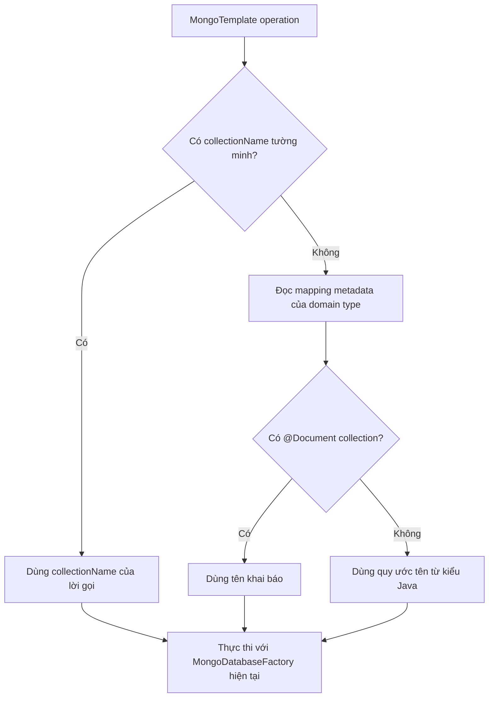
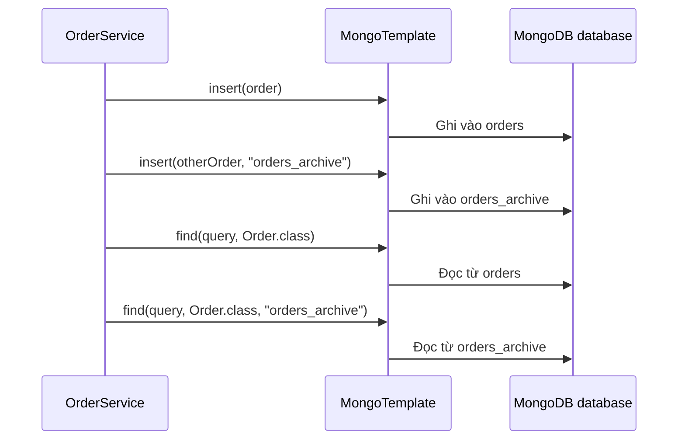
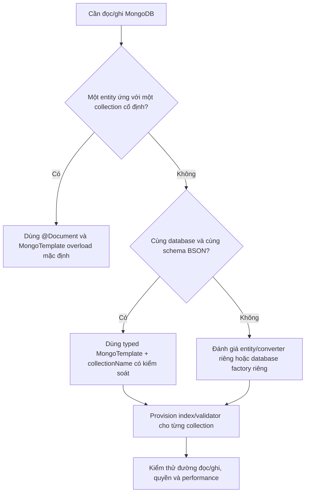

# Chọn collection từ entity hoặc chỉ định tường minh với MongoTemplate

## 1. Vấn đề cốt lõi: một kiểu Java có thể truy cập collection nào?

Trong **Spring Data MongoDB**, `MongoTemplate` cung cấp API để đọc, ghi, cập nhật, xóa, aggregation và quản lý index trên MongoDB. Mỗi thao tác cần biết **database** và **collection** đích. Database thường được xác định qua `MongoDatabaseFactory` mà template sử dụng; collection có thể được xác định **từ metadata của entity** hoặc **từ tên collection do mã gọi truyền vào**.

Ví dụ một ứng dụng quản lý đơn hàng có kiểu Java `Order`. Trong nghiệp vụ thông thường, entity ánh xạ tới collection `orders`. Nhưng hệ thống có thể có những tập dữ liệu khác với cùng một hình dạng BSON:

- `orders`: đơn hàng đang hoạt động.
- `orders_archive`: đơn hàng đã lưu trữ.
- `orders_import_staging`: vùng nhập liệu kiểm thử hoặc staging.

Khi dùng `mongoTemplate.find(query, Order.class)`, Spring Data cần quyết định collection nào tương ứng với `Order.class`. Khi dùng `mongoTemplate.find(query, Order.class, "orders_archive")`, người viết chương trình **chỉ định đích tường minh cho lời gọi đó**.

Chủ đề của chương **MongoTemplate** này không phải tự động tạo phân vùng dữ liệu hay routing đa tenant, mà là hiểu **quy tắc chọn collection và hệ quả của nó đối với mapping, truy vấn, cập nhật, index, transaction và bảo mật**.

Sau bài học, bạn cần có khả năng:

1. Dùng `@Document(collection = "...")` và quy ước đặt tên để suy ra collection.
2. Dùng `MongoTemplate.getCollectionName(...)` kiểm tra tên do mapping xác định.
3. Chọn đúng overload `insert`, `save`, `find`, `findById`, `updateFirst`, `upsert`, `remove` và `count` khi muốn chỉ định collection khác.
4. Hiểu tại sao **entity type** vẫn quan trọng với việc ánh xạ trường BSON dù tên collection được override.
5. Phân biệt `MongoTemplate.getCollection(...)` trả API raw driver với các thao tác template có mapping.
6. Thiết kế việc chọn collection động an toàn, có kiểm soát index và dễ kiểm thử.

## 2. MongoTemplate xác định collection từ đâu?



| Cách gọi | Nguồn chọn collection | Còn dùng mapping entity không? |
|---|---|---|
| `insert(order)` | Metadata theo class của object | Có |
| `save(order)` | Metadata theo class của object | Có |
| `find(query, Order.class)` | Metadata của `Order.class` | Có |
| `find(query, Order.class, "orders_archive")` | Chuỗi truyền tường minh | Có, vì vẫn có `Order.class` |
| `updateFirst(query, update, Order.class, "orders_archive")` | Chuỗi truyền tường minh | Có, ánh xạ query và update theo `Order.class` |
| `getCollection("orders_archive")` | Chuỗi truyền tường minh | **Không tự đi qua Spring entity converter** cho raw driver operations |

Từ bảng trên, tách hai quyết định:

- **Collection selection**: thao tác sẽ chạy trên collection nào?
- **Object mapping**: property của Java object và các điều kiện truy vấn được chuyển thành BSON field như thế nào?

Tên collection và kiểu mapping thường được lựa chọn cùng lúc, nhưng **không phải một thứ**. Chọn collection tường minh không có nghĩa Spring Data bỏ qua `@Id`, `@Field`, value object hoặc custom conversions khi vẫn sử dụng overload có entity type.

## 3. Entity dùng @Document(collection = ...)

### 3.1. Entity đơn hàng làm ví dụ xuyên suốt

Ví dụ Java 17 và Spring Data MongoDB, mỗi class đặt trong file thích hợp:

```java
import java.time.Instant;
import org.springframework.data.annotation.Id;
import org.springframework.data.mongodb.core.mapping.Document;
import org.springframework.data.mongodb.core.mapping.Field;

@Document(collection = "orders")
public class Order {
    @Id
    private String id;

    @Field("customer_id")
    private String customerId;

    private String status;

    @Field("total_cents")
    private long totalCents;

    @Field("created_at")
    private Instant createdAt;

    protected Order() {
        // Spring Data materialization
    }

    public Order(String id, String customerId,
                 String status, long totalCents, Instant createdAt) {
        this.id = id;
        this.customerId = customerId;
        this.status = status;
        this.totalCents = totalCents;
        this.createdAt = createdAt;
    }

    public String getId() { return id; }
    public String getCustomerId() { return customerId; }
    public String getStatus() { return status; }
    public long getTotalCents() { return totalCents; }
    public Instant getCreatedAt() { return createdAt; }
}
```

`@Document(collection = "orders")` khai báo tên collection mặc định. `@Id` ánh xạ Java property `id` với BSON `_id`; `@Field("customer_id")` và các annotation khác đổi tên trường BSON **bên trong document**, không đổi collection.

Một bản ghi điển hình có hình dạng BSON:

```javascript
{
  _id: "O-101",
  customer_id: "C-01",
  status: "PAID",
  total_cents: NumberLong(15500),
  created_at: ISODate("2026-01-05T10:00:00Z")
}
```

Đây là giá trị minh họa. Java `long` thường được ghi dưới BSON 64-bit integer và `Instant` ánh xạ theo cấu hình thời gian của framework; xác minh dữ liệu thực khi ứng dụng dùng custom converters.

### 3.2. Insert mà không cung cấp collection name

```java
import java.time.Instant;
import org.springframework.data.mongodb.core.MongoTemplate;
import org.springframework.stereotype.Service;

@Service
public class OrderWriter {
    private final MongoTemplate template;

    public OrderWriter(MongoTemplate template) {
        this.template = template;
    }

    public Order create() {
        Order order = new Order(
            "O-101", "C-01", "PAID", 15500L, Instant.now());

        return template.insert(order);
    }
}
```

`insert(order)` sử dụng metadata của `Order` và ghi vào collection `orders`. Không cần nhập lại tên collection ở từng service method, giúp giảm trùng lặp và giảm nguy cơ gõ sai tên khi entity chỉ có **một collection chuẩn**.

Với các thao tác khác cũng như vậy:

```java
Order loaded = template.findById("O-101", Order.class);
long total = template.count(new Query(), Order.class);
```

Cả hai dùng collection được suy từ `Order.class`.

### 3.3. Nếu @Document không khai báo collection

Với một mapped entity mà không chỉ định tên, Spring Data MongoDB dùng quy ước đặt tên từ tên class. Ví dụ:

```java
@Document
public class InventoryItem {
    @Id
    private String id;
}
```

Theo quy ước thông thường, `InventoryItem` dùng collection `inventoryItem`. Đây **không mặc định là dạng số nhiều** như `inventoryItems`. Nếu tập dữ liệu phải nằm ở collection `inventory_items` hoặc `inventoryItems`, nên khai báo tường minh bằng `@Document(collection = "...")`.

Trong ứng dụng cần schema ổn định hoặc đã có dữ liệu từ trước, tránh để việc đổi tên class Java vô tình thay đổi collection mà ứng dụng tìm đến. Dùng annotation tường minh cũng giúp người đọc code không phải đoán quy ước.

### 3.4. Kiểm tra tên collection thật bằng getCollectionName

```java
String orderCollection =
    mongoTemplate.getCollectionName(Order.class);

System.out.println(orderCollection); // "orders"
```

`getCollectionName(Class<?>)` trả về tên collection theo mapping metadata của class, **không mở collection, không đếm bản ghi và không chứng minh collection đã tồn tại trên server**.

Ví dụ kiểm tra cấu hình ở startup hoặc integration test:

```java
if (!"orders".equals(
        mongoTemplate.getCollectionName(Order.class))) {
    throw new IllegalStateException(
        "Order mapping points to unexpected collection");
}
```

Đây là một phép xác nhận hợp đồng mapping đơn giản. Nó không có nghĩa mọi lời gọi `MongoTemplate` trong ứng dụng đều bắt buộc dùng `orders`: những overload có `collectionName` vẫn có thể chọn collection khác.

## 4. Chỉ định tên collection tường minh khi gọi MongoTemplate

### 4.1. Insert vào collection khác

Giả sử cần lưu đơn hàng thử nghiệm vào `orders_import_staging` nhưng vẫn tái dùng entity `Order`:

```java
Order incoming = new Order(
    "O-IMP-01", "C-99", "IMPORTED", 4200L, Instant.now());

mongoTemplate.insert(incoming, "orders_import_staging");
```

Overload `insert(object, collectionName)` ghi object đã map vào collection được chỉ định. Nó **không sửa annotation `@Document`** trong class `Order` và không thay đổi tên mà `getCollectionName(Order.class)` trả về.

Hai lời gọi kế tiếp chọn hai collection khác nhau:

```java
mongoTemplate.insert(incoming, "orders_import_staging");
// Đích: orders_import_staging

mongoTemplate.insert(otherOrder);
// Đích: orders, theo @Document trên Order
```

Ở đoạn code này, `otherOrder` là một `Order` khác có ID không trùng và đã được tạo trước đó. Hãy dùng dữ liệu kiểm thử tách biệt để tránh nhầm lỗi trùng `_id` với sai đường chọn collection.

### 4.2. Find vào collection khác

```java
import java.util.List;
import org.springframework.data.mongodb.core.query.Criteria;
import org.springframework.data.mongodb.core.query.Query;

Query byCustomer = Query.query(
    Criteria.where("customerId").is("C-99"));

List<Order> stagingOrders =
    mongoTemplate.find(
        byCustomer, Order.class, "orders_import_staging");
```

Spring Data tiếp tục dùng mapping của `Order.class` để hiểu `customerId` là field BSON `customer_id`. Về ý nghĩa, MongoDB nhận điều kiện:

```javascript
db.orders_import_staging.find({ customer_id: "C-99" });
```

Nếu gọi:

```java
mongoTemplate.find(byCustomer, Order.class);
```

thì sẽ truy vấn `orders`, không phải `orders_import_staging`. Đây là lỗi dễ gặp khi một service **ghi ở collection override nhưng đọc lại bằng method mặc định**, khiến lập trình viên tưởng dữ liệu đã bị mất.

### 4.3. findById vào collection khác

```java
Order archiveOrder = mongoTemplate.findById(
    "O-101",
    Order.class,
    "orders_archive"
);
```

Overload ba tham số chọn `orders_archive`. Giá trị ID vẫn được chuyển theo metadata của `Order`; nếu ID Java là String có hình dạng ObjectId, cần biết quy tắc `@Id`/`@MongoId` và BSON `_id` thực tế của entity. Chỉ thay tên collection không sửa được lỗi **khác kiểu khóa `_id`** giữa hai collection.

### 4.4. Save vào collection khác

```java
mongoTemplate.save(archiveOrder, "orders_archive");
```

`save` thể hiện hành vi ghi theo identity của object, có thể thay thế dữ liệu hoặc tạo mới theo trạng thái/ID của entity và quy tắc Spring Data. Nó **khác `insert`**: `insert` dành cho tạo mới và sẽ gặp duplicate-key khi trùng khóa đã tồn tại; `save` không nên được dùng như một cập nhật từng field có bảo vệ concurrency.

Nếu cần sửa một field, ưu tiên atomic update phù hợp với điều kiện nghiệp vụ. Tránh lấy một object đọc bằng projection chỉ có vài field, rồi `save` nó vào collection khác: điều đó có thể **thay thế document với dữ liệu thiếu**.

### 4.5. Ghi nhớ nguyên tắc “collectionName thuộc về từng lời gọi”

Một lời gọi có `collectionName` chỉ chọn đích **cho chính lời gọi đó**. Nó không thay đổi bean `MongoTemplate` thành “template trỏ cố định vào collection đó” và không làm các service khác tự động sử dụng collection mới.



## 5. Bảng đối chiếu các API thường dùng

Tên method giống nhau không có nghĩa tất cả overload đều lấy collection theo cách giống nhau. Khi viết code, cần đọc đúng **chữ ký phương thức** và xem có truyền tên collection không.

| Nghiệp vụ | Collection từ entity | Collection chỉ định tường minh |
|---|---|---|
| Insert | `insert(order)` | `insert(order, "orders_archive")` |
| Save | `save(order)` | `save(order, "orders_archive")` |
| Find nhiều document | `find(query, Order.class)` | `find(query, Order.class, "orders_archive")` |
| Find một document | `findOne(query, Order.class)` | `findOne(query, Order.class, "orders_archive")` |
| Find theo ID | `findById(id, Order.class)` | `findById(id, Order.class, "orders_archive")` |
| Đọc tất cả | `findAll(Order.class)` | `findAll(Order.class, "orders_archive")` |
| Đếm | `count(query, Order.class)` | `count(query, Order.class, "orders_archive")` |
| Cập nhật document đầu tiên khớp | `updateFirst(query, update, Order.class)` | `updateFirst(query, update, Order.class, "orders_archive")` |
| Cập nhật nhiều document | `updateMulti(query, update, Order.class)` | `updateMulti(query, update, Order.class, "orders_archive")` |
| Upsert | `upsert(query, update, Order.class)` | `upsert(query, update, Order.class, "orders_archive")` |
| Xóa các document khớp | `remove(query, Order.class)` | `remove(query, Order.class, "orders_archive")` |
| Tên collection mặc định | `getCollectionName(Order.class)` | Không dùng method này để override: truyền chuỗi ở thao tác cần làm |

Các chữ ký có thể có thêm overload cho `findAndModify`, `findAndReplace` hoặc API chuyên biệt tùy phiên bản Spring Data MongoDB. Nguyên tắc chung vẫn là: **chọn tên collection tường minh tại đúng vị trí overload hỗ trợ**, không tạo một đối tượng entity giả chỉ để mong mapper chuyển collection.

### 5.1. Update và upsert theo entity mapping

```java
import com.mongodb.client.result.UpdateResult;
import org.springframework.data.mongodb.core.query.Criteria;
import org.springframework.data.mongodb.core.query.Query;
import org.springframework.data.mongodb.core.query.Update;

Query byId = Query.query(Criteria.where("id").is("O-101"));
Update markArchived = new Update().set("status", "ARCHIVED");

UpdateResult result = mongoTemplate.updateFirst(
    byId,
    markArchived,
    Order.class,
    "orders_archive"
);

System.out.println(result.getMatchedCount());
System.out.println(result.getModifiedCount());
```

Đoạn code trên chỉ cập nhật `orders_archive`. Nếu document `O-101` chỉ tồn tại ở `orders`, `matchedCount` có thể bằng 0. `updateFirst` không tự đi tìm mọi collection được ánh xạ bởi `Order`.

Khi thêm điều kiện theo property Java:

```java
Query byCustomerAndStatus = Query.query(
    Criteria.where("customerId").is("C-01")
        .and("status").is("PAID"));

mongoTemplate.updateMulti(
    byCustomerAndStatus,
    new Update().set("status", "ARCHIVED"),
    Order.class,
    "orders_archive"
);
```

Spring Data ánh xạ `customerId` sang BSON `customer_id` vì phương thức nhận `Order.class`. Nếu chỉ muốn đánh dấu một tập đơn hàng đã lưu trữ, hãy bảo đảm **thực sự đang có dữ liệu trong collection đích** trước khi update.

Ví dụ upsert:

```java
Query byOrderId = Query.query(Criteria.where("id").is("O-NEW"));

mongoTemplate.upsert(
    byOrderId,
    new Update()
        .set("customerId", "C-02")
        .set("status", "NEW")
        .set("totalCents", 8900L),
    Order.class,
    "orders_import_staging"
);
```

Một số điểm cần lưu ý:

- `upsert` có thể tạo document mới nếu không tìm thấy document khớp. Điều kiện `id` được ánh xạ thành `_id`; cần kiểm tra loại dữ liệu BSON của `_id`.
- Field trong `Update` được ánh xạ theo metadata của `Order`; ví dụ `totalCents` chuyển thành `total_cents`.
- Nếu collection staging có schema khác, dùng cùng `Order.class` có thể **không còn phù hợp**.
- Upsert không thay thế thiết kế idempotency, validation và unique index khi nhiều tác vụ ghi song song.

### 5.2. Xóa có chủ đích trong collection

```java
import com.mongodb.client.result.DeleteResult;

Query target = Query.query(
    Criteria.where("id").is("O-IMP-01"));

DeleteResult deleted = mongoTemplate.remove(
    target,
    Order.class,
    "orders_import_staging"
);

System.out.println(deleted.getDeletedCount());
```

`remove` là thao tác phá hủy dữ liệu; bắt buộc kiểm tra điều kiện query, tên collection và quyền truy cập. Đặc biệt, `new Query()` có thể khớp mọi document. Không gửi một lệnh xóa rộng khi tên collection đến từ input ngoài hệ thống mà chưa được kiểm soát.

### 5.3. Phân biệt insert một object và insertAll

`insert(order, "orders_archive")` biểu thị rõ một collection cho object được truyền. Ngược lại, `insertAll(collectionOfObjects)` có thể dựa vào thông tin **kiểu của từng object** để phân nhóm và chọn collection theo mapping. Vì thế không nên dùng `insertAll` với giả định nó tự áp dụng collection override của một lời gọi khác.

Nếu cần batch nhiều document **cùng collection**, hãy chọn API insert bulk phù hợp với cùng class và tên collection (ví dụ `mongoTemplate.insert(listOfOrders, "orders_import_staging")` khi phiên bản hỗ trợ overload này) hoặc `BulkOperations` được định cấu hình đúng entity type/collection. Kiểm tra thứ tự ghi, xử lý duplicate key và kết quả thất bại từng phần trong bài toán import.

## 6. Có chỉ định collection nhưng vẫn giữ mapping của entity

### 6.1. Vì sao Order.class vẫn quan trọng?

Nhìn hai lời gọi sau:

```java
Query q = Query.query(
    Criteria.where("customerId").is("C-01"));

List<Order> typed = mongoTemplate.find(
    q, Order.class, "orders_archive");

var raw = mongoTemplate.getCollection("orders_archive")
    .find(new org.bson.Document("customer_id", "C-01"))
    .into(new java.util.ArrayList<>());
```

Cả hai cùng đọc `orders_archive` nhưng **khác cách làm việc**:

- Lời gọi đầu dùng `MongoTemplate.find(..., Order.class, ...)`. Spring hiểu `customerId` là property Java, ánh xạ thành `customer_id`, rồi ánh xạ BSON document trở lại entity `Order`.
- Lời gọi thứ hai dùng `MongoTemplate.getCollection(...)` để lấy `MongoCollection<Document>` của **Java Driver**. Điều kiện query đang là raw BSON field `customer_id`; driver không tự suy từ `@Field` của `Order`.

Nếu raw driver code viết:

```java
mongoTemplate.getCollection("orders_archive")
    .find(new org.bson.Document("customerId", "C-01"));
```

thì nó đang tìm field BSON có tên `customerId`. Trong schema ví dụ, field thực tế là `customer_id` nên có thể không có kết quả. Đây là lỗi khác hẳn với việc chọn sai collection.

### 6.2. Điều gì xảy ra nếu collection khác lưu schema khác?

Giả sử `orders_archive` lưu trạng thái cũ theo cấu trúc:

```javascript
{
  _id: "O-101",
  customer: { id: "C-01" },
  current_state: "ARCHIVED",
  amount_minor: NumberLong(15500)
}
```

Entity `Order` ở mục 3 mong các field `customer_id`, `status` và `total_cents`. Gọi:

```java
Order archived = mongoTemplate.findById(
    "O-101", Order.class, "orders_archive");
```

vẫn dùng converter của `Order`, nhưng **không tự nhận biết schema archive khác**. Những field không khớp có thể bị đọc thành null/giá trị mặc định hoặc gây lỗi mapping tùy constructor, validation, target type và converters. Điều này đặc biệt nguy hiểm khi Java property có kiểu primitive như `long`.

Nếu các collection có schema khác nhau, nên:

1. Dùng entity/DTO riêng cho từng schema và mapping rõ ràng.
2. Hoặc chuẩn hóa dữ liệu archive về cùng schema với dữ liệu chính.
3. Hoặc thiết kế lớp chuyển đổi migration/compatibility được kiểm thử.

**Không có bảo đảm** rằng chỉ định collection khác là đủ để làm hai schema tương thích. Overload có `collectionName` giải quyết việc **chọn nơi đọc/ghi**, không giải quyết việc **đổi hình dạng dữ liệu**.

### 6.3. @Id và @Field không bị bỏ qua khi override

```java
mongoTemplate.findById(
    "O-101", Order.class, "orders_archive");
```

Spring vẫn có thể áp dụng quy tắc ánh xạ ID. Nếu entity sử dụng `@Id String id`, String có hình dạng ObjectId có thể được chuyển thành BSON ObjectId theo các quy tắc mapping/version. Khi collection archive lưu `_id` là BSON String thuần, cần kiểm tra và chọn chiến lược ID thích hợp, ví dụ `@MongoId` khi cần giữ kiểu đã xác định.

Tương tự, `@Field("total_cents")` trên entity vẫn có tác dụng khi thao tác typed được thực hiện với `orders_archive`. Nếu raw BSON ở archive đặt tên khác, mapper không tự thay đổi chỉ nhờ tên collection.

## 7. Phân biệt collection, database và MongoClient

Trong mô hình thông thường:

```text
MongoClient
  └─ MongoDatabaseFactory (chọn database, cấu hình kết nối)
       └─ MongoTemplate
            ├─ orders
            ├─ orders_archive
            └─ orders_import_staging
```

`MongoTemplate` thường được gắn với một `MongoDatabaseFactory` đã cấu hình database. Truyền `"orders_archive"` vào một lời gọi **không chuyển sang database khác**, không đổi tenant credential và không tạo client riêng.

Ví dụ Spring Boot 3.x sử dụng URI qua environment:

```yaml
spring:
  data:
    mongodb:
      uri: ${MONGODB_URI}
```

Giả sử `MONGODB_URI` trỏ đến database `shop`. Hai lời gọi:

```java
mongoTemplate.find(new Query(), Order.class, "orders");
mongoTemplate.find(new Query(), Order.class, "orders_archive");
```

đều truy cập **các collection trong database `shop`** thông qua template này.

Nếu cần database hoặc cluster/credential khác, phải cấu hình `MongoDatabaseFactory`/`MongoTemplate` tương ứng hoặc chiến lược định tuyến database được kiểm soát. Không dùng chuỗi có dấu chấm hay dạng `"otherDb.orders"` ở tham số `collectionName` và kỳ vọng nó đại diện cú pháp chuyển database.

**Tách biệt ba việc:**

| Muốn thay đổi | Thông thường làm ở đâu? |
|---|---|
| Field Java ↔ BSON, định danh và custom converters | Entity metadata, mapping configuration |
| Collection trong cùng database | `@Document` hoặc overload nhận `collectionName` |
| Database/cluster/credential | `MongoDatabaseFactory`, `MongoTemplate` hoặc client configuration phù hợp |

Chọn collection động không tự động giải quyết **multi-tenancy an toàn**. Phân quyền vẫn cần được thực thi ở API/domain, MongoDB roles và cấu hình kết nối thích hợp.

## 8. Chọn collection theo mục đích nghiệp vụ mà không rải chuỗi khắp code

### 8.1. Vấn đề với chuỗi hard-code ở mọi service

Một service có thể đọc từ `orders_archive`, service khác lại dùng `order_archive` hoặc `orders_archived`. MongoDB coi những chuỗi đó là các tên collection khác nhau. Khi một thao tác ghi dùng tên sai, nếu tài khoản có quyền, database có thể tạo một collection mới ngoài ý muốn; ở đường đọc, ứng dụng thường nhận danh sách rỗng và khó nhận biết lỗi gõ tên.

Ví dụ không nên lặp lại:

```java
mongoTemplate.insert(order, "orders_archived");
mongoTemplate.find(query, Order.class, "orders_archive");
// Hai collection khác nhau do typo!
```

Thiết kế nên tập trung quyết định collection theo một quy tắc dễ kiểm thử, thay vì đưa tên collection trực tiếp từ controller xuống mọi lời gọi.

### 8.2. Dùng enum để hạn chế những collection được phép chọn

```java
public enum OrderStore {
    ACTIVE,
    ARCHIVE,
    IMPORT_STAGING
}
```

```java
import org.springframework.stereotype.Component;

@Component
public class OrderCollectionResolver {
    public String resolve(OrderStore store) {
        return switch (store) {
            case ACTIVE -> "orders";
            case ARCHIVE -> "orders_archive";
            case IMPORT_STAGING -> "orders_import_staging";
        };
    }
}
```

Trong service:

```java
import java.util.Optional;
import org.springframework.data.mongodb.core.MongoTemplate;
import org.springframework.stereotype.Service;

@Service
public class OrderLookupService {
    private final MongoTemplate template;
    private final OrderCollectionResolver resolver;

    public OrderLookupService(
            MongoTemplate template,
            OrderCollectionResolver resolver) {
        this.template = template;
        this.resolver = resolver;
    }

    public Optional<Order> find(String id, OrderStore store) {
        String target = resolver.resolve(store);
        Order result = template.findById(id, Order.class, target);
        return Optional.ofNullable(result);
    }
}
```

Đây là ví dụ cho **tập collection hữu hạn**. Nó không tự kiểm tra người dùng có quyền đọc archive hay không: authorization vẫn phải được thực hiện trước khi service chọn `OrderStore. Nhưng việc dùng enum ngăn client bên ngoài truyền một tên collection MongoDB hoàn toàn tùy ý.

### 8.3. Repository mặc định không có tham số collectionName

`MongoRepository<Order, String>` dùng mapping của entity để truy vấn collection mặc định. Ví dụ:

```java
import org.springframework.data.mongodb.repository.MongoRepository;

public interface OrderRepository
        extends MongoRepository<Order, String> {
}
```

`orderRepository.findById("O-101")` không có tham số để chỉ định `orders_archive`. Khi dự án cần thao tác trên những collection khác nhau trong cùng database, có thể dùng:

- `MongoTemplate` trong một service hoặc repository custom, nơi collection được chọn theo luật nghiệp vụ.
- Entity/repository khác được ánh xạ tường minh tới collection khác nếu schema, lifecycle và trách nhiệm thực sự khác nhau.
- Một cơ chế routing được thiết kế có chủ đích, có test và quản lý tài nguyên rõ ràng.

Không nên “đổi tạm” `@Document` hoặc bean singleton trong runtime để một repository bỗng trỏ sang collection khác cho từng request. Những thay đổi toàn cục như vậy có thể làm request đồng thời đọc/ghi sai đích.

### 8.4. Có nên tạo collection cho mỗi tenant?

Một số hệ thống muốn đặt `orders_tenantA`, `orders_tenantB`... và dùng cùng entity `Order`. Đây chỉ là một khả năng thiết kế, **không phải mặc định khuyến nghị** của Spring Data MongoDB.

Nếu mỗi tenant có collection riêng, hệ thống phải quản lý:

1. Vòng đời tạo/xóa collection và index cho từng tenant.
2. Số lượng namespaces/collections và chi phí metadata/index.
3. Naming, tenant authorization, migration và backup/restore theo tenant.
4. Quota MongoDB, resource consumption, shard strategy, connection/database routing.
5. Khả năng thống kê hoặc truy vấn liên tenant.

Với số tenant lớn, thường cần so sánh phương án **một collection chung có `tenantId` và index phù hợp** hoặc phương án nhiều database/cluster theo mức độ cô lập. Việc “có thể truyền collectionName” không đủ chứng minh thiết kế collection-per-tenant là phù hợp.

## 9. Chọn tên collection động và bảo mật

### 9.1. Đừng nhận collectionName trực tiếp từ request

Một API không nên cho client tùy ý gửi:

```text
GET /orders?collection=orders_archive
```

rồi gọi `mongoTemplate.find(query, Order.class, request.collection())` mà không kiểm tra. Tên collection tuy không phải một filter expression như `$where`, nhưng vẫn quyết định **nơi đọc/ghi dữ liệu**. Nếu ứng dụng dùng MongoDB credential rộng, sai lầm này có thể dẫn tới truy cập dữ liệu nhạy cảm hoặc sửa nhầm collection khác.

**Nguyên tắc:** collection selection phải được suy ra từ ngữ cảnh nghiệp vụ đã được xác thực và luật phân quyền của server, không phải từ tham số khách hàng tự khẳng định.

### 9.2. Tách authorization khỏi naming

Ví dụ mục tiêu cần đọc đơn hàng archive cho một tenant:

```text
JWT/session đã xác thực
    ↓
Lấy tenantId và quyền theo security context tin cậy
    ↓
Kiểm tra quyền đọc archive của tenant đó
    ↓
Resolver chọn collection được phép
    ↓
Query bổ sung điều kiện tenantId nếu schema cần
    ↓
MongoTemplate.find(..., Order.class, targetCollection)
```

Trong mô hình shared collection, chỉ chọn đúng collection **không** thay thế điều kiện `tenantId`. Ví dụ:

```java
Query byTenantAndId = Query.query(
    Criteria.where("tenantId").is(authenticatedTenant)
        .and("id").is(orderId));
```

Đoạn trên giả định entity thực tế có property `tenantId` hoặc mapping tương ứng; `Order` mẫu ở mục 3 chưa có field này. Khi triển khai multi-tenant, phải bổ sung property, index, validation và test cô lập dữ liệu thay vì copy mã máy móc.

Nếu cơ sở dữ liệu được tách theo credential/cluster cho mỗi tenant, phải dùng cấu hình database/client thích hợp. Việc thay `collectionName` trên một template không cấp hoặc thay đổi quyền truy cập MongoDB.

### 9.3. Nếu bắt buộc sinh tên động theo thời gian

Một ví dụ khác là collection `orders_2026_01`, `orders_2026_02` được tổ chức theo tháng. Tên có thể được tạo từ **kiểu thời gian nội bộ** chứ không ghép raw text từ người dùng:

```java
import java.time.YearMonth;
import java.time.format.DateTimeFormatter;

public final class MonthlyOrderCollection {
    private static final DateTimeFormatter FORMAT =
        DateTimeFormatter.ofPattern("uuuu_MM");

    private MonthlyOrderCollection() {}

    public static String forMonth(YearMonth month) {
        if (month == null || month.getYear() < 2020
                || month.getYear() > 2100) {
            throw new IllegalArgumentException("Unsupported month");
        }
        return "orders_" + month.format(FORMAT);
    }
}
```

Đặt giới hạn năm trong ví dụ nhằm minh họa **chính sách nghiệp vụ**, không phải giới hạn của MongoDB. Mọi việc chọn collection theo tháng phải thống nhất giữa writer và reader: truy vấn một khoảng thời gian kéo dài nhiều tháng có thể cần chạy trên **nhiều collection**, tổng hợp kết quả và đảm bảo sort/pagination đúng.

Phương án chia collection theo thời gian cũng tăng công việc về lifecycle và index; với nhiều workload, một collection có index trên `created_at`, TTL index (khi phù hợp), archive workflow hoặc sharding có thể đơn giản hơn. Không chọn collection-per-month chỉ để hy vọng truy vấn nhanh hơn mà chưa benchmark.

## 10. Collection lifecycle, index và collection options

### 10.1. @Document không đồng nghĩa collection đã tồn tại

`@Document(collection = "orders")` là metadata mapping. Chỉ khởi tạo `Order.class` trong Java hoặc gọi `getCollectionName(Order.class)` **không tạo collection** trên MongoDB.

Trong môi trường được phép quản lý schema:

```java
boolean exists = mongoTemplate.collectionExists("orders_archive");

if (!exists) {
    mongoTemplate.createCollection("orders_archive");
}
```

Đây là ví dụ thao tác quản trị để kiểm tra/tạo collection; không nên để mỗi request thực hiện check-then-create như một cơ chế synchronization. Có thể có race giữa nhiều instance cùng tạo collection; thường nên đưa việc chuẩn bị collection vào migration hoặc bootstrap do một thành phần được kiểm soát thực hiện.

Ngoài ra, một số thao tác ghi có thể khiến MongoDB tạo collection ngầm nếu collection chưa tồn tại và credential cho phép. Không dựa vào việc tự tạo ngầm khi hệ thống cần **validator, collation, time-series hoặc các options khác** tại thời điểm tạo collection.

### 10.2. Index gắn với từng collection, không tự đi theo class

Giả sử `orders` có index:

```javascript
db.orders.createIndex(
  { customer_id: 1, created_at: -1 },
  { name: "ix_orders_customer_created" }
);
```

Index đó **không tự xuất hiện** trong `orders_archive` chỉ vì cả hai chứa document do `Order.class` ánh xạ. Muốn truy vấn archive nhanh, collection archive cần index phù hợp:

```javascript
db.orders_archive.createIndex(
  { customer_id: 1, created_at: -1 },
  { name: "ix_orders_archive_customer_created" }
);
```

Tương tự với Spring Data:

```java
import org.springframework.data.domain.Sort;
import org.springframework.data.mongodb.core.index.Index;

mongoTemplate.indexOps("orders_archive")
    .ensureIndex(
        new Index()
            .on("customer_id", Sort.Direction.ASC)
            .on("created_at", Sort.Direction.DESC)
    );
```

Khi dùng `indexOps("orders_archive")` với tên collection, ví dụ trên chủ ý sử dụng **tên field BSON vật lý**. Với `indexOps(Order.class)`, template có context entity và suy ra collection mặc định `orders`. Đừng tạo index trên `"customerId"` trong archive nếu BSON thật là `customer_id`.

Các annotation như `@Indexed` và `@CompoundIndex` không bảo đảm rằng bất kỳ collection override nào cũng được tự động tạo index. Cơ chế auto-index creation phụ thuộc cấu hình/version, còn các collection được tạo động thường cần **index provisioning riêng**.

### 10.3. Validator và chính sách retention cũng thuộc từng collection

Mỗi collection có thể được tạo với schema validator, collation hoặc cấu hình khác nhau. Vì vậy dù `orders_archive` và `orders` dùng chung class Java, hệ quả khi insert vẫn khác nếu một nơi cho phép missing field còn nơi kia yêu cầu giá trị cụ thể.

Ví dụ validator ở collection archive có thể yêu cầu `status = "ARCHIVED"`, trong khi `orders` chỉ nhận `status = "NEW"` hoặc `"PAID"`. `@Document` và converter Java không thay thế validation ở database; dữ liệu có thể bị từ chối khi ghi vào collection override.

Khi triển khai collection theo tháng/tenant:

- Quy định ai tạo collection và khi nào.
- Đảm bảo index/validator trước khi mở cho read/write.
- Tách retention và quyền xóa dữ liệu khỏi logic query bình thường.
- Có kế hoạch schema migration cho tất cả collection, không chỉ collection mặc định.
- Theo dõi số collection/index, storage, tốc độ tạo namespace và chi phí vận hành.

### 10.4. Phân biệt collection tồn tại và dữ liệu đã có

`collectionExists("orders_archive")` chỉ xác nhận namespace có tồn tại tại thời điểm gọi, **không chứng minh có bất kỳ document nào**. Ngược lại, một query trả rỗng chưa đủ kết luận collection không tồn tại. Để chẩn đoán, kiểm tra tách bạch:

```java
boolean archiveExists =
    mongoTemplate.collectionExists("orders_archive");

long archivedCount =
    mongoTemplate.count(new Query(), Order.class, "orders_archive");
```

Đếm tất cả document có thể tốn tài nguyên trong một số ngữ cảnh và không nên chạy lặp lại chỉ để phục vụ mỗi request. Khi cần monitoring số lượng, xem xét cơ chế ước lượng hoặc metrics phù hợp theo yêu cầu độ chính xác.

## 11. Transaction khi thao tác trên nhiều collection

Chỉ định tên collection **không tự tạo transaction**. Điều này quan trọng nếu ứng dụng muốn **chuyển đơn từ `orders` sang `orders_archive`**:

```text
1. Đọc Order từ orders
2. Insert Order vào orders_archive
3. Delete Order khỏi orders
```

Nếu không có transaction, lỗi xảy ra sau bước 2 có thể để lại hai bản ghi; lỗi ở các bước khác có thể làm trạng thái không như dự định. Nếu nghiệp vụ cần ba thao tác có tính nhất quán nguyên tử, hãy sử dụng transaction MongoDB trên deployment hỗ trợ.

### 11.1. Cấu hình transaction manager

Với Spring Data MongoDB đồng bộ và database chạy trên replica set hoặc sharded cluster hỗ trợ transaction:

```java
import org.springframework.context.annotation.Bean;
import org.springframework.context.annotation.Configuration;
import org.springframework.data.mongodb.MongoDatabaseFactory;
import org.springframework.data.mongodb.MongoTransactionManager;

@Configuration
public class MongoTransactionsConfig {
    @Bean
    MongoTransactionManager mongoTransactionManager(
            MongoDatabaseFactory factory) {
        return new MongoTransactionManager(factory);
    }
}
```

Giao dịch nhiều document không được dùng như mong muốn với MongoDB standalone. Các collection cần thao tác nên được **chuẩn bị schema/index/validator trước**, tránh dựa vào việc tạo namespace bất ngờ trong transaction.

### 11.2. Service chuyển đơn sang archive

```java
import org.springframework.data.mongodb.core.MongoTemplate;
import org.springframework.data.mongodb.core.query.Criteria;
import org.springframework.data.mongodb.core.query.Query;
import org.springframework.stereotype.Service;
import org.springframework.transaction.annotation.Transactional;

@Service
public class OrderArchiveService {
    private final MongoTemplate template;

    public OrderArchiveService(MongoTemplate template) {
        this.template = template;
    }

    @Transactional
    public void moveToArchive(String orderId) {
        Order source = template.findById(orderId, Order.class);
        if (source == null) {
            throw new IllegalArgumentException("Order not found");
        }

        // Ghi bản sao cùng BSON schema vào collection archive.
        template.insert(source, "orders_archive");

        Query byId = Query.query(Criteria.where("id").is(orderId));
        long deleted = template.remove(byId, Order.class)
            .getDeletedCount();
        if (deleted != 1L) {
            throw new IllegalStateException("Unexpected delete result");
        }
    }
}
```

Ví dụ sử dụng hai cơ chế chọn đích **trong cùng transaction**:

- `template.findById(orderId, Order.class)`: từ `orders` qua entity.
- `template.insert(source, "orders_archive")`: ghi sang `orders_archive` tường minh.
- `template.remove(byId, Order.class)`: xóa ở `orders` qua entity.

`@Transactional` nhờ `MongoTransactionManager` gắn transaction/session thích hợp cho các thao tác Spring Data tham gia. Với rollback, mục tiêu là không để bản sao trong archive nếu phần xóa source thất bại. Cần test thật trên topology hỗ trợ và hiểu các điều kiện transaction, retry và write concern.

**Không dùng nguyên xi trong production khi chưa giải quyết:**

- Xung đột song song khi hai worker cùng archive một đơn: insert trùng `_id`, retry và trạng thái cuối.
- Yêu cầu chuyển `status` sang `ARCHIVED`, audit và quy tắc lưu lịch sử.
- Cách xử lý retry của tầng API, idempotency và transaction timeout.
- Dữ liệu còn tham chiếu đến đơn ở collection cũ hoặc liên kết giữa các collection.
- Việc gọi `@Transactional` qua Spring proxy; self-invocation có thể bỏ qua transaction theo cơ chế proxy thông thường.

Nếu đơn hàng chỉ cần đổi trạng thái trong **một document**, một atomic update trong `orders` có thể đơn giản hơn sao chép sang collection khác. Tách collection nên có lý do vận hành/retention hoặc mô hình dữ liệu rõ ràng.

### 11.3. Transaction và việc thay đổi collectionName

Transaction không làm `MongoTemplate` tự theo dõi “collection hiện hành” qua những lời gọi. Mỗi thao tác vẫn quyết định collection từ entity hoặc tên truyền vào. Các lệnh cùng transaction có thể nhắm tới nhiều collection, nhưng **việc chọn đúng đích vẫn là trách nhiệm của code**.

Với reactive Spring Data MongoDB, giao dịch thường dùng `ReactiveMongoTransactionManager` và Reactor Context; không dùng transaction manager đồng bộ để mong bao phủ reactive pipeline. Việc xác định collection ở mỗi lời gọi reactive template theo các nguyên tắc mapping và overload tương ứng, dù kiểu trả về có thể là `Mono` hoặc `Flux`.

## 12. Aggregation, BulkOperations và đường dẫn collection

### 12.1. Aggregate theo collection mặc định hoặc chỉ định

Với aggregation chỉ dùng entity `Order`:

```java
import org.bson.Document;
import org.springframework.data.mongodb.core.aggregation.Aggregation;
import org.springframework.data.mongodb.core.aggregation.AggregationResults;
import org.springframework.data.mongodb.core.query.Criteria;

Aggregation aggregation = Aggregation.newAggregation(
    Aggregation.match(Criteria.where("status").is("PAID")),
    Aggregation.group("customerId").count().as("orderCount")
);

AggregationResults<Document> activeCounts =
    mongoTemplate.aggregate(
        aggregation, Order.class, Document.class);
```

Overload trên lấy tên collection đầu vào từ `Order.class`. Nếu muốn chạy aggregation trên `orders_archive` nhưng vẫn muốn property path theo mapping `Order`, tạo **typed aggregation** và truyền tên collection:

```java
import org.springframework.data.mongodb.core.aggregation.TypedAggregation;

TypedAggregation<Order> archivePipeline =
    Aggregation.newAggregation(
        Order.class,
        Aggregation.match(
            Criteria.where("status").is("ARCHIVED")),
        Aggregation.group("customerId")
            .count().as("orderCount")
    );

AggregationResults<Document> archiveCounts =
    mongoTemplate.aggregate(
        archivePipeline,
        "orders_archive",
        Document.class
    );
```

`TypedAggregation<Order>` mang metadata kiểu đầu vào. `"orders_archive"` là collection nguồn, còn `Document.class` là kiểu của **kết quả**. Ở `$group`, field `_id` của kết quả là giá trị customer ID dùng làm group key, không phải ID đơn hàng nguồn.

Một pipeline BSON thuần với tên collection trực tiếp cũng có thể dùng overload `aggregate(aggregation, collectionName, outputType)`. Khi sử dụng raw `Document` stages hoặc field names là chuỗi BSON vật lý, đừng nhầm `customerId` với `customer_id`, nhất là khi không có ngữ cảnh mapping đầu vào.

### 12.2. BulkOperations cần collection đích rõ ràng

Khi cập nhật nhiều document, `MongoTemplate` có API `bulkOps(...)` để gom các thao tác ghi. Tùy phiên bản, API hỗ trợ xác định class đầu vào và collection tường minh:

```java
import org.springframework.data.mongodb.core.BulkOperations;

BulkOperations bulk = mongoTemplate.bulkOps(
    BulkOperations.BulkMode.ORDERED,
    Order.class,
    "orders_import_staging"
);

bulk.updateOne(
    Query.query(Criteria.where("id").is("O-IMP-01")),
    new Update().set("status", "VALIDATED")
);

bulk.updateOne(
    Query.query(Criteria.where("id").is("O-IMP-02")),
    new Update().set("status", "VALIDATED")
);

bulk.execute();
```

Những update này được gom cho collection `orders_import_staging`. Không tạo một bulk writer và sau đó kỳ vọng có thể thay collection tùy ý cho mỗi operation trong cùng bulk. Cần biết sự khác nhau giữa ORDERED/UNORDERED, lỗi từng operation và các giới hạn về lifecycle callbacks/versioning của bulk operations trong phiên bản Spring Data đang dùng.

### 12.3. Khi dùng raw MongoCollection

```java
import com.mongodb.client.MongoCollection;
import org.bson.Document;

MongoCollection<Document> collection =
    mongoTemplate.getCollection("orders_archive");

Document rawOrder = collection.find(
    new Document("_id", "O-101")
).first();
```

Lời gọi `getCollection(...)` trả về **API Java Driver**, không phải một `MongoTemplate` “mặc định gắn với collection mới”. Các thao tác driver trực tiếp không tự đi qua:

- `MappingMongoConverter` cho `Order`.
- Mapping metadata `@Field`, `@Id` của Spring Data khi query raw BSON.
- Những lifecycle callbacks/auditing events dành cho đường Spring Data template, nếu ứng dụng có sử dụng.

Driver vẫn có **CodecRegistry** của nó để đọc/ghi BSON. Nếu muốn raw `MongoCollection<Order>`, bạn cần cấu hình codec/POJO mapping tương ứng; việc có `@Document("orders")` trong entity Spring Data không đủ để raw driver tự hiểu kiểu `Order`.

Sử dụng raw driver khi cần quyền kiểm soát cấp thấp hoặc một API driver đặc thù; với CRUD thông thường có mapping entity, nên ưu tiên `MongoTemplate` để giảm nguy cơ hai đường ghi sinh schema khác nhau.

### 12.4. Không nhầm withCollection/withDatabase và template scope

MongoDB Driver có các view như `MongoDatabase.getCollection(...)` hoặc `MongoCollection.withCodecRegistry(...)`. Chúng không đổi global state của Spring bean `MongoTemplate`. Một helper trả về raw driver collection không làm các lời gọi `mongoTemplate.find(query, Order.class)` tự động đọc từ đó.

Khi thiết kế API service, đặt tên rõ `readFromArchive`, `readFromActive` hoặc truyền enum `OrderStore` để caller biết **collection scope**; tránh che giấu hành vi đích trong các global mutable settings.

## 13. Những lỗi thường gặp khi chọn collection

| Hiện tượng | Nguyên nhân có thể | Bước điều tra |
|---|---|---|
| `insert(order, "orders_archive")` thành công nhưng `findById(id, Order.class)` trả null | Ghi vào archive, đọc mặc định từ orders | Dùng `findById(id, Order.class, "orders_archive")` |
| Không tìm thấy dữ liệu dù đúng collection | Dùng field `customerId` trong raw driver thay vì `customer_id` | Đọc raw BSON và kiểm tra mapping `@Field` |
| Thấy một collection lạ tên gần giống | Gõ sai tên collection khi insert, hoặc resolver lỗi | Kiểm tra `getCollectionNames()`/tên truyền vào từ code; điều tra quyền tạo collection |
| `getCollectionName(Order.class)` trả `orders` nhưng service ghi nơi khác | Overload nhận `collectionName` override metadata | Xem lời gọi thực tế, không chỉ xem annotation |
| Archive có schema khác làm Java property null | Vẫn dùng mapper của `Order` với archive schema legacy | Xem BSON thực tế; dùng entity riêng/migration |
| Query archive chậm dù orders rất nhanh | Index chỉ tồn tại ở `orders` | Kiểm tra `getIndexes()` của từng collection |
| `collectionExists(...)` trả true nhưng find rỗng | Collection có tồn tại nhưng không có document khớp | So sánh count/filter/ID/schema và database |
| `@Indexed` có trên Order nhưng archive không có index | Auto-index không tạo theo mọi collection override | Provision index tường minh cho archive |
| Transaction chuyển archive để lại dữ liệu trùng | Không chạy transaction, hoặc sai cấu hình/đường code | Kiểm tra MongoTransactionManager, topology, retry/idempotency |
| Dữ liệu nằm ở database khác | Template trỏ sai database, không phải collection sai | Kiểm tra `MongoDatabaseFactory`/URI và database mong muốn |
| Raw `getCollection` đọc/ghi khác schema entity | Bỏ qua mapping converter và callbacks của Spring | Dùng typed MongoTemplate hoặc cấu hình driver mapping riêng |
| Đầu vào client có thể chọn collection nhạy cảm | Thiếu authorization/allowlist | Chọn collection từ trusted context và quyền đã kiểm tra |
| Phân trang kết quả qua nhiều archive collections bị thiếu/trùng | Chỉ query một collection hoặc gộp không sort ổn định | Thiết kế aggregate/fan-out/range pagination theo dữ liệu |

### 13.1. Phương pháp điều tra từ ngoài vào trong

Khi một lời gọi `MongoTemplate` trả rỗng hoặc lỗi bất ngờ:

1. **Tên collection thực tế:** method nào đang được gọi? Có tham số `collectionName` không? Giá trị đó do ai tạo?
2. **Database:** template dùng `MongoDatabaseFactory` nào? URI/credential trỏ đâu? Có nhiều template hoặc profile môi trường không?
3. **BSON schema:** MongoDB lưu field `customer_id` hay `customerId`? `_id` là String hay ObjectId? Dữ liệu archive có cùng schema không?
4. **Query sau mapping:** điều kiện Java có được Spring đổi sang field BSON đúng tên và kiểu không? Có điều kiện tenant/status bị thiếu không?
5. **Index và server:** chạy `explain("executionStats")` cho query trên đúng collection; so sánh keys/docs examined và thời gian.
6. **Concurrency/transaction:** khi dữ liệu có thể được chuyển/xóa song song, cần xác định snapshot, session, transaction, retry và consistency expectations.

Không vội thêm `@Document` mới, tăng connection pool hoặc đổi timeout khi nguyên nhân đơn giản là **đọc từ một collection khác với nơi đã ghi**.

### 13.2. Kiểm tra bằng mongosh

Trong database phù hợp:

```javascript
db.getName();
db.getCollectionNames();

db.orders.findOne({ _id: "O-101" });
db.orders_archive.findOne({ _id: "O-101" });

db.orders.getIndexes();
db.orders_archive.getIndexes();

db.orders_archive
  .find({ customer_id: "C-01" })
  .explain("executionStats");
```

Những lệnh này phân biệt rõ “không có document”, “sai field”, “sai collection” và “query không được index hỗ trợ”. Chạy trên môi trường và dữ liệu bạn được phép truy cập; không xuất/ghi log document có PII hoặc credential.

### 13.3. Lỗi schema và khác biệt tên collection không phải một vấn đề

Giả sử ứng dụng có hai collection:

```javascript
// Collection orders:
{ _id: "O-101", customer_id: "C-01", total_cents: NumberLong(15500) }

// Collection orders_archive:
{ _id: "O-101", customer_id: "C-01", total_cents: "15500" }
```

Một query `findById` có thể tìm thấy document ở cả hai nơi. Nhưng `Order.totalCents` khai báo `long`; trong archive, BSON String không phải BSON Int64, nên đọc vào entity có thể thất bại hoặc đi qua converter theo cấu hình. **Tìm thấy dữ liệu** không có nghĩa mapping từ BSON sang Java luôn đúng.

Giải pháp là chuẩn hóa schema hoặc thiết kế converter/DTO tương thích được kiểm thử. Đừng âm thầm đổi `String` thành `long` mà không xét dữ liệu legacy ngoài phạm vi số, null, thiếu, tràn số hoặc thay đổi đơn vị.

## 14. Kiểm thử tích hợp: cùng entity, hai collection khác nhau

### 14.1. Mục tiêu và dữ liệu

Một integration test nên xác minh những hợp đồng sau:

- `getCollectionName(Order.class)` trả `"orders"`.
- Insert mặc định xuất hiện ở `orders` và không tự xuất hiện trong `orders_archive`.
- Insert tường minh xuất hiện ở `orders_archive` và không tự xuất hiện trong `orders`.
- Query typed theo `customerId` vẫn khớp field BSON `customer_id` khi đọc archive.
- Update/remove tường minh không tác động đến collection mặc định.
- Raw `getCollection(...)` trả BSON thực tế, không biến field theo property Java.
- Collection archive có index cần thiết theo nhu cầu triển khai; không giả định index ở collection chính được sao chép sang.

### 14.2. Ví dụ JUnit 5 với MongoTemplate

Đoạn test sau minh họa một database test cô lập, ví dụ Spring Boot `@DataMongoTest` kết nối tới MongoDB dành cho integration test. **Không chạy phần cleanup trên database dùng chung hoặc production.**

```java
import java.time.Instant;
import java.util.List;

import org.bson.Document;
import org.junit.jupiter.api.BeforeEach;
import org.junit.jupiter.api.Test;
import org.springframework.beans.factory.annotation.Autowired;
import org.springframework.boot.test.autoconfigure.data.mongo.DataMongoTest;
import org.springframework.data.mongodb.core.MongoTemplate;
import org.springframework.data.mongodb.core.query.Criteria;
import org.springframework.data.mongodb.core.query.Query;
import org.springframework.data.mongodb.core.query.Update;

import static org.assertj.core.api.Assertions.assertThat;

@DataMongoTest
class OrderCollectionRoutingTest {
    @Autowired
    MongoTemplate template;

    @BeforeEach
    void cleanupTestIds() {
        Document filter =
            new Document("_id", new Document("$regex", "^TEST-"));

        template.getCollection("orders").deleteMany(filter);
        template.getCollection("orders_archive").deleteMany(filter);
    }

    @Test
    void usesEntityDefaultCollectionWhenNameIsOmitted() {
        assertThat(template.getCollectionName(Order.class))
            .isEqualTo("orders");

        Order active = new Order(
            "TEST-ACTIVE", "C-01", "NEW", 1200L, Instant.now());

        template.insert(active);

        assertThat(template.findById("TEST-ACTIVE", Order.class))
            .isNotNull();

        assertThat(template.findById(
            "TEST-ACTIVE", Order.class, "orders_archive"))
            .isNull();
    }

    @Test
    void explicitNameKeepsEntityFieldMapping() {
        Order archive = new Order(
            "TEST-ARCHIVE", "C-99", "ARCHIVED", 3500L, Instant.now());

        template.insert(archive, "orders_archive");

        assertThat(template.findById("TEST-ARCHIVE", Order.class))
            .isNull();

        Query byCustomer = Query.query(
            Criteria.where("customerId").is("C-99"));

        List<Order> archived = template.find(
            byCustomer, Order.class, "orders_archive");

        assertThat(archived)
            .extracting(Order::getId)
            .containsExactly("TEST-ARCHIVE");

        Document raw = template.getCollection("orders_archive")
            .find(new Document("_id", "TEST-ARCHIVE"))
            .first();

        assertThat(raw).isNotNull();
        assertThat(raw.getString("customer_id")).isEqualTo("C-99");
        assertThat(raw.containsKey("customerId")).isFalse();
    }

    @Test
    void updateAndDeleteTargetOnlyExplicitCollection() {
        Order sameActive = new Order(
            "TEST-SAME", "C-10", "NEW", 1500L, Instant.now());
        Order sameArchive = new Order(
            "TEST-SAME", "C-10", "ARCHIVED", 1500L, Instant.now());

        template.insert(sameActive);
        template.insert(sameArchive, "orders_archive");

        Query byId = Query.query(
            Criteria.where("id").is("TEST-SAME"));

        template.updateFirst(
            byId, new Update().set("status", "PURGED"),
            Order.class, "orders_archive");

        assertThat(template.findById(
            "TEST-SAME", Order.class).getStatus()).isEqualTo("NEW");
        assertThat(template.findById(
            "TEST-SAME", Order.class,
            "orders_archive").getStatus()).isEqualTo("PURGED");

        template.remove(byId, Order.class, "orders_archive");

        assertThat(template.findById(
            "TEST-SAME", Order.class, "orders_archive")).isNull();
        assertThat(template.findById(
            "TEST-SAME", Order.class)).isNotNull();
    }
}
```

Các test sử dụng `getCollection("orders")` ở cleanup để xóa những bản ghi có ID tiền tố `TEST-`. Phương án này chỉ an toàn khi **database test thật sự được cô lập** và không có dữ liệu quan trọng dùng chung prefix; việc tạo mới/cleanup namespace cũng cần quyền truy cập phù hợp.

Ví dụ kiểm tra hai collection có thể chứa **cùng một `_id`**: `_id` unique trong từng collection theo điều kiện MongoDB, không có một unique constraint toàn database cho mọi collection. Vì thế hai bản ghi có `_id: "TEST-SAME"` trong `orders` và `orders_archive` hoàn toàn có thể tồn tại song song.

### 14.3. Test collection-name resolver

Một unit test cho resolver không cần database:

```java
import org.junit.jupiter.api.Test;
import static org.assertj.core.api.Assertions.assertThat;

class OrderCollectionResolverTest {
    private final OrderCollectionResolver resolver =
        new OrderCollectionResolver();

    @Test
    void resolvesOnlyKnownStores() {
        assertThat(resolver.resolve(OrderStore.ACTIVE))
            .isEqualTo("orders");
        assertThat(resolver.resolve(OrderStore.ARCHIVE))
            .isEqualTo("orders_archive");
        assertThat(resolver.resolve(OrderStore.IMPORT_STAGING))
            .isEqualTo("orders_import_staging");
    }
}
```

Unit test kiểm tra luật đặt tên; integration test kiểm tra thao tác tới MongoDB. Cần cả hai khi việc chọn collection ảnh hưởng tính đúng đắn và phạm vi dữ liệu.

### 14.4. Test transaction riêng với replica set

Không dùng database standalone để kết luận rollback đa document. Khi cần kiểm thử `OrderArchiveService.moveToArchive(...)`:

1. Chạy MongoDB replica set dành riêng cho test hoặc Testcontainers có cấu hình phù hợp.
2. Tạo `orders_archive` trước bài test; chuẩn bị mapping/index.
3. Insert một đơn ở `orders`, gọi service **qua Spring proxy** để `@Transactional` có hiệu lực.
4. Xác nhận sau thành công: source không còn ở `orders` và bản sao có trong `orders_archive`.
5. Gây lỗi có kiểm soát sau khi insert archive nhưng trước delete source; xác nhận transaction rollback theo quy tắc Spring.
6. Thử trường hợp archive đã có cùng `_id` để kiểm tra duplicate key, retry/idempotency và trạng thái cuối.

Transaction rollback test phải kiểm tra **cả hai collection**, không chỉ status exception. Nếu application có nhiều transaction manager, cần chắc chắn dùng `MongoTransactionManager` tương ứng với template đang gọi.

## 15. Bài thực hành: active, staging và archive cùng một entity

### 15.1. Bối cảnh

Một hệ thống bán hàng sử dụng Spring Data MongoDB. Các đơn bình thường nằm trong `orders`. Các đơn nhập từ file ngoài phải qua xác thực trong `orders_import_staging`. Những đơn cũ sau quy trình archive được lưu trong `orders_archive`. Trong giai đoạn đầu, cả ba collection cùng áp dụng **BSON schema của `Order`**.

Yêu cầu:

- Truy cập mặc định vào `orders` bằng metadata `@Document`.
- Khi nhập staging, chỉ chọn collection `orders_import_staging`.
- Khi đọc archive, bắt buộc chọn đúng overload có `collectionName`.
- Không được cho người dùng chọn collection tùy ý.
- Index và validator được chuẩn bị riêng cho mỗi collection.
- Mọi nơi giữ tên field BSON `customer_id`, `total_cents`, `created_at` nhất quán.

### 15.2. Những bước cần thực hiện

1. **Cấu hình ứng dụng:** tạo Spring Boot app có `spring-boot-starter-data-mongodb`, kết nối MongoDB test bằng URI từ biến môi trường. Không hardcode credential.
2. **Định nghĩa entity:** tạo `Order` từ mục 3, giữ `@Document(collection = "orders")` và các `@Field` tương ứng.
3. **Kiểm tra mapping:** in hoặc assert `mongoTemplate.getCollectionName(Order.class)` đúng `orders`.
4. **Chuẩn bị collection:** tạo `orders`, `orders_archive` và `orders_import_staging` theo cơ chế bootstrap/migration. Tạo index phù hợp cho từng collection.
5. **Ghi dữ liệu:** gọi `insert(activeOrder)` rồi `insert(stagingOrder, "orders_import_staging")`, dùng ID khác nhau.
6. **Đọc dữ liệu:** chạy `findById(id, Order.class)` và `findById(id, Order.class, "orders_import_staging")` để thấy kết quả khác nhau dù cùng class.
7. **Query theo property:** dùng `Criteria.where("customerId")` với cả hai overload typed; xác nhận mapping `@Field` vẫn hoạt động.
8. **Raw BSON:** dùng `mongoTemplate.getCollection("orders_import_staging")` để kiểm tra tên field vật lý; thử query với `"customerId"` và `"customer_id"` để thấy sự khác biệt.
9. **Update:** gọi `updateFirst` và `upsert` trên staging có tên collection tường minh, xác minh `orders` không đổi.
10. **Dịch vụ archive:** dùng resolver enum để chọn `orders_archive`. Nếu cần di chuyển nguyên tử, viết transaction trên replica set và kiểm thử rollback.
11. **Hiệu năng:** chạy `explain("executionStats")` cho cùng query trên `orders` và `orders_archive`; so sánh index hiện có, `keysExamined` và `docsExamined`.
12. **Regression test:** thêm test cho việc gõ sai tên collection, database configuration khác dự định, và archive dùng schema khác `Order`.

### 15.3. Tự kiểm tra bằng mongosh

Trên một database test, có thể dùng:

```javascript
// Kiểm tra thông tin collection trước khi thực hành.
db.getCollectionNames();

// Đọc cùng ID từ từng collection.
db.orders.findOne({ _id: "O-101" });
db.orders_import_staging.findOne({ _id: "O-IMP-01" });
db.orders_archive.findOne({ _id: "O-101" });

// Kiểm tra field BSON có tên đúng.
db.orders_import_staging.find(
  { customer_id: "C-99" },
  { _id: 1, customer_id: 1, status: 1 }
);

// Kiểm tra index ở archive, không suy từ orders.
db.orders_archive.getIndexes();
```

Nếu không có dữ liệu mẫu trong một collection, kết quả query rỗng là bình thường. Hãy đảm bảo bước insert đã chạy đúng database và ID được ghi theo kiểu BSON mong muốn trước khi kết luận có lỗi mapping.

### 15.4. Tiêu chí hoàn thành

Một bài thực hành đạt yêu cầu khi học viên:

- Chỉ ra được **collection mặc định** và **collection tường minh** của từng lời gọi.
- Trình bày đúng vai trò `@Document`, `getCollectionName`, `MongoDatabaseFactory` và `@Field`.
- Chứng minh ghi staging không làm document tự xuất hiện trong collection mặc định.
- Đọc staging/archive bằng `MongoTemplate` và nhận `Order` đúng nhờ mapping entity.
- Giải thích vì sao `getCollection(...)` dùng raw BSON names và không tự gọi Spring converters.
- Tạo index đúng ở collection đích thay vì giả định index ở collection khác tự áp dụng.
- Đưa ra chính sách an toàn cho tên collection từ request, enum resolver và multi-tenant.
- Mô tả được transaction cần thiết khi di chuyển dữ liệu qua nhiều collection.

## 16. Bảng ghi nhớ nhanh

| Câu hỏi | Nguyên tắc đúng |
|---|---|
| `@Document(collection = "orders")` làm gì? | Xác định collection mặc định theo metadata của entity. |
| Bỏ tên collection thì Spring dùng gì? | Mapping metadata của class hoặc quy ước tên class khi phù hợp. |
| `getCollectionName(Order.class)` có tạo collection không? | Không; chỉ xác định tên theo mapping. |
| `insert(order, "orders_archive")` có đổi `@Document` không? | Không; chỉ override collection cho lời gọi đó. |
| `find(query, Order.class, "orders_archive")` còn dùng `@Field` không? | Có; entity type vẫn tham gia mapping. |
| `getCollection("orders_archive")` có mapping entity không? | Không theo cơ chế Spring Data; nó trả raw driver collection. |
| Chỉ truyền tên collection có đổi database không? | Không; database phụ thuộc template/factory hiện tại. |
| `MongoRepository.findById(...)` có tự tìm archive không? | Không; repository thông thường dùng collection của entity. |
| Hai collection có thể chứa cùng `_id` không? | Có; unique `_id` được áp dụng trong từng collection theo quy tắc MongoDB. |
| Index của `orders` có áp dụng cho `orders_archive` không? | Không; cần thiết kế/provision trên từng collection. |
| `@Document` có tạo index hoặc validator cho mọi collection động không? | Không có bảo đảm như vậy; cấu hình provisioning riêng. |
| Cho client truyền raw collectionName có an toàn không? | Không nên; cần xác thực, phân quyền và allowlist/resolver. |
| Chuyển document qua archive có tự nguyên tử không? | Không; multi-document transaction cần deployment hỗ trợ và cấu hình đúng. |
| Archive có schema khác entity hiện tại thì sao? | Cần entity/converter riêng, migration hoặc lớp compatibility được kiểm thử. |

### Quy tắc quyết định ngắn gọn



Lựa chọn **collection từ entity** làm code ngắn và thống nhất khi dữ liệu có một nơi lưu chuẩn. Lựa chọn **collection tường minh** hữu ích cho archive, staging, lưu dữ liệu theo phạm vi hoặc các quy trình quản trị có chủ đích. Dù chọn cách nào, hệ thống vẫn phải giữ nhất quán **BSON mapping, quyền truy cập, schema, index và giao dịch** để tránh lỗi đọc nhầm hoặc ghi sai collection.

**Tài liệu tham khảo theo phiên bản dự án:** [Spring Data MongoDB — Template API](https://docs.spring.io/spring-data/mongodb/reference/mongodb/template-api.html), [Spring Data MongoDB — Object Mapping](https://docs.spring.io/spring-data/mongodb/reference/mongodb/mapping/mapping.html), [Spring Data MongoDB — Index Creation](https://docs.spring.io/spring-data/mongodb/reference/mongodb/mapping/mapping-index-management.html) và [MongoDB — Databases and Collections](https://www.mongodb.com/docs/manual/core/databases-and-collections/). Khi triển khai, đối chiếu chữ ký overload, mapper, transaction và hành vi auto-index với phiên bản Spring Data MongoDB/Java Driver trong dự án.
