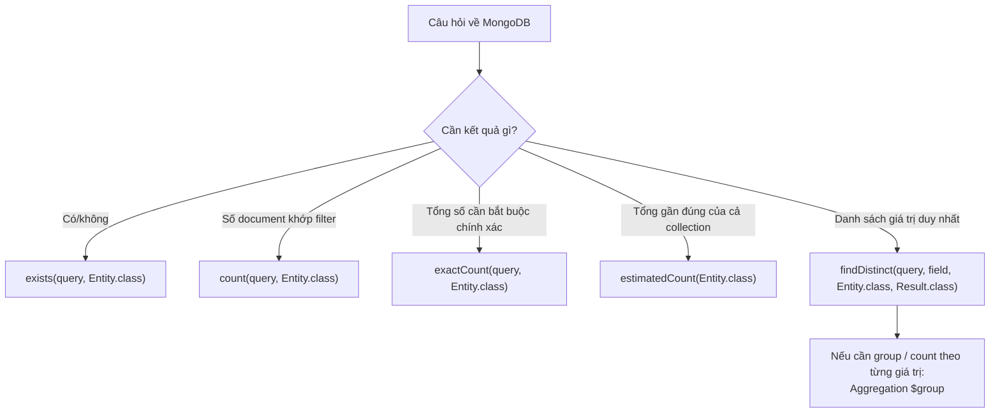

# count, exactCount, estimatedCount, exists và distinct

## 1. Mục tiêu và bối cảnh

Trong **Spring Data MongoDB**, `MongoTemplate` cho phép kiểm tra và thống kê dữ liệu mà không cần nạp toàn bộ document thành object Java. Khi xây dựng **Mini Commerce** với các collection `products`, `customers` và `orders`, hệ thống thường phải trả lời:

- Có bao nhiêu sản phẩm đang bán trong một danh mục?
- Có đơn hàng nào của khách hàng đang ở trạng thái `PLACED` hay không?
- Toàn bộ collection có khoảng bao nhiêu document để hiển thị chỉ số vận hành?
- Có những danh mục, trạng thái đơn hàng hoặc nhãn sản phẩm nào trong dữ liệu?
- Tổng số phần tử dùng cho phân trang cần **đếm chính xác** hay chấp nhận một **ước lượng**?

Bài thuộc chương **MongoTemplate**, tập trung vào năm nhóm API `count`, `exactCount`, `estimatedCount`, `exists` và `findDistinct`. Ta sẽ phân biệt **đếm document**, **kiểm tra tồn tại** và **lấy tập giá trị duy nhất**, đồng thời hiểu cách ánh xạ Java property sang BSON, viết truy vấn có index, kiểm thử và áp dụng trong môi trường đồng bộ/reactive.

Sau bài học, bạn có thể:

1. Dùng `count(Query, Class<?>)` để đếm các document khớp filter.
2. Dùng `exactCount(Query, Class<?>)` khi cần buộc thực hiện cách đếm chính xác, kể cả truy vấn rỗng.
3. Dùng `estimatedCount(Class<?>)` cho **tổng số document ước lượng của collection**, không áp dụng filter.
4. Chọn `exists(Query, Class<?>)` thay vì đếm hoặc lấy entity khi chỉ cần kết quả boolean.
5. Sử dụng `findDistinct(Query, field, entityClass, resultClass)` để lấy các giá trị khác nhau, kể cả trên array.
6. Tránh các lỗi về `skip`/`limit` trong count, kiểu BSON, tên field `@Field` và kỳ vọng sai về distinct.
7. Kiểm thử kết quả trên MongoDB thật, kiểm tra index và hiểu giới hạn giao dịch/độ chính xác.

**Điều kiện đầu vào:** Java 17+, Spring Boot với `spring-boot-starter-data-mongodb`, MongoDB kết nối thành công, `@Document`, `@Id`, `@Field`, `Query`/`Criteria`. Ví dụ minh họa nhánh đồng bộ; cuối bài có đối chiếu với `ReactiveMongoTemplate`. Các API `exactCount` và tối ưu `useEstimatedCount` cần phiên bản Spring Data MongoDB có hỗ trợ (chẳng hạn dòng 4.x/5.x).

## 2. Bảng quyết định nhanh: dùng API nào?

| Câu hỏi | API | Giá trị trả về | Đặc điểm quan trọng |
| --- | --- | --- | --- |
| Có bao nhiêu sản phẩm thỏa điều kiện? | `count(query, Product.class)` | `long` | Đếm theo filter, mặc định là cách đếm chính xác |
| Cần chắc chắn đếm chính xác cả khi query rỗng? | `exactCount(query, Product.class)` | `long` | Bắt buộc đường đếm dựa trên dữ liệu, không dùng thống kê ước lượng |
| Collection có *khoảng* bao nhiêu sản phẩm? | `estimatedCount(Product.class)` | `long` | Ước lượng từ metadata/statistics; **không nhận filter** |
| Có sản phẩm với SKU này không? | `exists(query, Product.class)` | `boolean` | Kiểm tra sự tồn tại, không cần nạp entity |
| Những danh mục nào đang có sản phẩm active? | `findDistinct(query, "category", Product.class, String.class)` | `List<String>` | Trả các **giá trị khác nhau**, không trả số lượng document |



Điểm cốt lõi: **`estimatedCount` không phải biến thể nhanh hơn của `count(query, ...)` với filter**. Nó phục vụ yêu cầu khác hẳn: ước lượng tổng số document trong collection.

## 3. Chuẩn bị dữ liệu Mini Commerce

### 3.1. Entity Product

Ví dụ dùng entity `Product` có tên trường Java `price` nhưng được lưu BSON bằng khóa `unit_price` và kiểu `Decimal128`:

```java
package com.example.minicommerce.domain;

import java.math.BigDecimal;
import java.util.List;

import org.springframework.data.annotation.Id;
import org.springframework.data.mongodb.core.mapping.Document;
import org.springframework.data.mongodb.core.mapping.Field;
import org.springframework.data.mongodb.core.mapping.FieldType;

@Document(collection = "products")
public class Product {

    @Id
    private String id;

    private String sku;
    private String category;
    private boolean active;

    @Field(name = "unit_price", targetType = FieldType.DECIMAL128)
    private BigDecimal price;

    private List<String> tags;

    public Product() {}

    public Product(String id, String sku, String category,
                   boolean active, BigDecimal price, List<String> tags) {
        this.id = id;
        this.sku = sku;
        this.category = category;
        this.active = active;
        this.price = price;
        this.tags = tags;
    }

    public String getId() { return id; }
    public void setId(String id) { this.id = id; }

    public String getSku() { return sku; }
    public void setSku(String sku) { this.sku = sku; }

    public String getCategory() { return category; }
    public void setCategory(String category) { this.category = category; }

    public boolean isActive() { return active; }
    public void setActive(boolean active) { this.active = active; }

    public BigDecimal getPrice() { return price; }
    public void setPrice(BigDecimal price) { this.price = price; }

    public List<String> getTags() { return tags; }
    public void setTags(List<String> tags) { this.tags = tags; }
}
```

`@Document(collection = "products")` chọn collection; `@Id` ánh xạ sang `_id`; `@Field(name = "unit_price", ...)` quy định tên và kiểu BSON đích cho giá. Với các ví dụ count, exists, distinct, ta **không cần nạp Product đầy đủ** để có kết quả.

### 3.2. Bộ dữ liệu kiểm chứng

Trong `mongosh` kết nối database `mini_commerce`, có thể tạo **bốn document mẫu**:

```javascript
use mini_commerce

db.products.insertMany([
  {
    _id: "demo-p1",
    sku: "LAP-001",
    category: "phu-kien",
    active: true,
    unit_price: NumberDecimal("129900.00"),
    tags: ["featured", "office"]
  },
  {
    _id: "demo-p2",
    sku: "MOU-001",
    category: "phu-kien",
    active: true,
    unit_price: NumberDecimal("249000.00"),
    tags: ["office"]
  },
  {
    _id: "demo-p3",
    sku: "KEY-OLD",
    category: "phu-kien",
    active: false,
    unit_price: NumberDecimal("99000.00"),
    tags: ["clearance"]
  },
  {
    _id: "demo-p4",
    sku: "HOME-001",
    category: "gia-dung",
    active: true,
    unit_price: NumberDecimal("199000.00"),
    tags: ["featured"]
  }
]);
```

**Kết quả nếu chỉ tính bốn fixture này**:

| Điều kiện | Số document |
| --- | ---: |
| Tất cả | 4 |
| `active = true` | 3 |
| `active = true AND category = "phu-kien"` | 2 |
| `active = false` | 1 |
| `sku = "LAP-001"` | 1 |
| `sku = "NOT-FOUND"` | 0 |

Chỉ insert một lần trên database thử nghiệm riêng; nếu chạy lại cùng `_id` sẽ gây lỗi duplicate key. Nếu collection còn dữ liệu khác, các truy vấn không giới hạn theo `_id` fixture có thể trả số lớn hơn; integration test ở cuối bài sẽ cô lập dữ liệu qua tập ID cố định.

Các câu lệnh `mongosh` tương đương:

```javascript
db.products.countDocuments({ active: true });

db.products.countDocuments({
  active: true,
  category: "phu-kien"
});

db.products.findOne({ sku: "LAP-001" });

db.products.distinct("category", { active: true });
```

Không nhầm `countDocuments(filter)` với `estimatedDocumentCount()` của driver. Tên API Java Spring Data ở các phần sau khác tên API MongoDB driver, dù chúng dùng những cơ chế đếm tương ứng.

## 4. count(Query, Class): đếm document phù hợp

### 4.1. Ví dụ với MongoTemplate

```java
import org.springframework.data.mongodb.core.MongoTemplate;
import org.springframework.data.mongodb.core.query.Criteria;
import org.springframework.data.mongodb.core.query.Query;

Query activeAccessories = Query.query(
    Criteria.where("active").is(true)
        .and("category").is("phu-kien"));

long total = mongoTemplate.count(activeAccessories, Product.class);
System.out.println(total); // 2, nếu chỉ có bốn fixture của bài.
```

`count` trả về `long`: đó là **số document** khớp filter, không phải danh sách `Product`, không cần tạo object cho từng bản ghi. Với collection được ánh xạ bởi `Product.class`, `MongoTemplate` xác định collection và mapping metadata của kiểu Java.

Nếu chỉ biết collection name:

```java
long allProducts =
    mongoTemplate.count(new Query(), "products");
```

Tuy nhiên, overload chỉ nhận **tên collection** không có metadata entity để map Java property alias. Nếu query chứa `price` của Java, phải dùng overload với `Product.class` hoặc viết đúng BSON key `unit_price` khi truy vấn bằng collection name.

### 4.2. count với filter phức tạp

Ví dụ đếm sản phẩm đang bán trong khoảng giá:

```java
import java.math.BigDecimal;

Query priceRange = Query.query(
    Criteria.where("active").is(true)
        .and("price")
        .gte(new BigDecimal("100000.00"))
        .lt(new BigDecimal("200000.00")));

long count = mongoTemplate.count(priceRange, Product.class);
```

Do `@Field(name = "unit_price", targetType = DECIMAL128)`, filter logic sau khi Spring Data mapping gần với:

```javascript
db.products.countDocuments({
  active: true,
  unit_price: {
    $gte: NumberDecimal("100000.00"),
    $lt: NumberDecimal("200000.00")
  }
});
```

Trên fixture, `demo-p1` và `demo-p4` khớp, nên kết quả là **2**. Dữ liệu giá cũ lưu kiểu String/Double có thể không cho kết quả như mong đợi nếu so sánh bằng Decimal128; cần kiểm kê BSON type trước khi tin kết quả thống kê.

### 4.3. Count ảnh hưởng bởi skip/limit

**Một lỗi rất phổ biến:** dùng lại `Query` đã phân trang để đếm tổng:

```java
import org.springframework.data.domain.PageRequest;
import org.springframework.data.domain.Sort;

Query paged = Query.query(
    Criteria.where("active").is(true))
    .with(PageRequest.of(
        1, 2, Sort.by(Sort.Order.asc("sku"))));

long pageRestrictedCount = mongoTemplate.count(paged, Product.class);
```

Query trên mang `skip` và `limit`; theo API `MongoOperations`, những thiết lập này **có thể tác động trực tiếp đến số được trả về bởi count**. Nó **không phải** cách an toàn để lấy tổng số phần tử cho tất cả các trang.

Đếm tổng phải dùng **Query mới chỉ chứa filter**, không có paging:

```java
Query countQuery = Query.query(
    Criteria.where("active").is(true));

long totalMatching = mongoTemplate.count(countQuery, Product.class);
// 3 trong bộ fixture.
```

Quy tắc áp dụng cho `count` và `exactCount`: khi hiển thị `Page`, giữ **filter giống nhau** nhưng **không dùng skip/limit của data query** cho count query. Sort thường không cần cho đếm.

## 5. exactCount(Query, Class): buộc đếm chính xác

`MongoTemplate.exactCount(...)` dùng cơ chế đếm dựa trên document phù hợp, kể cả khi filter **rỗng**, thay vì dùng thống kê collection.

```java
Query all = new Query();

long exactTotal =
    mongoTemplate.exactCount(all, Product.class);

long exactActive =
    mongoTemplate.exactCount(
        Query.query(Criteria.where("active").is(true)),
        Product.class);
```

Khi chỉ có bốn fixture, `exactTotal == 4` và `exactActive == 3`. API thực hiện đường đếm có semantics phù hợp cho shard, session và transaction; cái giá có thể cao hơn việc lấy ngay thống kê ước lượng.

**Khi nào nên gọi `exactCount` rõ ràng?**

- UI/admin cần tổng số đúng để đối chiếu.
- Cần kiểm tra số document sau migration hoặc xử lý dữ liệu.
- Có cấu hình `mongoTemplate.useEstimatedCount(true)` nhưng một thao tác riêng vẫn **bắt buộc chính xác**.
- Đang làm việc với session/transaction và cần đếm phù hợp trạng thái trong transaction.

`exactCount` không khiến nhiều câu truy vấn diễn ra ở những thời điểm khác nhau tự trở thành **một snapshot**. Nếu số document đang thay đổi liên tục, kết quả count có thể khác với `find(...)` chạy sau đó. Transaction/snapshot consistency là một quyết định riêng ở tầng nghiệp vụ và topology MongoDB.

### 5.1. Vì sao gọi là exact nhưng không phải lúc nào cũng rẻ?

Theo tài liệu Spring Data MongoDB hiện đại, đường đếm chính xác sử dụng MongoDB `countDocuments` (có thể thực hiện bằng aggregation nội bộ). Với filter rỗng, server vẫn có thể cần đọc dữ liệu/index để xác định tổng chính xác, khác với việc lấy nhanh thống kê metadata.

Nếu cần con số phục vụ **đối soát**, không đổi sang `estimatedCount` chỉ để giảm latency. Nếu chỉ hiển thị số gần đúng trên dashboard, hãy thể hiện rõ đó là ước lượng.

## 6. estimatedCount(Class): tổng số ước lượng

`estimatedCount` dùng thống kê của collection, có thể nhanh hơn trong trường hợp cần tổng số ước lượng mà **không có filter**:

```java
long approximateTotal =
    mongoTemplate.estimatedCount(Product.class);
```

Hoặc chỉ rõ tên collection:

```java
long approximateProducts =
    mongoTemplate.estimatedCount("products");
```

Các phương thức này **không nhận `Query`**. Vì vậy không có lời gọi tương đương:

```java
// KHÔNG có API estimatedCount(Query, Product.class)
// để ước lượng riêng active=true hay category="phu-kien".
```

| Nhu cầu | Có nên dùng estimatedCount? | Lý do |
| --- | --- | --- |
| Hiển thị “khoảng X sản phẩm đang lưu” | Có thể | Chỉ cần tổng gần đúng collection |
| Tổng số sản phẩm active | **Không** | Cần filter |
| Tổng số đơn của một khách | **Không** | Cần điều kiện customerId |
| Kiểm kê trước migration | Thường không đủ | Cần con số/điều kiện đối chiếu chính xác |
| Đối soát tài chính/đơn hàng | Không | Sai số không phù hợp |
| Chỉ số giám sát gần đúng | Có thể | Có thể chấp nhận metadata-based estimate |

**Không assert** rằng `estimatedCount(Product.class) == 4` trong mọi môi trường. Số ước lượng có thể lệch số thực, nhất là khi collection/sharded cluster vừa thay đổi; hành vi còn phụ thuộc phiên bản MongoDB, topology và giới hạn của thống kê.

### 6.1. useEstimatedCount(true) ảnh hưởng count ra sao?

`MongoTemplate` có cấu hình:

```java
// Chỉ bật tại bước cấu hình MongoTemplate khi hệ thống
// chấp nhận ước lượng cho count query rỗng:
mongoTemplate.useEstimatedCount(true);
```

Khi bật, các lệnh `mongoTemplate.count(...)` có **filter rỗng, không phân trang** có thể được chuyển sang `estimatedCount`, **miễn là không có transaction/session-bound template**. Query có điều kiện vẫn cần được đếm theo filter.

Nếu cần chắc chắn kết quả chính xác bất kể cấu hình này:

```java
long auditedTotal =
    mongoTemplate.exactCount(new Query(), Product.class);
```

**Mặc định, `MongoTemplate` dùng exact counting.** Không nên bật `useEstimatedCount(true)` tùy tiện trong controller hoặc mỗi request. Quyết định này thuộc cấu hình ứng dụng; phải tài liệu hóa tác động lên các lời gọi `count(new Query(), ...)` hiện có.

### 6.2. Giới hạn trong session và transaction

Thống kê collection không phản ánh chắc chắn thay đổi chưa commit trong transaction, và ước lượng không mang đầy đủ semantics của một count theo transaction. Khi cần đếm trong transaction, dùng API count/exactCount phù hợp và kết nối MongoDB hỗ trợ transaction. Nếu ứng dụng dùng sharded cluster, cần kiểm tra giới hạn của estimate trên topology đang vận hành.

## 7. exists(Query, Class): chỉ cần biết có document hay không

Thay vì nạp một sản phẩm:

```java
Product product = mongoTemplate.findOne(
    Query.query(Criteria.where("sku").is("LAP-001")),
    Product.class);

boolean found = product != null;
```

Ta có thể hỏi trực tiếp:

```java
boolean exists = mongoTemplate.exists(
    Query.query(Criteria.where("sku").is("LAP-001")),
    Product.class);
```

Nếu chỉ cần boolean, `exists` diễn đạt đúng ý định và tránh việc phải dựng entity đầy đủ. Trong bộ dữ liệu fixture, `exists` trên `LAP-001` trả `true`; trên `NOT-FOUND` trả `false`.

### 7.1. Tránh count > 0 khi chỉ cần tồn tại

Ví dụ chưa phù hợp về ý nghĩa:

```java
boolean exists = mongoTemplate.count(
    Query.query(Criteria.where("sku").is("LAP-001")),
    Product.class) > 0;
```

Lệnh trên yêu cầu đếm các document phù hợp, trong khi nghiệp vụ chỉ cần biết **ít nhất một document tồn tại**. `MongoTemplate.exists(...)` là lựa chọn trực tiếp hơn và có thể tránh một phần công việc cần cho count. Dù vậy, truy vấn tồn tại vẫn cần filter/index phù hợp để nhanh; không cam kết chi phí O(1) cho mọi filter.

### 7.2. Kiểm tra đơn hàng của khách

Trong collection `orders`, muốn biết khách `customer-001` có đơn `PLACED`:

```java
Query pending = Query.query(
    Criteria.where("customerId").is("customer-001")
        .and("status").is("PLACED"));

boolean hasPlacedOrder =
    mongoTemplate.exists(pending, Order.class);
```

`Order.class` cần ánh xạ `@Document(collection = "orders")` và có hai property `customerId`, `status`. Khi hệ thống có multi-tenancy hoặc phân quyền theo cửa hàng, bộ lọc `exists` cũng cần **đầy đủ điều kiện tenant/authorization**, không được rút gọn chỉ vì kết quả là boolean.

### 7.3. exists không thay thế unique index

Mẫu code:

```java
if (!mongoTemplate.exists(
        Query.query(Criteria.where("sku").is(sku)),
        Product.class)) {
    // Sau điều kiện này, một request khác vẫn có thể
    // chèn sản phẩm có SKU trùng trước khi ta insert.
}
```

Đây là **race condition kiểm tra rồi ghi**. Để bảo đảm SKU duy nhất, tạo unique index:

```javascript
db.products.createIndex({ sku: 1 }, { unique: true });
```

Sau đó xử lý duplicate-key exception tại tầng service/API. `exists` có thể hỗ trợ trải nghiệm người dùng nhưng không phải ràng buộc duy nhất trong database.

## 8. distinct: lấy các giá trị khác nhau, không phải đếm document

Spring Data MongoDB cung cấp `findDistinct` trên `MongoTemplate`. Ví dụ lấy danh mục sản phẩm đang bán:

```java
Query active = Query.query(
    Criteria.where("active").is(true));

List<String> categories =
    mongoTemplate.findDistinct(
        active, "category", Product.class, String.class);
```

`findDistinct(query, field, entityClass, resultClass)` nhận:

| Tham số | Ý nghĩa |
| --- | --- |
| `query` | Filter chỉ xét document phù hợp |
| `field` | Java property path cần lấy các giá trị duy nhất |
| `entityClass` | Class dùng để chọn collection và ánh xạ tên field/kiểu |
| `resultClass` | Kiểu Java muốn nhận từng phần tử, ví dụ `String.class` |

Trên bộ fixture, các danh mục active là `"phu-kien"` và `"gia-dung"`. Thứ tự trong danh sách kết quả **không có hợp đồng sắp xếp mặc định**; nếu UI cần thứ tự, sắp xếp ở tầng ứng dụng với tập nhỏ hoặc dùng aggregation có `$sort`.

MongoDB `mongosh` tương đương:

```javascript
db.products.distinct("category", { active: true });
```

### 8.1. Distinct trên array: lấy từng phần tử duy nhất

Trường `tags` là `List<String>`. Khi distinct trên array, MongoDB xét **các giá trị phần tử**:

```java
List<String> uniqueActiveTags =
    mongoTemplate.findDistinct(
        Query.query(Criteria.where("active").is(true)),
        "tags",
        Product.class,
        String.class);
```

Trong fixture active, tập giá trị tương ứng là:

```text
featured
office
```

Không phải một danh sách gồm các array `["featured", "office"]` và `["office"]`. Distinct trả từng giá trị không trùng, không mang số lần xuất hiện.

Nếu muốn biết **mỗi nhãn xuất hiện ở bao nhiêu sản phẩm**, dùng aggregation `$unwind` + `$group` thay vì `distinct`.

### 8.2. Distinct theo field nhúng

Giả sử `Order` có `shippingAddressSnapshot.city`. Có thể:

```java
List<String> cities =
    mongoTemplate.findDistinct(
        Query.query(Criteria.where("status").is("PLACED")),
        "shippingAddressSnapshot.city",
        Order.class,
        String.class);
```

Với raw `mongosh`:

```javascript
db.orders.distinct(
  "shippingAddressSnapshot.city",
  { status: "PLACED" }
);
```

Khi Java property mang `@Field(name = "ship_to")`, Spring Data mapping có thể đổi `shippingAddressSnapshot.city` thành `ship_to.city`. **Raw driver và mongosh luôn dùng tên BSON thực tế**, không tự biết alias của Java.

### 8.3. Distinct không có pagination/sort như Page<T>

Không nên xem `findDistinct(...)` như một API phân trang danh mục có thể mở rộng vô hạn. Nó trả về một danh sách kết quả khác nhau, không có `Pageable` tiêu chuẩn để phân lô trực tiếp các giá trị theo cách `find(...)` trả `Page<T>`.

Nếu số lượng distinct value rất lớn, kết quả distinct có thể tốn bộ nhớ/băng thông và chịu các giới hạn kết quả BSON của MongoDB. Với dashboard cần lọc, sắp xếp, giới hạn hoặc thống kê nhiều nhóm, cân nhắc **aggregation `$match → $group → $sort → $limit`** và thiết kế index phù hợp.

### 8.4. Null, field thiếu và kiểu BSON trộn lẫn

Nếu collection có:

```javascript
{ _id: "a", category: "phu-kien" }
{ _id: "b", category: null }
{ _id: "c" }
{ _id: "d", category: 123 }
```

Cần phân biệt:

- Field **thiếu** khác field có giá trị BSON `null`.
- Distinct có thể trả `null` khi giá trị null thực sự tồn tại; field thiếu không có một giá trị category để đưa vào danh sách.
- Nếu một field chứa cả String và Number, có nhiều **BSON type** khác nhau; ép tất cả vào `String.class` có thể tạo chuyển đổi hoặc lỗi ngoài dự kiến.
- Nếu cần quy tắc “danh mục hợp lệ”, filter kiểu dữ liệu/giá trị tại MongoDB hoặc chuẩn hóa trong migration; không xem distinct là cơ chế làm sạch dữ liệu.

## 9. Aggregation khi cần đếm theo từng giá trị

`count` trả số document phù hợp, `findDistinct` trả các giá trị duy nhất. Còn câu hỏi “mỗi danh mục có bao nhiêu sản phẩm đang bán?” cần `$group`:

```javascript
db.products.aggregate([
  { $match: { active: true } },
  {
    $group: {
      _id: "$category",
      totalProducts: { $sum: 1 }
    }
  },
  { $sort: { totalProducts: -1, _id: 1 } }
]);
```

Trên fixture:

| category | totalProducts |
| --- | ---: |
| `phu-kien` | 2 |
| `gia-dung` | 1 |

Nếu muốn số sản phẩm theo từng tag (một document có nhiều tag):

```javascript
db.products.aggregate([
  { $match: { active: true } },
  { $unwind: "$tags" },
  {
    $group: {
      _id: "$tags",
      products: { $sum: 1 }
    }
  },
  { $sort: { products: -1, _id: 1 } }
]);
```

Với fixture active, `featured` có 2 sản phẩm và `office` có 2. `$unwind` biến từng phần tử mảng thành bản ghi trung gian, nhờ vậy mỗi tag được thống kê riêng.

### 9.1. Ví dụ aggregation bằng MongoTemplate

```java
import org.springframework.data.mongodb.core.aggregation.Aggregation;
import org.springframework.data.mongodb.core.aggregation.AggregationResults;
import org.bson.Document;

Aggregation pipeline = Aggregation.newAggregation(
    Aggregation.match(Criteria.where("active").is(true)),
    Aggregation.group("category").count().as("totalProducts"),
    Aggregation.sort(Sort.Direction.DESC, "totalProducts")
);

AggregationResults<Document> results =
    mongoTemplate.aggregate(
        pipeline, Product.class, Document.class);
```

Đoạn trên minh họa cách sử dụng `Aggregation` với `MongoTemplate`; cần import thêm `Criteria` và `Sort` trong Java file thực tế. Khi ứng dụng cần DTO ổn định, tạo một class projection có `_id`/`totalProducts` tương ứng để tránh thao tác với `Document` trần.

**Không cộng `distinct(...).size()` rồi xem đó là số sản phẩm.** Đó chỉ là **số giá trị khác nhau**, không phải số document.

## 10. Count, exists và distinct với FluentMongoOperations

Ngoài các phương thức trực tiếp, `MongoTemplate` hỗ trợ API fluent:

```java
long activeCount = mongoTemplate
    .query(Product.class)
    .matching(Query.query(Criteria.where("active").is(true)))
    .count();

boolean hasSku = mongoTemplate
    .query(Product.class)
    .matching(Query.query(Criteria.where("sku").is("LAP-001")))
    .exists();
```

Fluent API giúp xâu chuỗi việc chọn domain type, đặt filter và thao tác terminal. Tương tự API trực tiếp, các query vẫn phải được mapping theo entity và có index hợp lý. Với distinct, có thể dùng `mongoTemplate.findDistinct(...)` như mục 8 để dễ đọc và kiểm soát kiểu kết quả.

Nếu chuyển sang reactive, `ReactiveMongoTemplate` có fluent API riêng trả publisher; không dùng các kết quả `long`/`boolean` đồng bộ vào pipeline Reactor.

## 11. Phân trang: count tổng và query dữ liệu phải nhất quán

Giả sử UI danh mục có `page=1`, `size=20` và filter `active=true, category=phu-kien`.

```java
import java.util.List;
import org.springframework.data.domain.Page;
import org.springframework.data.domain.PageImpl;
import org.springframework.data.domain.PageRequest;
import org.springframework.data.domain.Pageable;
import org.springframework.data.domain.Sort;

Pageable page = PageRequest.of(
    1,
    20,
    Sort.by(Sort.Order.asc("price"), Sort.Order.asc("id")));

Query dataQuery = Query.query(
    Criteria.where("active").is(true)
        .and("category").is("phu-kien")).with(page);

List<Product> content =
    mongoTemplate.find(dataQuery, Product.class);

// Chỉ dùng filter tương ứng, không mang skip/limit.
Query countQuery = Query.query(
    Criteria.where("active").is(true)
        .and("category").is("phu-kien"));

long total = mongoTemplate.count(countQuery, Product.class);

Page<Product> result =
    new PageImpl<>(content, page, total);
```

`PageImpl` chứa content và metadata; `count` có thể tốn thêm truy vấn. Nếu không cần tổng số phần tử, cân nhắc `Slice`/API “xem thêm” để giảm việc đếm không cần thiết.

**Bất biến quan trọng:** không dùng `estimatedCount(Product.class)` để làm `totalElements` cho một filter theo category, vì estimate chỉ nói về **toàn collection**, không phải số document phù hợp với filter.

## 12. Hiệu năng và thiết kế index

Các API không có cùng chi phí:

| Phép toán | Chi phí cần lưu ý | Biện pháp |
| --- | --- | --- |
| `count` theo SKU | Filter equality có thể rất chọn lọc | Index `sku`, unique nếu nghiệp vụ yêu cầu |
| `count` theo active/category | Nhiều document có thể khớp | Compound index và kiểm tra plan |
| `exactCount(new Query())` | Cần tổng chính xác trên collection | Chỉ dùng khi có yêu cầu thật |
| `estimatedCount(Product.class)` | Đọc thống kê nhanh nhưng có thể lệch | Đánh dấu kết quả gần đúng |
| `exists` theo SKU | Chỉ cần kết quả true/false | Dùng API exists và index phù hợp |
| `findDistinct` theo category | Có thể duyệt nhiều key và trả nhiều giá trị | Index, kiểm soát số lượng distinct, aggregation nếu cần |
| `findDistinct` trên array tags | Multikey index/có thể nhiều giá trị | Quan sát workload, tránh mảng không giới hạn |

### 12.1. Index theo các thao tác Mini Commerce

```javascript
// Kiểm tra SKU tồn tại, và bảo đảm không trùng.
db.products.createIndex({ sku: 1 }, { unique: true });

// Đếm theo trạng thái và danh mục.
db.products.createIndex({ active: 1, category: 1 });

// Đếm đơn theo khách và trạng thái.
db.orders.createIndex({ customerId: 1, status: 1 });
```

Đây là các index **đề xuất để kiểm nghiệm**, không bắt buộc triển khai tất cả. Trước khi tạo unique index, xử lý dữ liệu SKU trùng đã có; mỗi index tốn dung lượng và làm tăng chi phí ghi.

### 12.2. Explain truy vấn cùng filter

Để xem filter được hỗ trợ ra sao:

```javascript
db.products.find({
  active: true,
  category: "phu-kien"
}).explain("executionStats");
```

Theo dõi `winningPlan`, `totalKeysExamined`, `totalDocsExamined`, `nReturned`. Lệnh `find(...).explain()` là một phép **kiểm tra query shape tương tự**, không mặc định là bản sao plan của `countDocuments` hay `distinct`; những lệnh khác nhau có thể chọn kế hoạch khác. Khi cần đo chính count/distinct, sử dụng profiler/command monitoring hoặc explain của đúng lệnh với phiên bản MongoDB đang chạy.

**Không suy luận `count` là O(1)**: đếm chính xác có filter vẫn có thể cần xét nhiều index entries. **Không suy luận `exists` là O(1)**: nếu thiếu index, server vẫn có thể scan để tìm match đầu tiên.

### 12.3. Collation, case-insensitive và định nghĩa “khác nhau”

`findDistinct` xét khác biệt của giá trị theo so sánh BSON/thiết lập collation. Ví dụ category `"Phu-Kien"` và `"phu-kien"` có thể là hai giá trị khác nhau nếu không áp dụng quy tắc collation tương thích. Nếu UI muốn gộp chúng thành một danh mục, nên chuẩn hóa dữ liệu hoặc cấu hình collation có chủ đích; đồng thời kiểm tra index có collation phù hợp. Không dựa vào việc chuyển Java `String` sang chữ thường **sau** khi distinct rồi nghĩ server đã dùng một query tối ưu.

## 13. Transaction, session và tính chính xác theo thời điểm

Với transaction MongoDB nhiều document (ví dụ tạo `Order` đồng thời giảm `Product.stock`), API đếm cần phù hợp với session và transaction. Theo Spring Data MongoDB, `count` trong transaction dùng phương pháp dựa trên `countDocuments`/aggregation để phản ánh dữ liệu trong ngữ cảnh transaction. `estimatedCount` dựa trên collection statistics **không phù hợp để kiểm tra thay đổi chưa commit**.

Nếu ứng dụng dùng Geo query, lưu ý một số toán tử như `$near`/`$nearSphere` không dùng nguyên dạng trong countDocuments/aggregation count; Spring Data có cơ chế rewrite một số query, nhưng các điều kiện chứa `$minDistance` cần được hiểu và kiểm thử đặc biệt. Khi viết logic nghiệp vụ dựa vào count, cần kiểm tra filter BSON cuối cùng và semantics chứ không chỉ nhìn method name.

**Không thay thế transaction/atomic update bằng exists trước khi ghi.** Ví dụ “nếu còn ít đơn đang xử lý thì tạo thêm” là một kiểm tra-ghi chịu race condition nếu nhiều request chạy đồng thời. Sử dụng unique index, cập nhật điều kiện nguyên tử, transaction hoặc cơ chế điều phối phù hợp với invariant thực tế.

## 14. Reactive MongoTemplate: cùng ý nghĩa, kết quả dạng Publisher

Khi dùng `spring-boot-starter-data-mongodb-reactive`, các phương thức tương tự có thể trả `Mono`/`Flux`:

```java
import reactor.core.publisher.Mono;
import reactor.core.publisher.Flux;

import org.springframework.data.mongodb.core.ReactiveMongoTemplate;
import org.springframework.data.mongodb.core.query.Criteria;
import org.springframework.data.mongodb.core.query.Query;

Query active = Query.query(
    Criteria.where("active").is(true));

Mono<Long> count =
    reactiveMongoTemplate.count(active, Product.class);

Mono<Long> exact =
    reactiveMongoTemplate.exactCount(new Query(), Product.class);

Mono<Long> estimated =
    reactiveMongoTemplate.estimatedCount(Product.class);

Mono<Boolean> exists =
    reactiveMongoTemplate.exists(
        Query.query(Criteria.where("sku").is("LAP-001")),
        Product.class);

Flux<String> categories =
    reactiveMongoTemplate.findDistinct(
        active, "category", Product.class, String.class);
```

Đoạn code được đặt trong service có bean `ReactiveMongoTemplate` và import `Product` theo package ứng dụng. Các thao tác reactive được thực thi khi có **subscription**; không dùng `block()` trong event loop WebFlux. Ý nghĩa filter, estimate, distinct và rủi ro count trong transaction không đổi chỉ vì I/O non-blocking.

Với integration test, có thể dùng Reactor `StepVerifier`:

```java
StepVerifier.create(
    reactiveMongoTemplate.exists(
        Query.query(Criteria.where("sku").is("LAP-001")),
        Product.class))
    .expectNext(true)
    .verifyComplete();
```

Đoạn trên cần import `reactor.test.StepVerifier` và dependency `reactor-test` trong test scope. Kiểm tra cả việc publisher hoàn thành và không phát sinh lỗi mapping/database.

## 15. Kiểm thử tích hợp: phân biệt chính xác và ước lượng

Một mock `MongoTemplate` không chứng minh được việc driver đếm hay distinct theo BSON. Nên sử dụng **MongoDB thật hoặc Testcontainers** và một database test riêng. Test sau insert raw BSON theo tập ID fixture và **chỉ đếm những ID đó** để không phụ thuộc dữ liệu của bài test khác.

```java
package com.example.minicommerce;

import static org.junit.jupiter.api.Assertions.*;

import java.math.BigDecimal;
import java.util.List;
import java.util.Set;

import org.bson.Document;
import org.bson.types.Decimal128;
import org.junit.jupiter.api.Test;
import org.springframework.beans.factory.annotation.Autowired;
import org.springframework.boot.test.context.SpringBootTest;
import org.springframework.data.mongodb.core.MongoTemplate;
import org.springframework.data.mongodb.core.query.Criteria;
import org.springframework.data.mongodb.core.query.Query;

import com.example.minicommerce.domain.Product;

@SpringBootTest
class MongoTemplateCountDistinctIntegrationTest {

    @Autowired
    MongoTemplate template;

    @Test
    void countsChecksExistenceAndGetsDistinctValues() {
        List<String> ids = List.of(
            "template-count-01",
            "template-count-02",
            "template-count-03",
            "template-count-04"
        );
        var raw = template.getCollection("products");
        Document fixtureFilter =
            new Document("_id", new Document("$in", ids));

        raw.deleteMany(fixtureFilter);
        try {
            raw.insertMany(List.of(
                product(ids.get(0), "LAP-T1", "phu-kien",
                    true, "129900.00", "featured", "office"),
                product(ids.get(1), "MOU-T1", "phu-kien",
                    true, "249000.00", "office"),
                product(ids.get(2), "OLD-T1", "phu-kien",
                    false, "99000.00", "clearance"),
                product(ids.get(3), "HOME-T1", "gia-dung",
                    true, "199000.00", "featured")
            ));

            Query allFixture = Query.query(
                Criteria.where("id").in(ids));
            Query activeFixture = Query.query(
                Criteria.where("id").in(ids)
                    .and("active").is(true));
            Query accessoryFixture = Query.query(
                Criteria.where("id").in(ids)
                    .and("active").is(true)
                    .and("category").is("phu-kien"));

            assertEquals(4L,
                template.exactCount(allFixture, Product.class));
            assertEquals(3L,
                template.count(activeFixture, Product.class));
            assertEquals(2L,
                template.count(accessoryFixture, Product.class));

            assertTrue(template.exists(
                Query.query(Criteria.where("sku").is("LAP-T1")),
                Product.class));
            assertFalse(template.exists(
                Query.query(Criteria.where("sku").is("MISSING-T1")),
                Product.class));

            List<String> categories = template.findDistinct(
                activeFixture, "category", Product.class, String.class);
            assertEquals(Set.of("phu-kien", "gia-dung"),
                Set.copyOf(categories));

            List<String> tags = template.findDistinct(
                activeFixture, "tags", Product.class, String.class);
            assertEquals(Set.of("featured", "office"),
                Set.copyOf(tags));

            // Estimate là tổng gần đúng của CẢ collection, không
            // chỉ bốn fixture. Không assert estimated == 4.
            assertTrue(template.estimatedCount(Product.class) >= 0);
        } finally {
            raw.deleteMany(fixtureFilter);
        }
    }

    private static Document product(
            String id, String sku, String category,
            boolean active, String price, String... tags) {
        return new Document("_id", id)
            .append("sku", sku)
            .append("category", category)
            .append("active", active)
            .append("unit_price",
                new Decimal128(new BigDecimal(price)))
            .append("tags", List.of(tags));
    }
}
```

**Cách đọc test:** hai phương thức `exactCount`/`count` đếm theo ID fixture đã cô lập; `exists` kiểm tra SKU riêng của fixture; distinct chỉ nhìn fixture active nên kết quả là hai category và hai tag; `estimatedCount` áp dụng toàn collection nên **chỉ** kiểm tra kết quả có giá trị hợp lệ, không đòi bằng số fixture.

Nếu các test khác cùng sử dụng ID/SKU đó, kết quả vẫn có thể bị nhiễu. Trong thực tế hãy dùng database/collection test được cô lập và không chạy cleanup trên production. Đoạn test cần một cấu hình Spring Boot thật có thể inject `MongoTemplate`; test không chứng minh hiệu năng index.

### 15.1. Ma trận test nên có

| Trường hợp | Kỳ vọng |
| --- | --- |
| `count` với filter chính xác | Số document đúng theo fixture |
| `exactCount` với query rỗng | Tổng đúng trong collection test cô lập |
| `estimatedCount` | Trả giá trị `long` hợp lệ, **không** assert bằng exact |
| `count` với skip/limit | Hiểu và kiểm chứng ảnh hưởng của pagination |
| `exists` với SKU có/không | Trả true/false đúng |
| `findDistinct` trên category | Trả mỗi category một lần, không đảm bảo thứ tự |
| `findDistinct` trên tags array | Trả mỗi tag duy nhất, không trả mảng như một value |
| `findDistinct` có filter active | Không lấy category/tag chỉ thuộc document inactive |
| `@Field(name = "unit_price")` | Count/query giá dùng đúng BSON field |
| Data có null/missing | Phân biệt và xử lý theo schema |
| Transaction | Đếm bằng session-bound template, không dùng estimate để xét pending writes |
| Reactive | `Mono`/`Flux` có đúng kiểu và complete signal |
| Query hiệu năng | Filter hoạt động với index mong đợi, đo plan thực tế |

## 16. Lỗi thường gặp và cách xử lý

| Triệu chứng | Nguyên nhân | Cách xử lý |
| --- | --- | --- |
| Tổng dùng trong `Page` thấp bất thường | Count query đang mang `skip`/`limit` | Tạo count query mới không phân trang |
| `estimatedCount` khác `exactCount` | Estimate theo thống kê, không bảo đảm chính xác | Chọn exactCount khi cần đối soát |
| Dùng estimate cho filter active | `estimatedCount` không nhận `Query` | Dùng count/exactCount theo filter |
| Count rỗng không còn chính xác | Đã bật `useEstimatedCount(true)` | Dùng `exactCount(new Query(), ...)` khi bắt buộc |
| `exists` nhanh trong test nhưng chậm ở production | Thiếu index hoặc filter ít chọn lọc | Tạo index theo query shape và đo |
| SKU trùng dù đã gọi exists trước insert | Race condition kiểm tra-ghi | Dùng unique index, xử lý duplicate key |
| Count trên giá không đúng | Field lưu String/Double lẫn Decimal128, hoặc sai alias | Kiểm tra `$type`, `@Field`, chuẩn hóa dữ liệu |
| `findDistinct` trả kết quả lộn thứ tự | Distinct không bảo đảm sort | Sắp xếp tập nhỏ hoặc dùng aggregation |
| Distinct tags trả từng tag riêng | MongoDB flatten giá trị array trong distinct | Đây là hành vi dự kiến; dùng aggregation nếu cần cấu trúc khác |
| Distinct quá nhiều giá trị gây tốn tài nguyên | Cardinality cao/giới hạn kết quả | Thiết kế aggregation, giới hạn, cache hoặc schema mới |
| Distinct theo category có chữ hoa/thường trùng ý nghĩa | Không chuẩn hóa/collation chưa đúng | Chuẩn hóa hoặc cấu hình collation/index phù hợp |
| Query dùng `price` nhưng collection lưu `unit_price` | Dùng overload collection-name không có mapping entity | Dùng overload `Product.class` hoặc BSON field name |
| Đếm đúng nhưng UI hiển thị sai số đơn | Count và find chạy tại thời điểm khác nhau | Kiểm tra concurrency và chính sách nhất quán |
| `exists` trên đơn làm lộ thông tin khách khác | Thiếu điều kiện quyền/tenant | Áp dụng authorization trong filter/service |
| Reactive code gọi `block()` trong WebFlux | Dùng publisher sai cách | Compose `Mono`/`Flux` non-blocking |

## 17. Bài tập và tiêu chí hoàn thành

**Bài tập 1 — Count có filter.** Insert bốn sản phẩm fixture. Viết `Query` đếm sản phẩm active, đếm sản phẩm active của danh mục `phu-kien` và đếm sản phẩm trong khoảng giá `[100000, 200000)`. Đối chiếu với `mongosh countDocuments`.

**Bài tập 2 — Exact và estimate.** Dùng `exactCount(new Query(), Product.class)` và `estimatedCount(Product.class)` trên database test cô lập. Giải thích vì sao chúng có thể khác nhau và tại sao không dùng ước lượng trong đối soát.

**Bài tập 3 — Tác động của paging.** Tạo `Query` với `PageRequest.of(1, 2)`, gọi `count`, sau đó tạo một `Query` chỉ chứa filter để đếm tổng. Giải thích nguyên nhân hai kết quả có thể khác nhau.

**Bài tập 4 — Exists với unique SKU.** Viết hàm kiểm tra SKU đã tồn tại hay chưa. Sau đó giả lập hai request tạo SKU giống nhau, giải thích vì sao chỉ kiểm tra `exists` chưa đủ và thiết kế unique index.

**Bài tập 5 — Distinct có filter và array.** Tìm category của sản phẩm active, tìm toàn bộ tag khác nhau của sản phẩm active. Sắp xếp danh sách category để hiển thị; kiểm chứng distinct trên array trả từng phần tử.

**Bài tập 6 — Aggregation theo nhóm.** Thay vì chỉ liệt kê category, dùng `$group` để đếm mỗi category có bao nhiêu sản phẩm. So sánh ý nghĩa của `distinct().size()` với tổng số sản phẩm.

**Bài tập 7 — Hiệu năng.** Dùng `explain("executionStats")` trên filter `{ active: true, category: "phu-kien" }`. Thêm index thử nghiệm và kiểm tra plan. Quan sát `countDocuments`/`distinct` đúng lệnh qua profiler/monitoring khi cần phân tích riêng.

**Bài tập mở rộng — Reactive.** Dùng `ReactiveMongoTemplate` viết năm thao tác tương đương, test `Mono<Long>`, `Mono<Boolean>` và `Flux<String>` bằng `StepVerifier`. Không gọi `block()` trong reactive request handler.

### Câu hỏi tự kiểm tra

1. Sự khác biệt về semantics giữa `count`, `exactCount` và `estimatedCount` là gì?
2. Tại sao `estimatedCount` không phù hợp để đếm sản phẩm đang bán trong một danh mục?
3. Khi `useEstimatedCount(true)` được bật, những `count` nào có thể đi theo đường estimate?
4. Vì sao count query dùng trong `Page` không nên mang `skip`/`limit`?
5. Khi chỉ cần boolean tồn tại, vì sao `exists` thường hợp hơn `count > 0` hoặc `findOne != null`?
6. Tại sao `exists` không thể thay unique index?
7. `findDistinct` trên `tags: ["featured", "office"]` trả dạng kết quả nào?
8. Khi nào `$group` tốt hơn `findDistinct`?
9. Tại sao phải phân biệt Java property `price` và BSON field `unit_price`?
10. Count trong transaction và estimated count dựa trên thống kê khác nhau điều gì?

**Kết quả mong đợi:** người học chọn đúng phép đếm/tồn tại/distinct cho nhu cầu nghiệp vụ, giữ cho tổng phân trang chính xác, hiểu giới hạn của estimate, biết kiểm tra tên field và BSON type, đồng thời đo được chi phí query. Đây là nền tảng để xây dựng báo cáo, aggregation, index, transaction, reactive access và kiểm thử Spring Data MongoDB đáng tin cậy.

## Tài liệu tham khảo

- [Spring Data MongoDB — Counting Documents](https://docs.spring.io/spring-data/mongodb/reference/mongodb/template-document-count.html) — `count`, `exactCount`, `estimatedCount`, `useEstimatedCount` và transaction.
- [Spring Data MongoDB — Querying Documents](https://docs.spring.io/spring-data/mongodb/reference/mongodb/template-query-operations.html) — `Query`, `Criteria`, distinct, mapping và projection.
- [Spring Data MongoDB — MongoOperations API](https://docs.spring.io/spring-data/mongodb/docs/current/api/org/springframework/data/mongodb/core/MongoOperations.html) — chữ ký `count`, `exactCount`, `exists`, `findDistinct`.
- [Spring Data MongoDB — Sessions and Transactions](https://docs.spring.io/spring-data/mongodb/reference/mongodb/client-session-transactions.html) — semantics của count trong transaction.
- [MongoDB — db.collection.countDocuments()](https://www.mongodb.com/docs/manual/reference/method/db.collection.countDocuments/) — đếm chính xác theo filter.
- [MongoDB — db.collection.estimatedDocumentCount()](https://www.mongodb.com/docs/manual/reference/method/db.collection.estimatedDocumentCount/) — ước lượng theo metadata collection.
- [MongoDB — db.collection.distinct()](https://www.mongodb.com/docs/manual/reference/method/db.collection.distinct/) — giá trị khác nhau, array và giới hạn kết quả.
- [MongoDB — Explain Results](https://www.mongodb.com/docs/manual/reference/explain-results/) — phân tích plan và hiệu năng truy vấn.
