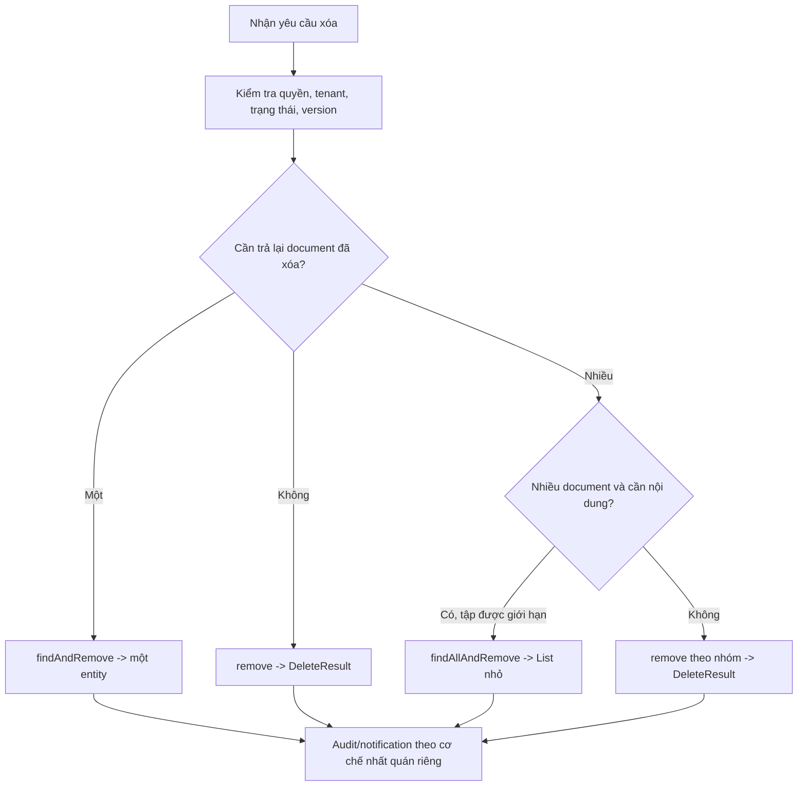

# remove, findAndRemove và findAllAndRemove

Khi làm việc với **Spring Data MongoDB**, không phải mọi thao tác xóa đều có cùng ý nghĩa. `MongoTemplate` cung cấp ba nhóm phương thức thường gặp:

- `remove(...)`: xóa document phù hợp với tiêu chí, trả về **kết quả của thao tác xóa**.
- `findAndRemove(...)`: tìm rồi xóa **một document** phù hợp, đồng thời trả về document đã bị xóa.
- `findAllAndRemove(...)`: tìm và xóa **nhiều document** phù hợp, đồng thời trả về danh sách document tương ứng.

Khác biệt nằm ở **số document**, **giá trị trả về**, **tính nguyên tử** và **chi phí đưa dữ liệu về Java**. Chọn sai API có thể khiến hệ thống xóa rộng hơn dự kiến, lưu audit thiếu dữ liệu hoặc dùng quá nhiều bộ nhớ. Bài thuộc chương **MongoTemplate** này hướng dẫn cách lựa chọn đúng, bảo vệ phạm vi tenant, viết câu lệnh có điều kiện và kiểm thử kết quả trên MongoDB.

Sau bài học, bạn có thể:

1. Chọn đúng phương thức xóa theo nhu cầu chỉ xóa, xóa rồi nhận một bản ghi, hoặc nhận nhiều bản ghi.
2. Đọc `DeleteResult`, xử lý trường hợp không tìm thấy và hiểu giá trị document được trả lại.
3. Phân biệt xóa một document nguyên tử với một workflow xóa nhiều document.
4. Dùng bộ lọc `_id`, `tenantId`, trạng thái và `version` để tránh xóa nhầm.
5. Nhận biết khi nên **soft delete** thay vì xóa vật lý.
6. Kiểm tra truy vấn, chỉ mục, kết quả BSON và hành vi đồng thời bằng `mongosh`, `MongoTemplate` và bài kiểm thử tích hợp.

## 1. Tư duy đúng về thao tác xóa trong MongoDB

MongoDB có các thao tác ở mức driver/server như `deleteOne`, `deleteMany` và `findOneAndDelete`. `MongoTemplate` cung cấp API ở mức domain object, sử dụng `MappingMongoConverter` để ánh xạ tên field và kiểu dữ liệu.

Ví dụ với class `OrderRecord` có property `id` được đánh dấu `@Id`, truy vấn qua `MongoTemplate` có thể viết:

```java
Query query = Query.query(Criteria.where("id").is(orderId));
```

Spring Data biết `id` được lưu dưới BSON field `_id` khi bạn gọi API có `OrderRecord.class`. Trong `mongosh`, phải truy vấn tên BSON thực:

```javascript
db.orders_delete_lab.findOne({ _id: ObjectId("665f1f2a4b6c7d8e9f001234") });
```

### Ba phương thức cốt lõi

| API của `MongoTemplate` | Số document hướng tới | Giá trị trả về | Khi nên dùng |
| --- | --- | --- | --- |
| `remove(Query, Entity.class)` | Các document khớp query; với `_id` duy nhất thì tối đa 1 | `DeleteResult` | Chỉ cần xóa và biết số lượng |
| `findAndRemove(Query, Entity.class)` | Tối đa **1** document khớp | Entity đã bị xóa hoặc `null` | Cần đọc **chính document vừa xóa**, không tách thành hai bước |
| `findAllAndRemove(Query, Entity.class)` | Nhiều document khớp | `List<Entity>` | Cần lấy **nhiều document trước khi chúng bị xóa**, với tập kết quả đủ nhỏ |

Các overload bổ sung có thể nhận **tên collection**; phương thức `remove(Object)` cũng có cách dùng riêng với entity đã có. Bài tập trung vào overload **`Query + Class`** để làm rõ phạm vi lọc và kiểu dữ liệu trả về.

**Cảnh báo quan trọng:** `remove(Query, Entity.class)` không tự giới hạn một document chỉ vì tên là “remove”. Nếu bộ lọc khớp 100 document, lệnh có thể xóa 100 document. Muốn xóa **đúng một**, lọc theo `_id` hoặc khóa duy nhất, hoặc dùng `findAndRemove` khi còn cần trả về document.

### Kết quả và tính nguyên tử

Một thao tác xóa trên **một document** có tính nguyên tử ở cấp document. Với `findAndRemove`, việc chọn và xóa một document là một thao tác tìm-và-xóa nguyên tử ở phía MongoDB, nên tránh được khoảng hở giữa “đọc” rồi “xóa” bằng hai câu lệnh riêng.

Ngược lại, **xóa nhiều document không tự động trở thành một transaction toàn bộ**. Dù `remove` hay `findAllAndRemove` xóa nhiều bản ghi, ứng dụng không nên giả định cả tập được commit/rollback như một đơn vị khi không thiết lập transaction phù hợp.

## 2. Chuẩn bị entity và quy ước dữ liệu

Xét ứng dụng quản lý đơn hàng của nhiều tenant. Để tránh nhầm dữ liệu, mỗi document có:

- `tenantId`: ranh giới truy cập giữa các tổ chức.
- `labRun`: marker dành riêng cho lần thực hành.
- `status`: trạng thái như `DRAFT`, `CANCELLED`, `EXPIRED`.
- `deleted`: cờ hỗ trợ xóa mềm khi nghiệp vụ cần.
- `createdAt`: thời điểm tạo.
- `version`: thuộc tính optimistic locking.

Entity Java:

```java
import java.time.Instant;
import org.bson.types.ObjectId;
import org.springframework.data.annotation.Id;
import org.springframework.data.annotation.Version;
import org.springframework.data.mongodb.core.mapping.Document;

@Document(collection = "orders_delete_lab")
public class OrderRecord {
    @Id
    private ObjectId id;

    private String labRun;
    private String tenantId;
    private String status;
    private boolean deleted;
    private Instant createdAt;
    private Instant deletedAt;

    @Version
    private Long version;

    protected OrderRecord() {}

    public OrderRecord(
            String labRun, String tenantId, String status,
            boolean deleted, Instant createdAt) {
        this.labRun = labRun;
        this.tenantId = tenantId;
        this.status = status;
        this.deleted = deleted;
        this.createdAt = createdAt;
    }

    public ObjectId getId() { return id; }
    public String getLabRun() { return labRun; }
    public String getTenantId() { return tenantId; }
    public String getStatus() { return status; }
    public boolean isDeleted() { return deleted; }
    public Instant getCreatedAt() { return createdAt; }
    public Long getVersion() { return version; }
}
```

Các ví dụ Java tiếp theo giả định `MongoTemplate` được Spring inject, tham số `trustedTenantId` đã được lấy hoặc xác minh từ **ngữ cảnh xác thực đáng tin cậy** và thao tác trên database thử nghiệm. Không nhận một `tenantId` bất kỳ từ URL rồi coi đó là quyền truy cập.

BSON minh họa:

```javascript
{
  _id: ObjectId("665f1f2a4b6c7d8e9f001234"),
  labRun: "run-001",
  tenantId: "T1",
  status: "CANCELLED",
  deleted: false,
  createdAt: ISODate("2026-11-20T02:00:00Z"),
  version: NumberLong(0)
}
```

Giá trị `_id` và version chỉ có tính minh họa; metadata `_class` có thể xuất hiện theo cấu hình converter. Khi Spring Data ghi entity lần đầu, `@Id` và `@Version` tham gia vào quá trình mapping theo phiên bản thư viện và đường ghi cụ thể. **Không dùng dữ liệu minh họa như bằng chứng cho BSON type hoặc version thực tế**; hãy kiểm tra document thật.

## 3. `remove(Query, Entity.class)` — xóa và nhận `DeleteResult`

### 3.1. Xóa một đơn theo ID và tenant

```java
import com.mongodb.client.result.DeleteResult;
import org.bson.types.ObjectId;
import org.springframework.data.mongodb.core.MongoTemplate;
import org.springframework.data.mongodb.core.query.Criteria;
import org.springframework.data.mongodb.core.query.Query;

public DeleteResult removeCancelledOrder(
        MongoTemplate template,
        ObjectId orderId,
        String trustedTenantId) {

    Query query = Query.query(
        Criteria.where("id").is(orderId)
            .and("tenantId").is(trustedTenantId)
            .and("status").is("CANCELLED")
            .and("deleted").is(false)
    );

    return template.remove(query, OrderRecord.class);
}
```

Bộ lọc chỉ khớp document nếu **đúng ID, đúng tenant, đúng trạng thái và chưa bị đánh dấu xóa mềm**. Vì `_id` là duy nhất trong collection, lệnh này xóa tối đa một document.

Giá trị trả về là `com.mongodb.client.result.DeleteResult`:

```java
DeleteResult outcome = removeCancelledOrder(
    template, orderId, trustedTenantId
);

if (!outcome.wasAcknowledged()) {
    throw new IllegalStateException(
        "Write concern không xác nhận thao tác xóa"
    );
}

long deletedCount = outcome.getDeletedCount();
if (deletedCount == 0) {
    // Không khớp: không tồn tại, sai tenant, sai trạng thái
    // hoặc đã bị xóa.
}
```

`getDeletedCount()` cho biết số document thực sự bị xóa khi lệnh được **acknowledged**. Với `write concern` không xác nhận, không nên dựa vào `deletedCount`; trong nhiều API gọi count trên kết quả unacknowledged có thể ném lỗi.

| Kết quả | Cách diễn giải |
| --- | --- |
| `deletedCount = 1` | Đã xóa document phù hợp |
| `deletedCount = 0` | Không có document nào khớp **toàn bộ** điều kiện tại thời điểm xóa |
| `deletedCount > 1` | Query có thể khớp nhiều document; phù hợp với xóa theo nhóm nếu chủ động thiết kế |
| Exception hoặc kết quả không acknowledged | Không thể kết luận thành công chỉ từ một kết quả trả về chưa xác nhận |

Không tự suy ra `deletedCount = 0` là “ID không tồn tại”. Nó cũng có thể là lỗi quyền theo tenant hoặc trạng thái nghiệp vụ đã thay đổi. Với API, mã lỗi nên được chọn theo chính sách bảo mật; tránh để thông tin về document của tenant khác bị lộ.

### 3.2. `remove` có thể xóa nhiều document

Nếu muốn xóa **tất cả đơn đã hết hạn** thuộc một tenant và trong một lần thực hành:

```java
public long purgeExpiredLabOrders(
        MongoTemplate template, String labRun,
        String trustedTenantId) {

    Query query = Query.query(
        Criteria.where("labRun").is(labRun)
            .and("tenantId").is(trustedTenantId)
            .and("status").is("EXPIRED")
    );

    DeleteResult result = template.remove(
        query, OrderRecord.class
    );
    return result.getDeletedCount();
}
```

Query ở đây **không giới hạn `_id`**, do đó có thể xóa nhiều document. Đây là chủ ý của phương thức purge nhưng **không phù hợp** cho API chỉ cho phép xóa một đơn.

Trong `mongosh`, ý nghĩa gần tương đương:

```javascript
db.orders_delete_lab.deleteMany({
  labRun: "run-001",
  tenantId: "T1",
  status: "EXPIRED"
});
```

**Không gọi `template.remove(new Query(), OrderRecord.class)` trên collection có dữ liệu quan trọng.** Một query rỗng có thể nhắm tới tất cả document trong collection. Trước một thao tác purge, cần cơ chế duyệt phạm vi, dry-run, giám sát số lượng và phê duyệt theo quy định vận hành.

### 3.3. `remove(Object entity)` không giống `remove(Query, Entity.class)`

Spring Data MongoDB còn hỗ trợ xóa entity object, ví dụ một object đã được đọc từ repository/template. Đường xóa entity có thể tận dụng metadata ID/version và hỗ trợ **optimistic locking** tùy overload và phiên bản Spring Data.

Khi mục tiêu là xóa có điều kiện nghiệp vụ (tenant, trạng thái và expected version), **hãy chủ động viết Query chứa mọi điều kiện đó**. Đừng giả định `remove(Query, ...)` sẽ tự thêm version của một Java object mà query không hề nhận được.

## 4. `findAndRemove(Query, Entity.class)` — xóa một document và nhận bản ghi

Giả sử ứng dụng quản lý hàng đợi đơn thử nghiệm: cần lấy **đơn CANCELLED cũ nhất**, đồng thời xóa document đó để không còn nằm trong tập chờ xử lý.

```java
import org.springframework.data.domain.Sort;
import org.springframework.data.mongodb.core.MongoTemplate;
import org.springframework.data.mongodb.core.query.Criteria;
import org.springframework.data.mongodb.core.query.Query;

public OrderRecord takeOldestCancelled(
        MongoTemplate template,
        String labRun,
        String trustedTenantId) {

    Query query = Query.query(
        Criteria.where("labRun").is(labRun)
            .and("tenantId").is(trustedTenantId)
            .and("status").is("CANCELLED")
            .and("deleted").is(false)
    );
    query.with(Sort.by(
        Sort.Order.asc("createdAt"),
        Sort.Order.asc("id")
    ));

    return template.findAndRemove(query, OrderRecord.class);
}
```

Phương thức tìm **một document** theo filter, dùng thứ tự sort để chọn bản ghi đầu tiên, xóa nó rồi trả về object `OrderRecord` tương ứng. Nếu không có document nào khớp, kết quả có thể là `null`:

```java
OrderRecord removed = takeOldestCancelled(
    template, labRun, trustedTenantId
);

if (removed == null) {
    // Không có đơn phù hợp để lấy và xóa.
} else {
    // Có thể dùng removed.getId(), removed.getStatus(), ...
    // để tạo kết quả hoặc dữ liệu audit theo quy tắc nghiệp vụ.
}
```

Thứ tự `createdAt ASC, id ASC` giúp chọn **đơn cũ nhất**, đồng thời dùng `id` làm tie-breaker khi hai đơn có cùng `createdAt`. Trong BSON sort raw, `id` được ánh xạ thành `_id`.

### 4.1. Khác `findOne` rồi `remove` như thế nào?

Mẫu hai bước:

```java
OrderRecord candidate = template.findOne(query, OrderRecord.class);
if (candidate != null) {
    template.remove(
        Query.query(Criteria.where("id").is(candidate.getId())),
        OrderRecord.class
    );
}
```

**Không bảo đảm** bản ghi trả về chính là bản ghi bị xóa trong mọi điều kiện đồng thời. Giữa `findOne` và `remove`, một worker khác có thể xóa bản ghi, hoặc trạng thái có thể thay đổi. Nếu lệnh remove chỉ dựa trên ID, bạn còn có nguy cơ xóa document vừa chuyển sang trạng thái không được phép.

`findAndRemove` sử dụng thao tác tìm-và-xóa một document ở phía MongoDB, nên việc **chọn/xóa/nhận chính document đó** không có khoảng hở hai lệnh riêng như trên.

Với một tác vụ lấy phần tử khỏi hàng đợi, nếu cần chuyển trạng thái sang `PROCESSING` thay vì xóa vĩnh viễn, cân nhắc `findAndModify` với update có điều kiện. Không dùng xóa vật lý chỉ để đánh dấu “đã nhận xử lý” khi sau đó còn cần retry, theo dõi tiến trình hoặc audit.

### 4.2. Bộ lọc phải mang đủ điều kiện nghiệp vụ

`findAndRemove` **không tự kiểm tra tenant, quyền, status hoặc soft delete**. Nếu chỉ lọc `{ status: "CANCELLED" }`, phương thức có thể xóa đơn thuộc tenant khác. Cần đưa tất cả điều kiện bắt buộc vào Query.

Ngoài ra, giá trị document trả lại phản ánh dữ liệu ngay trước khi bị xóa. Một thao tác khác như gửi message hoặc ghi audit **không trở thành nguyên tử cùng thao tác xóa** chỉ vì `findAndRemove` trả document. Hãy thiết kế outbox, transaction hoặc cơ chế idempotency theo độ tin cậy cần thiết.

### 4.3. So sánh với `findOneAndDelete` của MongoDB

Trong `mongosh`:

```javascript
db.orders_delete_lab.findOneAndDelete(
  {
    labRun: "run-001",
    tenantId: "T1",
    status: "CANCELLED"
  },
  { sort: { createdAt: 1, _id: 1 } }
);
```

Đây là thao tác raw ở MongoDB server; tên field là BSON `_id`. Spring Data `findAndRemove` mang thêm phần ánh xạ thành entity Java. Tùy API/version có thể khác biệt ở tùy chọn projection, collation hoặc hint; khi cần tính năng chuyên biệt, đọc hợp đồng overload của phiên bản đang dùng và kiểm thử thực tế.

## 5. `findAllAndRemove(Query, Entity.class)` — nhận danh sách document đã xóa

Giả sử một tác vụ quản trị cần loại bỏ những đơn hết hạn và **nhận lại thông tin của các đơn đó** để đối chiếu trong cùng một luồng xử lý.

```java
import java.util.List;
import org.springframework.data.mongodb.core.MongoTemplate;
import org.springframework.data.mongodb.core.query.Criteria;
import org.springframework.data.mongodb.core.query.Query;

public List<OrderRecord> removeExpiredAndReturnAll(
        MongoTemplate template,
        String labRun,
        String trustedTenantId) {

    Query query = Query.query(
        Criteria.where("labRun").is(labRun)
            .and("tenantId").is(trustedTenantId)
            .and("status").is("EXPIRED")
    );

    return template.findAllAndRemove(
        query, OrderRecord.class
    );
}
```

Ở mức API, phương thức trả về một `List<OrderRecord>` chứa những document phù hợp đã được lấy ra và xóa. Với tập không có document khớp, kết quả là danh sách rỗng. Khác `findAndRemove`, đây là thao tác dành cho **nhiều document**.

### 5.1. Tại sao không dùng cho mọi lệnh xóa hàng loạt?

Khi cần xóa 500.000 document nhưng không cần nội dung trước xóa, sử dụng `findAllAndRemove` chỉ để đếm danh sách:

```java
// KHÔNG NÊN nếu chỉ cần số bản ghi bị xóa:
int count = template.findAllAndRemove(query, OrderRecord.class).size();
```

có thể làm ứng dụng phải đọc và ánh xạ một tập lớn dữ liệu vào các entity Java, tăng network traffic và tiêu thụ bộ nhớ. Dùng:

```java
DeleteResult deleted = template.remove(query, OrderRecord.class);
long count = deleted.getDeletedCount();
```

đúng mục đích hơn nếu chỉ cần số lượng và được dùng với acknowledged write concern.

| Tiêu chí | `remove` | `findAndRemove` | `findAllAndRemove` |
| --- | --- | --- | --- |
| Có trả document đã xóa? | Không | Có, tối đa 1 | Có, dạng danh sách |
| Phù hợp để xóa hàng loạt không cần nội dung? | **Có**, sau khi đánh giá phạm vi | Không | Không nên với tập lớn |
| Sử dụng bộ nhớ Java theo số document trả về | Không cần materialize entity để trả kết quả | Một entity | Có thể tăng theo số entity |
| Cần xác nhận chính document vừa xóa | Không đáp ứng trực tiếp | **Có** | Dùng khi cần nhiều document và hiểu rõ giới hạn |
| Bảo đảm transaction toàn tập xóa nhiều document? | Không tự động | Một document | **Không tự động** |

### 5.2. Xóa nhiều document và tính nhất quán

Một **danh sách kết quả** không đồng nghĩa các document đã được xóa như một giao dịch nguyên tử trên toàn bộ tập. Đặc biệt khi có worker khác đồng thời sửa/xóa/thêm document, đừng tự suy ra rằng “find all, delete all, trả list” luôn cung cấp một snapshot hoàn chỉnh của toàn collection.

Nếu yêu cầu nghiệp vụ là “hoặc xóa hết 20 document và ghi audit thành công, hoặc không xóa document nào”, bạn phải xem xét transaction nhiều document trên deployment hỗ trợ, kết hợp kiểm soát phạm vi và xử lý lỗi. Đặc tính cụ thể của đường thực thi `findAllAndRemove`, gồm cách chọn tập và các tùy chọn Query, phụ thuộc phiên bản Spring Data MongoDB; không dựa vào tên API để suy ra transactional semantics.

### 5.3. Chỉ dùng với tập dữ liệu có giới hạn nghiệp vụ

Ví dụ hợp lý:

- Một bước tác vụ chỉ quản lý các bản ghi của **một batch ID đã được xác định**, với số lượng nhỏ và giới hạn rõ ràng.
- Một thao tác quản trị theo phiên thực hành được cách ly bằng `labRun` và tenant.
- Một lệnh cần đối chiếu các document đã xóa và đã kiểm soát số lượng dự kiến trước.

Ví dụ không phù hợp:

- Dọn toàn bộ log cũ của hệ thống trong nhiều năm.
- Xóa hàng triệu bản ghi rồi đưa tất cả vào `List` để lấy số lượng.
- Dùng danh sách trả về như “bằng chứng audit đã lưu bền vững”, trong khi chưa có một kênh ghi audit độc lập.

Nếu cần lưu audit cho tập dữ liệu lớn, hãy thiết kế quy trình có batch, checkpoint, idempotency và/hoặc transaction/outbox tùy mức nhất quán; không coi `List<Entity>` trả về là hệ thống audit.

## 6. Chọn API theo tình huống nghiệp vụ

| Yêu cầu | API/cách làm đề xuất | Lý do |
| --- | --- | --- |
| Xóa một document theo `_id` và xác nhận thành công | `remove(query theo id, Entity.class)` | `DeleteResult.getDeletedCount()` đủ |
| Xóa một document và cần dữ liệu chính xác trước khi xóa | `findAndRemove(query, Entity.class)` | Chọn/xóa/trả document trong một thao tác ở cấp một document |
| Xóa các document thuộc một nhóm, chỉ cần biết bao nhiêu | `remove(query, Entity.class)` | Không phải materialize toàn bộ entity |
| Xóa tập nhỏ, cần nội dung các document đã xóa | `findAllAndRemove(query, Entity.class)` | Có danh sách entity để xử lý |
| Lấy một đơn khỏi hàng chờ nhưng vẫn muốn retry/audit | `findAndModify` để chuyển trạng thái, hoặc workflow riêng | Không nhất thiết nên xóa vật lý |
| Cho phép “khôi phục” record | Soft delete bằng `updateFirst` hoặc `updateMulti` | Vẫn giữ document để restore |
| Xóa phải kiểm tra version client đã đọc | Query có `_id` + `version` và kiểm tra kết quả | Tránh xóa document đã thay đổi sau lần đọc |
| Xóa nhiều collection phải commit cùng nhau | Transaction và hạ tầng MongoDB hỗ trợ | API xóa đơn lẻ không tự tạo giao dịch |

**Một câu hỏi hữu ích trước khi viết code:** *“Sau khi xóa, tôi thực sự cần cái gì?”* Nếu chỉ cần biết có xóa được không, dùng `DeleteResult`; nếu cần chính entity vừa bị xóa, dùng `findAndRemove`; nếu cần danh sách nhỏ, có thể dùng `findAllAndRemove`.

## 7. Bảo vệ phạm vi xóa: ID, tenant, trạng thái và dry-run

### 7.1. Không tự động tin input của client

Giả sử API nhận `DELETE /orders/{id}`. Mã đơn có thể hợp lệ, nhưng điều đó không chứng minh người gọi có quyền xóa. Bộ lọc nên có ID và tenant được xác minh:

```java
Query safeDelete = Query.query(
    Criteria.where("id").is(orderId)
        .and("tenantId").is(trustedTenantId)
        .and("status").is("DRAFT")
        .and("deleted").is(false)
);
```

Nếu ID đến từ chuỗi, chuyển đổi ở biên ứng dụng:

```java
public ObjectId requireObjectId(String input) {
    if (input == null || !ObjectId.isValid(input)) {
        throw new IllegalArgumentException("ID không hợp lệ");
    }
    return new ObjectId(input);
}
```

Parser kiểm tra **định dạng**, không kiểm tra quyền truy cập. Tránh để client gửi raw JSON filter rồi parse thành `Query`/`Document` một cách không giới hạn; client không được tự xóa dựa trên toán tử `$ne`, `$or` hoặc tên field tùy ý.

### 7.2. Dry-run với bộ lọc hoàn toàn giống thao tác xóa

Với tác vụ purge, có thể kiểm tra số lượng trước:

```java
Query purgeScope = Query.query(
    Criteria.where("labRun").is(labRun)
        .and("tenantId").is(trustedTenantId)
        .and("status").is("EXPIRED")
);

long candidates = template.count(
    purgeScope, OrderRecord.class
);

if (candidates > 1000) {
    throw new IllegalStateException(
        "Số lượng vượt ngưỡng phê duyệt"
    );
}

DeleteResult result = template.remove(
    purgeScope, OrderRecord.class
);
```

**Giới hạn cần hiểu:** `count` rồi `remove` là **hai thao tác khác nhau**. Document có thể được thêm/xóa/chuyển trạng thái giữa hai lệnh, nên đây chỉ là cơ chế bảo vệ vận hành và hiển thị dự kiến, **không phải ràng buộc nguyên tử** “chắc chắn xóa không quá 1000”. Nếu giới hạn cứng là yêu cầu bắt buộc, thiết kế batch ID, transaction hoặc workflow phân lô có kiểm soát.

Trong production, một quy trình xóa dữ liệu diện rộng thường còn cần:

- Quyền vận hành riêng, xác nhận phạm vi và môi trường.
- Logging/audit không chứa bí mật nhưng lưu đủ lý do và số lượng.
- Backup/retention policy phù hợp.
- Chính sách thử trên môi trường staging và khả năng khôi phục.
- Giới hạn thời gian, kích thước batch và giám sát tác động tới cluster.

### 7.3. Bộ lọc thiếu `tenantId` trong `$or`

Một query như:

```javascript
{
  $or: [
    { tenantId: "T1", status: "EXPIRED" },
    { deleted: true }
  ]
}
```

có thể xóa document đã đánh dấu xóa thuộc **tenant khác** ở nhánh thứ hai. Hãy để tenant ở cấp bao ngoài hoặc phân phối tenant vào mọi nhánh:

```javascript
{
  tenantId: "T1",
  $or: [
    { status: "EXPIRED" },
    { deleted: true }
  ]
}
```

Với lệnh xóa vật lý, lỗi nhóm điều kiện nghiêm trọng hơn rất nhiều so với đọc sai danh sách. Kiểm thử phải có **document của tenant khác vẫn khớp một nhánh `OR`** để phát hiện.

## 8. Xóa có điều kiện version và optimistic locking

Đối với entity có `@Version`, Spring Data MongoDB hỗ trợ optimistic locking ở các đường ghi/xóa entity phù hợp. Tuy nhiên, với **xóa dựa trên Query**, hãy chủ động thêm expected version nếu yêu cầu “không xóa document đã bị thay đổi kể từ lúc client đọc”.

### 8.1. `remove` theo ID và expected version

```java
public boolean deleteDraftIfUnchanged(
        MongoTemplate template,
        ObjectId id,
        String trustedTenantId,
        long expectedVersion) {

    Query query = Query.query(
        Criteria.where("id").is(id)
            .and("tenantId").is(trustedTenantId)
            .and("status").is("DRAFT")
            .and("deleted").is(false)
            .and("version").is(expectedVersion)
    );

    DeleteResult result = template.remove(
        query, OrderRecord.class
    );

    return result.getDeletedCount() == 1;
}
```

Khi một request khác đã cập nhật phiên bản từ `3` lên `4`, bộ lọc `version = 3` không còn khớp. Kết quả xóa là 0 thay vì âm thầm xóa trạng thái mới. Với hệ thống cần phân biệt “không tìm thấy” và “xung đột phiên bản”, thực hiện thêm bước kiểm tra theo chính sách API mà không tiết lộ dữ liệu tenant khác.

### 8.2. `findAndRemove` có kiểm tra version

```java
public OrderRecord findAndRemoveIfVersionMatches(
        MongoTemplate template,
        ObjectId id,
        String trustedTenantId,
        long expectedVersion) {

    Query query = Query.query(
        Criteria.where("id").is(id)
            .and("tenantId").is(trustedTenantId)
            .and("status").is("DRAFT")
            .and("version").is(expectedVersion)
    );

    return template.findAndRemove(query, OrderRecord.class);
}
```

Nếu kết quả là `null`, ít nhất một điều kiện đã không khớp tại thời điểm xóa. Nếu có entity trả về, nó là document đã bị xóa, và câu query đảm bảo expected version đã được kiểm tra cùng với điều kiện xóa.

### 8.3. Những đường ghi khác cũng phải cập nhật version nhất quán

Một số thao tác `MongoTemplate` có thể tự tăng `@Version` khi update mà không đồng nghĩa chúng đã so khớp một version client yêu cầu. Với lệnh raw `mongosh` hoặc driver, metadata `@Version` trên class Java **không tự được áp dụng**. Để optimistic locking có ý nghĩa, mọi đường ghi liên quan phải tuân theo cùng một hợp đồng phiên bản.

Trường hợp xóa bằng `remove(entity)` theo object đã đọc có thể mang kiểm tra version theo cơ chế Spring Data; hãy kiểm tra overload và phiên bản thư viện đang dùng. Không sử dụng câu chuyện đó để thay thế một query xóa vốn chỉ được cấp ID.

## 9. Xóa mềm là thao tác update, không phải `remove`

Nếu người dùng cần khôi phục, tra soát đơn hàng hoặc lưu lịch sử theo quy định, xóa vật lý có thể không phù hợp. **Soft delete** giữ document nhưng đánh dấu trạng thái:

```java
import org.springframework.data.mongodb.core.query.Update;

public boolean softDeleteDraft(
        MongoTemplate template,
        ObjectId id,
        String trustedTenantId) {

    Query query = Query.query(
        Criteria.where("id").is(id)
            .and("tenantId").is(trustedTenantId)
            .and("status").is("DRAFT")
            .and("deleted").is(false)
    );

    Update update = new Update()
        .set("deleted", true)
        .currentDate("deletedAt");

    return template.updateFirst(
        query, update, OrderRecord.class
    ).getModifiedCount() == 1;
}
```

Đây là một **update có điều kiện trên một document**, không tạo bản sao và không xóa vật lý. Các query đọc danh sách sau đó phải nhất quán lọc `deleted = false`.

| Soft delete | Hard delete |
| --- | --- |
| Giữ document trong collection | Xóa document khỏi collection |
| Có thể hỗ trợ restore | Restore thường cần backup hoặc nguồn dữ liệu khác |
| Vẫn tốn dung lượng, có thể bị đọc nhầm nếu thiếu filter | Không thể đọc lại qua query thông thường |
| Cần chiến lược retention, index và có thể purge sau này | Cần kiểm soát thời điểm/phạm vi trước khi xóa |

Đừng dùng `findAndRemove` như một kiểu “soft delete trả document”: nó là **xóa vật lý**. Nếu muốn đồng thời đánh dấu và nhận document trước/sau cập nhật, xem `findAndModify` với tùy chọn trả kết quả phù hợp, kết hợp version/tenant theo nghiệp vụ.

### 9.1. Có cần xóa vật lý ở tất cả các nơi?

Không nhất thiết. Dữ liệu chứa thông tin cá nhân hoặc dữ liệu thuộc retention policy có thể có yêu cầu xóa, ẩn danh hoặc giữ lại theo luật/chính sách. Một cờ `deleted` **không đồng nghĩa** dữ liệu đã được xóa khỏi database, backup, log, cache hoặc hệ thống downstream. Quyết định retention phải do chính sách sản phẩm/vận hành quy định.

## 10. Tính nhất quán khi xóa và ghi audit

Xét workflow “xóa đơn CANCELLED, ghi audit và gửi message”. `findAndRemove` có thể trả **document trước xóa**, nhưng các thao tác ngoài MongoDB như email/message broker **không tự được commit nguyên tử** với lần xóa.



### 10.1. Khi nào cần MongoDB transaction?

MongoDB đảm bảo thao tác trên một document có tính nguyên tử. Nếu cần xóa các document ở nhiều collection **và** ghi một audit document trong cùng một giao dịch, có thể dùng `MongoTransactionManager` với `@Transactional` trên hạ tầng MongoDB hỗ trợ transaction (chẳng hạn replica set hoặc sharded cluster với cấu hình phù hợp).

Nhưng hãy phân biệt:

- Transaction MongoDB có thể bao các thao tác MongoDB tham gia cùng session/transaction.
- Việc gửi HTTP, email hay message tới một hệ thống khác **không tự rollback** theo MongoDB transaction.
- Transaction nhiều document tăng chi phí vận hành, đòi hỏi xử lý lỗi transient/retry phù hợp.
- Với nhiều sự kiện downstream, outbox/idempotency có thể phù hợp hơn việc gửi ngay trong transaction.

Một workflow đúng cần xác định *bất biến nghiệp vụ* và yêu cầu delivery rõ ràng, thay vì mặc định xóa rồi gửi message sẽ luôn thành công cả hai.

### 10.2. Xóa theo batch và khả năng retry

Khi dọn một tập rất lớn, chia thành các batch có khóa rõ ràng, giới hạn số lượng/tải và có checkpoint. Nếu job bị dừng, việc retry phải xác định được những document nào đã xử lý và cách tránh mất audit. Không giả định một lần `findAllAndRemove` khổng lồ là một batch an toàn.

Trong hoạt động định kỳ, cân nhắc TTL index nếu chỉ cần **tự động hết hạn document** dựa trên trường ngày và điều kiện hỗ trợ. TTL không phải lựa chọn thay thế trực tiếp khi cần kiểm tra trạng thái nghiệp vụ, authorization, audit từng bản ghi hoặc trả nội dung những document đã xóa; TTL deletion cũng không phải tức thời đúng tới mili giây.

## 11. Thực hành `mongosh`: so sánh kết quả ba nhu cầu xóa

Phần này dùng MongoDB local/thử nghiệm, không thao tác trên dữ liệu sản xuất. Tạo collection riêng và marker `labRun` để có thể dọn **chỉ những document vừa tạo**.

### 11.1. Chuẩn bị bảy document

Mở `mongosh`, chọn database luyện tập và chạy:

```javascript
use spring_data_training

const lab = db.getCollection("orders_delete_lab");
const labRun = "mongo-template-005-" + new ObjectId().toHexString();
const t1 = labRun + "-T1";
const t2 = labRun + "-T2";

const batch = lab.insertMany([
  {
    labRun: labRun, tenantId: t1,
    status: "CANCELLED", deleted: false,
    createdAt: ISODate("2026-11-20T01:00:00Z")
  },
  {
    labRun: labRun, tenantId: t1,
    status: "CANCELLED", deleted: false,
    createdAt: ISODate("2026-11-20T02:00:00Z")
  },
  {
    labRun: labRun, tenantId: t1,
    status: "EXPIRED", deleted: false,
    createdAt: ISODate("2026-11-19T01:00:00Z")
  },
  {
    labRun: labRun, tenantId: t1,
    status: "EXPIRED", deleted: false,
    createdAt: ISODate("2026-11-19T02:00:00Z")
  },
  {
    labRun: labRun, tenantId: t2,
    status: "EXPIRED", deleted: false,
    createdAt: ISODate("2026-11-19T03:00:00Z")
  },
  {
    labRun: labRun, tenantId: t1,
    status: "DRAFT", deleted: false,
    createdAt: ISODate("2026-11-20T03:00:00Z")
  },
  {
    labRun: labRun, tenantId: t1,
    status: "CANCELLED", deleted: true,
    createdAt: ISODate("2026-11-18T01:00:00Z")
  }
]);

print("labRun=" + labRun);
print("t1=" + t1);
print("t2=" + t2);
print("count=" + lab.countDocuments({ labRun: labRun })); // 7
```

Các lệnh sau giả định bạn **giữ nguyên phiên shell** để tái sử dụng biến `lab`, `labRun`, `t1` và `t2`. Dữ liệu thô chèn bằng `mongosh` không tự áp dụng metadata `@Version` của Spring Data, nhưng vẫn phù hợp để so sánh các thao tác xóa dựa trên Query.

### 11.2. `findOneAndDelete`: tương ứng nhu cầu `findAndRemove`

Lấy đơn CANCELLED cũ nhất của T1, loại trừ soft-deleted:

```javascript
const oldestCancelled = lab.findOneAndDelete(
  {
    labRun: labRun,
    tenantId: t1,
    status: "CANCELLED",
    deleted: false
  },
  { sort: { createdAt: 1, _id: 1 } }
);

printjson(oldestCancelled);
// Dự kiến: document có createdAt 2026-11-20T01:00:00Z.

print(lab.countDocuments({
  labRun: labRun, tenantId: t1,
  status: "CANCELLED", deleted: false
})); // Dự kiến: 1
```

`findOneAndDelete` vừa chọn vừa xóa một document và trả về document vừa xóa. Nếu không có kết quả khớp, kết quả là `null`. Bộ lọc và `sort` ở đây có vai trò tương đương ý định của `MongoTemplate.findAndRemove` trong phần 4.

### 11.3. `deleteMany`: tương ứng nhu cầu `remove` theo Query rộng

```javascript
const expired = lab.deleteMany({
  labRun: labRun,
  tenantId: t1,
  status: "EXPIRED"
});

printjson(expired);
// Dự kiến: deletedCount = 2.

print(lab.countDocuments({
  labRun: labRun, tenantId: t2,
  status: "EXPIRED"
})); // Dự kiến: 1 (tenant khác không bị xóa).
```

Lệnh trả **số lượng** chứ không trả nội dung hai document đã xóa. Điều này phù hợp với `remove(Query, Entity.class)` khi ứng dụng không cần entity trước xóa.

### 11.4. Nhận nhiều document trước xóa: giới hạn khi làm thủ công

Trong `mongosh`, bạn có thể hình dung nhu cầu của `findAllAndRemove` bằng hai bước:

```javascript
// CHỈ MINH HỌA Ý TƯỞNG — không phải thao tác nguyên tử toàn tập.
const candidates = lab.find({
  labRun: labRun, tenantId: t1, status: "CANCELLED"
}).toArray();

printjson(candidates);
// Nếu sau đó dùng deleteMany với cùng filter, các thao tác
// có khoảng hở cho các client khác sửa/xóa/thêm document.
```

**Không đồng nhất** `findAllAndRemove` với việc “find rồi deleteMany” theo nghĩa có transaction toàn bộ. API Spring Data trả về danh sách entity phù hợp nhưng không tạo bảo đảm snapshot/atomic commit cho mọi document. Khi workflow đòi hỏi điều kiện nhất quán nghiêm ngặt giữa nhiều thao tác, phải thiết kế transaction/batch riêng.

### 11.5. Dọn document của lần thực hành

```javascript
const beforeCleanup = lab.countDocuments({ labRun: labRun });
print("Số document chuẩn bị dọn: " + beforeCleanup);

const cleanup = lab.deleteMany({ labRun: labRun });
printjson({ deletedCount: cleanup.deletedCount });

print(lab.countDocuments({ labRun: labRun })); // 0
```

Sau hai lệnh xóa ở mục 11.2 và 11.3, thường còn **4** document của phiên hiện tại để dọn nếu không có thay đổi khác. Không thay `{ labRun: labRun }` bằng `{}` và không gọi `drop()` trên collection chứa dữ liệu không thuộc về bạn.

## 12. Index, hiệu năng và chi phí của thao tác xóa

Một lệnh xóa phải **tìm được document cần xóa** trước khi thực hiện xóa. Với truy vấn:

```javascript
{
  tenantId: "T1",
  status: "EXPIRED"
}
```

có thể xem xét index ghép theo tenant và trạng thái, chẳng hạn:

```javascript
db.orders_delete_lab.createIndex(
  { tenantId: 1, status: 1 },
  { name: "idx_tenant_status" }
);
```

Nếu thường dùng `findAndRemove` để chọn document cũ nhất theo `createdAt ASC, _id ASC`:

```javascript
db.orders_delete_lab.createIndex(
  {
    tenantId: 1,
    status: 1,
    createdAt: 1,
    _id: 1
  },
  { name: "idx_tenant_status_created_id" }
);
```

Đây là **ứng viên index**, không phải một bộ chỉ mục bắt buộc cho mọi hệ thống. Nếu các query thường lọc thêm `deleted = false`, thứ tự và các field trong index còn cần được điều chỉnh theo workload thực tế. Thêm index tăng chi phí lưu trữ và cập nhật khi ghi/xóa.

### 12.1. Đọc `explain` trước khi xóa diện rộng

Đối với việc thiết kế và kiểm tra kế hoạch lọc, có thể bắt đầu bằng truy vấn **read-only tương đương**:

```javascript
db.orders_delete_lab.find({
  tenantId: "TENANT_THUC_TE",
  status: "EXPIRED"
}).explain("executionStats");
```

Thay bằng tenant có dữ liệu thử thực tế. Đọc các trường `winningPlan`, `totalKeysExamined`, `totalDocsExamined` và `nReturned`. Trên dataset nhỏ, MongoDB có thể chọn collection scan vì đó là kế hoạch rẻ hơn; không nên kết luận hiệu năng production từ vài bản ghi.

**Chi phí thực tế của delete** còn có write traffic, công việc cập nhật index, replication, ảnh hưởng cache và workload đồng thời. Một query lọc nhanh chưa bảo đảm việc xóa hàng triệu document không gây tải đáng kể. Với xóa nhiều, cân nhắc phân lô, thời gian thấp điểm và giám sát.

### 12.2. Dùng `findAllAndRemove` có thể tốn bộ nhớ

Với một danh sách lớn, document được đọc về Java có thể chứa embedded object, array và nhiều field. `List<OrderRecord>` có thể tăng mạnh chi phí heap/GC và network so với chỉ gọi `remove` rồi nhận `DeleteResult` nhỏ gọn. Khi cần audit hàng loạt, thiết kế phương án lưu audit theo lô và không giữ toàn bộ entity trong một danh sách duy nhất.

### 12.3. Có nên truyền sort cho xóa nhiều?

`Sort` có ý nghĩa rõ với `findAndRemove`: chọn **một** document đầu tiên theo thứ tự. Với `remove` theo query rộng, việc xóa “tất cả bản ghi khớp” không giống yêu cầu chọn một bản ghi đã sắp xếp. Với `findAllAndRemove`, đừng tự suy ra các tùy chọn sort/limit/skip sẽ có hiệu lực giống một query phân trang thông thường trên mọi phiên bản. Khi cần xóa đúng một **tập con hữu hạn có thứ tự**, xác định trước danh sách ID/batch trong workflow được kiểm soát và kiểm thử với phiên bản cụ thể.

## 13. Kiểm thử tích hợp cho cả ba phương thức

Một unit test chỉ xác nhận `template.remove(...)` được gọi chưa chứng minh đã xóa đúng collection, đúng tenant hay đúng số document. Nên dùng MongoDB thử nghiệm hoặc Testcontainers và kiểm tra trực tiếp dữ liệu trước/sau.

### 13.1. Các ca tối thiểu

| Ca kiểm thử | Bộ dữ liệu | Kết quả mong đợi |
| --- | --- | --- |
| `remove` theo ID | Đơn DRAFT của T1; đơn khác của T2 | Xóa đúng 1 đơn T1, giữ T2 |
| `remove` không khớp | ID đúng nhưng status không cho phép | `deletedCount = 0` |
| `remove` theo nhóm | Hai EXPIRED ở T1, một EXPIRED ở T2 | Xóa 2 của T1, giữ T2 |
| `findAndRemove` | Hai CANCELLED ở T1 có `createdAt` khác nhau | Trả/xóa đúng một đơn cũ nhất |
| `findAndRemove` không khớp | Không có document phù hợp | Trả `null` |
| `findAllAndRemove` | Hai EXPIRED ở T1, một ở T2 | Danh sách 2 bản ghi của T1, T2 còn lại |
| Đúng version | `version = expectedVersion` | Có thể xóa nếu mọi điều kiện khác khớp |
| Sai version | Client giữ version cũ | Không xóa document |
| Không có tenant | Query thiếu điều kiện tenant | Test phải phát hiện hoặc ngăn code production dùng |
| Soft delete | Đơn đã `deleted = true` | Không bị lấy/xóa bởi filter chỉ cho phép active |

### 13.2. Ví dụ JUnit 5 với `@DataMongoTest`

Mã dưới đây giả định dự án Spring Boot đã cấu hình MongoDB riêng cho kiểm thử. Ví dụ cố ý dùng nhiều tenant để assertion không chỉ chứng minh “đã xóa được” mà còn chứng minh “không xóa nhầm”.

```java
import static org.junit.jupiter.api.Assertions.*;

import java.time.Instant;
import java.util.List;
import java.util.Set;
import java.util.UUID;
import java.util.stream.Collectors;

import com.mongodb.client.result.DeleteResult;
import org.bson.types.ObjectId;
import org.junit.jupiter.api.Test;
import org.springframework.beans.factory.annotation.Autowired;
import org.springframework.boot.test.autoconfigure.data.mongo.DataMongoTest;
import org.springframework.data.domain.Sort;
import org.springframework.data.mongodb.core.MongoTemplate;
import org.springframework.data.mongodb.core.query.Criteria;
import org.springframework.data.mongodb.core.query.Query;

@DataMongoTest
class MongoTemplateDeleteTest {
    @Autowired
    MongoTemplate template;

    private OrderRecord save(
            String run, String tenant, String status,
            String createdAt) {
        return template.insert(new OrderRecord(
            run, tenant, status, false, Instant.parse(createdAt)
        ));
    }

    private Query scope(
            String run, String tenant, String status) {
        return Query.query(
            Criteria.where("labRun").is(run)
                .and("tenantId").is(tenant)
                .and("status").is(status)
        );
    }

    private void cleanup(String run) {
        template.remove(
            Query.query(Criteria.where("labRun").is(run)),
            OrderRecord.class
        );
    }

    @Test
    void removeDeletesOnlyMatchingTenant() {
        String run = UUID.randomUUID().toString();
        String t1 = run + "-T1";
        String t2 = run + "-T2";

        OrderRecord target =
            save(run, t1, "EXPIRED", "2026-11-19T01:00:00Z");
        OrderRecord otherTenant =
            save(run, t2, "EXPIRED", "2026-11-19T02:00:00Z");

        try {
            DeleteResult outcome = template.remove(
                scope(run, t1, "EXPIRED"), OrderRecord.class
            );

            assertEquals(1L, outcome.getDeletedCount());
            assertNull(template.findById(
                target.getId(), OrderRecord.class
            ));
            assertNotNull(template.findById(
                otherTenant.getId(), OrderRecord.class
            ));
        } finally {
            cleanup(run);
        }
    }

    @Test
    void findAndRemoveReturnsExactlyTheOldest() {
        String run = UUID.randomUUID().toString();
        String tenant = run + "-T1";

        OrderRecord oldest =
            save(run, tenant, "CANCELLED", "2026-11-19T01:00:00Z");
        OrderRecord newer =
            save(run, tenant, "CANCELLED", "2026-11-20T01:00:00Z");

        try {
            Query query = scope(run, tenant, "CANCELLED");
            query.with(Sort.by(
                Sort.Order.asc("createdAt"),
                Sort.Order.asc("id")
            ));

            OrderRecord removed = template.findAndRemove(
                query, OrderRecord.class
            );

            assertNotNull(removed);
            assertEquals(oldest.getId(), removed.getId());
            assertNull(template.findById(
                oldest.getId(), OrderRecord.class
            ));
            assertNotNull(template.findById(
                newer.getId(), OrderRecord.class
            ));
        } finally {
            cleanup(run);
        }
    }

    @Test
    void findAllAndRemoveReturnsMatchingList() {
        String run = UUID.randomUUID().toString();
        String t1 = run + "-T1";
        String t2 = run + "-T2";

        OrderRecord a =
            save(run, t1, "EXPIRED", "2026-11-18T01:00:00Z");
        OrderRecord b =
            save(run, t1, "EXPIRED", "2026-11-19T01:00:00Z");
        OrderRecord otherTenant =
            save(run, t2, "EXPIRED", "2026-11-19T02:00:00Z");

        try {
            List<OrderRecord> removed = template.findAllAndRemove(
                scope(run, t1, "EXPIRED"), OrderRecord.class
            );

            Set<ObjectId> removedIds = removed.stream()
                .map(OrderRecord::getId)
                .collect(Collectors.toSet());

            assertEquals(Set.of(a.getId(), b.getId()), removedIds);
            assertEquals(0L, template.count(
                scope(run, t1, "EXPIRED"), OrderRecord.class
            ));
            assertNotNull(template.findById(
                otherTenant.getId(), OrderRecord.class
            ));
        } finally {
            cleanup(run);
        }
    }
}
```

Những ví dụ này kiểm tra **hành vi chức năng** trên database được cấu hình cho test; code chưa được chạy trong quá trình soạn bài. Với các workflow nhiều document, hãy bổ sung kiểm thử concurrency và transaction nếu đó là yêu cầu nghiệp vụ thực.

### 13.3. Kiểm thử race condition và version

Một kịch bản hữu ích:

1. Request A đọc `OrderRecord` phiên bản `3`.
2. Request B cập nhật document và version tăng lên `4`.
3. Request A cố xóa bằng bộ lọc `_id` và `version = 3`.
4. Kết quả xóa phải là 0; document phiên bản 4 vẫn còn.

Nếu Request A chỉ lọc ID mà không có expected version, thao tác có thể xóa document mới được B cập nhật. Kiểm thử này giúp kiểm tra quy tắc optimistic locking trên **đường xóa do ứng dụng thực sự dùng**, không chỉ trên `repository.save`.

## 14. Lỗi thường gặp khi xóa bằng `MongoTemplate`

| Hiện tượng | Nguyên nhân có thể | Cách khắc phục |
| --- | --- | --- |
| Gọi `remove` theo status và xóa nhiều hơn dự kiến | Query không có `_id`/khóa duy nhất | Dùng ID nếu xóa một document; đánh giá và duyệt phạm vi nếu xóa nhóm |
| Xóa nhầm document của tenant khác | Thiếu `tenantId` hoặc đặt điều kiện chỉ trong một nhánh `$or` | Đưa điều kiện tenant đáng tin cậy vào toàn bộ query |
| `deletedCount = 0` dù ID tồn tại | Sai trạng thái, tenant, version hoặc bản ghi đã bị xóa | Kiểm tra đủ predicate và tình huống đồng thời, tránh rò rỉ dữ liệu tenant khác |
| `findAndRemove` trả `null` | Không có document nào khớp tất cả điều kiện | Xử lý như tình huống hợp lệ, không mặc định có entity |
| Cần entity đã xóa nhưng dùng `remove` | `DeleteResult` chỉ báo số lượng, không chứa document | Sử dụng `findAndRemove` nếu xóa một document và cần pre-image |
| Dùng `findAllAndRemove` cho hàng triệu document | Đọc/mapping quá nhiều entity, tốn heap và network | Dùng `remove` khi chỉ cần count; batch/audit riêng nếu cần chi tiết |
| Dùng `findOne` rồi `remove` và dữ liệu thay đổi giữa chừng | Khoảng hở giữa đọc và xóa | Dùng `findAndRemove` với filter đầy đủ hoặc kiểm tra version |
| Xóa bằng `remove(Query, ...)` nhưng trông chờ version tự kiểm tra | Query không chứa version của client | Đưa `version = expectedVersion` vào query và kiểm tra count |
| Xóa thành công nhưng gửi message thất bại | Xóa MongoDB và I/O downstream không cùng transaction | Outbox, idempotency hoặc workflow phục hồi phù hợp |
| Soft delete không “ẩn” trên API | Query đọc không lọc `deleted = false` | Chuẩn hóa filter đọc, thử dữ liệu đã xóa mềm |
| Chỉ xem `count` rồi tin số lượng xóa cố định | Có ghi đồng thời giữa count và delete | Coi dry-run là dự báo, không phải giới hạn nguyên tử |
| Xóa rất chậm | Query thiếu index, số document lớn, nhiều index cần cập nhật | Đọc `explain` của filter, đo tải và chia batch |
| Xóa rồi không thể khôi phục | Dùng hard delete cho dữ liệu cần giữ | Quyết định retention/soft delete/backup trước khi xóa |
| Script `mongosh` không có tác động version/callback của Java | Thao tác raw bỏ qua mapping Spring Data | Xem raw BSON, quy định chính sách thống nhất cho mọi đường ghi |
| Test pass nhưng chạy production sai | Test không có document của tenant khác/trạng thái khác | Bổ sung ca âm tính, concurrency và kiểm tra số lượng thực |

### 14.1. Không nhầm ý nghĩa của tên phương thức

Một lỗi dễ mắc là đọc “`findAndRemove`” và nghĩ rằng nó sẽ lấy **mọi** document rồi xóa. API đó chỉ nhằm một document; muốn lấy nhiều document đã xóa, dùng `findAllAndRemove`. Ngược lại, “`remove`” nghe như xóa một nhưng query không có ID có thể xóa nhiều.

Hãy xem **chữ ký + kiểu trả về + filter** thay vì suy đoán chỉ từ tên method.

### 14.2. Không coi xóa vật lý là ghi log

`findAndRemove` trả một document tại thời điểm gọi, nhưng nếu tiến trình Java bị dừng ngay sau xóa, tài liệu trả về có thể chưa kịp được ghi vào audit store. Với hệ thống yêu cầu audit bền vững, quy trình ghi audit phải là **một phần thiết kế riêng**; không chỉ dựa vào việc method đã trả object.

### 14.3. Không giả định callback được chạy với mọi đường xóa

Các API xóa trực tiếp bằng Query, xóa object qua repository, sử dụng raw driver và soft delete bằng update có các lifecycle path khác nhau. Đừng đặt quy tắc quan trọng như “phải gửi thông báo mỗi khi xóa” chỉ trong một callback mà chưa xác nhận nó được gọi trên **mọi** đường ghi/xóa. Khi cần side effect đáng tin cậy, thiết kế ở service/workflow hoặc outbox.

## 15. Checklist trước khi triển khai xóa vật lý

1. **Mục đích:** cần hard delete hay soft delete? Có yêu cầu giữ dữ liệu để audit/restore không?
2. **Số lượng:** kỳ vọng xóa một hay nhiều document? Có giới hạn batch thực sự không?
3. **Kết quả cần trả:** chỉ count, một pre-image hay danh sách pre-image?
4. **Đúng tenant:** mọi nhánh điều kiện đều bị giới hạn bởi tenant/authorization chưa?
5. **Đúng trạng thái:** document có thể đổi trạng thái giữa lần đọc và lệnh xóa không?
6. **Version:** có cần so khớp version client đã đọc không? Đường ghi khác có cùng chính sách không?
7. **Atomicity:** thao tác liên quan một document hay nhiều document/collection?
8. **Side effect:** audit/message/cache invalidation được đảm bảo theo cơ chế nào nếu xảy ra lỗi giữa chừng?
9. **Hiệu năng:** query lọc có index thích hợp? Có nguy cơ đọc quá nhiều entity vào RAM không?
10. **Khả năng phục hồi:** đã có backup/retention/migration và chiến lược rollback chưa?
11. **Kiểm thử:** có ca không tồn tại, sai tenant, sai trạng thái, sai version, concurrent update và không match không?
12. **Quan sát vận hành:** có metric `deletedCount`, thông tin phạm vi xóa, cảnh báo số lượng bất thường và giới hạn quyền gọi API không?

### Quy tắc lựa chọn nhanh

```text
Chỉ xóa + đếm số lượng?
    -> remove(Query, Entity.class) -> DeleteResult

Xóa một + lấy đúng document trước xóa?
    -> findAndRemove(Query, Entity.class) -> Entity hoặc null

Xóa nhiều + cần danh sách document trước xóa?
    -> findAllAndRemove(Query, Entity.class) -> List<Entity>
       Chỉ chọn khi tập được kiểm soát; không mặc định atomic toàn tập.

Cần giữ dữ liệu để phục hồi?
    -> update (soft delete) hoặc workflow khác
```

## 16. Bài tập tự luyện

**Bài 1 — Chọn API.** Đối với từng yêu cầu sau, chọn `remove`, `findAndRemove`, `findAllAndRemove` hoặc soft delete: (a) xóa một đơn theo ID và biết có thành công không; (b) lấy đơn CANCELLED cũ nhất ra khỏi danh sách và trả về object; (c) dọn 50.000 log hết hạn và chỉ cần số lượng; (d) xóa ba đơn của một batch nhỏ và trả thông tin để đối chiếu; (e) cho phép khôi phục đơn đã hủy.

**Bài 2 — Viết filter an toàn.** Xây `Query` xóa một đơn chỉ khi có `id` đúng, `tenantId` đúng, `status = "DRAFT"`, `deleted = false` và `version = expectedVersion`. Giải thích kết quả khi một điều kiện không khớp.

**Bài 3 — So sánh giá trị trả về.** Với ba document `EXPIRED` cùng tenant, viết code xóa bằng `remove` và lấy `DeleteResult.getDeletedCount()`. Sau đó tạo lại ba document thử và dùng `findAllAndRemove`, kiểm tra ID trong danh sách. So sánh network và heap khi tập kết quả tăng rất lớn.

**Bài 4 — Race condition.** Request A gọi `findOne`, Request B xóa document đó, rồi A gọi `remove` theo ID. Kết quả gì có thể xảy ra? Viết lại bằng `findAndRemove` và nêu giới hạn của tính nguyên tử một document.

**Bài 5 — Xóa có sort.** Tạo ba document CANCELLED cùng tenant, hai document cùng `createdAt`. Dùng `findAndRemove` với sort `createdAt ASC, id ASC`. Chứng minh chỉ một document bị xóa và document được trả về đúng khóa sort đầu tiên.

**Bài 6 — Lỗi tenant và `$or`.** Viết một query nguy hiểm có điều kiện tenant ở nhánh `$or` thứ nhất nhưng không ở nhánh thứ hai. Tạo fixture ở tenant khác khớp nhánh thứ hai và chứng minh vì sao query đó không được dùng để xóa. Sửa bằng cách đặt tenant bên ngoài `$or`.

**Bài 7 — Soft delete.** Viết `MongoTemplate.updateFirst` đặt `deleted = true`, `deletedAt` là thời gian hiện tại. Viết query chỉ đọc `deleted = false` và trường hợp phục hồi. Phân biệt dữ liệu vẫn tồn tại trong database với hard delete.

**Bài 8 — Version conflict.** Insert một entity có `@Version`, đọc version, cập nhật document qua đường ghi có tăng version, sau đó thử `remove` với version cũ. Assert `getDeletedCount() == 0` và document vẫn tồn tại.

**Bài 9 — Kiểm thử tích hợp.** Viết ba `@Test` cho `remove`, `findAndRemove` và `findAllAndRemove`. Mỗi test phải có document thuộc tenant khác; dùng marker riêng và dọn dữ liệu trong `finally`. Kiểm tra cả số lượng lẫn ID còn lại.

**Bài 10 — Thiết kế job dọn dữ liệu.** Collection có hàng triệu đơn cũ và audit phải lưu đủ. Hãy đề xuất cơ chế chia batch, checkpoint, quyền vận hành, chống retry trùng và cách xác minh xóa thành công. Giải thích vì sao một lần `findAllAndRemove` trả `List` khổng lồ không phù hợp.

### Ghi nhớ

Ba API của `MongoTemplate` khác nhau rõ ràng:

- **`remove`** xóa theo Query và trả `DeleteResult` — lựa chọn hợp lý khi chỉ cần **số lượng bị xóa**.
- **`findAndRemove`** tìm/xóa **một document** và trả document đã xóa hoặc `null` — phù hợp khi cần pre-image trong một thao tác nguyên tử một document.
- **`findAllAndRemove`** trả **danh sách document** phù hợp đã xóa — chỉ nên dùng khi tập kết quả được kiểm soát và cần thực sự sử dụng nội dung các entity.

Ở cả ba trường hợp, **bộ lọc an toàn là trách nhiệm của ứng dụng**: giới hạn đúng tenant, ID, trạng thái và version; kiểm tra kết quả thực tế; phân biệt hard delete và soft delete; thiết kế riêng transaction/audit khi thao tác vượt quá một document. Không đánh đổi tính đúng đắn và khả năng phục hồi chỉ để viết một câu lệnh xóa ngắn.


