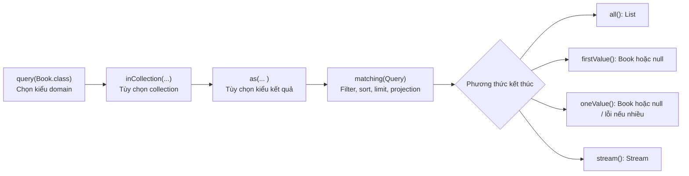

# FluentMongoOperations và các bước chọn kiểu–điều kiện–kết quả

Trong **Spring Data MongoDB**, `MongoTemplate` thường được dùng với các phương thức như `find(query, Book.class)`, `findOne(...)`, `updateFirst(...)` và `remove(...)`. Bên cạnh các phương thức đó, Spring Data cung cấp **fluent API** qua `FluentMongoOperations`: thay vì truyền mọi lựa chọn vào một lời gọi, ta ghép các bước có ý nghĩa rõ ràng từ **kiểu entity → điều kiện truy vấn → cách nhận kết quả**.

Bài học thuộc chương **MongoTemplate** của module **SPRING_DATA_MONGODB**. Mục tiêu là xây dựng trực giác về fluent API, biết lúc nào chọn `query(Class)`, `matching(Query)`, `as(Class)`, `inCollection(String)`, và các phương thức kết thúc như `all()`, `firstValue()`, `oneValue()`, `stream()`; đồng thời sử dụng các biến thể fluent update/remove, nhận biết tác động tới truy vấn MongoDB, index, transaction, kiểm thử và truy cập reactive.

## 1. Fluent API giải quyết điều gì?

Hai cách viết dưới đây cùng thể hiện ý định lấy danh sách sách đang xuất bản của một tác giả.

**MongoTemplate truyền thống:**

```java
Query filter = Query.query(
    Criteria.where("authorId").is(authorId)
            .and("status").is("PUBLISHED")
);

List<Book> books = mongoTemplate.find(filter, Book.class);
```

**FluentMongoOperations:**

```java
List<Book> books = mongoTemplate.query(Book.class)
    .matching(Query.query(
        Criteria.where("authorId").is(authorId)
                .and("status").is("PUBLISHED")
    ))
    .all();
```

Điểm khác biệt chủ yếu là **cách biểu đạt và tổ chức bước gọi**, không phải một động cơ truy vấn MongoDB khác. Cả hai đều dùng hạ tầng mapping, driver, kết nối và server của Spring Data MongoDB. Fluent API thường dễ đọc khi cần thay đổi kiểu kết quả, collection hoặc thao tác kết thúc, và giúp service thể hiện mục đích rõ hơn.



Thứ tự các bước tùy giao diện fluent cụ thể và những tùy chọn đã chọn; sơ đồ nhấn mạnh **ba câu hỏi**: đọc **kiểu gì**, lọc **document nào**, trả về **dạng nào**. Lời gọi kết thúc mới tạo thao tác đọc; không nên cho rằng `query(Book.class)` tự gửi lệnh tới MongoDB.

## 2. Chuẩn bị entity, collection và chỉ mục

Giả sử collection `books` lưu thông tin sách dưới dạng document:

```javascript
{
  _id: ObjectId("674000000000000000000401"),
  tenant_id: "T1",
  author_id: "A-101",
  title: "MongoDB thực hành",
  status: "PUBLISHED",
  published_at: ISODate("2026-01-15T09:00:00Z"),
  price_vnd: NumberLong("280000")
}
```

Một entity Java khớp với document:

```java
import java.time.Instant;
import org.bson.types.ObjectId;
import org.springframework.data.annotation.Id;
import org.springframework.data.mongodb.core.mapping.Document;
import org.springframework.data.mongodb.core.mapping.Field;

@Document(collection = "books")
public class Book {
    @Id
    private ObjectId id;

    @Field("tenant_id")
    private String tenantId;

    @Field("author_id")
    private String authorId;

    private String title;
    private String status;

    @Field("published_at")
    private Instant publishedAt;

    @Field("price_vnd")
    private long priceVnd;

    public Book() {}

    public ObjectId getId() { return id; }
    public String getTenantId() { return tenantId; }
    public String getAuthorId() { return authorId; }
    public String getTitle() { return title; }
    public String getStatus() { return status; }
    public Instant getPublishedAt() { return publishedAt; }
    public long getPriceVnd() { return priceVnd; }
}
```

`@Id` đánh dấu thuộc tính ánh xạ tới trường BSON `_id`, còn `@Field` ánh xạ tên Java sang field thực tế trong MongoDB. Khi xây `Criteria.where("authorId")` với `Book.class`, Spring Data chuyển đường dẫn theo mapping thành `author_id`. Khi viết truy vấn trực tiếp trong mongosh, phải dùng `author_id`.

Nếu service luôn lọc theo `tenant_id`, `status` và sắp xếp theo ngày xuất bản, một index có thể cân nhắc là:

```javascript
db.books.createIndex(
  { tenant_id: 1, status: 1, published_at: -1, _id: -1 },
  { name: "books_tenant_status_publish" }
);
```

Đây là một **đề xuất dựa trên access pattern**, chưa phải bảo đảm query planner sẽ dùng index. Phải kiểm tra `explain` với dữ liệu và tần suất truy vấn thực tế.

## 3. Lấy và inject FluentMongoOperations

`MongoTemplate` triển khai các thao tác MongoDB và hỗ trợ fluent operations. Trong ứng dụng Spring Boot có starter Spring Data MongoDB đồng bộ, hạ tầng template thường được tạo qua auto-configuration.

Ví dụ service chỉ phụ thuộc vào giao diện fluent:

```java
import org.springframework.data.mongodb.core.FluentMongoOperations;
import org.springframework.stereotype.Service;

@Service
public class BookReadService {
    private final FluentMongoOperations mongo;

    public BookReadService(FluentMongoOperations mongo) {
        this.mongo = mongo;
    }
}
```

Khi cần thêm những phương thức không thuộc fluent API, service có thể inject `MongoOperations` hoặc `MongoTemplate` tùy phạm vi công việc. Việc inject interface giúp làm rõ phần API đang dùng; không tạo một kết nối MongoDB mới mỗi lần gọi.

**Cấu hình cần có:** MongoDB Java Driver đồng bộ, một database/URI hợp lệ, `MongoTemplate` tương ứng với database mong muốn, và entity/converter được Spring Data nhận diện. Không cần viết lại toàn bộ bean MongoClient/MongoTemplate chỉ để sử dụng fluent API nếu Boot đã cấu hình phù hợp.

## 4. Bước một — chọn kiểu với query(Class)

Điểm bắt đầu của luồng đọc:

```java
var operation = mongo.query(Book.class);
```

`Book.class` là **domain type**: Spring Data dùng nó để biết collection mặc định (`books`), mapping `@Id`/`@Field` và cách đọc document thành đối tượng Java. Một `query(Class)` mới tạo một đối tượng biểu diễn đường thao tác, **chưa đồng nghĩa đã lấy dữ liệu**.

Khác biệt giữa *domain type* và *result type*:

- **Domain type** `Book`: mô tả document được truy vấn, nơi lấy mapping metadata.
- **Result type** có thể vẫn là `Book`, hoặc một kiểu khác khi dùng `as(Class)`.
- **Collection** mặc định lấy từ `@Document("books")`; có thể thay thế bằng `inCollection(...)` khi có lý do rõ ràng.

Ví dụ truy vấn không có filter, có terminal:

```java
List<Book> allBooks = mongo.query(Book.class).all();
```

Lệnh trên có thể đọc **toàn bộ collection**; không nên sử dụng trong một endpoint production khi collection lớn. “Fluent” không tự thêm phân trang, filter hoặc giới hạn RAM.

## 5. Bước hai — matching(Query): chọn document bằng điều kiện

Dùng `Query` và `Criteria` để khai báo MongoDB filter.

```java
import org.springframework.data.mongodb.core.query.Criteria;
import org.springframework.data.mongodb.core.query.Query;

Query publishedByAuthor = Query.query(
    Criteria.where("tenantId").is("T1")
        .and("authorId").is("A-101")
        .and("status").is("PUBLISHED")
);

List<Book> result = mongo.query(Book.class)
    .matching(publishedByAuthor)
    .all();
```

Về ý nghĩa, bộ lọc gần với:

```javascript
db.books.find({
  tenant_id: "T1",
  author_id: "A-101",
  status: "PUBLISHED"
});
```

`matching(Query)` **không chỉ mang mỗi filter**: `Query` có thể chứa sort, limit, skip và cấu hình field projection. Vì vậy, fluent chain có thể ngắn mà vẫn điều khiển truy vấn khá chi tiết.

### Kết hợp sort và limit

```java
import org.springframework.data.domain.Sort;

Query newest = Query.query(
    Criteria.where("tenantId").is("T1")
        .and("status").is("PUBLISHED")
).with(Sort.by(
    Sort.Order.desc("publishedAt"),
    Sort.Order.desc("id")
)).limit(20);

List<Book> newestBooks = mongo.query(Book.class)
    .matching(newest)
    .all();
```

Bản dịch mapping sẽ dùng `published_at` và `_id` trong BSON. `id` làm tie-breaker giúp thứ tự ổn định nếu nhiều sách có cùng `publishedAt`. Khi phân trang sâu, nên cân nhắc keyset pagination thay vì tăng `skip` lớn, nhưng fluent API **không tự biến offset thành keyset**.

### Điều kiện phức tạp bằng and/or

```java
Criteria tenant = Criteria.where("tenantId").is("T1");
Criteria eligible = new Criteria().orOperator(
    Criteria.where("status").is("PUBLISHED"),
    Criteria.where("status").is("PREORDER")
);

Query query = Query.query(
    new Criteria().andOperator(tenant, eligible)
);

List<Book> books = mongo.query(Book.class)
    .matching(query)
    .all();
```

Với ứng dụng đa tenant, điều kiện tenant phải có ở **mọi nhánh truy vấn** và được lấy từ ngữ cảnh xác thực đáng tin cậy, không chỉ từ một tham số tùy ý của client. Việc có API fluent không tự bổ sung tenant isolation hay phân quyền.

## 6. Bước ba — chọn cách nhận kết quả

Các phương thức cuối chain thể hiện câu hỏi mà service muốn trả lời.

| Cách kết thúc | Ý nghĩa đối với API đồng bộ | Trường hợp phù hợp |
| --- | --- | --- |
| `all()` | Trả `List<T>` các document phù hợp | Danh sách đã có filter và limit |
| `firstValue()` | Trả giá trị đầu tiên hoặc `null` khi rỗng | Đã sort để quyết định bản ghi “đầu tiên” |
| `oneValue()` | Yêu cầu tối đa một kết quả; có thể báo lỗi nếu nhiều | Tìm kiếm theo khóa duy nhất hoặc điều kiện có ràng buộc duy nhất |
| `stream()` | Trả `Stream<T>` để tiêu thụ tuần tự | Xử lý dữ liệu lớn có quản lý tài nguyên cursor |

**Không thể tùy tiện thay `oneValue()` bằng `firstValue()`:** hai phương thức khác nhau về hợp đồng số lượng. Nếu điều kiện dự kiến duy nhất nhưng có hai document khớp, `oneValue()` giúp làm lộ vấn đề tính duy nhất; `firstValue()` chấp nhận lấy một kết quả theo query.

### 6.1. all() — danh sách

```java
List<Book> cards = mongo.query(Book.class)
    .matching(
        Query.query(Criteria.where("status").is("PUBLISHED"))
            .limit(30)
    )
    .all();
```

`all()` vật hóa danh sách kết quả trong bộ nhớ Java. Nếu query có thể trả hàng trăm nghìn document, phải thêm giới hạn, chọn projection hoặc xem xét streaming/batch processing. Hãy đo kích thước document thực, không chỉ số phần tử.

### 6.2. firstValue() — lấy đầu tiên

```java
Book newest = mongo.query(Book.class)
    .matching(
        Query.query(Criteria.where("tenantId").is("T1"))
            .with(Sort.by(Sort.Order.desc("publishedAt"),
                          Sort.Order.desc("id")))
            .limit(1)
    )
    .firstValue();

if (newest == null) {
    // Tenant chưa có sách phù hợp.
}
```

Nếu không chỉ định sort, “đầu tiên” không có nghĩa sách mới nhất, sách có ID nhỏ nhất hay thứ tự insert. Luôn dùng `Sort` khi có ý định lấy “mới nhất”, “giá thấp nhất” hoặc một thứ tự có ý nghĩa nghiệp vụ.

### 6.3. oneValue() — yêu cầu duy nhất

Giả sử collection có field `isbn` và **unique index thực sự tồn tại** trên phạm vi ISBN tương ứng:

```java
Book byIsbn = mongo.query(Book.class)
    .matching(Query.query(Criteria.where("isbn").is(isbn)))
    .oneValue();
```

`oneValue()` phù hợp khi nghiệp vụ kỳ vọng **tối đa một document**. Nếu không có document, kết quả có thể là `null`. Nếu nhiều document khớp, Spring Data có thể phát sinh lỗi số lượng kết quả không đúng (ví dụ một subtype của `IncorrectResultSizeDataAccessException`) thay vì âm thầm chọn một bản ghi.

**Phân biệt hai cách bảo đảm:** dùng `oneValue()` thể hiện hợp đồng trong code và giúp phát hiện dữ liệu sai, nhưng **không thay thế unique index** trên MongoDB để chặn các thao tác ghi cạnh tranh tạo trùng. Nếu uniqueness theo `tenant_id + isbn`, nên lọc tenant và tạo compound unique index phù hợp.

### 6.4. stream() — tiêu thụ tuần tự

```java
import java.util.stream.Stream;

Query query = Query.query(
    Criteria.where("tenantId").is("T1")
        .and("status").is("PUBLISHED")
).with(Sort.by(Sort.Order.asc("id")));

try (Stream<Book> books = mongo.query(Book.class)
        .matching(query)
        .stream()) {
    books.forEach(book -> processOneBook(book));
}
```

`processOneBook` là hàm nghiệp vụ minh họa cần có trong ứng dụng. **Đóng `Stream` bằng try-with-resources** để giải phóng tài nguyên driver/cursor đúng lúc. Không trả một `Stream` còn phụ thuộc cursor ra khỏi service rồi đóng `MongoClient`, hoặc giữ stream qua nhiều request HTTP.

`stream()` không tạo keyset pagination cho API: nó giúp tiêu thụ kết quả của **một truy vấn đang mở**, còn keyset là chiến lược duyệt qua các **request độc lập** theo khóa sắp xếp. Streaming cũng không có nghĩa MongoDB không tốn bộ nhớ; nếu query cần sort không có index, server có thể phải xử lý nhiều dữ liệu trước khi trả batch.

## 7. as(Class) — chọn kiểu kết quả khác entity

Trong một API chỉ trả tiêu đề và tên tác giả, service có thể muốn một read model nhỏ thay vì entity đầy đủ.

Khai báo kiểu kết quả:

```java
import org.bson.types.ObjectId;

public class BookCard {
    private ObjectId id;
    private String title;

    public BookCard() {}

    public ObjectId getId() { return id; }
    public String getTitle() { return title; }
}
```

Sử dụng `as(BookCard.class)` và server-side field projection trong `Query`:

```java
Query listQuery = Query.query(
    Criteria.where("tenantId").is("T1")
        .and("status").is("PUBLISHED")
).with(Sort.by(Sort.Order.desc("publishedAt"),
              Sort.Order.desc("id"))).limit(20);

listQuery.fields().include("title");

List<BookCard> cards = mongo.query(Book.class)
    .as(BookCard.class)
    .matching(listQuery)
    .all();
```

`Book.class` vẫn là domain type dùng để lập query/mapping collection, còn `BookCard.class` là kiểu nhận kết quả. Trường `_id` thường được giữ trong projection nếu không loại bỏ, giúp code nhận ID tương ứng.

**Lưu ý phân biệt hai khái niệm:** `as(BookCard.class)` yêu cầu ánh xạ sang **kiểu Java khác**, nhưng không nên mặc định điều đó luôn tối ưu payload ở mức BSON trên mọi phiên bản/cấu hình. `listQuery.fields().include("title")` mới biểu thị rõ ràng những field server cần trả. Với DTO có `@Field`, constructor bất biến hoặc projection interface, cần integration test trên dữ liệu thật và phiên bản Spring Data đang dùng.

Đối tượng được đọc qua projection thường **thiếu một số field của entity gốc**. Không lấy một entity bị projection rồi gọi `save` để cập nhật một field, vì có thể ghi đè/làm mất dữ liệu chưa được tải. Nên dùng DTO riêng và thao tác `update` tường minh.

## 8. inCollection(String) — lựa chọn collection có chủ đích

Theo `@Document("books")`, domain `Book` mặc định gắn với collection `books`. Nếu nghiệp vụ có collection chuyên biệt cùng schema (ví dụ một collection dành cho dữ liệu lịch sử), fluent API có thể thay lựa chọn:

```java
List<Book> archived = mongo.query(Book.class)
    .inCollection("books_archive")
    .matching(
        Query.query(Criteria.where("status").is("ARCHIVED"))
            .limit(20)
    )
    .all();
```

`inCollection("books_archive")` **không chuyển sang database khác**, chỉ chọn collection trong database hiện tại của `MongoTemplate`. Truy vấn vẫn dùng mapping của `Book` cho các property.

Tránh cho client gửi thẳng tên collection mà không kiểm tra: collection name là **cấu trúc truy vấn**, không phải giá trị filter. Nên chọn collection từ danh sách cho phép hoặc định tuyến cố định bởi backend; không dùng nó như cách “tự động” bảo đảm tenant isolation.

## 9. Fluent update: chọn kiểu, điều kiện, thay đổi và phạm vi ghi

Fluent API không chỉ có read operations. Với update, cần ba lựa chọn chính: **entity type**, **filter**, và **các thay đổi**.

Ví dụ chuyển sách `DRAFT` thành `PUBLISHED` cho một tenant:

```java
import com.mongodb.client.result.UpdateResult;
import org.springframework.data.mongodb.core.query.Update;

Query draftOfTenant = Query.query(
    Criteria.where("tenantId").is("T1")
        .and("status").is("DRAFT")
);

Update statusChange = new Update().set("status", "PUBLISHED");

UpdateResult firstResult = mongo.update(Book.class)
    .matching(draftOfTenant)
    .apply(statusChange)
    .first();

long updated = firstResult.getModifiedCount();
```

Hợp đồng trên là **chỉ cập nhật document đầu tiên khớp**; nếu muốn cập nhật mọi document thỏa filter, chọn terminal thao tác phù hợp:

```java
UpdateResult allResult = mongo.update(Book.class)
    .matching(draftOfTenant)
    .apply(statusChange)
    .all();
```

`first()` và `all()` trong đường **update** có nghĩa phạm vi document sẽ được ghi, **khác** `firstValue()`/`all()` của đường **find**. Hãy đọc từ khóa mở đầu `query(...)` hay `update(...)` trước khi kết luận ý nghĩa của terminal.

Nếu cần đúng một document theo ID, hãy lọc bằng `id` và tenant, không dựa vào “first” của một tập nhiều document theo thứ tự tự nhiên. Tùy nghiệp vụ có thể dùng `findAndModify` hoặc cập nhật có điều kiện để nhận document trước/sau khi cập nhật.

### 9.1. Tính nguyên tử và @Version

Một update MongoDB trên **một document** là nguyên tử ở cấp document. Nhưng cập nhật nhiều document không mặc định là một transaction chung. Ngoài ra, các thao tác `MongoTemplate` update thủ công có thể cần bạn xử lý `@Version` hoặc điều kiện chống ghi đè theo quy tắc phiên bản đang dùng; đừng giả định mọi update tự mang hợp đồng optimistic locking tương tự một lần `repository.save(entity)`.

Khi cập nhật trạng thái theo logic “chỉ khi còn DRAFT”, hãy đưa `status: DRAFT` vào filter và xem `matchedCount`/`modifiedCount`. Nếu filter không còn khớp do writer khác đổi trạng thái, thao tác sẽ không âm thầm chấp nhận điều kiện cũ.

## 10. Fluent remove: chọn kiểu, điều kiện và xóa

Xóa theo bộ lọc là thao tác nguy hiểm, vì vậy luôn ràng buộc rõ tenant và trạng thái.

```java
import com.mongodb.client.result.DeleteResult;

Query oldDrafts = Query.query(
    Criteria.where("tenantId").is("T1")
        .and("status").is("DRAFT")
);

DeleteResult removed = mongo.remove(Book.class)
    .matching(oldDrafts)
    .all();

long count = removed.getDeletedCount();
```

Đây là **xóa document** đang khớp, không phải xóa một field. Nếu cần xóa riêng một trường, dùng `Update.unset(...)`. Không sao chép ví dụ này sang production khi chưa thêm điều kiện retention/time-limit và phân quyền cần thiết.

Với CRUD đơn giản, `MongoRepository` có thể dễ đọc hơn; fluent update/remove hữu ích khi service cần mô tả rõ target entity, filter và phạm vi thao tác. Khi lọc thiếu tenant hoặc filter quá rộng, API fluent **không cung cấp bảo vệ mặc định**.

## 11. Count, exists và aggregation nằm ở đâu?

Fluent query tập trung vào đường **tìm và ánh xạ document**. Nếu chỉ muốn số lượng hoặc boolean, `MongoTemplate` cung cấp các thao tác chuyên dụng, không cần tải tất cả entity rồi `size()`:

```java
Query published = Query.query(
    Criteria.where("tenantId").is("T1")
        .and("status").is("PUBLISHED")
);

long total = mongoTemplate.count(published, Book.class);
boolean any = mongoTemplate.exists(published, Book.class);
```

Đoạn trên giả định service cũng có `MongoTemplate` hoặc `MongoOperations`. Tùy phiên bản Spring Data, fluent APIs và repository có thể hỗ trợ thêm cách kết thúc/đường truy vấn count hoặc exists; lựa chọn ổn định là dùng **API chuyên biệt** khi chỉ cần số lượng hoặc sự tồn tại.

Nếu cần `$group`, `$lookup`, `$unwind` hoặc các stage khác, hãy dùng aggregation API thay vì cố lắp một pipeline vào `matching(Query)` của một lệnh find:

```java
Aggregation pipeline = Aggregation.newAggregation(
    Aggregation.match(
        Criteria.where("tenantId").is("T1")
            .and("status").is("PUBLISHED")
    ),
    Aggregation.group("authorId").count().as("bookCount")
);
```

Đoạn này minh họa khai báo pipeline (cần import `org.springframework.data.mongodb.core.aggregation.Aggregation`); việc thực thi cần dùng `MongoTemplate.aggregate(...)` hoặc aggregation operation phù hợp. Fluent find, update và aggregation là những thao tác khác nhau cả ở phía MongoDB Server.

## 12. Truy vấn động: tránh tạo điều kiện mâu thuẫn

Một yêu cầu tìm kiếm có thể có các filter tùy chọn: tenant bắt buộc, status có thể bỏ qua, tác giả có thể bỏ qua, giá có thể có giới hạn trên.

```java
import org.springframework.data.mongodb.core.query.Criteria;
import org.springframework.data.mongodb.core.query.Query;

Query buildFilter(
        String tenantId, String status,
        String authorId, Long maxPriceVnd) {

    Criteria criteria = Criteria.where("tenantId").is(tenantId);

    if (status != null && !status.isBlank()) {
        criteria = criteria.and("status").is(status);
    }
    if (authorId != null && !authorId.isBlank()) {
        criteria = criteria.and("authorId").is(authorId);
    }
    if (maxPriceVnd != null) {
        if (maxPriceVnd < 0) {
            throw new IllegalArgumentException("Giá tối đa phải không âm");
        }
        criteria = criteria.and("priceVnd").lte(maxPriceVnd);
    }

    return Query.query(criteria).limit(100);
}
```

Sử dụng:

```java
List<Book> result = mongo.query(Book.class)
    .matching(buildFilter("T1", "PUBLISHED", null, 500_000L))
    .all();
```

Trên những truy vấn phức tạp, hãy tránh thêm điều kiện trùng tên rồi ghi đè, hoặc tạo JSON bằng cách nối input thô. `Criteria` biểu diễn giá trị động an toàn hơn và Spring Data tự chuyển `priceVnd` thành `price_vnd`. Nếu người dùng được chọn field/sort, hãy dùng allowlist tên property thay vì để họ tự đưa toán tử MongoDB.

## 13. Hiệu năng, index và đo đạc

Một fluent chain gọn không làm câu truy vấn tự nhanh hơn. Những vấn đề hiệu năng cần đo:

- **Filter:** các field equality như `tenant_id` và `status` có chọn lọc không?
- **Sort:** `published_at DESC, _id DESC` có được index hỗ trợ hay phải sort nhiều document?
- **Limit:** API đã giới hạn số record trả về chưa?
- **Projection:** có đang tải field lớn như nội dung sách hoặc toàn bộ array lồng dù chỉ cần tiêu đề?
- **Collection:** có đang chọn sai collection vì `inCollection(...)` hoặc kết nối sai database?
- **Stream:** cursor có được đóng và liệu server có giữ tài nguyên lâu?
- **Update/remove:** filter có đủ ràng buộc tenant/trạng thái, write concern có xác nhận để đọc số document bị thay đổi?

Đối chiếu truy vấn tương đương trực tiếp trong mongosh:

```javascript
db.books.find({
  tenant_id: "T1",
  status: "PUBLISHED"
})
.sort({ published_at: -1, _id: -1 })
.limit(20)
.explain("executionStats");
```

Xem `winningPlan`, `totalKeysExamined`, `totalDocsExamined`, `nReturned` và stage `SORT`. Nếu query kết hợp nhiều điều kiện hoặc sắp xếp không tương thích index, MongoDB có thể phải scan/sort nhiều dữ liệu. Với dữ liệu lớn, hãy benchmark cả p95/p99 latency và số byte trả về, thay vì chỉ đo thời gian Java tạo fluent chain.

## 14. Kiểm thử fluent operations với MongoDB thật

Mock `FluentMongoOperations` giúp xác minh service gọi chain nào, nhưng khó chứng minh mapping `@Field`, BSON type, query/filter, sort và số kết quả trên MongoDB thực. Nên viết integration test với một MongoDB test cô lập.

Ví dụ test chèn **raw document** rồi dùng fluent API để đọc:

```java
import static org.assertj.core.api.Assertions.assertThat;

import java.util.List;
import org.bson.Document;
import org.bson.types.ObjectId;
import org.junit.jupiter.api.Test;
import org.springframework.beans.factory.annotation.Autowired;
import org.springframework.boot.test.autoconfigure.data.mongo.DataMongoTest;
import org.springframework.data.mongodb.core.MongoTemplate;
import org.springframework.data.mongodb.core.query.Criteria;
import org.springframework.data.mongodb.core.query.Query;

@DataMongoTest
class FluentBookQueryTest {
    @Autowired MongoTemplate template;

    @Test
    void shouldMatchUsingMappedJavaPropertyNames() {
        ObjectId id1 = new ObjectId();
        ObjectId id2 = new ObjectId();
        String tenant = "test-" + id1.toHexString();

        template.getCollection("books").insertMany(List.of(
            new Document("_id", id1)
                .append("tenant_id", tenant)
                .append("author_id", "A-101")
                .append("status", "PUBLISHED")
                .append("title", "Sách A"),
            new Document("_id", id2)
                .append("tenant_id", tenant)
                .append("author_id", "A-102")
                .append("status", "DRAFT")
                .append("title", "Sách B")
        ));

        Query published = Query.query(
            Criteria.where("tenantId").is(tenant)
                .and("status").is("PUBLISHED")
        );

        List<Book> books = template.query(Book.class)
            .matching(published)
            .all();

        assertThat(books).hasSize(1);
        assertThat(books.get(0).getId()).isEqualTo(id1);
        assertThat(books.get(0).getTitle()).isEqualTo("Sách A");
        assertThat(books.get(0).getAuthorId()).isEqualTo("A-101");

        Book single = template.query(Book.class)
            .matching(published)
            .oneValue();

        assertThat(single).isNotNull();
        assertThat(single.getId()).isEqualTo(id1);
    }
}
```

Test trên cô lập thông tin tenant bằng ID ngẫu nhiên và không yêu cầu xóa document toàn collection. Chỉ chạy với database **dành cho test** (ví dụ Testcontainers), không chạy trên production. Nếu project dùng Spring Boot/Spring Data phiên bản khác, cần điều chỉnh test slice/dependency theo phiên bản thực tế.

Các ca kiểm thử cần bổ sung:

1. `firstValue()` với sort và tập rỗng.
2. `oneValue()` khi hai document khớp để thấy hành vi uniqueness.
3. `as(BookCard.class)` với field projection: chỉ nhận dữ liệu cần thiết, không ghi đè entity gốc.
4. `inCollection("books_archive")` đọc đúng collection, không lẫn `books`.
5. Fluent `update(...).first()` và `.all()` thay đổi đúng số document khi có hai bản ghi khớp.
6. Fluent `remove(...).all()` không xóa document tenant khác.
7. Lệnh `stream()` được đóng khi xử lý xong, không kéo dài cursor qua ranh giới không còn tài nguyên.
8. Chẩn đoán `explain` dưới tập dữ liệu lớn để xác nhận compound index.

## 15. Reactive fluent API khác ở kiểu kết quả và thời điểm chạy

Trong ứng dụng WebFlux, `ReactiveMongoTemplate` dùng reactive MongoDB Driver. Fluent API có hình thức truy vấn tương tự nhưng kết quả thường là publisher `Mono<T>`/`Flux<T>` thay vì giá trị/collection đồng bộ:

```java
import org.springframework.data.mongodb.core.ReactiveMongoTemplate;
import reactor.core.publisher.Flux;

Flux<Book> findPublishedReactive(
        ReactiveMongoTemplate template, String tenantId) {

    Query query = Query.query(
        Criteria.where("tenantId").is(tenantId)
            .and("status").is("PUBLISHED")
    ).limit(20);

    return template.query(Book.class)
        .matching(query)
        .all();
}
```

`Flux<Book>` chỉ mô tả thao tác cho đến khi có subscription; Spring WebFlux thường subscribe vào publisher trả từ handler. Không gọi `block()` ngay trong event-loop hay tự `subscribe()` trong service rồi trả response trước khi truy vấn hoàn tất. Query và index vẫn phải tối ưu: reactive không biến một `COLLSCAN` thành `IXSCAN`.

Transaction reactive cần đúng driver và `ReactiveMongoTransactionManager`, duy trì context trên chuỗi Reactor. Không cho rằng một synchronous `FluentMongoOperations` trở thành reactive chỉ bằng cách bọc kết quả với `Mono.just(...)`.

## 16. Lỗi phổ biến và cách tránh

| Lỗi | Vì sao nguy hiểm | Cách xử lý |
| --- | --- | --- |
| Gọi `query(Book.class)` rồi nghĩ đã gửi lệnh | Đối tượng fluent chưa kết thúc thao tác | Chọn terminal `all()`, `firstValue()`, `oneValue()`, `stream()` |
| Dùng `all()` trên collection rất lớn | Tải nhiều document và tốn heap | Thêm filter/limit, projection hoặc streaming đúng cách |
| Chọn `firstValue()` cho yêu cầu duy nhất | Che giấu dữ liệu trùng | Dùng `oneValue()` và unique index phù hợp |
| Lấy “mới nhất” mà không sort | Thứ tự tự nhiên không đáng tin | Sort theo thời gian cùng tie-breaker |
| Truy vấn theo `author_id` như tên Java property | Dễ nhầm mapping khi code đổi schema | Dùng `authorId` và xác minh `@Field` |
| Hiểu `as()` là đã chắc chắn chỉ đọc hai field | Có thể vẫn truyền nhiều dữ liệu trên mạng | Cấu hình `Query.fields()` và đo payload |
| Dùng `inCollection(...)` với input tự do | Đọc sai collection hoặc mất tenant isolation | Allowlist và kiểm soát tenant tại server |
| Quên đóng `stream()` | Tài nguyên cursor/kết nối kéo dài | Try-with-resources |
| Dùng `save` trên entity đọc thiếu qua projection | Có nguy cơ mất field không được tải | DTO + update từng trường |
| Fluent remove với filter quá rộng | Có thể xóa nhiều document ngoài dự kiến | Luôn ràng buộc tenant, quyền và điều kiện nghiệp vụ |
| Tin vào chỉ một `@Transactional` không cấu hình manager | Không đạt tính nhất quán mong muốn | Cấu hình transaction/session đúng driver/topology |
| Test chỉ mock fluent chain | Không xác minh query mapping và BSON | Integration test trên MongoDB thực |

## 17. Bài thực hành và tự đánh giá

**Bài thực hành:** tạo collection `books` trong MongoDB dành cho phát triển và entity `Book` như ví dụ. Sau đó:

1. Dùng `mongo.query(Book.class).matching(...).all()` để liệt kê sách `PUBLISHED` của `T1`, giới hạn 20 bản ghi.
2. Thêm sort `publishedAt DESC, id DESC` và gọi `firstValue()` để lấy sách mới nhất.
3. Tạo điều kiện dự kiến duy nhất (ví dụ `tenantId + isbn` sau khi thêm field/index); thử `oneValue()` trên dữ liệu trùng.
4. Dùng `as(BookCard.class)` và `Query.fields().include("title")`; quan sát các field được trả bằng command monitoring.
5. Tạo collection `books_archive`, sử dụng `inCollection(...)` để đọc mà không thay domain mapping.
6. Dùng `update(Book.class).matching(...).apply(...).first()`; kiểm tra `matchedCount`/`modifiedCount`.
7. Thử `remove(Book.class).matching(...).all()` **chỉ** trên dữ liệu test với filter tenant cụ thể.
8. Dùng `stream()` trong try-with-resources, so sánh với `all()` khi đọc dữ liệu có giới hạn.
9. Thêm compound index dựa trên truy vấn thực tế rồi kiểm tra `explain("executionStats")`.

**Câu 1.** `query(Book.class)` chọn collection hay kiểu kết quả?  
**Đáp án:** nó chọn **domain type** để xác định mapping và collection mặc định; có thể chọn kiểu kết quả khác bằng `as(...)` và collection khác bằng `inCollection(...)`.

**Câu 2.** `matching(Query)` chỉ có filter không?  
**Đáp án:** không; `Query` có thể bao gồm filter, sort, limit, skip và field projection.

**Câu 3.** Vì sao `oneValue()` khác `firstValue()`?  
**Đáp án:** `oneValue()` yêu cầu tối đa một kết quả, còn `firstValue()` lấy kết quả đầu khi có nhiều; muốn kết quả “đầu” có nghĩa nghiệp vụ cần sort rõ ràng.

**Câu 4.** `as(BookCard.class)` có đồng nghĩa một `Book` entity được lưu thành `BookCard` không?  
**Đáp án:** không; `as()` chỉ thay **kiểu ánh xạ kết quả đọc**, không thay đổi dữ liệu lưu ở MongoDB.

**Câu 5.** Đường `update(...).apply(...).all()` có giống `query(...).all()` không?  
**Đáp án:** không; một bên cập nhật mọi document khớp, bên kia đọc và trả danh sách document.

**Câu 6.** Có thể trả trực tiếp Java `Stream<Book>` cho client để tiêu thụ sau khi service đóng tài nguyên không?  
**Đáp án:** không nên; stream có thể phụ thuộc driver cursor đang mở và cần được tiêu thụ/đóng trong vòng đời hợp lệ.

**Câu 7.** Vì sao fluent query vẫn cần index?  
**Đáp án:** fluent chỉ là API phía Java; MongoDB Server vẫn quyết định query plan dựa trên filter, sort, index và phân bố dữ liệu.

**Kết luận:** dùng **FluentMongoOperations** theo tư duy **chọn kiểu (`query(Class)`) → chọn điều kiện (`matching(Query)`) → chọn kết quả (`all`, `firstValue`, `oneValue`, `stream`)** sẽ làm ý định truy vấn rõ ràng. Các tùy chọn `as` và `inCollection` thay kiểu ánh xạ/đích đọc; các đường `update` và `remove` có terminal cùng tên nhưng mang tác dụng ghi. Độ chính xác, tính nhất quán và hiệu năng vẫn phải được kiểm chứng bằng mapping BSON, filter an toàn, index, transaction và integration test với MongoDB thật.

