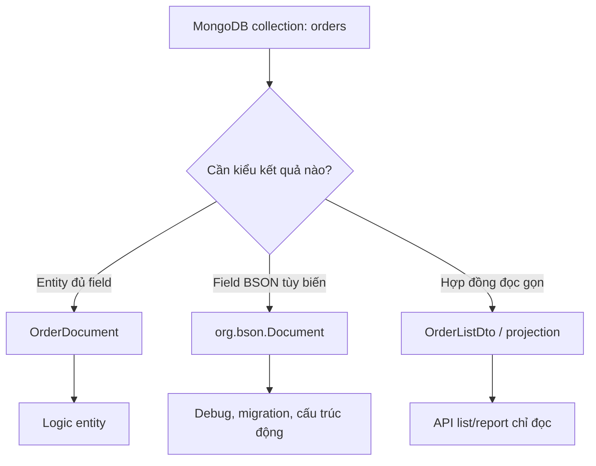

# Trả Document hoặc DTO khi không cần entity đầy đủ

## 1. Bài toán: màn hình chỉ cần vài trường trong document lớn

Trong hệ thống đặt hàng, một document `orders` có thể chứa thông tin khách hàng, địa chỉ giao hàng, danh sách sản phẩm, số tiền, lịch sử cập nhật và ghi chú nội bộ. Tuy nhiên, trang danh sách đơn hàng thường chỉ cần **mã đơn, trạng thái, tổng tiền và thời điểm tạo**.

Nếu mọi truy vấn đều ánh xạ sang `OrderDocument` đầy đủ, ứng dụng có thể:

- Chuyển nhiều byte BSON hơn mức cần thiết qua mạng.
- Tạo object lồng nhau và mảng `items` dù màn hình không dùng đến.
- Tốn thêm thời gian chuyển đổi kiểu dữ liệu và serialize JSON response.
- Dễ nhầm đối tượng đọc một phần với entity đầy đủ, dẫn tới lỗi khi ghi trở lại.
- Vô tình trả hoặc ghi log dữ liệu nội bộ nếu không có ranh giới API rõ ràng.

**MongoTemplate** của **Spring Data MongoDB** cho phép chủ động lựa chọn **cách truy vấn, tập field và kiểu kết quả**. Bên cạnh việc trả về entity, hai hướng quan trọng là:

1. Trả về **`org.bson.Document`** khi muốn thao tác trực tiếp với cấu trúc BSON/field động, debug dữ liệu cũ hoặc xử lý kết quả không có một model Java cố định.
2. Trả về **DTO/record hoặc interface projection** khi ứng dụng muốn một hợp đồng dữ liệu đọc gọn và có kiểu tường minh.

Đây là bài thuộc chương **MongoTemplate** của module **SPRING_DATA_MONGODB**. Nội dung kết nối việc sử dụng template với thiết kế truy vấn, projection, aggregation, index, transaction, reactive access, kiểm thử và chẩn đoán hiệu năng. Trọng tâm là **đọc đúng dữ liệu cần dùng mà không cần tải hoặc sử dụng entity đầy đủ**; không biến `Document` và DTO thành các công cụ thay thế cho nhau trong mọi trường hợp.

## 2. Dữ liệu mẫu và entity nguồn

### 2.1. Document BSON trong MongoDB

Trong database thử nghiệm, giả sử có bản ghi:

```javascript
db.orders.insertOne({
  _id: "ord-1001",
  customer_id: "cus-01",
  status: "PAID",
  total_amount: NumberDecimal("1850000.00"),
  placed_at: ISODate("2026-11-20T02:00:00Z"),
  shipping_address: {
    recipient: "Nguyễn An",
    city: "Đà Nẵng",
    phone: "0900000000"
  },
  items: [
    {
      product_id: "p-10",
      name_at_purchase: "Bàn phím cơ",
      quantity: NumberInt(2),
      unit_price: NumberDecimal("925000.00")
    }
  ],
  internal_note: "Giao trong giờ hành chính"
});
```

Lệnh `insertOne` minh họa **BSON thực tế** khi ghi trực tiếp từ `mongosh`. Nó không đi qua mapping của Spring Data. Trong code sản xuất, dạng BSON phải được xác minh sau khi ghi qua repository/template vì converter và annotation có thể làm thay đổi kiểu/tên trường.

Từ dữ liệu này, màn hình danh sách chỉ muốn kết quả tương đương:

```javascript
{
  _id: "ord-1001",
  status: "PAID",
  total_amount: NumberDecimal("1850000.00"),
  placed_at: ISODate("2026-11-20T02:00:00Z")
}
```

Field `shipping_address`, `items` và `internal_note` vẫn nằm trong database nhưng **không được trả về** khi dùng projection phù hợp.

### 2.2. Entity Java đầy đủ

Ví dụ Java 17+ với Spring Data MongoDB:

```java
import java.math.BigDecimal;
import java.time.Instant;
import java.util.List;

import org.springframework.data.mongodb.core.mapping.Document;
import org.springframework.data.mongodb.core.mapping.Field;
import org.springframework.data.mongodb.core.mapping.FieldType;
import org.springframework.data.mongodb.core.mapping.MongoId;

@Document(collection = "orders")
public record OrderDocument(
    @MongoId(FieldType.STRING)
    String id,

    @Field("customer_id")
    String customerId,

    String status,

    @Field(value = "total_amount", targetType = FieldType.DECIMAL128)
    BigDecimal totalAmount,

    @Field("placed_at")
    Instant placedAt,

    @Field("shipping_address")
    ShippingAddress shippingAddress,

    List<OrderItem> items,

    @Field("internal_note")
    String internalNote
) {
    public record ShippingAddress(
        String recipient,
        String city,
        String phone
    ) {}

    public record OrderItem(
        @Field("product_id") String productId,
        @Field("name_at_purchase") String nameAtPurchase,
        int quantity,
        @Field(value = "unit_price", targetType = FieldType.DECIMAL128)
        BigDecimal unitPrice
    ) {}
}
```

Ở đây tên Java và BSON được cố tình đặt khác nhau. Ví dụ `customerId` lưu thành `customer_id`, `totalAmount` thành `total_amount`. `@MongoId(FieldType.STRING)` thể hiện chủ đích lưu `id` vào `_id` với kiểu BSON `string`.

Document có thể có thêm type hint `_class` khi ghi qua Spring Data tùy cấu hình mapping; dữ liệu mẫu tạo bằng `mongosh` không tự chứa field ấy.

**Điểm cần nhớ:** entity đầy đủ phù hợp cho việc thao tác nghiệp vụ có yêu cầu đọc toàn bộ aggregate; không nhất thiết là kiểu trả về tốt nhất cho mọi endpoint chỉ đọc.

## 3. Ba lựa chọn đọc và ranh giới mapping

| Cách đọc | Kiểu trả về | Đi qua mapping nào? | Phù hợp khi |
| --- | --- | --- | --- |
| `mongoTemplate.find(query, OrderDocument.class)` | `List<OrderDocument>` | Entity mapping theo `OrderDocument` | Cần aggregate đầy đủ hoặc logic dựa trên entity |
| `mongoTemplate.find(query, Document.class, "orders")` | `List<org.bson.Document>` | Query/template và cơ chế chuyển đổi `Document`; không dựng entity `OrderDocument` | Cần tập field BSON linh hoạt, xử lý dữ liệu không đồng nhất |
| `mongoTemplate.query(OrderDocument.class).as(OrderListDto.class)...all()` | `List<OrderListDto>` | Dùng **entity nguồn** để mapping query, dùng **DTO** để dựng kết quả | Cần DTO gọn, tên Java/BSON có thể khác |
| `mongoTemplate.getCollection("orders").find(...)` | `MongoCollection<Document>` trả raw driver document | Bỏ qua Spring Data entity mapping ở đường driver | Chẩn đoán BSON, dùng tính năng driver cấp thấp |

`org.bson.Document` là một **class Java của MongoDB Driver**, khác với annotation `@Document` của Spring Data. Cả hai có chữ “Document” nhưng vai trò khác hẳn:

- `@Document(collection = "orders")` đánh dấu kiểu entity và metadata collection.
- `org.bson.Document` là cấu trúc key/value chứa dữ liệu BSON được giải mã ở driver, có các phương thức như `getString`, `getDate` và `get`.

Không nên gọi `org.bson.Document` là “JSON thuần” vì trong dữ liệu vẫn có `Decimal128`, `ObjectId`, `Date` và các giá trị BSON đặc thù. Chuyển sang JSON để hiển thị có thể làm khác biểu diễn kiểu số/ngày.



## 4. Giới hạn trường bằng `Query.fields()`

Trước khi quyết định trả `Document` hay DTO, cần hiểu cách chọn field ngay trên server.

### 4.1. Projection include

Trong `mongosh`:

```javascript
db.orders.find(
  { customer_id: "cus-01" },
  {
    _id: 1,
    status: 1,
    total_amount: 1,
    placed_at: 1
  }
);
```

Trong Spring Data MongoDB, một query **được ánh xạ theo entity nguồn** có thể dùng property Java:

```java
import org.springframework.data.mongodb.core.query.Criteria;
import org.springframework.data.mongodb.core.query.Query;

Query query = Query.query(
    Criteria.where("customerId").is("cus-01")
);

query.fields()
    .include("id")
    .include("status")
    .include("totalAmount")
    .include("placedAt");
```

Khi `Query` được thực thi qua đường có metadata `OrderDocument`, Spring Data có thể ánh xạ `customerId` → `customer_id`, `totalAmount` → `total_amount` và `id` → `_id`.

**Đừng tự suy ra cùng một query sẽ được mapping y hệt khi target chỉ là `Document.class` hoặc một DTO độc lập.** Đường template được gọi quyết định domain type dùng để mapping tên property.

### 4.2. Projection exclude và `_id` mặc định

MongoDB bao gồm `_id` theo mặc định, trừ khi bạn chủ động loại nó:

```javascript
db.orders.find(
  { customer_id: "cus-01" },
  { status: 1, total_amount: 1, _id: 0 }
);
```

Các chỉ thị include (`1`) và exclude (`0`) thông thường **không được trộn tùy ý**, ngoại trừ `_id` và một số toán tử projection đặc thù theo server. Ví dụ `{ status: 1, items: 0 }` là projection thông thường không hợp lệ; hãy chọn include hoặc exclude.

Đối với API list có hợp đồng cố định, **include whitelist** thường dễ bảo trì hơn exclude. Nếu sau này document được thêm `risk_note`, một exclusion list cũ có thể làm API nhận thêm field ngoài dự kiến; inclusion list sẽ không tự mở rộng.

### 4.3. Field lồng nhau và mảng

```javascript
// Chỉ lấy tên người nhận, không cần toàn bộ địa chỉ.
db.orders.find(
  { _id: "ord-1001" },
  { "shipping_address.recipient": 1 }
);

// Chỉ lấy product_id từ từng phần tử của items.
db.orders.find(
  { _id: "ord-1001" },
  { "items.product_id": 1 }
);
```

Projection `items.product_id` vẫn có thể giữ **toàn bộ số phần tử** của array; nó chỉ giảm field trong từng phần tử. Muốn chọn vài phần tử dùng `$slice`, `$elemMatch` hoặc aggregation pipeline phù hợp; không nhầm chọn field với chọn phần tử.

Một entity/subdocument đọc qua projection bị thiếu nhiều trường không còn là representation đầy đủ; nếu muốn thao tác ghi, hãy đọc entity đúng phạm vi hoặc dùng cập nhật từng field.

## 5. Cách 1: trả `org.bson.Document` bằng `MongoTemplate`

### 5.1. Query raw-field và collection tường minh

Khi chọn `Document.class` làm target, một lựa chọn dễ kiểm soát là viết **tên field BSON thực** trong query và projection:

```java
import java.util.List;

import org.bson.Document;
import org.springframework.data.domain.Sort;
import org.springframework.data.mongodb.core.MongoTemplate;
import org.springframework.data.mongodb.core.query.Criteria;
import org.springframework.data.mongodb.core.query.Query;

public List<Document> findRawOrderHeaders(
    MongoTemplate template,
    String customerId
) {
    Query query = Query.query(
        Criteria.where("customer_id").is(customerId)
    );

    query.fields()
        .include("_id")
        .include("status")
        .include("total_amount")
        .include("placed_at");

    query.with(
        Sort.by(
            Sort.Order.desc("placed_at"),
            Sort.Order.desc("_id")
        )
    );
    query.limit(20);

    return template.find(
        query,
        Document.class,
        "orders"
    );
}
```

Ví dụ chỉ yêu cầu các field của phần header. Vì `Document` không phải `OrderDocument`, đoạn code **không** dựa vào việc `MongoTemplate` tự đọc annotation của entity gốc. Nếu cần dùng tên property Java và khai thác metadata entity nguồn, xem cách fluent query tại mục 7.

`MongoTemplate.find(query, Document.class, "orders")` khác với `mongoTemplate.getCollection("orders").find(...)`: phương thức template vẫn đi qua cơ chế thực thi query của Spring Data; raw driver thao tác trực tiếp với collection driver và không dùng metadata/converter entity của Spring Data cho query.

### 5.2. Đọc đúng kiểu BSON trong `Document`

Giả sử `total_amount` là BSON Decimal128 và `placed_at` là BSON Date. Một số getter phù hợp:

```java
import java.math.BigDecimal;
import java.time.Instant;
import java.util.Date;

import org.bson.Document;
import org.bson.types.Decimal128;

public record OrderHeader(
    String id,
    String status,
    BigDecimal totalAmount,
    Instant placedAt
) {}

public OrderHeader toHeader(Document raw) {
    String id = raw.getString("_id");
    String status = raw.getString("status");

    Decimal128 amount = raw.get(
        "total_amount", Decimal128.class
    );
    Date date = raw.getDate("placed_at");

    if (id == null || status == null
            || amount == null || date == null) {
        throw new IllegalArgumentException(
            "Document thiếu field bắt buộc"
        );
    }

    return new OrderHeader(
        id,
        status,
        amount.bigDecimalValue(),
        date.toInstant()
    );
}
```

Hàm này kiểm tra dữ liệu rõ ràng. Nếu `total_amount` thực chất là BSON string hoặc double từ một đời schema cũ, phép đọc kỳ vọng `Decimal128` có thể báo lỗi kiểu — đây là **tín hiệu dữ liệu không tuân hợp đồng**, không nên tự ép sang giá tiền mà chưa biết quy tắc nghiệp vụ.

Ở tầng `Document`, các field lồng nhau thường là `Document` và mảng có thể là `List`. Kiểu ID cũng phải được kiểm tra: nếu `_id` là BSON `ObjectId` thay vì string, `getString("_id")` không phải cách đọc đúng. Có thể dùng `raw.get("_id")`, `instanceof` và đưa ra chính sách chuyển đổi rõ ràng.

### 5.3. Khi nào chọn `Document`?

`Document` hữu ích khi:

- Schema biến thiên theo nguồn dữ liệu hoặc phiên bản.
- Cần kiểm tra BSON type/name thực tế.
- Viết công cụ migration, đối soát hoặc kiểm tra chất lượng dữ liệu.
- Đọc một subset BSON để map thủ công sang view mà không tạo entity đầy đủ.
- Nhận kết quả aggregation có shape thay đổi hoặc chứa field không thuộc entity nguồn.

Nhược điểm là mất tính an toàn kiểu lúc biên dịch: lỗi `"total_amout"` thay vì `"total_amount"` chỉ lộ ra khi chạy; đọc nhầm Decimal128/Date/null có thể tạo lỗi. Với API có shape ổn định, DTO thường rõ ràng và dễ kiểm thử hơn.

## 6. Cách 2: truy cập trực tiếp driver khi cần BSON thật

Nếu mục đích chính là debug hoặc dùng khả năng cấp thấp của MongoDB Java Driver, lấy collection từ template:

```java
import java.util.ArrayList;
import java.util.List;

import org.bson.Document;
import com.mongodb.client.MongoCollection;

import static com.mongodb.client.model.Filters.eq;
import static com.mongodb.client.model.Projections.fields;
import static com.mongodb.client.model.Projections.include;
import static com.mongodb.client.model.Sorts.descending;

public List<Document> findDriverHeaders(
    MongoTemplate template,
    String customerId
) {
    MongoCollection<Document> collection =
        template.getCollection("orders");

    return collection.find(eq("customer_id", customerId))
        .projection(fields(
            include("_id", "status", "total_amount", "placed_at")
        ))
        .sort(descending("placed_at", "_id"))
        .limit(20)
        .into(new ArrayList<>());
}
```

Đoạn này dùng **tên field BSON** và API driver `Filters`/`Projections`/`Sorts`. Nó không tự chuyển `customerId` → `customer_id` hay `BigDecimal` từ value object miền sang Decimal128 theo custom converter của Spring Data.

**Không sử dụng raw driver trong một transaction Spring Data mà mặc định session/transaction context sẽ được truyền giống `MongoTemplate`.** Khi cần transaction, nên dùng API tham gia đúng session được Spring Data quản lý hoặc thao tác driver với `ClientSession` được quản lý tường minh theo hợp đồng. Raw driver phù hợp để debug, nhưng việc bỏ qua converter có thể làm xuất hiện khác biệt giữa kết quả ứng dụng và dữ liệu thô.

Cũng cần tránh cho caller bên ngoài truyền tên collection, tên field hay filter BSON tùy ý nếu hệ thống có yêu cầu phân quyền.

## 7. Cách 3: trả DTO/record bằng Fluent MongoTemplate

Đây là hướng **nên cân nhắc đầu tiên** khi yêu cầu là API chỉ đọc với shape cố định.

### 7.1. Định nghĩa record DTO

```java
import java.math.BigDecimal;
import java.time.Instant;

public record OrderListDto(
    String id,
    String status,
    BigDecimal totalAmount,
    Instant placedAt
) {}
```

DTO chỉ chứa bốn field. Nó không phải entity có thể lưu lại toàn bộ đơn hàng. Constructor record mô tả rõ dữ liệu cần dựng và giúp tránh việc một `OrderDocument` thiếu nhiều property được sử dụng như entity hoàn chỉnh.

### 7.2. Fluent query phân biệt source và target type

Spring Data MongoDB hỗ trợ fluent operations, nơi `query(Source.class)` quyết định domain type nguồn dùng để mapping field, còn `as(Result.class)` chọn **kiểu kết quả**:

```java
import java.util.List;

import org.springframework.data.domain.Sort;
import org.springframework.data.mongodb.core.MongoTemplate;
import org.springframework.data.mongodb.core.query.Criteria;
import org.springframework.data.mongodb.core.query.Query;

public List<OrderListDto> findOrderDtos(
    MongoTemplate template,
    String customerId
) {
    Query query = Query.query(
        Criteria.where("customerId").is(customerId)
    );

    query.with(
        Sort.by(
            Sort.Order.desc("placedAt"),
            Sort.Order.desc("id")
        )
    );
    query.limit(20);

    return template.query(OrderDocument.class)
        .as(OrderListDto.class)
        .matching(query)
        .all();
}
```

Điểm quan trọng:

- `OrderDocument.class` chỉ rõ collection từ `@Document` và metadata của **entity nguồn**.
- `Criteria.where("customerId")` và sort theo `placedAt`/`id` được mapping sang BSON `customer_id`, `placed_at`, `_id`.
- `as(OrderListDto.class)` yêu cầu ánh xạ kết quả sang DTO, thay vì tạo `OrderDocument`.
- Với **closed interface hoặc DTO projection** và `Query` không có restriction field thủ công, fluent API có thể tối ưu tập field trả về theo projection.
- `all()` thực thi truy vấn và trả `List<OrderListDto>`. Với trường hợp cần một bản ghi, API fluent còn có `first()` và `one()` theo contract của nó.

**Không mặc định mọi DTO đều tối ưu projection:** custom converters, property lồng nhau, truy vấn phức tạp, projection mở hoặc cấu hình khác có thể khiến framework cần nhiều dữ liệu hơn. Cần quan sát command thực tế nếu mục tiêu là chứng minh số byte BSON giảm.

Cũng không nên gọi `template.find(query, OrderListDto.class, "orders")` rồi cho rằng query tự dùng metadata `OrderDocument`; đường đó dùng target DTO/metadata riêng để mapping. Fluent `query(OrderDocument.class).as(...)` giúp chủ động phân biệt **source entity** và **result type**.

### 7.3. Interface projection cũng là một lựa chọn

Ví dụ:

```java
import java.math.BigDecimal;
import java.time.Instant;

public interface OrderListView {
    String getId();
    String getStatus();
    BigDecimal getTotalAmount();
    Instant getPlacedAt();
}
```

Trong service:

```java
List<OrderListView> views = template
    .query(OrderDocument.class)
    .as(OrderListView.class)
    .matching(query)
    .all();
```

Closed interface có thể cho phép Spring Data suy ra property cần thiết; kết quả đọc thường được thể hiện qua proxy projection. DTO record tạo object bất biến có constructor rõ ràng và phù hợp khi muốn một giá trị được truyền qua các lớp. Không có một lựa chọn tốt nhất cho mọi API; cân nhắc tính dễ kiểm thử, tương thích thư viện, logic hiển thị và performance.

### 7.4. Khi nào không dùng projection DTO trực tiếp?

- Kết quả cần tính toán `$sum`, `$multiply`, `$concat` hoặc ghép từ nhiều collection: aggregation pipeline có thể rõ ràng hơn.
- Data được lưu không đồng nhất, cần phát hiện kiểu BSON khác thường: raw `Document` giúp quan sát lỗi thay vì cố chuyển thành kiểu Java.
- DTO không khớp một-một với property nguồn và cần xử lý nghiệp vụ: đọc một projection ổn định rồi map sang response ở service.
- Kết quả mang field động không thể mô tả bằng record cố định: `Document` có thể phù hợp hơn.

## 8. `@Field`, property Java và tên BSON: lỗi thường gặp

Với model ở mục 2:

| Java property | Tên lưu BSON | Kiểu BSON dự kiến |
| --- | --- | --- |
| `id` | `_id` | string |
| `customerId` | `customer_id` | string |
| `status` | `status` | string |
| `totalAmount` | `total_amount` | decimal |
| `placedAt` | `placed_at` | date |
| `shippingAddress` | `shipping_address` | object |
| `internalNote` | `internal_note` | string |

Khi dùng:

```java
template.query(OrderDocument.class)
    .as(OrderListDto.class)
    .matching(
        Query.query(
            Criteria.where("customerId").is("cus-01")
        )
    )
    .all();
```

domain type `OrderDocument` cho phép framework biết `customerId` là `customer_id`. Nhưng khi dùng:

```java
template.getCollection("orders")
    .find(com.mongodb.client.model.Filters.eq(
        "customerId", "cus-01"
    ));
```

driver không biết `@Field("customer_id")` và filter `customerId` không khớp document BSON mẫu. Với raw driver, phải dùng `"customer_id"`.

Tương tự, việc đặt `Query.fields().include("totalAmount")` khi có metadata của entity nguồn có thể được mapping sang `total_amount`; nhưng khi làm việc với một `Document.class` không mang metadata của `OrderDocument`, nên dùng tên BSON thật.

**Quy trình kiểm chứng:** xem một document thật trong `mongosh`, kiểm tra `$type` của field, chạy query ứng dụng, xác minh command MongoDB nhận đúng filter/projection, và kiểm thử kiểu kết quả Java sau mapping.

## 9. Projection, entity tải một phần và nguy cơ `save`

Giả sử cần dùng entity làm kết quả nhưng chỉ yêu cầu bốn field:

```java
Query q = Query.query(
    Criteria.where("customerId").is("cus-01")
);
q.fields()
    .include("id")
    .include("status")
    .include("totalAmount")
    .include("placedAt");

List<OrderDocument> partial =
    template.find(q, OrderDocument.class);
```

Trong `OrderDocument` nhận được, các property như `shippingAddress`, `items` và `internalNote` không được đọc. Với record, giá trị không được cung cấp có thể thành null; với class dùng primitive, có thể thành default như `0` hoặc `false` tùy cách mapping.

**Không dùng `mongoTemplate.save(partial.get(0))` để cập nhật trạng thái.** Tùy cơ chế save/replace và mapping, giá trị thiếu có thể làm mất những field đang tồn tại trong database. `save` là thao tác lưu entity, không phải “tự động chỉ sửa những field đã được projection”.

### 9.1. Update field có điều kiện

Nếu chỉ muốn chuyển trạng thái:

```java
import com.mongodb.client.result.UpdateResult;

import org.springframework.data.mongodb.core.MongoTemplate;
import org.springframework.data.mongodb.core.query.Criteria;
import org.springframework.data.mongodb.core.query.Query;
import org.springframework.data.mongodb.core.query.Update;

public boolean markShipped(
    MongoTemplate template,
    String id
) {
    Query q = Query.query(
        Criteria.where("id").is(id)
            .and("status").is("PAID")
    );

    Update change = new Update()
        .set("status", "SHIPPED");

    UpdateResult result = template.updateFirst(
        q, change, OrderDocument.class
    );

    return result.getModifiedCount() == 1;
}
```

Đây là một cập nhật có điều kiện trên **một document**, không cần lấy entity trước. MongoDB thực hiện một thao tác ghi document nguyên tử; những field khác không bị thay thế bằng giá trị thiếu của entity partial. Cập nhật theo điều kiện vẫn cần kiểm soát quyền và quy tắc chuyển trạng thái nghiệp vụ.

### 9.2. DTO là read model, không phải aggregate

`OrderListDto` và `OrderListView` nên được dùng để đọc và trả dữ liệu. Nếu cần cập nhật đơn, hãy gọi command rõ ràng (`$set`, `$inc`, `findAndModify`) hoặc tải entity phù hợp với quy tắc optimistic locking/version.

Không gọi `save(dto)` chỉ vì DTO có ID: nó không phải entity lưu trữ đầy đủ và có thể thiếu metadata/converter cần thiết.

## 10. DTO lồng nhau, chuyển đổi số và dữ liệu cũ

### 10.1. Record DTO cho dữ liệu lồng nhau

Một summary có thể cần thành phố giao hàng:

```java
import java.math.BigDecimal;

public record OrderCityDto(
    String id,
    String status,
    BigDecimal totalAmount,
    CityDto shippingAddress
) {
    public record CityDto(String city) {}
}
```

Có thể thử `as(OrderCityDto.class)`, nhưng cần kiểm chứng cách mapping nested property. Một projection nested có thể khiến Spring Data đọc cả subdocument `shipping_address`, không nhất thiết chỉ trường `city`; quan sát command thực tế.

Nếu mục tiêu là **chắc chắn** lấy đúng `shipping_address.city` và không lấy số điện thoại, một query với field projection tường minh hoặc aggregation `$project` sẽ giúp kiểm soát BSON:

```javascript
db.orders.find(
  { customer_id: "cus-01" },
  {
    _id: 1,
    status: 1,
    total_amount: 1,
    "shipping_address.city": 1
  }
);
```

Trong trường hợp cần kiểm soát riêng tư ở mức field, dùng whitelist và DTO; projection không thay thế authorization.

### 10.2. BSON Decimal128 không phải Double

Tổng tiền là BSON Decimal128:

```javascript
{
  total_amount: NumberDecimal("1850000.00")
}
```

Với raw `Document` do driver trả về, có thể đọc `org.bson.types.Decimal128` và gọi `bigDecimalValue()`. Với DTO có property `BigDecimal`, Spring Data converter có thể ánh xạ về kiểu Java phù hợp.

Không dùng `Double` cho tiền rồi chuyển về `BigDecimal` bằng một phép chuyển tùy ý: số thực nhị phân có thể không biểu diễn chính xác các giá trị thập phân. Cần xác định loại tiền, scale và quy tắc làm tròn theo nghiệp vụ.

### 10.3. Date và Instant

MongoDB BSON Date lưu thời điểm dưới dạng số mili giây tính từ epoch. Trong raw `Document`, nó thường được đọc thành `java.util.Date`; DTO `Instant` có thể được Spring Data chuyển đổi.

Nếu các document cũ lưu `placed_at` như string ISO-8601 thay vì BSON Date, DTO có thể chuyển đổi thất bại hoặc tạo kết quả không đồng nhất tùy converter. Cần kiểm tra kiểu bằng `$type` trước khi khẳng định toàn bộ collection tuân schema mới.

### 10.4. Null và field thiếu

Giả sử một số đơn cũ không có `total_amount`. Với DTO record:

```java
public record OrderListDto(
    String id,
    String status,
    java.math.BigDecimal totalAmount,
    java.time.Instant placedAt
) {}
```

Record có thể nhận `null` cho trường tham chiếu bị thiếu, nếu mapping cho phép. Không nên tự hiểu null là 0 đồng doanh thu. API cần hợp đồng xử lý rõ ràng: từ chối đơn lỗi, gắn cờ dữ liệu thiếu hoặc áp dụng migration.

Với raw `Document`, ta có thể phân biệt:

```java
boolean exists = raw.containsKey("total_amount");
Object value = raw.get("total_amount");

if (!exists) {
    // Field hoàn toàn không tồn tại.
} else if (value == null) {
    // Field tồn tại nhưng có giá trị null.
} else {
    // Field có dữ liệu; kiểm tra BSON/Java type.
}
```

## 11. Aggregation trả `Document` hoặc DTO

`MongoTemplate` không chỉ dùng cho `find`. Khi kết quả có các field được tính toán hoặc nhóm theo nhiều document, aggregation là lựa chọn phù hợp.

### 11.1. Báo cáo doanh thu theo trạng thái

Giả sử mỗi đơn đã được xác nhận có `total_amount` là Decimal128. Một pipeline đơn giản trong `mongosh`:

```javascript
db.orders.aggregate([
  { $match: { customer_id: "cus-01" } },
  {
    $group: {
      _id: "$status",
      orderCount: { $sum: 1 },
      totalAmount: { $sum: "$total_amount" }
    }
  },
  { $sort: { orderCount: -1 } }
]);
```

Đây là tổng số tiền đơn theo trạng thái, **chưa phải báo cáo doanh thu kế toán** vì chưa lọc chính xác các trạng thái ghi nhận, hoàn tiền, hủy đơn, thuế hay tiền tệ.

### 11.2. Kết quả aggregate là `Document`

```java
import java.util.List;

import org.bson.Document;
import org.springframework.data.mongodb.core.MongoTemplate;
import org.springframework.data.mongodb.core.aggregation.Aggregation;
import org.springframework.data.mongodb.core.query.Criteria;

public List<Document> countByStatus(
    MongoTemplate template,
    String customerId
) {
    Aggregation agg = Aggregation.newAggregation(
        Aggregation.match(
            Criteria.where("customerId").is(customerId)
        ),
        Aggregation.group("status")
            .count().as("orderCount")
            .sum("totalAmount").as("totalAmount"),
        Aggregation.sort(
            org.springframework.data.domain.Sort.Direction.DESC,
            "orderCount"
        )
    );

    return template.aggregate(
        agg,
        OrderDocument.class,
        Document.class
    ).getMappedResults();
}
```

Sử dụng `OrderDocument.class` làm **input domain type** giúp Spring Data ánh xạ những field như `customerId`, `totalAmount` sang `customer_id`, `total_amount` trong pipeline ở các stage hỗ trợ mapping. Kết quả kiểu `Document` phù hợp khi muốn quan sát `_id` nhóm, `orderCount` và `totalAmount` mà chưa tạo DTO.

### 11.3. Ánh xạ kết quả vào DTO báo cáo

Có thể định nghĩa:

```java
import java.math.BigDecimal;

public record OrderStatusReport(
    String id,
    long orderCount,
    BigDecimal totalAmount
) {}
```

Và thay result type:

```java
List<OrderStatusReport> reports = template.aggregate(
    agg,
    OrderDocument.class,
    OrderStatusReport.class
).getMappedResults();
```

Ở pipeline trên, `_id` chứa giá trị nhóm `status`; DTO có `id` để nhận `_id` theo mapping thông dụng. Nếu muốn tên property `status` trong DTO, có thể thêm stage `$project` hoặc `@Field("_id")` khi phù hợp và kiểm tra lại mapping. Trong báo cáo thật, cần test giá trị, kiểu Decimal128, null, currency, thứ tự và khả năng map constructor record.

Nếu tổng hợp trên nhiều loại tiền, phải nhóm theo currency hoặc dùng chính sách quy đổi rõ ràng; không cộng USD và VND thành một trường tiền vô nghĩa.

## 12. Index và hiệu năng: ít field có nghĩa là nhanh hơn?

Projection thường giúp giảm lượng dữ liệu MongoDB phải **trả về** và client phải map; nó không tự bảo đảm engine đọc ít document hơn. Nếu query thiếu index, MongoDB vẫn có thể quét phần lớn collection.

### 12.1. Index lọc và sắp xếp

Ví dụ màn hình list lọc khách và sort đơn mới nhất:

```javascript
db.orders.createIndex({
  customer_id: 1,
  placed_at: -1,
  _id: -1
});
```

Query tương ứng:

```javascript
db.orders.find(
  { customer_id: "cus-01" },
  {
    _id: 1,
    status: 1,
    total_amount: 1,
    placed_at: 1
  }
)
.sort({ placed_at: -1, _id: -1 })
.limit(20)
.explain("executionStats");
```

Kiểm tra `IXSCAN`/`COLLSCAN`, `totalKeysExamined`, `totalDocsExamined` và thời gian truy vấn. Index trên có thể hỗ trợ lọc và sort, nhưng không nhất thiết là **covered query** vì `status`/`total_amount` không có trong index.

### 12.2. Covered query: điều kiện nghiêm ngặt hơn

Khi **mọi field lọc và trả về** đều nằm trong index phù hợp, MongoDB có thể trả kết quả mà không cần đọc document gốc. Ví dụ minh họa một query **không trả `_id`**:

```javascript
db.orders.createIndex({
  customer_id: 1,
  placed_at: -1,
  status: 1,
  total_amount: 1
});

db.orders.find(
  { customer_id: "cus-01" },
  {
    _id: 0,
    placed_at: 1,
    status: 1,
    total_amount: 1
  }
).sort({ placed_at: -1 })
 .limit(20)
 .explain("executionStats");
```

Nếu optimizer dùng index phù hợp và không có điều kiện cản trở, `totalDocsExamined` có thể bằng 0. Nhưng **không loại ID** chỉ để đạt covered query nếu API thực sự cần ID. Index rộng hơn tốn bộ nhớ và làm tăng chi phí ghi; cân nhắc trên mẫu truy vấn thực tế.

### 12.3. Đo nhiều lớp chi phí

| Chỉ số | Câu hỏi |
| --- | --- |
| Số query đến MongoDB | Một list có phát sinh N+1 khi tải tham chiếu không? |
| `totalDocsExamined` / `totalKeysExamined` | Có scan thừa dữ liệu không? |
| BSON projection của command | Server thực sự được yêu cầu trả những field nào? |
| Byte dữ liệu trả về | `Document`/DTO giảm dữ liệu mạng bao nhiêu? |
| Thời gian mapping | Raw `Document`, DTO constructor và entity đầy đủ chênh nhau thế nào? |
| CPU/memory ứng dụng | Có giữ cả list rất lớn hoặc map lồng nhau không? |
| Độ trễ p95/p99 | Hiệu quả ở tải thật hay chỉ ở một lần chạy nhỏ? |
| Sort/index | Index có hỗ trợ filter và sort như mong đợi không? |

**Không kết luận DTO luôn nhanh hơn `Document`.** DTO rõ kiểu và giảm dữ liệu không cần thiết khi có projection tốt; raw `Document` tránh một số bước dựng domain object nhưng code kiểm tra/map thủ công cũng tốn chi phí. Nên benchmark ở phạm vi endpoint/công việc thực tế.

## 13. Phân trang, streaming và tránh tải toàn bộ dữ liệu

### 13.1. Luôn giới hạn list khi dữ liệu lớn

Một `find(...)` không có limit có thể đưa toàn bộ kết quả vào `List` trong bộ nhớ. Với API list, dùng `limit` và sort ổn định:

```java
import org.springframework.data.domain.Sort;
import org.springframework.data.mongodb.core.query.Criteria;
import org.springframework.data.mongodb.core.query.Query;

Query query = Query.query(
    Criteria.where("customerId").is("cus-01")
);

query.with(
    Sort.by(
        Sort.Order.desc("placedAt"),
        Sort.Order.desc("id")
    )
);

query.limit(20);

List<OrderListDto> page = template
    .query(OrderDocument.class)
    .as(OrderListDto.class)
    .matching(query)
    .all();
```

Nếu cần các trang tiếp theo, có thể dùng `Pageable` với offset, hoặc scrolling `Window<T>`/`ScrollPosition` ở các phiên bản Spring Data MongoDB hỗ trợ. Với tập dữ liệu sâu, keyset scrolling với sort/index ổn định có thể tránh chi phí `skip` lớn; nhưng phải bảo đảm DTO/projection giữ đủ khóa sort và ID để khôi phục vị trí.

### 13.2. Stream và vòng đời tài nguyên

Fluent MongoTemplate hỗ trợ cách đọc dạng stream qua terminal method `stream()` trong API phù hợp. Khi làm việc với stream dựa trên MongoDB cursor, cần đóng tài nguyên:

```java
import java.util.stream.Stream;

try (Stream<OrderListDto> stream = template
        .query(OrderDocument.class)
        .as(OrderListDto.class)
        .matching(query)
        .stream()) {

    stream.forEach(this::processOrder);
}
```

Đoạn này giả định ở service có phương thức `processOrder(OrderListDto)`. Không giữ stream mở qua một HTTP request lâu hoặc một luồng xử lý không kiểm soát timeout. Với batch job lớn, cần checkpoint, idempotency, giới hạn query và kế hoạch xử lý lỗi.

Lưu ý việc dùng cursor/stream **khác** với trả `List` và khác với `Window`. `Window` gồm một tập hữu hạn kết quả cùng vị trí để truy vấn tiếp; nó không đồng nghĩa một cursor đang được giữ liên tục.

## 14. ReactiveMongoTemplate: trả `Flux<Document>` hoặc `Flux<Dto>`

Đối với WebFlux, `ReactiveMongoTemplate` có các API tương tự nhưng trả reactive publisher và không nên block event loop.

### 14.1. Reactive fluent DTO

```java
import org.springframework.data.mongodb.core.ReactiveMongoTemplate;

import reactor.core.publisher.Flux;

public Flux<OrderListDto> findReactiveDtos(
    ReactiveMongoTemplate template,
    String customerId
) {
    Query query = Query.query(
        Criteria.where("customerId").is(customerId)
    );
    query.limit(20);

    return template.query(OrderDocument.class)
        .as(OrderListDto.class)
        .matching(query)
        .all();
}
```

Các import `Query` và `Criteria` giống ví dụ imperative. Đây là một luồng **không chặn**, nhưng vẫn phải định nghĩa sort/limit, index, authorization và handling cho trường hợp lỗi mapping.

### 14.2. Reactive `Document`

```java
import org.bson.Document;
import reactor.core.publisher.Flux;

public Flux<Document> findReactiveRaw(
    ReactiveMongoTemplate template,
    String customerId
) {
    Query q = Query.query(
        Criteria.where("customer_id").is(customerId)
    );
    q.fields()
        .include("_id")
        .include("status")
        .include("total_amount");

    q.limit(20);

    return template.find(q, Document.class, "orders");
}
```

`ReactiveMongoTemplate.find(...)` trả `Flux<Document>`; caller có thể map từng phần tử sang read model theo logic kiểm tra BSON. Nếu cần mapping domain type chuẩn, ưu tiên DTO/projection thay vì triển khai tay những converter đã có trong Spring Data.

Reactive access không tự biến query thiếu index thành nhanh hơn, cũng không tự mở transaction. Transaction đa document nếu cần phải được cấu hình riêng với `ReactiveMongoTransactionManager` và reactive context phù hợp; imperative tương ứng dùng `MongoTransactionManager`.

## 15. Tính nhất quán, transaction và bảo mật

### 15.1. Query chỉ đọc không mặc định cần transaction

Đọc list DTO thông thường không nhất thiết cần multi-document transaction. Nếu UI ghép nhiều collection và yêu cầu snapshot nhất quán tại cùng một thời điểm, cần xác định read concern, session và transaction phù hợp với triển khai MongoDB.

Một phép projection không bảo vệ dữ liệu khỏi thay đổi đồng thời. Hai request cách nhau vài giây có thể nhận trạng thái khác nhau do đơn đã cập nhật; đó có thể là hành vi bình thường của hệ thống.

### 15.2. Kết quả `Document` dễ bị lộ field nếu trả thẳng ra API

`Document` có thể chứa bất kỳ field nào mà query trả về, kể cả field mới thêm sau này. Không đưa raw `Document` ra HTTP API public theo mặc định. Hãy map sang response DTO có whitelist và kiểm tra quyền:

- Lọc đơn theo khách hàng/tenant **đã xác thực**, không tin ID từ client nếu chưa kiểm tra quyền.
- Chỉ trả những field được phê duyệt; đặc biệt cẩn thận với địa chỉ, điện thoại, ghi chú nội bộ và dữ liệu thanh toán.
- Không dùng projection như cơ chế thay thế authorization. Projection chỉ giới hạn field, không xác minh người dùng được xem document nào.
- Không log BSON chứa dữ liệu cá nhân hoặc credential trong môi trường production khi debug mapping.

Ví dụ một service lấy `customerId` từ security context đáng tin cậy rồi đưa vào query; không để người dùng đổi `customerId` tùy ý bằng query parameter nếu sẽ xem được đơn của người khác.

### 15.3. Document động có thể che giấu dữ liệu lỗi

Nếu một bản ghi cũ có `total_amount` dạng BSON string, raw `Document` vẫn có thể được trả về mà không gặp lỗi map ngay từ đầu. Nếu ứng dụng sau đó xuất nó ra JSON không kiểm tra, sự bất nhất có thể lọt tới client.

Vì vậy với raw `Document` hãy xác định:

1. Những trường nào **bắt buộc**?
2. BSON type nào được hỗ trợ?
3. Giá trị null và field thiếu khác nhau thế nào?
4. Khi gặp dữ liệu sai thì **bỏ qua, gắn cờ, trả lỗi hay migration** theo chính sách nào?
5. Kiểm thử trường hợp dữ liệu cũ trước khi áp dụng trong production.

## 16. Kiểm thử tích hợp: DTO và raw BSON phải nhất quán

Unit test mock `MongoTemplate` chỉ xác minh service xây query gọi đúng hàm giả lập; không chứng minh MongoDB thực sự trả field đúng hoặc Spring Data mapping DTO thành công. Nên viết integration test trên MongoDB thật, ví dụ Testcontainers.

### 16.1. Chuẩn bị dữ liệu riêng cho test

Ví dụ test dùng `MongoTemplate` và `@DataMongoTest`. Database/collection test cần được cô lập; có thể tạo ID ngẫu nhiên hoặc dọn dữ liệu test.

```java
import static org.assertj.core.api.Assertions.assertThat;

import java.math.BigDecimal;
import java.time.Instant;
import java.util.List;

import org.bson.Document;
import org.bson.types.Decimal128;
import org.junit.jupiter.api.Test;
import org.springframework.beans.factory.annotation.Autowired;
import org.springframework.boot.test.autoconfigure.data.mongo.DataMongoTest;
import org.springframework.data.mongodb.core.MongoTemplate;
import org.springframework.data.mongodb.core.query.Criteria;
import org.springframework.data.mongodb.core.query.Query;

@DataMongoTest
class MongoTemplateReadModelTest {

    @Autowired MongoTemplate template;

    @Test
    void readsDtoAndRawDocumentWithoutLoadingOrderDetails() {
        String id = "mongo-template-read-model-test";
        String customer = "cus-read-model-test";

        template.insert(new OrderDocument(
            id,
            customer,
            "PAID",
            new BigDecimal("1850000.00"),
            Instant.parse("2026-11-20T02:00:00Z"),
            new OrderDocument.ShippingAddress(
                "Nguyễn An", "Đà Nẵng", "0900000000"
            ),
            List.of(new OrderDocument.OrderItem(
                "p-10", "Bàn phím cơ", 2,
                new BigDecimal("925000.00")
            )),
            "Ghi chú nội bộ"
        ));

        Query dtoQuery = Query.query(
            Criteria.where("customerId").is(customer)
        );

        List<OrderListDto> summaries = template
            .query(OrderDocument.class)
            .as(OrderListDto.class)
            .matching(dtoQuery)
            .all();

        assertThat(summaries).hasSize(1);
        assertThat(summaries.get(0).id()).isEqualTo(id);
        assertThat(summaries.get(0).status()).isEqualTo("PAID");
        assertThat(summaries.get(0).totalAmount())
            .isEqualByComparingTo("1850000.00");

        Query rawQuery = Query.query(
            Criteria.where("_id").is(id)
        );
        rawQuery.fields()
            .include("_id")
            .include("status")
            .include("total_amount");

        List<Document> raws = template.find(
            rawQuery, Document.class, "orders"
        );

        assertThat(raws).hasSize(1);
        Document raw = raws.get(0);

        assertThat(raw.containsKey("items")).isFalse();
        assertThat(raw.containsKey("internal_note")).isFalse();
        assertThat(raw.get("total_amount"))
            .isInstanceOf(Decimal128.class);
    }
}
```

Test này kiểm tra **kết quả** của projection và kiểu BSON sau mapping. Nó không khẳng định đã quan sát được lệnh wire protocol để biết tất cả field nào server đã gửi trong phép DTO query. Để chứng minh tối ưu hóa field, dùng command monitoring hoặc quan sát MongoDB command trong môi trường test an toàn.

Với ví dụ ID cố định, cần database test sạch hoặc cleanup khi chạy lặp; code test minh họa chưa được thực thi tại bước soạn bài này.

### 16.2. Test dữ liệu thiếu và sai kiểu

Nên bổ sung test:

- `total_amount` lưu Decimal128 đúng chuẩn, và trường hợp lưu string/double cũ.
- `placed_at` là BSON Date, và trường hợp thiếu/null.
- `_id` dạng BSON string, và trường hợp dữ liệu cũ dạng ObjectId.
- Projection chỉ trả field cần, không có `shipping_address.phone` hay `internal_note`.
- Khi entity dùng `@Field` rename, cả query DTO và query raw vẫn lọc đúng field tương ứng.
- Khi có nhiều document, sort/limit ổn định và không dùng `find` không giới hạn.
- Khi một query cần aggregate, shape DTO đúng với `$group`/`$project`.
- Người dùng không đủ quyền không thể truy vấn đơn của tenant khác.

### 16.3. Quan sát BSON thật bằng `mongosh`

```javascript
db.orders.findOne(
  { _id: "mongo-template-read-model-test" },
  {
    _id: 1,
    status: 1,
    total_amount: 1,
    placed_at: 1
  }
);

db.orders.aggregate([
  { $match: { _id: "mongo-template-read-model-test" } },
  {
    $project: {
      idType: { $type: "$_id" },
      amountType: { $type: "$total_amount" },
      dateType: { $type: "$placed_at" }
    }
  }
]);
```

Kết quả kiểu kỳ vọng là `"string"`, `"decimal"` và `"date"`. Nếu `$type` trả `"missing"` hoặc kiểu khác, phải xác định nguyên nhân trước khi viết code map DTO giả định dữ liệu đồng nhất.

## 17. Lỗi thường gặp và cách chẩn đoán

| Triệu chứng | Nguyên nhân đáng kiểm tra | Giải pháp/kiểm chứng |
| --- | --- | --- |
| DTO có các property null dù BSON có dữ liệu | Tên Java khác tên BSON, constructor mapping sai, thiếu converter | Dùng entity nguồn trong fluent query, đọc raw `Document` và test constructor |
| Raw `find` không thấy document | Dùng `customerId` thay vì `customer_id` hoặc sai kiểu `_id` | Kiểm tra BSON name/type bằng `mongosh` |
| `getString("_id")` lỗi | ID lưu ObjectId chứ không phải BSON string | Kiểm tra `$type` và dùng getter/conversion đúng |
| Tiền ra sai số | Dùng Double, có dữ liệu string/decimal pha trộn | Kiểm tra Decimal128; thống nhất BigDecimal/BSON decimal |
| `OrderDocument` partial bị ghi mất field | Gọi `save` trên entity chỉ được projection | Dùng DTO cho đọc, `updateFirst` cho cập nhật một field |
| DTO trả ít field nhưng query vẫn đọc nhiều | Query có restrictions riêng, projection mở/nested hoặc không tối ưu | Quan sát MongoDB command và số byte kết quả |
| Query list chậm | Thiếu index lọc/sort, lấy quá nhiều bản ghi | `explain("executionStats")`, limit, pagination |
| Aggregation không map DTO | `_id`/alias, kiểu số hoặc constructor không khớp | Dùng `$project` alias tường minh, test kết quả |
| Reactive query treo/chậm | Blocking trong pipeline, không giới hạn kết quả hoặc kết nối quá tải | Dùng API reactive xuyên suốt và quan sát backpressure |
| Trả raw Document làm lộ dữ liệu nhạy cảm | Thiếu include projection, DTO hoặc authorization | Áp dụng whitelist field, quyền và test response |
| Sau migration chỉ một số record lỗi | Schema cũ mới khác tên/kiểu | Thống kê `$type`, thiết kế reader tương thích/migration |

**Phân biệt lỗi query với lỗi mapping**: nếu `mongosh` tìm được document nhưng template không trả kết quả, xem tên field và kiểu filter. Nếu template tìm thấy nhưng DTO lỗi/null, xem constructor, alias và converter. Nếu DTO đúng nhưng API vẫn chậm, xem query plan và lượng dữ liệu truyền chứ không chỉ số field trong DTO.

## 18. Checklist chọn `Document` hay DTO

1. **Dữ liệu có shape ổn định không?** Nếu có, ưu tiên DTO/record hoặc closed interface projection; nếu biến thiên, `Document` có thể thích hợp.
2. **Có entity nguồn với `@Field` không?** Dùng fluent `query(Entity.class).as(Dto.class)` để giữ metadata nguồn khi cần.
3. **Có cần BSON type thật không?** Dùng raw `Document` hoặc `getCollection` để kiểm chứng Decimal128, ObjectId, Date.
4. **Có giới hạn field ở MongoDB không?** Dùng `Query.fields()` hoặc auto projection có kiểm chứng; không chỉ tạo một DTO từ entity đã tải đầy đủ.
5. **Có field nhạy cảm không?** Áp dụng include whitelist và authorization; không trả `Document` trực tiếp theo mặc định.
6. **Có cập nhật dữ liệu không?** Không `save` một entity partial; dùng update có điều kiện hoặc entity đầy đủ.
7. **Có dữ liệu cũ khác schema không?** Test null, missing, kiểu BSON khác và kế hoạch migration.
8. **Có phân trang và sort không?** Giới hạn số kết quả, dùng index đúng BSON field và thứ tự ổn định.
9. **Có aggregation không?** Chọn output `Document` hoặc DTO theo alias và shape sau các stage.
10. **Có dùng reactive không?** Dùng `ReactiveMongoTemplate`, `Flux<Dto>`/`Flux<Document>` và không block.
11. **Đã đo chưa?** Quan sát command, `explain`, số docs/keys examined, bytes trả về và p95/p99.
12. **Đã test tích hợp chưa?** Ghi qua Spring Data rồi đối chiếu kết quả DTO, raw BSON và điều kiện quyền.

**Kết luận:** khi không cần entity đầy đủ, **`MongoTemplate`** cho phép trả trực tiếp `org.bson.Document` để kiểm soát dữ liệu BSON, hoặc dùng **fluent query `query(Entity.class).as(Dto.class)`** để dựng read model gọn với metadata của entity nguồn. Kết hợp projection, sort/limit, index và kiểm thử để tránh tải thừa dữ liệu. Chọn DTO cho hợp đồng ổn định, `Document` cho cấu trúc linh hoạt/chẩn đoán; cả hai đều cần kiểm soát kiểu BSON và phân quyền, và **không được lưu lại một entity chỉ được tải một phần như thể nó là aggregate hoàn chỉnh**.

