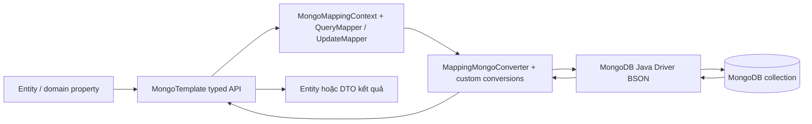

# Mapping tên trường và kiểu dữ liệu khi dùng API có kiểu miền

Trong **Spring Data MongoDB**, cùng một thuộc tính Java có thể có tên và kiểu lưu trữ khác với dữ liệu BSON của MongoDB. Ví dụ, entity khai báo `customerId` nhưng MongoDB lưu `customer_id`; Java dùng `Instant` nhưng BSON lưu `Date`; Java dùng `String id` nhưng trường `_id` có thể lưu `ObjectId`. Nếu tự viết truy vấn bằng tên field và kiểu tùy ý, ứng dụng dễ gặp lỗi **truy vấn không tìm thấy document**, **cập nhật nhầm field**, hoặc **không tận dụng index**.

`MongoTemplate` cung cấp các API **có kiểu miền** (*domain-typed APIs*) để Spring Data dựa trên metadata của entity mà ánh xạ **tên property Java → tên field BSON**, đồng thời chuyển các **giá trị truy vấn/cập nhật** sang kiểu lưu trữ thích hợp. Những metadata quan trọng gồm `@Document`, `@Id`, `@MongoId`, `@Field`, cấu trúc object nhúng và custom conversions.

Bài thuộc chương **MongoTemplate** của module `SPRING_DATA_MONGODB`. Kiến thức này được dùng xuyên suốt truy vấn `Query`/`Criteria`, cập nhật `Update`, projection, aggregation, index, reactive access, transaction, kiểm thử và chẩn đoán hiệu năng.

> **Cốt lõi:** Khi hai overload trông gần giống nhau, **có truyền domain class hay không** có thể làm thay đổi mức độ hỗ trợ field mapping, type conversion và version. Không nên xem `mongoTemplate.updateFirst(query, update, "collection")` là hoàn toàn tương đương với `mongoTemplate.updateFirst(query, update, Entity.class)`.

## 1. Mục tiêu học tập

Sau khi hoàn thành bài này, bạn có thể:

1. Mô tả đường đi từ property Java, metadata entity và `Query`/`Update` đến field BSON thật.
2. Dùng `@Field` đặt tên lưu trữ khác với property Java, kể cả property nhúng.
3. Dùng `@Id`/`@MongoId` phù hợp để truy vấn `_id` với đúng kiểu BSON.
4. Viết `MongoTemplate.find`, `count`, `updateFirst`, `findAndModify` và Fluent API **có domain type**.
5. Giải thích vì sao overload chỉ nhận `collectionName` có thể thiếu field mapping hoặc xử lý `@Version`.
6. Phân biệt biểu diễn `Instant`, `BigDecimal`, value object và kiểu BSON trong query.
7. Hiểu vai trò của `QueryMapper`, `UpdateMapper` và `MappingMongoConverter` mà không tự xây lại logic framework.
8. Nhận ra khi nào query/aggregation là biểu thức **native BSON** và cần dùng tên lưu trữ thực.
9. Viết kiểm thử đối chiếu entity, query có mapping và **document BSON thô**.
10. Rà soát mapping khi đổi schema, index, DTO projection hoặc cập nhật phiên bản Spring Data MongoDB.

## 2. Ba lớp tên và kiểu trong một thao tác

Hãy tách ba khái niệm:

| Lớp | Ví dụ | Ai hiểu lớp này? |
| --- | --- | --- |
| **Domain Java** | `customerId`, `totalCents`, `createdAt: Instant` | Entity, service, `Criteria`/`Update` theo property |
| **Metadata mapping** | `@Field("customer_id")`, `@Id`, `@MongoId` | Spring Data MongoDB mapping context và converter |
| **BSON trong MongoDB** | `customer_id`, `total_cents`, `created_at: Date`, `_id` | MongoDB Server và Java Driver |

Một vòng ghi và đọc đơn giản:



Sơ đồ mang tính khái niệm: khi ghi object, đọc object và chuyển đổi query/update, thứ tự các thành phần nội bộ có thể khác. Điều cần nhớ là **mapping ở tầng Spring Data** và **BSON codec ở tầng driver** không phải một hệ thống duy nhất.

### Tại sao chỉ nhìn Query.getQueryObject() chưa đủ?

`Query` có thể còn giữ tên property Java trước khi Spring Data dùng mapping metadata để dựng lệnh gửi server.

```java
Query query = Query.query(
    Criteria.where("customerId").is("CUS-9")
);
System.out.println(query.getQueryObject());
```

Việc in `getQueryObject()` hữu ích khi kiểm tra **cấu trúc Criteria**, nhưng **không luôn phản ánh lệnh BSON cuối** sau mapping tên field và giá trị. Để khẳng định command thật, dùng command monitoring, profiler, hoặc kiểm tra kết quả trên BSON thô trong test.

## 3. Entity ví dụ: tên Java khác tên BSON

Một ứng dụng bán hàng lưu đơn hàng trong collection `shop_orders`. Ở Java, dùng tên camelCase rõ ràng; trong MongoDB, nhóm dữ liệu cũ dùng snake_case.

### 3.1. Object nhúng

```java
package dev.learning.orders;

import org.springframework.data.mongodb.core.mapping.Field;

public record ShippingAddress(
        @Field("city_name") String city,
        @Field("postal_code") String postalCode) {
}
```

### 3.2. Aggregate root có kiểu miền

```java
package dev.learning.orders;

import java.time.Instant;

import org.springframework.data.annotation.Id;
import org.springframework.data.annotation.Version;
import org.springframework.data.mongodb.core.mapping.Document;
import org.springframework.data.mongodb.core.mapping.Field;

@Document("shop_orders")
public record OrderDoc(
        @Id String id,
        @Field("customer_id") String customerId,
        @Field("total_cents") long totalCents,
        @Field("created_at") Instant createdAt,
        @Field("ship_to") ShippingAddress shippingAddress,
        String status,
        @Version Long version) {
}
```

Trong ví dụ, mỗi `public record` đặt vào tệp Java riêng, và dữ liệu đầu vào/`Instant` không null. Sử dụng tiền theo **đơn vị nhỏ nhất** ở dạng `long` để tránh phụ thuộc cấu hình thập phân khi tập trung học mapping tên và kiểu.

### 3.3. Document BSON kỳ vọng

```javascript
{
  _id: "ORD-1001",
  customer_id: "CUS-9",
  total_cents: NumberLong("159900"),
  created_at: ISODate("2026-11-20T08:00:00Z"),
  ship_to: {
    city_name: "Da Nang",
    postal_code: "550000"
  },
  status: "PAID",
  version: NumberLong("0")
}
```

Bảng đối chiếu:

| Property Java | Đường dẫn BSON | Kiểu Java → BSON |
| --- | --- | --- |
| `id` | `_id` | `String` → string hoặc ObjectId theo quy tắc ID |
| `customerId` | `customer_id` | `String` → BSON string |
| `totalCents` | `total_cents` | `long` → BSON integer 64-bit |
| `createdAt` | `created_at` | `Instant` → BSON Date |
| `shippingAddress` | `ship_to` | Object Java → BSON embedded document |
| `shippingAddress.city` | `ship_to.city_name` | `String` → BSON string |
| `shippingAddress.postalCode` | `ship_to.postal_code` | `String` → BSON string |
| `status` | `status` | Không đổi tên |
| `version` | `version` | `Long` → BSON integer 64-bit |

Tài liệu có thể xuất hiện thêm `_class` tùy cách Spring Data ghi type hints. Vì vậy JSON ở trên biểu diễn các trường cần thiết để học mapping, không cam kết mỗi cấu hình đều tạo BSON có đúng từng ấy field.

## 4. Mapping tên field trong truy vấn có domain type

Khởi tạo một query bằng **tên property Java**, sau đó truyền `OrderDoc.class` cho `MongoTemplate.find`:

```java
import java.util.List;

import org.springframework.data.mongodb.core.MongoTemplate;
import org.springframework.data.mongodb.core.query.Criteria;
import org.springframework.data.mongodb.core.query.Query;

Query query = Query.query(
        Criteria.where("customerId").is("CUS-9")
                .and("totalCents").gte(100_000L));

List<OrderDoc> orders =
        mongoTemplate.find(query, OrderDoc.class);
```

Truy vấn BSON tương đương sau mapping:

```javascript
db.shop_orders.find({
  customer_id: "CUS-9",
  total_cents: { $gte: NumberLong("100000") }
});
```

**Điểm mấu chốt:** code dùng `customerId` và `totalCents` vì đây là property trên `OrderDoc`. Spring Data có thể dùng `@Field` để chuyển chúng thành `customer_id` và `total_cents`.

### 4.1. Vì sao domain class quan trọng?

`mongoTemplate.find(query, OrderDoc.class)` giúp framework:

- Biết metadata property và annotation `@Field`.
- Biết `@Id`/`@MongoId` nào quy chiếu tới `_id`.
- Biết kiểu domain của các property để áp dụng conversion phù hợp.
- Ánh xạ kết quả BSON về `OrderDoc`.
- Suy ra collection từ `@Document("shop_orders")` nếu bạn không truyền collection name.

Với query native driver thuần, không có đối tượng domain để suy ra các thông tin đó.

### 4.2. Tên BSON có thể được xử lý, nhưng không nên trộn ngẫu nhiên

Trong một số API mapping, cả tên property và tên field đã được ánh xạ có thể được nhận diện. Tuy nhiên, đặt một lệnh query dài trộn `customerId`, `customer_id` và nested BSON path là nguồn lỗi khó phát hiện.

**Quy ước an toàn:** Với Spring Data **typed API**, viết tên **property Java** và kiểm tra kết quả mapping. Với `mongosh` hoặc Java Driver **raw API**, viết tên **BSON thực**.

## 5. Nested property: ánh xạ từng đoạn đường dẫn

Với `ShippingAddress` ở mục 3:

```java
Query query = Query.query(
    Criteria.where("shippingAddress.city").is("Da Nang")
);
List<OrderDoc> result = mongoTemplate.find(
    query, OrderDoc.class
);
```

Kỳ vọng BSON:

```javascript
db.shop_orders.find({
  "ship_to.city_name": "Da Nang"
});
```

Spring Data dựa vào metadata của entity **và kiểu của object nhúng** để ánh xạ:

```text
shippingAddress        . city
       │                  │
       ▼                  ▼
    "ship_to"          "city_name"
       │                  │
       └───── ghép ───────┘
            "ship_to.city_name"
```

Tương tự:

```java
Query query = Query.query(
    Criteria.where("shippingAddress.postalCode").is("550000")
);
```

sẽ hướng đến `ship_to.postal_code` khi có domain type và mapping phù hợp.

### 5.1. Không nhầm đường dẫn với field name chứa dấu chấm

MongoDB dùng dấu chấm trong `"a.b"` để biểu thị đường dẫn nested trong nhiều query/update. Spring Data cũng hỗ trợ trường có **dấu chấm nguyên văn trong tên key** thông qua `@Field(fieldNameType = KEY)`, nhưng đó là trường hợp khác, đòi hỏi cú pháp đặc biệt như `$getField`/`$setField` khi cần thao tác.

Ví dụ ý nghĩa khác nhau:

```javascript
// Nested path:
{ address: { city: "Hue" } }

// Key literal có tên chứa dấu chấm:
{ "address.city": "Hue" }
```

Hai document này **không giống nhau**. Không dùng `Criteria.where("address.city")` và mặc định nó truy vấn key literal. Nếu hệ thống có key đặc biệt, hãy đọc tài liệu `@Field(fieldNameType = KEY)` và thiết kế phép truy cập bằng MongoDB expressions.

### 5.2. Map và array

Đối với embedded object của một entity, Spring Data có thể ánh xạ từng property theo metadata. Nhưng với `Map<String,Object>`, tên key có thể là dữ liệu nghiệp vụ không trùng với property Java, nên không nên mặc định mọi đoạn đường dẫn trong Map được rename.

Với array of embedded objects, các điều kiện trên property con có thể khớp các phần tử khác nhau khi có nhiều điều kiện tách rời. Nếu muốn các điều kiện áp dụng cho **cùng một phần tử**, dùng `$elemMatch`. Đây là semantics của MongoDB, không được thay đổi chỉ nhờ API có domain type.

## 6. Sort và projection cũng cần mapping

Mapping không chỉ xuất hiện trong `Criteria`. `Sort` và field projection cũng dùng đường dẫn thuộc tính.

```java
import org.springframework.data.domain.Sort;

Query query = Query.query(
    Criteria.where("customerId").is("CUS-9")
);

query.with(Sort.by(
    Sort.Order.desc("createdAt"),
    Sort.Order.desc("id")
));

query.fields()
    .include("customerId")
    .include("totalCents")
    .include("createdAt");

List<OrderDoc> partial =
    mongoTemplate.find(query, OrderDoc.class);
```

Về ý nghĩa, MongoDB nhận:

```javascript
db.shop_orders.find(
  { customer_id: "CUS-9" },
  {
    customer_id: 1,
    total_cents: 1,
    created_at: 1
  }
).sort({ created_at: -1, _id: -1 });
```

**Lưu ý quan trọng:** MongoDB thường **không cho trộn inclusion và exclusion** trong cùng field projection, ngoại trừ quy tắc riêng của `_id`. Nếu chỉ muốn ba field như trên, dùng các lệnh `include`; nếu muốn loại `shippingAddress` và giữ những field khác, dùng `exclude("shippingAddress")` trong một query riêng, **không** ghép với các lệnh `include` ở ví dụ này.

`_id` được đưa vào mặc định trừ khi loại tường minh.

> **Không lưu lại entity chỉ được tải một phần.** Các property thiếu có thể thành `null`/mặc định; gọi `save(partialEntity)` có thể làm mất dữ liệu hoặc gây lỗi optimistic locking. Khi chỉ cần hiển thị, dùng projection/DTO chuyên biệt.

## 7. API có domain class và API chỉ có collection name

Một khác biệt quan trọng được nêu rõ trong Javadoc `MongoOperations.updateFirst`:

```java
// Có domain type:
UpdateResult a = mongoTemplate.updateFirst(
    query, update, OrderDoc.class
);

// Có domain type VÀ collection name được chỉ định:
UpdateResult b = mongoTemplate.updateFirst(
    query, update, OrderDoc.class, "shop_orders"
);

// Chỉ có collection name:
UpdateResult c = mongoTemplate.updateFirst(
    query, update, "shop_orders"
);
```

Đây là các **phương án gọi**, không phải ba lệnh cần chạy nối tiếp. Mức hỗ trợ khác nhau:

| Cách gọi | Metadata domain | Tên collection | Field mapping/`@Version` |
| --- | --- | --- | --- |
| `updateFirst(q,u,OrderDoc.class)` | Có | Suy từ entity | Có hỗ trợ theo domain type |
| `updateFirst(q,u,OrderDoc.class,"shop_orders")` | Có | Chỉ định tường minh | Có hỗ trợ theo domain type |
| `updateFirst(q,u,"shop_orders")` | Thiếu domain type | Chỉ định tường minh | **Không có đầy đủ hỗ trợ** field mapping/version của entity |

Theo Javadoc, overload chỉ nhận collection name thiếu thông tin domain class để thực hiện **các hỗ trợ kiểu miền như mapping field hoặc version**. Không được khẳng định hai kiểu gọi “chỉ khác tên collection”.

### 7.1. Ví dụ gây lỗi khó thấy

Entity có `@Field("customer_id")` nhưng truy vấn chỉ dùng property Java:

```java
Query q = Query.query(
    Criteria.where("customerId").is("CUS-9")
);
Update u = new Update().set("status", "SHIPPED");

// KHÔNG nên cho rằng lệnh này tự hiểu @Field("customer_id"):
mongoTemplate.updateFirst(q, u, "shop_orders");
```

Nếu BSON thực có `customer_id` mà không có `customerId`, lệnh có thể **không khớp document nào**. Nếu update dùng property có alias, nguy cơ tệ hơn là **ghi ra một field mới sai tên**, tạo hai schema song song.

Hãy viết:

```java
UpdateResult result = mongoTemplate.updateFirst(
    Query.query(Criteria.where("customerId").is("CUS-9")),
    new Update().set("status", "SHIPPED"),
    OrderDoc.class
);
```

Nếu cần dùng collection khác với mặc định nhưng vẫn muốn mapping, hãy truyền cả `OrderDoc.class` và tên collection.

### 7.2. Chọn theo thiết kế

- Dùng overload **typed** nếu đang làm việc với entity Spring Data có annotations/versions/converters.
- Dùng overload **collection-only/raw** khi bạn cố tình làm việc với schema BSON thô và đã kiểm soát tên field, kiểu dữ liệu.
- Trong code review, xem mỗi `updateFirst`/`updateMulti`/`upsert`/`findAndModify` có đủ metadata entity hay không; không chỉ nhìn query.

## 8. Cập nhật bằng Update: ánh xạ cả field và giá trị

Ví dụ thay thành phố giao hàng và tăng tổng tiền của đơn đã thanh toán:

```java
import com.mongodb.client.result.UpdateResult;
import org.springframework.data.mongodb.core.query.Criteria;
import org.springframework.data.mongodb.core.query.Query;
import org.springframework.data.mongodb.core.query.Update;

Query filter = Query.query(
    Criteria.where("id").is("ORD-1001")
            .and("status").is("PAID")
);

Update changes = new Update()
    .set("shippingAddress.city", "Hue")
    .inc("totalCents", 1_000L);

UpdateResult result = mongoTemplate.updateFirst(
    filter, changes, OrderDoc.class
);
```

BSON logic tương đương:

```javascript
db.shop_orders.updateOne(
  { _id: "ORD-1001", status: "PAID" },
  {
    $set: { "ship_to.city_name": "Hue" },
    $inc: { total_cents: NumberLong("1000") }
  }
);
```

Nếu `OrderDoc` có `@Version` và lệnh update không chỉ rõ version, Spring Data có thể **tự tăng** giá trị version khi dùng update API có domain type. Vì vậy BSON minh họa ở trên chỉ tập trung vào hai thay đổi được yêu cầu; command thật có thể có phần cập nhật `version` do framework thêm vào.

**Không nhầm:** tự tăng version khi update **không có nghĩa** update đang so khớp expected version từ một entity đã đọc. Muốn compare-and-set thực sự, thêm điều kiện version vào `Query`:

```java
Query filter = Query.query(
    Criteria.where("id").is(orderId)
            .and("version").is(expectedVersion)
            .and("status").is("PAID")
);

Update update = new Update().set("status", "SHIPPED");

UpdateResult result = mongoTemplate.updateFirst(
    filter, update, OrderDoc.class
);

if (result.getMatchedCount() != 1) {
    // Không tìm thấy, trạng thái đổi hoặc version đã bị cập nhật.
}
```

`matchedCount` cho biết có document khớp trước cập nhật. `modifiedCount` có thể bằng 0 nếu dữ liệu mới giống dữ liệu cũ (tùy thao tác/version), nên không dùng đơn độc để kết luận entity không tồn tại.

### 8.1. @Version trong save và update

- `save` của entity versioned áp dụng optimistic locking trên version của entity theo cơ chế Spring Data.
- `updateFirst`/`findAndModify` theo kiểu miền có thể **tự tăng version** nếu chưa được khai báo trong `Update`, nhưng **không tự biết version mà caller kỳ vọng** nếu bạn không đưa version vào điều kiện query.
- API **không có domain type** có thể không áp dụng các quy tắc version đặc thù.
- Optimistic locking cần write concern có xác nhận để phát hiện xung đột đáng tin cậy.

## 9. findAndModify và Fluent update API

`findAndModify` hữu ích khi muốn cập nhật và lấy giá trị trước/sau trong cùng một thao tác:

```java
import org.springframework.data.mongodb.core.FindAndModifyOptions;

OrderDoc changed = mongoTemplate.findAndModify(
    Query.query(
        Criteria.where("id").is("ORD-1001")
                .and("status").is("PAID")),
    new Update().set("shippingAddress.city", "Hue"),
    FindAndModifyOptions.options().returnNew(true),
    OrderDoc.class
);
```

`returnNew(true)` yêu cầu document **sau cập nhật**, nếu có kết quả. `findAndModify` mặc định không upsert; chỉ bật `upsert(true)` khi nghiệp vụ cho phép tạo mới.

Có thể dùng Fluent API với domain type đặt ngay từ đầu:

```java
UpdateResult result = mongoTemplate.update(OrderDoc.class)
    .matching(Query.query(
        Criteria.where("customerId").is("CUS-9")
                .and("status").is("PAID")))
    .apply(new Update().set("status", "SHIPPED"))
    .first();
```

Hoặc dùng truy vấn theo kiểu miền:

```java
OrderDoc order = mongoTemplate.query(OrderDoc.class)
    .matching(Query.query(
        Criteria.where("id").is("ORD-1001")))
    .oneValue();
```

Fluent API đặt domain type rõ ràng ở đầu chuỗi, giúp người review thấy ngay hệ mapping đang được áp dụng. Nó không thay thế việc kiểm tra authorization, điều kiện race và transaction khi cập nhật nhiều document.

## 10. @Id, @MongoId và kiểu thực của _id

`_id` là một field đặc biệt. Spring Data MongoDB có thể ánh xạ:

```java
@Id
private String id;
```

sang `_id` dạng ObjectId **nếu chuỗi là ObjectId hex hợp lệ**; nếu không chuyển được, giá trị có thể được lưu dạng string.

Hai document sau có `_id` **khác kiểu BSON**:

```javascript
{ _id: ObjectId("507f1f77bcf86cd799439011"), status: "PAID" }
{ _id: "507f1f77bcf86cd799439011", status: "PAID" }
```

Chúng có thể cùng tồn tại vì `ObjectId` và BSON string là hai giá trị khác nhau. Nhưng khi query qua typed entity `@Id String`, Spring Data áp dụng quy tắc conversion của entity, nên có thể chỉ khớp một trong hai.

Ví dụ:

```java
Query q = Query.query(
    Criteria.where("id").is("507f1f77bcf86cd799439011")
);
OrderDoc order = mongoTemplate.findOne(q, OrderDoc.class);
```

Không kết luận “MongoDB không có document” chỉ vì query typed không tìm thấy; trước hết kiểm tra kiểu `_id` thực tế, collection và annotation.

### 10.1. Muốn giữ chuỗi ID, kể cả hex 24 ký tự

Với domain lưu string ID cố định, có thể dùng:

```java
import org.springframework.data.mongodb.core.mapping.MongoId;

@Document("external_orders")
public record ExternalOrder(
        @MongoId String id,
        String status) {
}
```

`@MongoId` không khai báo field type thường lưu chuỗi ID theo kiểu Java thực, tránh tự đổi các chuỗi hex 24 ký tự thành `ObjectId` như `@Id String`.

Nếu muốn kiểm soát kiểu đích cụ thể, Spring Data có `@MongoId(FieldType.OBJECT_ID)` khi model phù hợp; đừng thay đổi ID mapping trên collection đang chạy mà chưa audit và migrate dữ liệu.

### 10.2. Đừng coi mọi chuỗi là ObjectId

Mã đơn như `"ORD-1001"` không phải ObjectId hex, nên với `@Id String` thông thường được lưu dạng BSON string. Mã khác trông như 24 ký tự hex có thể bị convert. Chính vì vậy production nên chọn **quy ước ID ổn định** và test các trường hợp đặc biệt.

## 11. Mapping kiểu BSON của số và thời gian

### 11.1. Số nguyên và String không được tự so sánh như nhau

Document:

```javascript
{ total_cents: NumberLong("159900") }
```

khác với:

```javascript
{ total_cents: "159900" }
```

Câu query phạm vi:

```java
Query q = Query.query(
    Criteria.where("totalCents").gte(100_000L)
);
List<OrderDoc> result = mongoTemplate.find(q, OrderDoc.class);
```

kỳ vọng match nhóm số BSON thích hợp; không trông đợi MongoDB tự parse string thành số. Nếu quá trình migration hoặc một client raw đã lưu string, cần xử lý schema rõ ràng.

### 11.2. Instant và BSON Date

`Instant` thường được lưu thành BSON Date, tức thời điểm theo UTC với độ phân giải **mili giây**. Code:

```java
Instant from = Instant.parse("2026-11-20T00:00:00Z");
Instant until = Instant.parse("2026-11-21T00:00:00Z");

Query q = Query.query(
    Criteria.where("createdAt").gte(from).lt(until)
);
List<OrderDoc> orders = mongoTemplate.find(
    q, OrderDoc.class
);
```

BSON tương ứng:

```javascript
{
  created_at: {
    $gte: ISODate("2026-11-20T00:00:00Z"),
    $lt: ISODate("2026-11-21T00:00:00Z")
  }
}
```

Nên dùng khoảng `[start,nextStart)` cho phân trang và lọc ngày; tránh lấy “23:59:59.999999999” rồi hy vọng dữ liệu và MongoDB có cùng precision. Khi ngày bắt đầu theo múi giờ người dùng, hãy chuyển từ `LocalDate`/`ZoneId` sang `Instant` trước khi lập filter.

### 11.3. BigDecimal và Decimal128

MongoDB có BSON `Decimal128`. Với domain:

```java
import java.math.BigDecimal;
import org.springframework.data.mongodb.core.mapping.Field;
import org.springframework.data.mongodb.core.mapping.FieldType;

public record PaymentValue(
    @Field(targetType = FieldType.DECIMAL128)
    BigDecimal amount) {
}
```

`@Field(targetType = DECIMAL128)` thể hiện ý định dùng BSON Decimal128 cho field đó. Nó không có nghĩa mọi giá trị `BigDecimal` có thể biểu diễn chính xác trong Decimal128 (có giới hạn phạm vi và độ chính xác).

**Khác biệt phiên bản:** Spring Data MongoDB 4.5 từng có cách biểu diễn mặc định `BigDecimal`/`BigInteger` dưới dạng string; từ dòng 5.x, việc lựa chọn representation cần được cấu hình tường minh khi ứng dụng thực sự lưu các kiểu này. Một cấu hình phù hợp:

```java
import org.springframework.context.annotation.Bean;
import org.springframework.context.annotation.Configuration;
import org.springframework.data.mongodb.core.convert.MongoCustomConversions;
import org.springframework.data.mongodb.core.convert.MongoCustomConversions.BigDecimalRepresentation;

@Configuration(proxyBeanMethods = false)
class MongoDecimalConfiguration {

    @Bean
    MongoCustomConversions mongoCustomConversions() {
        return MongoCustomConversions.create(adapter -> {
            adapter.bigDecimal(BigDecimalRepresentation.DECIMAL128);
        });
    }
}
```

Trong ứng dụng thật, **hợp nhất tất cả custom converters** vào một bean `MongoCustomConversions`, tránh tạo nhiều bean cạnh tranh. Nếu đang có dữ liệu `amount` dạng string, thay conversion mà không migration có thể khiến sort/range query sai do BSON type không đồng nhất.

## 12. Custom conversions ảnh hưởng cả ghi, đọc và tham số query

Ví dụ domain dùng `EmailAddress` để xác thực dữ liệu nhưng MongoDB lưu email dạng BSON string:

```java
public record EmailAddress(String value) {}
```

Có thể định nghĩa hai converter:

```java
import org.springframework.core.convert.converter.Converter;
import org.springframework.data.convert.WritingConverter;
import org.springframework.data.convert.ReadingConverter;

@WritingConverter
public final class EmailWriteConverter
        implements Converter<EmailAddress, String> {
    @Override
    public String convert(EmailAddress source) {
        return source.value();
    }
}

@ReadingConverter
public final class EmailReadConverter
        implements Converter<String, EmailAddress> {
    @Override
    public EmailAddress convert(String source) {
        return new EmailAddress(source);
    }
}
```

Mỗi `public class` ở đây là một tệp Java độc lập. Đăng ký vào `MongoCustomConversions`:

```java
@Bean
MongoCustomConversions mongoCustomConversions() {
    return MongoCustomConversions.create(adapter -> {
        adapter.registerConverter(new EmailWriteConverter());
        adapter.registerConverter(new EmailReadConverter());
    });
}
```

Đây là **phương án cấu hình độc lập** với bean BigDecimal ở mục trước. Nếu dự án cần cả hai, dùng **một** bean:

```java
@Bean
MongoCustomConversions mongoCustomConversions() {
    return MongoCustomConversions.create(adapter -> {
        adapter.bigDecimal(BigDecimalRepresentation.DECIMAL128);
        adapter.registerConverter(new EmailWriteConverter());
        adapter.registerConverter(new EmailReadConverter());
    });
}
```

Khi domain type chứa property `EmailAddress email`, Spring Data có thể dùng writing conversion để chuyển giá trị của `Criteria.where("email").is(new EmailAddress("a@example.test"))` thành BSON string phù hợp. Nhưng khi tự viết query native JSON, aggregation pipeline raw hoặc code Java Driver, không được mặc định cùng converter sẽ chạy theo đường tương đương.

**Điểm cần test:** converter chạy khi ghi entity không tự bảo đảm mọi query expression phức tạp trên kiểu đó cũng được convert. Hãy test query thật, raw BSON và những pipeline sử dụng trong ứng dụng.

## 13. Typed API với tên collection chỉ định riêng

Một số hệ thống dùng collection động theo năm hoặc tenant. Vẫn có thể giữ mapping domain type nếu chỉ định cả entity class lẫn collection:

```java
Query q = Query.query(
    Criteria.where("customerId").is("CUS-9")
);

List<OrderDoc> orders = mongoTemplate.find(
    q, OrderDoc.class, "shop_orders_2026"
);

UpdateResult changed = mongoTemplate.updateFirst(
    q,
    new Update().set("status", "ARCHIVED"),
    OrderDoc.class,
    "shop_orders_2026"
);
```

Đặc điểm:

- `OrderDoc.class` cung cấp mapping metadata.
- `"shop_orders_2026"` chọn nơi thao tác.
- Việc truyền collection riêng **không đổi tên field mapping**.
- Việc chọn collection động phải được kiểm tra whitelist/authorization; không nhận thẳng tên collection từ input không tin cậy.

Không dùng collection per tenant như biện pháp tự động bảo đảm cách ly dữ liệu nếu ứng dụng cho phép caller lựa chọn tên collection không được kiểm soát.

## 14. Fluent query và projection DTO

Một read view chỉ cần ID, khách hàng và tổng tiền:

```java
import org.springframework.data.annotation.Id;
import org.springframework.data.mongodb.core.mapping.Field;

public record OrderSummary(
    @Id String id,
    @Field("customer_id") String customerId,
    @Field("total_cents") long totalCents) {
}
```

Fluent API:

```java
List<OrderSummary> summaries = mongoTemplate
    .query(OrderDoc.class)
    .as(OrderSummary.class)
    .matching(Query.query(
        Criteria.where("customerId").is("CUS-9")))
    .all();
```

Trong code này:

1. `query(OrderDoc.class)` là **kiểu nguồn** cho filter và collection mapping.
2. `as(OrderSummary.class)` là **kiểu kết quả** (read projection).
3. `matching(...)` mô tả query bằng property Java của nguồn.
4. `all()` ánh xạ kết quả sang DTO.

`OrderSummary` cũng khai báo `@Field` phù hợp để thể hiện tên BSON nó đọc; hãy kiểm chứng mapping theo phiên bản Spring Data và tập field thực được server trả về.

**Không nhầm:** thay `as(OrderSummary.class)` không biến `OrderSummary` thành write entity. Không `save` lại một DTO một phần; những field không được tải sẽ mất giá trị hoặc gây lỗi nếu cố dùng DTO cho write path.

### 14.1. Field projection

```java
Query query = Query.query(
    Criteria.where("status").is("PAID")
);
query.fields()
    .include("customerId")
    .include("totalCents");

List<OrderDoc> partial = mongoTemplate.find(
    query, OrderDoc.class
);
```

Các key trong `fields().include(...)` dùng property Java khi query có domain type; Spring Data ánh xạ sang `customer_id` và `total_cents`. `_id` thường vẫn được trả. Kết quả `OrderDoc` có thể thiếu nhiều property, nên chỉ dùng để **đọc**; tốt hơn là dùng DTO thích hợp.

### 14.2. distinct có kiểu nguồn

```java
List<String> customerIds = mongoTemplate
    .query(OrderDoc.class)
    .distinct("customerId")
    .as(String.class)
    .all();
```

`distinct("customerId")` được ánh xạ thành tên BSON `customer_id` từ metadata `OrderDoc`. `as(String.class)` yêu cầu kiểu kết quả; conversion không thực hiện được có thể phát sinh `DataAccessException`.

## 15. Typed aggregation: input class và field aliases

Aggregation là nơi dễ nhầm **property Java**, **field sau `$group`/`$project`**, và **biểu thức MongoDB raw**.

Spring Data có `TypedAggregation<T>`, giữ thông tin **kiểu đầu vào** để mapping tham chiếu theo entity.

```java
import org.springframework.data.mongodb.core.aggregation.Aggregation;
import org.springframework.data.mongodb.core.aggregation.TypedAggregation;
import org.springframework.data.mongodb.core.aggregation.AggregationResults;
import org.springframework.data.mongodb.core.query.Criteria;

public record RevenueByCustomer(
    String customerId,
    long sumCents) {
}

TypedAggregation<OrderDoc> aggregation =
    Aggregation.newAggregation(
        OrderDoc.class,
        Aggregation.match(
            Criteria.where("status").is("PAID")),
        Aggregation.group("customerId")
            .sum("totalCents").as("sumCents"),
        Aggregation.project("sumCents")
            .and("_id").as("customerId")
    );

AggregationResults<RevenueByCustomer> result =
    mongoTemplate.aggregate(
        aggregation, RevenueByCustomer.class
    );
```

Ý định của pipeline:

```javascript
db.shop_orders.aggregate([
  { $match: { status: "PAID" } },
  { $group: {
      _id: "$customer_id",
      sumCents: { $sum: "$total_cents" }
  } },
  { $project: { _id: 0, customerId: "$_id", sumCents: 1 } }
]);
```

Trong các stage được Spring Data mapping hỗ trợ, `customerId` và `totalCents` được tham chiếu theo domain type rồi chuyển thành `customer_id` và `total_cents`. Sau `$group`/`$project`, alias mới như `sumCents` thuộc **shape trung gian**, không nhất thiết là property của `OrderDoc`.

### 15.1. strictMapping không còn mặc định như cũ

Tài liệu Spring Data lưu ý từ 3.2, tham chiếu đến property không tồn tại trong `TypedAggregation` **không còn mặc định ném lỗi**. Có thể dùng `AggregationOptions` với `strictMapping` khi cần khôi phục hành vi chặt chẽ. Hãy kiểm thử pipeline sau khi đổi tên field, không chỉ dựa vào IDE hoặc việc code biên dịch.

### 15.2. Native aggregation stage không giống typed expression

Ví dụ:

```java
Aggregation.stage("""
    { "$match": { "customer_id": "CUS-9" } }
""");
```

Đây là JSON stage native, phải dùng **tên BSON thực**. Đừng đổi tùy tiện `customer_id` thành `customerId` vì nghĩ input của aggregation đã là `OrderDoc.class`.

Tương tự, expression string/raw `MongoExpression.create(...)` có thể giữ tham chiếu raw BSON. Ngược lại, các `AggregationExpression` do Spring Data xây dựng có khả năng ánh xạ property Java trong ngữ cảnh typed.

**Quy tắc thực hành:** tìm hiểu rõ API đang nhận **field reference có mapping** hay **native JSON/BSON expression** trước khi quyết định viết tên nào.

## 16. Raw Document và MongoDB Java Driver: ranh giới metadata

Khi cần kiểm tra dữ liệu BSON thật, bạn có thể dùng `MongoTemplate.getCollection` rồi truy vấn driver:

```java
import org.bson.Document;

Document raw = mongoTemplate
    .getCollection("shop_orders")
    .find(new Document("_id", "ORD-1001"))
    .first();

if (raw != null) {
    System.out.println(raw.getString("customer_id"));
    System.out.println(raw.get("total_cents"));
    System.out.println(raw.get("ship_to"));
}
```

Ở đây:

- `getCollection` trả collection của **MongoDB Java Driver**.
- `Document` dùng tên **BSON thực**: `customer_id`, `total_cents`, `ship_to`.
- `@Field` của `OrderDoc` **không** được driver tự áp dụng cho các chuỗi truyền vào `Document`.
- Driver không tự gọi Spring Data `MongoCustomConversions` cho mọi raw query/update.

Nếu viết:

```java
mongoTemplate.getCollection("shop_orders")
    .find(new Document("customerId", "CUS-9"));
```

thì MongoDB sẽ tìm key literal `customerId`, không tự dịch thành `customer_id` chỉ vì Java có entity tương ứng.

### 16.1. Query raw không luôn sai

Có tình huống chính đáng cần driver API: dùng tính năng BSON đặc biệt, code migration, lệnh quản trị hoặc pipeline native. Khi đó phải viết và review theo **schema MongoDB thực tế**, có test riêng để không vô tình phụ thuộc mapping Spring Data vốn không chạy.

### 16.2. Không dùng raw Document làm bằng chứng duy nhất cho query typed

Một document thô giúp kiểm tra **tên, BSON type và cấu trúc**. Nhưng để xác minh **typed query** đã được mapping đúng, hãy chạy query typed thật hoặc quan sát lệnh thực qua command listener. Hai kiểm tra bổ sung cho nhau.

## 17. Index phải khớp tên BSON thực

Ví dụ truy vấn thường xuyên:

```java
Query query = Query.query(
    Criteria.where("customerId").is("CUS-9")
);
query.with(Sort.by(Sort.Order.desc("createdAt")));
```

Lệnh MongoDB cuối cùng tương ứng:

```javascript
db.shop_orders.find({
  customer_id: "CUS-9"
}).sort({ created_at: -1 });
```

Index phục vụ query này phải dùng tên **BSON**:

```javascript
db.shop_orders.createIndex(
  { customer_id: 1, created_at: -1 },
  { name: "customer_created" }
);
```

Một index xây nhầm trên `customerId` ở MongoDB sẽ không tự được dùng cho predicate `customer_id`. Khi khai báo index qua Spring Data entity mapping, có thể dùng API `indexOps(OrderDoc.class)` và property Java với mapping phù hợp, nhưng vẫn cần kiểm tra index keys thực qua MongoDB.

Đo kế hoạch:

```javascript
db.shop_orders.find({
  customer_id: "CUS-9"
}).sort({ created_at: -1 })
  .explain("executionStats");
```

Quan sát `winningPlan`, `totalKeysExamined`, `totalDocsExamined`, `nReturned` và dấu hiệu sort không được index hỗ trợ. Mapping đúng không tự làm truy vấn nhanh; index và phân bố dữ liệu vẫn quyết định chi phí lớn.

## 18. Kiểm thử tích hợp: so khớp Java, BSON và cập nhật

Một test nên chứng minh ít nhất bốn điều:

1. `MongoTemplate.insert` ghi đúng tên và kiểu BSON.
2. Typed query bằng **property Java** tìm đúng document.
3. Typed update bằng **property Java** sửa đúng BSON field, không thêm key sai.
4. Khi đọc lại, entity Java có đúng các giá trị mong đợi.

Ví dụ với Spring Boot test starter và MongoDB test riêng:

```java
package dev.learning.orders;

import static org.assertj.core.api.Assertions.assertThat;

import java.time.Instant;
import java.util.UUID;

import org.bson.Document;
import org.junit.jupiter.api.Test;
import org.springframework.beans.factory.annotation.Autowired;
import org.springframework.boot.test.context.SpringBootTest;
import org.springframework.data.mongodb.core.MongoTemplate;
import org.springframework.data.mongodb.core.query.Criteria;
import org.springframework.data.mongodb.core.query.Query;
import org.springframework.data.mongodb.core.query.Update;

@SpringBootTest
class DomainTypedMappingIntegrationTest {

    @Autowired MongoTemplate template;

    @Test
    void mapsFieldNamesAndBsonTypesOnReadAndUpdate() {
        String id = "ORD-" + UUID.randomUUID();
        Instant moment =
                Instant.parse("2026-11-20T08:00:00Z");

        template.insert(new OrderDoc(
            id,
            "CUS-9",
            159_900L,
            moment,
            new ShippingAddress("Da Nang", "550000"),
            "PAID",
            null
        ));

        Document raw = template.getCollection("shop_orders")
            .find(new Document("_id", id))
            .first();

        assertThat(raw).isNotNull();
        assertThat(raw.getString("customer_id"))
            .isEqualTo("CUS-9");
        assertThat(raw.get("total_cents"))
            .isInstanceOf(Long.class);
        assertThat(raw.get("created_at"))
            .isInstanceOf(java.util.Date.class);

        Document address =
            raw.get("ship_to", Document.class);
        assertThat(address.getString("city_name"))
            .isEqualTo("Da Nang");

        OrderDoc found = template.findOne(
            Query.query(
                Criteria.where("customerId").is("CUS-9")
                    .and("shippingAddress.city").is("Da Nang")
                    .and("id").is(id)
            ),
            OrderDoc.class
        );
        assertThat(found).isNotNull();

        var updated = template.updateFirst(
            Query.query(Criteria.where("id").is(id)),
            new Update()
                .set("shippingAddress.city", "Hue")
                .inc("totalCents", 1_000L),
            OrderDoc.class
        );
        assertThat(updated.getMatchedCount()).isEqualTo(1);

        Document after = template.getCollection("shop_orders")
            .find(new Document("_id", id))
            .first();

        assertThat(after).isNotNull();
        assertThat(after.get("ship_to", Document.class)
                    .getString("city_name"))
            .isEqualTo("Hue");
        assertThat(after.getLong("total_cents"))
            .isEqualTo(160_900L);
        assertThat(after.containsKey("customerId")).isFalse();
        assertThat(after.containsKey("totalCents")).isFalse();

        OrderDoc reloaded =
            template.findById(id, OrderDoc.class);

        assertThat(reloaded).isNotNull();
        assertThat(reloaded.shippingAddress().city())
            .isEqualTo("Hue");
        assertThat(reloaded.totalCents())
            .isEqualTo(160_900L);
    }
}
```

**Giới hạn của test minh họa:** yêu cầu MongoDB test thực sự đã cấu hình và Spring Data MongoDB version tương thích. Không dùng collection production cho test; tạo database thử với quyền truy cập phù hợp. ID có tiền tố `ORD-` giúp tránh chuyển thành ObjectId do chuỗi hex 24 ký tự.

### 18.1. Kiểm thử phân biệt overload

Ngoài test trên, nên viết test độc lập chứng minh `updateFirst(q,u,OrderDoc.class)` dùng metadata `@Field`, còn `updateFirst(q,u,"shop_orders")` **không được giả định** có cùng mapping. Test nên kiểm tra document thô cuối cùng, không chỉ status code thành công.

### 18.2. Quan sát command thật

Nếu muốn kiểm tra lệnh gửi server, dùng **MongoDB Java Driver CommandListener** hoặc profiler trong môi trường test để quan sát `find`/`update`. Đừng log toàn bộ query/document chứa dữ liệu nhạy cảm. Trong telemetry, redact email, mã định danh cá nhân, token, địa chỉ và payload nghiệp vụ.

### 18.3. Test BSON type ở giá trị biên

Ngoài dữ liệu bình thường, cần kiểm thử:

- ID dạng `ObjectId` và dạng BSON string khi migration.
- BSON `NumberLong` so với number string.
- `Instant` ở ranh giới ngày/mili giây.
- Value object có custom converter đọc/ghi hai chiều.
- Nested object với field alias ở nhiều cấp.
- Document cũ thiếu field hoặc dùng tên BSON cũ.
- Projection chỉ lấy một phần field.
- Query theo trường version, khi nhiều request cập nhật cạnh tranh.

## 19. Những sai lầm thường gặp

| Sai lầm | Hậu quả | Cách tránh |
| --- | --- | --- |
| Viết `Criteria.where("customer_id")` ở mọi typed query rồi sửa tên property | Coupling với BSON schema và khó refactor | Thống nhất dùng property Java ở typed API. |
| Dùng `updateFirst(q,u,"shop_orders")` và kỳ vọng `@Field` được áp dụng đầy đủ | Không match hoặc tạo field sai tên | Dùng overload có `OrderDoc.class`. |
| Chỉ nhìn `Query.getQueryObject()` để kết luận MongoDB nhận key gì | Có thể đang nhìn cấu trúc trước mapping | Test typed query, raw BSON và command monitoring. |
| Tưởng `id` luôn lưu BSON string | Chuỗi hex có thể thành `ObjectId` | Chọn `@Id`/`@MongoId` và test kiểu thật. |
| Chuyển `BigDecimal` từ string sang Decimal128 mà không migration | Sort/range/index có kết quả khác | Chọn representation rõ và migrate dữ liệu. |
| Dùng tên Java trong `Document` raw Driver | MongoDB tìm key không tồn tại | Dùng tên BSON thực ở driver API. |
| Dùng raw aggregation stage với tên property Java | Pipeline có thể không khớp field | Dùng tên BSON hoặc typed aggregation expression có mapping. |
| Dùng `save` với entity chỉ đọc một vài field | Có thể làm mất dữ liệu hoặc lỗi version | Dùng DTO read model hoặc update có điều kiện. |
| Cho rằng `@Version` luôn kiểm tra đồng thời khi gọi `updateFirst` | Có thể không phát hiện stale state | Đưa expected version vào `Query` nếu cần CAS. |
| Field tên có dấu chấm bị hiểu như path | Không tìm thấy literal key | Phân biệt PATH và KEY, dùng `$getField` khi cần. |
| Index đặt theo camelCase trong mongosh nhưng query BSON dùng snake_case | Không tận dụng index đã tạo | Tạo index trên tên BSON và đo `explain`. |
| Dùng collection động trực tiếp từ HTTP | Có thể truy cập dữ liệu ngoài phạm vi | Validate whitelist/authorization phía server. |
| Bỏ qua test dữ liệu cũ | Mapping sau migration không khớp schema | Test BSON lịch sử và kế hoạch chuyển đổi. |

## 20. Bài tập thực hành

### Bài 1 — Đối chiếu tên field

Dùng `OrderDoc` ở mục 3, viết `Criteria.where("customerId").is("CUS-9")` và `Criteria.where("shippingAddress.postalCode").is("550000")`. Dự đoán BSON query. Sau đó xác minh bằng integration test.

**Gợi ý:** `customer_id` và `ship_to.postal_code`.

### Bài 2 — Typed so với collection-only update

Viết hai đoạn `updateFirst` có cùng `Query` và `Update`, một đoạn nhận `OrderDoc.class` và đoạn còn lại chỉ nhận `"shop_orders"`. Tạo bộ dữ liệu chỉ có `customer_id` và `ship_to.city_name`, xác minh khác biệt khi chạy.

**Gợi ý:** Không có domain type thì không giả định `@Field`/version metadata được xử lý như overload typed.

### Bài 3 — Tìm dữ liệu có ID trông như ObjectId

Tạo hai document với `_id` là BSON string và ObjectId có cùng biểu diễn hex. Viết entity `@Id String` và `@MongoId String`, so sánh hành vi `findById`/`Criteria.where("id")`.

**Gợi ý:** Đừng xem hai BSON type là một; xác nhận mapping và migration.

### Bài 4 — Cập nhật object nhúng

Dùng `Update.set("shippingAddress.city","Hue")` với domain type. Kiểm tra chỉ `ship_to.city_name` đổi, field `ship_to.postal_code` còn nguyên.

### Bài 5 — Lọc ngày theo UTC và local day

Viết query cho một ngày ở `Asia/Ho_Chi_Minh`. Chuyển ngày local sang hai `Instant` rồi dùng `gte(start).lt(nextStart)`. Giải thích lý do không dùng ngưỡng “23:59:59.999999999”.

### Bài 6 — BigDecimal representation

Một field đang lưu string `"100.50"`, người dùng muốn range query số. Giải thích vì sao string khác Decimal128, cách chọn `@Field(targetType=DECIMAL128)` và cấu hình `MongoCustomConversions`, cùng nhu cầu migration.

### Bài 7 — Typed aggregation

Nhóm `OrderDoc` theo `customerId`, tính `sum(totalCents)`, trả DTO `RevenueByCustomer`. Đoạn nào dùng property Java, đoạn nào dùng alias của output sau `$group`?

### Bài 8 — Debug command thực

Dùng CommandListener trong test để xem lệnh MongoDB đã gửi. Chỉ ra những field được map; đảm bảo log đã che thông tin nhạy cảm và không chứa toàn document production.

## 21. Checklist triển khai

- [ ] Có domain class cụ thể trong `MongoTemplate`/Fluent API khi muốn mapping theo entity.
- [ ] Dùng tên property Java ở `Criteria`, `Update`, `Sort`, `Query.fields()` khi API có kiểu miền.
- [ ] Xác minh `@Field` của property trực tiếp và nested property.
- [ ] Không dùng overload chỉ có collection name nếu đang cần type-aware mapping/version.
- [ ] Kiểm tra `@Id`/`@MongoId` với kiểu BSON thực của `_id`.
- [ ] Test các phép chuyển `String`, `long`, `Instant`, `BigDecimal` và value object.
- [ ] Không mặc định native `Document`/JSON stage được Spring Data mapping.
- [ ] Giữ tên BSON nhất quán ở index, aggregation raw và công cụ quản trị.
- [ ] Đưa expectedVersion vào filter khi cần optimistic compare-and-set tùy biến.
- [ ] Tách read DTO khỏi write entity, tránh `save` entity chỉ được tải một phần.
- [ ] Dùng integration test kiểm tra raw BSON, typed query và typed update.
- [ ] Dùng command monitoring và `explain` để chẩn đoán query thật.
- [ ] Kiểm thử dữ liệu cũ trước khi đổi annotation hoặc converter.
- [ ] Không chạy migration/index/diagnostic ghi dữ liệu trên production nếu chưa có kế hoạch phù hợp.

## 22. Nguồn tài liệu chính thức

1. [Spring Data MongoDB — Object Mapping](https://docs.spring.io/spring-data/mongodb/reference/mongodb/mapping/mapping.html): `@Field`, `@Id`, `@MongoId`, embedded mapping, kiểu BSON và field name đặc biệt.
2. [Spring Data MongoDB — Querying Documents](https://docs.spring.io/spring-data/mongodb/reference/mongodb/template-query-operations.html): `Query`, `Criteria`, sort, field projection, distinct và Fluent projection.
3. [Spring Data MongoDB — MongoOperations API](https://docs.spring.io/spring-data/mongodb/reference/api/java/org/springframework/data/mongodb/core/MongoOperations.html): typed overloads; khác biệt hỗ trợ field mapping/version khi chỉ truyền collection name.
4. [Spring Data MongoDB — Saving, Updating, and Removing Documents](https://docs.spring.io/spring-data/mongodb/reference/mongodb/template-crud-operations.html): typed `updateFirst`, `findAndModify`, `upsert` và `@Version`.
5. [Spring Data MongoDB — Aggregation Framework Support](https://docs.spring.io/spring-data/mongodb/reference/mongodb/aggregation-framework.html): `TypedAggregation`, input class, field mapping và `strictMapping`.
6. [Spring Data MongoDB — Custom Conversions](https://docs.spring.io/spring-data/mongodb/reference/mongodb/mapping/custom-conversions.html): converter hai chiều, cấu hình MongoDB 5.x và Decimal128.
7. [Spring Data MongoDB — Projection](https://docs.spring.io/spring-data/mongodb/reference/repositories/projections.html): read DTO và interface projection.
8. [MongoDB Manual — BSON Types](https://www.mongodb.com/docs/manual/reference/bson-types/): phân biệt NumberLong, Date, String, ObjectId và Decimal128.
9. [MongoDB Manual — Explain Results](https://www.mongodb.com/docs/manual/reference/explain-results/): kiểm chứng index và query plan.
10. [MongoDB Manual — Fields with Periods and Dollar Signs](https://www.mongodb.com/docs/manual/core/dot-dollar-considerations/): giới hạn và cú pháp field name đặc biệt.

**Ghi nhớ:** API `MongoTemplate` có kiểu miền mang theo **ngữ cảnh mapping** để xử lý tên property và giá trị BSON nhất quán với entity. Hãy xem domain class là một phần quan trọng của lời gọi, không chỉ là kiểu kết quả. Khi làm việc với `Document`/Java Driver hoặc biểu thức aggregation native, hãy chuyển sang tư duy **tên và kiểu BSON thực**; kiểm tra bằng integration test và command thực trước khi triển khai thay đổi schema.
