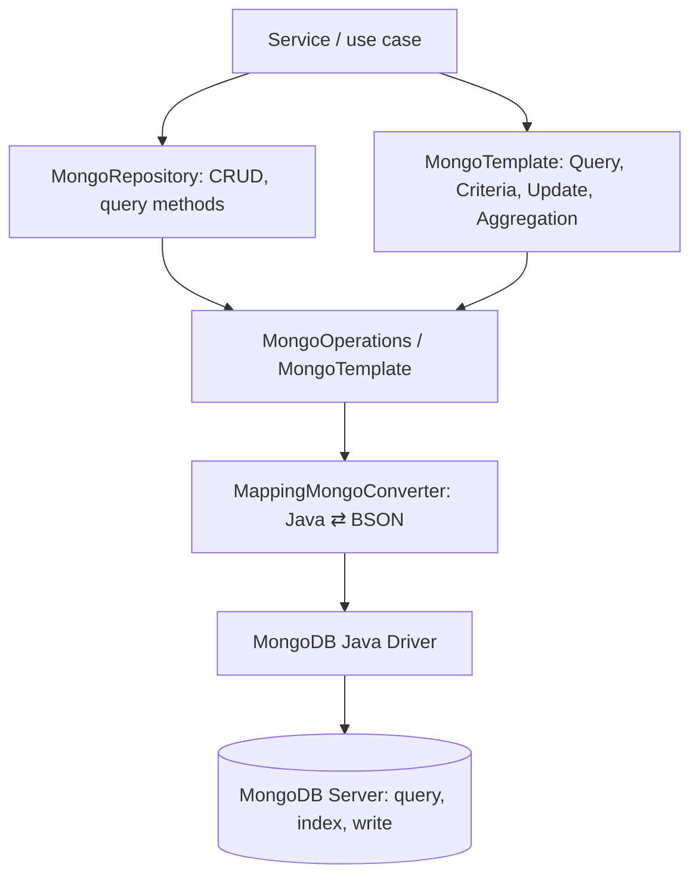

# Chọn repository hay template theo mức độ tùy chỉnh

Trong **Spring Data MongoDB**, `MongoRepository` và `MongoTemplate` đều giúp ứng dụng Java truy cập MongoDB, nhưng cung cấp hai cách diễn đạt thao tác dữ liệu. Với repository, ta thường mô tả **ý định nghiệp vụ bằng phương thức** như `findBySku`, `findByStatus` hoặc `save`. Với template, ta trực tiếp xây **query, update và aggregation** bằng những API như `Query`, `Criteria`, `Update` và `Aggregation`.

Câu hỏi không phải “cách nào hiện đại hơn?” mà là: **mức độ tùy chỉnh của thao tác có đủ lớn để cần điều khiển truy vấn trực tiếp hay không?** Chọn repository cho CRUD và các truy vấn dễ biểu diễn giúp code gọn, dễ đọc; chọn `MongoTemplate` khi phải xây filter động, cập nhật một số field có điều kiện, chạy pipeline aggregation, tổ chức bulk operation hoặc điều chỉnh hành vi truy vấn theo từng use case. Nhiều ứng dụng hiệu quả nhất khi **dùng cả hai**, thông qua service hoặc custom repository fragment.

Bài học thuộc chương **MongoTemplate** của module `SPRING_DATA_MONGODB`: kết nối MongoDB, ánh xạ BSON document, truy vấn, aggregation, index, transaction, reactive access, kiểm thử và chẩn đoán hiệu năng. Sau bài này, bạn có thể:

- Phân biệt trách nhiệm của `MongoRepository`, `MongoTemplate`, `MongoOperations`, converter và MongoDB Java Driver.
- Chọn API theo tính **ổn định của truy vấn**, độ động của điều kiện, kiểu cập nhật và nhu cầu kiểm soát hiệu năng.
- Xây repository cho CRUD, derived queries, `@Query` và phân trang; dùng template cho `Criteria`, `$set`, `$inc`, `findAndModify`, `upsert`, aggregation và bulk.
- Kết hợp repository cùng template mà không tạo hai tầng dữ liệu trùng chức năng hoặc bỏ qua các nguyên tắc transaction.
- Kiểm thử kết quả BSON thực, index, cạnh tranh ghi và khả năng mở rộng của từng cách.

## 1. Repository và template cùng nằm trong một hệ sinh thái



`MongoRepository` là interface được Spring Data hiện thực hóa dựa trên mô hình repository. Nó cung cấp sẵn CRUD, tạo truy vấn từ tên method hoặc annotation, hỗ trợ kiểu trả về/`Pageable` và có thể ghép với custom repository fragment. `MongoTemplate` là implementation tiêu biểu của `MongoOperations`, cho phép code trực tiếp với cấu trúc lệnh MongoDB qua các đối tượng Java.

**Hai API không trỏ đến hai database khác nhau** chỉ vì cách viết khác nhau. Khi được cấu hình trên cùng `MongoDatabaseFactory`/MongoDB client và converter, chúng dùng cùng mapping của Spring Data và MongoDB Server. Cả hai có thể hoạt động trong cùng một service và cùng transaction được cấu hình đúng.

| Tiêu chí | `MongoRepository` | `MongoTemplate` |
| --- | --- | --- |
| Mức trừu tượng | Cao, thiên về repository domain | Thấp hơn, thiên về thao tác query/command |
| CRUD một entity | `insert`, `save`, `findById`, `deleteById` | `insert`, `save`, `findById`, `remove` |
| Truy vấn đơn giản/cố định | Derived query, `@Query` dễ đọc | `Query`/`Criteria` viết tay nhưng rõ điều kiện |
| Điều kiện động theo nhiều bộ lọc | Có thể chia nhiều method, Specification không phải API mặc định phổ quát của MongoRepository | `Criteria` và `Query` linh hoạt |
| Projection, sort, paging | Interface/DTO projection, `Pageable`, `Sort` | `Query.fields()`, `with(Sort)`, `with(Pageable)` |
| Cập nhật một phần có điều kiện | Có một số cơ chế khai báo update tùy phiên bản; không tương đương `save` | `updateFirst`, `updateMulti`, `findAndModify`, `Update` |
| Aggregation | `@Aggregation` phù hợp pipeline cố định | `Aggregation` cho pipeline động/phức tạp |
| Bulk nhiều lệnh khác nhau | `saveAll` không mặc định là bulk update có điều kiện | `BulkOperations` |
| Truy cập BSON/command đặc thù | Thường dùng fragment/template | Template/driver tùy mức tùy chỉnh |
| Bảo trì | Rất tốt khi method ngắn, truy vấn rõ | Tốt khi tổ chức thành method dùng lại, có test |

**Không có quy tắc hiệu năng “template nhanh hơn repository” hoặc ngược lại.** Thời gian thực thi thường bị chi phối bởi query thực gửi, index, lượng document trả về, mapping, số round-trip và tải của MongoDB Server. Thay API mà giữ nguyên query plan không nhất thiết mang lại cải thiện.

## 2. Mô hình dữ liệu dùng xuyên suốt bài

Giả sử ứng dụng thương mại điện tử có collection `products`, mỗi document thuộc một tenant và có mã SKU, category, trạng thái, giá, tồn kho và ngày tạo.

```javascript
{
  _id: "P-100",
  tenantId: "T-A",
  sku: "BK-001",
  name: "Sổ tay",
  category: "BOOK",
  status: "ACTIVE",
  priceVnd: NumberLong("85000"),
  stock: 42,
  createdAt: ISODate("2026-11-01T09:00:00Z")
}
```

Entity Java:

```java
import java.time.Instant;
import org.springframework.data.mongodb.core.mapping.Document;
import org.springframework.data.mongodb.core.mapping.MongoId;

@Document(collection = "products")
public record Product(
        @MongoId String id,
        String tenantId,
        String sku,
        String name,
        String category,
        String status,
        long priceVnd,
        int stock,
        Instant createdAt
) {}
```

`@MongoId String id` giữ ID theo kiểu BSON String trong cấu hình mapping mặc định. Nếu dữ liệu có `_id` kiểu ObjectId, phải điều chỉnh khai báo cho khớp; **ID Java trông giống nhau không đảm bảo BSON type giống nhau**.

Với ứng dụng đa tenant, điều kiện `tenantId` là **ranh giới truy cập dữ liệu quan trọng**. Bất kể dùng repository hay template, truy vấn của người dùng thường phải giới hạn tenant theo danh tính được kiểm tra ở tầng service/security, không tin tenant ID tự khai báo từ client.

### 2.1. Index gắn với truy vấn thật

```javascript
// SKU duy nhất trong mỗi tenant.
db.products.createIndex(
  { tenantId: 1, sku: 1 },
  { unique: true }
);

// Danh sách ACTIVE mới nhất.
db.products.createIndex(
  { tenantId: 1, status: 1, createdAt: -1, _id: -1 }
);

// Tìm theo category, khoảng giá: cân nhắc sau khi đo workload.
db.products.createIndex(
  { tenantId: 1, category: 1, priceVnd: 1 }
);
```

Đây là index minh họa, **không phải danh sách cần tạo nguyên xi**. Index có chi phí ghi và dung lượng. Chỉ số nào hữu ích phụ thuộc filter, sort, độ chọn lọc, phân phối dữ liệu và kết quả `explain`.

## 3. Chọn repository khi truy vấn có tên rõ ràng

Với nghiệp vụ “tìm theo SKU”, “lấy các sản phẩm ACTIVE gần đây” hoặc “đếm theo trạng thái”, repository giúp service biểu diễn ý định ngắn gọn:

```java
import java.util.Optional;
import java.util.List;
import org.springframework.data.domain.Page;
import org.springframework.data.domain.Pageable;
import org.springframework.data.mongodb.repository.MongoRepository;

public interface ProductRepository
        extends MongoRepository<Product, String> {

    Optional<Product> findByTenantIdAndSku(
            String tenantId, String sku);

    Page<Product> findByTenantIdAndStatus(
            String tenantId, String status, Pageable pageable);

    List<Product>
    findTop5ByTenantIdAndStatusOrderByCreatedAtDescIdDesc(
            String tenantId, String status);

    long countByTenantIdAndStatus(
            String tenantId, String status);

    boolean existsByTenantIdAndSku(
            String tenantId, String sku);
}
```

Ví dụ service:

```java
import java.util.Optional;
import org.springframework.data.domain.Page;
import org.springframework.data.domain.PageRequest;
import org.springframework.data.domain.Sort;
import org.springframework.stereotype.Service;

@Service
public class ProductReadService {
    private final ProductRepository repository;

    public ProductReadService(ProductRepository repository) {
        this.repository = repository;
    }

    public Optional<Product> getBySku(String tenantId, String sku) {
        return repository.findByTenantIdAndSku(tenantId, sku);
    }

    public Page<Product> activePage(String tenantId, int page) {
        int safePage = Math.max(0, page);
        return repository.findByTenantIdAndStatus(
                tenantId,
                "ACTIVE",
                PageRequest.of(
                        safePage,
                        20,
                        Sort.by(Sort.Order.desc("createdAt"),
                                Sort.Order.desc("id"))));
    }
}
```

`Page<T>` có thông tin tổng số, có thể làm phát sinh truy vấn đếm; khi chỉ cần “còn trang sau không”, `Slice<T>` thường phù hợp hơn. Với phân trang sâu, `skip`/`limit` có thể tốn chi phí; cần cân nhắc keyset theo `createdAt` và `_id`. Lựa chọn repository **không loại bỏ nhu cầu thiết kế phân trang và index**.

### 3.1. `@Query` giúp đi xa hơn derived method

Khi điều kiện vẫn **cố định và dễ mô tả** nhưng tên method trở nên dài, `@Query` là lựa chọn trung gian:

```java
import java.util.List;
import org.springframework.data.mongodb.repository.Query;

// Bổ sung trong ProductRepository:
@Query(
    value = "{ 'tenantId': ?0, 'status': 'ACTIVE', "
          + "'priceVnd': { '$gte': ?1, '$lt': ?2 } }",
    fields = "{ 'tenantId': 1, 'sku': 1, 'name': 1, 'priceVnd': 1 }"
)
List<ProductSummary> findActiveSummariesByPriceRange(
        String tenantId, long minPriceInclusive, long maxPriceExclusive);
```

`ProductSummary` là một DTO chỉ đọc tương ứng với field projection:

```java
public record ProductSummary(
        String id,
        String tenantId,
        String sku,
        String name,
        long priceVnd
) {}
```

Các placeholder `?0`, `?1`, `?2` được Spring Data bind với tham số method, tránh tự ghép giá trị người dùng vào chuỗi JSON. Với DTO/class-based projection, hãy kiểm tra mapping constructor, tên field và phiên bản Spring Data đang dùng. **Không đem DTO hoặc entity chỉ được tải một phần vào `save`**, vì `save` có thể ghi lại document thiếu field.

**Mốc chuyển sang template:** khi filter liên tục thay đổi tùy hàng loạt lựa chọn của người dùng, tạo hàng chục method hoặc JSON/SpEL khó đọc là dấu hiệu nên đưa phần query động vào `MongoTemplate`, không kéo dài mã khai báo mãi.

## 4. Chọn `MongoTemplate` cho query có bộ lọc động

Giả sử màn hình tìm kiếm sản phẩm cho phép lọc theo `category`, `status`, giá tối thiểu/tối đa; bất kỳ bộ lọc tùy chọn nào cũng có thể được bỏ trống. Viết một derived method cho **mọi tổ hợp** sẽ gây bùng nổ tên phương thức:

- `findByTenantIdAndStatus`
- `findByTenantIdAndCategory`
- `findByTenantIdAndStatusAndCategory`
- `findByTenantIdAndStatusAndPriceVndBetween`
- Và hàng loạt biến thể khác...

Đây là tình huống `Query` và `Criteria` diễn đạt tốt hơn. Trước tiên định nghĩa command tìm kiếm:

```java
public record ProductSearchFilter(
        String tenantId,
        String category,
        String status,
        Long minPriceVnd,
        Long maxPriceVnd,
        int limit
) {}
```

Xây query có chủ đích:

```java
import java.util.List;
import org.springframework.data.domain.Sort;
import org.springframework.data.mongodb.core.MongoTemplate;
import org.springframework.data.mongodb.core.query.Criteria;
import org.springframework.data.mongodb.core.query.Query;
import org.springframework.stereotype.Component;

@Component
public class ProductSearch {

    private final MongoTemplate template;

    public ProductSearch(MongoTemplate template) {
        this.template = template;
    }

    public List<Product> search(ProductSearchFilter filter) {
        if (filter.tenantId() == null || filter.tenantId().isBlank()) {
            throw new IllegalArgumentException("Thiếu tenant đã xác thực");
        }
        if (filter.minPriceVnd() != null
                && filter.maxPriceVnd() != null
                && filter.minPriceVnd() > filter.maxPriceVnd()) {
            throw new IllegalArgumentException("Khoảng giá không hợp lệ");
        }

        Query query = new Query();
        // Tenant là điều kiện bắt buộc, không phụ thuộc checkbox của UI.
        query.addCriteria(Criteria.where("tenantId").is(filter.tenantId()));

        if (filter.status() != null && !filter.status().isBlank()) {
            query.addCriteria(Criteria.where("status").is(filter.status()));
        }
        if (filter.category() != null && !filter.category().isBlank()) {
            query.addCriteria(Criteria.where("category").is(filter.category()));
        }

        if (filter.minPriceVnd() != null
                || filter.maxPriceVnd() != null) {
            Criteria price = Criteria.where("priceVnd");
            if (filter.minPriceVnd() != null) {
                price = price.gte(filter.minPriceVnd());
            }
            if (filter.maxPriceVnd() != null) {
                price = price.lte(filter.maxPriceVnd());
            }
            query.addCriteria(price);
        }

        query.with(Sort.by(
                Sort.Order.desc("createdAt"),
                Sort.Order.desc("id")));
        query.limit(Math.max(1, Math.min(filter.limit(), 100)));

        return template.find(query, Product.class);
    }
}
```

Ví dụ `new ProductSearchFilter("T-A", "BOOK", "ACTIVE", 50_000L, 100_000L, 20)` tương đương về ý nghĩa với:

```javascript
db.products.find({
  tenantId: "T-A",
  category: "BOOK",
  status: "ACTIVE",
  priceVnd: { $gte: NumberLong("50000"), $lte: NumberLong("100000") }
}).sort({ createdAt: -1, _id: -1 }).limit(20);
```

Ưu điểm là service có thể **bật/tắt từng điều kiện** mà không phải ghép JSON từ chuỗi input. `Criteria` xử lý cấu trúc query, còn Spring Data mapping tên thuộc tính và giá trị Java sang BSON. Nếu ứng dụng cho phép sort do người dùng chọn, hãy **whitelist** tên field được phép, không nhận tự do đường dẫn/biểu thức từ client.

### 4.1. Template không tự bảo vệ tenant hoặc hiệu năng

Việc dùng `Criteria` không tự sinh ra chính sách phân quyền. Nếu service quên điều kiện `tenantId`, query có thể đọc dữ liệu ngoài phạm vi được phép. Nên đặt kiểm tra tenant ở một điểm thống nhất, có test bảo vệ, và dùng danh tính **đã được xác thực** thay vì tin query parameter của client.

Khi filter gồm cả `category`, `status`, khoảng giá và sort theo thời gian, một index không nhất thiết tối ưu được tất cả tổ hợp. Đo `explain("executionStats")` cho những tổ hợp phổ biến nhất, rồi điều chỉnh index. Không cố tạo một index cho mỗi trường hợp hiếm.

### 4.2. Projection từ template vẫn là đối tượng chỉ đọc

Để giảm dữ liệu trả về:

```java
query.fields()
        .include("sku")
        .include("name")
        .include("priceVnd");
```

Nếu sau đó gọi `template.find(query, Product.class)`, `Product` chỉ có một phần field. **Không đem entity này vào `repository.save` hay `template.save`**, vì đường save của entity đã tồn tại có thể thay thế document bằng nội dung thiếu field. Hãy ánh xạ ra DTO riêng và giữ nó trong luồng đọc, hoặc dùng API cập nhật theo field.

## 5. Chọn template khi muốn cập nhật **đúng những field cần sửa**

Một nguyên nhân phổ biến để chuyển từ `repository.save` sang `MongoTemplate` là yêu cầu **PATCH**: chỉ cập nhật một vài trường, có điều kiện nghiệp vụ và phải giữ nguyên các trường khác.

### 5.1. Ví dụ trừ tồn kho nguyên tử

Khi mua 3 đơn vị sản phẩm, nghiệp vụ yêu cầu **không trừ xuống dưới 0**. Pattern “đọc stock → trừ trong Java → `save`” có nguy cơ lost update nếu nhiều request cùng thao tác.

```java
import com.mongodb.client.result.UpdateResult;
import org.springframework.data.mongodb.core.MongoTemplate;
import org.springframework.data.mongodb.core.query.Criteria;
import org.springframework.data.mongodb.core.query.Query;
import org.springframework.data.mongodb.core.query.Update;
import org.springframework.stereotype.Service;

@Service
public class StockService {
    private final MongoTemplate template;

    public StockService(MongoTemplate template) {
        this.template = template;
    }

    public boolean reserve(
            String tenantId, String productId, int quantity) {
        if (quantity <= 0) {
            throw new IllegalArgumentException("Số lượng phải dương");
        }

        Query query = Query.query(
                Criteria.where("_id").is(productId)
                        .and("tenantId").is(tenantId)
                        .and("stock").gte(quantity));

        Update update = new Update().inc("stock", -quantity);
        UpdateResult result = template.updateFirst(
                query, update, Product.class);

        return result.getModifiedCount() == 1;
    }
}
```

MongoDB Server kiểm tra điều kiện `stock >= quantity` và áp dụng `$inc` trong **một thao tác ghi nguyên tử trên document**. Nếu không đủ tồn kho, query không khớp và phương thức trả `false`; `updateFirst` mặc định không tự tạo document mới.

Điều này tốt hơn `save` khi chỉ cần thay field `stock`: không ghi đè `priceVnd`, `name` hoặc `status` từ một snapshot cũ. Tuy vậy, **đặt hàng còn liên quan tới đơn hàng, thanh toán, idempotency và nhiều document**, có thể cần transaction hoặc workflow bù riêng. Một update tồn kho thành công không tự làm toàn bộ giao dịch thương mại điện tử thành nguyên tử.

### 5.2. `findAndModify` khi cần giá trị mới ngay sau cập nhật

Nếu service cần trả về trạng thái tồn kho sau khi trừ, `findAndModify` giúp cập nhật và lấy bản ghi đã sửa trong một thao tác:

```java
import org.springframework.data.mongodb.core.FindAndModifyOptions;

Query query = Query.query(
        Criteria.where("_id").is(productId)
                .and("tenantId").is(tenantId)
                .and("stock").gte(quantity));

Product updated = template.findAndModify(
        query,
        new Update().inc("stock", -quantity),
        FindAndModifyOptions.options().returnNew(true),
        Product.class
);
```

Đây là **đoạn code trong một service đã có** `template`, `productId`, `tenantId`, `quantity` hợp lệ. `updated == null` có thể nghĩa là không thấy product, sai tenant hoặc không đủ tồn kho; nếu API cần thông báo phân biệt, phải tra cứu/thiết kế phản hồi phù hợp. Việc trả entity đầy đủ có thể tốn dữ liệu; khi chỉ cần số stock mới, cân nhắc DTO/projection theo phiên bản API.

### 5.3. `upsert` khi muốn “tạo nếu chưa tồn tại”

Một use case khác là nạp catalog mẫu từ hệ thống ngoài bằng cặp khóa `tenantId + sku`. Nếu bản ghi đã tồn tại, **không muốn ghi đè các field do người dùng chỉnh sửa**:

```java
import java.time.Instant;
import com.mongodb.client.result.UpdateResult;
import org.springframework.data.mongodb.core.query.Criteria;
import org.springframework.data.mongodb.core.query.Query;
import org.springframework.data.mongodb.core.query.Update;

Query query = Query.query(
        Criteria.where("tenantId").is(tenantId)
                .and("sku").is(sku));

Update update = new Update()
        .setOnInsert("tenantId", tenantId)
        .setOnInsert("sku", sku)
        .setOnInsert("name", incomingName)
        .setOnInsert("status", "DRAFT")
        .setOnInsert("category", incomingCategory)
        .setOnInsert("priceVnd", initialPriceVnd)
        .setOnInsert("stock", 0)
        .setOnInsert("createdAt", Instant.now());

UpdateResult result = template.upsert(
        query, update, Product.class);
```

`$setOnInsert` chỉ đặt các giá trị khi upsert **chèn document mới**; nếu `tenantId + sku` đã tồn tại, các field không bị ghi đè chỉ vì chạy lại quá trình import. Để tránh tạo bản ghi trùng khi có nhiều request cạnh tranh, cần **unique index trên cặp khóa** và xử lý lỗi ghi một cách idempotent.

Lưu ý ví dụ này nằm trong method có các biến đã được xác thực. Đừng coi `upsert` mặc định là một cách thay thế `save` cho mọi trường hợp: `upsert` nêu rõ **filter và các toán tử ghi**, còn `save` mang ngữ nghĩa ghi entity đã mapping.

### 5.4. `@Version` và đường cập nhật trực tiếp

`repository.save` hoặc `MongoTemplate.save` có thể áp dụng optimistic locking khi entity có `@Version`. Nhưng các update theo field như `updateFirst` cần được thiết kế **nhất quán về điều kiện version**; không coi việc gọi một lệnh `Update` bất kỳ là tự động bảo vệ mọi xung đột như `save`.

Khi cần compare-and-set, hãy đưa version kỳ vọng vào `Criteria` và tăng version theo chiến lược mapping của ứng dụng. Spring Data có thể tự tăng version cho một số update khi chưa chỉ định version; nếu **đã khai báo `$inc("version", 1)`**, tránh giả định framework sẽ tăng thêm lần nữa. Kiểm thử BSON thực để bảo đảm version chỉ tăng đúng một lần và request mang version cũ bị từ chối như mong muốn.

## 6. Aggregation: pipeline cố định hay xây dựng linh hoạt?

Một báo cáo “đếm số sản phẩm ACTIVE và tổng tồn kho theo category” không phải CRUD đơn giản. MongoDB Server có aggregation pipeline:

```javascript
db.products.aggregate([
  { $match: { tenantId: "T-A", status: "ACTIVE" } },
  {
    $group: {
      _id: "$category",
      productCount: { $sum: 1 },
      totalUnits: { $sum: "$stock" }
    }
  },
  { $sort: { productCount: -1 } }
]);
```

Nếu pipeline cố định và trả DTO rõ ràng, repository có thể dùng `@Aggregation`. Khi dashboard có nhiều bộ lọc tùy chọn, nhóm theo những trường khác nhau hoặc chọn pipeline theo điều kiện, `MongoTemplate.aggregate` rõ ràng hơn.

Ví dụ template:

```java
import java.util.List;
import org.bson.Document;
import org.springframework.data.domain.Sort;
import org.springframework.data.mongodb.core.MongoTemplate;
import org.springframework.data.mongodb.core.aggregation.Aggregation;
import org.springframework.data.mongodb.core.aggregation.AggregationResults;
import org.springframework.data.mongodb.core.query.Criteria;

public class ProductStatistics {
    private final MongoTemplate template;

    public ProductStatistics(MongoTemplate template) {
        this.template = template;
    }

    public List<Document> byCategory(String tenantId) {
        Aggregation pipeline = Aggregation.newAggregation(
                Aggregation.match(
                        Criteria.where("tenantId").is(tenantId)
                                .and("status").is("ACTIVE")),
                Aggregation.group("category")
                        .count().as("productCount")
                        .sum("stock").as("totalUnits"),
                Aggregation.sort(
                        Sort.Direction.DESC, "productCount")
        );

        AggregationResults<Document> result = template.aggregate(
                pipeline, Product.class, Document.class);
        return result.getMappedResults();
    }
}
```

Ở kết quả BSON, `_id` nhóm biểu diễn category; `productCount` là số document và `totalUnits` là tổng stock. Trong ứng dụng thực, nên ánh xạ ra DTO rõ tên field và kiểm thử kiểu số (int/long/decimal) khi dữ liệu lớn hoặc converter tùy chỉnh. Đừng chỉ dùng `Document` thô tràn lan ở mọi tầng service nếu domain cần hợp đồng dữ liệu ổn định.

**Aggregation có thể tốn nhiều tài nguyên** bất kể được khai báo bằng `@Aggregation` hay `MongoTemplate`. Quan trọng là stage `$match` phù hợp, index, cardinality của `$group`, stage sort, số lượng document và giải pháp tiền tổng hợp khi dashboard chạy thường xuyên.

## 7. Bulk operations: khác với `saveAll`

Khi cập nhật tồn kho nhiều sản phẩm, `repository.saveAll(products)` không nhất thiết là một lệnh bulk update có điều kiện; tập trộn mới và đã tồn tại có thể đi qua nhiều lần `save`. `MongoTemplate.bulkOps` cho phép chỉ định một danh sách **updateOne/upsert/delete** cùng các filter khác nhau:

```java
import com.mongodb.bulk.BulkWriteResult;
import org.springframework.data.mongodb.core.BulkOperations;
import org.springframework.data.mongodb.core.MongoTemplate;
import org.springframework.data.mongodb.core.query.Criteria;
import org.springframework.data.mongodb.core.query.Query;
import org.springframework.data.mongodb.core.query.Update;

BulkOperations bulk = template.bulkOps(
        BulkOperations.BulkMode.ORDERED,
        Product.class);

bulk.updateOne(
        Query.query(Criteria.where("_id").is("P-100")
                .and("tenantId").is("T-A")),
        new Update().inc("stock", 5));

bulk.updateOne(
        Query.query(Criteria.where("_id").is("P-101")
                .and("tenantId").is("T-A")),
        new Update().inc("stock", -2));

BulkWriteResult result = bulk.execute();
```

Đoạn này nằm trong service đã có `template`. Dùng `ORDERED` để thực thi các thao tác theo thứ tự; dùng `UNORDERED` chỉ khi chấp nhận các thao tác không cần giữ thứ tự và đã chuẩn bị xử lý lỗi từng phần. **Bulk không mặc định là một transaction nguyên tử trên nhiều document**, và một số cơ chế callback/lifecycle/optimistic locking của entity có thể không được áp dụng như `save` thông thường.

Mỗi `updateOne` vẫn chỉ thay đổi document khớp filter. Trong thực tế, nếu yêu cầu stock không âm thì lệnh giảm stock phải có điều kiện `stock >= quantity` như mục 5; ví dụ bulk trên chỉ minh họa cú pháp. Thiết kế retry/idempotency và kiểm soát duplicate event là trách nhiệm của ứng dụng.

## 8. Kết hợp repository và template: phương án thực tế

Không nhất thiết chọn **một API duy nhất cho toàn hệ thống**. Ví dụ:

- `ProductRepository` xử lý tạo mới, tìm theo SKU, đếm, trang danh sách đơn giản.
- `StockService` dùng `MongoTemplate.updateFirst` cho thao tác tồn kho có điều kiện.
- `ProductStatistics` dùng `MongoTemplate.aggregate` cho báo cáo.
- `ProductSearch` dùng `Criteria` khi bộ lọc phụ thuộc nhiều tham số.

Các class trên có thể cùng tồn tại. Cách tiếp cận này giữ phần CRUD gọn mà không ép các thao tác phức tạp vào tên method repository dài khó bảo trì.

### 8.1. Tổ chức theo use case, tránh trùng lặp API

```text
application/
  ProductReadService       → ProductRepository
  ProductCommandService    → ProductRepository + MongoTemplate
  StockService             → MongoTemplate
  ProductReportingService  → ProductStatistics (MongoTemplate)

infrastructure/
  ProductRepository        → Spring Data MongoRepository
  ProductSearch            → Query/Criteria qua MongoTemplate
  ProductStatistics        → Aggregation qua MongoTemplate
```

Đây là cấu trúc minh họa, không phải yêu cầu Spring. Dù lựa chọn package nào, những nguyên tắc nên giữ là:

1. **Mỗi use case có một phương thức rõ nghĩa** như `reserveStock`, `searchProducts`, `countActive`; đừng để controller tùy ý lắp query MongoDB.
2. **Đừng sao chép cùng một quy tắc nghiệp vụ** (ví dụ kiểm tra tenant, stock không âm) ở hai nơi. Có thể đóng gói rule dùng chung hoặc tách command service rõ quyền sở hữu.
3. **Không để domain service phụ thuộc vào một trăm method repository** chỉ vì muốn tránh template. Khi truy vấn động thực sự phức tạp, template làm code dễ hiểu hơn.
4. **Không dùng template cho tất cả mọi thứ chỉ vì linh hoạt.** Với `findById`/`existsBy...`, repository diễn đạt ý định rõ hơn và ít boilerplate hơn.

### 8.2. Custom repository fragment khi muốn một cổng truy cập thống nhất

Spring Data cho phép ghép hành vi tùy chỉnh vào repository thông qua **repository fragment**. Điều này hữu ích khi nhóm muốn service gọi một `ProductRepository`, còn phần tìm kiếm phức tạp được triển khai bằng `MongoTemplate`.

Khai báo fragment:

```java
import java.util.List;

public interface ProductSearchFragment {
    List<Product> search(ProductSearchFilter filter);
}
```

Thêm fragment vào repository có sẵn:

```java
// Điều chỉnh phần khai báo ProductRepository ở mục 3:
public interface ProductRepository
        extends MongoRepository<Product, String>,
                ProductSearchFragment {
    // Các phương thức CRUD/derived query khác giữ nguyên.
}
```

Định nghĩa implementation với hậu tố `Impl` theo convention của repository fragment:

```java
import java.util.List;

public class ProductSearchFragmentImpl
        implements ProductSearchFragment {

    private final ProductSearch delegate;

    public ProductSearchFragmentImpl(ProductSearch delegate) {
        this.delegate = delegate;
    }

    @Override
    public List<Product> search(ProductSearchFilter filter) {
        return delegate.search(filter);
    }
}
```

`ProductSearch` ở mục 4 đã sử dụng `MongoTemplate`; implementation trên chỉ **ủy quyền**, không lặp code tạo filter. Spring Data kết hợp fragment vào repository khi class implementation nằm trong vùng package scan, tuân thủ cách đặt tên và cấu hình đã chọn. Nếu bean implementation không được nhận diện, cần kiểm tra scanning, tên fragment và postfix của phiên bản đang dùng.

**Đừng khai báo đồng thời hai interface `ProductRepository` trùng tên trong cùng package**: đoạn trên là phần *thay đổi khai báo* trước đó để minh họa mô hình hybrid, không phải yêu cầu tạo hai repository độc lập.

## 9. Transaction, version và ranh giới nhất quán

Cả repository và template có thể tham gia transaction MongoDB nếu ứng dụng đã cấu hình transaction manager đúng với MongoDB deployment. Ví dụ service có thể gọi `repository.insert(order)` rồi `template.updateFirst(...)` trong một transaction được quản lý bởi Spring:

```java
import org.springframework.transaction.annotation.Transactional;

@Transactional
public void createOrderAndReserveStock(...) {
    // Kiểm tra điều kiện nghiệp vụ.
    // repository.insert(order);
    // template.updateFirst(queryStock, updateStock, Product.class);
    // Xử lý kết quả matched/modifiedCount: không đủ stock thì phải báo lỗi.
}
```

Đoạn code chỉ mô tả ranh giới, **không phải implementation hoàn chỉnh để copy**. Transaction MongoDB cần topology hỗ trợ (thường replica set hoặc sharded cluster theo phiên bản) và `MongoTransactionManager` phù hợp; annotation `@Transactional` tự nó không bảo đảm MongoDB transaction đã thực sự hoạt động. Với reactive cần transaction manager reactive và mô hình tham gia transaction riêng.

**Quan trọng:** `updateFirst` không khớp điều kiện tồn kho thường trả `matchedCount = 0`, **không tự ném exception**. Nếu toàn bộ transaction phải rollback, service phải phát hiện kết quả này và thực hiện chính sách rollback (ví dụ ném exception phù hợp), không cứ gọi hai lệnh rồi mặc định thành công.

### 9.1. `@Version` và cập nhật không thông qua `save`

Khi entity có `@Version`, repository `save` và template `save` có thể thực hiện optimistic locking. Với template update theo field, cần kiểm tra kỹ:

- Query có lọc theo `version` hiện tại khi cần compare-and-set không?
- Update có tăng version đúng một lần không?
- Mọi đường ghi (repository, template, bulk hoặc Java Driver) có duy trì cùng quy tắc version không?
- Write concern có đủ để ứng dụng biết kết quả thao tác không?

Không giả định việc dùng `MongoTemplate` làm mất **mọi** cơ chế mapping hoặc `@Version`; cũng không giả định bulk update sẽ tự áp dụng toàn bộ callback và optimistic locking như `save`. Phải kiểm thử API cụ thể, converter và phiên bản Spring Data thực tế.

### 9.2. API không thay thế ràng buộc từ MongoDB

Repository hay template đều không tự tạo **foreign key** giữa các collection. Với reference, delete/update liên quan cần chính sách riêng. Cả hai đều phải tuân thủ unique index và giới hạn BSON **16 MiB/document**. Nếu thao tác nhiều document không nằm trong transaction, có thể xảy ra **thành công một phần**.

Đối với retry sau lỗi mạng, xác nhận được kết quả ghi hay chưa và tính idempotent của command quan trọng hơn việc command được gọi bằng repository hay template. `insert`, `save`, `upsert` và `$inc` có ngữ nghĩa khác nhau khi được gọi lại.

## 10. Reactive access: chọn API song song

Với ứng dụng reactive, có các API tương ứng là **`ReactiveMongoRepository`** và **`ReactiveMongoTemplate`**. Nguyên tắc chọn API tương tự: repository cho CRUD/derived query dễ biểu diễn; reactive template cho filter động, update hoặc aggregation rõ ràng.

Ví dụ reactive repository:

```java
import reactor.core.publisher.Flux;
import reactor.core.publisher.Mono;
import org.springframework.data.mongodb.repository.ReactiveMongoRepository;

public interface ReactiveProductRepository
        extends ReactiveMongoRepository<Product, String> {

    Mono<Product> findByTenantIdAndSku(
            String tenantId, String sku);

    Flux<Product> findByTenantIdAndStatus(
            String tenantId, String status);
}
```

Reactive template cho truy vấn tương đương:

```java
import reactor.core.publisher.Flux;
import org.springframework.data.mongodb.core.ReactiveMongoTemplate;
import org.springframework.data.mongodb.core.query.Criteria;
import org.springframework.data.mongodb.core.query.Query;

public class ReactiveProductSearch {
    private final ReactiveMongoTemplate template;

    public ReactiveProductSearch(ReactiveMongoTemplate template) {
        this.template = template;
    }

    public Flux<Product> activeBooks(String tenantId) {
        Query query = Query.query(
                Criteria.where("tenantId").is(tenantId)
                        .and("status").is("ACTIVE")
                        .and("category").is("BOOK"));
        query.limit(100);
        return template.find(query, Product.class);
    }
}
```

`Flux` chỉ phát dữ liệu khi có subscription, cần quản lý backpressure, cancellation, giới hạn số phần tử và concurrency. **Không gọi blocking `MongoTemplate` trong reactive event loop** và không dùng `block()` tùy tiện để kết hợp hai kiểu truy cập. Một `Flux` có filter đúng vẫn có thể tốn tài nguyên nếu `collectList()` gom quá nhiều document vào RAM.

Mô hình reactive không làm thay đổi các yêu cầu về index, BSON type, version, unique constraint hay transaction. Khi một workflow gồm nhiều ghi reactive cần nguyên tử, phải sử dụng cấu hình transaction reactive phù hợp; không suy từ `Mono`/`Flux` rằng toàn bộ pipeline mặc định là một transaction.

## 11. Hiệu năng và khả năng bảo trì: đo cùng truy vấn

Để chọn repository hay template, **không benchmark bằng cách so hai đoạn Java không thực hiện cùng một query**. Hãy so sánh các truy vấn tương đương, trên cùng MongoDB Server và dữ liệu có phân phối giống thực tế:

```java
// Repository: dùng derived method.
repository.findByTenantIdAndSku("T-A", "BK-001");

// Template: cùng mục tiêu dữ liệu.
Query query = Query.query(
        Criteria.where("tenantId").is("T-A")
                .and("sku").is("BK-001"));
Product product = template.findOne(query, Product.class);
```

Trong hai câu lệnh, MongoDB Server đều phải tìm một document theo `tenantId + sku`. Nếu chúng đi qua cùng converter, filter và index, không có cơ sở kết luận template luôn nhanh hơn chỉ vì số dòng code dài hơn hoặc vì không dùng proxy repository.

### 11.1. Các thông số cần quan sát

| Thành phần | Cách kiểm tra | Dấu hiệu cần chú ý |
| --- | --- | --- |
| Query plan | `explain("executionStats")` | `COLLSCAN` không mong muốn, sort tốn bộ nhớ |
| Index | `getIndexes()` và query workload | Thiếu index theo filter/sort, quá nhiều index gây tốn ghi |
| Số document trả về | Query projection, limit, pagination | Đọc toàn document khi chỉ cần vài field |
| Số round-trip | Command monitoring/profiler | N+1 queries, nhiều `save` lẻ thay vì bulk thích hợp |
| Mapping Java/BSON | Kiểm tra kiểu, converter, callback | ID String/ObjectId không khớp, mapping chi phí cao |
| Đọc phân trang/stream | `Page`/`Slice`/cursor metrics | Count thừa, skip sâu, cursor không đóng |
| Ghi đồng thời | Integration test với cạnh tranh | Lost update, duplicate key, stock âm |
| Tài nguyên | Heap, GC, connection pool, latency p95/p99 | Dữ liệu quá lớn, quá nhiều request đang chờ |

Ví dụ kiểm tra index cho truy vấn theo SKU:

```javascript
db.products.find({
  tenantId: "T-A",
  sku: "BK-001"
}).explain("executionStats");
```

Với một test database có vài document, MongoDB có thể chọn collection scan vì rẻ hơn; đừng suy ra index vô ích chỉ từ fixture nhỏ. Một index có hiệu lực trên dữ liệu lớn cũng chưa giải quyết mọi độ trễ do mạng, serialization, phần giao diện hoặc các service khác.

### 11.2. Dấu hiệu API đã bị dùng vượt mức

**Repository đang bị ép quá mức** khi tên method kéo dài nhiều dòng, `@Query` chứa SpEL động khó bảo trì, hoặc phải tạo hàng chục method gần giống nhau. Khi đó hãy xem xét `MongoTemplate` hoặc fragment.

**Template đang bị dùng quá mức** khi service liên tục viết lại `Query.query(Criteria.where("_id").is(id))` chỉ để thay `findById`, lặp lại bộ lọc SKU giống nhau ở nhiều chỗ, hoặc trả `Document` thô cho mọi API dù có entity/DTO rõ ràng. Khi đó repository có thể đơn giản hóa nhiều code.

Nguyên tắc: **dùng abstraction cao nhất vẫn diễn đạt đúng thao tác một cách minh bạch; hạ xuống template khi thật sự cần kiểm soát thêm**. Đừng chọn chỉ theo số dòng code, thói quen cá nhân hoặc một benchmark chưa kiểm soát yếu tố khác.

## 12. Kiểm thử lựa chọn API với MongoDB thật

**Unit test mock repository hoặc template chỉ kiểm tra việc method được gọi**, không xác nhận BSON được lưu đúng, filter có khớp tenant, hay lệnh `$inc` có bảo vệ tồn kho. Nên dùng `@DataMongoTest` cùng **MongoDB test instance cô lập**, ví dụ Testcontainers, để kiểm chứng những thao tác có ngữ nghĩa khác nhau.

Ví dụ cho Spring Boot 3.x sử dụng `Product`, `ProductRepository`, `ProductSearch` và `StockService` đã được trình bày:

```java
import static org.assertj.core.api.Assertions.assertThat;

import java.time.Instant;
import org.junit.jupiter.api.BeforeEach;
import org.junit.jupiter.api.Test;
import org.springframework.beans.factory.annotation.Autowired;
import org.springframework.boot.test.autoconfigure.data.mongo.DataMongoTest;
import org.springframework.data.mongodb.core.MongoTemplate;
import org.springframework.data.mongodb.core.query.Criteria;
import org.springframework.data.mongodb.core.query.Query;

@DataMongoTest
class RepositoryVsTemplateTest {

    @Autowired ProductRepository repository;
    @Autowired MongoTemplate template;

    @BeforeEach
    void seed() {
        // Chỉ xóa dữ liệu trong MongoDB test được cô lập.
        template.remove(new Query(), Product.class);
        template.insert(product(
                "P-100", "T-A", "BK-001", "BOOK", "ACTIVE", 85_000, 2));
        template.insert(product(
                "P-101", "T-A", "PN-001", "PEN", "ACTIVE", 20_000, 9));
        template.insert(product(
                "P-102", "T-B", "BK-001", "BOOK", "ACTIVE", 90_000, 7));
    }

    private Product product(String id, String tenantId, String sku,
                            String category, String status,
                            long priceVnd, int stock) {
        return new Product(
                id, tenantId, sku, "Sản phẩm " + id,
                category, status, priceVnd, stock,
                Instant.parse("2026-11-01T09:00:00Z"));
    }

    @Test
    void repositoryAndTemplateFindTheSameDocument() {
        Product fromRepository = repository
                .findByTenantIdAndSku("T-A", "BK-001")
                .orElseThrow();

        Product fromTemplate = template.findOne(
                Query.query(Criteria.where("tenantId").is("T-A")
                        .and("sku").is("BK-001")),
                Product.class);

        assertThat(fromTemplate).isEqualTo(fromRepository);
        assertThat(fromRepository.id()).isEqualTo("P-100");
    }

    @Test
    void dynamicSearchRespectsTenantAndFilters() {
        ProductSearch search = new ProductSearch(template);
        var result = search.search(new ProductSearchFilter(
                "T-A", "BOOK", "ACTIVE", 50_000L, 100_000L, 10));

        assertThat(result).extracting(Product::id)
                .containsExactly("P-100");
    }

    @Test
    void templateUpdatePreventsNegativeStockAndPreservesPrice() {
        StockService stockService = new StockService(template);
        assertThat(stockService.reserve("T-A", "P-100", 2)).isTrue();
        assertThat(stockService.reserve("T-A", "P-100", 1)).isFalse();
        assertThat(stockService.reserve("T-B", "P-100", 1)).isFalse();

        Product after = repository.findById("P-100").orElseThrow();
        assertThat(after.stock()).isZero();
        assertThat(after.priceVnd()).isEqualTo(85_000L);
    }
}
```

Test trên cần dependency Spring Boot Test, JUnit, AssertJ và MongoDB Server riêng được cấu hình trước. `@DataMongoTest` không tự tạo MongoDB Server trong mọi môi trường; không chạy `template.remove(new Query(), ...)` với database dùng chung hay production.

Với aggregation, bulk hoặc transaction, cần các test bổ sung:

| Trường hợp | Điều phải xác minh |
| --- | --- |
| Derived query theo tenant/SKU | Không trả product của tenant khác có SKU giống nhau |
| Bộ lọc động thiếu category/status | Không vô tình bỏ điều kiện tenant bắt buộc |
| Khoảng giá đầu vào không hợp lệ | Validation từ chối trước khi query |
| `updateFirst` trừ tồn kho | Không âm; không thay giá hoặc tên |
| `upsert` chạy nhiều lần | Không ghi đè field dùng `$setOnInsert`; unique index hoạt động |
| Aggregation theo category | Group và tổng số lượng đúng kiểu BSON |
| `BulkOperations` có một lệnh thất bại | Xử lý kết quả ghi một phần đúng theo chế độ và nghiệp vụ |
| `@Version` với request đồng thời | Phát hiện conflict và không ghi đè dữ liệu từ version cũ |
| Projection theo field | DTO đủ field để đọc; không `save` entity chỉ được tải một phần |
| Transaction repository + template | Cùng tham gia transaction thực khi deployment hỗ trợ |

Kiểm thử correctness và kiểm thử hiệu năng là hai việc khác nhau. Chạy với ba document chỉ chứng minh filter và update đúng trên dữ liệu mẫu, **không chứng minh throughput hoặc query plan tối ưu**.

## 13. Những sai lầm thường gặp

| Sai lầm | Hậu quả | Cách khắc phục |
| --- | --- | --- |
| Luôn dùng `MongoTemplate` thay cho repository vì cho là nhanh hơn | Tăng boilerplate, có thể gửi cùng query không nhanh hơn | So sánh query/index thực tế; ưu tiên repository cho CRUD rõ nghĩa |
| Nhồi mọi biến thể bộ lọc vào tên derived method | Tên dài, khó bảo trì, nhiều tổ hợp gần giống | Dùng `Criteria`, `Query` hoặc custom fragment |
| Ghép trực tiếp input client vào JSON query | Rủi ro query sai và khó kiểm soát dữ liệu | Bind tham số trong `@Query` hoặc xây `Criteria` |
| Không giới hạn tenant trong template query | Có thể truy vấn dữ liệu ngoài phạm vi | Bắt buộc filter tenant từ context đã xác thực |
| Đọc projection rồi gọi `save` | Có thể mất field không được tải | Dùng DTO read-only và `Update` theo field |
| Dùng `save` để tăng tồn kho hoặc số dư | Có thể mất update khi request đồng thời | `$inc` với điều kiện tại server, version nếu cần |
| Dùng `upsert` để đảm bảo unique nhưng không có unique index | Race condition có thể tạo dữ liệu trùng theo khóa nghiệp vụ | Index unique theo khóa logic, retry idempotent |
| Nghĩ `saveAll` tương đương bulk update có điều kiện | Không kiểm soát mỗi filter và cách batching | Dùng `BulkOperations` nếu thật sự cần các lệnh update riêng |
| Nghĩ bulk tự rollback toàn bộ khi có lỗi | Ghi một phần, dữ liệu không nhất quán nghiệp vụ | Transaction nếu bắt buộc; hoặc đối soát, trạng thái và retry |
| Chạy aggregation động không có index phù hợp | Group/sort tốn CPU/RAM | `$match` sớm, đo pipeline, index và tiền tổng hợp |
| Gọi blocking template trên reactive event loop | Giảm khả năng phục vụ I/O không chặn | Dùng `ReactiveMongoTemplate`/repository reactive |
| Cho controller nhận tên field sort/update tùy ý | Query đắt, sửa field không được phép | Whitelist sort/filter/update và kiểm tra quyền |
| Chỉ mock repository khi test update | Không phát hiện sai BSON, sai filter hoặc duplicate key | Thêm integration test trên MongoDB test instance |

## 14. Bài tập thực hành: chọn đúng API cho từng yêu cầu

Một hệ thống kho vận quản lý `products` với `tenantId`, `sku`, `category`, `stock`, `priceVnd` và `createdAt`. Hãy chọn repository, template hoặc kết hợp:

| Yêu cầu | Lựa chọn hợp lý | Lý do |
| --- | --- | --- |
| Tra cứu một SKU trong tenant | Repository `findByTenantIdAndSku` | Query cố định, ngắn gọn |
| Hiển thị 20 sản phẩm ACTIVE mới nhất | Repository với `Pageable`/`Sort` | Có hỗ trợ phân trang và sắp xếp |
| Tìm theo 6 bộ lọc tùy chọn | `MongoTemplate` + `Criteria` | Lắp các điều kiện động rõ ràng |
| Tạo SKU mới, không được trùng trong tenant | Repository `insert` + unique index | Diễn đạt tạo mới, server bảo vệ duy nhất |
| Trừ 3 sản phẩm nếu đủ stock | Template `updateFirst`/`findAndModify` | Điều kiện và `$inc` nguyên tử trên document |
| Nạp catalog lần đầu nhưng không ghi đè bản chỉnh sửa | Template `upsert`/`setOnInsert` | Ghi đúng các field chỉ lúc insert |
| Thống kê tổng stock theo category | Template aggregation hoặc repository `@Aggregation` nếu cố định | Xử lý nhóm và tổng trên server |
| Giảm stock cho 1.000 SKU khác nhau | `BulkOperations` với filter riêng | Gom các thao tác có điều kiện |
| CRUD thường dùng và một thao tác tìm kiếm rất đặc biệt | Repository + custom fragment/template | Giữ API domain gọn, linh hoạt đúng nơi |

### 14.1. Bài toán kết hợp

Trang báo cáo cho phép chọn tenant, trạng thái và giá tối thiểu. Khi nhấn “xuất báo cáo”, ứng dụng cần trả **top 10 category có tổng tồn kho lớn nhất**, không tải toàn bộ products về Java.

Một phương án:

1. Xây `Criteria` bắt buộc theo tenant, tùy chọn theo `status` và giá tối thiểu.
2. Tạo `Aggregation.match(criteria)`, `group("category").sum("stock").as("totalUnits")`, `sort(DESC, "totalUnits")` và `limit(10)`.
3. Trả DTO báo cáo, không trả entity `Product` chỉ được group/projection một phần.
4. Kiểm tra index hỗ trợ phần match và đo pipeline trên dữ liệu đại diện.
5. Nếu báo cáo rất thường xuyên và dữ liệu lớn, cân nhắc pre-aggregation hoặc cache có quy tắc làm mới.

Tình huống này thiên về template vì filter và pipeline đều động; nếu mọi tham số và pipeline đều cố định thì `@Aggregation` trong repository vẫn là lựa chọn hợp lệ. **Không phải aggregation là độc quyền của template**, mà template thuận tiện hơn khi cần xây pipeline bằng code.

## 15. Checklist quyết định nhanh

1. **Thao tác có phải CRUD hoặc truy vấn cố định?** Bắt đầu bằng `MongoRepository`.
2. **Tên derived query có còn dễ đọc?** Nếu không, cân nhắc `@Query` hoặc template.
3. **Filter/sort/limit thay đổi theo nhiều lựa chọn?** Xây bằng `Query`/`Criteria`; whitelist input.
4. **Chỉ sửa một vài field hoặc cần điều kiện tại server?** Dùng `Update`, `updateFirst`, `findAndModify` thay vì `save` một bản entity thiếu dữ liệu.
5. **Cần tạo khi chưa tồn tại?** Phân biệt `insert`, `save` và `upsert`; unique index và idempotency vẫn quan trọng.
6. **Có group, transform, lookup hoặc nhiều stage động?** Template `Aggregation` có thể diễn đạt tốt hơn; pipeline cố định có thể dùng `@Aggregation`.
7. **Có nhiều lệnh ghi khác nhau?** Xem xét `BulkOperations`, nhưng không nhầm với transaction.
8. **Ứng dụng sử dụng transaction hoặc `@Version`?** Mọi đường repository/template/driver phải thống nhất ranh giới ghi và version.
9. **Có reactive access?** Chọn cả repository/template **reactive**, đừng chặn event loop.
10. **Đã đo query plan và kiểm thử trên MongoDB thật?** Không kết luận từ số dòng Java hoặc mock.
11. **Có thể dùng cả hai mà không lặp logic không?** Tổ chức service/fragment theo use case.

**Quy tắc ghi nhớ:** **Repository** phù hợp khi muốn nói ngắn gọn *“lấy, đếm, lưu entity nào?”*; **MongoTemplate** phù hợp khi cần điều khiển *“lọc ra sao, cập nhật field nào, theo điều kiện nào và chạy pipeline gì?”*. Hai API bổ sung cho nhau, cùng chịu quy tắc BSON, index, transaction và hiệu năng của MongoDB. Hãy ưu tiên lựa chọn đơn giản nhất vẫn **biểu đạt đúng nghiệp vụ, bảo vệ dữ liệu và có thể kiểm thử**.
