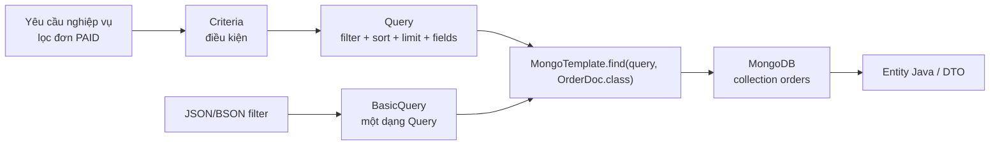
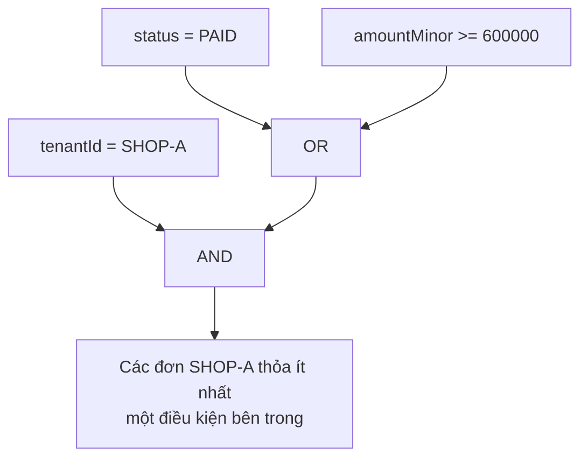

# Tạo Query, Criteria và BasicQuery

## 1. Query và Criteria giải quyết vấn đề gì?

Trong **Spring Data MongoDB**, `MongoRepository` giúp viết nhanh các truy vấn đơn giản dựa trên tên phương thức, còn `MongoTemplate` cung cấp API chi tiết hơn để xây dựng điều kiện lọc, chọn field, sắp xếp, phân trang và thực hiện những thao tác truy cập dữ liệu khác.

Ví dụ, màn hình quản trị của một cửa hàng cần tìm **các đơn đã thanh toán**, được tạo trong một khoảng thời gian, có tổng tiền từ một ngưỡng trở lên. Bộ lọc do người dùng chọn có thể thay đổi theo từng request. Nếu cứ tạo một repository method mới cho mọi tổ hợp điều kiện, interface sẽ nhanh chóng dài và khó kiểm soát. Khi đó, bộ đôi `Query` và `Criteria` giúp diễn đạt truy vấn **một cách có cấu trúc**.

Ba khái niệm cần phân biệt:

| Thành phần | Vai trò | Ví dụ |
| --- | --- | --- |
| `Criteria` | Biểu diễn một hoặc một nhóm **điều kiện** | `Criteria.where("status").is("PAID")` |
| `Query` | Chứa điều kiện truy vấn, cùng tùy chọn như **sort, skip, limit, field projection** | `Query.query(criteria).with(sort).limit(20)` |
| `BasicQuery` | Một loại `Query` cho phép khai báo filter bằng **JSON hoặc BSON Document** và có thể chỉ định field projection | `new BasicQuery(filterJson)` |

Trong ví dụ này, `Criteria` và `Query` thuộc package `org.springframework.data.mongodb.core.query`. `BasicQuery` cũng thuộc package đó và **kế thừa `Query`**, nên có thể chuyển tới nhiều phương thức `MongoTemplate` nhận tham số `Query`.



**Kết quả học tập:** bạn có thể tự tạo `Criteria`, đóng gói vào `Query`, đọc hiểu `BasicQuery`, ánh xạ tên property Java sang field BSON, tránh lỗi khi kết hợp điều kiện và kiểm tra một truy vấn bằng dữ liệu MongoDB thực.

## 2. Mô hình đơn hàng và dữ liệu thực hành

Giả sử ứng dụng có collection `orders` trong database `orders_query_demo`. Mỗi đơn hàng thuộc một tenant (cửa hàng), có trạng thái, thời điểm tạo, số tiền theo đơn vị nhỏ nhất và danh sách dòng hàng:

| Property trong Java | Field BSON | Kiểu minh họa | Ý nghĩa |
| --- | --- | --- | --- |
| `id` | `_id` | BSON String | Định danh đơn |
| `tenantId` | `tenant_id` | String | Cửa hàng sở hữu |
| `customerId` | `customer_id` | String | Khách mua |
| `status` | `status` | String | `PAID`, `CREATED`, `CANCELLED` |
| `amountMinor` | `amount_minor` | Int64 | Giá trị tiền theo đơn vị nhỏ nhất |
| `createdAt` | `created_at` | Date | Thời điểm tạo |
| `tags` | `tags` | Array of String | Nhãn phân loại |
| `lines` | `lines` | Array of embedded document | Dòng hàng, có `sku` và `quantity` |

Ví dụ một document được hiển thị bởi `mongosh`:

```javascript
{
  _id: "ORD-1001",
  tenant_id: "SHOP-A",
  customer_id: "CUS-01",
  status: "PAID",
  amount_minor: NumberLong("450000"),
  created_at: ISODate("2026-11-10T08:00:00Z"),
  tags: ["priority", "online"],
  lines: [
    { sku: "BOOK-101", quantity: 2 },
    { sku: "BOOK-202", quantity: 1 }
  ]
}
```

### Entity `OrderDoc`

Ví dụ dùng Java 17 và phong cách cấu hình Spring Boot 3.x / Spring Data MongoDB tương ứng. Các API cụ thể cần được đối chiếu với phiên bản dự án khi triển khai:

```java
package com.example.orders;

import java.time.Instant;
import java.util.ArrayList;
import java.util.List;
import org.springframework.data.mongodb.core.mapping.Document;
import org.springframework.data.mongodb.core.mapping.Field;
import org.springframework.data.mongodb.core.mapping.FieldType;
import org.springframework.data.mongodb.core.mapping.MongoId;

@Document(collection = "orders")
public class OrderDoc {

    @MongoId(FieldType.STRING)
    private String id;

    @Field("tenant_id")
    private String tenantId;

    @Field("customer_id")
    private String customerId;

    private String status;

    @Field("amount_minor")
    private long amountMinor;

    @Field("created_at")
    private Instant createdAt;

    private List<String> tags = new ArrayList<>();
    private List<OrderLine> lines = new ArrayList<>();

    protected OrderDoc() {}

    public OrderDoc(
            String id, String tenantId, String customerId,
            String status, long amountMinor, Instant createdAt,
            List<String> tags, List<OrderLine> lines) {
        this.id = id;
        this.tenantId = tenantId;
        this.customerId = customerId;
        this.status = status;
        this.amountMinor = amountMinor;
        this.createdAt = createdAt;
        this.tags = new ArrayList<>(tags);
        this.lines = new ArrayList<>(lines);
    }

    public String getId() { return id; }
    public String getTenantId() { return tenantId; }
    public String getCustomerId() { return customerId; }
    public String getStatus() { return status; }
    public long getAmountMinor() { return amountMinor; }
    public Instant getCreatedAt() { return createdAt; }
    public List<String> getTags() { return tags; }
    public List<OrderLine> getLines() { return lines; }

    public static class OrderLine {
        private String sku;
        private int quantity;

        protected OrderLine() {}

        public OrderLine(String sku, int quantity) {
            this.sku = sku;
            this.quantity = quantity;
        }

        public String getSku() { return sku; }
        public int getQuantity() { return quantity; }
    }
}
```

`@Document` xác định collection. `@Field` mô tả tên lưu trữ BSON; `@MongoId(FieldType.STRING)` yêu cầu lưu ID dưới dạng BSON String. `OrderLine` là object nhúng, không phải reference sang collection khác.

### Nạp dữ liệu mẫu

Trong một database MongoDB **dành riêng cho thực hành**, chạy một lần:

```javascript
use orders_query_demo

db.orders.insertMany([
  {
    _id: "ORD-1001", tenant_id: "SHOP-A", customer_id: "CUS-01",
    status: "PAID", amount_minor: NumberLong("450000"),
    created_at: ISODate("2026-11-10T08:00:00Z"),
    tags: ["priority", "online"],
    lines: [
      { sku: "BOOK-101", quantity: 2 },
      { sku: "BOOK-202", quantity: 1 }
    ]
  },
  {
    _id: "ORD-1002", tenant_id: "SHOP-A", customer_id: "CUS-02",
    status: "CREATED", amount_minor: NumberLong("180000"),
    created_at: ISODate("2026-11-11T08:00:00Z"),
    tags: ["online"],
    lines: [{ sku: "BOOK-202", quantity: 1 }]
  },
  {
    _id: "ORD-1003", tenant_id: "SHOP-A", customer_id: "CUS-01",
    status: "PAID", amount_minor: NumberLong("650000"),
    created_at: ISODate("2026-11-12T08:00:00Z"),
    tags: ["gift", "priority"],
    lines: [{ sku: "BOOK-303", quantity: 3 }]
  },
  {
    _id: "ORD-1004", tenant_id: "SHOP-B", customer_id: "CUS-03",
    status: "PAID", amount_minor: NumberLong("800000"),
    created_at: ISODate("2026-11-13T08:00:00Z"),
    tags: ["priority"],
    lines: [{ sku: "BOOK-101", quantity: 5 }]
  },
  {
    _id: "ORD-1005", tenant_id: "SHOP-A", customer_id: "CUS-04",
    status: "CANCELLED", amount_minor: NumberLong("220000"),
    created_at: ISODate("2026-11-14T08:00:00Z"),
    tags: [],
    lines: [{ sku: "BOOK-404", quantity: 1 }]
  }
])
```

Không chạy lại `insertMany` với cùng ID nếu không muốn gặp duplicate key. Kết nối demo Spring Boot 3.x có thể cấu hình:

```properties
spring.data.mongodb.uri=mongodb://localhost:27017/orders_query_demo
```

Mọi đoạn Java tiếp theo giả định `MongoTemplate` đã được Spring inject vào service hoặc component; các snippet nhỏ không phải một ứng dụng chạy độc lập.

## 3. Tạo `Criteria` và `Query` đơn giản

Yêu cầu: lấy các đơn có trạng thái `PAID` của `SHOP-A`. Với `Criteria`:

```java
import java.util.List;
import org.springframework.data.mongodb.core.MongoTemplate;
import org.springframework.data.mongodb.core.query.Criteria;
import org.springframework.data.mongodb.core.query.Query;

Criteria criteria = Criteria.where("tenantId").is("SHOP-A")
    .and("status").is("PAID");

Query query = Query.query(criteria);

List<OrderDoc> orders =
    mongoTemplate.find(query, OrderDoc.class);
```

Điều kiện Java nói trên tương đương về ý nghĩa với truy vấn MongoDB:

```javascript
db.orders.find({
  tenant_id: "SHOP-A",
  status: "PAID"
})
```

Kết quả từ dữ liệu mẫu gồm `ORD-1001` và `ORD-1003`, nhưng **thứ tự không được bảo đảm** khi query chưa có `sort`.

### Tách bạch trách nhiệm từng lớp

```java
// Criteria: nói điều kiện nào phải đúng.
Criteria condition = Criteria.where("status").is("PAID");

// Query: chứa điều kiện, có thể bổ sung sort/limit/fields.
Query query = new Query(condition);

// MongoTemplate: thực thi truy vấn cho entity/collection.
List<OrderDoc> found = mongoTemplate.find(query, OrderDoc.class);
```

`new Query(condition)` và `Query.query(condition)` đều là cách khởi tạo thường gặp. `MongoTemplate.find(query, OrderDoc.class)` sử dụng metadata của `OrderDoc` để ánh xạ property Java sang tên field BSON.

### `find`, `findOne`, `exists`, `count`

Cùng một `Query` có thể dùng cho các ý định khác nhau:

```java
List<OrderDoc> found = mongoTemplate.find(query, OrderDoc.class);

OrderDoc first = mongoTemplate.findOne(query, OrderDoc.class);

boolean hasMatch = mongoTemplate.exists(query, OrderDoc.class);

long matches = mongoTemplate.count(query, OrderDoc.class);
```

Trong đó:

- `find` trả danh sách; không tìm thấy thì trả danh sách rỗng.
- `findOne` trả một entity hoặc `null` nếu không có document; **không mặc định là đơn mới nhất** khi thiếu sort.
- `exists` trả boolean xác nhận có ít nhất một document khớp.
- `count` phục vụ đếm số document khớp với điều kiện; không nên tải tất cả entity về rồi `size()` chỉ để đếm.

Nếu gọi `findOne` mà nghiệp vụ yêu cầu “mới nhất”, phải thêm sort rõ ràng. Khi xây query cho count, nên dùng một query filter riêng nếu không muốn các tùy chọn skip/limit của query danh sách làm thay đổi ý nghĩa đếm tùy API/phiên bản.

## 4. Nhóm toán tử so sánh và lọc giá trị

`Criteria` có nhiều phương thức ánh xạ sang toán tử truy vấn MongoDB:

| Java `Criteria` | Toán tử BSON tương ứng | Ví dụ nghiệp vụ |
| --- | --- | --- |
| `is(v)` | Giá trị bằng `v` | `status = PAID` |
| `ne(v)` | `$ne` | Trạng thái không phải `CANCELLED` |
| `gt(v)` / `gte(v)` | `$gt` / `$gte` | Giá trị lớn hơn / ít nhất một ngưỡng |
| `lt(v)` / `lte(v)` | `$lt` / `$lte` | Trước thời điểm / không vượt ngưỡng |
| `in(values)` | `$in` | Trạng thái thuộc tập được chấp nhận |
| `nin(values)` | `$nin` | Loại một số trạng thái |
| `exists(true/false)` | `$exists` | Field có tồn tại không |
| `regex(pattern)` | `$regex` | Khớp mẫu chuỗi |
| `all(values)` | `$all` | Array chứa tất cả giá trị |
| `size(n)` | `$size` | Array có chính xác `n` phần tử |
| `elemMatch(criteria)` | `$elemMatch` | Nhiều điều kiện trên cùng một phần tử array |

### So sánh số và khoảng thời gian

```java
import java.time.Instant;

Instant start = Instant.parse("2026-11-10T00:00:00Z");
Instant endExclusive = Instant.parse("2026-11-14T00:00:00Z");

Query paidInRange = Query.query(
    Criteria.where("tenantId").is("SHOP-A")
        .and("status").is("PAID")
        .and("amountMinor").gte(400_000L)
        .and("createdAt").gte(start).lt(endExclusive)
);
```

Ở đây `createdAt` được giới hạn theo **khoảng nửa mở** `[start, endExclusive)` để tránh lỗi ở biên thời gian. Trong MongoDB, chúng tương ứng `created_at: { $gte: ISODate(...), $lt: ISODate(...) }` và `amount_minor: { $gte: NumberLong("400000") }`.

Với dữ liệu mẫu, nếu bỏ qua sắp xếp, các đơn khớp là `ORD-1001` và `ORD-1003`. `Long` dùng để biểu diễn giá trị tiền ở đơn vị nhỏ nhất cho ví dụ, giúp tránh nhầm số thực dấu phẩy động với giá tiền.

### Điều kiện `in`

```java
import java.util.List;

Query activeOrders = Query.query(
    Criteria.where("tenantId").is("SHOP-A")
        .and("status").in(List.of("PAID", "CREATED"))
);
```

Tương ứng:

```javascript
db.orders.find({
  tenant_id: "SHOP-A",
  status: { $in: ["PAID", "CREATED"] }
})
```

Nếu tập trạng thái đầu vào rỗng, yêu cầu nghiệp vụ có thể là trả rỗng ngay, thay vì tạo một query không cần thiết. Nếu tập giá trị rất lớn, cần giới hạn đầu vào và đo chi phí truy vấn; `$in` không phải cách thay thế an toàn cho mọi bài toán join hoặc tìm kiếm hàng triệu ID.

## 5. Kết hợp điều kiện: AND, OR và nhóm ngoặc

MongoDB cho phép nhiều field trong một filter cùng phải đúng (*implicit AND*):

```javascript
db.orders.find({
  tenant_id: "SHOP-A",
  status: "PAID"
})
```

Trong Java, có thể dùng `.and(...)` để thêm một điều kiện lên field khác:

```java
Criteria condition = Criteria.where("tenantId").is("SHOP-A")
    .and("status").is("PAID")
    .and("amountMinor").gte(400_000L);

Query query = Query.query(condition);
```

### Dùng `orOperator` khi có lựa chọn thay thế

Yêu cầu: chỉ xem đơn của `SHOP-A` và lấy đơn **đã thanh toán hoặc có giá trị từ 600.000 trở lên**. Hình dạng biểu thức logic là:

\[
\operatorname{tenant} = A
\;\land\;
(\operatorname{status} = PAID \;\lor\; \operatorname{amount} \ge 600000)
\]

```java
Criteria grouped = new Criteria().andOperator(
    Criteria.where("tenantId").is("SHOP-A"),
    new Criteria().orOperator(
        Criteria.where("status").is("PAID"),
        Criteria.where("amountMinor").gte(600_000L)
    )
);

Query query = Query.query(grouped);
List<OrderDoc> results =
    mongoTemplate.find(query, OrderDoc.class);
```

Truy vấn MongoDB tương đương:

```javascript
db.orders.find({
  $and: [
    { tenant_id: "SHOP-A" },
    {
      $or: [
        { status: "PAID" },
        { amount_minor: { $gte: NumberLong("600000") } }
      ]
    }
  ]
})
```

Với dữ liệu mẫu, `ORD-1001` và `ORD-1003` đáp ứng điều kiện. Đơn `ORD-1004` có giá trị cao và trạng thái `PAID` nhưng **bị loại vì thuộc SHOP-B**. Điều này cũng minh họa vì sao điều kiện tenant/quyền truy cập phải nằm **ngoài nhóm OR** của các tiêu chí tìm kiếm khác.



### Khi nào dùng `andOperator` thay vì `.and(...)`?

`.and("status")` thuận tiện khi thêm điều kiện theo **field khác** trên cùng chuỗi. `andOperator(...)` hữu ích khi cần nhóm nhiều biểu thức con, đặc biệt khi có `$or`, các nhóm lồng nhau hoặc nhiều điều kiện trên cùng field.

Ví dụ muốn thời gian vừa `gte(start)` vừa `lt(end)`, hãy viết trên **một Criteria của field**:

```java
Criteria dateRange = Criteria.where("createdAt")
    .gte(start)
    .lt(endExclusive);
```

Không nên thêm lặp các `Criteria.where("createdAt")` vào cùng một `Query` bằng nhiều lần `addCriteria` rồi kỳ vọng framework tự gộp mọi điều kiện trên cùng một key; thao tác đó có thể báo lỗi do trùng khóa hoặc tạo ý nghĩa khó đoán. Khi điều kiện phức tạp, hãy xây một cấu trúc logic rõ ràng và kiểm tra BSON query.

## 6. Truy vấn mảng và embedded document

Trong `OrderDoc`, `tags` là `List<String>` còn `lines` là `List<OrderLine>`. Cả hai được lưu thành BSON array nhưng có **kiểu phần tử khác nhau**.

### Tìm đơn chứa một tag

```java
Query priority = Query.query(
    Criteria.where("tenantId").is("SHOP-A")
        .and("tags").is("priority")
);
```

Khi field MongoDB là array, điều kiện bằng một giá trị đơn có thể khớp khi array chứa phần tử đó:

```javascript
db.orders.find({
  tenant_id: "SHOP-A",
  tags: "priority"
})
```

Trong dữ liệu demo, hai đơn `ORD-1001` và `ORD-1003` có tag `priority`.

### `$all` và `$size`

```java
Query allTags = Query.query(
    Criteria.where("tags").all("priority", "online")
);

Query exactlyTwoTags = Query.query(
    Criteria.where("tags").size(2)
);
```

`all` yêu cầu array chứa tất cả các giá trị; `size` lọc theo đúng số lượng phần tử. Cả hai là tiêu chí trên **document BSON hiện có**, không tự biến array thành Set hay loại giá trị lặp.

### `$elemMatch`: hai điều kiện trên cùng dòng hàng

Yêu cầu: tìm đơn thuộc `SHOP-A` có **một dòng hàng** vừa có `sku = BOOK-101` vừa có `quantity >= 2`:

```java
Criteria itemCondition = Criteria.where("sku").is("BOOK-101")
    .and("quantity").gte(2);

Query query = Query.query(
    Criteria.where("tenantId").is("SHOP-A")
        .and("lines").elemMatch(itemCondition)
);
```

Tương đương:

```javascript
db.orders.find({
  tenant_id: "SHOP-A",
  lines: {
    $elemMatch: {
      sku: "BOOK-101",
      quantity: { $gte: 2 }
    }
  }
})
```

`ORD-1001` thỏa điều kiện vì dòng `BOOK-101` có số lượng 2. `ORD-1004` có dòng tương ứng nhưng thuộc `SHOP-B` nên không được phép lọt vào kết quả của `SHOP-A`.

**Vì sao không viết hai điều kiện độc lập trên `lines.sku` và `lines.quantity`?** Với array nhiều object, MongoDB có thể tìm `sku` ở một phần tử và `quantity` ở một phần tử khác. `$elemMatch` buộc điều kiện đúng trên **cùng một embedded document**, phù hợp ý nghĩa “một dòng hàng”.

## 7. Regex, null và field không tồn tại

### `regex` dành cho mẫu chuỗi

Ví dụ tìm các `customerId` bắt đầu với `CUS-0`:

```java
Query customers = Query.query(
    Criteria.where("customerId").regex("^CUS-0")
);
```

Regex hữu ích cho một số truy vấn đơn giản, nhưng không nên dùng bừa bãi như một công cụ tìm kiếm toàn văn. Regex không có tiền tố cố định, regex với chữ hoa/thường hoặc mẫu quá phức tạp có thể hạn chế khả năng sử dụng index và làm tăng tải. Đối với tìm kiếm văn bản thực sự, cân nhắc giải pháp full-text search hoặc công cụ search phù hợp.

**Không ghép trực tiếp chuỗi regex tùy ý do người dùng nhập** vào biểu thức nếu ý định chỉ là tìm literal. Có thể escape bằng `Pattern.quote(...)`:

```java
import java.util.regex.Pattern;

String userPrefix = "CUS.";
Pattern safePrefix = Pattern.compile(
    "^" + Pattern.quote(userPrefix)
);

Query query = Query.query(
    Criteria.where("customerId").regex(safePrefix)
);
```

Đoạn code này xem `CUS.` là tiền tố literal, không coi dấu chấm là ký tự regex khớp mọi giá trị. Nếu API không cho phép tìm kiếm bằng prefix bất kỳ, hãy giới hạn định dạng đầu vào hơn nữa.

### Phân biệt `null`, missing và chuỗi rỗng

MongoDB phân biệt các document:

```javascript
{ customer_id: null }
{ /* hoàn toàn thiếu customer_id */ }
{ customer_id: "" }
```

Trong truy vấn MongoDB, điều kiện `{ customer_id: null }` thường khớp cả document có field `null` **lẫn document thiếu field**. `Criteria.where("customerId").is(null)` có ngữ nghĩa tương ứng, nên không dùng nó để kiểm tra chắc chắn “field có tồn tại và null” khi chưa thêm điều kiện.

Một số trường hợp:

```java
// Field tồn tại, bất kể giá trị là gì (kể cả null).
Criteria present = Criteria.where("customerId").exists(true);

// Field không tồn tại trong document.
Criteria missing = Criteria.where("customerId").exists(false);

// Field tồn tại và khác null.
Criteria nonNull = Criteria.where("customerId")
    .exists(true)
    .ne(null);
```

Nếu dữ liệu lịch sử có field sai kiểu (ví dụ `amount_minor` lưu String trong khi entity dùng long), kết quả của các toán tử so sánh có thể không phù hợp với kỳ vọng nghiệp vụ. Cần kiểm tra BSON thật bằng `$type`, định nghĩa schema và có kế hoạch migration rõ ràng.

## 8. `Query` chứa nhiều hơn điều kiện: Sort, Limit, Skip, Fields

Sau khi xây `Criteria`, `Query` bổ sung các tùy chọn để quyết định **document nào và bao nhiêu field** được trả về. Ví dụ màn hình muốn 20 đơn `PAID` của `SHOP-A`, sắp mới nhất trước, bắt đầu từ trang thứ ba:

```java
import org.springframework.data.domain.Sort;
import org.springframework.data.mongodb.core.query.Criteria;
import org.springframework.data.mongodb.core.query.Query;

Query query = Query.query(
    Criteria.where("tenantId").is("SHOP-A")
        .and("status").is("PAID")
);

query.with(Sort.by(
    Sort.Order.desc("createdAt"),
    Sort.Order.desc("id")
));
query.skip(40);
query.limit(20);

List<OrderDoc> page =
    mongoTemplate.find(query, OrderDoc.class);
```

Trong `mongosh`, truy vấn cùng ý nghĩa:

```javascript
db.orders.find({
  tenant_id: "SHOP-A",
  status: "PAID"
})
.sort({ created_at: -1, _id: -1 })
.skip(40)
.limit(20)
```

**Lưu ý:** `skip(40)` chỉ là ví dụ trang 2 với kích thước 20 (đánh số trang từ 0). Trong bộ dữ liệu demo nhỏ, trang đó rỗng. Với dữ liệu lớn, `skip` ở offset sâu có chi phí phải duyệt nhiều kết quả; cần kiểm tra `explain("executionStats")` và cân nhắc keyset pagination nếu giao diện chỉ cần “xem thêm”.

### Chỉ lấy một số field

`Query.fields()` cho phép mô tả field projection:

```java
Query summary = Query.query(
    Criteria.where("tenantId").is("SHOP-A")
);

summary.fields()
    .include("id")
    .include("status")
    .include("amountMinor")
    .include("createdAt");

summary.with(Sort.by(Sort.Order.desc("createdAt")));
summary.limit(10);

List<OrderDoc> partial =
    mongoTemplate.find(summary, OrderDoc.class);
```

Vì có metadata entity, `id` được ánh xạ tới `_id`, `amountMinor` tới `amount_minor` và `createdAt` tới `created_at`. Có thể đối chiếu phép chọn field bằng:

```javascript
db.orders.find(
  { tenant_id: "SHOP-A" },
  {
    _id: 1,
    status: 1,
    amount_minor: 1,
    created_at: 1
  }
).sort({ created_at: -1 }).limit(10)
```

**Không coi kết quả partial entity là một `OrderDoc` đã nạp đầy đủ.** Các field không được chọn có thể `null` hoặc mang giá trị mặc định như `0` với kiểu primitive. Không `save` lại partial entity một cách vô điều kiện, vì có nguy cơ ghi đè dữ liệu không được tải. Nếu cần trả kết quả danh sách cho API, interface projection hoặc DTO xác định rõ field thường dễ quản lý hơn.

Trong một projection kiểu include, thường không được pha trộn tùy ý `include` và `exclude` trong cùng cấp (ngoại lệ phổ biến là xử lý `_id`). Nên kiểm tra cấu trúc BSON field projection thực tế theo yêu cầu.

## 9. `BasicQuery`: tạo truy vấn từ JSON hoặc BSON Document

`Query` cùng `Criteria` là lựa chọn tự nhiên khi ứng dụng xây điều kiện theo các property Java. Trong một số tình huống khác, ta đã có bộ lọc dạng **JSON do lập trình viên kiểm soát**, hoặc cần diễn đạt trực tiếp một cấu trúc BSON không thuận tiện qua các phương thức fluent. Khi đó, `BasicQuery` là một lựa chọn.

### 9.1. `BasicQuery` từ JSON filter

```java
import java.util.List;
import org.springframework.data.mongodb.core.query.BasicQuery;

String filterJson = """
    {
      "tenant_id": "SHOP-A",
      "status": { "$in": ["PAID", "CREATED"] },
      "amount_minor": { "$gte": 200000 }
    }
    """;

BasicQuery query = new BasicQuery(filterJson);

List<OrderDoc> found =
    mongoTemplate.find(query, OrderDoc.class);
```

Đoạn JSON là bộ lọc MongoDB (không phải pipeline aggregation), với tên field `tenant_id`, `status` và `amount_minor` đúng theo BSON lưu trữ. `BasicQuery` kế thừa `Query` nên được truyền cho `MongoTemplate.find` giống một truy vấn thông thường.

Giá trị 200000 trong JSON là số; khi so sánh, MongoDB có quy tắc so sánh các kiểu số BSON. Trong ứng dụng cần kiểm soát chính xác kiểu Int64, có thể dùng `Document` với giá trị Java `Long` hoặc Extended JSON đúng cú pháp và xác minh kiểu gửi đến server. Đừng chuyển số tiền thành String một cách ngẫu nhiên khi mục đích là lọc khoảng số.

### 9.2. Khai báo cả JSON field projection

`BasicQuery` có constructor nhận hai chuỗi: **filter JSON** và **field projection JSON**.

```java
String filterJson = """
    { "tenant_id": "SHOP-A", "status": "PAID" }
    """;

String fieldsJson = """
    { "_id": 1, "status": 1, "amount_minor": 1 }
    """;

BasicQuery query = new BasicQuery(filterJson, fieldsJson);

query.with(Sort.by(
    Sort.Order.desc("createdAt"),
    Sort.Order.desc("id")
));
query.limit(10);

List<OrderDoc> results =
    mongoTemplate.find(query, OrderDoc.class);
```

Ở đây:

- `filterJson` chọn các document `SHOP-A` có `status = PAID`.
- `fieldsJson` chỉ yêu cầu các field `_id`, `status` và `amount_minor` trong kết quả.
- `with(Sort)` và `limit` là phương thức kế thừa từ `Query`.
- Kết quả là **partial entity** vì `tenantId`, `customerId`, `createdAt`, `tags` và `lines` có thể không được trả về. Không dùng chúng như một aggregate đầy đủ để lưu lại bằng `save`.

Một điều cần phân biệt: `sort` có thể dùng field phục vụ sắp xếp mà field ấy **không xuất hiện trong kết quả projection**. Việc sắp xếp theo `created_at` vẫn có ý nghĩa với query này.

### 9.3. `BasicQuery` từ BSON `Document`

Thay vì chuyển JSON thành chuỗi, ta có thể xây filter bằng `org.bson.Document`:

```java
import java.util.List;
import org.bson.Document;
import org.springframework.data.mongodb.core.query.BasicQuery;

Document filter = new Document("tenant_id", "SHOP-A")
    .append("status", new Document("$in",
        List.of("PAID", "CREATED")))
    .append("amount_minor", new Document("$gte", 200_000L));

BasicQuery query = new BasicQuery(filter);

List<OrderDoc> results =
    mongoTemplate.find(query, OrderDoc.class);
```

`Document` thuận tiện khi phải cung cấp cấu trúc BSON có giá trị đã được kiểm soát kiểu Java. Dù vậy, code xây `Document` trực tiếp thường dài và khó đọc hơn `Criteria` cho những filter nghiệp vụ thông dụng.

### 9.4. `BasicQuery` có bỏ qua metadata mapping không?

Không nên phát biểu tuyệt đối rằng `BasicQuery` “luôn bỏ qua” mọi cơ chế ánh xạ của Spring Data. Khi gọi `mongoTemplate.find(query, OrderDoc.class)`, truy vấn vẫn đi qua đường xử lý của `MongoTemplate` với metadata entity; framework có thể ánh xạ những tên property mà nó nhận diện được.

Tuy nhiên, với **JSON/BSON viết tay**, cách ít mơ hồ nhất là chủ động kiểm tra **tên field vật lý** của collection, nhất là tên được đổi bởi `@Field`, đường dẫn lồng, ID và các toán tử động. Khi trộn key là tên Java và key là tên BSON trong một JSON thô, dễ khiến người bảo trì hiểu sai. Hãy quyết định một quy ước, viết test và quan sát truy vấn thực sự được gửi tới MongoDB.

### 9.5. Không đưa JSON tùy ý từ client vào `BasicQuery`

**Đây là quy tắc an toàn quan trọng.** Nếu HTTP API nhận một đoạn JSON filter rồi chuyển nguyên văn vào `new BasicQuery(userJson)`, caller có thể đưa vào các toán tử MongoDB như `$ne`, `$or`, `$regex` hoặc các điều kiện khác ngoài phạm vi nghiệp vụ dự kiến. Việc này có thể tạo **NoSQL operator injection**, đọc vượt phạm vi cho phép hoặc làm database xử lý truy vấn rất tốn tài nguyên.

Không viết:

```java
// KHÔNG dùng với JSON tùy ý từ người dùng.
BasicQuery unsafe = new BasicQuery(requestBody);
```

Thay vào đó, nhận **các tham số có kiểu và được kiểm tra** rồi tạo `Criteria`:

```java
Criteria safeCriteria = Criteria.where("tenantId")
    .is(authorizedTenantId)
    .and("status").is(validatedStatus);

Query safeQuery = Query.query(safeCriteria);
```

Trong đó `authorizedTenantId` được lấy từ ngữ cảnh người dùng đã xác thực/cấp quyền, còn `validatedStatus` thuộc tập enum hoặc danh sách trạng thái được phép. Cả với `Query` fluent, không ghép tên field do người dùng tự ý chỉ định nếu chưa có allowlist.

## 10. Xây một bộ lọc động bằng `Criteria`

Giả sử API danh sách nhận các tham số **có thể có hoặc không**: `status`, `minAmountMinor`, `from` và `untilExclusive`. Tenant là điều kiện bắt buộc lấy từ nguồn tin cậy.

Ta có thể tạo danh sách điều kiện rồi kết hợp chúng bằng `andOperator`:

```java
package com.example.orders;

import java.time.Instant;
import java.util.ArrayList;
import java.util.List;
import org.springframework.data.domain.Sort;
import org.springframework.data.mongodb.core.MongoTemplate;
import org.springframework.data.mongodb.core.query.Criteria;
import org.springframework.data.mongodb.core.query.Query;
import org.springframework.stereotype.Service;

@Service
public class OrderSearchService {

    private final MongoTemplate template;

    public OrderSearchService(MongoTemplate template) {
        this.template = template;
    }

    public List<OrderDoc> search(
            String authorizedTenantId,
            String status,
            Long minAmountMinor,
            Instant fromInclusive,
            Instant untilExclusive,
            int limit) {

        if (authorizedTenantId == null || authorizedTenantId.isBlank()) {
            throw new IllegalArgumentException("Tenant không hợp lệ");
        }
        if (limit < 1 || limit > 100) {
            throw new IllegalArgumentException("Giới hạn không hợp lệ");
        }
        if (minAmountMinor != null && minAmountMinor < 0) {
            throw new IllegalArgumentException("Giá trị tiền phải không âm");
        }
        if (fromInclusive != null && untilExclusive != null
                && !fromInclusive.isBefore(untilExclusive)) {
            throw new IllegalArgumentException("Khoảng ngày không hợp lệ");
        }

        List<Criteria> conditions = new ArrayList<>();
        conditions.add(Criteria.where("tenantId").is(authorizedTenantId));

        if (status != null && !status.isBlank()) {
            conditions.add(Criteria.where("status").is(status));
        }
        if (minAmountMinor != null) {
            conditions.add(
                Criteria.where("amountMinor").gte(minAmountMinor));
        }
        if (fromInclusive != null || untilExclusive != null) {
            Criteria dates = Criteria.where("createdAt");
            if (fromInclusive != null) {
                dates.gte(fromInclusive);
            }
            if (untilExclusive != null) {
                dates.lt(untilExclusive);
            }
            conditions.add(dates);
        }

        Criteria combined = conditions.size() == 1
            ? conditions.get(0)
            : new Criteria().andOperator(
                conditions.toArray(new Criteria[0]));

        Query query = Query.query(combined);
        query.with(Sort.by(
            Sort.Order.desc("createdAt"),
            Sort.Order.desc("id")
        ));
        query.limit(limit);

        return template.find(query, OrderDoc.class);
    }
}
```

Đoạn này minh họa một **đường truy vấn đồng bộ**. Nó có các đặc tính:

1. Luôn có filter `tenantId`, tránh một request vô tình đọc toàn collection nhiều tenant.
2. Chỉ thêm tiêu chí được cung cấp, không gắn cố định tất cả giá trị vào tên phương thức.
3. Giữ hai đầu khoảng thời gian trên cùng một `Criteria` cho property `createdAt`.
4. Không ghép JSON do người dùng cung cấp, mà sử dụng giá trị typed.
5. Giới hạn tối đa 100 kết quả và sắp bằng `createdAt` cộng khóa phụ `id` để thứ tự xác định khi nhiều đơn trùng thời điểm.

Ở ứng dụng thật cần thêm xác thực `status` theo enum, giới hạn khoảng ngày, phân quyền xem tenant và cơ chế giới hạn tốc độ. Không dùng việc biết tenant ID như bằng chứng người gọi được phép đọc dữ liệu của tenant đó.

## 11. Query, Criteria, BasicQuery và repository: chọn thế nào?

| Tình huống | Lựa chọn thường phù hợp | Vì sao |
| --- | --- | --- |
| Tìm theo một vài property cố định | Derived repository method | Ngắn, dễ đọc, ít mã |
| Bộ lọc có nhiều tham số tùy chọn | `Query` + `Criteria` | Có thể thêm điều kiện theo runtime |
| Truy vấn nested field, array, AND/OR phức tạp | `Query` + `Criteria` | Cấu trúc logic tường minh |
| Đã có BSON/JSON query đáng tin cậy, được kiểm soát trong code | `BasicQuery` | Giữ cú pháp MongoDB gần với query gốc |
| Cần field selection, sort, skip, limit | `Query` hoặc `BasicQuery` | Chúng đều hỗ trợ các tùy chọn truy vấn |
| Truy vấn phức tạp nhưng muốn API repository | `@Query` ở repository khi hợp lý | Gắn query với phương thức repository |
| Cần `$group`, `$lookup`, `$project` nhiều stage | Aggregation API / pipeline | Không phải một lệnh find filter đơn thuần |
| Ứng dụng non-blocking | `ReactiveMongoTemplate` | Cùng ý tưởng Query/Criteria nhưng trả publisher reactive |

### `BasicQuery` khác `@Query` ra sao?

`BasicQuery` là **object truy vấn tại runtime** mà ta truyền cho `MongoTemplate`. `@Query` là **annotation** khai báo query trên repository method:

```java
import java.util.List;
import org.springframework.data.mongodb.repository.MongoRepository;
import org.springframework.data.mongodb.repository.Query;

public interface OrderRepository
        extends MongoRepository<OrderDoc, String> {

    @Query("{ 'tenant_id': ?0, 'status': ?1 }")
    List<OrderDoc> findMatching(
        String tenantId, String status);
}
```

Đoạn này minh họa cách bind tham số của annotation, khác với tự tạo `BasicQuery` từ một chuỗi tùy ý. Nếu trong cùng file Java cần dùng cả annotation `@Query` và class `org.springframework.data.mongodb.core.query.Query`, hãy dùng import/qualified name phù hợp để tránh hai class có tên `Query` va chạm.

Derived query và `@Query` đều không tự join sang collection khác. Nếu cần điều kiện trên document được tham chiếu trong collection khác, phải truy vấn hai bước, dùng aggregation `$lookup` hoặc thiết kế dữ liệu phù hợp.

## 12. Kiểm tra tên field, kiểu BSON và truy vấn thực tế

Một trong những lỗi phổ biến nhất là nhầm **property Java** với **tên field MongoDB**. Với `OrderDoc`:

```java
// Với MongoTemplate.find(query, OrderDoc.class):
Criteria.where("tenantId").is("SHOP-A");
Criteria.where("createdAt").gte(start);
Criteria.where("amountMinor").gte(400_000L);
```

Các property này được ánh xạ sang:

```javascript
// Trong mongosh hoặc JSON/BSON thô được thiết kế theo schema vật lý:
{
  tenant_id: "SHOP-A",
  created_at: { $gte: ISODate("2026-11-10T00:00:00Z") },
  amount_minor: { $gte: NumberLong("400000") }
}
```

**ID cần lưu ý riêng:** `@MongoId(FieldType.STRING)` trong ví dụ lưu `_id` là BSON String. Nếu một collection khác dùng ObjectId, việc truyền chuỗi có cùng ký tự vào một truy vấn BSON trực tiếp không bảo đảm khớp. Cần biết kiểu `_id` thực tế, quy tắc mapping và cách converter tạo query.

### Xem BSON type qua `mongosh`

```javascript
db.orders.aggregate([
  { $match: { _id: "ORD-1001" } },
  {
    $project: {
      _id: 0,
      idType: { $type: "$_id" },
      amountType: { $type: "$amount_minor" },
      createdType: { $type: "$created_at" },
      linesType: { $type: "$lines" }
    }
  }
])
```

Kết quả mong muốn với dữ liệu ví dụ gồm `idType = "string"`, `amountType = "long"`, `createdType = "date"` và `linesType = "array"`.

### `getQueryObject()` có cho thấy command MongoDB cuối cùng không?

`Query` cung cấp các phương thức như `getQueryObject()` và `getFieldsObject()` để quan sát cấu trúc mà object query đang mang:

```java
Query query = Query.query(
    Criteria.where("tenantId").is("SHOP-A")
        .and("status").is("PAID")
);

System.out.println(query.getQueryObject());
```

Đây là công cụ hữu ích để debug, nhưng **không nên coi chuỗi in ra là bằng chứng cuối cùng về command BSON được gửi tới MongoDB**. Khi thực thi `MongoTemplate.find(query, OrderDoc.class)`, mapping, converter và tùy chọn của driver có thể tiếp tục xử lý query. Muốn chắc chắn, dùng MongoDB command monitoring/logging phù hợp trong test hoặc quan sát hành vi bằng `mongosh` và kiểm thử tích hợp.

## 13. Index, query plan và chi phí thực thi

API `Criteria` chỉ giúp tạo query đúng ngữ nghĩa; nó **không tự tạo index** hoặc bảo đảm truy vấn nhanh.

Giả sử workload chủ yếu đọc đơn đã thanh toán theo tenant, sắp mới nhất trước. Một index ứng viên:

```javascript
db.orders.createIndex(
  { tenant_id: 1, status: 1, created_at: -1, _id: -1 },
  { name: "orders_tenant_status_created_id" }
)
```

Và truy vấn tương ứng:

```javascript
db.orders.find({
  tenant_id: "SHOP-A",
  status: "PAID"
})
.sort({ created_at: -1, _id: -1 })
.limit(20)
.explain("executionStats")
```

Đọc các chỉ số:

| Chỉ dấu | Cần kiểm tra điều gì? |
| --- | --- |
| `winningPlan` | MongoDB chọn kế hoạch nào, dùng index nào? |
| `IXSCAN` | Có quét index; đã duyệt bao nhiêu khóa? |
| `COLLSCAN` | Có phải quét nhiều/all document trong collection? |
| `SORT` | Có cần sort riêng thay vì tận dụng thứ tự index không? |
| `totalKeysExamined` | Đã xem xét bao nhiêu khóa index? |
| `totalDocsExamined` | Đã phải đọc bao nhiêu document? |
| `nReturned` | Số document trả ra có phù hợp limit không? |
| `executionTimeMillis` | Độ trễ đo trong lần chạy, cần kiểm tra nhiều lần |

Với truy vấn theo `amount_minor`, theo `lines.sku` hoặc kết hợp `$or`, kế hoạch có thể khác; một index cho truy vấn sort không tự tối ưu mọi bộ lọc. Chọn index từ **mẫu truy cập thật**, độ chọn lọc và giới hạn ghi, không tự động tạo index cho mọi property trong entity.

Ví dụ index trên field array:

```javascript
db.orders.createIndex(
  { tenant_id: 1, "lines.sku": 1 },
  { name: "orders_tenant_line_sku" }
)
```

Đây có thể là **multikey index**, phục vụ truy vấn liên quan dòng hàng; với `$elemMatch`, hãy kiểm tra kế hoạch thực thi và quy tắc compound index khi nhiều field array cùng tham gia. Mỗi index tăng chi phí lưu trữ và ghi.

**Tối ưu khác với tính đúng:** cùng một điều kiện `Criteria` có thể trả đúng trên collection năm bản ghi nhưng chậm khi có hàng triệu document. Đừng đánh giá hiệu năng chỉ từ ví dụ demo; cần dữ liệu và tải đại diện.

## 14. Kiểm thử Query, Criteria và BasicQuery

Nên kiểm thử với **MongoDB thật** trong môi trường tích hợp, ví dụ MongoDB test cô lập hoặc Testcontainers. Bài test nên xác minh cả kết quả qua entity Java và dữ liệu BSON lưu trữ.

Ví dụ dưới dùng `@DataMongoTest`, `MongoTemplate` và BSON `Document` để nạp fixture trực tiếp. Đường kết nối và MongoDB cho test cần được cấu hình riêng trước khi chạy:

```java
package com.example.orders;

import java.time.Instant;
import java.util.Date;
import java.util.List;
import org.bson.Document;
import org.junit.jupiter.api.BeforeEach;
import org.junit.jupiter.api.Test;
import org.springframework.beans.factory.annotation.Autowired;
import org.springframework.boot.test.autoconfigure.data.mongo.DataMongoTest;
import org.springframework.data.mongodb.core.MongoTemplate;
import org.springframework.data.mongodb.core.query.BasicQuery;
import org.springframework.data.mongodb.core.query.Criteria;
import org.springframework.data.mongodb.core.query.Query;

import static org.assertj.core.api.Assertions.assertThat;

@DataMongoTest
class OrderQueryTest {

    @Autowired
    MongoTemplate template;

    @BeforeEach
    void seedIsolatedDatabase() {
        // Chỉ xóa trên database test được cô lập!
        template.getCollection("orders").deleteMany(new Document());

        Date created = Date.from(
            Instant.parse("2026-11-10T08:00:00Z"));

        template.getCollection("orders").insertMany(List.of(
            new Document("_id", "ORD-A")
                .append("tenant_id", "SHOP-A")
                .append("customer_id", "CUS-01")
                .append("status", "PAID")
                .append("amount_minor", 450_000L)
                .append("created_at", created)
                .append("tags", List.of("priority"))
                .append("lines", List.of(
                    new Document("sku", "BOOK-101")
                        .append("quantity", 2))),
            new Document("_id", "ORD-B")
                .append("tenant_id", "SHOP-A")
                .append("customer_id", "CUS-02")
                .append("status", "CREATED")
                .append("amount_minor", 180_000L)
                .append("created_at", created)
                .append("tags", List.of("online"))
                .append("lines", List.of(
                    new Document("sku", "BOOK-202")
                        .append("quantity", 1))),
            new Document("_id", "ORD-C")
                .append("tenant_id", "SHOP-B")
                .append("customer_id", "CUS-03")
                .append("status", "PAID")
                .append("amount_minor", 800_000L)
                .append("created_at", created)
                .append("tags", List.of("priority"))
                .append("lines", List.of(
                    new Document("sku", "BOOK-101")
                        .append("quantity", 5)))
        ));
    }

    @Test
    void fluentCriteriaMapsJavaPropertiesToBsonNames() {
        Query query = Query.query(
            Criteria.where("tenantId").is("SHOP-A")
                .and("status").is("PAID")
                .and("amountMinor").gte(400_000L)
        );

        assertThat(template.find(query, OrderDoc.class))
            .extracting(OrderDoc::getId)
            .containsExactly("ORD-A");
    }

    @Test
    void basicQueryUsesExplicitBsonFilter() {
        BasicQuery query = new BasicQuery("""
            { "tenant_id": "SHOP-A", "status": "CREATED" }
            """);

        assertThat(template.find(query, OrderDoc.class))
            .extracting(OrderDoc::getId)
            .containsExactly("ORD-B");
    }

    @Test
    void elemMatchChecksSameEmbeddedLine() {
        Query query = Query.query(
            Criteria.where("tenantId").is("SHOP-A")
                .and("lines").elemMatch(
                    Criteria.where("sku").is("BOOK-101")
                        .and("quantity").gte(2))
        );

        assertThat(template.find(query, OrderDoc.class))
            .extracting(OrderDoc::getId)
            .containsExactly("ORD-A");
    }
}
```

**Cảnh báo:** `deleteMany(new Document())` xóa tất cả document trong collection `orders` đang được kết nối. Đoạn setup chỉ dành cho database test **hoàn toàn cô lập**; tuyệt đối không chạy trên production hoặc database dùng chung. `@DataMongoTest` không tự tạo ra một MongoDB an toàn trong mọi môi trường; cần thiết lập hạ tầng test trước.

Những trường hợp nên bổ sung:

1. Filter có nhiều tùy chọn `null`, cần chắc không bỏ điều kiện tenant bắt buộc.
2. Khoảng thời gian có hai biên: đúng tại biên bắt đầu, loại đúng tại `untilExclusive`.
3. `$or` phải nằm trong nhóm `$and` với tenant, không vô tình cho phép dữ liệu tenant khác.
4. Query theo array: dùng `$elemMatch` để không khớp nhầm hai phần tử khác nhau.
5. BSON field bị thiếu/null/sai kiểu: ghi rõ chính sách xử lý.
6. `BasicQuery` sai tên BSON: test phải phát hiện thay vì trả rỗng âm thầm.
7. Field selection có thể dẫn tới partial entity: kiểm tra những field được trả và không dùng partial entity để lưu lại.
8. Với dữ liệu lớn: đo `explain("executionStats")` và tác động của index, không suy ra hiệu năng từ ba bản ghi.

## 15. Reactive Query và Criteria

Nếu ứng dụng dùng reactive access, `ReactiveMongoTemplate` vẫn nhận `Query`/`Criteria` được xây theo nguyên tắc tương tự, nhưng kết quả là `Flux` hoặc `Mono`:

```java
import org.springframework.data.mongodb.core.ReactiveMongoTemplate;
import org.springframework.data.mongodb.core.query.Criteria;
import org.springframework.data.mongodb.core.query.Query;
import reactor.core.publisher.Flux;

Query query = Query.query(
    Criteria.where("tenantId").is("SHOP-A")
        .and("status").is("PAID")
);

Flux<OrderDoc> orders =
    reactiveMongoTemplate.find(query, OrderDoc.class);
```

Đoạn này thuộc component đã inject `ReactiveMongoTemplate` và dùng starter reactive tương ứng. Không dùng `block()` trong request reactive chỉ để biến `Flux` thành danh sách đồng bộ. Đồng thời, reactive không tự tối ưu một filter sai, thiếu index hoặc không có limit: database vẫn chịu chi phí truy vấn thực tế.

Một `Query` là object có các phương thức cấu hình có thể thay đổi trạng thái như `limit`, `skip`, `addCriteria`. Trong service đa luồng hoặc pipeline reactive, nên **tạo Query riêng cho từng request** thay vì chia sẻ một instance mutable rồi sửa điều kiện trong nhiều tác vụ đồng thời.

## 16. Lỗi thường gặp và cách chẩn đoán

| Triệu chứng | Nguyên nhân có thể | Hướng khắc phục |
| --- | --- | --- |
| `find` trả rỗng dù `mongosh` thấy document | Nhầm tên Java/BSON, sai database, sai kiểu ID | Kiểm tra `@Field`, `_id`, `$type` và connection URI |
| Filter thời gian bỏ sót document ở biên | Dùng sai múi giờ hoặc sai `lt/lte` | Dùng `Instant` và khoảng `[start, endExclusive)` |
| `andOperator`/`orOperator` cho kết quả ngoài tenant | Ngoặc logic đặt sai; tenant nằm trong nhóm OR | Viết cấu trúc nhóm rõ ràng và test dữ liệu nhiều tenant |
| Thêm tiêu chí nhiều lần trên cùng field gây lỗi | `addCriteria` với key trùng, khó tạo BSON đúng | Dùng một Criteria chứa các toán tử hoặc nhóm logic phù hợp |
| Truy vấn mảng khớp sai dòng hàng | Điều kiện áp lên hai phần tử array khác nhau | Dùng `elemMatch` |
| `BasicQuery` không tìm được dữ liệu | Tên field/kiểu BSON trong JSON không khớp schema | Đối chiếu JSON filter với document thật |
| API đọc ngoài phạm vi hoặc truy vấn rất đắt | Nhận raw filter JSON tùy ý từ client | Không chuyển trực tiếp user JSON sang `BasicQuery`; dùng typed Criteria và allowlist |
| `regex` quá chậm | Mẫu không tận dụng index hoặc query quét nhiều document | Giới hạn input, dùng tiền tố phù hợp hoặc full-text search |
| Field trong partial entity thành null/0 | Query chỉ include một số field | Dùng DTO/projection; không save partial entity |
| `findOne` không trả document mới nhất | Không có sort | Thêm sort theo thời gian và khóa duy nhất |
| Query chậm dù code Criteria ngắn | Thiếu index, filter không chọn lọc, payload lớn | Dùng `explain`, đo index, bytes và latency |
| Không thấy thay đổi query khi sửa code | Chia sẻ/tái sử dụng mutable Query hoặc đang chạy cấu hình cũ | Tạo Query mới cho từng request, kiểm tra command thực tế |

## 17. Bài tập tự kiểm tra

### Bài tập 1: xác định vai trò

**Câu hỏi:** `Criteria.where("status").is("PAID")` là một `Query` đầy đủ chưa? **Đáp án:** Chưa. Nó là điều kiện; dùng `Query.query(criteria)` hoặc `new Query(criteria)` để xây object query trước khi gọi những API nhận `Query`.

### Bài tập 2: truy vấn giá trị lớn hơn ngưỡng

**Câu hỏi:** Tìm đơn `PAID` của `SHOP-A` có `amountMinor >= 500000`.

```java
Query query = Query.query(
    Criteria.where("tenantId").is("SHOP-A")
        .and("status").is("PAID")
        .and("amountMinor").gte(500_000L)
);
```

**Đáp án dữ liệu mẫu:** `ORD-1003`.

### Bài tập 3: phân biệt `$or` với `$and`

**Câu hỏi:** Muốn chỉ lấy đơn của `SHOP-A` và thỏa **một trong hai điều kiện**: `PAID` hoặc giá trị từ 600.000 trở lên. Có nên dùng `orOperator` cho cả ba tiêu chí không?

**Đáp án:** Không. Tenant phải được kết hợp bằng `AND` với một nhóm `OR` gồm hai điều kiện nghiệp vụ, tránh lọt dữ liệu `SHOP-B`.

### Bài tập 4: vì sao cần `elemMatch`?

**Câu hỏi:** Một đơn có hai dòng: `{ sku: "A", quantity: 1 }` và `{ sku: "B", quantity: 10 }`. Có một dòng `sku = A` và `quantity >= 5` không?

**Đáp án:** Không. Dùng `$elemMatch` để bảo đảm hai điều kiện khớp trên **cùng dòng hàng**, thay vì vô tình ghép kết quả từ hai dòng khác nhau.

### Bài tập 5: BasicQuery và field vật lý

**Câu hỏi:** Entity Java có `@Field("tenant_id") String tenantId`. Khi viết một JSON query thô theo schema BSON, field tương ứng nên tên gì?

**Đáp án:** `tenant_id`. Trong `Criteria` có metadata entity, thường viết `tenantId`. Luôn kiểm tra trường thực tế và câu lệnh cuối nếu dùng `BasicQuery` hay các API BSON thô.

### Bài tập 6: an toàn API

**Câu hỏi:** Có nên nhận raw JSON filter từ client rồi gọi `new BasicQuery(requestBody)` không?

**Đáp án:** Không đối với API nghiệp vụ thông thường. Client có thể đặt toán tử ngoài dự kiến hoặc tạo truy vấn tốn tài nguyên. Nên nhận dữ liệu có kiểu, kiểm tra phạm vi field/toán tử, áp filter theo quyền và xây `Criteria`.

### Bài tập 7: Query thay vì Repository

**Câu hỏi:** Khi nào `MongoTemplate` + `Query` phù hợp hơn tạo hàng chục phương thức `findBy...`?

**Đáp án:** Khi có nhiều bộ lọc tùy chọn, nhóm logic AND/OR phức tạp, các điều kiện mảng, field projection hoặc cấu trúc truy vấn động khó diễn đạt rõ bằng tên method.

## 18. Checklist sử dụng trong dự án

1. Xác định **câu hỏi nghiệp vụ và ranh giới phân quyền**, đặc biệt điều kiện tenant bắt buộc.
2. Chọn **tên property Java** cho `Criteria` có ngữ cảnh entity; đối chiếu `@Field` để biết tên BSON thực.
3. Dựng các điều kiện bằng `where`/`and`; khi có ngoặc logic, dùng `andOperator`/`orOperator` tường minh.
4. Kiểm tra **kiểu giá trị**: Int64, Date/`Instant`, ObjectId/String, array; tránh chuyển kiểu âm thầm.
5. Thêm `Sort` có khóa phụ duy nhất nếu cần thứ tự ổn định; giới hạn `limit` và quản lý `skip` sâu.
6. Dùng `fields()` hoặc DTO khi chỉ cần vài trường, nhưng không lưu lại partial entity một cách bất cẩn.
7. Dùng `BasicQuery` cho **JSON/BSON tin cậy, được quản lý trong code**, không dùng raw filter không kiểm soát từ client.
8. Kiểm tra query sinh ra, trường BSON và index qua test tích hợp, `mongosh` và `explain("executionStats")`.
9. Tạo `Query` riêng cho từng request khi có cấu hình động hoặc truy cập đồng thời.
10. Khi query cần join hoặc aggregation, chuyển sang API phù hợp thay vì cố diễn đạt mọi thứ bằng `Criteria` của find query.

**Kết luận:** Trong Spring Data MongoDB, **`Criteria` mô tả điều kiện**, **`Query` đóng gói filter cùng các tùy chọn truy vấn**, còn **`BasicQuery` cho phép cung cấp điều kiện dạng JSON/BSON tường minh**. Chọn `Criteria` làm mặc định cho bộ lọc nghiệp vụ động; dùng `BasicQuery` khi thật sự cần cấu trúc BSON được kiểm soát. Dù sử dụng cách nào, tính đúng và hiệu năng phụ thuộc vào **tên field, kiểu BSON, nhóm logic, phân quyền, index và kiểm thử với MongoDB thực**.
