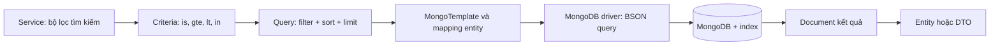

# Điều kiện so sánh, khoảng giá trị và tập giá trị

## 1. Vì sao cần hiểu kỹ các toán tử so sánh?

Trong **Spring Data MongoDB**, `Query` và `Criteria` giúp viết điều kiện MongoDB bằng API Java thay vì tự ghép chuỗi JSON. Khi hệ thống tìm kiếm sản phẩm, lọc đơn hàng theo thời gian hoặc chọn tài liệu thuộc một tập trạng thái, lỗi thường không nằm ở cú pháp mà nằm ở **ý nghĩa của ranh giới** và **kiểu dữ liệu được so sánh**.

Ví dụ một cửa hàng muốn tìm sản phẩm của tenant `shop-01`, đang bán, có tồn kho từ 10 đến dưới 50 và thuộc một trong hai danh mục `books` hoặc `tools`:

```javascript
db.catalog_items.find({
  tenantId: "shop-01",
  active: true,
  stock: { $gte: 10, $lt: 50 },
  category: { $in: ["books", "tools"] }
});
```

Tại tầng Spring Data MongoDB, query này có thể được tạo bằng:

```java
Query query = Query.query(
    Criteria.where("tenantId").is("shop-01")
        .and("active").is(true)
        .and("stock").gte(10).lt(50)
        .and("category").in("books", "tools")
);
```

Ví dụ thể hiện ba nhóm điều kiện:

1. **So sánh bằng và không bằng:** `is`, `ne`.
2. **So sánh lớn/nhỏ và khoảng:** `gt`, `gte`, `lt`, `lte`.
3. **Kiểm tra thuộc một tập giá trị:** `in`, `nin` và các trường hợp liên quan đến mảng.

Bài thuộc chương **Query và Criteria** của module **SPRING_DATA_MONGODB**. Mục tiêu là xây các filter có ý nghĩa rõ ràng, xử lý ranh giới và dữ liệu thiếu, xác minh truy vấn BSON, lựa chọn index, sử dụng với `MongoTemplate` hoặc repository và kiểm thử những trường hợp dễ sai.

## 2. Query, Criteria và MappingMongoConverter giữ vai trò gì?

`Criteria` mô tả một hoặc nhiều điều kiện. `Query` chứa tập điều kiện cùng các tùy chọn như sort, projection, skip và limit. `MongoTemplate` nhận `Query` và biết kiểu entity để thực hiện ánh xạ tên thuộc tính và giá trị trước khi giao cho MongoDB driver.



Ví dụ gọi thực tế:

```java
import java.util.List;
import org.springframework.data.mongodb.core.MongoTemplate;
import org.springframework.data.mongodb.core.query.Criteria;
import org.springframework.data.mongodb.core.query.Query;

public List<CatalogItem> findInStock(MongoTemplate template) {
    Query query = Query.query(
        Criteria.where("stock").gte(1)
    );

    return template.find(query, CatalogItem.class);
}
```

Ở ví dụ trên, `CatalogItem` là entity trong phần 3. Không có phép nối chuỗi JSON do người dùng kiểm soát; giá trị được truyền qua API tạo điều kiện. Tuy vậy, query hợp lệ về mặt kỹ thuật vẫn có thể **sai nghiệp vụ**, ví dụ dùng `gte` khi yêu cầu thực tế phải dùng `gt`.

### Bảng đối chiếu API Java và toán tử MongoDB

| Ý nghĩa | Spring Data Criteria | MongoDB BSON |
| --- | --- | --- |
| Bằng | `Criteria.where("stock").is(10)` | `{stock: 10}` hoặc `{stock: {$eq: 10}}` |
| Khác một giá trị | `.ne(10)` | `{$ne: 10}` |
| Lớn hơn | `.gt(10)` | `{$gt: 10}` |
| Lớn hơn hoặc bằng | `.gte(10)` | `{$gte: 10}` |
| Nhỏ hơn | `.lt(50)` | `{$lt: 50}` |
| Nhỏ hơn hoặc bằng | `.lte(50)` | `{$lte: 50}` |
| Thuộc một tập | `.in("books", "tools")` | `{$in: ["books", "tools"]}` |
| Không thuộc một tập | `.nin("books", "tools")` | `{$nin: ["books", "tools"]}` |
| Field tồn tại | `.exists(true)` | `{$exists: true}` |

Các phép so sánh của MongoDB phụ thuộc **BSON type**, collation và quy tắc so sánh của server. Spring Data không tự sửa một trường lưu sai kiểu chỉ vì code Java truyền đúng một giá trị.

## 3. Entity mẫu và dữ liệu để thực hành

### 3.1. Entity Java

Giả sử có collection `catalog_items`. Để nhất quán về dữ liệu tiền, ví dụ biểu diễn `price` ở `Decimal128` thay vì `Double`; dữ liệu thời gian dùng BSON Date thông qua `Instant`.

```java
package example.catalog;

import java.math.BigDecimal;
import java.time.Instant;
import java.util.List;
import org.springframework.data.mongodb.core.mapping.Document;
import org.springframework.data.mongodb.core.mapping.Field;
import org.springframework.data.mongodb.core.mapping.FieldType;
import org.springframework.data.mongodb.core.mapping.MongoId;

@Document(collection = "catalog_items")
public record CatalogItem(
    @MongoId(FieldType.STRING) String id,
    String tenantId,
    String sku,
    String category,
    @Field(targetType = FieldType.DECIMAL128) BigDecimal price,
    int stock,
    boolean active,
    Instant createdAt,
    List<String> tags
) {}
```

`@MongoId(FieldType.STRING)` xác định ID lưu thành BSON String, tránh phụ thuộc việc một chuỗi tình cờ có dạng ObjectId. `@Field(targetType = FieldType.DECIMAL128)` chỉ rõ kiểu BSON dự kiến cho `price`. Các annotation này không tự ép dữ liệu cũ trong collection về kiểu mới.

### 3.2. Tập dữ liệu minh họa

```javascript
db.catalog_items.insertMany([
  {
    _id: "p-A", tenantId: "shop-01", sku: "BOOK-A",
    category: "books", price: NumberDecimal("15.00"),
    stock: NumberInt("0"), active: true,
    createdAt: ISODate("2026-11-19T10:00:00Z"),
    tags: ["sale"]
  },
  {
    _id: "p-B", tenantId: "shop-01", sku: "BOOK-B",
    category: "books", price: NumberDecimal("20.00"),
    stock: NumberInt("10"), active: true,
    createdAt: ISODate("2026-11-20T09:00:00Z"),
    tags: ["sale", "featured"]
  },
  {
    _id: "p-C", tenantId: "shop-01", sku: "TOOL-C",
    category: "tools", price: NumberDecimal("25.00"),
    stock: NumberInt("10"), active: true,
    createdAt: ISODate("2026-11-20T12:00:00Z"),
    tags: ["featured"]
  },
  {
    _id: "p-D", tenantId: "shop-01", sku: "TOY-D",
    category: "toys", price: NumberDecimal("30.00"),
    stock: NumberInt("50"), active: false,
    createdAt: ISODate("2026-11-20T15:00:00Z"),
    tags: []
  },
  {
    _id: "p-E", tenantId: "shop-01", sku: "BOOK-E",
    category: "books", price: NumberDecimal("40.00"),
    stock: NumberInt("100"), active: true,
    createdAt: ISODate("2026-11-21T08:00:00Z"),
    tags: ["sale"]
  },
  {
    _id: "p-X", tenantId: "shop-02", sku: "BOOK-X",
    category: "books", price: NumberDecimal("20.00"),
    stock: NumberInt("10"), active: true,
    createdAt: ISODate("2026-11-20T09:00:00Z"),
    tags: ["featured"]
  }
]);
```

Các ví dụ bên dưới tập trung vào `shop-01` để minh họa **không được vô tình làm rơi bộ lọc tenant** trong một ứng dụng đa tenant. Truy vấn chỉ dựa vào một ID hoặc tenant do client tự cung cấp không thay thế cơ chế xác thực và phân quyền ở tầng service.

## 4. So sánh đơn: is, ne, gt, gte, lt và lte

### 4.1. Bằng và không bằng

```java
Criteria.where("category").is("books");
Criteria.where("stock").ne(0);
```

Truy vấn tương ứng:

```javascript
{ category: "books" }
{ stock: { $ne: 0 } }
```

`is("books")` tìm các giá trị bằng chuỗi `"books"` theo quy tắc so sánh đang dùng. `ne(0)` không phải cách thay thế hoàn toàn cho `gt(0)`: nó khớp cả giá trị âm, các giá trị khác 0 và trong nhiều tình huống **cả document thiếu field `stock`**.

Nếu muốn sản phẩm có tồn kho dương, sử dụng:

```java
Criteria.where("stock").gt(0);
```

Điều kiện này trực tiếp mô tả nghiệp vụ và loại trường hợp stock âm/không tồn tại theo quy tắc so sánh số.

### 4.2. Chọn đúng dấu bất đẳng thức

Với dữ liệu `stock` lần lượt `0`, `10`, `50`, `100`:

| Điều kiện | Kết quả trên các giá trị mẫu |
| --- | --- |
| `stock > 10` | 50, 100 |
| `stock >= 10` | 10, 50, 100 |
| `stock < 50` | 0, 10 |
| `stock <= 50` | 0, 10, 50 |
| `stock != 10` | 0, 50, 100; document thiếu `stock` cũng có thể khớp |

Kiểu số của giá trị truy vấn phải được xem xét cùng kiểu BSON đã lưu. Trong MongoDB, các kiểu BSON **numeric** được so sánh theo giá trị số trên nhiều loại toán tử, nhưng các kiểu khác như String không tự biến thành số chỉ vì chuỗi trông như `"10"`. Đặc biệt, giá trị `Double` đã mất độ chính xác sẽ không tự được phục hồi bằng cách ép sang `Decimal128` ở bước truy vấn.

## 5. Khoảng giá trị: ranh giới đóng, mở và nửa mở

### 5.1. Bốn kiểu khoảng thông dụng

Xét khoảng giữa `10` và `50`:

| Ký hiệu toán học | Ý nghĩa | Criteria |
| --- | --- | --- |
| `(10, 50)` | Loại cả hai đầu | `.gt(10).lt(50)` |
| `[10, 50]` | Gồm cả hai đầu | `.gte(10).lte(50)` |
| `[10, 50)` | Gồm 10, loại 50 | `.gte(10).lt(50)` |
| `(10, 50]` | Loại 10, gồm 50 | `.gt(10).lte(50)` |

Ví dụ tìm hàng có số lượng tồn từ 10 đến **dưới** 50:

```java
Criteria stockRange = Criteria.where("stock")
    .gte(10)
    .lt(50);

Query query = Query.query(
    Criteria.where("tenantId").is("shop-01")
        .and("stock").gte(10).lt(50)
);

List<CatalogItem> items = template.find(query, CatalogItem.class);
```

Với dữ liệu phần 3, query này tìm `p-B` và `p-C` (đều stock 10), không tìm `p-D` (stock 50) hoặc `p-E` (stock 100). `stockRange` ở ví dụ có thể dùng riêng để minh họa cấu trúc điều kiện; biến `query` tạo lại điều kiện cùng ý nghĩa khi kết hợp tenant.

### 5.2. Đặt hai toán tử trên **cùng một Criteria**

Đúng:

```java
Criteria.where("price")
    .gte(new BigDecimal("20.00"))
    .lt(new BigDecimal("30.00"));
```

Cách viết này tạo một điều kiện cho trường `price` với hai operator:

```javascript
{
  price: {
    $gte: NumberDecimal("20.00"),
    $lt: NumberDecimal("30.00")
  }
}
```

Khi dùng typed query cho `CatalogItem`, mapping của `price` cần được áp dụng để query value phù hợp Decimal128. Đừng tự nối hai key `price` giống nhau vào một BSON object hoặc viết các Criteria trùng key theo cách khiến quá trình tạo `Document` gặp lỗi trùng khóa. Nếu cần nhiều biểu thức logic đặc biệt trên cùng field, dùng `andOperator` với các nhánh riêng và kiểm tra query thực tế.

### 5.3. Kiểm tra ranh giới trước khi truy vấn

Nếu client truyền `min=50` và `max=10`, điều kiện `stock >= 50 AND stock < 10` sẽ trả rỗng. Nhưng một bộ lọc sai cấu hình nên được báo lỗi sớm thay vì để người dùng hiểu “không có sản phẩm”.

```java
static void validateRange(Integer min, Integer maxExclusive) {
    if (min != null && maxExclusive != null
            && min >= maxExclusive) {
        throw new IllegalArgumentException(
            "min phải nhỏ hơn maxExclusive"
        );
    }
}
```

Tùy miền dữ liệu, có thể cho phép khoảng rỗng và coi đó là kết quả hợp lệ; nhưng cần xác định hợp đồng rõ ràng. Tránh các biểu thức tính toán `max + 1` khi `max` có thể bằng `Integer.MAX_VALUE` vì sẽ gây tràn kiểu số.

### 5.4. Giá tiền và độ chính xác thập phân

```java
import java.math.BigDecimal;

BigDecimal min = new BigDecimal("20.00");
BigDecimal maxExclusive = new BigDecimal("30.00");

Query query = Query.query(
    Criteria.where("tenantId").is("shop-01")
        .and("price").gte(min).lt(maxExclusive)
);
```

Nếu entity dùng `@Field(targetType = FieldType.DECIMAL128)`, Spring Data MongoDB có thông tin mục tiêu để chuyển giá trị `BigDecimal` thành Decimal128 khi mapping query. Tuy nhiên, phiên bản framework, custom converter và dữ liệu cũ ảnh hưởng hành vi thực tế. Với trường tiền, cần xác minh **raw BSON** và kết quả thực tế; đừng dùng `double` chỉ để so sánh thập phân cho tiện.

Với tập dữ liệu mẫu, giá `20.00` và `25.00` được chọn, `30.00` bị loại. Phép so sánh luôn phải dùng **cùng đơn vị và quy tắc làm tròn** giữa dữ liệu lưu và tham số.

## 6. Khoảng thời gian: ưu tiên [from, to)

Một trong các bộ lọc khó sai nhất là “tất cả dữ liệu của ngày 20/11/2026”. Không nên diễn đạt bằng một `endOfDay` tự chế như `23:59:59.999999999` trong Java khi MongoDB Date lưu **mili-giây**, hoặc dựa vào `lte` cuối ngày với giả định độ phân giải không đổi.

### 6.1. Khoảng nửa mở

Quy ước:

\[
\text{from} \le \text{createdAt} < \text{toExclusive}
\]

Ví dụ lọc một ngày UTC:

```java
import java.time.Instant;
import org.springframework.data.mongodb.core.query.Criteria;
import org.springframework.data.mongodb.core.query.Query;

Instant from = Instant.parse("2026-11-20T00:00:00Z");
Instant toExclusive = Instant.parse("2026-11-21T00:00:00Z");

Query query = Query.query(
    Criteria.where("tenantId").is("shop-01")
        .and("createdAt").gte(from).lt(toExclusive)
);
```

`gte(from).lt(toExclusive)` không bỏ sót bản ghi ở những mili-giây cuối của ngày và giúp hai khoảng liền nhau không chồng lấn. Với dữ liệu mẫu, nó chọn các sự kiện của `p-B`, `p-C` và `p-D` thuộc `shop-01` nếu không thêm bộ lọc nào khác.

### 6.2. Ngày theo múi giờ của người dùng

Một “ngày lịch” trong múi giờ `Asia/Ho_Chi_Minh` không bắt đầu tại `00:00:00Z`. Chuyển ranh giới **ngày địa phương** thành `Instant`:

```java
import java.time.Instant;
import java.time.LocalDate;
import java.time.ZoneId;

LocalDate day = LocalDate.of(2026, 11, 20);
ZoneId zone = ZoneId.of("Asia/Ho_Chi_Minh");

Instant from = day.atStartOfDay(zone).toInstant();
Instant toExclusive = day.plusDays(1)
    .atStartOfDay(zone)
    .toInstant();
```

Cách này cũng phù hợp với vùng có chuyển đổi giờ mùa hè vì nó tính **hai mốc lịch tại cùng zone**, không mặc định mọi ngày đều dài đúng 24 giờ. Hãy truyền `Instant` vào `Criteria` để so sánh với BSON Date. Kiểm thử các ngày ranh giới nếu sản phẩm phục vụ nhiều múi giờ.

## 7. Tập giá trị: in và nin

### 7.1. $in — thuộc ít nhất một giá trị

```java
List<String> categories = List.of("books", "tools");

Query query = Query.query(
    Criteria.where("tenantId").is("shop-01")
        .and("category").in(categories)
);
```

Tương đương MongoDB:

```javascript
db.catalog_items.find({
  tenantId: "shop-01",
  category: { $in: ["books", "tools"] }
});
```

Với dữ liệu mẫu, query tìm `p-A`, `p-B`, `p-C`, `p-E`. Có thể truyền varargs `.in("books", "tools")` hoặc collection theo API của Spring Data.

**`in` có nghĩa OR giữa các giá trị của cùng một field**, không phải AND. Nó khác việc yêu cầu document đồng thời có category bằng cả `"books"` và `"tools"`, điều bất khả thi đối với trường category scalar.

### 7.2. $nin — không thuộc tập được liệt kê

```java
Query query = Query.query(
    Criteria.where("tenantId").is("shop-01")
        .and("category").nin(List.of("books", "tools"))
);
```

`$nin` lọc các document có giá trị `category` **không nằm trong** danh sách. Cần lưu ý: `$nin` cũng có thể khớp các document **không có field** được kiểm tra. Nếu nghiệp vụ chỉ chấp nhận một category hiện hữu và không thuộc danh sách cấm, thêm `exists(true)` theo logic phù hợp.

```java
Criteria categoryAllowed = Criteria.where("category")
    .exists(true)
    .nin(List.of("books", "tools"));
```

Lệnh trên loại field missing, nhưng **chưa đủ để loại BSON null** trong mọi chính sách nghiệp vụ. Nếu category không được null, cần ràng buộc dữ liệu hoặc điều kiện kiểm tra kiểu. Đừng nhầm `nin` với một cơ chế “chỉ trả bản ghi hợp lệ”.

### 7.3. Tập rỗng và null

Hai tình huống dễ bị hiểu sai:

```javascript
{ category: { $in: [] } }
{ category: { $nin: [] } }
```

- `$in: []` không khớp giá trị nào; kết quả thường rỗng.
- `$nin: []` không loại giá trị nào và có thể khớp gần như toàn bộ tập theo điều kiện còn lại, gồm cả field missing.

Vì vậy, khi client truyền danh sách rỗng, hãy xác định nghĩa rõ ràng:

| Ý định của API | Cách xử lý nên cân nhắc |
| --- | --- |
| “Chọn một trong các category người dùng đã chọn” mà tập chọn rỗng | Trả danh sách rỗng có chủ đích; `in([])` diễn đạt đúng |
| “Không có bộ lọc category” | Không thêm điều kiện `in`; khác với `in([])` |
| “Loại các category bị cấm” mà danh sách cấm rỗng | Không thêm `nin` hoặc áp dụng policy rõ ràng |
| “Danh sách category phải có ít nhất một giá trị” | Validate input và báo lỗi nếu rỗng |

Đối với giá trị `null` của chính đối số collection, nên reject hoặc áp dụng chính sách rõ ràng ở service. Đừng mặc định `in(null)` sẽ có nghĩa “bỏ điều kiện”.

### 7.4. Tập lớn không phải lúc nào cũng là lựa chọn tốt

Một `$in` chứa hàng nghìn/millions giá trị có thể làm query cồng kềnh, tốn thời gian tìm khóa index hoặc vượt giới hạn lệnh BSON. Hãy giới hạn kích thước danh sách đầu vào, cân nhắc batch hợp lý và xem lại mô hình dữ liệu nếu thường xuyên cần lọc theo tập rất lớn. Chi phí cụ thể phụ thuộc index, số phần tử và độ phân bố dữ liệu.

## 8. Trường mảng: in, all và $elemMatch không giống nhau

Giả sử `tags` là một array:

```javascript
{ _id: "p-B", tags: ["sale", "featured"] }
```

### 8.1. Chứa ít nhất một giá trị trong tập

```java
Criteria.where("tags").in("featured", "clearance");
```

MongoDB có thể khớp document nếu mảng `tags` chứa **ít nhất một phần tử** bằng `featured` hoặc `clearance`. Điều này cũng có thể được viết:

```javascript
{ tags: { $in: ["featured", "clearance"] } }
```

### 8.2. Chứa tất cả giá trị

```java
Criteria.where("tags").all("sale", "featured");
```

Tương đương:

```javascript
{ tags: { $all: ["sale", "featured"] } }
```

`$all` yêu cầu mảng có **đủ các giá trị** liệt kê, không phụ thuộc thứ tự các phần tử trong mảng. Với dữ liệu mẫu, `p-B` có cả `sale` lẫn `featured`. `$all` khác `$in` (chỉ cần một trong các giá trị).

### 8.3. $elemMatch cho mảng object

Giả sử đơn hàng có array:

```javascript
{
  _id: "order-1",
  lines: [
    { sku: "A", quantity: 2 },
    { sku: "B", quantity: 9 }
  ]
}
```

Nếu cần **một phần tử cùng lúc** có `sku = "A"` và `quantity >= 5`:

```java
Criteria.where("lines").elemMatch(
    Criteria.where("sku").is("A")
        .and("quantity").gte(5)
);
```

Truy vấn tương đương:

```javascript
{
  lines: {
    $elemMatch: {
      sku: "A",
      quantity: { $gte: 5 }
    }
  }
}
```

Ví dụ document `order-1` **không khớp** vì line A có quantity 2, còn line B có quantity 9. Nếu chỉ viết hai điều kiện độc lập trên `lines.sku` và `lines.quantity`, MongoDB có thể dùng các phần tử khác nhau để thỏa hai điều kiện. `elemMatch` thể hiện ý định “cùng một element”.

## 9. Kết hợp điều kiện: AND, OR và giới hạn theo tenant

### 9.1. AND đơn giản trên các field khác nhau

```java
Criteria criteria = Criteria.where("tenantId").is("shop-01")
    .and("active").is(true)
    .and("stock").gte(10).lt(50)
    .and("category").in("books", "tools");

Query query = Query.query(criteria);
```

Các điều kiện trên mặc định kết hợp như **AND** trong MongoDB. Với dữ liệu mẫu, kết quả là `p-B` và `p-C`. `p-X` có stock/category phù hợp nhưng thuộc tenant `shop-02` nên phải bị loại.

### 9.2. OR trong cùng một tenant

Nhu cầu: lấy sản phẩm của `shop-01`, đang bán và **hoặc** thuộc category books **hoặc** có stock từ 50 trở lên:

```java
Criteria criteria = new Criteria().andOperator(
    Criteria.where("tenantId").is("shop-01"),
    Criteria.where("active").is(true),
    new Criteria().orOperator(
        Criteria.where("category").is("books"),
        Criteria.where("stock").gte(50)
    )
);

Query query = Query.query(criteria);
```

MongoDB tương đương về cấu trúc:

```javascript
{
  $and: [
    { tenantId: "shop-01" },
    { active: true },
    {
      $or: [
        { category: "books" },
        { stock: { $gte: 50 } }
      ]
    }
  ]
}
```

**Không đặt điều kiện tenant chỉ trong một nhánh của `$or`**: điều đó có thể khiến nhánh còn lại lấy dữ liệu tenant khác. Giá trị tenant cần được xác định từ security context tin cậy của service, không lấy nguyên văn từ query parameter do client tự chọn.

### 9.3. Tránh ghép tùy tiện Criteria trùng khóa

Một object BSON/JSON không thể đại diện an toàn cho hai key trùng nhau theo cách ứng dụng mong đợi. Nếu cần điều kiện `stock >= 10` và `stock < 50`, ưu tiên `Criteria.where("stock").gte(10).lt(50)`. Nếu phải kết hợp các cấu trúc phức tạp trên cùng field, sử dụng `andOperator` với các nhánh độc lập và kiểm thử BSON query thực tế.

Không biến input người dùng thành tên operator hoặc tên field tùy ý. `Criteria` giúp xây dựng cú pháp nhưng **không tự cấp quyền truy cập** cho các trường nhạy cảm.

## 10. Xây Query động an toàn cho bộ lọc tùy chọn

Tìm kiếm thực tế thường có các tham số `category`, `minPrice`, `maxPriceExclusive` và tập trạng thái. Giá trị `null` trong yêu cầu có thể được quy định là “không áp dụng bộ lọc”; đây là **quyết định ở tầng service**, không phải mặc định của MongoDB.

### 10.1. Request filter và service

```java
package example.catalog;

import java.math.BigDecimal;
import java.util.Collection;

public record ItemFilter(
    String category,
    BigDecimal minPrice,
    BigDecimal maxPriceExclusive,
    Collection<String> allowedSkus
) {}
```

```java
package example.catalog;

import java.math.BigDecimal;
import java.util.ArrayList;
import java.util.List;
import org.springframework.data.domain.Sort;
import org.springframework.data.mongodb.core.MongoTemplate;
import org.springframework.data.mongodb.core.query.Criteria;
import org.springframework.data.mongodb.core.query.Query;

public class ItemSearchService {

    private final MongoTemplate template;

    public ItemSearchService(MongoTemplate template) {
        this.template = template;
    }

    public List<CatalogItem> search(
            String authorizedTenantId,
            ItemFilter filter) {

        if (filter.minPrice() != null &&
                filter.maxPriceExclusive() != null &&
                filter.minPrice().compareTo(
                    filter.maxPriceExclusive()
                ) >= 0) {
            throw new IllegalArgumentException(
                "Khoảng giá phải có min < maxExclusive"
            );
        }

        List<Criteria> conditions = new ArrayList<>();
        conditions.add(
            Criteria.where("tenantId").is(authorizedTenantId)
        );
        conditions.add(Criteria.where("active").is(true));

        if (filter.category() != null &&
                !filter.category().isBlank()) {
            conditions.add(
                Criteria.where("category").is(filter.category())
            );
        }

        if (filter.minPrice() != null ||
                filter.maxPriceExclusive() != null) {
            Criteria range = Criteria.where("price");
            if (filter.minPrice() != null) {
                range.gte(filter.minPrice());
            }
            if (filter.maxPriceExclusive() != null) {
                range.lt(filter.maxPriceExclusive());
            }
            conditions.add(range);
        }

        if (filter.allowedSkus() != null) {
            // Collection rỗng có nghĩa không SKU nào được chọn.
            conditions.add(
                Criteria.where("sku").in(filter.allowedSkus())
            );
        }

        Query query = Query.query(
            new Criteria().andOperator(
                conditions.toArray(new Criteria[0])
            )
        );

        query.with(Sort.by(
            Sort.Order.asc("price"),
            Sort.Order.asc("id")
        ));
        query.limit(100);

        return template.find(query, CatalogItem.class);
    }
}
```

Điểm đáng chú ý:

- Tenant là tham số **đã được xác thực** từ service, không nằm trong `ItemFilter` do client tùy ý thay đổi.
- `null` đối với category/range nghĩa là không thêm điều kiện tương ứng.
- `allowedSkus == null` nghĩa là không giới hạn theo tập SKU; collection rỗng nghĩa là không SKU nào được chọn. Hai trạng thái được quy định khác nhau.
- Các phép so sánh của `BigDecimal` dùng `compareTo` thay vì `doubleValue()`.
- Sort có thêm `id` phá hòa khi nhiều sản phẩm cùng giá; `limit(100)` chỉ giới hạn dữ liệu, chưa tạo phân trang hoàn chỉnh.

**Lưu ý:** `ItemFilter` ở đây là ví dụ contract nội bộ, không tự thực hiện validation kích thước tập, chuẩn hóa category hay kiểm soát quyền truy cập. Với hệ thống thật, bổ sung kiểm tra `authorizedTenantId`, giới hạn độ dài `allowedSkus` và chính sách search phù hợp.

## 11. Query trong repository và lựa chọn cách viết

Với điều kiện ít nhánh, repository query derivation dễ đọc:

```java
package example.catalog;

import java.util.Collection;
import java.util.List;
import org.springframework.data.mongodb.repository.MongoRepository;

public interface CatalogItemRepository
        extends MongoRepository<CatalogItem, String> {

    List<CatalogItem> findByTenantIdAndActiveTrueAndStockGreaterThanEqual(
        String tenantId,
        int minStock
    );

    List<CatalogItem> findByTenantIdAndCategoryIn(
        String tenantId,
        Collection<String> categories
    );
}
```

Cùng yêu cầu có thể viết `@Query` với JSON query và binding:

```java
import org.springframework.data.mongodb.repository.Query;

// Bên trong CatalogItemRepository:
@Query(
    "{ 'tenantId': ?0, 'active': true, " +
    "'stock': { '$gte': ?1, '$lt': ?2 } }"
)
List<CatalogItem> findStockRange(
    String tenantId, int minStock, int maxStockExclusive
);
```

`?0`, `?1`, `?2` là tham số theo vị trí của Spring Data, bắt đầu từ 0. Với truy vấn cần nhiều nhánh tùy chọn hoặc một query chỉ nên có một vị trí để bảo đảm tenant filter, `MongoTemplate`/custom repository thường rõ hơn việc kéo dài tên method hoặc nhồi SpEL phức tạp.

### So sánh các lựa chọn

| Cách tiếp cận | Phù hợp | Cần lưu ý |
| --- | --- | --- |
| Query derivation `findBy...` | Điều kiện đơn giản, ổn định | Method dài khi nhiều operator |
| `@Query` với parameter binding | Query JSON cố định, ít tham số | Kiểm tra kiểu BSON, vị trí bind và tên field |
| `MongoTemplate` + `Criteria` | Filter động, khoảng và tập giá trị kết hợp | Cần quản lý điều kiện tenant, sort, limit và validation |
| Custom repository | Logic query phức tạp dùng lại ở nhiều service | Tổ chức code và kiểm thử query thực tế |

## 12. Null, missing, array và kiểu BSON: những bẫy khó thấy

### 12.1. null không hoàn toàn giống missing

```javascript
// Truy vấn bằng null có thể khớp cả null và field thiếu:
db.catalog_items.find({ category: null });

// Chỉ field thiếu:
db.catalog_items.find({
  category: { $exists: false }
});

// Field tồn tại và mang giá trị BSON null:
db.catalog_items.find({
  category: { $exists: true, $eq: null }
});
```

Trong Java, có thể dùng `Criteria.where("category").exists(false)` để tìm missing, hoặc kết hợp `exists(true)` với so sánh null khi cần explicit null. Cách kết hợp cụ thể phải kiểm tra BSON tạo ra; không suy ra `.is(null)` nghĩa là field chắc chắn tồn tại.

### 12.2. ne và nin trên field missing

Với điều kiện `{category: {$ne: "books"}}` hoặc `{category: {$nin: ["books"]}}`, MongoDB có thể khớp document **không tồn tại field category**. Đây là ngữ nghĩa quan trọng khi chuyển quy tắc nghiệp vụ “category không bị cấm” thành query.

Nếu domain yêu cầu category là String hợp lệ, dùng schema validation và dữ liệu chuẩn hóa. `exists(true)` chỉ phân biệt tồn tại của field, không tự bảo đảm dữ liệu không null, không chuỗi rỗng hoặc đúng danh mục.

### 12.3. So sánh số, chuỗi, ngày và các BSON type

```javascript
[
  { _id: "a", stock: NumberInt("10") },
  { _id: "b", stock: NumberLong("10") },
  { _id: "c", stock: "10" },
  { _id: "d", stock: 10.0 }
]
```

Không dựa vào cách giao diện hiển thị `10` để kết luận mọi document có cùng kiểu. Các toán tử range của MongoDB có quy tắc **type bracketing**: giá trị truy vấn dạng số thường được so sánh trên các BSON numeric types, nhưng chuỗi `"10"` không tự coi là số 10.

Tương tự:

- BSON Date khác BSON String có nội dung giống ngày.
- `Double` có thể đã làm tròn một phân số thập phân trước khi so sánh.
- `Decimal128` có giới hạn biểu diễn thập phân và cách mapping riêng.
- String sorting/comparison phụ thuộc collation khi yêu cầu không phân biệt chữ hoa/thường hoặc quy tắc ngôn ngữ.

Để kiểm tra dữ liệu thực tế:

```javascript
db.catalog_items.aggregate([
  {
    $group: {
      _id: { $type: "$stock" },
      count: { $sum: 1 }
    }
  },
  { $sort: { count: -1 } }
]);
```

### 12.4. Tránh dùng ne để mô tả một khoảng

`stock != 0` không tương đương `stock > 0`. `price != 0` không đồng nghĩa giá tiền hợp lệ; giá âm hoặc field thiếu có thể lọt vào kết quả. Sử dụng điều kiện khớp chính xác yêu cầu nghiệp vụ, chẳng hạn `gte(BigDecimal.ZERO)` kèm validation kiểu Decimal128.

## 13. Index và hiệu năng của điều kiện so sánh

### 13.1. Compound index theo các truy vấn thường gặp

Với query:

```javascript
db.catalog_items.find({
  tenantId: "shop-01",
  active: true,
  category: { $in: ["books", "tools"] },
  stock: { $gte: 10, $lt: 50 }
});
```

một index ứng viên để đánh giá:

```javascript
db.catalog_items.createIndex(
  { tenantId: 1, active: 1, category: 1, stock: 1 },
  { name: "by_tenant_active_category_stock" }
);
```

Ở đây tenant/active thường được so sánh bằng; `$in` có thể hoạt động như nhiều nhánh bằng đối với danh sách ngắn; `stock` là điều kiện khoảng. Đây là **giả thuyết thiết kế index**, không phải công thức tối ưu tuyệt đối. Hiệu quả còn tùy cardinality, kích thước tập `$in`, sort, dữ liệu phân bố và các query khác.

### 13.2. Phân biệt điều kiện range với điều kiện phủ định

`$gt`/`$gte`/`$lt`/`$lte` có thể tận dụng việc duyệt một khoảng khóa index phù hợp. `$ne` và `$nin` thường kém chọn lọc nếu phần lớn document thỏa điều kiện; chúng có thể khiến truy vấn phải kiểm tra nhiều bản ghi dù index tồn tại.

Nếu muốn “các sản phẩm còn hàng”, `stock > 0` thường diễn đạt đúng và có cơ hội tối ưu rõ ràng hơn `stock != 0`. Không dùng `$nin` rất dài như cách thay thế duy nhất cho mô hình dữ liệu hoặc quyền truy cập.

### 13.3. Dùng explain để xác minh

```javascript
db.catalog_items.find({
  tenantId: "shop-01",
  active: true,
  stock: { $gte: 10, $lt: 50 }
})
.explain("executionStats");
```

Quan sát các thông tin như `winningPlan`, `totalKeysExamined`, `totalDocsExamined` và số lượng document trả về. Đừng chỉ đo một query trên vài bản ghi mẫu rồi kết luận index tốt cho production. Index cũng làm tăng chi phí ghi và dung lượng lưu trữ.

Đối với truy vấn có sort, kiểm tra index có hỗ trợ cả filter lẫn thứ tự hay không. Khi nhiều document cùng giá trị sort, thêm khóa phá hòa ổn định như `_id` để tránh phân trang không xác định.

## 14. Kiểm thử Criteria bằng dữ liệu ở đúng ranh giới

Một test chỉ xác nhận một giá trị nằm giữa khoảng sẽ dễ bỏ sót lỗi `gte` thay `gt` hoặc `lt` thay `lte`. Cần cố ý tạo document ngay tại **min**, ngay tại **max**, nằm ngoài khoảng và ở tenant khác.

### 14.1. Kiểm thử tích hợp khoảng và tập

Ví dụ dùng JUnit 5, Spring Boot test slice và MongoDB test đang hoạt động:

```java
package example.catalog;

import static org.junit.jupiter.api.Assertions.*;

import java.math.BigDecimal;
import java.time.Instant;
import java.util.List;
import java.util.UUID;
import org.junit.jupiter.api.BeforeEach;
import org.junit.jupiter.api.Test;
import org.springframework.beans.factory.annotation.Autowired;
import org.springframework.boot.test.autoconfigure.data.mongo.DataMongoTest;
import org.springframework.data.mongodb.core.MongoTemplate;
import org.springframework.data.mongodb.core.query.Criteria;
import org.springframework.data.mongodb.core.query.Query;

@DataMongoTest
class CatalogCriteriaTest {

    @Autowired
    MongoTemplate template;

    String tenant;

    @BeforeEach
    void setup() {
        String suffix = UUID.randomUUID().toString();
        tenant = "tenant-" + suffix;
        Instant now = Instant.parse("2026-11-20T12:00:00Z");

        template.insertAll(List.of(
            item("a-" + suffix, tenant, "A", "books", "15.00", 0, now),
            item("b-" + suffix, tenant, "B", "books", "20.00", 10, now),
            item("c-" + suffix, tenant, "C", "tools", "25.00", 10, now),
            item("d-" + suffix, tenant, "D", "toys", "30.00", 50, now),
            item("e-" + suffix, tenant, "E", "books", "40.00", 100, now),
            item("x-" + suffix, "other-" + suffix, "X",
                "books", "20.00", 10, now)
        ));
    }

    private static CatalogItem item(
            String id, String tenant, String sku, String category,
            String price, int stock, Instant time) {
        return new CatalogItem(
            id, tenant, sku, category,
            new BigDecimal(price), stock, true, time, List.of()
        );
    }

    @Test
    void halfOpenStockRangeIncludesMinAndExcludesMax() {
        Query query = Query.query(
            Criteria.where("tenantId").is(tenant)
                .and("stock").gte(10).lt(50)
        );

        List<String> skus = template.find(query, CatalogItem.class)
            .stream()
            .map(CatalogItem::sku)
            .sorted()
            .toList();

        assertEquals(List.of("B", "C"), skus);
    }

    @Test
    void decimalRangeAndInSetAreCombined() {
        Query query = Query.query(
            Criteria.where("tenantId").is(tenant)
                .and("price").gte(new BigDecimal("20.00"))
                    .lt(new BigDecimal("30.00"))
                .and("category").in(List.of("books", "tools"))
        );

        List<String> skus = template.find(query, CatalogItem.class)
            .stream().map(CatalogItem::sku).sorted().toList();

        assertEquals(List.of("B", "C"), skus);
    }

    @Test
    void emptyInSetMatchesNothing() {
        Query query = Query.query(
            Criteria.where("tenantId").is(tenant)
                .and("category").in(List.of())
        );
        assertTrue(template.find(query, CatalogItem.class).isEmpty());
    }
}
```

Test này chứng minh kết quả khi dùng entity có `@Field(targetType = DECIMAL128)`, nhưng chưa tự động chứng minh kiểu BSON lưu đúng nếu hệ thống có custom converter. Có thể thêm test đọc raw `Document` và kiểm tra `org.bson.types.Decimal128` trong field `price`.

`@DataMongoTest` giới hạn Spring context cho phần MongoDB; nó không tự bảo đảm có MongoDB server trong mọi môi trường. Có thể dùng Testcontainers MongoDB hoặc một instance test riêng. Ví dụ ở bước soạn tài liệu chưa được chạy build/test theo quy trình hiện tại.

### 14.2. Test missing và nin bằng raw document

Để xem `$nin` khác `$in` ra sao khi field thiếu, dùng driver ghi dữ liệu BSON mẫu:

```java
import org.bson.Document;

String id = "missing-category-" + UUID.randomUUID();
template.getCollection("catalog_items").insertOne(
    new Document("_id", id).append("tenantId", tenant)
);

Query query = Query.query(
    Criteria.where("tenantId").is(tenant)
        .and("category").nin(List.of("books", "tools"))
);

List<CatalogItem> found = template.find(query, CatalogItem.class);
assertTrue(found.stream().anyMatch(item -> id.equals(item.id())));
```

Đoạn này thuộc một test method trong class ở trên, với `tenant` và `template` đã được khởi tạo. Nó xác nhận document thiếu `category` vẫn có thể được chọn bởi `nin`. Cũng nên kiểm tra điều kiện `exists(true)` nếu yêu cầu nghiệp vụ bắt buộc field phải có.

### 14.3. Các ca kiểm thử nên bổ sung

| Ca | Điều cần xác nhận |
| --- | --- |
| `stock = min` | `gte(min)` nhận; `gt(min)` loại |
| `stock = max` | `lt(max)` loại; `lte(max)` nhận |
| `min = max` | Hợp đồng xử lý khoảng rỗng hoặc lỗi validation |
| `price = 20.00` Decimal128 | Không bị loại do ép giá trị query thành Double/String |
| `categories = []` | Rỗng có chủ đích, không trở thành “mọi category” |
| `categories = null` | Lỗi validation hoặc bỏ lọc theo policy rõ ràng |
| Field `category` missing | `nin` và `exists` có ngữ nghĩa được xác minh |
| `createdAt` đúng ranh giới UTC hoặc local day | Khoảng `[from, to)` không trùng/khuyết |
| Document khác tenant | Không được trả dù khớp tất cả điều kiện còn lại |
| Hai phần tử trong array khác nhau | `elemMatch` không nhận nhầm kết quả |

## 15. Lỗi thường gặp và quy trình chẩn đoán

| Triệu chứng | Nguyên nhân thường gặp | Hướng xử lý |
| --- | --- | --- |
| Bản ghi tại giá trị max xuất hiện ngoài ý muốn | Dùng `lte` thay vì `lt` | Viết test đúng ranh giới, chọn khoảng đóng/mở |
| Query theo ngày bỏ sót bản ghi cuối ngày | Tự chế 23:59:59 hoặc sai múi giờ | Dùng `gte(start).lt(nextDayStart)` |
| `stock != 0` trả sản phẩm không có stock | `ne` có thể khớp field missing | Dùng `gt(0)` và schema validation |
| `nin` trả document thiếu category | Ngữ nghĩa `$nin` gồm field missing | Thêm điều kiện tồn tại/kiểu khi cần |
| Tập category rỗng trả toàn bộ sản phẩm | Service tự bỏ filter nhưng nghiệp vụ kỳ vọng rỗng | Quy định `null` vs empty collection riêng |
| Query giá tiền trả rỗng dù dữ liệu có | BSON String/Double khác Decimal128 mong muốn | Xem raw BSON, `$type`, converter |
| Hai điều kiện trên cùng field tạo BSON lỗi | Ghép Criteria trùng key sai cách | Gộp operator `gte().lt()` hoặc `andOperator` |
| `OR` trả kết quả tenant khác | Điều kiện tenant không được áp dụng cho mọi nhánh | Đặt tenant ở cấp `AND` ngoài cùng |
| Query chậm dù có index | Index không khớp filter/sort, `nin` kém chọn lọc, `in` quá dài | `explain("executionStats")` và đo workload |
| String so sánh khác mong đợi | Collation và quy tắc hoa/thường/locale | Chuẩn hóa dữ liệu hoặc dùng collation phù hợp |

Một quy trình điều tra:

1. Diễn giải lại yêu cầu nghiệp vụ thành dấu `=`, `>`, `>=`, `<`, `<=` hoặc tập các giá trị.
2. Kiểm tra tham số null, collection rỗng và tính hợp lệ của min/max.
3. Đối chiếu typed field Java với BSON field/type thực tế, đặc biệt tiền và thời gian.
4. Viết query BSON tương đương, kiểm tra `$or`/`$and` và tenant filter.
5. Tạo document đúng tại các ranh giới để xác minh bao gồm/loại trừ.
6. Xem `explain`, số document được quét và index được sử dụng.
7. Kiểm thử lại sau migration schema, thay đổi converter hoặc điều chỉnh collation.

## 16. Bài tập thực hành

### Bài 1 — Bốn loại khoảng

Với field `score` có các giá trị 9, 10, 11, 49, 50 và 51, viết bốn query mô tả `(10,50)`, `[10,50]`, `[10,50)` và `(10,50]`. Dự đoán rồi kiểm tra tập kết quả của mỗi query.

### Bài 2 — Khoảng thời gian theo múi giờ

Tìm tất cả đơn hàng phát sinh trong ngày 20/11/2026 theo giờ Việt Nam. Dùng `LocalDate`, `ZoneId.of("Asia/Ho_Chi_Minh")` để tính hai `Instant`. Giải thích vì sao dùng `lte(23:59:59)` hoặc áp ngày UTC trực tiếp có thể sai.

### Bài 3 — Tập giá trị và tập rỗng

Tìm sản phẩm thuộc một trong `books`, `tools`; sau đó thử danh sách rỗng. So sánh nghĩa của `in([])` với **không thêm điều kiện category**. Viết một contract API thể hiện hai trường hợp này tách biệt.

### Bài 4 — Phủ định và field thiếu

Tạo ba document: category `books`, category `tools` và document không có category. Thử `ne("books")`, `nin(["books"])` và `exists(true).nin(["books"])`. Ghi lại khác biệt và bàn về chính sách category bắt buộc.

### Bài 5 — Array và $elemMatch

Tạo một order có hai line `{sku:"A",quantity:2}` và `{sku:"B",quantity:9}`. Viết query tìm line A có quantity ít nhất 5 bằng `elemMatch`. So sánh với cách dùng hai điều kiện đường dẫn độc lập.

### Bài 6 — Query động và index

Tạo bộ lọc tùy chọn tenant + active + price range + categories. Viết service dùng `Criteria`, test null/rỗng, giới hạn số phần tử. Đề xuất compound index, dùng `explain("executionStats")` để kiểm tra trên tập dữ liệu đại diện.

### Câu hỏi tự kiểm tra

- `gt(10)` và `gte(10)` khác nhau tại giá trị nào?
- Vì sao khoảng thời gian thường dùng `[from, to)` thay cho cuối ngày `lte(endOfDay)`?
- `in("a", "b")` khác `all("a", "b")` trên array thế nào?
- `nin(["a"])` có thể khớp document không có field không?
- Khi nào cần `elemMatch` thay vì nhiều điều kiện trên các field của array?
- Vì sao `stock != 0` không tương đương `stock > 0`?
- Nếu field `price` lưu String nhưng query dùng `BigDecimal`, điều gì cần xác minh?
- Cách nào giữ tenant filter bắt buộc khi kết hợp nhiều nhánh `orOperator`?

## Ghi nhớ

Trong **Spring Data MongoDB**, `Criteria` giúp diễn đạt **so sánh đơn**, **khoảng đóng/mở** và **tập giá trị** một cách tường minh: `is/ne` cho bằng/khác, `gt/gte/lt/lte` cho biên số hoặc thời gian, `in/nin` cho tập lựa chọn; với array, `all` và `elemMatch` có ngữ nghĩa khác. Cần phân biệt `null` với field thiếu, tập rỗng với việc bỏ filter, và kiểu Java với kiểu BSON thực tế. Hãy ưu tiên khoảng thời gian `[from,to)`, giữ điều kiện tenant ở mọi nhánh, kiểm tra ranh giới bằng integration test và đo truy vấn bằng `explain` trước khi kết luận index phù hợp.

## Tài liệu tham khảo

- [Spring Data MongoDB Reference — Querying Documents](https://docs.spring.io/spring-data/mongodb/reference/mongodb/template-query-operations.html)
- [Spring Data MongoDB API — Criteria](https://docs.spring.io/spring-data/mongodb/docs/current/api/org/springframework/data/mongodb/core/query/Criteria.html)
- [MongoDB Manual — Comparison Query Operators](https://www.mongodb.com/docs/manual/reference/operator/query-comparison/)
- [MongoDB Manual — Query an Array](https://www.mongodb.com/docs/manual/tutorial/query-arrays/)
