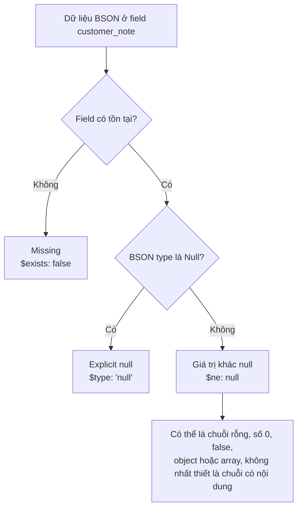

# exists, type và đối sánh trường null hoặc không tồn tại

> **Chương:** Query và Criteria  
> **Module:** `SPRING_DATA_MONGODB` — sử dụng Spring Data MongoDB để kết nối, ánh xạ document và thao tác MongoDB bằng `MongoTemplate` hoặc repository. Bài học tập trung vào ba tình huống cần phân biệt khi truy vấn: **field vắng mặt**, **field tồn tại nhưng có giá trị BSON null**, và **field tồn tại với kiểu BSON cụ thể**. Những quyết định này ảnh hưởng đến truy vấn, aggregation, index, kiểm thử, cập nhật dữ liệu, transaction, reactive access và chẩn đoán hiệu năng.

## 1. Vấn đề: “không có giá trị” không phải lúc nào cũng là null

Một hệ thống quản lý đơn hàng có thể ghi chú giao hàng dưới tên BSON `customer_note`. Hãy xét bốn document:

```javascript
{ _id: "ORD-1", status: "PAID" }
{ _id: "ORD-2", status: "PAID", customer_note: null }
{ _id: "ORD-3", status: "PAID", customer_note: "" }
{ _id: "ORD-4", status: "PAID", customer_note: "Giao buổi sáng" }
```

Ở đây có bốn tình trạng khác nhau:

1. **Missing:** `ORD-1` không có key `customer_note` trong BSON.
2. **Explicit null:** `ORD-2` có key nhưng giá trị là BSON Null.
3. **Empty string:** `ORD-3` có key, chứa chuỗi rỗng; đây vẫn là một chuỗi.
4. **Non-empty string:** `ORD-4` có key và có nội dung.

Điều bất ngờ với người quen SQL là điều kiện MongoDB:

```javascript
db.orders.find({ customer_note: null })
```

**khớp cả document có giá trị `null` lẫn document thiếu field**. Nó không chỉ tìm explicit null.

Nếu nghiệp vụ yêu cầu “chưa từng ghi trường này” thì phải dùng `$exists: false`. Nếu yêu cầu “field được ghi rõ là null”, hãy dùng `$type: "null"`. Nếu chỉ muốn “có thông tin, không phải null”, có thể dùng `$ne: null` với những lưu ý về dữ liệu mảng.



**Mục tiêu học tập:** dự đoán chính xác tập document mà mỗi filter sẽ khớp, chuyển filter sang `Criteria` của Spring Data MongoDB, và kiểm chứng bằng BSON thực thay vì chỉ nhìn object Java đã materialize.

## 2. Tạo bộ dữ liệu để đối chiếu trực tiếp

Dưới đây là bộ dữ liệu có cả field chính và một field legacy cố ý chứa nhiều kiểu khác nhau. Chỉ chạy trên **database thử nghiệm**, vì `drop()` sẽ xóa collection đang chọn:

```javascript
db.orders.drop();

db.orders.insertMany([
  { _id: "ORD-1", status: "PAID" },
  {
    _id: "ORD-2",
    status: "PAID",
    customer_note: null,
    legacy_value: null
  },
  {
    _id: "ORD-3",
    status: "PAID",
    customer_note: "",
    legacy_value: "120"
  },
  {
    _id: "ORD-4",
    status: "PAID",
    customer_note: "Giao buổi sáng",
    legacy_value: 120
  },
  {
    _id: "ORD-5",
    status: "PENDING",
    legacy_value: false
  },
  {
    _id: "ORD-6",
    status: "PENDING",
    legacy_value: []
  },
  {
    _id: "ORD-7",
    status: "PENDING",
    legacy_value: {}
  }
]);
```

Chạy query và hiển thị ID cho dễ so:

```javascript
db.orders.find(
  { customer_note: { $exists: true } },
  { _id: 1 }
).sort({ _id: 1 });
```

Trong bài này, các ví dụ về `customer_note` dùng giá trị scalar (null hoặc String), còn `legacy_value` minh họa việc truy vấn type trên các dạng BSON khác. Vì toán tử đối với **array** có thêm quy tắc so khớp từng phần tử, không nên khái quát bảng scalar thành mọi trường hợp mảng lồng.

## 3. $exists: field có mặt hay vắng mặt?

### 3.1. `$exists: true` — có key, kể cả null

```javascript
db.orders.find({ customer_note: { $exists: true } });
```

Kết quả khớp bộ dữ liệu test: **`ORD-2`, `ORD-3`, `ORD-4`**. Trong đó `ORD-2` có giá trị null nhưng field vẫn **tồn tại**.

Điều kiện này **không khẳng định** giá trị hữu dụng cho nghiệp vụ. Chuỗi rỗng, số 0, `false`, một object rỗng, một array rỗng và explicit null đều có thể là field tồn tại.

### 3.2. `$exists: false` — field không có trong document

```javascript
db.orders.find({ customer_note: { $exists: false } });
```

Kết quả: **`ORD-1`, `ORD-5`, `ORD-6`, `ORD-7`**. Không bao gồm `ORD-2` vì document đó có key `customer_note` và giá trị null.

`$exists: false` đặc biệt hữu ích cho migration, ví dụ tìm document được tạo trước khi trường `processedAt` được triển khai. Nhưng nếu field bị thiếu do một phần dữ liệu lỗi hoặc vì writer hiện tại cố ý bỏ qua null, cần xác định semantics trước khi coi tất cả là “chưa xử lý”.

### 3.3. `$exists` không phải một phép kiểm tra Java null

Hai document BSON:

```javascript
{ _id: "A" }
{ _id: "B", customer_note: null }
```

khi đọc vào một field Java `String customerNote` **có thể đều cho getter trả `null`**. Bản thân giá trị getter không còn cho biết key BSON ban đầu có tồn tại hay không. Muốn phân biệt, truy vấn `$exists` trên database, đọc raw `Document.containsKey(...)`, hoặc thay đổi domain/schema để biểu diễn trạng thái này tường minh.

## 4. So sánh bằng null và $ne: null

### 4.1. `{ field: null }` khớp null **hoặc** missing

Hai biểu thức sau có cùng ý nghĩa cốt lõi trong MongoDB:

```javascript
db.orders.find({ customer_note: null });

db.orders.find({ customer_note: { $eq: null } });
```

Với bộ dữ liệu test, chúng khớp **`ORD-1`, `ORD-2`, `ORD-5`, `ORD-6`, `ORD-7`**. Một trong các lý do chính là MongoDB coi điều kiện bằng `null` là có thể match field chưa được ghi.

**Hệ quả nghiệp vụ:** nếu API muốn tìm “người dùng đã xóa ghi chú và hệ thống đã lưu explicit null”, query trên **không đủ** để phân biệt trường hợp hệ thống chưa từng có field ghi chú.

### 4.2. `$ne: null` — field có giá trị khác null

```javascript
db.orders.find({
  customer_note: { $ne: null }
});
```

Với các giá trị scalar ở bộ dữ liệu, kết quả là **`ORD-3` và `ORD-4`**. Khác với `{ field: null }`, điều kiện `$ne: null` ở MongoDB dùng để tìm field tồn tại có giá trị khác null.

Điểm cần nhấn mạnh: `ORD-3` có **chuỗi rỗng** nên vẫn thỏa `$ne: null`. Nếu yêu cầu “chuỗi chứa nội dung thật”, cần bổ sung validation ở tầng ghi dữ liệu hoặc điều kiện nghiệp vụ tương ứng. Đừng đồng nhất **khác null** với **không rỗng**, **hợp lệ** hay **có ý nghĩa**.

### 4.3. Bảng đối chiếu những filter quan trọng

| Filter MongoDB theo `customer_note` | ORD-1 thiếu | ORD-2 null | ORD-3 `""` | ORD-4 chuỗi có nội dung |
| --- | :---: | :---: | :---: | :---: |
| `{ customer_note: null }` | ✓ | ✓ | — | — |
| `{ customer_note: { $eq: null } }` | ✓ | ✓ | — | — |
| `{ customer_note: { $exists: true } }` | — | ✓ | ✓ | ✓ |
| `{ customer_note: { $exists: false } }` | ✓ | — | — | — |
| `{ customer_note: { $type: "null" } }` | — | ✓ | — | — |
| `{ customer_note: { $ne: null } }` | — | — | ✓ | ✓ |
| `{ customer_note: { $type: "string" } }` | — | — | ✓ | ✓ |

Nếu một document có **array chứa null**, các quy tắc đối sánh phần tử của MongoDB có thể ảnh hưởng `$eq`, `$ne` và `$type`. Bảng chỉ dành cho các giá trị scalar ở bốn document đầu; muốn xác minh trường mảng, hãy dùng bộ test riêng với BSON đúng cấu trúc.

## 5. $type: phân biệt BSON Null, String, Number và kiểu khác

### 5.1. BSON Null là một kiểu thực

`$type` trong **query filter** dùng để khớp giá trị theo kiểu BSON:

```javascript
db.orders.find({
  customer_note: { $type: "null" }
});
```

Ở bộ dữ liệu test, filter này khớp **duy nhất `ORD-2`**, vì `ORD-2` có field `customer_note` với kiểu BSON **Null**. Field thiếu **không** được xem là BSON Null.

Có thể dùng mã số BSON type tương ứng:

```javascript
db.orders.find({
  customer_note: { $type: 10 }
});
```

**10** là mã cho BSON Null. Dùng alias `"null"` thường dễ đọc hơn trong `mongosh`; trong Spring Data `Criteria.type(10)` là một cách biểu diễn trực tiếp.

### 5.2. Các alias hữu ích

| Alias `$type` | Kiểu BSON | Ví dụ |
| --- | --- | --- |
| `"null"` | Null | `customer_note: null` |
| `"string"` | String | `legacy_value: "120"` |
| `"int"` | Int32 | `legacy_value: NumberInt(120)` |
| `"long"` | Int64 | `legacy_value: NumberLong(120)` |
| `"double"` | Double | `legacy_value: 120.5` trong một ngữ cảnh BSON double |
| `"decimal"` | Decimal128 | `legacy_value: NumberDecimal("120.50")` |
| `"number"` | Các kiểu số BSON | Dùng khi cần match những kiểu số như int, long, double và decimal |
| `"bool"` | Boolean | `legacy_value: false` |
| `"date"` | Date | `createdAt: ISODate("...")` |
| `"object"` | Embedded document | `legacy_value: {}` |
| `"array"` | Array | `legacy_value: []` |
| `"objectId"` | ObjectId | `_id: ObjectId("...")` |

Với dữ liệu thử:

```javascript
db.orders.find({ legacy_value: { $type: "string" } });
// ORD-3

db.orders.find({ legacy_value: { $type: "number" } });
// ORD-4 (giá trị 120)

db.orders.find({ legacy_value: { $type: "bool" } });
// ORD-5

db.orders.find({ legacy_value: { $type: "array" } });
// ORD-6

db.orders.find({ legacy_value: { $type: "object" } });
// ORD-7
```

MongoDB có nhiều BSON type hơn bảng trên; khi triển khai migration cần đối chiếu danh sách type alias theo phiên bản server và driver đang sử dụng.

### 5.3. `$type: "number"` không chuyển đổi chuỗi thành số

`legacy_value: "120"` trông giống số nhưng vẫn là **BSON String**. Filter:

```javascript
db.orders.find({ legacy_value: { $type: "number" } });
```

không khớp `ORD-3`. Nó chỉ nhận diện document có giá trị lưu dưới **BSON numeric type** thích hợp, không gọi `parseInt` hay tự biến chuỗi thành Decimal128.

Nếu hệ thống từng lưu giá tiền dạng String và nay muốn đổi sang Decimal128, `$type` rất hữu ích để **kiểm kê dữ liệu lịch sử** trước khi chạy migration. Nó không tự chuyển dữ liệu và cũng không khôi phục độ chính xác đã mất nếu số từng được lưu bằng double.

### 5.4. Field kiểu array có quy tắc riêng

Với array, `$type` trong query có thể match **kiểu của phần tử bên trong mảng**, không chỉ kiểu của giá trị field ngoài cùng. Ví dụ một array chứa chuỗi có thể khớp điều kiện `$type: "string"`, dù field bên ngoài là BSON Array.

Để hỏi “bản thân field là array” có thể dùng `$type: "array"`. Nếu muốn kiểm tra **kiểu của toàn giá trị field** mà không cho phép cách match phần tử, cần thiết kế query/aggregation phù hợp và test. Đừng dùng bảng scalar ở trên để suy mọi tình huống array.

## 6. Chuyển các điều kiện sang Spring Data MongoDB Criteria

### 6.1. Domain Java và BSON field alias

Giả sử domain Java dùng camelCase nhưng database dùng snake_case:

```java
package demo.orders;

import org.springframework.data.annotation.Id;
import org.springframework.data.mongodb.core.mapping.Document;
import org.springframework.data.mongodb.core.mapping.Field;

@Document(collection = "orders")
public class OrderDocument {

    @Id
    private String id;
    private String status;

    @Field("customer_note")
    private String customerNote;

    @Field("legacy_value")
    private Object legacyValue;

    protected OrderDocument() {}

    public String getId() { return id; }
    public String getStatus() { return status; }
    public String getCustomerNote() { return customerNote; }
    public Object getLegacyValue() { return legacyValue; }
}
```

Các phương thức `Criteria.where(...)` dưới đây dùng **tên property Java** khi `MongoTemplate` biết entity type. Với `@Field("customer_note")`, `MappingMongoConverter` có thể chuyển property `customerNote` sang BSON field `customer_note` trong query.

### 6.2. Các phép đối sánh trong Criteria

```java
import org.springframework.data.mongodb.core.query.Criteria;
import org.springframework.data.mongodb.core.query.Query;

// Field có mặt (kể cả giá trị BSON null).
Query present = Query.query(
    Criteria.where("customerNote").exists(true)
);

// Field vắng mặt hoàn toàn trong BSON.
Query missing = Query.query(
    Criteria.where("customerNote").exists(false)
);

// Null HOẶC field vắng mặt.
Query nullOrMissing = Query.query(
    Criteria.where("customerNote").isNull()
);

// Chỉ explicit BSON null: tương đương $type: 10.
Query explicitNull = Query.query(
    Criteria.where("customerNote").isNullValue()
);

// Field tồn tại và khác null (bao gồm chuỗi rỗng).
Query notNull = Query.query(
    Criteria.where("customerNote").ne(null)
);

// Chỉ field có BSON String; gồm chuỗi rỗng.
Query bsonString = Query.query(
    Criteria.where("customerNote").type(2)
);

// BSON Null theo mã type, tương đương isNullValue().
Query bsonNull = Query.query(
    Criteria.where("customerNote").type(10)
);
```

**Phân biệt hai method dễ nhầm:**

- `Criteria.isNull()` diễn tả điều kiện null theo semantics MongoDB, **bao gồm missing**.
- `Criteria.isNullValue()` diễn tả **explicit BSON null**, không bao gồm missing.

Các method `isNull()`/`isNullValue()` thuộc Spring Data MongoDB phiên bản có hỗ trợ API tương ứng. Nếu project dùng bản cũ, có thể dùng `Criteria.type(10)` để diễn đạt BSON null hoặc khai báo filter `$type` bằng `@Query`. Đối chiếu javadoc/API đúng phiên bản trước khi dùng production.

### 6.3. Thực thi qua MongoTemplate

```java
import java.util.List;
import org.springframework.data.mongodb.core.MongoTemplate;

// mongoTemplate được inject vào service/test.
List<OrderDocument> absentOrders =
    mongoTemplate.find(missing, OrderDocument.class);

long numberOfExplicitNulls =
    mongoTemplate.count(explicitNull, OrderDocument.class);

boolean anyPopulatedNote =
    mongoTemplate.exists(notNull, OrderDocument.class);
```

**Chú ý ba khái niệm tên gần giống nhau:**

1. `Criteria.exists(false)` tạo filter MongoDB **`$exists: false`** để kiểm tra sự hiện diện của **một field**.
2. `mongoTemplate.exists(query, OrderDocument.class)` trả `boolean` cho câu hỏi **có document nào khớp toàn bộ query không**.
3. `repository.existsById(id)` là API repository kiểm tra document theo **ID**, không phải một phép kiểm tra field BSON tùy ý.

Nói cách khác, cùng chữ “exists” nhưng **đối tượng kiểm tra** khác nhau.

### 6.4. Kết hợp điều kiện nghiệp vụ

Tìm những đơn đã thanh toán nhưng không có field ghi chú:

```java
Query query = Query.query(
    Criteria.where("status").is("PAID")
        .and("customerNote").exists(false)
);

List<OrderDocument> paidWithoutNote =
    mongoTemplate.find(query, OrderDocument.class);
```

Filter về ý nghĩa:

```javascript
db.orders.find({
  status: "PAID",
  customer_note: { $exists: false }
});
```

Với bộ dữ liệu test, kết quả là **`ORD-1`**. Những document `ORD-5`, `ORD-6`, `ORD-7` cũng thiếu ghi chú nhưng có trạng thái `PENDING` nên không khớp.

Nếu logic có cả `OR` và `AND`, dùng `andOperator(...)`/`orOperator(...)` để biểu diễn nhóm điều kiện rõ ràng. Không cố gắn hai toán tử mâu thuẫn trên cùng một key bằng nhiều `Criteria.where(...)` rồi tự giả định chúng được ghép đúng. Hãy xem query BSON được sinh trong test.

## 7. Repository @Query và sự khác biệt với derived query

Khi cần thể hiện rõ field tồn tại hay không tồn tại, `@Query` là cách trực quan:

```java
import java.util.List;
import org.springframework.data.mongodb.repository.MongoRepository;
import org.springframework.data.mongodb.repository.Query;

public interface OrderRepository
        extends MongoRepository<OrderDocument, String> {

    @Query("{ 'customer_note' : { '$exists' : false } }")
    List<OrderDocument> findWithoutCustomerNoteField();

    @Query("{ 'customer_note' : { '$type' : 'null' } }")
    List<OrderDocument> findWithExplicitNullNote();

    @Query("{ 'customer_note' : null }")
    List<OrderDocument> findWithNullOrMissingNote();

    @Query("{ 'customer_note' : { '$ne' : null } }")
    List<OrderDocument> findWithNonNullNote();

    @Query("{ 'legacy_value' : { '$type' : 'number' } }")
    List<OrderDocument> findWithNumericLegacyValue();
}
```

Vì `@Query` khai báo JSON filter, tên được dùng trong ví dụ là **tên BSON thật** `customer_note`/`legacy_value`. Spring Data có cơ chế mapping query theo entity và parameter conversion, nhưng không nên dùng điều đó để che khuất khác biệt tên Java–BSON trong các ví dụ schema migration.

Một derived method như:

```java
List<OrderDocument> findByCustomerNoteIsNull();
```

thường mang semantics so sánh với null ở MongoDB, tức **null hoặc missing**, chứ không phải “chỉ field có BSON Null”. Khi yêu cầu phân biệt chặt, dùng `Criteria.isNullValue()` hoặc `@Query` với `$type: "null"` cho dễ kiểm chứng.

Thêm một phép kiểm tra trực tiếp trên server bằng `mongosh` trước khi tin rằng tên method đã thể hiện đúng yêu cầu nghiệp vụ.

## 8. Tại sao ghi null trong Java không đồng nghĩa lưu BSON null?

### 8.1. Mapping mặc định có thể bỏ qua field null

Trong Spring Data MongoDB, các property có giá trị Java `null` **thường không được ghi vào BSON** theo chiến lược mapping mặc định. Ví dụ:

```java
OrderDocument order = /* entity với customerNote == null */;
mongoTemplate.insert(order);
```

Document có thể **không chứa** `customer_note`, thay vì chứa `customer_note: null`. Vì vậy một ứng dụng có thể có rất ít explicit BSON null dù code Java truyền null thường xuyên.

Khi cần buộc ghi explicit null bằng mapping annotation, Spring Data MongoDB hiện đại có tùy chọn:

```java
import org.springframework.data.mongodb.core.mapping.Field;

// Đặt trên property customerNote của entity.
@Field(value = "customer_note", write = Field.Write.ALWAYS)
private String customerNote;
```

Đoạn trên minh họa **field trong class**, không phải một file Java độc lập. `Field.Write.ALWAYS` yêu cầu persistence mapping ghi field ngay cả khi giá trị null; tùy chọn tương ứng phải được phiên bản Spring Data trong project hỗ trợ. Đừng tự đổi quy tắc từ bỏ field null sang luôn ghi null trên toàn hệ thống mà không đánh giá query và dữ liệu lịch sử.

### 8.2. `$set: null` và `$unset` là hai thao tác khác nhau

Nếu muốn **giữ key nhưng đặt giá trị null**:

```javascript
db.orders.updateOne(
  { _id: "ORD-4" },
  { $set: { customer_note: null } }
);
```

Sau thao tác, document `ORD-4` thỏa:

```javascript
{ customer_note: { $exists: true } }
{ customer_note: { $type: "null" } }
```

Nếu muốn **xóa hẳn field khỏi BSON**:

```javascript
db.orders.updateOne(
  { _id: "ORD-4" },
  { $unset: { customer_note: 1 } }
);
```

Sau thao tác, `ORD-4` thỏa `$exists: false`. `$unset` là thay đổi schema/dữ liệu, không phải gán null trong RAM.

Spring Data có API tương ứng:

```java
import org.springframework.data.mongodb.core.query.Criteria;
import org.springframework.data.mongodb.core.query.Query;
import org.springframework.data.mongodb.core.query.Update;

Query byId = Query.query(Criteria.where("id").is("ORD-4"));

// Đặt giá trị BSON Null.
mongoTemplate.updateFirst(
    byId, new Update().set("customerNote", null), OrderDocument.class
);

// Xóa field khỏi BSON.
mongoTemplate.updateFirst(
    byId, new Update().unset("customerNote"), OrderDocument.class
);
```

`MongoTemplate` với domain type có thể ánh xạ `customerNote` thành `customer_note`. Những lệnh cập nhật này chạy **lần lượt**; nếu đưa cả hai vào cùng ví dụ, trạng thái cuối là field đã bị unset. Trong thực tế, chỉ chọn thao tác đúng với ý định nghiệp vụ.

### 8.3. Thiết kế API PATCH với ba trạng thái

Trong HTTP PATCH, thường cần phân biệt:

| Payload | Ý định ví dụ |
| --- | --- |
| **Không gửi** thuộc tính `customerNote` | Không thay đổi ghi chú hiện tại. |
| Gửi `"customerNote": null` | Xóa nội dung, có thể lưu explicit null hoặc unset theo hợp đồng API. |
| Gửi `"customerNote": "Giao giờ hành chính"` | Cập nhật chuỗi mới. |

Một DTO có một field `String customerNote` bình thường thường **không phân biệt được** thuộc tính JSON vắng mặt với thuộc tính JSON có giá trị null sau deserialize. Nếu nghiệp vụ yêu cầu phân biệt, dùng kiểu biểu diễn presence tường minh như JSON Patch, DTO có presence marker hoặc xử lý raw JSON với validation thích hợp.

Việc quyết định null từ API sẽ thành **BSON Null** hay **missing** phải nhất quán ở tầng service, không để tình cờ phụ thuộc annotation mapping.

## 9. Nested path, field mảng và dữ liệu có cấu trúc

### 9.1. Đường dẫn lồng và thiếu object cha

Xét các document:

```javascript
{ _id: "N1" }
{ _id: "N2", shippingAddress: null }
{ _id: "N3", shippingAddress: {} }
{ _id: "N4", shippingAddress: { city: null } }
{ _id: "N5", shippingAddress: { city: "Da Nang" } }
```

Truy vấn dotted path:

```javascript
db.orders.find({ "shippingAddress.city": { $exists: false } });
```

khớp những document **không có đường dẫn `shippingAddress.city`**, bao gồm trường hợp không có `shippingAddress`, parent null hoặc object cha không có `city`. Nhưng:

```javascript
db.orders.find({
  "shippingAddress.city": { $type: "null" }
});
```

chỉ nhận explicit null tại đường dẫn `city` (ở tập minh họa là `N4`).

**Không dùng `shippingAddress.city: null` để thay thế yêu cầu “object cha không tồn tại”**; nó có thể khớp thêm những document có `city` explicit null hoặc một đường dẫn không có mặt. Nếu cần xác định trạng thái của object cha, truy vấn riêng `shippingAddress` bằng `$exists` hoặc `$type`.

### 9.2. Phân biệt field mảng rỗng với field vắng mặt

Trong MongoDB, các trường hợp:

```javascript
{ _id: "A1" }
{ _id: "A2", tags: null }
{ _id: "A3", tags: [] }
{ _id: "A4", tags: ["priority"] }
```

khác nhau:

| Mục đích | Filter |
| --- | --- |
| Không có field `tags` | `{ tags: { $exists: false } }` |
| Có explicit null | `{ tags: { $type: "null" } }` |
| Bản thân field là array | `{ tags: { $type: "array" } }` |
| Array rỗng | `{ tags: { $size: 0 } }` |
| Array có chuỗi `priority` | `{ tags: "priority" }` với semantics match array MongoDB |

Đừng dùng `tags: null` để thay cho “array rỗng” hoặc `$exists: true` để thay cho “array có phần tử”. Muốn kiểm tra **một phần tử thỏa nhiều điều kiện cùng lúc**, dùng `$elemMatch` trên mảng document thay vì điều kiện dotted path độc lập.

## 10. $type trong filter khác $type trong aggregation

Đây là một chi tiết quan trọng khi kiểm tra dữ liệu legacy.

### 10.1. Query operator $type

```javascript
db.orders.find({
  customer_note: { $type: "null" }
});
```

Truy vấn trên **chỉ khớp** document có field kiểu BSON Null. Nó **không** có kiểu `"missing"` tương ứng để lọc bằng `$type` theo cùng cơ chế.

### 10.2. Aggregation expression $type

Trong **aggregation expression**, `$type` có thể trả về **chuỗi `"missing"`** nếu input field không tồn tại:

```javascript
db.orders.aggregate([
  {
    $project: {
      _id: 1,
      customerNoteType: { $type: "$customer_note" }
    }
  },
  { $sort: { _id: 1 } }
]);
```

Với dữ liệu `ORD-1` đến `ORD-4`:

| ID | Giá trị `customerNoteType` của aggregation |
| --- | --- |
| `ORD-1` | `"missing"` |
| `ORD-2` | `"null"` |
| `ORD-3` | `"string"` |
| `ORD-4` | `"string"` |

Như vậy, **`"missing"` là kết quả của một aggregation expression**, không phải một BSON type của field tồn tại trong database. Không viết `{ customer_note: { $type: "missing" } }` trong một find query rồi mong nó giống `$exists: false`.

Đây là một kỹ thuật hữu ích để khảo sát chất lượng schema trước khi migration:

```javascript
db.orders.aggregate([
  {
    $project: {
      kind: { $type: "$customer_note" }
    }
  },
  {
    $group: {
      _id: "$kind",
      count: { $sum: 1 }
    }
  },
  { $sort: { count: -1 } }
]);
```

Pipeline cho biết số document thuộc từng trạng thái/type của field trong collection. Với collection rất lớn, cần đánh giá hiệu năng, quyền truy cập và workload trước khi chạy kiểm kê nặng trong production.

## 11. Index: $exists và null có thể có chi phí khác nhau

### 11.1. Không mặc định mọi truy vấn $exists đều dùng index hiệu quả

```javascript
db.orders.createIndex({ customer_note: 1 });
```

Một index thông thường có thể giúp một số truy vấn `$exists` hoặc so sánh giá trị, nhưng không có nghĩa nó luôn phân biệt được **missing** và **explicit null** mà không cần xem document thật. Hiệu quả phụ thuộc query shape, planner, tập dữ liệu, loại index và phiên bản MongoDB.

Thực hành đo:

```javascript
db.orders.find({
  customer_note: { $exists: true }
}).explain("executionStats");

db.orders.find({
  customer_note: { $exists: false }
}).explain("executionStats");

db.orders.find({
  customer_note: { $type: "null" }
}).explain("executionStats");
```

Quan sát `winningPlan`, `totalKeysExamined`, `totalDocsExamined` và thời gian. Đặc biệt, **`$exists: false` thường khó tận dụng sparse index** vì các document thiếu field không có entry trong sparse index đó.

### 11.2. Sparse index không đồng nghĩa với "chỉ index non-null"

```javascript
db.orders.createIndex(
  { customer_note: 1 },
  { sparse: true, name: "note_sparse" }
);
```

Sparse index dựa vào **việc field có mặt**; nó bỏ qua document thiếu field, nhưng **vẫn có thể chứa document có explicit null** tại field đã index. Đây là lý do không nên dùng “sparse” làm từ đồng nghĩa với “không có giá trị null”.

Một sparse index có thể hữu ích cho truy vấn `$exists: true`, nhưng không giúp liệt kê document **vắng field** chỉ bằng entry của chính sparse index, vì những document đó đã bị loại khỏi index. Nếu database có cả index thường lẫn sparse, query planner lựa chọn theo điều kiện và kế hoạch thực tế.

### 11.3. Partial index và dữ liệu đặc thù

Partial index dùng điều kiện lọc xác định nhóm document được index:

```javascript
db.orders.createIndex(
  { status: 1, _id: 1 },
  {
    name: "orders_with_note",
    partialFilterExpression: {
      customer_note: { $exists: true }
    }
  }
);
```

Index này chỉ bao gồm document thỏa điều kiện partial filter. Query muốn được dùng index một cách an toàn phải bảo đảm không bỏ sót document ngoài phạm vi index; vì vậy index chỉ có thể được planner dùng khi query chứng minh điều kiện tương ứng. Cần test `explain`, không tự suy rằng index partial sẽ tăng tốc mọi tìm kiếm `status`.

Trước khi thêm sparse hoặc partial index, xác định rõ vấn đề là truy vấn nhiều field, phân bố dữ liệu, số phần tử có null/missing hay chi phí ghi. Index không tự sửa ý nghĩa của `{field:null}`.

## 12. Chiến lược migration cho field vắng hoặc sai kiểu

Một ví dụ schema evolution:

- Thế hệ 1: document không có `processed_at`.
- Thế hệ 2: writer mới có thể lưu `processed_at: null` khi chưa xử lý.
- Thế hệ 3: khi xử lý xong, writer lưu BSON Date.

Nếu dịch vụ muốn lấy những document “chưa xử lý” theo nghĩa nghiệp vụ, query cần bao gồm những trạng thái được thừa nhận:

```javascript
db.orders.find({
  $or: [
    { processed_at: { $exists: false } },
    { processed_at: { $type: "null" } }
  ]
});
```

Trong trường hợp scalar field đơn giản, biểu thức `{ processed_at: null }` cũng khớp missing hoặc null; dạng `$or` trên giúp **ghi rõ hai nhóm dữ liệu** khi viết kịch bản migration. Nếu dữ liệu cũ có giá trị sai kiểu, ví dụ chuỗi ngày thay cho BSON Date, cần khảo sát thêm `$type`.

Quy trình đề xuất:

1. **Kiểm kê** số document missing, explicit null, Date và String bằng aggregation type hoặc các query riêng.
2. **Định nghĩa ý nghĩa nghiệp vụ** cho từng nhóm; không tự đồng nhất “không có field” với “chưa xử lý” nếu schema cũ không bảo đảm.
3. **Chọn trạng thái đích**: ví dụ tất cả document chưa xử lý sẽ **không có** field, hoặc tất cả sẽ có explicit null; chọn một quy ước.
4. **Đảm bảo tương thích** khi nhiều phiên bản ứng dụng cùng chạy, trước khi đổi query/validator.
5. **Chuyển dữ liệu theo batch** có giới hạn và checkpoint; giữ nguyên những giá trị đang hợp lệ.
6. **Kiểm tra sau migration** bằng raw BSON, count theo type và integration test; không chỉ dựa vào getter Java.

Nếu nhiều request cập nhật cùng một document, có thể dùng filter bổ sung, version/optimistic locking hoặc transaction phù hợp để tránh ghi đè dữ liệu hợp lệ trong lúc backfill. `$exists`/`$type` là công cụ xác định điều kiện, **không phải cơ chế locking**.

## 13. Tính nhất quán, validation và bảo mật

### 13.1. Schema validation phải phân biệt required và bsonType

MongoDB JSON Schema validator có hai khái niệm liên quan nhưng tách biệt:

- `required`: field phải **có mặt**.
- `bsonType`: khi field có mặt, loại BSON của nó phải thuộc loại được cho phép.

Ví dụ muốn `customer_note` **không bắt buộc**, nhưng nếu có thì phải là String hoặc Null:

```javascript
{
  $jsonSchema: {
    bsonType: "object",
    properties: {
      customer_note: {
        bsonType: [ "string", "null" ]
      }
    }
  }
}
```

Đây là **phần rule minh họa**, chưa phải một lệnh triển khai validator lên collection. Nếu thêm `customer_note` vào mảng `required`, document thiếu field sẽ bị coi là không hợp lệ theo rule đó, dù `bsonType` cho phép `"null"`. Cần phối hợp yêu cầu nghiệp vụ và migration trước khi bật validation nghiêm ngặt.

### 13.2. Query theo tenant và visibility

Nếu database phục vụ nhiều tenant, mọi query theo `$exists`/`$type` phải kèm điều kiện quyền truy cập:

```java
Query query = Query.query(
    Criteria.where("tenantId").is(tenantId)
        .and("customerNote").exists(false)
);
```

Query cho content, count, update và backfill phải áp dụng ranh giới tenant/ownership giống nhau; nếu không, API có thể lộ số bản ghi hoặc sửa dữ liệu của tenant khác. Không đưa tên field/operator bất kỳ từ client vào raw query mà không có validation/allowlist.

### 13.3. Transaction và reactive không đổi semantics null

Đặt một truy vấn trong transaction không khiến `{field:null}` chỉ match explicit null. Dùng `ReactiveMongoTemplate` hoặc `ReactiveMongoRepository` cũng không thay đổi quy tắc của MongoDB `$exists`/`$type`; khác biệt chủ yếu là kiểu kết quả như `Mono`/`Flux` và mô hình thực thi bất đồng bộ.

Ví dụ reactive query:

```java
import reactor.core.publisher.Flux;
import org.springframework.data.mongodb.core.query.Criteria;
import org.springframework.data.mongodb.core.query.Query;

Query missingNote = Query.query(
    Criteria.where("customerNote").exists(false)
);

Flux<OrderDocument> orders =
    reactiveMongoTemplate.find(missingNote, OrderDocument.class);
```

Đừng gọi `collectList()` trên toàn bộ tập dữ liệu lớn chỉ để xử lý từng document có field thiếu; dùng streaming/backpressure và giới hạn số thao tác downstream. Với migration khối lượng lớn, nên thiết kế retry và checkpoint/idempotency, không dựa vào một `Flux` duy nhất để bảo đảm xử lý đúng-một-lần.

## 14. Integration test: kiểm tra raw BSON và mapping

### 14.1. Vì sao chỉ dùng repository.save chưa đủ?

Nếu tạo entity với `customerNote == null` rồi `repository.save`, tùy chiến lược mapping, BSON có thể không chứa field. Điều đó khiến test không tạo được trường hợp **explicit BSON null** cần kiểm chứng.

Để test semantics của MongoDB, hãy seed dữ liệu bằng Java Driver hoặc `mongosh`, với cả hai trường hợp:

```java
import org.bson.Document;
import java.util.List;

mongoTemplate.getCollection("orders").insertMany(List.of(
    new Document("_id", "T1").append("status", "PAID"),
    new Document("_id", "T2").append("status", "PAID")
        .append("customer_note", null),
    new Document("_id", "T3").append("status", "PAID")
        .append("customer_note", ""),
    new Document("_id", "T4").append("status", "PAID")
        .append("customer_note", "Hẹn giao")
));
```

`Document.append("customer_note", null)` đảm bảo document test có key explicit null ở tầng BSON; ở đây không phụ thuộc vào annotation có bỏ qua Java null hay không.

### 14.2. Bài kiểm thử với MongoTemplate

Ví dụ sau là **các method trong lớp integration test** được cấu hình `MongoTemplate` và database thử nghiệm; `@BeforeEach` cần dọn collection test hoặc xóa riêng các ID `T1`–`T4` trước khi seed:

```java
import static org.assertj.core.api.Assertions.assertThat;

import java.util.List;
import org.junit.jupiter.api.Test;
import org.springframework.data.mongodb.core.query.Criteria;
import org.springframework.data.mongodb.core.query.Query;

@Test
void nullAndMissingAreDifferent() {
    Query nullOrMissing = Query.query(
        Criteria.where("customerNote").isNull()
    );
    Query explicitNull = Query.query(
        Criteria.where("customerNote").isNullValue()
    );
    Query missing = Query.query(
        Criteria.where("customerNote").exists(false)
    );
    Query nonNull = Query.query(
        Criteria.where("customerNote").ne(null)
    );

    assertThat(idsFor(nullOrMissing))
        .containsExactlyInAnyOrder("T1", "T2");
    assertThat(idsFor(explicitNull))
        .containsExactly("T2");
    assertThat(idsFor(missing))
        .containsExactly("T1");
    assertThat(idsFor(nonNull))
        .containsExactlyInAnyOrder("T3", "T4");
}

private List<String> idsFor(Query query) {
    return mongoTemplate.find(query, OrderDocument.class)
        .stream()
        .map(OrderDocument::getId)
        .toList();
}
```

Test giả định collection test chỉ có bốn document `T1`–`T4` lúc chạy. Với Java 16+ có thể dùng `Stream.toList()`; với Java cũ có thể thay bằng `collect(Collectors.toList())`.

Để kiểm chứng cả **field có mặt** trong BSON:

```java
Document missingRaw = mongoTemplate.getCollection("orders")
    .find(new Document("_id", "T1")).first();
Document nullRaw = mongoTemplate.getCollection("orders")
    .find(new Document("_id", "T2")).first();

assertThat(missingRaw).isNotNull();
assertThat(nullRaw).isNotNull();

assertThat(missingRaw.containsKey("customer_note")).isFalse();
assertThat(nullRaw.containsKey("customer_note")).isTrue();
assertThat(nullRaw.get("customer_note")).isNull();
```

Đây là lý do phải đọc raw `Document` thay vì chỉ dùng `OrderDocument.getCustomerNote()`: getter có thể trả `null` cho cả hai trường hợp.

### 14.3. Các test case bắt buộc khác

| Test case | Kết quả cần xác minh |
| --- | --- |
| Field missing | `$exists:false` match; `$type:"null"` không match. |
| Field explicit null | `$exists:true` và `$type:"null"` cùng match. |
| Field empty string | `$ne:null` match; không phải BSON Null. |
| Field có số 0 hoặc Boolean false | `$exists:true` match; các giá trị này không đồng nghĩa null. |
| Field array rỗng | `$type:"array"` và `$size:0` match; khác missing. |
| Nested path bị thiếu ở parent | Dotted path `$exists:false` match theo ngữ nghĩa MongoDB. |
| Field cùng tên nhưng BSON String vs numeric | `$type:"number"` không tự parse chuỗi số. |
| Update bằng `$set:null` và `$unset` | Hai thao tác tạo ra hai trạng thái BSON khác nhau. |
| Mapping với `@Field` | `Criteria.where("customerNote")` được chuyển tới BSON `customer_note`. |
| Sparse/partial index | Dùng `explain` kiểm chứng kế hoạch, không chỉ đo thời gian. |

## 15. Lỗi thường gặp và cách chẩn đoán

| Hiện tượng | Nguyên nhân khả dĩ | Cách xử lý |
| --- | --- | --- |
| `findByCustomerNoteIsNull` trả cả document chưa từng có field | MongoDB xem field bằng null là **null hoặc missing**. | Dùng `$type:"null"` hoặc `isNullValue()` nếu chỉ muốn explicit null. |
| `$exists:true` trả cả document có null | `$exists` chỉ kiểm tra sự hiện diện của key. | Kết hợp điều kiện kiểu/giá trị theo nhu cầu nghiệp vụ. |
| `$ne:null` trả chuỗi rỗng | Chuỗi rỗng không phải null. | Quy định và validate chuỗi có nội dung riêng. |
| `$type:"number"` không trả String `"120"` | Kiểu BSON String khác numeric. | Migration hoặc chuyển đổi kiểu có kiểm soát; không trông chờ query auto-cast. |
| `$type:"null"` không trả document thiếu field | Missing không phải BSON Null. | Dùng `$exists:false` hoặc query null-or-missing theo ý định. |
| Getter Java bằng null nhưng `$type:"null"` không match | Mapping không lưu field null hoặc document legacy không có field. | Đọc raw BSON; cân nhắc `Field.Write.ALWAYS` nếu cần lưu explicit null. |
| Update set null nhưng API vẫn trả trạng thái khác | Writer/reader hoặc converter có quy tắc riêng, hoặc code đã unset field. | So sánh raw BSON sau cập nhật và logic serialize JSON. |
| Query thiếu field chạy chậm | `$exists:false` khó dùng sparse index, filter quá rộng. | Đo `explain`; cân nhắc materialized state field nếu là truy vấn nghiệp vụ nóng. |
| Tìm theo Java `customerNote` trên driver raw không khớp | BSON thật là `customer_note`. | Dùng tên BSON với driver/mongosh; Spring Data typed query dùng property Java. |
| Dữ liệu lẫn null, String và Number trong cùng field | Schema đã đổi, converter không nhất quán. | Kiểm kê bằng aggregation `$type` và migration có kế hoạch. |
| Truy vấn parent.child trả kết quả “lạ” | Parent thiếu/null hoặc field nằm trong mảng lồng. | Kiểm tra shape BSON và semantics dotted path/array. |

**Quy trình debug ngắn:** (1) lấy một document BSON thật; (2) kiểm tra `containsKey`/`$type`; (3) xác định field Java và tên BSON; (4) viết filter `mongosh` tương đương; (5) kiểm tra `Criteria`/`@Query`; (6) chạy integration test có dữ liệu phân biệt; (7) xem `explain` nếu query chậm.

## 16. Bài thực hành: chuẩn hóa trường processed_at

**Bối cảnh:** một hệ thống đồng bộ có field `processed_at`. Document cũ thiếu field này; một số document mới chứa explicit null; document đã xử lý lưu BSON Date. Ngoài ra có vài bản ghi lỗi chứa String thời gian.

Yêu cầu:

1. Tạo collection `import_jobs` với các document mẫu: missing `processed_at`, explicit null, BSON Date, String datetime và một document có `processed_at: false` để mô phỏng dữ liệu lỗi.
2. Viết filter `$exists:false` để tìm document chưa có field; so sánh với `{processed_at:null}` và giải thích sự khác biệt.
3. Viết filter `$type:"null"` để tìm riêng explicit null; kiểm tra nó không trả document thiếu field.
4. Viết filter `$type:"date"` và `$type:"string"`; thống kê số lượng mỗi nhóm và giải thích nguy cơ khi lưu thời điểm dưới dạng chuỗi.
5. Chuyển các filter sang `MongoTemplate`/`Criteria`; dùng `Criteria.isNull()` và `Criteria.isNullValue()` để so sánh tập kết quả.
6. Thử `$set: {processed_at:null}` và `$unset:{processed_at:1}` trên một document, xem thay đổi ở `$exists`/`$type`.
7. Viết aggregation projection `{kind:{$type:"$processed_at"}}` và group theo `kind`; quan sát giá trị `"missing"` trong output.
8. Đề xuất migration để dữ liệu chưa xử lý chỉ có **một quy ước** (missing hoặc explicit null) và các bản ghi thời gian được lưu BSON Date.
9. Nếu truy vấn `processed_at` là hot path, đo index thường/sparse/partial với `explain("executionStats")` trên dữ liệu test đủ lớn.
10. Viết test dữ liệu null/missing/type trước và sau migration; đảm bảo count/filter có điều kiện tenant nếu ứng dụng phục vụ nhiều người dùng.

### Câu hỏi tự kiểm tra

- `{field:null}` khác `{field:{$type:"null"}}` ra sao?
- `$exists:true` có nhận document với explicit null hay không?
- `$ne:null` có loại chuỗi rỗng, số 0 và Boolean false hay không?
- Vì sao object Java có getter `null` không giúp phân biệt BSON missing và explicit null?
- `Criteria.isNull()` khác `Criteria.isNullValue()` như thế nào?
- `MongoTemplate.exists(query, Entity.class)` khác `Criteria.exists(false)` ở đâu?
- Vì sao `$type:"number"` không khớp trường String `"120"`?
- `$type` trong aggregation có thể trả `"missing"` nhưng query operator `$type` không được dùng để tìm missing vì sao?
- `$unset` có tương đương `$set:null` không?
- Vì sao sparse index không phải “index chỉ những document non-null”?

## 17. Ghi nhớ và tài liệu đối chiếu

- **Missing** là field không có trong BSON; **explicit null** là field tồn tại và mang BSON Null.
- **`$exists:true`** tìm field có mặt **kể cả null**; **`$exists:false`** tìm field không có.
- **`{field:null}`** hoặc `$eq:null` khớp **null lẫn missing**; không đủ để phân biệt hai trạng thái.
- **`$type:"null"`** hoặc `$type:10` tìm **explicit BSON Null**.
- **`$ne:null`** trong tình huống scalar tìm field tồn tại khác null, **không** có nghĩa giá trị đã hợp lệ.
- **`Criteria.isNull()` và `Criteria.isNullValue()`** thể hiện hai semantics khác nhau; cần dùng method phù hợp với nghiệp vụ.
- **MongoTemplate.exists(...)** trả boolean kiểm tra có document khớp query, khác với toán tử **`$exists`** trên field.
- **Java null không quyết định duy nhất BSON representation**; mapping có thể bỏ field, còn `$set:null` và `$unset` tạo hai trạng thái khác nhau.
- **Aggregation expression `$type`** có thể báo `"missing"` để thống kê schema, khác query operator `$type`.
- Index, sparse/partial index, truy vấn nested và dữ liệu mảng cần được kiểm tra bằng **BSON thực và `explain`**, không chỉ dựa vào tên property Java.

Nguồn tham khảo chính thức để đối chiếu theo phiên bản đang dùng:

- [Spring Data MongoDB — Querying Documents / Criteria](https://docs.spring.io/spring-data/mongodb/reference/mongodb/template-query-operations.html)
- [Spring Data MongoDB — Criteria API](https://docs.spring.io/spring-data/mongodb/reference/api/java/org/springframework/data/mongodb/core/query/Criteria.html)
- [Spring Data MongoDB — Mapping](https://docs.spring.io/spring-data/mongodb/reference/mongodb/mapping/mapping.html)
- [MongoDB — $exists](https://www.mongodb.com/docs/manual/reference/operator/query/exists/)
- [MongoDB — $type (query)](https://www.mongodb.com/docs/manual/reference/operator/query/type/)
- [MongoDB — Query for Null or Missing Fields](https://www.mongodb.com/docs/manual/tutorial/query-for-null-fields/)
- [MongoDB — $type (aggregation)](https://www.mongodb.com/docs/manual/reference/operator/aggregation/type/)
- [MongoDB — Sparse Indexes](https://www.mongodb.com/docs/manual/core/index-sparse/)
