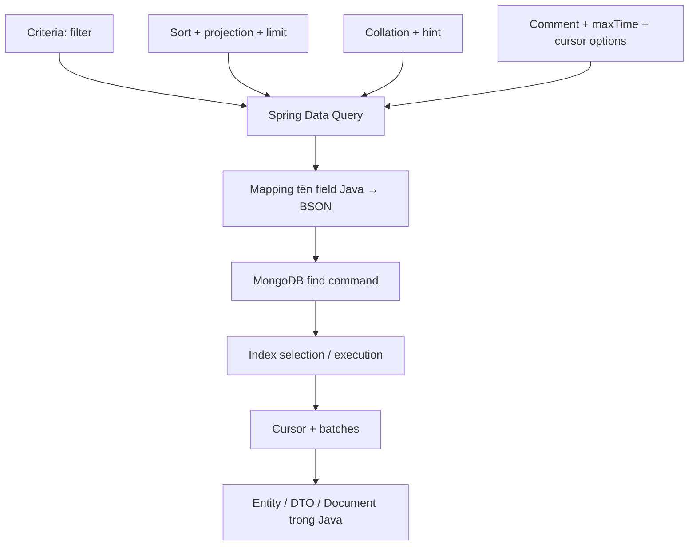

# Collation, hint, comment, maxTime và tùy chọn cursor

## 1. Vì sao `Criteria` đúng vẫn chưa đủ?

Trong **Spring Data MongoDB**, `Criteria` và `Query` giúp diễn đạt *những document cần lấy*. Nhưng cùng một điều kiện lọc có thể cho kết quả hoặc hiệu năng khác nhau tùy cách MongoDB **so sánh chuỗi**, **chọn index**, **giới hạn thời gian**, **ghi nhận thông tin truy vết** và **trả dữ liệu qua cursor**.

Giả sử ứng dụng cần tìm khách hàng có tên “Ánh”, không phân biệt hoa/thường, chỉ trong nhóm tài khoản đang hoạt động:

- Nếu dùng so sánh nhị phân mặc định, `"Ánh"` và `"ánh"` có thể không khớp.
- Nếu collation của query khác collation của index, MongoDB có thể không dùng index cho so sánh chuỗi hoặc sort theo cách kỳ vọng.
- Nếu cố ép `hint` sang index không phù hợp, query có thể chậm hơn, hoặc lỗi nếu index không tồn tại.
- Nếu query mất quá lâu, cần hạn mức thực thi phía server bằng `maxTime`, không chỉ timeout của HTTP.
- Nếu kết quả rất lớn, `batchSize` và vòng đời cursor ảnh hưởng số lần lấy dữ liệu và lượng bộ nhớ ứng dụng.
- Nếu muốn biết truy vấn nào gây tải, `comment` giúp gắn nhãn truy vết an toàn trong command/profiler.

Đây là bài thuộc chương **Query và Criteria** của module **SPRING_DATA_MONGODB**, nơi ta kết nối và truy cập MongoDB qua `MongoTemplate` hoặc repository; đồng thời học cách kiểm tra index, aggregation, transaction, reactive access, kiểm thử và chẩn đoán hiệu năng dữ liệu.

**Mục tiêu:** xây một `Query` đúng về nghiệp vụ *và* hiểu các **tùy chọn thực thi** của nó, thay vì coi mọi lệnh `find` có cùng bộ lọc là tương đương.

## 2. Phân biệt filter, sort, projection và query options

Một truy vấn MongoDB có thể được chia thành các phần độc lập về ý nghĩa:

| Nhóm | Ví dụ Spring Data | Trả lời câu hỏi |
| --- | --- | --- |
| **Filter** | `Criteria.where("active").is(true)` | Document nào khớp? |
| **Sort** | `query.with(Sort.by("displayName"))` | Kết quả theo thứ tự nào? |
| **Projection** | `query.fields().include("displayName")` | Field nào được trả về? |
| **Limit/skip** | `query.limit(20)`, `query.skip(100)` | Bao nhiêu bản ghi, từ vị trí nào? |
| **Collation** | `query.collation(Collation.of("vi").strength(2))` | Chuỗi được so sánh/sắp xếp theo quy tắc ngôn ngữ nào? |
| **Hint** | `query.withHint("idx_customers_active_name_vi")` | Ưu tiên buộc dùng index nào? |
| **Comment** | `query.comment("customer-search-v1")` | Gắn nhãn quan sát truy vấn như thế nào? |
| **Max time** | `query.maxTime(Duration.ofSeconds(2))` | Giới hạn thời gian xử lý phía MongoDB là gì? |
| **Cursor batch** | `query.cursorBatchSize(100)` | Mỗi lượt trao đổi cursor yêu cầu tối đa khoảng bao nhiêu document? |
| **Cursor flags** | `query.noCursorTimeout()` | Thay đổi một số hành vi của cursor theo server/driver? |

Nội dung `Query.getQueryObject()` phản ánh phần *filter*, không phải bản dump đầy đủ mọi tùy chọn. `Query` còn giữ `sort`, `collation`, `hint` và metadata như `comment`, `maxTime`, `cursorBatchSize`. Khi debug, đừng chỉ in filter rồi kết luận server đã nhận đủ các options.



Một số tùy chọn có tác dụng ở server, số khác được Spring Data/driver áp dụng khi mở hoặc tiêu thụ cursor. Chúng **không thay thế cho điều kiện nghiệp vụ**, xác thực người dùng hay thiết kế chỉ mục.

## 3. Chuẩn bị dữ liệu và mô hình Java

### 3.1. Collection kiểm thử

Thử các lệnh trong một database riêng dành cho học tập:

```javascript
db.customers.insertMany([
  {
    _id: "cus-01",
    display_name: "Ánh",
    active: true,
    registered_at: ISODate("2026-11-20T02:00:00Z"),
    city: "Hà Nội",
    internal_note: "Khách thân thiết"
  },
  {
    _id: "cus-02",
    display_name: "ánh",
    active: true,
    registered_at: ISODate("2026-11-19T03:00:00Z"),
    city: "Đà Nẵng"
  },
  {
    _id: "cus-03",
    display_name: "Anh",
    active: true,
    registered_at: ISODate("2026-11-18T04:00:00Z"),
    city: "Huế"
  },
  {
    _id: "cus-04",
    display_name: "Ánh",
    active: false,
    registered_at: ISODate("2026-11-17T05:00:00Z"),
    city: "Cần Thơ"
  }
]);
```

Giá trị `"Ánh"` và `"ánh"` chỉ khác chữ hoa/thường; `"Anh"` còn khác dấu. Bộ dữ liệu giúp quan sát collation, nhưng không thể dùng một vài tên làm bằng chứng đầy đủ về mọi quy tắc so sánh Unicode/tiếng Việt.

### 3.2. Entity Spring Data MongoDB

```java
import java.time.Instant;

import org.springframework.data.mongodb.core.mapping.Document;
import org.springframework.data.mongodb.core.mapping.Field;
import org.springframework.data.mongodb.core.mapping.FieldType;
import org.springframework.data.mongodb.core.mapping.MongoId;

@Document(collection = "customers")
public record CustomerDocument(
    @MongoId(FieldType.STRING) String id,
    @Field("display_name") String displayName,
    boolean active,
    @Field("registered_at") Instant registeredAt,
    String city,
    @Field("internal_note") String internalNote
) {}
```

Ở đây:

- `id` được ánh xạ sang BSON `_id` dạng string theo `@MongoId(FieldType.STRING)`.
- Property Java `displayName` được lưu trong BSON field `display_name`.
- Property `registeredAt` được lưu thành `registered_at`; kiểu MongoDB thông thường là BSON Date.
- `internalNote` là field nội bộ, không cần tải khi trả danh sách khách hàng.

Ví dụ bài học sử dụng Java 17+, `MongoTemplate` và MongoDB có hỗ trợ collation. Không giả định người học đã bật tự động tạo index hoặc có collection được provision sẵn.

### 3.3. Query cơ bản chưa có options

```java
import java.util.List;

import org.springframework.data.mongodb.core.MongoTemplate;
import org.springframework.data.mongodb.core.query.Criteria;
import org.springframework.data.mongodb.core.query.Query;

public List<CustomerDocument> findActiveByName(
    MongoTemplate template,
    String name
) {
    Query query = Query.query(
        Criteria.where("active").is(true)
            .and("displayName").is(name)
    );
    return template.find(query, CustomerDocument.class);
}
```

Khi thực thi trên `CustomerDocument.class`, Spring Data dùng metadata `@Field` để ánh xạ `displayName` sang `display_name`. Nhưng nếu `name = "ánh"`, so sánh nhị phân mặc định có thể không tìm `"Ánh"`. Ta cần một lựa chọn **collation** rõ ràng.

## 4. Collation: so sánh chuỗi theo locale và strength

**Collation** quy định cách MongoDB so sánh và sắp xếp chuỗi theo các quy tắc ngôn ngữ (ICU). Nó không tự sửa chuỗi được lưu, không phải bộ chuyển đổi Unicode tại lớp API, và không tự tạo full-text search.

Một collation document thường có các thành phần:

```javascript
{
  locale: "vi",
  strength: 2
}
```

Với cấu hình cơ bản:

| `strength` | Ý nghĩa điển hình | Cần thận trọng |
| --- | --- | --- |
| `1` (primary) | So sánh khác biệt cơ bản, thường bỏ qua khác biệt dấu và hoa/thường ở mức primary | Có thể gộp các tên/từ mà nghiệp vụ muốn phân biệt |
| `2` (secondary) | Xét khác biệt dấu, thường không phân biệt hoa/thường | Không phải cơ chế fuzzy search hay chuẩn hóa mọi ký tự |
| `3` (tertiary) | Xét thêm khác biệt hoa/thường theo quy tắc locale | Sort khác simple binary |
| `4` hoặc `5` | Mức phân biệt bổ sung cho những trường hợp đặc biệt | Không dùng khi chưa hiểu yêu cầu và quy tắc server |

Diễn giải theo mức là mô tả khái quát; hành vi chính xác phụ thuộc locale, `caseLevel`, `caseFirst`, `numericOrdering`, `alternate` và những option collation khác. Với tiếng Việt, cần kiểm thử tên có dấu, chữ `đ`, khoảng trắng và Unicode tổ hợp trong dữ liệu thật.

### 4.1. Thử trong `mongosh`

```javascript
// Mặc định: so sánh simple, có thể chỉ khớp "ánh".
db.customers.find({
  active: true,
  display_name: "ánh"
});

// Collation vi, strength 2: hướng đến khớp cả "Ánh" và "ánh".
db.customers.find({
  active: true,
  display_name: "ánh"
}).collation({
  locale: "vi",
  strength: 2
});
```

Do `cus-04` đang `active: false`, nó không được trả dù tên giống. Đây là một ví dụ rất quan trọng: **collation tác động cách so sánh chuỗi, không vô hiệu hóa filter nghiệp vụ**.

Thử thêm sort:

```javascript
db.customers.find({ active: true })
  .collation({ locale: "vi", strength: 2 })
  .sort({ display_name: 1, _id: 1 });
```

Bổ sung `_id` giúp có thứ tự phân biệt giữa những document tên được coi là tương đương theo collation. Với pagination/scrolling, thứ tự ổn định rất quan trọng.

### 4.2. Áp dụng bằng `Query.collation(...)`

```java
import java.util.List;

import org.springframework.data.mongodb.core.MongoTemplate;
import org.springframework.data.mongodb.core.query.Collation;
import org.springframework.data.mongodb.core.query.Criteria;
import org.springframework.data.mongodb.core.query.Query;

public List<CustomerDocument> findIgnoringCase(
    MongoTemplate template,
    String name
) {
    Query query = Query.query(
        Criteria.where("active").is(true)
            .and("displayName").is(name)
    );

    query.collation(
        Collation.of("vi").strength(2)
    );

    return template.find(query, CustomerDocument.class);
}
```

`Collation.of("vi").strength(2)` xây bộ quy tắc so sánh; `query.collation(...)` đưa nó vào truy vấn. Không cần chuyển hết tên sang chữ thường trong collection chỉ để tạo query case-insensitive, nhưng vẫn phải quyết định riêng việc chuẩn hóa văn bản tại biên ghi dữ liệu.

### 4.3. Collation, `regex` và tìm kiếm

Một query `$regex` với option `i` không tương đương với truy vấn equality có collation. MongoDB `$regex` không tận dụng case-insensitive collation index theo cùng cách equality/sort; áp dụng collation không biến regex thành một phép so sánh ICU-aware toàn diện.

Nếu muốn tìm tên bắt đầu bằng ký tự nhập vào, tìm không dấu, xấp xỉ hoặc không phân biệt cách gõ, có thể cần khóa tìm kiếm canonical, index cho prefix hoặc cơ chế search chuyên dụng. **Không dùng `strength: 1` như lời giải tự động cho mọi nhu cầu tìm kiếm tiếng Việt.**

## 5. Collation và index phải thiết kế cùng nhau

MongoDB có thể tạo index với collation cụ thể:

```javascript
db.customers.createIndex(
  {
    active: 1,
    display_name: 1,
    _id: 1
  },
  {
    name: "idx_customers_active_name_vi",
    collation: { locale: "vi", strength: 2 }
  }
);
```

Một truy vấn equality/sort trên các trường string muốn tận dụng đầy đủ index theo collation cần có **collation tương thích** với index. Nếu query dùng `simple` nhưng index theo `vi`, hoặc query dùng `strength: 1` nhưng index theo `strength: 2`, khả năng dùng index cho phần so sánh/sắp xếp chuỗi có thể bị hạn chế.

Đối chiếu trong `mongosh`:

```javascript
db.customers.find({
  active: true,
  display_name: "ánh"
})
.collation({ locale: "vi", strength: 2 })
.sort({ display_name: 1, _id: 1 })
.explain("executionStats");
```

Quan sát `winningPlan`, `IXSCAN`/`COLLSCAN`, `totalKeysExamined`, `totalDocsExamined` và sort stage. Không đánh giá dựa trên một collection bốn document: query planner có thể chọn collection scan cho dữ liệu quá nhỏ; khi kiểm tra hiệu năng cần tập dữ liệu đại diện.

### 5.1. Unique index có collation là quyết định nghiệp vụ

Nếu tạo `unique` với collation không phân biệt hoa/thường, các tên `"Ánh"` và `"ánh"` có thể được xem là một giá trị trùng theo quy tắc index. Điều này có thể phù hợp cho username đã chuẩn hóa nhưng **không phù hợp** để bảo đảm tên thật của hai khách hàng là duy nhất.

Trước khi tạo unique index trên string, phải xác định “hai giá trị được coi là giống nhau” trong nghiệp vụ và kiểm tra dữ liệu cũ. Không thay đổi collation unique index chỉ vì muốn một màn hình sort đẹp hơn.

### 5.2. Collation mặc định và mức ưu tiên

Collation có thể được khai báo ở cấp collection/domain hoặc trên từng truy vấn tùy cách tạo collection và cấu hình Spring Data. Trong repository, `@Query(collation=...)` hoặc tham số `Collation` có thể đặt quy tắc cụ thể cho method.

Khi query cần cách so sánh khác với mặc định, nên đặt rõ và có integration test. Với hệ thống nhiều ngôn ngữ, không có một locale phù hợp cho mọi field: tên người, mã SKU, email, mã giao dịch và nội dung tự do có quy tắc khác nhau.

## 6. Hint: hướng query planner tới một index cụ thể

**`hint`** yêu cầu MongoDB sử dụng một index xác định thay vì để query planner tự lựa chọn. Trong Spring Data MongoDB, phương thức phổ biến là:

```java
query.withHint("idx_customers_active_name_vi");
```

Có thể dùng tên index đã tạo hoặc dạng key pattern theo API phù hợp. Với tên, hãy đảm bảo đúng ký tự và index tồn tại trong collection. Một index được dùng để đọc chuỗi theo collation cần được thiết kế phù hợp với query.

### 6.1. Ví dụ đầy đủ

```java
import java.util.List;

import org.springframework.data.mongodb.core.MongoTemplate;
import org.springframework.data.mongodb.core.query.Collation;
import org.springframework.data.mongodb.core.query.Criteria;
import org.springframework.data.mongodb.core.query.Query;

public List<CustomerDocument> findWithIndexHint(
    MongoTemplate template,
    String name
) {
    Query query = Query.query(
        Criteria.where("active").is(true)
            .and("displayName").is(name)
    );

    query.collation(Collation.of("vi").strength(2));
    query.withHint("idx_customers_active_name_vi");

    return template.find(query, CustomerDocument.class);
}
```

Việc thêm `withHint` **không tự tạo index**. Nếu tên index không tồn tại, MongoDB thường trả lỗi thay vì âm thầm tạo hoặc chuyển sang index mong muốn. Nếu index có collation không tương thích, ép dùng index không bảo đảm query sẽ sử dụng nó hiệu quả cho mọi phần so sánh/sort.

### 6.2. Dùng key pattern nếu cần

`Query.withHint(String)` chấp nhận tên index hoặc JSON biểu diễn key pattern; trong những dòng Spring Data hỗ trợ còn có overload nhận `org.bson.Document`:

```java
import org.bson.Document;

query.withHint(
    new Document("active", 1)
        .append("display_name", 1)
        .append("_id", 1)
);
```

Ở đây key pattern dùng **tên field BSON**, không phải `displayName` của Java. Tuy nhiên, nếu có nhiều index với cùng key pattern nhưng collation/option khác nhau, một hint theo **tên index** thường dễ kiểm soát và dễ review hơn trong ứng dụng.

### 6.3. Khi nào nên và không nên hint?

| Tình huống | Quyết định |
| --- | --- |
| Query planner chọn index kém trên workload đại diện, đã đo được | Có thể thử `hint`, ghi nhận lý do và theo dõi |
| Cần so sánh kế hoạch giữa hai index ở môi trường thử nghiệm | `hint` rất hữu ích để chẩn đoán |
| Query nhỏ, planner đã chọn index đúng | Thường không cần `hint` |
| Index có thể bị đổi tên/xóa trong migration | Hint hard-code có rủi ro triển khai |
| Thêm hint chỉ vì muốn “query nhanh hơn” | Không đủ căn cứ; phải dùng `explain` và đo |
| Query phụ thuộc parameter có selectivity thay đổi mạnh | Hint cố định có thể không tối ưu cho mọi giá trị |

**Nguyên tắc:** coi hint là một lựa chọn điều khiển kế hoạch có chủ đích. Luôn đo với và không có hint. Khi schema/index thay đổi, cần chạy lại phép đo. Một hint không phù hợp có thể tệ hơn để query planner tự chọn.

### 6.4. Hint và các giới hạn của MongoDB

MongoDB có những quy tắc khi dùng `hint` với các loại query/index như wildcard, hidden, partial hoặc các lệnh đặc thù. Không suy rằng mọi index đều có thể buộc dùng trong mọi trường hợp. Khi gặp lỗi hint, hãy kiểm tra:

- `db.customers.getIndexes()`: index có tồn tại, đúng tên và collation không?
- Query thực tế gửi tên field BSON nào?
- Index có hidden/partial hoặc điều kiện đặc biệt không?
- Collation query có tương thích với index và sort không?
- Máy chủ/driver đang chạy phiên bản nào và command nào được sử dụng?

## 7. Comment: đặt nhãn truy vấn để quan sát

`Query.comment(String)` thêm metadata để MongoDB hoặc công cụ giám sát nhận diện loại truy vấn. Nó có ích khi nhiều endpoint cùng đọc một collection.

```java
Query query = Query.query(
    Criteria.where("active").is(true)
);

query.comment("customer-list-v1");
```

Trong MongoDB, comment có thể xuất hiện trong profiler, diagnostic log hoặc command monitoring tùy cấu hình và mức độ ghi log. Nó **không** được dùng để thay đổi điều kiện lọc, sort hay index.

### 7.1. Thiết kế comment có chủ đích

Một quy ước đơn giản:

```text
customer-list-v1
customer-search-by-name-v1
customer-export-batch-v2
order-reconciliation-v1
```

Comment nên có tính ổn định để gom thống kê theo loại query. Tránh nối thẳng vào comment:

- Họ tên, email hoặc số điện thoại của khách hàng.
- JWT, API key, session token, thông tin thanh toán.
- Raw request body hoặc input dài không được kiểm tra.
- ID đặc biệt nhạy cảm có thể xuất hiện trong log/công cụ quan sát.

Không dùng `comment` làm cơ chế bảo mật hoặc trace-id duy nhất. Hệ thống tracing còn cần correlation ID, log policy, metrics và quyền truy cập log. Việc lưu comment trong profiler/diagnostic cũng cần cân nhắc dung lượng và chính sách lưu giữ.

### 7.2. Comment ở repository

Spring Data MongoDB cung cấp annotation `@Meta` cho các repository query method để đặt thông tin như thời gian thực thi tối đa, comment hoặc cursor batch size:

```java
import java.util.List;

import org.springframework.data.mongodb.repository.Meta;
import org.springframework.data.mongodb.repository.MongoRepository;
import org.springframework.data.mongodb.repository.Query;

public interface CustomerRepository
        extends MongoRepository<CustomerDocument, String> {

    @Meta(
        comment = "customer-search-by-name-v1",
        maxExecutionTimeMs = 1500,
        cursorBatchSize = 100
    )
    @Query(
        value = "{ 'active': true, 'display_name': ?0 }",
        collation = "{ 'locale': 'vi', 'strength': 2 }"
    )
    List<CustomerDocument> findActiveByName(String name);
}
```

`@Meta` chỉ thiết lập metadata được Spring Data hỗ trợ cho repository query method; nó không tạo index, không thay `@Query` thành filter khác, và không biến một `List` lớn thành luồng xử lý tiết kiệm bộ nhớ. Với các tùy chọn động phức tạp như `withHint(...)`, `MongoTemplate` thường thể hiện chính xác hơn.

Các annotation và overload có thể thay đổi theo phiên bản Spring Data MongoDB; trước khi biên dịch, kiểm tra Javadoc của phiên bản dependency thực tế.

## 8. `maxTime`: giới hạn thời gian xử lý phía server

Một query vô tình bỏ index hoặc sort nhiều document có thể tiêu tốn quá nhiều tài nguyên. `Query.maxTime(Duration)` yêu cầu MongoDB đặt giới hạn **server-side execution time** tương ứng với `maxTimeMS`:

```java
import java.time.Duration;

Query query = Query.query(
    Criteria.where("active").is(true)
);
query.maxTime(Duration.ofSeconds(2));
```

Trong `mongosh`:

```javascript
db.customers.find({ active: true })
  .maxTimeMS(2000);
```

Nếu lệnh vượt giới hạn theo cơ chế kiểm tra của MongoDB, server có thể hủy thao tác và trả lỗi timeout. Đây là **hàng rào bảo vệ** cho tài nguyên, không phải bảo đảm mọi query sẽ hoàn tất trong hai giây.

### 8.1. Server maxTime khác client timeout

| Cơ chế | Điều nó kiểm soát | Không nên giả định |
| --- | --- | --- |
| `Query.maxTime(Duration)` / `maxTimeMS` | Thời gian xử lý được MongoDB server giới hạn theo quy tắc lệnh | Không bao trùm toàn bộ HTTP request/serialize/network |
| Socket/read timeout của driver | Chờ trao đổi mạng ở phía client/driver | Không thay thế giới hạn thực thi phía server |
| Timeout của gateway/API | Thời gian trả HTTP và xử lý ở tầng service | Không chắc MongoDB đã dừng truy vấn ngay nếu client rời đi |
| Timeout của transaction | Phạm vi và vòng đời transaction | Không tương đương `maxTimeMS` của riêng query |
| Cancellation reactive | Hủy subscription/luồng người tiêu thụ | Không đảm bảo mọi thao tác server đã dừng ngay lập tức |

Với cursor có nhiều batch, MongoDB có quy tắc áp dụng giới hạn thời gian đối với quá trình lấy batch tiếp theo; không nên diễn giải `maxTimeMS` đơn giản là “đồng hồ tính cả mạng và thời gian xử lý Java”. Một session hết hạn cũng có thể đóng cursor dù `maxTimeMS` đặt cao hơn.

### 8.2. Chọn ngưỡng dựa trên SLA và workload

Một ngưỡng có thể thích hợp cho **truy vấn tương tác** nhưng quá nhỏ cho **truy vấn xuất báo cáo**. Không áp dụng 500 ms cho tất cả query chỉ vì muốn tối ưu latency.

Quy trình tốt hơn:

1. Đo p95/p99 của query trên dữ liệu đại diện.
2. Xác định SLA endpoint và thời gian dành cho các bước service khác.
3. Đặt `maxTime` đủ bảo vệ khi query bất thường nhưng không gây hủy hàng loạt query hợp lệ.
4. Theo dõi số lần bị hủy, loại query và execution plan.
5. Sửa index, filter, projection hoặc mô hình dữ liệu thay vì chỉ tăng `maxTime`.

Khi phát sinh timeout, không retry mù quáng cùng query đắt tiền trong một vòng vô hạn. Có thể cần giới hạn số lần, backoff, chuyển công việc thành background job hoặc điều chỉnh thiết kế truy vấn.

## 9. Cursor batch size: bao nhiêu document trên mỗi lượt nhận?

MongoDB dùng **cursor** để truyền kết quả của các truy vấn có nhiều document. Server có thể trả batch đầu, sau đó driver yêu cầu thêm bằng `getMore`.

`Query.cursorBatchSize(int)` chỉ định số document **mục tiêu mỗi batch**, không phải tổng số kết quả:

```java
Query query = Query.query(
    Criteria.where("active").is(true)
);

query.cursorBatchSize(100);
```

Nếu query khớp 5.000 document:

- `cursorBatchSize(100)` **không có nghĩa** chỉ nhận tối đa 100 document.
- Nó định hướng kích thước mỗi batch; số batch thực tế còn phụ thuộc giới hạn byte, dữ liệu và hành vi driver/server.
- Nếu gọi `mongoTemplate.find(query, CustomerDocument.class)`, Spring Data thường **tập hợp toàn bộ kết quả** vào `List`, nên batchSize không biến nó thành API streaming ít RAM.
- Muốn chỉ nhận 100 document tổng cộng, dùng `query.limit(100)`.
- Muốn xử lý tuần tự và giải phóng tài nguyên, dùng `mongoTemplate.stream(...)` hoặc reactive `Flux` theo điều kiện thích hợp.

### 9.1. Phân biệt `limit`, `batchSize` và `Pageable`

| Tùy chọn | Ý nghĩa |
| --- | --- |
| `query.limit(100)` | Giới hạn **tổng số document** trả về cho truy vấn thông thường |
| `query.cursorBatchSize(100)` | Gợi ý số document lấy trong **mỗi batch của cursor** |
| `query.skip(100)` | Bỏ qua phần đầu của kết quả theo thứ tự đã xác định |
| `Pageable` | Phân trang offset theo page/size/sort trong một số API |
| `Window<T>`/`ScrollPosition` | Đọc theo cửa sổ và vị trí tiếp tục ở các phiên bản hỗ trợ; không đồng nghĩa cursor server mở liên tục |
| `stream()` / `Flux` | Mô hình tiêu thụ nhiều phần tử theo luồng; cần quản lý lifecycle/cancellation |

Một cách tính sơ bộ: 1.000 document với batchSize 100 có thể cần nhiều lượt đọc batch, nhưng **không được mặc định chính xác 10 lần trao đổi** vì giới hạn kích thước byte, first batch, limit và hành vi driver thay đổi con số.

### 9.2. Tối ưu batch theo kích thước document

BatchSize quá nhỏ có thể làm tăng số lần `getMore` và round-trip. BatchSize quá lớn có thể tăng mức sử dụng bộ nhớ tạm thời, khiến client chậm xử lý và làm tăng lượng dữ liệu nhận không cần thiết khi hủy sớm.

Thử nghiệm:

- Document nhỏ vài trăm byte: batch lớn hơn có thể hợp lý.
- Document chứa mảng/field lớn: batch nhỏ hơn có thể tránh áp lực bộ nhớ.
- Kết nối mạng có độ trễ cao: chi phí mỗi round-trip quan trọng hơn.
- Công việc CPU-heavy trên mỗi document: cần kiểm soát tốc độ và tài nguyên xử lý.
- Web API list: thường nên giới hạn số lượng và projection trước, rồi mới nghĩ đến batchSize.

Không dùng batchSize như thay thế cho index hoặc tối ưu query filter.

## 10. `noCursorTimeout` và vòng đời cursor

MongoDB có chính sách đóng cursor không được sử dụng trong một khoảng thời gian. Spring Data cung cấp:

```java
Query query = Query.query(
    Criteria.where("active").is(true)
);
query.noCursorTimeout();
```

Cờ này hướng tới việc ngăn một số cơ chế timeout của **cursor không hoạt động**, nhưng **không bảo đảm cursor tồn tại vĩnh viễn**. MongoDB driver thường sử dụng session; session idle timeout (mặc định khoảng 30 phút trên các thiết lập phổ biến) vẫn có thể khiến server đóng cursor, kể cả khi `noCursorTimeout` được bật.

### 10.1. Khi nào cần cân nhắc?

Ví dụ một job xuất dữ liệu xử lý từng document và đôi khi mất nhiều thời gian giữa hai lượt `getMore`. Khi đó có thể xem xét `noCursorTimeout` nếu hiểu rõ rủi ro.

Tuy nhiên, chỉ bật cờ này khi:

- Có yêu cầu cụ thể từ workload và đã quan sát được timeout cursor.
- Luồng xử lý có quản lý `close()`/cancellation rõ ràng.
- Có cơ chế timeout/health check cho job và giới hạn tài nguyên.
- Đã hiểu session timeout, read concern và chi phí giữ cursor mở.
- Không dùng nó như một cách tránh sửa một luồng xử lý chậm hoặc rò rỉ tài nguyên.

Không bật `noCursorTimeout()` cho mọi truy vấn API. Cursor bị bỏ quên giữ tài nguyên ở server, và cờ này không sửa được vấn đề query thiếu index.

### 10.2. Dùng `MongoTemplate.stream` và đóng tài nguyên

```java
import java.time.Duration;
import java.util.stream.Stream;

import org.springframework.data.mongodb.core.MongoTemplate;
import org.springframework.data.mongodb.core.query.Criteria;
import org.springframework.data.mongodb.core.query.Query;

public void exportCustomers(
    MongoTemplate template
) {
    Query query = Query.query(
        Criteria.where("active").is(true)
    );

    query.cursorBatchSize(100)
         .comment("customer-export-batch-v1")
         .maxTime(Duration.ofSeconds(10));

    // Chỉ cân nhắc khi có yêu cầu kiểm soát timeout rõ ràng:
    // query.noCursorTimeout();

    try (Stream<CustomerDocument> stream =
             template.stream(query, CustomerDocument.class)) {

        stream.forEach(customer -> {
            // Ví dụ: xử lý một item, không giữ tất cả trong List.
            System.out.println(customer.id());
        });
    }
}
```

`try-with-resources` giúp đóng stream/cursor khi hoàn tất hoặc khi có exception. Ví dụ in ID đơn giản, không xử lý xuất file thật; trong job production còn cần kiểm soát backpressure, side effect, lỗi giữa chừng, retry và checkpoint.

**Cảnh báo:** một cursor mở lâu không cung cấp transaction hoặc snapshot bất biến cho toàn bộ quá trình. Khi dữ liệu được ghi đồng thời, kết quả có thể phụ thuộc read concern và đặc điểm query.

### 10.3. Session timeout vẫn áp dụng

Với implicit sessions của MongoDB Driver, một cursor có `noCursorTimeout` vẫn có thể bị đóng khi session không hoạt động quá thời hạn. Nếu hệ thống thực sự cần giữ cursor qua các khoảng xử lý dài, phải nghiên cứu giải pháp session rõ ràng hoặc thiết kế lại luồng thành những batch có checkpoint.

Đối với batch job có thể chạy hàng giờ, một chiến lược **keyset scrolling theo ID hoặc thời gian ổn định** thường dễ khôi phục sau lỗi hơn việc giữ một cursor duy nhất mở mãi. Chọn cơ chế theo yêu cầu về tính nhất quán và thứ tự; đừng hứa xử lý “exactly once” chỉ nhờ cursor.

## 11. Những tùy chọn cursor nâng cao cần thận trọng

`Query` còn có các cờ liên quan đến cursor hoặc truy vấn mà không nên bật tùy tiện:

| API/cờ | Ý nghĩa khái quát | Cảnh báo |
| --- | --- | --- |
| `noCursorTimeout()` | Yêu cầu không timeout cursor theo cơ chế idle cursor thông thường | Session timeout và rò rỉ tài nguyên vẫn tồn tại |
| `exhaust()` | Cờ exhaust cho cách chuyển dữ liệu cursor đặc thù | Không phải lựa chọn mặc định cho API; xem hỗ trợ driver/server và semantics |
| `partialResults()` | Cho phép một số truy vấn sharded trả kết quả khi một shard không khả dụng | Có thể thiếu dữ liệu; **không dùng** cho đối soát, báo cáo chính xác hoặc nghiệp vụ tài chính |
| `allowSecondaryReads()` | Cờ liên quan đến việc cho phép đọc từ secondary | Cần hiểu read preference, replica lag và consistency |
| `allowDiskUse(true)` | Cho phép dùng đĩa cho một số thao tác cần bộ nhớ lớn ở server theo phiên bản | Không sửa index kém; có thể tăng I/O và độ trễ |
| `withReadPreference(...)` | Chọn read preference ở phiên bản Spring Data có API này | Secondary có thể trễ so với primary, không thích hợp cho mọi use case |
| `withReadConcern(...)` | Chọn yêu cầu đọc nhất quán theo chính sách MongoDB | Không tự mở transaction đa document |

Một số cờ có lịch sử lâu đời và có thể bị giới hạn/diễn giải khác nhau theo MongoDB Server hoặc Java Driver. Vì vậy, **đừng viết những cờ như `exhaust()` hoặc `partialResults()` vào template chung của mọi query**. Khi dùng, phải có use case, phiên bản thư viện, tài liệu driver và integration test tương ứng.

### 11.1. Chọn read preference một cách có ý thức

Trong ứng dụng phục vụ báo cáo không yêu cầu dữ liệu mới nhất, đọc secondary có thể phù hợp tùy SLA. Nhưng thông tin khách vừa sửa có thể chưa được nhân bản ngay; truy vấn secondary có nguy cơ **replication lag**.

Với những API cần đọc dữ liệu vừa ghi hoặc quyết định cập nhật nghiệp vụ, phải xác định rõ read/write concern, read preference và transaction. `Query` options không tự tạo bảo đảm “read-your-writes” cho mọi cấu hình.

### 11.2. Không đồng nhất `allowDiskUse` với cursor batch

`allowDiskUse` liên quan đến khả năng server sử dụng đĩa cho một số thao tác tốn bộ nhớ, ví dụ sort/aggregation theo quy tắc phiên bản server. Nó **không** phải bộ đệm nhiều batch ở client và không thay thế `limit`.

Nếu một query chỉ chạy được sau khi bật `allowDiskUse(true)`, cần đánh giá thiết kế index, bộ lọc và sort trước khi coi đây là giải pháp vận hành lâu dài. MongoDB 6.0 trở lên có những thay đổi về mặc định sử dụng đĩa; kiểm tra cấu hình server thực.

## 12. Kết hợp các options trong một `MongoTemplate` query

Một phương thức tìm danh sách khách hàng có thể diễn đạt rõ một **hợp đồng truy vấn**:

```java
import java.time.Duration;
import java.util.List;

import org.springframework.data.domain.Sort;
import org.springframework.data.mongodb.core.MongoTemplate;
import org.springframework.data.mongodb.core.query.Collation;
import org.springframework.data.mongodb.core.query.Criteria;
import org.springframework.data.mongodb.core.query.Query;

public List<CustomerDocument> searchActiveCustomers(
    MongoTemplate template,
    String name
) {
    Query query = Query.query(
        Criteria.where("active").is(true)
            .and("displayName").is(name)
    );

    query.with(Sort.by(
        Sort.Order.asc("displayName"),
        Sort.Order.asc("id")
    ));

    query.fields()
         .include("id")
         .include("displayName")
         .include("active")
         .include("registeredAt");

    query.limit(50);
    query.collation(Collation.of("vi").strength(2));
    query.withHint("idx_customers_active_name_vi");
    query.comment("customer-search-by-name-v1");
    query.maxTime(Duration.ofSeconds(2));
    query.cursorBatchSize(25);

    return template.find(query, CustomerDocument.class);
}
```

Lưu ý:

1. Filter gồm `active=true` và tên được bind qua `Criteria`.
2. Sort theo tên, thêm `id` để phân biệt những document có tên bằng nhau theo collation.
3. Projection chỉ lấy những field cần thiết; `internal_note` không được trả về.
4. `limit(50)` giới hạn **tổng số document** trả về, khác `cursorBatchSize(25)`.
5. `collation` định nghĩa cách so sánh và sort string.
6. `hint` phải khớp index đã tạo; nếu index chưa được provision, ví dụ có thể thất bại.
7. `comment` dùng một nhãn tĩnh không chứa dữ liệu cá nhân.
8. `maxTime` là ngân sách thực thi phía MongoDB, không phải SLA HTTP đầy đủ.
9. Khi trả `List`, ứng dụng vẫn tạo danh sách kết quả; muốn xử lý hàng triệu document nên dùng stream, reactive hoặc scrolling.

Đây là một ví dụ **đủ nhiều options để học cách phối hợp**, không phải khuyến nghị mọi truy vấn đều phải cài hint, collation và cursorBatchSize. Trong production, chỉ đặt những option có nhu cầu thực.

### 12.1. Cảnh giác với entity được projection một phần

`CustomerDocument` ở ví dụ có `internalNote` nhưng query không lấy field này. Kết quả là **entity không đầy đủ**. Không làm:

```java
CustomerDocument partial = searchActiveCustomers(
    template, "ánh"
).get(0);

// KHÔNG save entity partial như thể đã load toàn bộ dữ liệu:
template.save(partial);
```

Điều này có thể xóa/ghi đè field chưa được load tùy mapping và thao tác save. Với API chỉ đọc, nên chuyển sang record DTO/closed projection, hoặc giữ rõ quy tắc không bao giờ save đối tượng partial.

Để cập nhật một field, dùng `MongoTemplate.updateFirst(...)` với filter và `$set` đúng field; không cần đọc trước toàn bộ entity. Tính nguyên tử trên một document không kéo dài tự động sang nhiều document.

## 13. Repository `@Query` và `@Meta` so với `MongoTemplate`

Với một query tĩnh, repository có thể gọn hơn:

```java
import java.util.List;

import org.springframework.data.mongodb.repository.Meta;
import org.springframework.data.mongodb.repository.MongoRepository;
import org.springframework.data.mongodb.repository.Query;

public interface CustomerRepository
        extends MongoRepository<CustomerDocument, String> {

    @Meta(
        maxExecutionTimeMs = 1500,
        comment = "customer-search-by-name-v1",
        cursorBatchSize = 25
    )
    @Query(
        value = "{ 'active': true, 'display_name': ?0 }",
        collation = "{ 'locale': 'vi', 'strength': 2 }"
    )
    List<CustomerDocument> searchByDisplayName(String name);
}
```

Các phần:

- `@Query(value=...)`: filter BSON ở repository.
- `@Query(collation=...)`: collation theo query.
- `@Meta(...)`: max execution time, comment và cursor batch metadata.
- `List<CustomerDocument>`: kiểu trả về; khi không có projection tĩnh, mapping có thể dựng entity đầy đủ.

Muốn dynamic hint theo điều kiện, logic query phức tạp hoặc stream với lifetime đặc thù, `MongoTemplate` giúp nhìn thấy việc cấu hình ở cùng một nơi. Không cần chuyển mọi query đơn giản khỏi repository chỉ vì cần collation.

### 13.1. Collation động ở repository

Spring Data cho phép method repository nhận một tham số `Collation` riêng theo các quy tắc phiên bản:

```java
import java.util.List;
import org.springframework.data.mongodb.core.query.Collation;

public interface CustomerRepository
        extends MongoRepository<CustomerDocument, String> {

    List<CustomerDocument> findByDisplayName(
        String displayName,
        Collation collation
    );
}
```

Khi gọi, chọn locale phù hợp với trường dữ liệu và use case. Tuy nhiên, **không cho client tự đưa một locale/collation JSON bất kỳ** mà không xác minh. Một locale khác có thể thay đổi kết quả hoặc khả năng dùng index.

Nếu có collation từ document/entity, query annotation và method argument, cần hiểu thứ tự ưu tiên theo tài liệu Spring Data; tham số cụ thể của method có thể override cấu hình tĩnh của `@Query` trong những trường hợp được hỗ trợ.

## 14. ReactiveMongoTemplate và backpressure

Reactive access dùng `ReactiveMongoTemplate`, nhưng vẫn cần thiết kế filter, index và query options như imperative.

```java
import java.time.Duration;

import org.springframework.data.mongodb.core.ReactiveMongoTemplate;
import org.springframework.data.mongodb.core.query.Collation;
import org.springframework.data.mongodb.core.query.Criteria;
import org.springframework.data.mongodb.core.query.Query;

import reactor.core.publisher.Flux;

public Flux<CustomerDocument> reactiveSearch(
    ReactiveMongoTemplate template,
    String name
) {
    Query query = Query.query(
        Criteria.where("active").is(true)
            .and("displayName").is(name)
    );

    query.collation(Collation.of("vi").strength(2));
    query.comment("customer-search-reactive-v1");
    query.maxTime(Duration.ofSeconds(2));
    query.cursorBatchSize(50);
    query.limit(100);

    return template.find(query, CustomerDocument.class);
}
```

`Flux<CustomerDocument>` cho phép tiêu thụ theo publisher; nó không miễn phí về số kết quả hay query cost. `query.limit(100)` giúp ràng buộc số document ở server. `take(100)` ở Reactor có thể hủy subscription sau 100 phần tử, nhưng **không nên dùng nó thay thế hoàn toàn cho server-side limit** nếu muốn bảo vệ lượng dữ liệu được MongoDB xử lý/trả về.

Cần xử lý cancellation, timeout, retry và log trong luồng reactive một cách nhất quán; không gọi `block()` trên event loop WebFlux chỉ để lấy kết quả.

### 14.1. Reactive `timeout` khác MongoDB `maxTime`

`Flux.timeout(Duration.ofSeconds(3))` là timeout ở tầng reactive publisher; `query.maxTime(Duration.ofSeconds(2))` là cấu hình cho thao tác MongoDB. Khi dùng cả hai, các giới hạn có thể kích hoạt theo những ngữ nghĩa khác nhau. Không mặc định exception và khả năng hủy thao tác ở server là giống nhau.

Reactive transaction cần `ReactiveMongoTransactionManager` và context riêng nếu thực sự có nghiệp vụ nhiều document. Các option của `Query` không tự mở transaction.

### 14.2. Tác động của cursor batch trong reactive

Driver/reactive stream có cơ chế demand và nhận batch. Nhưng `cursorBatchSize` không bảo đảm mức sử dụng bộ nhớ cố định: downstream có thể dùng `collectList()` và gom toàn bộ kết quả; quá trình map/serialize cũng có thể giữ nhiều object.

Hãy giới hạn kết quả, chọn projection đủ nhỏ và kiểm tra tốc độ tiêu thụ. Nếu cần xuất toàn bộ dữ liệu, thiết kế pipeline theo chunk/checkpoint; không chỉ tăng batchSize.

## 15. Quan sát command, profiler và execution plan

Để xác minh các tùy chọn thật sự được gửi tới MongoDB, có ba nhóm công cụ khác nhau.

### 15.1. Kiểm tra index và `explain` trong `mongosh`

```javascript
db.customers.getIndexes();

db.customers.find({
  active: true,
  display_name: "ánh"
})
.collation({ locale: "vi", strength: 2 })
.hint("idx_customers_active_name_vi")
.maxTimeMS(2000)
.comment("customer-search-test-v1")
.sort({ display_name: 1, _id: 1 })
.limit(50)
.explain("executionStats");
```

Dùng `explain("executionStats")` để xem kế hoạch và thống kê thực thi. Khi dùng `hint` ở đây, query planner **bị hướng tới index chỉ định**; hãy chạy cùng query **không có hint** để so sánh. Không đo một bên có collation và bên kia không có collation rồi kết luận index khác nhau tốt hơn.

Nếu index chưa có, tạo đúng cấu hình thử nghiệm trước, hoặc bỏ hint để cho planner chọn. Với collection nhỏ, kết quả đo dễ bị nhiễu.

### 15.2. Đo đúng điều kiện

| Đối tượng đo | Gợi ý |
| --- | --- |
| `IXSCAN`, `COLLSCAN` | Query có dùng index hay quét collection? |
| `totalKeysExamined` | Đã duyệt bao nhiêu index entries? |
| `totalDocsExamined` | Đã đọc bao nhiêu document gốc? |
| Sort stage | Có sort ngoài index, dùng nhiều bộ nhớ không? |
| Nguồn collation | Query có locale/strength đúng không? |
| Hint | Index bị ép có đúng tồn tại/tương thích không? |
| `maxTimeMS` | Có được gửi và có lỗi timeout server không? |
| Comment | Lệnh có nhãn để truy vết không? |
| Batch/getMore | Với stream, có bao nhiêu lượt lấy dữ liệu? |
| Latency p95/p99 | Tác động thực đến endpoint dưới tải thế nào? |

### 15.3. Command monitoring và log an toàn

`MongoTemplate` thường xây command thông qua Spring Data mapping và driver. Muốn xác minh đường đi thật, có thể dùng **command monitoring** ở MongoDB Java Driver hoặc profiler trên database kiểm thử để quan sát các field như `collation`, `hint`, `comment`, `maxTimeMS` và `batchSize`.

Không chỉ kiểm tra `query.getQueryObject()`. Nó không phải wire command cuối cùng, và các option có thể được áp dụng ở lớp khác.

Khi logging, cần che dữ liệu cá nhân, filter nhạy cảm và token. Comment là một nhãn vận hành, **không** là nơi chứa toàn bộ request.

### 15.4. Những nguyên nhân khiến query vẫn chậm

Nếu đã cấu hình đủ options mà API chậm, hãy kiểm tra:

- Index không khớp filter + sort + collation.
- Query chọn nhiều document hoặc projection chứa field lớn.
- Sort hoặc aggregation tiêu thụ bộ nhớ ngoài index.
- `skip` quá sâu trong offset pagination.
- N+1 query ở lớp service khi tải document tham chiếu.
- Chênh lệch mạng/cluster, replication lag, connection pool.
- DTO mapping/serialization và logic CPU sau khi nhận kết quả.
- Timeout/retry lặp lại một query vốn đã nặng.

**Options giúp điều khiển và quan sát**, không phải cách che đi thiết kế truy vấn chưa tối ưu.

## 16. Kiểm thử tích hợp: chứng minh hành vi bằng MongoDB thật

Một unit test chỉ xem đối tượng `Query` được dựng ra chưa chứng minh MongoDB đã áp dụng collation, hint, batch hoặc maxTime đúng. Dùng integration test với MongoDB thực (ví dụ Testcontainers), tạo dữ liệu và index trong database thử nghiệm.

### 16.1. Kiểm tra collation với dữ liệu tiếng Việt

Ví dụ JUnit 5 và Spring Boot test. Đoạn code giả định `MongoTemplate` được cấu hình tới database test và dữ liệu được cô lập:

```java
import static org.assertj.core.api.Assertions.assertThat;

import java.time.Instant;
import java.util.List;

import org.junit.jupiter.api.Test;
import org.springframework.beans.factory.annotation.Autowired;
import org.springframework.boot.test.autoconfigure.data.mongo.DataMongoTest;
import org.springframework.data.mongodb.core.MongoTemplate;
import org.springframework.data.mongodb.core.query.Collation;
import org.springframework.data.mongodb.core.query.Criteria;
import org.springframework.data.mongodb.core.query.Query;

@DataMongoTest
class CustomerCollationIntegrationTest {

    @Autowired MongoTemplate template;

    @Test
    void matchesNamesWithSameAccentDifferentCase() {
        Instant instant = Instant.parse("2026-11-20T02:00:00Z");

        template.insert(new CustomerDocument(
            "collation-01", "Ánh", true, instant, "Hà Nội", null
        ));
        template.insert(new CustomerDocument(
            "collation-02", "ánh", true, instant, "Đà Nẵng", null
        ));
        template.insert(new CustomerDocument(
            "collation-03", "Anh", true, instant, "Huế", null
        ));
        template.insert(new CustomerDocument(
            "collation-04", "Ánh", false, instant, "Cần Thơ", null
        ));

        Query query = Query.query(
            Criteria.where("active").is(true)
                .and("displayName").is("ánh")
        );
        query.collation(Collation.of("vi").strength(2));

        List<CustomerDocument> result =
            template.find(query, CustomerDocument.class);

        assertThat(result)
            .extracting(CustomerDocument::id)
            .containsExactlyInAnyOrder(
                "collation-01", "collation-02"
            );
    }
}
```

Test này cố ý **không yêu cầu hint**: mục tiêu là kiểm tra semantics collation trước khi đánh giá index. Khi chạy nhiều lần, cần dọn collection hoặc tạo ID/database test riêng. Nếu gặp khác biệt Unicode/locale trên server cụ thể, kiểm tra ICU và BSON string thực tế thay vì tùy tiện thay điều kiện assert cho qua.

### 16.2. Test hint và index được provision

Các bước kiểm chứng:

1. Tạo index `idx_customers_active_name_vi` trong database test với `locale="vi"`, `strength=2`.
2. Ghi một tập dữ liệu đủ đại diện cho truy vấn.
3. Chạy query với `query.withHint("idx_customers_active_name_vi")`.
4. Xác nhận kết quả đúng và ghi nhận winning plan bằng `explain` hoặc command monitoring.
5. Thử trên database test đã bỏ index, ghi nhận lỗi hint khi không tồn tại.
6. Đo lại không có hint để xác minh việc ép index thật sự có lợi.

Tránh làm test dựa trên việc query planner **luôn** chọn một index cố định trong mọi môi trường nếu không có hint; planner có quyền thay đổi dựa vào thống kê.

### 16.3. Test `comment`, `maxTime` và `cursorBatchSize`

Có thể kiểm tra metadata trên object `Query` ở unit test:

```java
import static org.junit.jupiter.api.Assertions.*;

import java.time.Duration;

import org.junit.jupiter.api.Test;
import org.springframework.data.mongodb.core.query.Query;

class QueryOptionsTest {

    @Test
    void storesOperationalQueryOptions() {
        Query query = new Query()
            .comment("customer-search-v1")
            .maxTime(Duration.ofMillis(1200))
            .cursorBatchSize(50);

        assertEquals(
            "customer-search-v1",
            query.getMeta().getComment()
        );
        assertEquals(
            50,
            query.getMeta().getCursorBatchSize()
        );
    }
}
```

Đoạn unit test chỉ xác minh **Query metadata được lưu đúng**, không chứng minh MongoDB đã thực thi giới hạn thời gian hoặc batch. Cần integration test/command monitoring để quan sát các option được gửi.

Không nên kiểm thử maxTime bằng một phép `sleep` cứng với kỳ vọng thời gian tuyệt đối giống nhau trên mọi CI: phụ thuộc tải, server version và command. Đặc biệt tránh tạo truy vấn đắt trên production chỉ để chứng minh nó timeout.

### 16.4. Test cursor lifecycle

Với `MongoTemplate.stream(...)`:

- Lấy một tập dữ liệu đủ lớn để có nhiều batch.
- Kiểm tra stream đọc được các phần tử và đóng khi rời `try-with-resources`.
- Trong môi trường test có command monitoring, xác minh có `getMore` khi cần.
- Thử hủy sớm/exception của consumer và đảm bảo tài nguyên được đóng.
- Đừng mặc định `noCursorTimeout` sẽ thắng session timeout; không cần chờ 30 phút trong CI để chứng minh điều đó.

Kiểm thử integration không thể thay thế monitoring trong vận hành thực, nhưng giúp bảo vệ khỏi những thay đổi mapper/driver làm option bị bỏ qua.

## 17. Phân biệt các vấn đề thường bị trộn lẫn

| Triệu chứng | Sai lầm có thể có | Cách xử lý |
| --- | --- | --- |
| Tìm `"ánh"` không thấy `"Ánh"` | Query dùng simple collation hoặc bộ lọc sai | Đặt collation phù hợp, kiểm tra filter và kiểu BSON |
| Sort tên tiếng Việt khác kỳ vọng | Locale/strength/query và index khác nhau | Test các trường hợp tiếng Việt; xem collation server |
| `hint` làm query lỗi | Index không tồn tại, tên sai hoặc không được hỗ trợ | `getIndexes`, migration index, thử không có hint |
| Có index nhưng `COLLSCAN` | Index không phù hợp filter/sort/collation hoặc planner chọn khác | `explain` trên dữ liệu đại diện |
| Query vẫn lâu dù có `maxTime` | Ngưỡng không bao trùm toàn bộ API/network hoặc chưa được áp dụng | Xem command thực, phân biệt server/client timeout |
| Query bị hủy thường xuyên | MaxTime quá nhỏ hoặc query có bottleneck | Đo p95/p99, sửa index, điều chỉnh SLA |
| `cursorBatchSize(50)` vẫn trả 5.000 kết quả | Nhầm batchSize với limit | Dùng `limit` để giới hạn tổng |
| `find(...)` vẫn dùng nhiều RAM | `find` materialize thành `List` | Dùng stream/Flux và xử lý tuần tự |
| `noCursorTimeout` mà cursor vẫn mất | Session idle timeout hoặc connection/cursor bị đóng | Xem lifecycle, session, checkpoint |
| Comment chứa dữ liệu cá nhân trong profiler | Gắn log label từ raw input | Thay bằng nhãn tĩnh không nhạy cảm |
| Query reactive bị timeout khác imperative | Timeout ở publisher, driver và MongoDB không tương đương | Cấu hình/quan sát từng tầng |
| Nhận dữ liệu thiếu từ sharded cluster | Dùng `partialResults()` không phù hợp | Không dùng với yêu cầu dữ liệu đầy đủ |
| Dữ liệu tiếng Việt khớp nhưng uniqueness sai | Unique index collation gộp giá trị | Quy định chính sách canonical/unique trước |

## 18. Bài thực hành tổng hợp

1. Tạo collection `customers` theo ví dụ, ghi hai tên chỉ khác hoa/thường và một tên khác dấu.
2. Thử query đơn giản không collation, ghi lại kết quả.
3. Thêm `Collation.of("vi").strength(2)`, đối chiếu với `mongosh .collation(...)`.
4. Tạo index `{active:1,display_name:1,_id:1}` có collation tương ứng.
5. Chạy `explain("executionStats")` với và không có collation, so sánh khả năng sử dụng index.
6. Thử `withHint("idx_customers_active_name_vi")`, sau đó thử tên index sai trên database kiểm thử để thấy lỗi.
7. Thêm `comment("customer-search-v1")`; quan sát command/profiler với chính sách log an toàn.
8. Thêm `maxTime(Duration.ofSeconds(2))`; xác minh command nhận `maxTimeMS` mà không tạo truy vấn nặng gây hại.
9. So sánh `cursorBatchSize(2)`, `limit(2)` và `stream` để thấy khác biệt về batch/tổng kết quả/bộ nhớ.
10. Xử lý một stream trong `try-with-resources`, không dùng `noCursorTimeout` nếu không có lý do.
11. Viết method repository dùng `@Query(collation=...)` và `@Meta`, so với cấu hình `MongoTemplate`.
12. Thử phiên bản reactive bằng `ReactiveMongoTemplate` nếu ứng dụng có stack reactive.
13. Thêm integration test về tên, kiểu BSON, index và các query options quan trọng.
14. Ghi lại những index/options **thực sự cần** cho workload, loại bỏ các tùy chọn không mang lại lợi ích.

## 19. Checklist trước khi đưa Query options vào production

- **Collation:** Quy tắc so sánh tên, mã, SKU là gì? Có locale/strength đúng cho từng field không?
- **Index:** Index đã tồn tại với collation tương thích? Có dùng `explain` kiểm chứng không?
- **Hint:** Có bằng chứng nó cải thiện query so với planner tự chọn? Có rủi ro khi triển khai index migration không?
- **Comment:** Nhãn có ổn định, gọn và không chứa dữ liệu nhạy cảm không?
- **MaxTime:** Ngưỡng có dựa trên SLA và số đo, phân biệt với client/API timeout không?
- **Cursor batch:** Đã phân biệt `batchSize` với `limit` và xét kích thước document chưa?
- **Cursor lifecycle:** Nếu dùng stream, có đóng tài nguyên và xử lý cancellation/exception không?
- **NoCursorTimeout:** Có thật sự cần, và đã hiểu session idle timeout cũng có thể đóng cursor?
- **Các cờ nâng cao:** `exhaust`, `partialResults`, `allowSecondaryReads` có use case rõ và đã kiểm chứng hỗ trợ phiên bản không?
- **Reactive:** Có dùng publisher không chặn, giới hạn số kết quả và quản lý backpressure hợp lý?
- **Dữ liệu BSON:** Query đang dùng đúng tên field thực tế theo `@Field` và đúng kiểu BSON không?
- **Bảo mật:** Query có filter theo tenant/quyền, không cho người dùng chỉ định index/options nguy hiểm?
- **Kiểm thử:** Đã test collation, hint, query meta và cursor trên MongoDB thật trong môi trường riêng?
- **Vận hành:** Có thể quan sát `explain`, profiler, command monitoring, lỗi timeout và p95/p99 không?

## 20. Tài liệu chính thức và điểm cần kiểm tra theo phiên bản

API `Query` và `Meta` được Spring Data MongoDB cập nhật qua từng dòng phiên bản. Các API sử dụng trong bài gồm `collation(...)`, `withHint(String)`, `withHint(Document)`, `comment(String)`, `maxTime(Duration)`, `cursorBatchSize(int)`, `noCursorTimeout()` và `getMeta()`. Khi build ứng dụng, **đối chiếu phiên bản dependency thực tế** thay vì giả định mọi API của Javadoc mới nhất đều hiện diện trên thư viện cũ.

Nguồn tham khảo:

- [Spring Data MongoDB – Query API](https://docs.spring.io/spring-data/mongodb/reference/api/java/org/springframework/data/mongodb/core/query/Query.html)
- [Spring Data MongoDB – Collation API](https://docs.spring.io/spring-data/mongodb/reference/api/java/org/springframework/data/mongodb/core/query/Collation.html)
- [Spring Data MongoDB – Meta API](https://docs.spring.io/spring-data/mongodb/reference/api/java/org/springframework/data/mongodb/core/query/Meta.html)
- [Spring Data MongoDB – Repository Query Methods và Collation](https://docs.spring.io/spring-data/mongodb/reference/mongodb/repositories/query-methods.html)
- [MongoDB Manual – Cursors](https://www.mongodb.com/docs/manual/core/cursors/)
- [MongoDB Manual – `noCursorTimeout` và session idle timeout](https://www.mongodb.com/docs/manual/reference/method/cursor.nocursortimeout/)
- [MongoDB Manual – `maxTimeMS`](https://www.mongodb.com/docs/manual/reference/method/cursor.maxtimems/)

**Kết luận:** Trong Spring Data MongoDB, `Criteria` xác định điều kiện lọc, còn **collation, hint, comment, maxTime và cursor options** điều khiển cách query được so sánh, thực thi, quan sát và tiêu thụ. **Collation phải đi cùng thiết kế index**, **hint cần bằng chứng từ `explain`**, **comment cần an toàn cho log**, **maxTime là ranh giới server-side**, và **batchSize khác limit, stream phải quản lý cursor**. Kết hợp `MongoTemplate`/repository với kiểm thử BSON thật, command monitoring và số đo hiệu năng sẽ giúp lựa chọn các tùy chọn truy vấn chính xác mà không tạo rủi ro mới.

