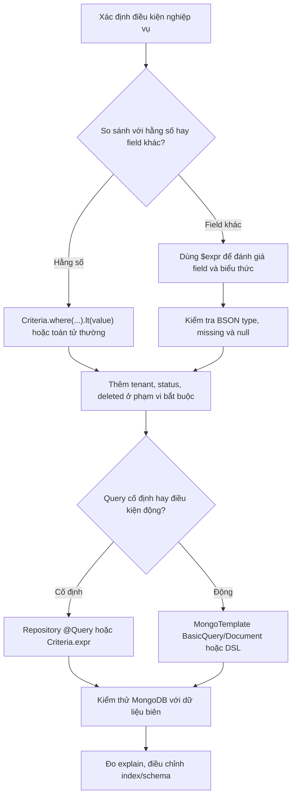

# $expr và biểu thức khi điều kiện cần so sánh nhiều trường

Với **Spring Data MongoDB**, phần lớn truy vấn có thể viết bằng `Criteria.where("status").is("OPEN")` hoặc `Criteria.where("totalAmount").gt(...)`. Những điều kiện đó thường so sánh **một field với một giá trị do ứng dụng cung cấp**. Nhưng nhiều quy tắc nghiệp vụ cần so sánh **hai field của chính document đang đọc**: số tiền đã thanh toán phải nhỏ hơn tổng tiền, tồn kho phải lớn hơn số lượng đặt trước, hoặc hạn sử dụng phải sau thời điểm tạo.

MongoDB cung cấp toán tử **`$expr`** để dùng các biểu thức của aggregation trong điều kiện truy vấn. Ví dụ, bộ lọc `{ $expr: { $lt: ["$paidAmount", "$totalAmount"] } }` chọn những document có `paidAmount` nhỏ hơn `totalAmount`. Dấu `$` trước tên field cho biết đây là **giá trị của field**, không phải chuỗi ký tự để so sánh.

Bài thuộc chương **Query và Criteria**, tập trung vào cách viết `$expr` đúng nghĩa, kết hợp với điều kiện tenant và soft delete, xây query bằng `MongoTemplate`, quan sát `mongosh`, đánh giá index và kiểm thử dữ liệu. Kỹ thuật này cũng có ích khi truy vấn thông qua repository tùy biến, aggregation và các thao tác update có điều kiện trong Spring Data MongoDB.

Sau bài học, bạn có thể:

- Phân biệt so sánh field với **giá trị cố định** và so sánh field với **field khác**.
- Viết `$expr` với `$eq`, `$ne`, `$lt`, `$lte`, `$gt`, `$gte` và biểu thức `$add`, `$subtract`, `$ifNull`.
- Kết hợp `$expr` cùng `tenantId`, `status`, `deleted` và các nhóm `$and`/`$or`.
- Xây truy vấn bằng `BasicQuery`/`Document` hoặc `Criteria.expr(...)` khi phiên bản Spring Data hỗ trợ.
- Hiểu giới hạn về kiểu BSON, field bị thiếu, precision và ánh xạ `@Field`.
- Kiểm tra query plan bằng `explain("executionStats")` và chọn chiến lược tối ưu cho workload thực tế.
- Viết kiểm thử tích hợp chứng minh query trả đúng và **không trả sai** các document.

## 1. Khi nào cần `$expr`?

Giả sử collection `billing_records` có các field:

```javascript
{
  tenantId: "T1",
  status: "OPEN",
  totalAmount: NumberDecimal("150.00"),
  paidAmount: NumberDecimal("90.00")
}
```

Yêu cầu: **tìm những hóa đơn chưa thanh toán đủ**, tức `paidAmount < totalAmount`.

Một cách viết dễ nhầm:

```javascript
// SAI: "$totalAmount" là chuỗi giá trị trong điều kiện so sánh thông thường.
db.billing_records.find({
  paidAmount: { $lt: "$totalAmount" }
});
```

Trong cú pháp truy vấn thông thường, đối số `"$totalAmount"` không được tự hiểu là đường dẫn tới field `totalAmount`. Nó là một giá trị **BSON String**. Vì vậy, truy vấn không diễn đạt đúng “paidAmount nhỏ hơn totalAmount”. Đặc biệt, MongoDB áp dụng các quy tắc so sánh có xét BSON type; dữ liệu Decimal128 sẽ không được so sánh số học với một String theo ý định trên.

Viết đúng:

```javascript
db.billing_records.find({
  $expr: {
    $lt: ["$paidAmount", "$totalAmount"]
  }
});
```

Hai đối số `"$paidAmount"` và `"$totalAmount"` **được đánh giá như tham chiếu field** trong ngữ cảnh biểu thức aggregation. MongoDB đọc các giá trị từ **cùng một document**, sau đó kiểm tra `$lt`.

| Nhu cầu | Cú pháp MongoDB | Diễn giải |
| --- | --- | --- |
| Field so với hằng số | `{ paidAmount: { $lt: NumberDecimal("100") } }` | `paidAmount < 100` |
| Hai field với nhau | `{ $expr: { $lt: ["$paidAmount", "$totalAmount"] } }` | `paidAmount < totalAmount` |
| Hai field bằng nhau | `{ $expr: { $eq: ["$paidAmount", "$totalAmount"] } }` | `paidAmount = totalAmount` |
| So sánh qua phép tính | `{ $expr: { $gte: ["$paidAmount", { $subtract: ["$totalAmount", "$discount"] }] } }` | Đã trả đủ sau giảm giá |
| Kết hợp điều kiện thường | `{ tenantId: "T1", $expr: { ... } }` | Tenant T1 **và** kết quả biểu thức đúng |

**Ghi nhớ:** `$expr` không phải cú pháp SQL, không thực hiện join tự động giữa hai collection. Nó đánh giá biểu thức với các field của document đang xét, trừ khi được dùng trong ngữ cảnh có biến khác (chẳng hạn `$lookup` với `let`).

## 2. Cấu trúc của `$expr` và các toán tử so sánh

Hình dạng chung:

```javascript
{
  $expr: {
    <operator>: [<expression1>, <expression2>]
  }
}
```

Hai biểu thức có thể là:

- Tham chiếu field, ví dụ `"$stock"` hoặc `"$reservedStock"`.
- Giá trị hằng số, ví dụ `0` hay `NumberDecimal("10.50")`.
- Một phép tính lồng nhau như `{ $subtract: ["$stock", "$reservedStock"] }`.
- Một biểu thức điều kiện như `{ $ifNull: ["$discountAmount", NumberDecimal("0")] }`.
- Biểu thức khác trả về giá trị phù hợp để so sánh.

| Toán tử | Ý nghĩa | Ví dụ đúng |
| --- | --- | --- |
| `$eq` | Bằng nhau | `{ $expr: { $eq: ["$paidAmount", "$totalAmount"] } }` |
| `$ne` | Khác nhau | `{ $expr: { $ne: ["$paidAmount", "$totalAmount"] } }` |
| `$lt` | Nhỏ hơn | `{ $expr: { $lt: ["$paidAmount", "$totalAmount"] } }` |
| `$lte` | Nhỏ hơn hoặc bằng | `{ $expr: { $lte: ["$paidAmount", "$totalAmount"] } }` |
| `$gt` | Lớn hơn | `{ $expr: { $gt: ["$stock", "$reservedStock"] } }` |
| `$gte` | Lớn hơn hoặc bằng | `{ $expr: { $gte: ["$stock", "$reservedStock"] } }` |

Trong biểu thức aggregation, `$eq` không phải phép so sánh query thông thường `{ field: value }`. Nó nằm trong cấu trúc biểu thức và nhận các đối số biểu thức. Ví dụ:

```javascript
// Đã thanh toán đúng số tiền của hóa đơn:
db.billing_records.find({
  $expr: { $eq: ["$paidAmount", "$totalAmount"] }
});
```

### 2.1. Field path, hằng chuỗi và ký tự `$`

Trong `$expr`:

```javascript
{ $eq: ["$status", "OPEN"] }
```

`"$status"` là **field reference**, `"OPEN"` là **hằng chuỗi**. Nếu thật sự muốn so sánh với một chuỗi bắt đầu bằng `$`, có thể dùng `$literal` để ngăn chuỗi đó bị diễn giải thành field path:

```javascript
{
  $expr: {
    $eq: ["$externalCode", { $literal: "$PROMO" }]
  }
}
```

Không biến input do người dùng gửi thành một field path bằng cách tự nối ký tự `$`. Nếu người dùng chỉ gửi **giá trị** để lọc, hãy bind giá trị theo kiểu dữ liệu; tên field và toán tử phải do ứng dụng quyết định.

### 2.2. Biểu thức phải trả về điều kiện có ý nghĩa

`$expr` cần một biểu thức có thể được đánh giá trong điều kiện `$match` hoặc `find`. Với quy tắc nghiệp vụ, nên tạo biểu thức boolean rõ ràng như `$lt`, `$eq`, `$and` hoặc `$or` thay vì dựa vào chuyển đổi truthy/falsy của giá trị bất kỳ.

Ví dụ kết hợp hai điều kiện biểu thức:

```javascript
{
  $expr: {
    $and: [
      { $gt: ["$totalAmount", NumberDecimal("0")] },
      { $lt: ["$paidAmount", "$totalAmount"] }
    ]
  }
}
```

Điều kiện này kiểm tra tổng tiền dương và số tiền đã trả thấp hơn tổng tiền. Bạn có thể dùng `$and` **bên ngoài** `$expr` để kết hợp biểu thức với các điều kiện truy vấn thông thường, hoặc dùng `$and` **bên trong** để kết hợp các biểu thức.

## 3. Bài toán thực tế: hóa đơn chưa được thanh toán đủ

Giả sử ứng dụng hỗ trợ nhiều tenant. Mỗi document có số tiền theo BSON Decimal128, trạng thái hóa đơn và cờ xóa mềm.

| Mã | Tenant | Status | Total | Paid | Deleted | Có nợ nếu áp dụng điều kiện? |
| --- | --- | --- | ---: | ---: | --- | --- |
| A | T1 | OPEN | 150.00 | 90.00 | false | Có |
| B | T1 | OPEN | 100.00 | 100.00 | false | Không |
| C | T1 | OPEN | 100.00 | 120.00 | false | Không |
| D | T1 | OPEN | 50.00 | 0.00 | false | Có |
| E | T2 | OPEN | 200.00 | 10.00 | false | Không được trả cho T1 |
| F | T1 | CLOSED | 100.00 | 20.00 | false | Không lấy khi chỉ tìm OPEN |
| G | T1 | OPEN | 150.00 | 10.00 | true | Không lấy khi đã xóa mềm |
| H | T1 | OPEN | 100.00 | thiếu field | false | Cần chính sách dữ liệu rõ ràng |

Yêu cầu: lấy các hóa đơn **OPEN, chưa xóa mềm, thuộc tenant T1, và paidAmount nhỏ hơn totalAmount**.

```javascript
db.billing_records.find({
  tenantId: "T1",
  status: "OPEN",
  deleted: false,
  $expr: {
    $lt: ["$paidAmount", "$totalAmount"]
  }
});
```

Theo dữ liệu có đủ trường số, kết quả dự kiến là **A và D**. B bằng tổng tiền, C đã trả nhiều hơn, E thuộc tenant khác, F không OPEN và G đã xóa mềm.

**Điểm cần xác định riêng:** bản ghi H thiếu `paidAmount`. Đừng âm thầm hiểu missing là 0 chỉ vì nghiệp vụ có khái niệm “chưa thanh toán”. Tùy cách dữ liệu cũ được ghi và biểu thức so sánh, BSON Null/missing có thể gây kết quả không mong đợi. Nếu chính sách yêu cầu thiếu field phải **bị loại khỏi truy vấn**, hãy kiểm tra tồn tại và BSON type; nếu thiếu field được coi là 0, hãy dùng `$ifNull` một cách tường minh.

### 3.1. Vì sao điều kiện tenant phải nằm ngoài `$or`?

Truy vấn sai phạm vi:

```javascript
{
  $or: [
    {
      tenantId: "T1",
      status: "OPEN"
    },
    {
      $expr: { $lt: ["$paidAmount", "$totalAmount"] }
    }
  ]
}
```

Nhánh thứ hai có thể trả document của **mọi tenant** nếu đang nợ. Muốn tenant và soft delete áp dụng cho tất cả nhánh, đặt chúng ngoài nhóm lựa chọn:

```javascript
{
  tenantId: "T1",
  deleted: false,
  $or: [
    { status: "OPEN" },
    { $expr: { $lt: ["$paidAmount", "$totalAmount"] } }
  ]
}
```

Ví dụ này chỉ minh họa **phạm vi tenant đúng**; logic OR ở đây vẫn khác yêu cầu “OPEN **và** chưa thanh toán đủ”. Khi nghiệp vụ yêu cầu đồng thời, cần dùng **AND** như bộ lọc chính ở đầu mục 3.

## 4. Biểu thức số học: so sánh nhiều field sau khi tính toán

`$expr` không chỉ so sánh trực tiếp hai field. Mỗi vế có thể là một biểu thức được MongoDB tính trên document hiện tại.

### 4.1. Kiểm tra số tiền đã trả sau khi áp dụng chiết khấu

Giả sử hóa đơn có `totalAmount`, `discountAmount` và `paidAmount`. Số tiền cần trả:

```text
amountDue = totalAmount - discountAmount
```

Muốn tìm hóa đơn đã thanh toán đủ:

```javascript
db.billing_records.find({
  tenantId: "T1",
  deleted: false,
  $expr: {
    $gte: [
      "$paidAmount",
      {
        $subtract: [
          "$totalAmount",
          "$discountAmount"
        ]
      }
    ]
  }
});
```

Đây là phép so sánh `paidAmount >= (totalAmount - discountAmount)`. Thứ tự đối số của `$subtract` rất quan trọng; đổi vế sẽ đảo dấu kết quả. Nếu nghiệp vụ không cho phép discount vượt total, quy tắc đó cần được bảo vệ ở domain/validation, không chỉ ở một query.

### 4.2. Field có thể `null` hoặc không tồn tại: dùng `$ifNull` khi có chính sách

Giả sử `discountAmount` có thể thiếu và nghiệp vụ quy ước “không có chiết khấu” tương đương 0:

```javascript
{
  $expr: {
    $gte: [
      "$paidAmount",
      {
        $subtract: [
          "$totalAmount",
          {
            $ifNull: [
              "$discountAmount",
              NumberDecimal("0")
            ]
          }
        ]
      }
    ]
  }
}
```

`$ifNull` dùng giá trị thay thế khi biểu thức đầu tiên là `null` hoặc bị thiếu theo ngữ nghĩa của toán tử. Vì cả tổng tiền/chiết khấu đều đang là Decimal128, hằng số thay thế được khai báo `NumberDecimal("0")` để định dạng số nhất quán.

**Không áp dụng mặc định `$ifNull` cho mọi field.** Ví dụ, nếu `paidAmount` thiếu vì dữ liệu nhập sai và nghiệp vụ không cho phép kết luận “chưa thanh toán”, chuyển missing thành 0 có thể che khuất lỗi dữ liệu. Hãy lựa chọn rõ:

- **Loại khỏi tập kết quả** khi thiếu field bắt buộc.
- **Thay bằng giá trị mặc định** khi hợp đồng nghiệp vụ cho phép.
- **Đưa vào tập lỗi dữ liệu riêng** để sửa schema hoặc migration.

### 4.3. Tính lượng tồn thực có

Một collection kho lưu `onHand` và `reserved`. Muốn tìm sản phẩm còn đủ tối thiểu 10 đơn vị:

```javascript
db.inventory.find({
  tenantId: "T1",
  $expr: {
    $gte: [
      { $subtract: ["$onHand", "$reserved"] },
      10
    ]
  }
});
```

Điều kiện là `onHand - reserved >= 10`. Nếu chỉ cần kiểm tra `onHand >= reserved`, dùng `$gte` trực tiếp:

```javascript
{
  $expr: {
    $gte: ["$onHand", "$reserved"]
  }
}
```

Trong thiết kế tồn kho, việc **đọc** một document còn hàng không giữ chỗ cho các request khác. Nếu mục tiêu là **trừ tồn hoặc giữ chỗ**, cần thực hiện phép update có điều kiện nguyên tử trên document, kết hợp `$inc` và kiểm tra số document được cập nhật; `$expr` trong query đọc không tự khóa dữ liệu.

### 4.4. So sánh ngày giờ giữa hai field

Muốn tìm document có `expiresAt` trước `createdAt`, một bất biến thời gian bất thường:

```javascript
db.sessions.find({
  tenantId: "T1",
  $expr: {
    $lt: ["$expiresAt", "$createdAt"]
  }
});
```

Với các field lưu BSON Date, MongoDB so sánh hai thời điểm. Nếu field là String mang ngày giờ, kết quả có thể không tương đương so sánh thời gian, đặc biệt khi định dạng không thống nhất. Hãy chuẩn hóa thành Date trước khi dựa vào điều kiện này.

Trong MongoDB hỗ trợ biến hệ thống `$$NOW` trong aggregation expressions, có thể dùng để kiểm tra hạn đã qua so với thời điểm thực thi truy vấn:

```javascript
db.sessions.find({
  tenantId: "T1",
  $expr: {
    $lt: ["$expiresAt", "$$NOW"]
  }
});
```

Điều kiện này so sánh với thời điểm server đánh giá, khác với việc ứng dụng truyền một timestamp `Instant.now()` thành hằng số. Khi dùng, kiểm tra phiên bản MongoDB và semantics thời gian phù hợp; đừng trộn `$$NOW` với chuỗi `"NOW"`.

## 5. BSON type, missing và độ chính xác khi dùng `$expr`

So sánh giữa nhiều field chỉ đáng tin khi dữ liệu có **kiểu và ý nghĩa nhất quán**. JSON hiển thị số `100` có thể che giấu việc MongoDB lưu các bản ghi khác nhau dưới BSON Int32, Int64, Double, Decimal128 hoặc String.

### 5.1. Chọn BSON type phù hợp

| Field nghiệp vụ | Kiểu gợi ý | Vì sao |
| --- | --- | --- |
| Số tiền cần giữ chính xác đến số thập phân | Decimal128, hoặc số nguyên đơn vị nhỏ nhất | Tránh sai số khi dùng Double |
| Số lượt và bộ đếm nguyên | Int32 hoặc Int64 | Dễ sử dụng phép `$gt`/`$lt` trên số |
| Thời điểm tạo/hết hạn | BSON Date | Có thể so sánh theo thời điểm |
| Mã đơn và trạng thái | BSON String/enum mapping | Không trộn với BSON object điều kiện |
| Cờ xóa mềm | Boolean | Không để thiếu field nếu API dựa vào `deleted = false` |

Với tiền, Spring Data MongoDB hỗ trợ chỉ định Decimal128 ở field:

```java
import java.math.BigDecimal;
import org.springframework.data.mongodb.core.mapping.Field;
import org.springframework.data.mongodb.core.mapping.FieldType;

@Field(targetType = FieldType.DECIMAL128)
private BigDecimal totalAmount;

@Field(targetType = FieldType.DECIMAL128)
private BigDecimal paidAmount;
```

Nếu chỉ khai báo `BigDecimal` mà không xác định BSON type, cách biểu diễn mặc định có thể là String tùy cấu hình mapping. **Không suy ra Java BigDecimal nghĩa là BSON Decimal128.** Trước khi viết `$expr` tính tiền, kiểm tra raw BSON và chuẩn hóa dữ liệu cũ.

### 5.2. Chỉ lấy document đủ trường với type đã xác định

Để loại document thiếu `paidAmount`/`totalAmount` và yêu cầu chính xác BSON Decimal128:

```javascript
db.billing_records.find({
  tenantId: "T1",
  status: "OPEN",
  deleted: false,
  paidAmount: { $type: "decimal" },
  totalAmount: { $type: "decimal" },
  $expr: {
    $lt: ["$paidAmount", "$totalAmount"]
  }
});
```

`$type` ở vị trí query kiểm tra kiểu BSON thực. Nếu ứng dụng cố ý cho phép Int32/Int64 hoặc các kiểu số khác, hãy quy định rõ những loại được chấp nhận thay vì sao chép máy móc yêu cầu Decimal128 này.

### 5.3. Dùng `$type` trong aggregation để thống kê dữ liệu lệch kiểu

```javascript
db.billing_records.aggregate([
  {
    $group: {
      _id: {
        paidType: { $type: "$paidAmount" },
        totalType: { $type: "$totalAmount" }
      },
      documents: { $sum: 1 }
    }
  },
  { $sort: { documents: -1 } }
]);
```

Bạn có thể thấy các nhóm như `decimal/decimal`, `string/decimal` hoặc `missing/decimal`. Nếu một hệ thống đang trộn kiểu, hãy điều tra nguồn ghi, quy trình chuyển đổi và rủi ro migration trước khi áp dụng so sánh ở production.

### 5.4. Có nên dùng `$convert` trong query để xử lý legacy data?

MongoDB cung cấp `$convert` và một số toán tử chuyển kiểu để chuyển đổi dữ liệu trước khi so sánh. Ví dụ cấu trúc:

```javascript
{
  $convert: {
    input: "$paidAmount",
    to: "decimal",
    onError: null,
    onNull: null
  }
}
```

Điều này hữu ích trong migration hoặc báo cáo chẩn đoán, nhưng không nên trở thành giải pháp che giấu một schema lệch kiểu mãi mãi. Một chuỗi không thể chuyển đổi sẽ rơi vào `onError`; nếu sau đó tự thay thành 0, kết quả nghiệp vụ có thể sai. Ngoài ra, chuyển đổi theo từng document có thể làm chi phí truy vấn cao và hạn chế cơ hội sử dụng index.

### 5.5. Field thiếu và `null` không giống nhau

```javascript
{ paidAmount: null, totalAmount: NumberDecimal("100") }
{ totalAmount: NumberDecimal("100") }
{ paidAmount: NumberDecimal("0"), totalAmount: NumberDecimal("100") }
```

Ba document lần lượt có `paidAmount` là BSON Null, thiếu field và Decimal128 bằng 0. Nếu cần phân biệt:

```javascript
// Chỉ giá trị BSON Null:
db.billing_records.find({
  paidAmount: { $type: "null" }
});

// Chỉ field không tồn tại:
db.billing_records.find({
  paidAmount: { $exists: false }
});

// Chỉ Decimal128:
db.billing_records.find({
  paidAmount: { $type: "decimal" }
});
```

Hãy dùng type/exists check khi có yêu cầu loại dữ liệu thiếu. Không dựa vào kết quả so sánh mặc định của các BSON type khác nhau để quyết định tình trạng thanh toán.

## 6. Spring Data MongoDB: entity và query có `$expr`

### 6.1. Entity Java cho ví dụ thanh toán

Để truy vấn số tiền Decimal128, sử dụng entity với metadata rõ ràng:

```java
import java.math.BigDecimal;
import org.bson.types.ObjectId;
import org.springframework.data.annotation.Id;
import org.springframework.data.mongodb.core.mapping.Document;
import org.springframework.data.mongodb.core.mapping.Field;
import org.springframework.data.mongodb.core.mapping.FieldType;

@Document(collection = "billing_records")
public class BillingRecord {
    @Id
    private ObjectId id;

    private String labRun;
    private String tenantId;
    private String status;
    private boolean deleted;

    @Field(targetType = FieldType.DECIMAL128)
    private BigDecimal totalAmount;

    @Field(targetType = FieldType.DECIMAL128)
    private BigDecimal paidAmount;

    @Field(targetType = FieldType.DECIMAL128)
    private BigDecimal discountAmount;

    protected BillingRecord() {}

    public BillingRecord(
            String labRun, String tenantId, String status,
            boolean deleted, BigDecimal totalAmount,
            BigDecimal paidAmount) {
        this.labRun = labRun;
        this.tenantId = tenantId;
        this.status = status;
        this.deleted = deleted;
        this.totalAmount = totalAmount;
        this.paidAmount = paidAmount;
    }

    public ObjectId getId() { return id; }
    public String getLabRun() { return labRun; }
    public String getTenantId() { return tenantId; }
    public String getStatus() { return status; }
    public boolean isDeleted() { return deleted; }
    public BigDecimal getTotalAmount() { return totalAmount; }
    public BigDecimal getPaidAmount() { return paidAmount; }
}
```

`labRun` chỉ là marker giúp cô lập dữ liệu trong bài tập. Trong production, không nhất thiết phải có field này. Ví dụ tập trung vào ánh xạ và truy vấn; validate tổng tiền không âm, quyền tenant và trạng thái chuyển đổi cần được bổ sung ở lớp nghiệp vụ.

### 6.2. Dùng `BasicQuery` với BSON `Document` — cách tường minh

Khi cần một biểu thức BSON đặc biệt, có thể dựng bộ lọc `Document` **bằng code cố định**, rồi truyền cho `BasicQuery`:

```java
import java.util.List;
import org.bson.Document;
import org.springframework.data.mongodb.core.MongoTemplate;
import org.springframework.data.mongodb.core.query.BasicQuery;

public List<BillingRecord> findUnderpaid(
        MongoTemplate template, String trustedTenantId) {

    Document expr = new Document(
        "$lt",
        List.of("$paidAmount", "$totalAmount")
    );

    Document filter = new Document("tenantId", trustedTenantId)
        .append("status", "OPEN")
        .append("deleted", false)
        .append("paidAmount", new Document("$type", "decimal"))
        .append("totalAmount", new Document("$type", "decimal"))
        .append("$expr", expr);

    return template.find(
        new BasicQuery(filter),
        BillingRecord.class
    );
}
```

Đây là truy vấn BSON tương đương `tenantId = trustedTenantId AND status = OPEN AND deleted = false AND paidAmount/totalAmount là Decimal128 AND paidAmount < totalAmount`.

`BasicQuery` chấp nhận raw query representation; khác với `Criteria.where("paidAmount").lt(...)`, ở đây bạn đã biểu diễn field reference trong `$expr` bằng `"$paidAmount"` và `"$totalAmount"`. Dùng `BillingRecord.class` giúp Spring Data biết loại kết quả để deserialize. Vì các expression path nằm trong raw BSON, hãy **viết đúng tên field lưu thực tế** và kiểm thử khi dùng `@Field` để đổi tên.

**Phân biệt an toàn:** cách dựng `Document` trên được kiểm soát vì ứng dụng cố định tên field, toán tử và cấu trúc; `trustedTenantId` chỉ là một giá trị Java. Không thay nó bằng `Document.parse(clientSuppliedFilter)` rồi cho phép client quyết định `$expr` hoặc toán tử.

### 6.3. Dùng `Criteria.expr(MongoExpression)` khi phiên bản hỗ trợ

Trong các phiên bản Spring Data MongoDB có hỗ trợ API `Criteria.expr(MongoExpression)`, có thể viết biểu thức ngắn gọn hơn:

```java
import java.util.List;
import org.springframework.data.mongodb.MongoExpression;
import org.springframework.data.mongodb.core.MongoTemplate;
import org.springframework.data.mongodb.core.query.Criteria;
import org.springframework.data.mongodb.core.query.Query;

public List<BillingRecord> findUnderpaidWithCriteria(
        MongoTemplate template, String trustedTenantId) {

    Criteria sameTenant = Criteria.where("tenantId")
        .is(trustedTenantId);
    Criteria open = Criteria.where("status").is("OPEN");
    Criteria visible = Criteria.where("deleted").is(false);

    Criteria amountComparison = Criteria.expr(
        MongoExpression.create(
            "{ $lt: [ '$paidAmount', '$totalAmount' ] }"
        )
    );

    Criteria filter = new Criteria().andOperator(
        sameTenant,
        open,
        visible,
        amountComparison
    );

    return template.find(
        new Query(filter),
        BillingRecord.class
    );
}
```

Ở cách này, `Criteria.expr(...)` tạo phần điều kiện `$expr`, còn `andOperator(...)` kết hợp với tenant, status và cờ deleted. Nếu phiên bản Spring Data của dự án không có `Criteria.expr`/`MongoExpression.create` với chữ ký trên, dùng cách `BasicQuery` ở mục 6.2 hoặc API expression tương ứng với phiên bản đang dùng; **không tự sửa tên hàm theo suy đoán**.

Với `MongoExpression` dạng raw, các chuỗi `"$paidAmount"` và `"$totalAmount"` biểu diễn field reference BSON. Đối với entity có alias:

```java
@Field("total_amount")
private BigDecimal totalAmount;
```

hãy xác minh biểu thức gửi xuống MongoDB nhắm `"$total_amount"` thay vì `"$totalAmount"`. Phần mapping field reference trong biểu thức còn tùy dạng expression và ngữ cảnh mapping; một chuỗi raw tự viết không nên được mặc định coi giống property path của `Criteria.where(...)`.

### 6.4. Truy vấn bằng `@Query` trong repository

Nếu cấu trúc query cố định, có thể khai báo trong repository:

```java
import java.util.List;
import org.bson.types.ObjectId;
import org.springframework.data.mongodb.repository.MongoRepository;
import org.springframework.data.mongodb.repository.Query;

public interface BillingRecordRepository
        extends MongoRepository<BillingRecord, ObjectId> {

    @Query("{ 'tenantId': ?0, 'status': 'OPEN', 'deleted': false, " +
           "  '$expr': { '$lt': [ '$paidAmount', '$totalAmount' ] } }")
    List<BillingRecord> findOpenUnderpaid(String tenantId);
}
```

`?0` là placeholder cho giá trị tenant; Spring Data bind tham số thay vì nối nguyên văn giá trị client vào JSON. `@Query` ở đây dùng biểu thức BSON không đổi theo request và dễ đọc nếu số điều kiện ít.

Với những biểu thức có nhiều điều kiện tùy chọn hoặc tính toán phức tạp, `MongoTemplate` giúp cấu trúc query dễ bảo trì hơn. Các phương thức derived query như `findByPaidAmountLessThanTotalAmount(...)` **không tự diễn đạt việc lấy giá trị của một field khác**: `LessThan` thông thường nhận một **tham số giá trị**. Đừng cố dùng tên method dài để thay thế `$expr`.

### 6.5. Vì sao `Criteria.where("paidAmount").lt("totalAmount")` không đúng?

```java
// SAI nếu muốn so sánh hai field của cùng document.
Query query = Query.query(
    Criteria.where("paidAmount").lt("totalAmount")
);
```

`"totalAmount"` là giá trị Java String, không phải một tham chiếu field. Tương tự, `Criteria.where("paidAmount").lt("$totalAmount")` không phải cơ chế đáng tin để biến chuỗi thành field reference. Dùng `$expr` hoặc DSL aggregation expression có chủ đích.

## 7. Kết hợp `$expr` trong update có điều kiện

`$expr` có thể làm một phần của query filter cho thao tác update MongoDB, giúp **kiểm tra điều kiện và cập nhật trên cùng document** trong một thao tác nguyên tử.

Ví dụ, cập nhật trạng thái thành `NEEDS_PAYMENT` khi một hóa đơn đang OPEN nhưng `paidAmount < totalAmount`:

```java
import java.util.List;
import org.bson.Document;
import org.springframework.data.mongodb.core.MongoTemplate;
import org.springframework.data.mongodb.core.query.BasicQuery;
import org.springframework.data.mongodb.core.query.Update;

public long markUnderpaidInvoices(
        MongoTemplate template, String trustedTenantId) {

    Document filter = new Document("tenantId", trustedTenantId)
        .append("status", "OPEN")
        .append("deleted", false)
        .append("paidAmount", new Document("$type", "decimal"))
        .append("totalAmount", new Document("$type", "decimal"))
        .append("$expr", new Document(
            "$lt", List.of("$paidAmount", "$totalAmount")
        ));

    return template.updateMulti(
        new BasicQuery(filter),
        new Update().set("status", "NEEDS_PAYMENT"),
        BillingRecord.class
    ).getModifiedCount();
}
```

Mỗi document được cập nhật sau khi bộ lọc được kiểm tra trong thao tác update của MongoDB. Nếu request khác đã thanh toán đủ và đổi `paidAmount` trước khi document được update, câu lệnh có điều kiện kiểm tra trạng thái hiện tại tại thời điểm thực hiện. Tuy nhiên:

- `updateMulti` **không tự trở thành transaction nguyên tử cho toàn bộ nhiều document**.
- Nếu tiền và trạng thái được cập nhật bằng nhiều đường ghi khác nhau, cần thống nhất invariants và kiểm tra xung đột.
- Kết quả `getModifiedCount()` cần được đọc với acknowledged write concern.
- Câu query này không tự kiểm tra `@Version` từ một object đã đọc trước đó; nếu cần expected version, đưa nó vào filter.

Nếu bài toán chỉ cần update **một hóa đơn**, ưu tiên dùng bộ lọc có `_id` và tenant, rồi `updateFirst`. Nếu yêu cầu “đọc trạng thái và cập nhật rồi trả đúng bản ghi trước/sau”, xem xét `findAndModify` theo hợp đồng nghiệp vụ.

### 7.1. Không nên dùng kết quả find để quyết định update sau đó

Mẫu dễ có race condition:

```text
1. find các hóa đơn paidAmount < totalAmount.
2. Ứng dụng tính trạng thái và chạy một lệnh update khác theo _id.
3. Trong khoảng giữa hai lệnh, tiến trình khác có thể sửa paidAmount.
```

Nếu tính đúng đắn phụ thuộc vào so sánh tại thời điểm ghi, hãy đưa `$expr` và điều kiện nghiệp vụ **vào chính filter của update** thay vì chỉ sử dụng ở câu find trước đó.

## 8. `$expr` trong aggregation và những trường hợp cần biến

`$expr` được sử dụng trong giai đoạn `$match` của aggregation khi cần đánh giá biểu thức trên từng document. Với `find`, cách dùng là một filter thông thường chứa `$expr`; với aggregation, nó là điều kiện của một stage:

```javascript
db.billing_records.aggregate([
  {
    $match: {
      tenantId: "T1",
      status: "OPEN",
      deleted: false,
      $expr: {
        $lt: ["$paidAmount", "$totalAmount"]
      }
    }
  },
  {
    $project: {
      tenantId: 1,
      totalAmount: 1,
      paidAmount: 1,
      remainingAmount: {
        $subtract: ["$totalAmount", "$paidAmount"]
      }
    }
  }
]);
```

Stage `$match` lọc những hóa đơn chưa thanh toán đủ. `$project` tính trường `remainingAmount` cho kết quả trả về mà **không ghi field đó vào document gốc**. Vì pipeline chạy trên MongoDB server, tên field trong stage raw phải là **tên BSON thực tế**.

### 8.1. Chọn giữa `find` với `$expr` và aggregation

| Yêu cầu | Cách phù hợp |
| --- | --- |
| Chỉ lọc hóa đơn mà `paid < total` và đọc entity | `find` với `$expr` |
| Lọc rồi tính số tiền còn thiếu cho response | Aggregation `$match` + `$project` |
| Thống kê tổng nợ theo tenant | Aggregation `$match` + `$group` |
| Lọc sau khi tạo field tính toán trong pipeline | Aggregation theo các stage phù hợp |
| Lọc một điều kiện đơn giản theo giá trị đã biết | `Criteria.where(...).lt(value)`, không cần `$expr` |

Nếu query chỉ cần `status = OPEN`, `$expr` là không cần thiết. Dùng toán tử query thông thường thường đơn giản hơn và dễ tận dụng index hơn.

### 8.2. `$expr` trong `$lookup` với `let`

Một trường hợp khác là so sánh field của document được tra cứu với **biến từ document nguồn** khi aggregation dùng `$lookup`. Ví dụ khung:

```javascript
db.orders.aggregate([
  {
    $lookup: {
      from: "payments",
      let: {
        currentOrderId: "$_id"
      },
      pipeline: [
        {
          $match: {
            $expr: {
              $eq: [
                "$orderId",
                "$$currentOrderId"
              ]
            }
          }
        }
      ],
      as: "payments"
    }
  }
]);
```

Ở đây `"$orderId"` là field của document trong collection `payments`; `"$$currentOrderId"` là biến `let` lấy từ document trong `orders`. Hai ký hiệu khác nhau:

- `$fieldName`: đường dẫn field.
- `$$variableName`: biến biểu thức/aggregation có tên.

`$expr` được dùng vì điều kiện so sánh cần truy cập biến trong pipeline `$lookup`. Đừng lấy ví dụ này làm dấu hiệu rằng mọi truy vấn `$expr` giữa hai field trong **cùng document** đều cần `$lookup`.

Hiệu năng `$lookup` còn phụ thuộc index ở collection đích, tính chọn lọc và khả năng planner dùng index cho biểu thức cụ thể. Kiểm tra phiên bản MongoDB và `explain` trước khi khẳng định một điều kiện có tận dụng index hay không.

## 9. Index, query plan và tác động hiệu năng

### 9.1. Vì sao so sánh hai field có thể khó tối ưu?

Một điều kiện thông thường:

```javascript
{ totalAmount: { $gt: NumberDecimal("100") } }
```

so sánh một field với **giá trị cố định**. Một index trên `totalAmount` có thể giúp xác định một khoảng khóa phù hợp.

Nhưng:

```javascript
{ $expr: { $gt: ["$totalAmount", "$paidAmount"] } }
```

so sánh hai giá trị **khác nhau ở từng document**. Một index B-tree thông thường trên `totalAmount` không tự cung cấp một khoảng hằng số để chọn ra tất cả document có `totalAmount > paidAmount`. Vì vậy, phần so sánh field-với-field thường vẫn cần đọc/đánh giá nhiều document.

Không nên kết luận “`$expr` không bao giờ dùng được index”. Khả năng sử dụng index phụ thuộc loại biểu thức, ngữ cảnh truy vấn (đặc biệt với một số so sánh trong `$lookup`), phiên bản MongoDB và query planner. Điều cần làm là **đo kế hoạch cụ thể**.

### 9.2. Hạn chế tập ứng viên bằng điều kiện thường

Nếu API luôn tìm trong một tenant, chỉ status OPEN và chưa xóa mềm, có thể tạo index phục vụ những điều kiện ấy:

```javascript
db.billing_records.createIndex(
  { tenantId: 1, status: 1, deleted: 1 },
  { name: "idx_tenant_status_deleted" }
);
```

Sau đó, query:

```javascript
db.billing_records.find({
  tenantId: "T1",
  status: "OPEN",
  deleted: false,
  $expr: {
    $lt: ["$paidAmount", "$totalAmount"]
  }
});
```

có thể tận dụng index để thu hẹp những document phải kiểm tra bằng `$expr`. Đây là lựa chọn chỉ mục để **đánh giá**; hiệu quả thực tế tùy tỉ lệ dữ liệu mỗi tenant/status, quy mô collection và các query khác.

### 9.3. Đọc `explain("executionStats")`

```javascript
db.billing_records.find({
  tenantId: "TENANT_THUC_TE",
  status: "OPEN",
  deleted: false,
  $expr: {
    $lt: ["$paidAmount", "$totalAmount"]
  }
}).explain("executionStats");
```

Thay tên tenant bằng giá trị thực. Quan sát:

| Chỉ số | Câu hỏi |
| --- | --- |
| `winningPlan` | Có `IXSCAN` hoặc stage scan/sort nào đang được chọn? |
| `totalKeysExamined` | Query phải duyệt bao nhiêu index entry? |
| `totalDocsExamined` | Bao nhiêu document phải được đánh giá? |
| `nReturned` | Có đúng tập kết quả nghiệp vụ không? |
| `executionTimeMillis` | Thời gian của lần chạy, không tự đại diện mọi tải |

Nếu `docsExamined` lớn trong khi `nReturned` nhỏ, điều này có thể báo hiệu cần thay thiết kế truy vấn, schema hoặc index. Một dataset chỉ vài document chưa đủ để đánh giá hiệu năng production.

### 9.4. Có nên materialize field tính toán?

Nếu dashboard liên tục tìm “tất cả hóa đơn chưa thanh toán đủ” trên hàng triệu document, bạn có thể cân nhắc lưu thêm `outstandingAmount` hoặc `underpaid` được tính và cập nhật theo quy tắc nghiệp vụ, sau đó index trường này.

Ví dụ:

```javascript
{
  totalAmount: NumberDecimal("150.00"),
  paidAmount: NumberDecimal("90.00"),
  outstandingAmount: NumberDecimal("60.00"),
  underpaid: true
}
```

Khi đó, query thường dùng có thể đơn giản hơn:

```javascript
db.billing_records.find({
  tenantId: "T1",
  status: "OPEN",
  deleted: false,
  underpaid: true
});
```

**Đánh đổi:** bạn đã đưa một field **dẫn xuất** vào dữ liệu lưu trữ; mọi đường cập nhật `totalAmount`/`paidAmount`/`discountAmount` phải bảo đảm field dẫn xuất được tính lại nhất quán, tốt nhất trong cùng thao tác nguyên tử một document hoặc cơ chế nhất quán được thiết kế. Nếu bỏ sót một đường ghi, `underpaid` trở nên sai. Chỉ materialize khi có bằng chứng workload cần thiết và đội phát triển có thể duy trì invariant.

## 10. Bảo mật và tính đúng đắn của biểu thức

`$expr` là một toán tử mạnh vì nó cho phép biểu thức tính toán, không chỉ phép so sánh đơn giản. Điều đó không có nghĩa API nên cho client truyền tùy ý:

```json
{
  "$expr": {
    "$gt": ["$totalAmount", "$paidAmount"]
  }
}
```

rồi dùng `Document.parse(requestBody)` làm query mà không giới hạn. Với API chỉ có mục đích “lọc hóa đơn đang nợ”, **server phải định nghĩa expression**, client chỉ được chọn những giá trị đầu vào hợp lệ.

Ví dụ an toàn:

```java
Document filter = new Document("tenantId", trustedTenantId)
    .append("status", "OPEN")
    .append("deleted", false)
    .append("$expr", new Document(
        "$lt", List.of("$paidAmount", "$totalAmount")
    ));
```

Nếu một API thực sự cần cho phép user chọn phép so sánh, hãy định nghĩa allowlist rõ ràng, chẳng hạn `LESS_THAN`, `EQUAL` hoặc `GREATER_THAN` rồi ánh xạ chúng sang các cấu trúc BSON cố định. Không lấy chuỗi operator như `"$function"`, `"$where"`, đường dẫn field hoặc một đoạn JSON tùy ý từ request để chạy trực tiếp.

### 10.1. Tránh `$where` và JavaScript phía server

Để so sánh hai field, `$expr` sử dụng aggregation expression và **không cần** thực thi JavaScript phía MongoDB. `$where` có những giới hạn, chi phí và rủi ro vận hành khác; không sử dụng nó như đường tắt cho những phép so sánh số, ngày hoặc boolean mà `$expr` đã hỗ trợ.

### 10.2. Field alias và thay đổi schema

Nếu class Java đổi:

```java
@Field("paid_amount")
private BigDecimal paidAmount;
```

thì biểu thức raw phải được kiểm tra lại, ví dụ:

```javascript
{
  $expr: {
    $lt: ["$paid_amount", "$total_amount"]
  }
}
```

nếu **cả hai** field đã được lưu dưới tên `paid_amount`/`total_amount`. Một refactor chỉ đổi Java property, annotation hoặc converter nhưng không xem lại raw BSON query có thể khiến kết quả sai hoặc không tìm thấy document.

### 10.3. Tính toán trong query không thay thế validation

`$expr` có thể lọc dữ liệu sai bất biến, chẳng hạn `paidAmount > totalAmount`, nhưng không tự **ngăn ứng dụng ghi** dữ liệu không hợp lệ. Muốn bảo vệ invariant, cần kiểm soát ở đường ghi và có thể kết hợp MongoDB JSON Schema validation, update có điều kiện, transaction hoặc các cơ chế phù hợp.

## 11. Thực hành `mongosh`: tự chứng minh các biểu thức

Phần này tạo bộ dữ liệu **cách ly theo một marker** trong database thử nghiệm `spring_data_training`. Không thao tác trên dữ liệu production hoặc xóa các document không thuộc lần thực hành của bạn.

### 11.1. Tạo tám document có tình huống biên

Mở `mongosh` đến MongoDB thử nghiệm, chọn database và chạy:

```javascript
use spring_data_training

const lab = db.getCollection("billing_records");
const runId = "queries-criteria-010-" + new ObjectId().toHexString();
const t1 = runId + "-T1";
const t2 = runId + "-T2";

const batch = lab.insertMany([
  {
    labRun: runId, tenantId: t1, label: "A",
    status: "OPEN", deleted: false,
    totalAmount: NumberDecimal("150.00"),
    paidAmount: NumberDecimal("90.00"),
    discountAmount: NumberDecimal("70.00")
  },
  {
    labRun: runId, tenantId: t1, label: "B",
    status: "OPEN", deleted: false,
    totalAmount: NumberDecimal("100.00"),
    paidAmount: NumberDecimal("100.00"),
    discountAmount: NumberDecimal("0")
  },
  {
    labRun: runId, tenantId: t1, label: "C",
    status: "OPEN", deleted: false,
    totalAmount: NumberDecimal("100.00"),
    paidAmount: NumberDecimal("120.00"),
    discountAmount: NumberDecimal("0")
  },
  {
    labRun: runId, tenantId: t1, label: "D",
    status: "OPEN", deleted: false,
    totalAmount: NumberDecimal("50.00"),
    paidAmount: NumberDecimal("0.00"),
    discountAmount: NumberDecimal("10.00")
  },
  {
    labRun: runId, tenantId: t2, label: "E",
    status: "OPEN", deleted: false,
    totalAmount: NumberDecimal("200.00"),
    paidAmount: NumberDecimal("10.00")
  },
  {
    labRun: runId, tenantId: t1, label: "F",
    status: "CLOSED", deleted: false,
    totalAmount: NumberDecimal("100.00"),
    paidAmount: NumberDecimal("20.00")
  },
  {
    labRun: runId, tenantId: t1, label: "G",
    status: "OPEN", deleted: true,
    totalAmount: NumberDecimal("150.00"),
    paidAmount: NumberDecimal("10.00")
  },
  {
    labRun: runId, tenantId: t1, label: "H",
    status: "OPEN", deleted: false,
    totalAmount: NumberDecimal("100.00")
    // paidAmount bị thiếu có chủ đích.
  }
]);

print("runId = " + runId);
print("tenant1 = " + t1);
print("tenant2 = " + t2);
print("documents = " +
  lab.countDocuments({ labRun: runId })); // 8
```

`runId` chứa một ObjectId mới cho mỗi lần chạy. Các lệnh tiếp theo cần được thực hiện **trong cùng phiên `mongosh`** để giữ các biến `lab`, `runId`, `t1` và `t2`.

Để dễ đọc kết quả:

```javascript
function findLabels(filter) {
  return lab.find(filter, { label: 1, _id: 0 })
    .toArray()
    .map(d => d.label)
    .sort();
}
```

### 11.2. So sánh trực tiếp hai field

```javascript
const underpaidFilter = {
  labRun: runId,
  tenantId: t1,
  status: "OPEN",
  deleted: false,
  paidAmount: { $type: "decimal" },
  totalAmount: { $type: "decimal" },
  $expr: {
    $lt: ["$paidAmount", "$totalAmount"]
  }
};

printjson(findLabels(underpaidFilter));
// Dự kiến: ["A", "D"]
```

Đây là trường hợp chính của bài: so sánh **giá trị hai field trong cùng document**. H không được lấy vì filter yêu cầu `paidAmount` phải là Decimal128.

### 11.3. So sánh bằng và so sánh lớn hơn

```javascript
const scope = {
  labRun: runId,
  tenantId: t1,
  status: "OPEN",
  deleted: false,
  paidAmount: { $type: "decimal" },
  totalAmount: { $type: "decimal" }
};

printjson(findLabels({
  ...scope,
  $expr: {
    $eq: ["$paidAmount", "$totalAmount"]
  }
}));
// Dự kiến: ["B"]

printjson(findLabels({
  ...scope,
  $expr: {
    $gt: ["$paidAmount", "$totalAmount"]
  }
}));
// Dự kiến: ["C"]
```

`$eq`, `$gt` và `$lt` kiểm tra những trạng thái khác nhau; tên method và mô tả API nên phản ánh đúng loại hóa đơn đang được tìm.

### 11.4. Biểu thức có phép tính chiết khấu

Muốn chọn những hóa đơn có `paidAmount >= totalAmount - discountAmount`:

```javascript
printjson(findLabels({
  ...scope,
  $expr: {
    $gte: [
      "$paidAmount",
      {
        $subtract: [
          "$totalAmount",
          {
            $ifNull: [
              "$discountAmount",
              NumberDecimal("0")
            ]
          }
        ]
      }
    ]
  }
}));
// Dự kiến: ["A", "B", "C"]
```

Ở bản ghi A, số tiền cần trả sau giảm là `150 - 70 = 80`, trong khi đã trả `90`. B đã trả đủ 100, C trả vượt 100. D chỉ trả 0 so với nghĩa vụ 40 nên không khớp.

Đây là kiểm tra toán học trên dữ liệu hiện có, không có nghĩa quy tắc discount đã được validated. Nếu discount lớn hơn total hoặc là String sai schema, bạn vẫn phải xử lý ở đường ghi/validator.

### 11.5. Phân biệt missing với Decimal128 bằng 0

```javascript
printjson(findLabels({
  labRun: runId,
  paidAmount: { $exists: false }
}));
// Dự kiến: ["H"]

printjson(findLabels({
  labRun: runId,
  paidAmount: NumberDecimal("0")
}));
// Dự kiến: ["D"]
```

Nếu một ứng dụng đọc document H rồi ánh xạ vào Java `BigDecimal paidAmount`, property có thể thành `null`. Không thể tự suy ra đó là một khoản thanh toán 0. Hãy quyết định schema có bắt buộc `paidAmount` hay không.

### 11.6. Lấy query plan

```javascript
lab.find(underpaidFilter)
  .explain("executionStats");
```

Với tám document, query planner có thể chọn scan đơn giản. Hãy đọc kết quả như một bài tập **hiểu explain**, không dùng để đánh giá hiệu năng của hệ thống có hàng triệu document.

### 11.7. Dọn sạch dữ liệu của lần thử

```javascript
const toDelete = lab.countDocuments({ labRun: runId });
print("Số document sẽ dọn: " + toDelete);

const removed = lab.deleteMany({ labRun: runId });
printjson({ deletedCount: removed.deletedCount });

print(lab.countDocuments({ labRun: runId })); // 0
```

Tuyệt đối không đổi filter `{ labRun: runId }` thành `{}` nếu collection có thể chứa dữ liệu của người khác. Không dùng `drop()` trên collection chung chỉ để kết thúc bài tập.

## 12. Kiểm thử tích hợp `$expr` trên Spring Data MongoDB

Một unit test kiểm tra đúng nội dung `Document` mới chỉ chứng minh code dựng query như dự định. Để biết converter lưu Decimal128, field name đúng và MongoDB đánh giá `$expr` theo mong đợi, cần kiểm thử tích hợp với MongoDB thử nghiệm.

### 12.1. Danh sách ca kiểm thử cần có

| Trường hợp | Dữ liệu | Điều kiện mong đợi |
| --- | --- | --- |
| Đang nợ | `total = 150`, `paid = 90` | Được trả khi lọc `paid < total` |
| Đã trả đủ | `total = 100`, `paid = 100` | Không được trả |
| Trả dư | `total = 100`, `paid = 120` | Không được trả |
| Còn nợ nhưng tenant khác | T2 với `paid < total` | Không trả cho T1 |
| Còn nợ nhưng không OPEN | `status = CLOSED` | Không được trả |
| Còn nợ nhưng đã xóa mềm | `deleted = true` | Không được trả |
| `paidAmount` thiếu | Không có field | Bị loại nếu query yêu cầu BSON Decimal128 |
| `paidAmount` bằng 0 | Decimal128 bằng 0 | Được tính đúng khi total dương |
| Field alias | `@Field("paid_amount")` | Biểu thức raw dùng đúng tên BSON |
| Query update | Client thay paid đồng thời | Bộ lọc được đánh giá trong thao tác update |

Quan trọng nhất là có **ca âm tính**: document của tenant khác hoặc document đã xóa mềm vẫn thỏa `$expr`, nhưng không được xuất hiện trong kết quả.

### 12.2. Ví dụ JUnit 5 với `@DataMongoTest`

Ví dụ dưới đây giả định Spring Boot đã kết nối tới một database thử nghiệm độc lập. Với một số phiên bản Spring Boot/Spring Data MongoDB, import/cấu hình test slice có thể khác; hãy điều chỉnh theo dependencies đang sử dụng.

```java
import static org.junit.jupiter.api.Assertions.*;
import static com.mongodb.client.model.Filters.eq;

import java.math.BigDecimal;
import java.util.List;
import java.util.Set;
import java.util.UUID;
import java.util.stream.Collectors;
import org.bson.Document;
import org.bson.types.Decimal128;
import org.junit.jupiter.api.Test;
import org.springframework.beans.factory.annotation.Autowired;
import org.springframework.boot.test.autoconfigure.data.mongo.DataMongoTest;
import org.springframework.data.mongodb.core.MongoTemplate;
import org.springframework.data.mongodb.core.query.BasicQuery;
import org.springframework.data.mongodb.core.query.Criteria;
import org.springframework.data.mongodb.core.query.Query;

@DataMongoTest
class ExprComparisonIntegrationTest {
    @Autowired
    MongoTemplate template;

    private BillingRecord insert(
            String run, String tenant, String status,
            boolean deleted, String total, String paid) {
        return template.insert(new BillingRecord(
            run, tenant, status, deleted,
            new BigDecimal(total), new BigDecimal(paid)
        ));
    }

    @Test
    void comparesTwoStoredDecimalFieldsAndKeepsTenantScope() {
        String run = UUID.randomUUID().toString();
        String t1 = run + "-T1";
        String t2 = run + "-T2";

        BillingRecord a =
            insert(run, t1, "OPEN", false, "150.00", "90.00");
        BillingRecord b =
            insert(run, t1, "OPEN", false, "100.00", "100.00");
        BillingRecord c =
            insert(run, t1, "OPEN", false, "100.00", "120.00");
        BillingRecord d =
            insert(run, t1, "OPEN", false, "50.00", "0.00");
        insert(run, t2, "OPEN", false, "200.00", "10.00");
        insert(run, t1, "CLOSED", false, "100.00", "20.00");
        insert(run, t1, "OPEN", true, "100.00", "20.00");

        try {
            Document expr = new Document(
                "$lt", List.of("$paidAmount", "$totalAmount")
            );
            Document filter = new Document("labRun", run)
                .append("tenantId", t1)
                .append("status", "OPEN")
                .append("deleted", false)
                .append("paidAmount",
                        new Document("$type", "decimal"))
                .append("totalAmount",
                        new Document("$type", "decimal"))
                .append("$expr", expr);

            List<BillingRecord> result = template.find(
                new BasicQuery(filter),
                BillingRecord.class
            );

            Set<Object> ids = result.stream()
                .map(BillingRecord::getId)
                .collect(Collectors.toSet());

            assertEquals(Set.of(a.getId(), d.getId()), ids);
            assertFalse(ids.contains(b.getId()));
            assertFalse(ids.contains(c.getId()));

            Document raw = template.getCollection("billing_records")
                .find(eq("_id", a.getId()))
                .first();

            assertNotNull(raw);
            assertTrue(
                raw.get("totalAmount") instanceof Decimal128
            );
            assertTrue(
                raw.get("paidAmount") instanceof Decimal128
            );
        } finally {
            template.remove(
                Query.query(Criteria.where("labRun").is(run)),
                BillingRecord.class
            );
        }
    }
}
```

Trong test, các document được tạo với marker ngẫu nhiên, sau đó chỉ xóa theo marker ấy. `@Field(targetType = FieldType.DECIMAL128)` cần thực sự tạo giá trị BSON Decimal128; test kiểm tra raw driver `Document` để xác nhận. Phần so sánh ID chứng minh cả điều kiện dương tính **và** điều kiện loại trừ.

Đây là **mã minh họa để thực hành**, không phải test đã được chạy khi soạn tài liệu. Theo quy trình STEP 4, vòng chạy kiểm thử và đánh giá chuyên môn sẽ được thực hiện ở bước phù hợp sau này.

### 12.3. Test phản ví dụ “so sánh với tên field như String”

Có thể viết một test riêng dùng điều kiện sai:

```java
Query incorrect = Query.query(
    Criteria.where("paidAmount").lt("totalAmount")
);
```

và chứng minh query này **không** cho cùng tập ID với cách dùng `$expr` trên dataset Decimal128. Không cần cố khẳng định một tập ID sai cố định khi BSON types hoặc converter của ứng dụng thay đổi; chỉ cần so sánh với hợp đồng nghiệp vụ đúng.

### 12.4. Test tương thích khi field bị đổi tên

Nếu dùng `@Field("paid_amount")`, hãy thêm assertion cho raw document để xác nhận đúng key BSON. Sau đó chạy cả `MongoTemplate` query và `mongosh` với raw tên field. Đây là cách phát hiện regression khi refactor entity nhưng chưa sửa biểu thức.

## 13. Lỗi thường gặp và cách kiểm tra

| Triệu chứng | Nguyên nhân thường gặp | Hướng khắc phục |
| --- | --- | --- |
| Viết `Criteria.where("paid").lt("total")` nhưng kết quả sai | String `"total"` là giá trị hằng, không phải field reference | Dùng `$expr` với `"$paid"` và `"$total"` |
| Lọc bằng `$expr` trả document thiếu field | Không đặt chính sách xử lý missing/null rõ ràng | Kiểm tra `$exists`/`$type` hoặc dùng `$ifNull` khi nghiệp vụ cho phép |
| So sánh tiền trả kết quả bất thường | BSON String/Double/Decimal128 bị trộn | Dùng `$type` để thống kê, chuẩn hóa và bảo vệ kiểu dữ liệu |
| Java dùng `BigDecimal` nhưng BSON lưu String | Mapping chưa yêu cầu Decimal128 | Dùng `@Field(targetType = FieldType.DECIMAL128)` theo hợp đồng và kiểm tra raw BSON |
| Raw `$expr` không tìm thấy document sau refactor | `@Field` đã đổi tên BSON | Sửa field path trong expression, chạy integration test |
| Query trả dữ liệu tenant khác | Tenant chỉ xuất hiện trong một nhánh `$or` | Đặt tenant ngoài `$or` và kiểm tra điều kiện truy cập |
| `Criteria.expr` không biên dịch | Phiên bản Spring Data không cung cấp API/chữ ký đó | Kiểm tra version hoặc dùng `BasicQuery(Document)` |
| Dùng `$subtract` bị âm ngoài mong đợi | Sai thứ tự đối số hoặc dữ liệu không hợp lệ | Xác định công thức nghiệp vụ, kiểm thử điều kiện biên |
| `$convert` thất bại khi có String sai | Dữ liệu legacy không thể chuyển thành số | Khảo sát type, xử lý `onError` có chủ đích, migration |
| Biểu thức chạy chậm dù có index | Field-với-field không tạo điều kiện range hằng số thuận lợi | Đo `explain`, lọc hẹp theo tenant/status, xem thiết kế dữ liệu |
| Query đọc đúng nhưng update sau đó sai | Đọc và ghi là hai thao tác, có race condition | Đặt `$expr` trong filter của update có điều kiện |
| Update nhiều document chỉ sửa một phần | `updateMulti` không phải transaction toàn tập | Thiết kế tính nhất quán, transaction nếu cần và xử lý partial progress |
| Input client thay đổi cấu trúc biểu thức | Parse hoặc ghép raw JSON query do người dùng gửi | Giữ toán tử/field ở server, bind chỉ các giá trị hợp lệ |
| Dùng `$where` cho phép tính đơn giản | Chọn công cụ không cần thiết, có rủi ro vận hành | Dùng aggregation expressions với `$expr` |
| Dữ liệu vừa ghi chưa được trả đúng | Mapping, BSON type hoặc query filter không đồng nhất | Quan sát raw document và assert tập ID ở integration test |

## 14. Quy trình lựa chọn và thiết kế query



Trước khi đưa vào production, hãy trả lời tám câu hỏi:

1. **Toán hạng thực sự là gì?** Một giá trị Java hay tham chiếu tới field trong document?
2. **Kết quả muốn lấy?** So sánh trực tiếp, so sánh sau phép tính hay tìm dữ liệu sai invariant?
3. **BSON type đã thống nhất?** Có String/Double/Decimal128/Date bị trộn hoặc field thiếu không?
4. **Quy tắc null/missing?** Bỏ qua, thay bằng 0 hay coi là lỗi dữ liệu?
5. **Phạm vi bảo mật?** Tenant, soft delete, trạng thái có áp dụng mọi nhánh `$or` không?
6. **Cần update nguyên tử?** Nếu phải ghi dựa trên so sánh, đã đưa điều kiện vào update filter chưa?
7. **Tên field BSON có đúng?** Có `@Field`, converter hoặc migration thay đổi schema không?
8. **Hiệu năng được đo?** Index nào thực sự thu hẹp candidate, `explain` cho thấy bao nhiêu document bị xét?

## 15. Bài tập thực hành

**Bài 1 — So sánh đúng hai field.** Collection `inventory` có `stock` và `reserved`. Viết query `mongosh` tìm document có `reserved > stock`. Sau đó viết lại bằng `BasicQuery(Document)` qua `MongoTemplate`. Giải thích vì sao `Criteria.where("reserved").gt("stock")` không đúng mục tiêu.

**Bài 2 — Hóa đơn chưa thanh toán đủ.** Với bộ dữ liệu A–H trong bài, viết query trả đúng A và D, với đủ điều kiện tenant T1, status OPEN, deleted false và các field tiền dạng Decimal128. Dùng `$expr` và kiểm tra tập nhãn.

**Bài 3 — Chiết khấu.** Viết điều kiện `paidAmount >= totalAmount - discountAmount`. Nếu discount có thể thiếu và hợp đồng cho phép coi là 0, thêm `$ifNull`. Dự đoán kết quả của A–D trong bộ dữ liệu thực hành.

**Bài 4 — Null/missing.** Thêm document có `paidAmount: null`, document thiếu `paidAmount` và document có `paidAmount: NumberDecimal("0")`. Viết ba query phân biệt chúng; giải thích khi nào được dùng `$ifNull`.

**Bài 5 — Ngày giờ.** Collection `sessions` có `createdAt` và `expiresAt` đều là BSON Date. Viết `$expr` tìm document có `expiresAt < createdAt`. Nêu cách kiểm chứng trường sai kiểu BSON String và vì sao phải chuẩn hóa timezone.

**Bài 6 — `@Field` và raw expression.** Entity Java có `@Field("paid_amount")` và `@Field("total_amount")`. Viết đúng `$expr` để so sánh, rồi giải thích khác biệt giữa property path Java trong `Criteria.where(...)` và field reference BSON trong raw `MongoExpression`.

**Bài 7 — Query có tenant và `$or`.** Một lập trình viên viết `(tenant=T1 AND status=OPEN) OR (paid<total)`. Chứng minh bằng dữ liệu T2 tại sao query sai phạm vi. Viết lại biểu thức để mọi nhánh đều giới hạn tenant, sau đó bảo đảm đúng yêu cầu nghiệp vụ là status OPEN **và** paid nhỏ hơn total.

**Bài 8 — Update có điều kiện.** Khi `stock >= requestedQuantity + reserved`, hãy viết filter chứa `$expr` và update nguyên tử để trừ tồn hoặc tăng lượng đặt trước theo mô hình bạn chọn. Mô tả kết quả khi có hai request đồng thời và vì sao `find` trước rồi `update` sau không đủ.

**Bài 9 — Index.** Thiết kế index cho query theo `tenantId`, `status`, `deleted` kết hợp `$expr` so sánh tiền. Đo `totalKeysExamined`, `totalDocsExamined` và xác định phần nào của query được index hỗ trợ.

**Bài 10 — Aggregation.** Tạo pipeline lọc hóa đơn chưa thanh toán đủ bằng `$match`/`$expr` và tính `remainingAmount` bằng `$project`. Giải thích vì sao đây là field kết quả tính toán, không tự lưu về database.

**Bài 11 — So sánh với `$lookup`.** Trong một pipeline `$lookup` dùng `let: { currentOrderId: "$_id" }`, hãy viết `$expr` để so khớp `"$orderId"` ở collection đích với `"$$currentOrderId"`. Phân biệt `$field` và `$$variable`.

**Bài 12 — Kiểm thử hồi quy.** Viết `@DataMongoTest` có ít nhất bốn tình huống trả thiếu, trả đủ, trả dư và tenant khác. Xác minh raw BSON Decimal128, tập ID trả về đúng và dữ liệu thử được dọn theo marker trong `finally`.

### Ghi nhớ

**`$expr` dùng khi điều kiện cần đánh giá biểu thức trên các field của document**, thay vì so sánh một field với giá trị cố định. Viết `"$fieldName"` để tham chiếu field trong biểu thức; kết hợp `$lt`, `$gte`, `$subtract`, `$ifNull` khi đúng nghiệp vụ. Trong Spring Data MongoDB, có thể dùng `@Query`, `Criteria.expr(MongoExpression)` khi phiên bản hỗ trợ hoặc `MongoTemplate` với `BasicQuery(Document)`.

Để kết quả đáng tin cậy, luôn xác minh **BSON type**, quy tắc missing/null, tên field sau mapping, bộ lọc tenant/soft delete, và kiểm thử cả document cần trả **lẫn document không được phép trả**. Khi thao tác ghi phụ thuộc biểu thức, đưa điều kiện vào chính **update filter**; khi cần tối ưu, đọc `explain` và cân nhắc schema/index trên workload thật.


