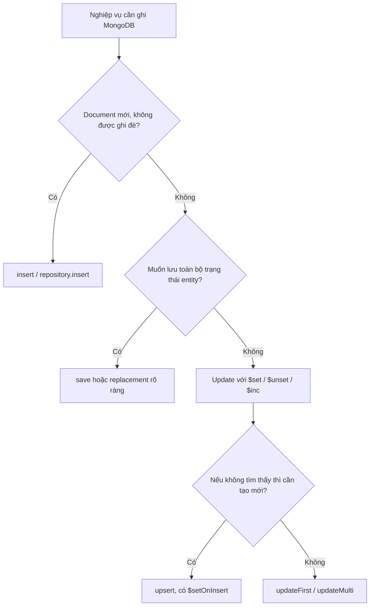

# Phân biệt insert, lưu thay thế document và cập nhật từng trường

Trong **Spring Data MongoDB**, ba thao tác nhìn có vẻ giống nhau — tạo mới một entity bằng `insert`, lưu một entity bằng `save`, và cập nhật một số thuộc tính bằng `Update` — thực chất gửi những ý định ghi dữ liệu **khác nhau** xuống MongoDB. Nhầm lẫn giữa chúng có thể tạo lỗi trùng khóa, làm mất field vốn đang tồn tại trong document, ghi đè thay đổi của request khác hoặc vô tình sửa/xóa dữ liệu ngoài phạm vi tenant.

Bài học thuộc chương **Ghi và cập nhật** của module **SPRING_DATA_MONGODB**. Ta sẽ phân biệt các kiểu ghi thông qua `MongoTemplate`, `MongoRepository` và MongoDB Java Driver, rồi kiểm tra khi nào nên dùng **insert**, **lưu/thay thế toàn bộ document**, **cập nhật từng trường bằng toán tử**, **upsert**, **cập nhật có điều kiện**, và **optimistic locking**. Các ví dụ có thể thực hành trên MongoDB dành cho phát triển; không chạy các lệnh thay thế hoặc xóa trên dữ liệu production khi chưa xác minh phạm vi.

## 1. Bốn thao tác quan trọng: insert, save, replace và update

| Ý định | API Spring Data MongoDB | Thao tác MongoDB tương ứng về mặt ý nghĩa | Khi document khớp đã tồn tại |
| --- | --- | --- | --- |
| **Chỉ tạo mới** | `mongoTemplate.insert(entity)`, `repository.insert(entity)` | Insert document mới | Trùng `_id`/unique index thì lỗi; không thay thế bản ghi cũ |
| **Lưu trạng thái entity** | `mongoTemplate.save(entity)`, `repository.save(entity)` | Insert với entity mới; với entity đã tồn tại thường là ghi **document đã được mapping** theo đường save/replacement | Có thể thay thế trạng thái document, không chỉ đổi những field vừa sửa |
| **Thay thế document rõ ràng** | MongoDB Driver `replaceOne(...)`, hoặc API replace phù hợp | Replacement document, có thể bật/tắt upsert | Những field cũ không có trong replacement sẽ không được giữ lại |
| **Cập nhật chọn lọc** | `mongoTemplate.updateFirst(...)`, `updateMulti(...)`, `Update` | Các toán tử `$set`, `$unset`, `$inc`,… | Chỉ các đường field được chỉ định bị thay đổi, phần còn lại được giữ |

**Từ khóa quyết định là _ý định ghi_:** “Tạo đối tượng mới”, “đồng bộ toàn bộ trạng thái”, hay “chỉ thay một số trường”? Không có một API phù hợp nhất cho tất cả các trường hợp.



Sơ đồ là hướng lựa chọn nghiệp vụ, không mô tả đầy đủ mọi chi tiết nhận diện entity mới, mapping version hoặc lệnh wire protocol. Các chi tiết này phụ thuộc trạng thái entity và phiên bản Spring Data.

## 2. Mô hình dữ liệu dùng xuyên suốt bài học

Một đơn hàng được lưu vào collection `orders`:

```javascript
{
  _id: ObjectId("674000000000000000000501"),
  tenant_id: "T1",
  status: "NEW",
  customer_note: "Giao giờ hành chính",
  total_vnd: NumberLong("350000"),
  delivery_address: {
    city: "Đà Nẵng",
    street: "12 Trần Phú"
  },
  createdAt: ISODate("2026-11-20T02:00:00Z"),
  legacy_label: "MIGRATED-V1"
}
```

Property `legacy_label` được một hệ thống cũ ghi vào document nhưng **không có trong entity mới**. Đây là tình huống lý tưởng để thấy sự khác biệt giữa replacement và partial update.

Java entity:

```java
import java.time.Instant;
import org.bson.types.ObjectId;
import org.springframework.data.annotation.Id;
import org.springframework.data.mongodb.core.mapping.Document;
import org.springframework.data.mongodb.core.mapping.Field;

record DeliveryAddress(String city, String street) {}

@Document(collection = "orders")
public class Order {
    @Id
    private ObjectId id;

    @Field("tenant_id")
    private String tenantId;

    private String status;

    @Field("customer_note")
    private String customerNote;

    @Field("total_vnd")
    private long totalVnd;

    @Field("delivery_address")
    private DeliveryAddress deliveryAddress;

    private Instant createdAt;

    public Order() {}

    public Order(
            String tenantId, String status,
            String customerNote, long totalVnd,
            DeliveryAddress deliveryAddress, Instant createdAt) {
        this.tenantId = tenantId;
        this.status = status;
        this.customerNote = customerNote;
        this.totalVnd = totalVnd;
        this.deliveryAddress = deliveryAddress;
        this.createdAt = createdAt;
    }

    public ObjectId getId() { return id; }
    public String getTenantId() { return tenantId; }
    public String getStatus() { return status; }
    public String getCustomerNote() { return customerNote; }
    public long getTotalVnd() { return totalVnd; }
    public DeliveryAddress getDeliveryAddress() { return deliveryAddress; }
    public Instant getCreatedAt() { return createdAt; }

    public void markPaid() { this.status = "PAID"; }
    public void changeNote(String note) { this.customerNote = note; }
}
```

Entity dùng `@Id ObjectId` để ánh xạ `_id`, `@Field` để nối tên property Java với field BSON. `DeliveryAddress` là object nhúng, được mapping vào `delivery_address`. Trong ví dụ chính, chưa dùng `@Version` để thấy rõ semantics replacement; optimistic locking sẽ được bổ sung ở phần sau.

**Quy ước ví dụ:** `mongoTemplate` là bean `MongoTemplate` được inject vào service; `orderRepository` là `MongoRepository<Order, ObjectId>`; những đoạn minh họa là các phương án độc lập, không phải tất cả cùng chạy trên một document production.

## 3. Insert — thêm mới, không thay thế document có sẵn

Thao tác insert diễn đạt rõ: **document này phải là bản ghi mới**.

```java
import java.time.Instant;
import org.springframework.data.mongodb.core.MongoTemplate;

Order draft = new Order(
    "T1",
    "NEW",
    "Giao giờ hành chính",
    350_000L,
    new DeliveryAddress("Đà Nẵng", "12 Trần Phú"),
    Instant.now()
);

Order inserted = mongoTemplate.insert(draft);
ObjectId id = inserted.getId();
```

Nếu `id` ban đầu chưa được gán, Spring Data/driver có thể tạo BSON ObjectId và cập nhật ID tương ứng trên entity. Lệnh tạo document mới trong mongosh có ý nghĩa như sau:

```javascript
db.orders.insertOne({
  tenant_id: "T1",
  status: "NEW",
  customer_note: "Giao giờ hành chính",
  total_vnd: NumberLong("350000"),
  delivery_address: {
    city: "Đà Nẵng",
    street: "12 Trần Phú"
  },
  createdAt: new Date()
});
```

MongoDB tạo `_id` nếu chưa có. Nếu ứng dụng đã gán `_id` và document khác trong cùng collection có `_id` đó, insert thất bại vì unique index `_id`. Một unique index khác (ví dụ `tenant_id + order_number`) cũng có thể khiến insert thất bại.

Repository tương ứng:

```java
import org.bson.types.ObjectId;
import org.springframework.data.mongodb.repository.MongoRepository;

interface OrderRepository extends MongoRepository<Order, ObjectId> {}

// Trong service:
Order insertedByRepo = orderRepository.insert(draft);
```

`MongoRepository.insert` và `MongoTemplate.insert` được dùng khi ý định là **thêm mới**. Đừng dùng insert để “sửa nếu đã có”: một lỗi trùng khóa không tự được chuyển thành update. Cần phân biệt lỗi trùng khóa (`DuplicateKeyException` thường được Spring chuyển đổi từ lỗi MongoDB) với lỗi kết nối, timeout hoặc validate dữ liệu.

**Chú ý khi insert nhiều document:** `insertAll`, `insert` cho collection hoặc `saveAll` có các chiến lược khác nhau, nhưng nhiều bản ghi không tự trở thành một transaction nguyên tử chung. Kiểm tra write concern, ordered/unordered execution, và xử lý kết quả/lỗi khi thao tác theo lô.

## 4. Save — lưu một entity không đồng nghĩa partial update

Đây là điểm thường gây mất dữ liệu khi dùng Spring Data MongoDB:

```java
ObjectId id = new ObjectId("674000000000000000000501");

Order order = mongoTemplate.findById(id, Order.class);
if (order == null) {
    throw new IllegalStateException("Không tìm thấy đơn hàng");
}

order.markPaid();
mongoTemplate.save(order);
```

Có vẻ như code chỉ sửa `status`, nhưng `save(order)` **không mang nghĩa chỉ `$set` các field vừa đổi**. Trong đường lưu thông thường của một entity đã có ID và không dựa trên versioning đặc biệt, Spring Data tạo document BSON từ **toàn bộ trạng thái entity** rồi ghi theo ngữ nghĩa lưu/thay thế.

Document gốc có `legacy_label: "MIGRATED-V1"`, nhưng `Order` không có property `legacyLabel`. Sau khi save theo replacement semantics, trường `legacy_label` có thể **biến mất** khỏi document.

```text
TRƯỚC save
  _id, tenant_id, status, customer_note,
  total_vnd, delivery_address, createdAt, legacy_label

Entity Order đọc vào Java
  id, tenantId, status, customerNote,
  totalVnd, deliveryAddress, createdAt
  (không có legacyLabel)

SAU khi sửa status và save
  _id, tenant_id, status="PAID", customer_note,
  total_vnd, delivery_address, createdAt
  (legacy_label không còn)
```

Tình huống này còn nguy hiểm hơn nếu entity được đọc bằng **projection** hoặc dữ liệu MongoDB có nhiều field mới mà phiên bản service hiện tại chưa biết. Một lần save toàn entity có thể loại bỏ những field không được materialize vào object.

### Save có giống insert khi ID null?

Nếu document/entity được coi là mới, `save` có thể đi qua đường insert. Với entity đã có ID, `save` có thể thực hiện thao tác lưu/thay thế và có các hành vi upsert tùy đường mapping/version. `MongoRepository.save` còn dùng quy tắc `isNew` của Spring Data, có thể dựa trên `@Version`, ID hoặc `Persistable`; không nên diễn giải nó chỉ bằng một phép kiểm tra `id != null`.

| Tình huống | `insert` | `save` |
| --- | --- | --- |
| Entity mới chưa có ID | Thêm mới, thường sinh ID | Thường thêm mới |
| Entity có ID chưa có trong collection | Thêm mới với ID đã cấp | Có thể upsert/insert theo đường save; `@Version` có thể thay đổi hành vi |
| Entity có ID trùng document hiện tại | Lỗi duplicate key | Có thể ghi trạng thái entity lên document hiện tại |
| Field BSON không có trong entity | Không liên quan đến document cũ | Có nguy cơ mất field nếu đường save thay thế document |
| Chỉ cần cập nhật một field | Không phù hợp | Không phải lựa chọn tối thiểu, dễ có tác động phụ |

**Chọn `save` khi** ứng dụng sở hữu đầy đủ schema/trạng thái của document và chủ ý lưu lại toàn bộ aggregate, có kiểm soát cạnh tranh ghi. **Chọn `Update` khi** chỉ muốn thay một số field hoặc cần bảo toàn field ngoài phạm vi nghiệp vụ đang xử lý.

## 5. Thay thế document một cách tường minh

MongoDB Java Driver cho phép gọi `replaceOne`, diễn đạt rõ việc một document sẽ được **thay thế** chứ không cập nhật từng field bằng toán tử.

```java
import static com.mongodb.client.model.Filters.and;
import static com.mongodb.client.model.Filters.eq;

import com.mongodb.client.result.UpdateResult;
import com.mongodb.client.model.ReplaceOptions;
import org.bson.Document;
import org.bson.types.ObjectId;

ObjectId id = new ObjectId("674000000000000000000501");

Document replacement = new Document("_id", id)
    .append("tenant_id", "T1")
    .append("status", "PAID")
    .append("customer_note", "Đã xác nhận")
    .append("total_vnd", 350_000L);

UpdateResult result = mongoTemplate.getCollection("orders").replaceOne(
    and(eq("_id", id), eq("tenant_id", "T1")),
    replacement,
    new ReplaceOptions().upsert(false)
);
```

Ở đây `upsert(false)` có nghĩa: **nếu không có document khớp, không tạo document mới**. Nếu document tồn tại, replacement sẽ thay nội dung field bằng document mới. Trong ví dụ, các field `delivery_address`, `createdAt`, `legacy_label` đều không xuất hiện trong replacement nên không còn sau khi thay thế.

Các ràng buộc cần hiểu:

- `_id` là định danh bất biến của một document đã tồn tại. Replacement không được đổi `_id` thành giá trị khác.
- `replaceOne` là **thao tác native driver**; nếu gọi qua `getCollection(...)` với `Document`, nó không tự áp dụng toàn bộ callback, auditing hay optimistic locking của Spring Data entity.
- Để phân quyền và tránh sửa nhầm tenant, filter vẫn cần `tenant_id` cùng `_id`. Nếu ID tồn tại nhưng thuộc tenant khác, thao tác không khớp và không thay thế.
- `matchedCount` và `modifiedCount` của `UpdateResult` có ý nghĩa khác nhau. `matchedCount = 1`, `modifiedCount = 0` có thể xảy ra nếu replacement giống trạng thái cũ.

Khi muốn replacement qua API Spring Data, có thể xem `findAndReplace` và các option tương ứng của phiên bản đang dùng. Dù chọn API nào, cần hiểu sự khác biệt giữa **replacement document** và **update operator document**.

## 6. Partial update — chỉ sửa những field được chỉ định

Khi yêu cầu chỉ đổi trạng thái đơn hàng, phương thức phù hợp hơn là `updateFirst` kết hợp `Update.set`.

```java
import com.mongodb.client.result.UpdateResult;
import org.bson.types.ObjectId;
import org.springframework.data.mongodb.core.query.Criteria;
import org.springframework.data.mongodb.core.query.Query;
import org.springframework.data.mongodb.core.query.Update;

ObjectId id = new ObjectId("674000000000000000000501");
String tenantId = "T1";

Query target = Query.query(
    Criteria.where("id").is(id)
        .and("tenantId").is(tenantId)
);

Update changes = new Update().set("status", "PAID");

UpdateResult result = mongoTemplate.updateFirst(
    target,
    changes,
    Order.class
);

long matched = result.getMatchedCount();
long modified = result.getModifiedCount();
```

Về mặt ý nghĩa, MongoDB nhận một thao tác cập nhật kiểu:

```javascript
db.orders.updateOne(
  {
    _id: ObjectId("674000000000000000000501"),
    tenant_id: "T1"
  },
  {
    $set: { status: "PAID" }
  }
);
```

**Các field khác được giữ nguyên:** `customer_note`, `total_vnd`, `delivery_address`, `createdAt` và cả `legacy_label` vẫn tồn tại. Đây là khác biệt cốt lõi giữa partial update và lưu/thay thế toàn bộ document.

Với `Query` và `Update` gắn cùng `Order.class`, Spring Data áp dụng mapping theo property Java: `tenantId` thành `tenant_id`, `id` thành `_id` và các property được đổi tên khác theo `@Field`. Nếu thao tác trực tiếp bằng mongosh/native driver, phải dùng **tên BSON** thực tế.

### updateFirst và updateMulti

```java
Query oldOrders = Query.query(
    Criteria.where("tenantId").is("T1")
        .and("status").is("NEW")
);

// Chỉ cập nhật một document khớp.
mongoTemplate.updateFirst(
    oldOrders, new Update().set("status", "REVIEW"), Order.class
);

// Cập nhật mọi document khớp.
mongoTemplate.updateMulti(
    oldOrders, new Update().set("status", "REVIEW"), Order.class
);
```

`updateFirst` không hứa cập nhật “đơn mới nhất” nếu filter có thể khớp nhiều document mà không xác định bản ghi mục tiêu. Đối với một document cần kiểm soát rõ, hãy lọc theo `_id` và tenant; khi cần chọn bản ghi dựa trên sort hoặc lấy bản ghi trả về cùng cập nhật, cân nhắc `findAndModify` với query/sort phù hợp.

`updateMulti` có thể sửa nhiều document. Từng document được cập nhật nguyên tử, nhưng toàn bộ tập **không mặc định** là một transaction chung.

## 7. Những toán tử cập nhật thường dùng

`Update` giúp biểu đạt thay đổi **theo field**, không cần đọc và lưu lại toàn bộ entity.

| Toán tử MongoDB | API Spring Data | Tác dụng |
| --- | --- | --- |
| `$set` | `new Update().set("status", "PAID")` | Gán giá trị field; tạo field nếu chưa có |
| `$unset` | `new Update().unset("customerNote")` | Xóa hẳn key khỏi document |
| `$inc` | `new Update().inc("retryCount", 1)` | Tăng số theo toán tử server, tránh read-modify-write đơn giản |
| `$setOnInsert` | `new Update().setOnInsert("createdAt", now)` | Chỉ gán khi upsert phải insert |
| `$push` | `new Update().push("tags", "priority")` | Thêm phần tử vào array |
| `$addToSet` | `new Update().addToSet("tags", "priority")` | Thêm vào array nếu không có phần tử bằng nó |
| `$pull` | `new Update().pull("tags", "stale")` | Loại các phần tử khớp khỏi array |

Những field như `retryCount` và `tags` trong bảng là ví dụ mở rộng, cần được khai báo trong schema/entity hoặc quản lý bằng raw BSON khi dùng thật. Đối với một trường tiền tệ, cần chọn kiểu số đúng (long/Decimal128) và xử lý tràn số, làm tròn phù hợp nghiệp vụ.

### Set null không giống unset

```javascript
// Field vẫn tồn tại, giá trị là BSON Null.
db.orders.updateOne(
  { _id: someId },
  { $set: { customer_note: null } }
);

// Field bị xóa khỏi document.
db.orders.updateOne(
  { _id: someId },
  { $unset: { customer_note: "" } }
);
```

Spring Data:

```java
mongoTemplate.updateFirst(
    target,
    new Update().set("customerNote", null),
    Order.class
);

mongoTemplate.updateFirst(
    target,
    new Update().unset("customerNote"),
    Order.class
);
```

Hai đoạn trên là **hai lựa chọn độc lập**. Sau `$set: null`, query `{customer_note: {$exists: true}}` vẫn có thể khớp; sau `$unset` thì field không còn. Khi dùng `save(entity)`, các property Java `null` thường bị converter bỏ qua khi ghi trừ khi cấu hình khác; đừng xem `save` như một cách thay thế hoàn toàn cho `$set: null`.

### Cập nhật object nhúng theo đường dẫn

Giả sử chỉ sửa thành phố giao hàng:

```java
mongoTemplate.updateFirst(
    target,
    new Update().set("deliveryAddress.city", "Hội An"),
    Order.class
);
```

Spring Data chuyển property `deliveryAddress` thành BSON `delivery_address` và cập nhật đường dẫn `delivery_address.city`. Nó **không cần thay toàn bộ** `delivery_address`; field `street` vẫn được giữ.

Ngược lại, nếu dùng `set("deliveryAddress", new DeliveryAddress(...))`, ta đang thay toàn bộ **giá trị của field nhúng** bằng object mới. Vì thế, hãy chọn mức đường dẫn đúng với phạm vi thay đổi mong muốn.

## 8. Upsert — không tìm thấy thì chèn mới

`Upsert` kết hợp **update** và **insert-if-missing**. Nó phù hợp với dữ liệu có định danh/khóa nghiệp vụ rõ ràng và muốn bảo đảm “đã tồn tại thì điều chỉnh, chưa có thì tạo”.

```java
import java.time.Instant;
import org.bson.types.ObjectId;

ObjectId id = new ObjectId("674000000000000000000777");
Instant now = Instant.now();

Query byIdAndTenant = Query.query(
    Criteria.where("id").is(id)
        .and("tenantId").is("T1")
);

Update upsertFields = new Update()
    .set("status", "NEW")
    .setOnInsert("tenantId", "T1")
    .setOnInsert("createdAt", now)
    .setOnInsert("totalVnd", 0L);

UpdateResult result = mongoTemplate.upsert(
    byIdAndTenant,
    upsertFields,
    Order.class
);

boolean inserted = result.getUpsertedId() != null;
```

Với điều kiện `_id` xác định, MongoDB tìm document phù hợp rồi áp dụng các toán tử. Nếu không tìm thấy, server có thể tạo document mới; các giá trị được khai báo trong `$setOnInsert` chỉ áp dụng ở nhánh insert, không sửa lại `createdAt` của đơn đã tồn tại.

**Phân biệt `upsert` với `save`:**

- Upsert dựa trên **filter + update operators**, nên field không liên quan thường vẫn được giữ ở nhánh cập nhật.
- Save dựa trên **trạng thái entity**, có thể mang ngữ nghĩa lưu/thay thế toàn bộ document.
- Với upsert, hãy xây unique index cho khóa quyết định tính duy nhất nếu có nhiều request cạnh tranh.
- Nếu `_id` đã tồn tại nhưng thuộc tenant khác, query gồm tenant không khớp; nhánh insert với cùng `_id` có thể thất bại duplicate key. Đây là tín hiệu cần kiểm tra phạm vi/quyền, không được bỏ tenant khỏi điều kiện cho “chạy được”.

Một số đường upsert tạo document mới từ các điều kiện bằng trong query kết hợp update operators; không nên dựa vào chi tiết phát sinh field ngầm để đảm bảo schema. Khai báo `$setOnInsert` cho các field bắt buộc, thêm validation và integration test trên MongoDB thật.

## 9. Find-and-modify — cập nhật nguyên tử và lấy kết quả

Thao tác “tìm đơn theo điều kiện, sửa trạng thái, rồi trả document mới” dễ gặp race condition nếu làm bằng **hai lời gọi riêng**: `findById` rồi `save`. Với một document, có thể dùng `findAndModify` để server thực hiện thao tác tìm-cập nhật như một đơn vị nguyên tử ở cấp document.

```java
import org.springframework.data.mongodb.core.FindAndModifyOptions;
import org.springframework.data.mongodb.core.query.Update;

Query pending = Query.query(
    Criteria.where("id").is(id)
        .and("tenantId").is("T1")
        .and("status").is("NEW")
);

Order updated = mongoTemplate.findAndModify(
    pending,
    new Update().set("status", "PAID"),
    FindAndModifyOptions.options()
        .returnNew(true)
        .upsert(false),
    Order.class
);

if (updated == null) {
    // Không có đơn NEW trong phạm vi này để chuyển trạng thái.
}
```

`returnNew(true)` yêu cầu trả document **sau cập nhật**. Với `returnNew(false)`, kết quả thường là document trước khi cập nhật. `upsert(false)` ngăn việc tạo đơn mới chỉ vì không tìm thấy trạng thái đang mong đợi.

Điều kiện `status = NEW` hoạt động như một **compare-and-set** theo trạng thái: nếu request khác đã chuyển đơn sang trạng thái khác, lệnh không còn khớp, tránh ghi đè một cách im lặng. Đây là ràng buộc nghiệp vụ ở mức một document, không đồng nghĩa tất cả luồng nghiệp vụ nhiều collection đã được transaction hóa.

## 10. Optimistic locking và cập nhật đồng thời

Nếu hai request cùng đọc một `Order`:

```text
Request A đọc status=NEW
Request B đọc status=NEW
Request A thay status=PAID và save
Request B thay customerNote, save entity cũ
```

Trong đường **save toàn document không kiểm tra version**, lần lưu từ B có nguy cơ ghi đè lại `status` bằng giá trị cũ `NEW`. Đây là dạng **lost update**.

Spring Data MongoDB hỗ trợ optimistic locking qua `@Version`:

```java
import org.springframework.data.annotation.Version;

// Bổ sung vào entity Order:
@Version
private Long version;
```

Với entity có `@Version`, các thao tác lưu entity qua đường hỗ trợ versioning kiểm tra phiên bản mong đợi. Nếu document trên server đã bị thay đổi và version không còn phù hợp, Spring Data có thể phát sinh `OptimisticLockingFailureException` thay vì âm thầm ghi đè. Cần **write concern có xác nhận** để phát hiện kết quả ghi/xung đột chính xác.

Không nên hiểu mọi `updateFirst` tự động kiểm tra version cũ của entity đang ở trong bộ nhớ. Với partial update có yêu cầu compare-and-set, hãy đưa version hoặc trạng thái mong đợi vào **filter**:

```java
long expectedVersion = 3L;

Query guarded = Query.query(
    Criteria.where("id").is(id)
        .and("tenantId").is("T1")
        .and("version").is(expectedVersion)
);

Update changes = new Update()
    .set("status", "PAID");
// Kiểm tra cách Spring Data phiên bản đang dùng tự cập nhật @Version;
// nếu quản lý version thủ công phải thống nhất một cơ chế duy nhất.

UpdateResult guardedResult =
    mongoTemplate.updateFirst(guarded, changes, Order.class);

if (guardedResult.getMatchedCount() == 0) {
    // Document đã đổi version, không tồn tại, hoặc sai tenant.
}
```

Khi kết hợp `@Version` với `MongoTemplate`, Spring Data có thể tự tăng version trên những đường update nếu update không chỉ định trường này. **Điều cần bảo đảm là filter có expected version** nếu nghiệp vụ yêu cầu chống ghi đè dựa trên version. Không tự `inc("version", 1)` thêm một lần nữa khi hạ tầng đã xử lý, tránh tăng version hai lần.

Khi không sử dụng version, một filter theo `status` và `_id` cũng là lựa chọn hợp lý cho chuyển trạng thái có điều kiện. Tùy yêu cầu, có thể thêm điều kiện tổng tiền, tenant hoặc một khóa idempotency riêng.

## 11. Kết quả ghi: matched, modified, upserted

Khi dùng `MongoTemplate.updateFirst` / `updateMulti` / `upsert`, kết quả thường là `com.mongodb.client.result.UpdateResult`. Các con số cần đọc đúng:

| Trường kết quả | Ý nghĩa | Ví dụ |
| --- | --- | --- |
| `getMatchedCount()` | Số document khớp filter của update | 1 nếu đơn tồn tại và phù hợp tenant |
| `getModifiedCount()` | Số document có thay đổi thực tế | Có thể là 0 dù matched = 1 |
| `getUpsertedId()` | ID của document mới được chèn bởi upsert, nếu có | Phân biệt nhánh insert mới |
| `DeleteResult.getDeletedCount()` | Số document đã xóa với thao tác remove | Không dùng để đánh giá update |

Ví dụ:

```java
UpdateResult r = mongoTemplate.updateFirst(
    target,
    new Update().set("status", "PAID"),
    Order.class
);

if (r.getMatchedCount() == 0) {
    // Không thấy document theo ID + tenant (hoặc điều kiện khác).
} else if (r.getModifiedCount() == 0) {
    // Có thể status đã là PAID, hoặc update không làm thay đổi giá trị.
}
```

**Không đồng nhất `matchedCount == 0` với HTTP 404 trong mọi trường hợp.** Nếu filter bao gồm cả trạng thái mong đợi/version, kết quả 0 có thể là document đã bị thay đổi, xung đột trạng thái hoặc sai tenant. Cần chính sách phân biệt 404/409 và kiểm tra quyền theo nghiệp vụ, tránh tiết lộ sự tồn tại của tài nguyên giữa các tenant.

Các con số chỉ có ý nghĩa khi thao tác ghi có cơ chế xác nhận thích hợp; khi lỗi mạng xảy ra, client có thể không biết chắc server đã áp dụng hay chưa. Retry cần thiết kế theo idempotency.

## 12. Atomicity, transaction và nhất quán

MongoDB bảo đảm tính nguyên tử ở **một document** cho một write operation. Điều đó giúp `$inc`, `$set` và cập nhật có điều kiện tránh nhiều dạng race condition so với “đọc–sửa ở Java–ghi lại” không có kiểm soát.

Nhưng một nghiệp vụ như “tạo đơn hàng, trừ tồn kho, ghi lịch sử thanh toán” có thể tác động **nhiều document/collection**. Gọi ba phương thức repository liên tiếp không mặc nhiên tạo transaction.

```java
import org.springframework.transaction.annotation.Transactional;

@Transactional
public void confirmOrder(ObjectId orderId) {
    // Minh họa ranh giới nghiệp vụ:
    // 1. Cập nhật order có điều kiện.
    // 2. Cập nhật inventory.
    // 3. Tạo payment audit.
    // Cần hiện thực đầy đủ trong service thực tế.
}
```

Để transaction MongoDB thực sự có hiệu lực, ứng dụng phải có `MongoTransactionManager` phù hợp và MongoDB topology hỗ trợ (thường replica set hoặc sharded cluster thích hợp). Trên reactive driver cần `ReactiveMongoTransactionManager` cùng Reactor Context.

Khi chỉ cần cập nhật một document, ưu tiên **một lệnh với điều kiện và toán tử đúng** thay vì mở transaction không cần thiết. Tăng phạm vi transaction có chi phí và có thể ảnh hưởng throughput.

## 13. Hiệu năng ghi và thiết kế index

Write operation vẫn phải **tìm document** khớp filter trước khi thay đổi. Vì vậy index rất quan trọng, nhất là khi update hàng loạt:

```javascript
// Tìm đơn của một tenant ở trạng thái cần xử lý.
db.orders.createIndex(
  { tenant_id: 1, status: 1 },
  { name: "orders_tenant_status" }
);
```

Truy vấn cập nhật một document theo `_id` thường tận dụng unique index `_id`; nhưng filter thêm tenant/status vẫn cần đánh giá tùy access pattern. Truy vấn quét nhiều đơn theo `tenant_id + status` có thể hưởng lợi từ compound index này. Ngược lại, mọi index đều làm tăng chi phí cập nhật nếu field nằm trong index bị sửa.

**Đừng đánh giá hiệu năng bằng số dòng Java.** Một `save(entity)` có thể ghi document lớn dù chỉ thay một field; `$set` gửi ý định cập nhật chọn lọc hơn, nhưng vẫn cần server xử lý ghi, index, journal và đồng bộ replica theo write concern.

Để phân tích filter, có thể kiểm tra query tương đương:

```javascript
db.orders.find({
  tenant_id: "T1",
  status: "NEW"
}).explain("executionStats");
```

Quan sát `winningPlan`, `totalKeysExamined`, `totalDocsExamined`, `nReturned`. Đây là phép đo **khả năng tìm document**, không thay thế benchmark lệnh update thực tế hoặc đo chi phí index/write concern.

Với số lượng cập nhật lớn, cân nhắc `BulkOperations` và batch hợp lý. Không mặc định bulk là transaction; cần kiểm tra ordered/unordered semantics, kết quả từng operation và cơ chế xử lý lỗi. Các đường bulk có thể không chạy callback/version handling giống `save` từng entity.

## 14. ReactiveMongoTemplate vẫn tuân theo các ngữ nghĩa ghi đó

Trong WebFlux, Spring Data MongoDB reactive trả publisher thay vì kết quả đồng bộ:

```java
import com.mongodb.client.result.UpdateResult;
import org.springframework.data.mongodb.core.ReactiveMongoTemplate;
import reactor.core.publisher.Mono;

Mono<UpdateResult> markPaid(
        ReactiveMongoTemplate template,
        ObjectId orderId,
        String tenantId) {

    Query query = Query.query(
        Criteria.where("id").is(orderId)
            .and("tenantId").is(tenantId)
    );

    return template.updateFirst(
        query,
        new Update().set("status", "PAID"),
        Order.class
    );
}
```

Ý nghĩa server của `$set` không thay đổi chỉ vì kết quả là `Mono<UpdateResult>`. Truy vấn reactive thường được thực thi khi publisher được **subscribe**; không gọi `block()` trong WebFlux event loop và không tự `subscribe()` để bỏ qua lỗi của một lệnh ghi quan trọng.

Nếu nhiều cập nhật cần transaction, kết hợp các publisher trong cùng reactive chain, sử dụng transaction manager phù hợp. Việc tạo một `Mono` từ kết quả của `MongoTemplate` đồng bộ không biến driver đó thành non-blocking.

## 15. Integration test chứng minh replacement khác partial update

Unit test mock `MongoTemplate` không xác minh MongoDB thực sự giữ hoặc xóa những field ngoài entity. Một **integration test với raw BSON** làm rõ sự khác biệt hơn.

Test dưới đây minh họa việc chèn document có `legacy_label` bằng native driver rồi so sánh hai đường ghi trên các document riêng biệt. Cần kết nối một MongoDB test cô lập (ví dụ Testcontainers), không chạy trên production.

```java
import static org.assertj.core.api.Assertions.assertThat;
import static com.mongodb.client.model.Filters.eq;

import java.util.UUID;
import org.bson.Document;
import org.bson.types.ObjectId;
import org.junit.jupiter.api.Test;
import org.springframework.beans.factory.annotation.Autowired;
import org.springframework.boot.test.autoconfigure.data.mongo.DataMongoTest;
import org.springframework.data.mongodb.core.MongoTemplate;
import org.springframework.data.mongodb.core.query.Criteria;
import org.springframework.data.mongodb.core.query.Query;
import org.springframework.data.mongodb.core.query.Update;

@DataMongoTest
class OrderWriteSemanticsTest {
    @Autowired MongoTemplate template;

    @Test
    void updatePreservesFieldWhileSaveCanReplaceDocument() {
        String tenant = "test-" + UUID.randomUUID();
        ObjectId partialId = new ObjectId();
        ObjectId saveId = new ObjectId();

        template.getCollection("orders").insertMany(
            java.util.List.of(
                rawOrder(partialId, tenant),
                rawOrder(saveId, tenant)
            )
        );

        Query partialTarget = Query.query(
            Criteria.where("id").is(partialId)
                .and("tenantId").is(tenant)
        );
        template.updateFirst(
            partialTarget,
            new Update().set("status", "PAID"),
            Order.class
        );

        Document partialRaw = template.getCollection("orders")
            .find(eq("_id", partialId)).first();
        assertThat(partialRaw).isNotNull();
        assertThat(partialRaw.getString("status")).isEqualTo("PAID");
        assertThat(partialRaw.getString("legacy_label"))
            .isEqualTo("MIGRATED-V1");

        Order loaded = template.findById(saveId, Order.class);
        assertThat(loaded).isNotNull();
        loaded.markPaid();
        template.save(loaded);

        Document savedRaw = template.getCollection("orders")
            .find(eq("_id", saveId)).first();
        assertThat(savedRaw).isNotNull();
        assertThat(savedRaw.getString("status")).isEqualTo("PAID");
        assertThat(savedRaw.containsKey("legacy_label")).isFalse();
    }

    private static Document rawOrder(ObjectId id, String tenant) {
        return new Document("_id", id)
            .append("tenant_id", tenant)
            .append("status", "NEW")
            .append("customer_note", "Ghi chú cũ")
            .append("total_vnd", 350_000L)
            .append("legacy_label", "MIGRATED-V1");
    }
}
```

Test này **không cần suy đoán** từ tên phương thức: sau partial update, field `legacy_label` vẫn còn; sau save toàn entity, field ngoài mapping không được giữ. Điều kiện cần lưu ý là mapping/version/handler đang dùng; ví dụ này chọn entity **không có `@Version`** để tập trung vào replacement semantics.

Các ca test cần bổ sung:

1. `insert` hai lần cùng `_id` phải bị từ chối, không ghi đè document đầu.
2. `updateFirst` với ID không tồn tại có `matchedCount = 0`; không tự tạo bản ghi.
3. `upsert` với ID mới tạo document và trả `upsertedId`; gọi lại không tạo bản thứ hai.
4. `$set("customerNote", null)` giữ key dưới BSON Null; `$unset("customerNote")` xóa key.
5. `$inc` cạnh tranh từ nhiều request không làm mất lần tăng khi thiết kế đúng.
6. `@Version` trên entity đã được lưu từ hai bản đọc gây xung đột theo hợp đồng optimistic locking.
7. Update/replace giới hạn tenant không sửa document khác tenant.
8. `updateMulti` chỉ cập nhật các document khớp, không phải tất cả collection.
9. Kiểm tra dữ liệu cũ có field lạ hoặc projection để phát hiện nguy cơ mất field do `save`.

## 16. Checklist lựa chọn API

| Câu hỏi nghiệp vụ | Lựa chọn ưu tiên | Điều cần kiểm tra |
| --- | --- | --- |
| Phải tạo một đơn mới, trùng ID là lỗi? | `insert` | Unique index, ID và lỗi trùng khóa |
| Có aggregate đầy đủ và muốn lưu trọn trạng thái? | `save` | Schema, version, field bị bỏ sót, quyền cập nhật |
| Chủ động thay thế toàn bộ BSON document? | `replaceOne` / API replace | `upsert`, `_id` bất biến, field thiếu, callbacks/version |
| Chỉ sửa `status` một đơn theo ID? | `updateFirst` + `$set` | Filter ID + tenant + trạng thái mong đợi |
| Sửa cùng một field ở nhiều đơn? | `updateMulti` | Phạm vi, index, atomicity/transaction |
| Tăng bộ đếm hoặc thêm phần tử array? | `$inc`, `$addToSet`/`$push` | Kiểu field, concurrency, idempotency |
| Không có thì tạo? | `upsert` + `$setOnInsert` | Unique index và dữ liệu mặc định nhánh insert |
| Cần cập nhật và trả document mới trong một thao tác? | `findAndModify` | `returnNew(true)`, filter, upsert |
| Cần chống stale write? | `@Version` hoặc conditional update | Expected version/status, acknowledged write |
| Nhiều document phải cùng commit/rollback? | Transaction phù hợp | MongoDB topology, transaction manager, error handling |

## 17. Câu hỏi tự đánh giá

**1.** Vì sao `repository.save(order)` không phù hợp để “chỉ đổi status” trên một document còn nhiều field ngoài entity?  
**Đáp án:** thao tác save có thể ghi toàn bộ trạng thái entity theo replacement semantics, làm mất field chưa được mapping; `$set` đúng phạm vi hơn.

**2.** Khi `insert(order)` gặp một document có cùng `_id` thì điều gì xảy ra?  
**Đáp án:** unique index `_id` khiến thao tác bị từ chối, thay vì ghi đè document đã tồn tại.

**3.** `new Update().set("customerNote", null)` và `unset("customerNote")` có giống nhau không?  
**Đáp án:** không. `set(null)` giữ field với BSON Null; `unset` xóa field.

**4.** `matchedCount=1` và `modifiedCount=0` có luôn là lỗi không?  
**Đáp án:** không. Document có thể đã mang giá trị mong muốn nên phép update không thay đổi gì.

**5.** Vì sao `updateFirst` lọc theo `status = NEW` có thể giúp chống ghi đè?  
**Đáp án:** MongoDB chỉ áp dụng thay đổi khi trạng thái vẫn khớp điều kiện; request đến sau khi trạng thái đã đổi sẽ không khớp.

**6.** `upsert` khác `save` ở đâu?  
**Đáp án:** upsert kết hợp **filter và update operators**, có thể chỉ thay field cần thiết hoặc chèn khi chưa có; save dùng trạng thái entity và có thể mang ngữ nghĩa ghi/thay thế toàn document.

**7.** Cần lưu nhiều entity trong một transaction có thể chỉ gọi `saveAll` không?  
**Đáp án:** không. `saveAll` không tự bảo đảm một transaction nguyên tử đa document; phải thiết kế transaction với hạ tầng tương ứng.

**8.** Vì sao filter ghi nên luôn kèm tenant trong hệ thống đa tenant?  
**Đáp án:** để không cập nhật document thuộc tenant khác, ngay cả khi ID/status hoặc điều kiện khác bị nhập sai; tenant phải lấy từ ngữ cảnh được tin cậy.

**Bài thực hành:** tạo collection `orders` trong MongoDB test, insert một raw document có `legacy_label`. Thử hai nhánh độc lập: đọc entity rồi `save` sau khi đổi status và `updateFirst` với `$set`. Dùng native driver đọc lại BSON để so field còn/mất; tiếp tục thử `$set(null)`, `$unset`, `upsert`, `findAndModify` và phiên bản `@Version` có two-writer conflict. Ghi lại `matchedCount`/`modifiedCount` và kiểm tra filter bằng `explain`.

**Kết luận:** **insert** yêu cầu thêm document mới, **save/replacement** có thể ghi lại **toàn bộ document**, còn **update operators** thay đổi **những field được chỉ định** và giữ phần còn lại. Trong Spring Data MongoDB, chọn API dựa trên phạm vi ghi mong muốn, cấu trúc BSON, điều kiện tenant, khả năng cạnh tranh và yêu cầu transaction — không dựa riêng vào tên phương thức. Đối chiếu kết quả bằng integration test với raw BSON là cách thực tế nhất để tránh mất dữ liệu do nhầm save với partial update.

