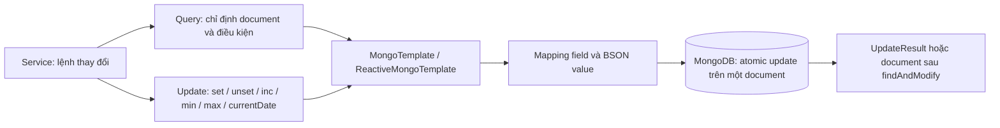

# Update với set, unset, inc, min, max và currentDate

## 1. Vì sao cập nhật từng trường khác với save cả document?

Trong **Spring Data MongoDB**, `MongoTemplate` và `ReactiveMongoTemplate` cho phép cập nhật trực tiếp một hoặc nhiều trường của document mà không cần đọc entity đầy đủ, sửa object Java rồi gọi `save`. Điều này đặc biệt hữu ích khi hệ thống ghi nhận tồn kho, thay đổi trạng thái, loại bỏ thuộc tính cũ, duy trì giá trị nhỏ nhất/lớn nhất hoặc cập nhật thời điểm xử lý.

Giả sử collection `inventory_items` có một sản phẩm:

```javascript
{
  _id: "item-101",
  tenantId: "shop-01",
  sku: "SKU-A",
  stock: NumberInt("10"),
  status: "ACTIVE",
  reorderThreshold: NumberInt("5"),
  lowestOfferCents: NumberLong("1700"),
  highestOfferCents: NumberLong("1900"),
  version: NumberLong("0"),
  attributes: { color: "red", origin: "VN" },
  legacyCode: "OLD-A"
}
```

Một yêu cầu nghiệp vụ có thể đòi:

- Đổi màu thành `blue`: `$set`.
- Bỏ trường `legacyCode` đã ngừng sử dụng: `$unset`.
- Nhập thêm 3 sản phẩm: `$inc`.
- Ghi nhận mức chào giá thấp nhất là 1.600 cent: `$min`.
- Ghi nhận mức chào giá cao nhất là 2.100 cent: `$max`.
- Đánh dấu thời điểm cập nhật theo đồng hồ MongoDB: `$currentDate`.

Các phép trên có thể được gửi trong **một lệnh update** tới cùng document. MongoDB áp dụng các sửa đổi hợp lệ của một thao tác ghi lên **một document một cách nguyên tử**. Điều đó khác với việc nhiều lần đọc/sửa/`save` liên tiếp và cũng khác một transaction cập nhật nhiều document.

Trong chương **Ghi và cập nhật** của module **SPRING_DATA_MONGODB**, chúng ta sẽ xây dựng update bằng API `Update`, chọn đúng phép toán theo ý nghĩa nghiệp vụ, xử lý kết quả, concurrency, upsert, query có điều kiện, nhánh reactive và kiểm thử BSON.

## 2. Tổng quan sáu toán tử update

| Toán tử MongoDB | API Spring Data `Update` | Ý nghĩa chính |
| --- | --- | --- |
| `$set` | `set("status", "ACTIVE")` | Ghi hoặc thay giá trị của field |
| `$unset` | `unset("legacyCode")` | Loại bỏ field khỏi document |
| `$inc` | `inc("stock", 3)` | Tăng giá trị số; số âm tương ứng giảm |
| `$min` | `min("lowestOfferCents", 1600L)` | Chỉ ghi giá trị mới nếu field chưa có hoặc giá trị mới nhỏ hơn theo quy tắc so sánh BSON |
| `$max` | `max("highestOfferCents", 2100L)` | Chỉ ghi giá trị mới nếu field chưa có hoặc giá trị mới lớn hơn theo quy tắc so sánh BSON |
| `$currentDate` | `currentDate("updatedAt")` | Đặt field bằng ngày giờ hiện tại từ MongoDB server, dạng BSON Date |

Trong Spring Data MongoDB, `Update` là đối tượng **mô tả phép cập nhật**, không phải lời gọi trực tiếp tới database. Thao tác thực sự xảy ra khi truyền nó cùng `Query` vào `MongoTemplate.updateFirst(...)`, `updateMulti(...)`, `upsert(...)`, `findAndModify(...)` hoặc API tương ứng.



### 2.1. Các toán tử không thể tùy tiện dùng trên cùng field

Một lệnh update không nên chứa các thao tác xung đột trên cùng đường dẫn, chẳng hạn vừa `set("stock", 10)` vừa `inc("stock", 3)`, hoặc vừa `unset("attributes")` vừa `set("attributes.color", "blue")`. MongoDB có thể từ chối do **conflicting update paths**.

Hãy gộp ý định thành một phép toán rõ ràng, dùng các field riêng hoặc thiết kế update pipeline phù hợp nếu cần tính toán phức tạp. Việc các operator cùng nằm trong một `Update` **không** có nghĩa có thể bỏ qua quy tắc xung đột đường dẫn.

## 3. Chuẩn bị entity và dữ liệu mẫu

Ví dụ sử dụng Java record để đơn giản hóa việc đọc kết quả. Việc update sẽ đi trực tiếp xuống MongoDB nên không phải sửa record trong bộ nhớ:

```java
package example.inventory;

import java.time.Instant;
import java.util.Map;
import org.springframework.data.mongodb.core.mapping.Document;
import org.springframework.data.mongodb.core.mapping.FieldType;
import org.springframework.data.mongodb.core.mapping.MongoId;

@Document(collection = "inventory_items")
public record InventoryItem(
    @MongoId(FieldType.STRING) String id,
    String tenantId,
    String sku,
    int stock,
    String status,
    Integer reorderThreshold,
    Long lowestOfferCents,
    Long highestOfferCents,
    Long version,
    Instant updatedAt,
    Map<String, String> attributes,
    String legacyCode
) {}
```

`@MongoId(FieldType.STRING)` thể hiện rằng `id` được ghi dưới BSON String, kể cả khi chuỗi ID tình cờ có dạng có thể chuyển sang ObjectId. Trong query typed, Spring Data dùng mapping entity để đổi `id` thành `_id`.

Dữ liệu minh họa có thể tạo trong mongosh:

```javascript
db.inventory_items.insertMany([
  {
    _id: "item-101", tenantId: "shop-01", sku: "SKU-A",
    stock: NumberInt("10"), status: "ACTIVE",
    reorderThreshold: NumberInt("5"),
    lowestOfferCents: NumberLong("1700"),
    highestOfferCents: NumberLong("1900"),
    version: NumberLong("0"),
    attributes: { color: "red", origin: "VN" },
    legacyCode: "OLD-A"
  },
  {
    _id: "item-102", tenantId: "shop-01", sku: "SKU-B",
    stock: NumberInt("2"), status: "ACTIVE",
    version: NumberLong("0")
  },
  {
    _id: "item-201", tenantId: "shop-02", sku: "SKU-A",
    stock: NumberInt("20"), status: "ACTIVE",
    version: NumberLong("0")
  }
]);
```

Hai tenant có thể dùng cùng SKU. Điều kiện update của ứng dụng đa tenant phải chứa **tenant đã được xác thực**; không thể xem một SKU do client gửi là bằng chứng được phép sửa document.

## 4. $set: ghi field mới, thay field cũ và cập nhật field lồng nhau

### 4.1. Dùng Update.set

```java
import org.springframework.data.mongodb.core.query.Criteria;
import org.springframework.data.mongodb.core.query.Query;
import org.springframework.data.mongodb.core.query.Update;

Query filter = Query.query(
    Criteria.where("id").is("item-101")
        .and("tenantId").is("shop-01")
);

Update update = new Update()
    .set("status", "ACTIVE")
    .set("reorderThreshold", 8);
```

BSON tương ứng:

```javascript
db.inventory_items.updateOne(
  { _id: "item-101", tenantId: "shop-01" },
  {
    $set: {
      status: "ACTIVE",
      reorderThreshold: NumberInt("8")
    }
  }
);
```

`$set` tạo field nếu chưa tồn tại, hoặc thay giá trị field nếu đã có. Nếu giá trị mới giống giá trị cũ, document có thể được **matched** nhưng không được tính là **modified**.

### 4.2. set field con không giống set toàn bộ object

Document gốc:

```javascript
attributes: { color: "red", origin: "VN" }
```

Muốn chỉ thay màu:

```java
new Update().set("attributes.color", "blue");
```

Tương đương:

```javascript
{ $set: { "attributes.color": "blue" } }
```

Kết quả vẫn có `attributes.origin: "VN"`. Ngược lại:

```java
new Update().set("attributes", Map.of("color", "blue"));
```

sẽ thay **toàn bộ giá trị object `attributes`**, khiến `origin` không còn được giữ như trong bản cũ. Đường dẫn chấm cũng không hoạt động vô điều kiện: nếu một component trung gian tồn tại dưới dạng giá trị scalar hoặc null thay vì document, MongoDB có thể báo lỗi khi tạo nested field.

### 4.3. $set với null không phải $unset

```java
new Update().set("legacyCode", null);
```

Đây là yêu cầu đặt field thành **BSON null**, không phải yêu cầu xóa key khỏi document. Nếu cần kiểm tra trạng thái field tồn tại, không thể dùng `get("legacyCode") == null` để phân biệt null và missing: phải xem `containsKey` hoặc `$exists`.

## 5. $unset: xóa một field khỏi document

Để xóa `legacyCode`:

```java
Update update = new Update()
    .unset("legacyCode");

mongoTemplate.updateFirst(
    Query.query(
        Criteria.where("id").is("item-101")
            .and("tenantId").is("shop-01")
    ),
    update,
    InventoryItem.class
);
```

BSON tương đương:

```javascript
db.inventory_items.updateOne(
  { _id: "item-101", tenantId: "shop-01" },
  { $unset: { legacyCode: "" } }
);
```

MongoDB bỏ hẳn key `legacyCode` khỏi document. Sau khi đọc entity Java, một thuộc tính tham chiếu `String legacyCode` có thể nhận `null`, nhưng ở BSON **không còn field**.

### 5.1. So sánh ba hành động

| Hành động | BSON sau thao tác | Khi nào dùng |
| --- | --- | --- |
| `set("legacyCode", "A")` | `legacyCode: "A"` | Ghi giá trị |
| `set("legacyCode", null)` | `legacyCode: null` | Nghiệp vụ chủ động lưu giá trị null |
| `unset("legacyCode")` | Không còn key `legacyCode` | Xóa field, làm sạch schema cũ |

Khi MongoDB nhận một query đơn giản `{legacyCode: null}`, nó có thể khớp **cả** document có BSON null **và** document không có field. Phân biệt hai trạng thái bằng:

```javascript
// Chỉ document không có field:
db.inventory_items.find({
  legacyCode: { $exists: false }
});

// Field tồn tại và mang giá trị null:
db.inventory_items.find({
  legacyCode: { $exists: true, $eq: null }
});
```

### 5.2. Cẩn thận với phần tử array

`$unset` trên một đường dẫn trỏ đến **vị trí phần tử của array** không đồng nghĩa xóa và dồn các phần tử còn lại; có trường hợp kết quả là một phần tử `null` để giữ vị trí. Nếu muốn loại bỏ phần tử array theo giá trị/điều kiện, nghiên cứu `$pull`, positional operator hoặc array filters tương ứng. Bài này chỉ dùng `unset` trên field document.

## 6. $inc: tăng/giảm số nguyên tử và kiểm tra tồn kho

### 6.1. Cộng mà không cần đọc–sửa–save

```java
Update update = new Update()
    .inc("stock", 3);
```

Tương đương:

```javascript
{ $inc: { stock: 3 } }
```

Nếu `stock` đang là 10, kết quả là 13. `inc("stock", -3)` dùng để trừ 3. MongoDB xử lý phép tăng/giảm của một document trong thao tác ghi nguyên tử, tránh một dạng **lost update** khi hai request đều đọc cùng giá trị rồi tự tính và ghi đè.

Lưu ý các trường hợp biên:

- Nếu field số **không tồn tại**, `$inc` có thể tạo field với giá trị bằng số tăng.
- Nếu field tồn tại với **BSON null** hoặc kiểu không phải số, thao tác có thể bị từ chối.
- Phải kiểm soát kiểu số và giới hạn phạm vi (Int32, Int64, Double, Decimal128), không mặc định bộ đếm có độ lớn vô hạn hoặc tự làm tròn đúng.

### 6.2. Tránh bán quá số lượng hàng có sẵn

Sai về concurrency:

```java
// MẪU KHÔNG AN TOÀN khi có hai request đồng thời:
InventoryItem item = mongoTemplate.findById(
    "item-101", InventoryItem.class
);
int remaining = item.stock() - quantity;
// Sau đó xây một thao tác set(stock, remaining) từ dữ liệu đã đọc...
```

Hai request có thể cùng đọc stock 10, cùng trừ 7 rồi đều set 3, khiến một yêu cầu bán hàng không được phản ánh chính xác. Dùng **điều kiện stock tối thiểu và `inc` trong cùng lệnh**:

```java
import com.mongodb.client.result.UpdateResult;
import org.springframework.data.mongodb.core.query.Criteria;
import org.springframework.data.mongodb.core.query.Query;
import org.springframework.data.mongodb.core.query.Update;

public boolean reserveStock(
        MongoTemplate template,
        String tenantId,
        String id,
        int quantity) {

    if (quantity <= 0) {
        throw new IllegalArgumentException(
            "quantity phải lớn hơn 0"
        );
    }

    Query query = Query.query(
        Criteria.where("id").is(id)
            .and("tenantId").is(tenantId)
            .and("stock").gte(quantity)
    );

    Update update = new Update()
        .inc("stock", -quantity)
        .currentDate("updatedAt");

    UpdateResult result = template.updateFirst(
        query, update, InventoryItem.class
    );

    return result.getMatchedCount() == 1;
}
```

Điều kiện `stock >= quantity` và phép `$inc: {stock: -quantity}` được MongoDB đánh giá trong **một thao tác ghi trên document**. Với hai request đồng thời yêu cầu trừ 7 từ stock 10, chỉ request đầu đáp ứng điều kiện theo thứ tự được xử lý; request còn lại không còn khớp.

Kết quả `false` có thể có nhiều nguyên nhân: không tồn tại item, sai tenant, hoặc tồn kho không đủ. **Không tự suy ra luôn là thiếu hàng** từ `matchedCount == 0`. Nếu cần thông báo chính xác, service có thể truy vấn thêm với chính sách quan sát/race condition phù hợp.

### 6.3. Một phép inc không làm toàn bộ quy trình đặt hàng nguyên tử

Giảm tồn kho trên document sản phẩm là nguyên tử **đối với document đó**. Nếu nghiệp vụ còn cần tạo document đơn hàng, ghi thanh toán và cập nhật nhiều document khác, một lệnh `$inc` không làm các bước ấy trở thành giao dịch. Cân nhắc transaction MongoDB khi cần và khi deployment hỗ trợ, hoặc thiết kế workflow có khả năng bù trừ/idempotency để xử lý lỗi.

## 7. $min và $max: chỉ cập nhật khi vượt mốc cũ

### 7.1. min và max là phép so sánh, không phải phép cộng

`$min` chỉ đặt field bằng giá trị mới khi field chưa tồn tại hoặc giá trị mới **nhỏ hơn** giá trị đang lưu; `$max` làm điều tương tự với giá trị **lớn hơn**.

```java
Update update = new Update()
    .min("lowestOfferCents", 1600L)
    .max("highestOfferCents", 2100L);
```

Với document có `lowestOfferCents = 1700` và `highestOfferCents = 1900`, kết quả là:

```javascript
{
  lowestOfferCents: NumberLong("1600"),
  highestOfferCents: NumberLong("2100")
}
```

Nếu một offer khác có giá 1.800 cent, phép `min(..., 1800L)` không thay 1.600 và `max(..., 1800L)` không thay 2.100. Hai phép bảo toàn **min/max của các giá trị đã quan sát** nếu mọi đường ghi tuân thủ cùng quy ước.

### 7.2. Tại sao set không tương đương min/max?

Giả sử request A và B cùng ghi nhận mức giá mới:

```text
lowestOfferCents hiện tại: 1700
Request A quan sát 1600
Request B quan sát 1650
```

Nếu cả hai dùng `$set`, giá trị cuối phụ thuộc request nào ghi sau; có thể thành 1.650, đánh mất mức thấp nhất 1.600. Với `$min`, kết quả cuối vẫn là 1.600 khi hai cập nhật được áp dụng thành công trên cùng document.

Tương tự, `$max` phù hợp với “giá trị lớn nhất từng quan sát”, “mốc sự kiện cao nhất đã ghi nhận” hoặc giới hạn cao nhất — **không** phù hợp với dữ liệu cần phản ánh **giá trị mới nhất theo thời gian**. Nếu giá hiện tại được phép tăng và giảm, `$min`/`$max` không thể thay thế trường `currentPrice`.

### 7.3. Kiểu BSON quyết định cách so sánh

MongoDB dùng quy tắc so sánh BSON cho `$min`/`$max`. Nếu field đang chứa String còn giá trị mới là Long, phép so sánh có thể diễn ra theo **thứ tự kiểu BSON**, không theo ý nghĩa số học mà nghiệp vụ mong đợi.

Một trường hợp dễ bỏ sót: field có **BSON null** không giống field chưa tồn tại. `$min`/`$max` áp dụng các quy tắc so sánh tương ứng; ví dụ null có thứ tự so sánh thấp hơn các số trong BSON type ordering, nên `$min` với số dương không có nghĩa sẽ thay null bằng số đó. Khi min/max là dữ liệu bắt buộc, cần chuẩn hóa schema/khởi tạo giá trị hoặc kiểm tra dữ liệu cũ trước khi sử dụng.

Trong ví dụ, tất cả offer được biểu diễn bằng **số nguyên cent `Long`**. Nếu dùng `BigDecimal` và Decimal128, cần xác minh mapping lưu/đọc cũng như toán tử update thực tế; không đổi ngầm dữ liệu tiền thành `double`.

### 7.4. min/max không sửa được sai lệch từ nguồn dữ liệu

Nếu một request gửi 100 cent do lỗi đơn vị, `min` sẽ giữ nó như “mức thấp nhất” cho đến khi có thao tác sửa dữ liệu có chủ đích. Vì thế cần validate miền giá trị và đơn vị trước khi ghi. Một min/max bảo đảm phép so sánh trên dữ liệu đã nhận, **không bảo đảm dữ liệu đầu vào đúng**.

## 8. $currentDate: thời điểm từ MongoDB server

### 8.1. Cú pháp Spring Data

```java
Update update = new Update()
    .set("status", "ACTIVE")
    .currentDate("updatedAt");
```

MongoDB nhận phép cập nhật tương đương:

```javascript
db.inventory_items.updateOne(
  { _id: "item-101", tenantId: "shop-01" },
  {
    $set: { status: "ACTIVE" },
    $currentDate: { updatedAt: true }
  }
);
```

`$currentDate` lấy giá trị ngày giờ hiện tại từ MongoDB server tại thời điểm xử lý. Nó khác:

```java
new Update().set("updatedAt", java.time.Instant.now());
```

Với `Instant.now()`, thời gian đến từ **clock của ứng dụng**, được tính trước khi lệnh tới server. Với `currentDate("updatedAt")`, thời gian do **server** ghi. Cả hai đều có thể phù hợp nếu hợp đồng nghiệp vụ rõ ràng, nhưng không nên trộn không có chủ đích nếu cần thứ tự hay khả năng đối chiếu thời gian thống nhất.

### 8.2. BSON Date khác BSON Timestamp

MongoDB `$currentDate` có thể cập nhật field theo kiểu **BSON Date** hoặc **BSON Timestamp**. `Update.currentDate("updatedAt")` thể hiện nhu cầu thông thường: lưu ngày giờ. BSON Timestamp chủ yếu phục vụ các trường hợp chuyên biệt của MongoDB, không nên tự mặc định nó là kiểu thời gian ứng dụng giống BSON Date.

Với domain field `Instant updatedAt`, hãy dùng BSON Date theo quy ước mapping và xác minh đọc/ghi. Không dùng BSON Timestamp chỉ vì tên của nó chứa “timestamp”.

### 8.3. currentDate không phải mọi loại timestamp nghiệp vụ

Một đơn hàng có thể cần:

- `createdAt`: thời điểm tạo document, không thay đổi khi chỉnh sửa;
- `updatedAt`: thời điểm ghi cập nhật mới nhất;
- `paidAt`: thời điểm hệ thống thanh toán xác nhận thành công;
- `effectiveAt`: thời điểm nghiệp vụ có hiệu lực theo hợp đồng.

`currentDate("updatedAt")` hợp lý cho dấu thời gian thao tác update. Nó không tự biết khi nào khoản thanh toán thực sự được xác nhận. Nếu một event đến trễ, dùng currentDate để thay `paidAt` có thể đổi sai ý nghĩa nghiệp vụ.

## 9. Gộp nhiều operator trong một Update

Khi các đường dẫn không xung đột, có thể kết hợp:

```java
import org.springframework.data.mongodb.core.query.Update;

Update update = new Update()
    .set("status", "ACTIVE")
    .set("attributes.color", "blue")
    .unset("legacyCode")
    .inc("stock", 3)
    .min("lowestOfferCents", 1600L)
    .max("highestOfferCents", 2100L)
    .currentDate("updatedAt");
```

Thao tác MongoDB tương đương:

```javascript
db.inventory_items.updateOne(
  { _id: "item-101", tenantId: "shop-01" },
  {
    $set: {
      status: "ACTIVE",
      "attributes.color": "blue"
    },
    $unset: { legacyCode: "" },
    $inc: { stock: 3 },
    $min: { lowestOfferCents: NumberLong("1600") },
    $max: { highestOfferCents: NumberLong("2100") },
    $currentDate: { updatedAt: true }
  }
);
```

Để thực thi qua Spring Data:

```java
Query filter = Query.query(
    Criteria.where("id").is("item-101")
        .and("tenantId").is("shop-01")
);

UpdateResult result = mongoTemplate.updateFirst(
    filter, update, InventoryItem.class
);
```

Với document mẫu đã tồn tại, kết quả kỳ vọng: stock 13, màu blue, mất legacyCode, low 1.600, high 2.100, updatedAt là BSON Date. **Tính nguyên tử ở đây là trên một document**, không đồng nghĩa toàn bộ các document khớp một updateMany đều tạo thành một transaction nguyên tử chung.

## 10. updateFirst, updateMulti, findAndModify và upsert

### 10.1. updateFirst: chỉ cập nhật một document khớp

```java
UpdateResult result = mongoTemplate.updateFirst(
    Query.query(
        Criteria.where("id").is("item-101")
            .and("tenantId").is("shop-01")
    ),
    new Update().set("status", "INACTIVE"),
    InventoryItem.class
);
```

`updateFirst` cập nhật một document khớp filter, thường thích hợp khi filter chỉ định **ID** hoặc khóa duy nhất. Nếu filter khớp nhiều document, đừng dựa vào “document đầu tiên” theo một thứ tự chưa được bảo đảm. Nếu cần chọn bản ghi theo sort và trả kết quả, cân nhắc `findAndModify` với `Query` có sort.

### 10.2. updateMulti: cập nhật nhiều document khớp

```java
UpdateResult result = mongoTemplate.updateMulti(
    Query.query(
        Criteria.where("tenantId").is("shop-01")
            .and("status").is("INACTIVE")
    ),
    new Update().set("status", "ARCHIVED")
        .currentDate("updatedAt"),
    InventoryItem.class
);
```

Lệnh tương ứng với cập nhật nhiều document (`updateMany`). Mỗi document được cập nhật nguyên tử, nhưng **toàn bộ tập document không phải một transaction nguyên tử** nếu không có ngữ cảnh transaction thích hợp. Một document có thể được sửa thành công trước khi thao tác khác gặp lỗi.

Với bulk update quan trọng, cần đánh giá kích thước tập, quyền truy cập, ảnh hưởng tới index, khả năng retry, failure handling và concurrency.

### 10.3. findAndModify: khi cần trả trạng thái trước/sau update

```java
import org.springframework.data.mongodb.core.FindAndModifyOptions;

InventoryItem updated = mongoTemplate.findAndModify(
    Query.query(
        Criteria.where("id").is("item-101")
            .and("tenantId").is("shop-01")
    ),
    new Update().inc("stock", 2)
        .currentDate("updatedAt"),
    FindAndModifyOptions.options().returnNew(true),
    InventoryItem.class
);
```

`returnNew(true)` yêu cầu document **sau cập nhật**. Nếu không có document khớp và không bật upsert, kết quả có thể là `null`. Giá trị được trả nên được xử lý như một snapshot sau thao tác, không phải một object có thể đại diện cho mọi cập nhật tương lai.

### 10.4. upsert: cập nhật nếu có, thêm nếu không

```java
Update update = new Update()
    .setOnInsert("tenantId", "shop-01")
    .setOnInsert("sku", "SKU-NEW")
    .inc("stock", 1)
    .currentDate("updatedAt");

UpdateResult result = mongoTemplate.upsert(
    Query.query(
        Criteria.where("tenantId").is("shop-01")
            .and("sku").is("SKU-NEW")
    ),
    update,
    InventoryItem.class
);
```

`$setOnInsert` chỉ áp dụng khi upsert **tạo document mới**; `$inc` có thể áp dụng ở cả nhánh cập nhật và chèn. Đoạn ví dụ minh họa ý tưởng; cần bảo đảm các trường bắt buộc khác của schema được khởi tạo đầy đủ và không có đường dẫn update xung đột với phần dữ liệu được suy ra từ query.

Với upsert đồng thời, nhiều request có thể tìm không thấy cùng khóa rồi cùng muốn insert. Khi nghiệp vụ yêu cầu chỉ một document theo cặp `tenantId + sku`, cần **unique index** thích hợp, không chỉ dựa vào lệnh upsert.

## 11. Hiểu UpdateResult để không báo thành công giả

`MongoTemplate.updateFirst`, `updateMulti` và `upsert` trả `com.mongodb.client.result.UpdateResult` trong các API đồng bộ thông dụng. Trong môi trường dùng write concern có acknowledgment:

```java
UpdateResult result = mongoTemplate.updateFirst(
    filter, update, InventoryItem.class
);

if (result.wasAcknowledged()) {
    long matched = result.getMatchedCount();
    long modified = result.getModifiedCount();
    System.out.println("matched=" + matched);
    System.out.println("modified=" + modified);
}
```

| Thuộc tính | Ý nghĩa | Không nên suy ra |
| --- | --- | --- |
| `wasAcknowledged()` | Server đã xác nhận thao tác theo write concern đang dùng | Mọi yêu cầu nghiệp vụ đều thành công |
| `getMatchedCount()` | Số document khớp điều kiện update | Số document thực sự đổi giá trị |
| `getModifiedCount()` | Số document được ghi nhận là có thay đổi | Số document tồn tại nếu update là no-op |
| `getUpsertedId()` | ID của document vừa chèn qua upsert nếu có | Trả ID cho mọi update thông thường |

Ví dụ: `set("status", "ACTIVE")` lên document vốn đã có status ACTIVE có thể cho `matched=1, modified=0`. Không nên báo “không tìm thấy” khi `modified=0`; cần xét `matchedCount` và hợp đồng nghiệp vụ.

Ngược lại, `matched=0` có thể do sai ID, sai tenant hoặc điều kiện lạc quan không còn đúng. Trong upsert, trường hợp insert mới cần được nhận diện bằng `getUpsertedId()` chứ không suy đoán chỉ từ `matchedCount`.

## 12. Cập nhật có điều kiện và xử lý ghi đồng thời

### 12.1. So sánh và sửa trong một thao tác

Giả sử chỉ được chuyển trạng thái từ `ACTIVE` sang `INACTIVE` khi version hiện tại bằng 5. Một cách là thêm điều kiện phiên bản vào query rồi tự tăng version bằng `$inc`.

Trong ví dụ này, `version` là **field Long thông thường**, **không gắn `@Version`**, để minh họa rõ cách tự quản lý:

```java
public boolean changeStatus(
        MongoTemplate template,
        String tenantId,
        String id,
        long expectedVersion) {

    Query filter = Query.query(
        Criteria.where("id").is(id)
            .and("tenantId").is(tenantId)
            .and("status").is("ACTIVE")
            .and("version").is(expectedVersion)
    );

    Update update = new Update()
        .set("status", "INACTIVE")
        .inc("version", 1L)
        .currentDate("updatedAt");

    UpdateResult result = template.updateFirst(
        filter, update, InventoryItem.class
    );
    return result.getMatchedCount() == 1;
}
```

Nếu hai request cùng mong đợi version 5, sau khi request đầu cập nhật thành 6, request còn lại không còn thỏa `version == 5`. Đây là dạng **compare-and-set** ở tầng MongoDB. Nó phát hiện thay đổi của cùng document khi tất cả đường ghi liên quan đều tuân thủ tăng version.

### 12.2. Khác với @Version do Spring Data quản lý

Spring Data MongoDB có cơ chế optimistic locking qua `@Version`. Khi entity thực dùng `@Version`, infrastructure có thể tự thêm điều kiện version và tăng version trong một số đường lưu/update được hỗ trợ. **Không tự áp dụng đồng thời cơ chế tăng version thủ công vào cùng field khi đã để Spring quản lý** nếu chưa hiểu chính xác đường cập nhật; có thể gây tăng sai hoặc xung đột.

Với các workflow quan trọng, chọn **một chiến lược versioning nhất quán**, kiểm thử xung đột cập nhật và dùng write concern phù hợp. `@Version` không thay thế kiểm tra điều kiện tồn kho hoặc quyền tenant.

### 12.3. Atomicity không đồng nghĩa idempotency

`$inc` có tính nguyên tử trên một document, nhưng **không idempotent**: gửi lại cùng thao tác hai lần sẽ cộng/trừ hai lần. Nếu service retry sau timeout mà chưa biết request đầu có được ghi hay chưa, bộ đếm có thể thay đổi ngoài ý muốn.

Với đơn hàng hoặc thu tiền, cần cơ chế nhận diện request duy nhất, trạng thái nghiệp vụ hoặc transaction/workflow phù hợp để bảo đảm một tác vụ chỉ được thực thi theo chính sách đã định. `$set` cùng một giá trị có thể có tính lặp lại an toàn hơn trong một số trường hợp, nhưng không vì thế mà mọi update có `$set` đều idempotent (đặc biệt nếu kèm `currentDate` hoặc điều kiện thay đổi).

## 13. Schema, BSON type, null và cập nhật field động

### 13.1. Field không tồn tại và field null

Như đã phân biệt:

- `$set` ghi giá trị, có thể ghi null;
- `$unset` xóa key;
- `$inc` trên field thiếu có thể khởi tạo bằng giá trị tăng, nhưng trên BSON null sẽ lỗi;
- `$min` và `$max` có quy tắc khởi tạo field missing và so sánh kiểu BSON;
- `$currentDate` ghi một giá trị thời gian server, không phải String ISO 8601.

Nếu một document legacy có `stock: "10"`, việc gọi `inc("stock", 1)` không nên được xem là bước “tự động chuẩn hóa” thành số. Cần migration/validation để chuyển field về numeric trước khi áp dụng cập nhật.

### 13.2. Typed mapping và tên field thật

Trong entity:

```java
@org.springframework.data.mongodb.core.mapping.Field("modified_at")
private java.time.Instant updatedAt;
```

Nếu dùng `MongoTemplate.updateFirst(query, update, EntityClass.class)`, Spring Data dùng metadata của entity để ánh xạ những đường dẫn thuộc tính như `updatedAt` sang tên BSON `modified_at` trong trường hợp được hỗ trợ. Nhưng một lệnh BSON thô dùng driver phải tham chiếu **tên field thực**:

```javascript
{ $currentDate: { modified_at: true } }
```

Đừng kiểm tra một getter Java rồi kết luận field BSON cùng tên đã được ghi. Xem raw document, nhất là khi có `@Field`, nested value object, custom converters hoặc `@Unwrapped`.

### 13.3. Dữ liệu đến từ client không được điều khiển tên field tự do

Mẫu dễ gây rủi ro:

```java
// Không cho phép mọi clientField trở thành đường dẫn cập nhật:
Update update = new Update().set(clientField, clientValue);
```

Nếu client tự quyết định field, có thể sửa `tenantId`, `version`, giá tiền hoặc những trường nội bộ không được phép. Hãy xác định **allowlist field được sửa**, kiểm tra định dạng, kiểm tra ràng buộc nghiệp vụ và luôn gắn tenant/auth filter. Với request JSON, ưu tiên DTO có những thuộc tính cập nhật được khai báo tường minh thay vì nhận một map tùy ý.

### 13.4. Cập nhật array và positional operator là bài toán riêng

`$set` theo đường dẫn `tags.0` chỉ sửa vị trí xác định, không phải thao tác thêm/xóa phần tử có ngữ nghĩa tập hợp. Tương tự, update phần tử bên trong array các object có thể cần `$[]`, `$[identifier]` và array filters. Không thay toàn bộ mảng khi yêu cầu thật chỉ là sửa một item; và không xây field path từ input người dùng nếu chưa validate.

## 14. ReactiveMongoTemplate: cùng Update, khác cách nhận kết quả

Nhánh reactive dùng cùng ý nghĩa `Update` và `Query`, nhưng kết quả thường là `Mono<UpdateResult>`:

```java
import com.mongodb.client.result.UpdateResult;
import org.springframework.data.mongodb.core.ReactiveMongoTemplate;
import org.springframework.data.mongodb.core.query.Criteria;
import org.springframework.data.mongodb.core.query.Query;
import org.springframework.data.mongodb.core.query.Update;
import reactor.core.publisher.Mono;

public Mono<Boolean> addStock(
        ReactiveMongoTemplate template,
        String tenantId,
        String id,
        int amount) {

    if (amount <= 0) {
        return Mono.error(
            new IllegalArgumentException("amount phải lớn hơn 0")
        );
    }

    Query filter = Query.query(
        Criteria.where("id").is(id)
            .and("tenantId").is(tenantId)
    );

    Update update = new Update()
        .inc("stock", amount)
        .currentDate("updatedAt");

    return template.updateFirst(
        filter, update, InventoryItem.class
    ).map(result -> result.getMatchedCount() == 1);
}
```

Service trả về publisher để caller/handler quyết định cách subscribe và xử lý lỗi; **không gọi `block()` trong luồng WebFlux** chỉ để lấy boolean. Với tồn kho, các điều kiện chống âm và quy tắc idempotency vẫn cần như nhánh đồng bộ. Reactive chỉ thay cách tổ chức I/O, không tự biến chuỗi nhiều lệnh thành transaction.

### 14.1. Repository CRUD và custom update

`MongoRepository.save(entity)` là thao tác lưu entity, không đồng nghĩa `Update.inc` hay `Update.unset`. Khi nghiệp vụ cần update field theo điều kiện, sử dụng `MongoTemplate`/`ReactiveMongoTemplate` trong service hoặc một custom repository implementation. Không tạo entity chỉ chứa vài field rồi gọi `save` như thể đó là một lệnh PATCH.

## 15. Kiểm thử tích hợp: xác minh BSON và UpdateResult

Chỉ assert Java object trước/sau `save` là chưa đủ để chứng minh các toán tử cập nhật đã chạy đúng. Với Spring Data MongoDB, cần kiểm tra:

1. Trường được `set` có giá trị mới.
2. Field `unset` **không còn tồn tại** trong BSON.
3. `inc` tăng đúng số lượng.
4. `min`/`max` chỉ thay trong đúng trường hợp.
5. `currentDate` tạo **BSON Date**, không phải chuỗi.
6. `matchedCount` và `modifiedCount` phản ánh tình huống có/không có document khớp.

### 15.1. Test cập nhật sáu toán tử

Ví dụ JUnit 5, Spring Boot MongoDB test slice:

```java
package example.inventory;

import static com.mongodb.client.model.Filters.eq;
import static org.junit.jupiter.api.Assertions.*;

import java.util.Map;
import java.util.UUID;
import org.bson.Document;
import org.junit.jupiter.api.Test;
import org.springframework.beans.factory.annotation.Autowired;
import org.springframework.boot.test.autoconfigure.data.mongo.DataMongoTest;
import org.springframework.data.mongodb.core.MongoTemplate;
import org.springframework.data.mongodb.core.query.Criteria;
import org.springframework.data.mongodb.core.query.Query;
import org.springframework.data.mongodb.core.query.Update;

@DataMongoTest
class InventoryUpdateTest {

    @Autowired
    MongoTemplate template;

    @Test
    void appliesSetUnsetIncMinMaxAndCurrentDate() {
        String suffix = UUID.randomUUID().toString();
        String id = "item-" + suffix;
        String tenant = "shop-" + suffix;

        template.insert(new InventoryItem(
            id, tenant, "SKU-A", 10, "ACTIVE", 5,
            1700L, 1900L, 0L, null,
            Map.of("color", "red", "origin", "VN"),
            "OLD-A"
        ));

        Query filter = Query.query(
            Criteria.where("id").is(id)
                .and("tenantId").is(tenant)
        );

        Update update = new Update()
            .set("attributes.color", "blue")
            .unset("legacyCode")
            .inc("stock", 3)
            .min("lowestOfferCents", 1600L)
            .max("highestOfferCents", 2100L)
            .currentDate("updatedAt");

        var result = template.updateFirst(
            filter, update, InventoryItem.class
        );

        assertEquals(1L, result.getMatchedCount());
        assertEquals(1L, result.getModifiedCount());

        Document raw = template.getCollection("inventory_items")
            .find(eq("_id", id))
            .first();

        assertNotNull(raw);
        assertEquals(13, raw.getInteger("stock"));
        assertEquals(1600L, raw.getLong("lowestOfferCents"));
        assertEquals(2100L, raw.getLong("highestOfferCents"));
        assertFalse(raw.containsKey("legacyCode"));
        assertNotNull(raw.getDate("updatedAt"));

        Document attributes =
            raw.get("attributes", Document.class);
        assertNotNull(attributes);
        assertEquals("blue", attributes.getString("color"));
        assertEquals("VN", attributes.getString("origin"));

        InventoryItem reloaded =
            template.findById(id, InventoryItem.class);
        assertNotNull(reloaded);
        assertEquals(13, reloaded.stock());
        assertNotNull(reloaded.updatedAt());
    }
}
```

Test đọc raw `Document` để kiểm tra field xóa bằng `containsKey` và kiểu Date bằng `getDate`. Nếu chỉ kiểm tra `reloaded.legacyCode() == null` thì không thể phân biệt BSON null với field missing.

### 15.2. Test điều kiện stock không đủ

Trong một test riêng, tạo một item có stock 2 rồi yêu cầu đặt trước 3:

```java
String suffix = UUID.randomUUID().toString();
String id = "limited-" + suffix;
String tenant = "shop-" + suffix;

template.insert(new InventoryItem(
    id, tenant, "SKU-L", 2, "ACTIVE",
    1, null, null, 0L, null, Map.of(), null
));

Query condition = Query.query(
    Criteria.where("id").is(id)
        .and("tenantId").is(tenant)
        .and("stock").gte(3)
);

var result = template.updateFirst(
    condition,
    new Update().inc("stock", -3),
    InventoryItem.class
);

assertEquals(0L, result.getMatchedCount());
assertEquals(
    2,
    template.findById(id, InventoryItem.class).stock()
);
```

Đoạn này được đặt **trong method `@Test`** của class trên, với `template` đã được inject. Kết quả cho thấy điều kiện `stock >= 3` không khớp, nên stock không bị trừ âm.

### 15.3. Test min/max không ghi đè mốc tốt hơn

```java
// Với document có thấp nhất 1600, cao nhất 2100:
Update noImprovement = new Update()
    .min("lowestOfferCents", 1800L)
    .max("highestOfferCents", 2000L);

template.updateFirst(filter, noImprovement, InventoryItem.class);

InventoryItem unchanged =
    template.findById(id, InventoryItem.class);
assertEquals(1600L, unchanged.lowestOfferCents());
assertEquals(2100L, unchanged.highestOfferCents());
```

Ví dụ này là phần nối tiếp test mục 15.1, nơi `filter` và `id` đã được khởi tạo. Nó kiểm tra tính chất min/max ngay cả khi giá trị đề xuất mới không cải thiện mốc.

### 15.4. MongoDB test environment

`@DataMongoTest` cấu hình context chuyên cho MongoDB, nhưng không tự bảo đảm server MongoDB sẵn sàng trong mọi môi trường. Có thể dùng Testcontainers MongoDB hoặc một instance test riêng. Phiên bản Spring Boot có thể yêu cầu import/thiết lập khác; cần bám theo BOM của dự án.

Bài này mô tả kiểm thử mẫu để học và mở rộng ở bước chuyên môn. Chưa chạy build hay bộ test thực tế trong giai đoạn soạn Markdown theo quy trình hiện tại.

## 16. Chẩn đoán lỗi và những trường hợp dễ bỏ sót

| Triệu chứng | Nguyên nhân có thể | Kiểm tra hoặc xử lý |
| --- | --- | --- |
| `matched=1` nhưng `modified=0` | `$set` cùng giá trị; `$min`/`$max` không cần thay | Xem hợp đồng no-op; không coi là missing |
| `matched=0` | Sai ID/tenant hoặc điều kiện stock/version không đạt | Kiểm tra filter và quyền truy cập |
| `$inc` báo lỗi trên field | Giá trị hiện có là BSON null, String hoặc không phải số | Xem raw BSON và migration |
| Stock bị trừ hai lần | Retry `$inc` sau timeout khi chưa xác định kết quả | Thiết kế idempotency/ghi nhận request ID |
| Field vẫn xuất hiện sau “xóa” | Dùng `set(field, null)` thay vì `unset` | Kiểm tra `containsKey`, `$exists` |
| Mất field con khi sửa object | `set("attributes", ...)` thay toàn subdocument | Dùng dotted path cho field cần sửa |
| Mốc min/max không cập nhật từ null | Quy tắc so sánh BSON và thiếu chiến lược khởi tạo | Chuẩn hóa field, test null/missing |
| `updatedAt` là String thay vì Date | Code ghi string hoặc custom conversion khác | Xem raw BSON `$type`/`getDate` |
| Update nhiều document không như một transaction | `updateMulti` không bảo đảm atomicity toàn tập | Thiết kế transaction hoặc workflow phù hợp |
| Upsert tạo dữ liệu trùng | Thiếu unique index hoặc key identity chưa được bảo đảm | Tạo/check unique index, xử lý duplicate key |
| Update sửa tenant khác | Query thiếu tenant hoặc tenant lấy từ client không xác thực | Buộc tenant từ security context |
| Conflict với field path | Vừa set parent vừa sửa child, hoặc nhiều operator cùng field | Tách/thiết kế lại thao tác cập nhật |
| `save` làm mất field chưa được load | Dùng partial entity từ projection như entity đầy đủ | Dùng typed `Update` theo field |
| Thời gian server và app khác nhau | Trộn `Instant.now()` với `$currentDate` | Quy định nguồn clock theo nghiệp vụ |

### Checklist chẩn đoán

1. Kiểm tra filter thực tế: `_id`, tenant, trạng thái, số lượng và version.
2. Xác nhận operator được chọn đúng nghĩa: set, unset, inc, min, max hay currentDate.
3. Xác minh raw BSON type của các trường thay đổi.
4. Đọc `matchedCount`, `modifiedCount` và `upsertedId` khi phù hợp.
5. Kiểm tra tình huống retry, hai request đồng thời và thao tác cập nhật nhiều document.
6. Xem index/filter với `explain` nếu query update tìm kiếm chậm; giám sát latency và contention ở document nóng.
7. Đảm bảo tất cả đường ghi tuân thủ cùng một quy tắc nghiệp vụ và versioning.

## 17. Bài tập thực hành

### Bài 1 — Phân biệt set với unset

Tạo document có `obsoleteNote: "old"`. Thử `set("obsoleteNote", null)` rồi dùng `$exists` kiểm tra. Sau đó thử `unset("obsoleteNote")` và xem raw BSON. Giải thích tại sao hai cách có thể cùng cho getter Java null nhưng khác nhau ở MongoDB.

### Bài 2 — Tồn kho và concurrency

Tạo item stock 10. Gửi hai yêu cầu cùng đặt trước 7 sản phẩm bằng query `stock >= 7` và `inc(stock, -7)`. Xác minh chỉ một yêu cầu khớp và stock không âm. So sánh với cách đọc stock rồi `set` giá trị đã tính.

### Bài 3 — min/max

Ghi nhận các offer lần lượt 1.700, 1.600, 1.800, 2.100 cent. Dùng `$min` và `$max` để giữ thấp nhất và cao nhất. Thử dữ liệu legacy có field missing, BSON null và String để xem vì sao cần chuẩn hóa schema.

### Bài 4 — currentDate

Cập nhật status và `updatedAt` bằng `currentDate`. Kiểm tra field là BSON Date và đọc được dưới dạng `Instant`. So sánh với `set("updatedAt", Instant.now())`, giải thích ưu/nhược điểm của clock app và server.

### Bài 5 — Upsert và unique index

Thiết kế upsert theo `tenantId + sku` để tăng bộ đếm lượt xem. Đề xuất unique compound index phù hợp. Mô tả điều gì có thể xảy ra nếu hai request upsert đồng thời và cách xử lý `DuplicateKeyException` hoặc retry an toàn theo nghiệp vụ.

### Bài 6 — Update có version

Thêm field version thông thường, cập nhật theo điều kiện version kỳ vọng và `inc(version, 1)`. Giả lập hai request cùng version cũ và xác minh một request không khớp. Sau đó so sánh với cách dùng `@Version` do Spring Data quản lý, tránh kết hợp hai chiến lược không có chủ đích.

### Câu hỏi tự kiểm tra

- `$set` field bằng null khác `$unset` như thế nào?
- `$inc` trên field missing và field BSON null có cùng hành vi không?
- Vì sao `inc(stock, -quantity)` cần đi cùng điều kiện `stock >= quantity` khi bán hàng?
- Khi nào `$min`/`$max` phù hợp hơn `$set` và khi nào chúng là lựa chọn sai?
- `currentDate` lấy đồng hồ của ứng dụng hay của MongoDB?
- `matchedCount == 1` có bắt buộc `modifiedCount == 1` không?
- `updateMulti` có bảo đảm tất cả document được sửa như một transaction nguyên tử không?
- Vì sao `$inc` không idempotent dù bản thân nó atomic?
- Khi nào dùng `findAndModify` thay cho `updateFirst`?

## Ghi nhớ

Trong **Spring Data MongoDB**, `Update` mô tả cách chỉnh sửa field **ngay trên MongoDB**: `set` ghi/thay giá trị, `unset` xóa field, `inc` tăng/giảm số, `min` và `max` giữ mốc thấp/cao theo so sánh BSON, `currentDate` ghi thời điểm server. Luôn kết hợp `Query` đúng khóa và tenant, dùng điều kiện nguyên tử để bảo vệ stock/version, kiểm tra `UpdateResult`, và phân biệt field missing với BSON null. Cập nhật nguyên tử trên **một document** không đồng nghĩa idempotency, snapshot hay transaction trên nhiều document. Hãy kiểm thử raw BSON, concurrency và các ranh giới trước khi triển khai sản xuất.

## Tài liệu tham khảo

- [Spring Data MongoDB Reference — Updating Documents](https://docs.spring.io/spring-data/mongodb/reference/mongodb/template-crud-operations.html)
- [Spring Data MongoDB API — Update](https://docs.spring.io/spring-data/mongodb/docs/current/api/org/springframework/data/mongodb/core/query/Update.html)
- [MongoDB Manual — Update Operators](https://www.mongodb.com/docs/manual/reference/operator/update/)
- [MongoDB Manual — Atomicity and Transactions](https://www.mongodb.com/docs/manual/core/write-operations-atomicity/)
