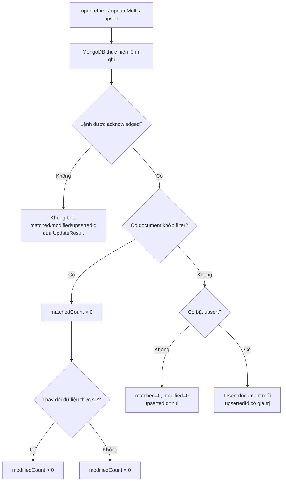

# UpdateResult: acknowledged, matchedCount, modifiedCount và upsertedId

> **Chương:** Ghi và cập nhật  
> **Module:** `SPRING_DATA_MONGODB` — sử dụng Spring Data MongoDB để kết nối, ánh xạ document và thao tác MongoDB thông qua `MongoTemplate` hoặc repository. Bài này giải thích **kết quả của thao tác cập nhật** thông qua `com.mongodb.client.result.UpdateResult`, từ ý nghĩa từng trường cho đến cách xử lý xung đột, upsert, write concern, kiểm thử và chẩn đoán hiệu năng. Đây là nền tảng để triển khai cập nhật có điều kiện, aggregation update, transaction và reactive access an toàn.

## 1. Vấn đề: gọi update không có nghĩa dữ liệu đã thay đổi

Giả sử dịch vụ thanh toán muốn chuyển đơn `ORD-001` từ `PENDING` sang `PAID`:

```java
UpdateResult result = mongoTemplate.updateFirst(
    Query.query(Criteria.where("id").is("ORD-001")
        .and("status").is("PENDING")),
    new Update().set("status", "PAID"),
    Order.class
);
```

Mệnh lệnh đã được gửi nhưng ứng dụng còn phải trả lời:

- MongoDB **có xác nhận** thao tác ghi không?
- Điều kiện `id` và `status` có khớp **document nào** không?
- Document khớp có được **thay đổi thực sự** không?
- Nếu bật **upsert** và không tìm được document, server có **tạo document mới** không?

`UpdateResult` giúp trả lời bằng bốn thông tin:

```java
boolean acknowledged = result.wasAcknowledged();
long matched = result.getMatchedCount();
long modified = result.getModifiedCount();
BsonValue upsertedId = result.getUpsertedId();
```

**Lưu ý:** phải kiểm tra `wasAcknowledged()` trước khi gọi các getter còn lại. Nếu thao tác dùng **unacknowledged write concern**, số document khớp/thay đổi và ID upsert không được bảo đảm sẵn có; các getter trên một `UpdateResult` không được xác nhận có thể ném `UnsupportedOperationException`.

### Mô hình tư duy



Sơ đồ mô tả nhánh **ghi thành công và được xác nhận**; lỗi write concern, lỗi duplicate key, kết nối bị ngắt hoặc những lỗi khác có thể khiến lời gọi **ném exception**, thay vì trả một `UpdateResult` thông thường.

## 2. UpdateResult đến từ đâu?

Trong MongoDB Java Driver, kiểu:

```java
import com.mongodb.client.result.UpdateResult;
import org.bson.BsonValue;
```

biểu diễn kết quả của các thao tác cập nhật được hỗ trợ. Với **Spring Data MongoDB imperative**, một số API trả trực tiếp `UpdateResult`:

```java
UpdateResult one =
    mongoTemplate.updateFirst(query, update, Order.class);

UpdateResult many =
    mongoTemplate.updateMulti(query, update, Order.class);

UpdateResult insertedOrUpdated =
    mongoTemplate.upsert(query, update, Order.class);
```

Ba lệnh khác nhau về mục đích:

| Phương thức | Tác động | Có upsert khi không khớp? |
| --- | --- | --- |
| `MongoTemplate.updateFirst` | Cập nhật tối đa một document khớp filter. | **Không** theo cách gọi thông thường này. |
| `MongoTemplate.updateMulti` | Cập nhật tất cả document khớp filter. | **Không** theo cách gọi thông thường này. |
| `MongoTemplate.upsert` | Cập nhật document khớp; nếu không có, chèn một document mới. | **Có**. |

Các method khác của Spring Data có thể **không** trả `UpdateResult`:

- `MongoRepository.save(entity)` trả entity đã lưu.
- `MongoTemplate.findAndModify(…)` thường trả entity theo tùy chọn trước/sau cập nhật, không trả `UpdateResult`.
- `MongoTemplate.remove(…)` trả `DeleteResult`.
- `BulkOperations.execute()` trả `BulkWriteResult`, có bộ thống kê riêng cho nhiều thao tác.

Không ép tất cả thao tác ghi thành `UpdateResult`: chọn API theo ý định nghiệp vụ và kiểu thông tin cần nhận.

## 3. Ý nghĩa chính xác của bốn thông tin

### 3.1. `wasAcknowledged()`: server có xác nhận thao tác?

`result.wasAcknowledged()` cho biết kết quả thuộc loại **acknowledged** theo write concern của thao tác.

- `true`: driver nhận được kết quả có thể dùng để biết matched/modified/upsert trong tình huống thành công.
- `false`: thao tác là **unacknowledged**; ứng dụng không được kết luận số document khớp hoặc thay đổi từ các getter.

**Acknowledged không đồng nghĩa majority-durable.** Write concern mức `w:1` và `majority` có mức bảo đảm khác nhau; cả hai vẫn là acknowledged khi thành công. `wasAcknowledged()` không cung cấp thông tin “đã được đa số replica xác nhận hay chưa” nếu không biết write concern thực tế.

### 3.2. `getMatchedCount()`: có bao nhiêu document khớp filter?

`getMatchedCount()` là số document khớp điều kiện tìm kiếm của thao tác update:

- Với `updateFirst`: thường là **0 hoặc 1**.
- Với `updateMulti`: có thể từ **0 đến nhiều document**.
- Với **upsert chèn mới** do không có document khớp: `matchedCount = 0`, vì lúc đánh giá filter chưa có document hiện hữu được cập nhật.

Matched **không có nghĩa** document đã thay đổi. Một document có thể khớp filter nhưng giá trị `$set` bằng đúng dữ liệu đã có.

### 3.3. `getModifiedCount()`: bao nhiêu document đã thay đổi?

`getModifiedCount()` đo **số document thực sự bị sửa**, không phải số field được thay đổi, không phải số byte ghi và cũng không phải số lượt gọi API.

Ví dụ:

```javascript
// Document trước khi update:
{ _id: "ORD-001", status: "PAID", attemptCount: 2 }

// Ghi lại đúng giá trị hiện có:
db.orders.updateOne(
  { _id: "ORD-001" },
  { $set: { status: "PAID" } }
);
```

Kết quả acknowledged thông thường là `matchedCount = 1`, `modifiedCount = 0`. Server tìm thấy document nhưng không cần thay đổi giá trị `status`.

Ngược lại, đổi `status` từ `PAID` thành `REFUNDED` sẽ cho `matchedCount = 1` và `modifiedCount = 1` trong một thao tác thành công. Nếu một `updateMulti` thay đổi ba field trong cùng một document, **modifiedCount vẫn chỉ tăng một** cho document đó.

### 3.4. `getUpsertedId()`: ID của document vừa được chèn qua upsert

Khi `upsert` không tìm thấy document và **tạo mới**, `getUpsertedId()` thường trả một `BsonValue` chứa ID của document vừa được chèn. Trái lại:

- Nếu upsert **cập nhật một document có sẵn**, `getUpsertedId() == null`.
- Nếu update thông thường không tìm thấy document và **không bật upsert**, `getUpsertedId() == null`.

`getUpsertedId()` là **BSON value**, không bắt buộc là Java `String` hay `ObjectId`:

```java
BsonValue id = result.getUpsertedId();

if (id != null) {
    if (id.isObjectId()) {
        String hex = id.asObjectId().getValue().toHexString();
    } else if (id.isString()) {
        String text = id.asString().getValue();
    }
}
```

Với ID do server/driver tạo, kiểu thường là `BsonObjectId`; với ID nghiệp vụ dạng chuỗi không chuyển thành ObjectId, có thể là `BsonString`. **Không gọi `asObjectId()` vô điều kiện**, vì dữ liệu ứng dụng có thể sử dụng kiểu `_id` khác.

## 4. Bảng diễn giải các tổ hợp giá trị

Giả định mọi lệnh bên dưới **được acknowledged và không ném exception**:

| Tình huống | matchedCount | modifiedCount | upsertedId |
| --- | ---: | ---: | --- |
| `updateFirst` không có document khớp | 0 | 0 | `null` |
| `updateFirst` khớp, nhưng `$set` ghi đúng giá trị cũ | 1 | 0 | `null` |
| `updateFirst` khớp và thay đổi giá trị | 1 | 1 | `null` |
| `updateMulti` khớp 5 document, chỉ 3 document cần thay đổi | 5 | 3 | `null` |
| `updateMulti` khớp 5 document, cả 5 đều thay đổi | 5 | 5 | `null` |
| `upsert` khớp một document và cập nhật thành công | 1 | 0 hoặc 1 | `null` |
| `upsert` không khớp, chèn mới thành công | 0 | 0 | ID BSON vừa tạo |

Đọc bảng theo nguyên tắc:

1. **`matchedCount > 0`**: đã có document phù hợp điều kiện, không khẳng định giá trị đã đổi.
2. **`modifiedCount > 0`**: có ít nhất một document bị sửa, trong phạm vi thao tác đã chạy.
3. **`matchedCount = 0`**: có thể không tìm thấy ID, hoặc điều kiện trạng thái/version không khớp; nếu có upsert thì còn xét `upsertedId`.
4. **`upsertedId != null`**: đã tạo document mới qua upsert; `modifiedCount` cho thao tác insert này là **0**, không phải 1.

Tổng số document mới được tạo bởi upsert **không nằm trong `modifiedCount`**. Muốn thống kê nghiệp vụ “tạo mới hay cập nhật” phải nhìn đồng thời `upsertedId`, `matchedCount` và mục đích thao tác.

## 5. Ví dụ domain và MongoTemplate

### 5.1. Model được dùng xuyên suốt

Ví dụ ứng dụng dùng hai trường liên quan cập nhật: `status` và `attemptCount`.

```java
package demo.orders;

import java.time.Instant;
import org.springframework.data.annotation.Id;
import org.springframework.data.mongodb.core.mapping.Document;

@Document(collection = "orders")
public class Order {
    @Id
    private String id;
    private String status;
    private long attemptCount;
    private Instant createdAt;
    private boolean archived;

    protected Order() {}

    public Order(String id, String status, long attemptCount, Instant createdAt) {
        this(id, status, attemptCount, createdAt, false);
    }

    public Order(String id, String status, long attemptCount,
                 Instant createdAt, boolean archived) {
        this.id = id;
        this.status = status;
        this.attemptCount = attemptCount;
        this.createdAt = createdAt;
        this.archived = archived;
    }

    public String getId() { return id; }
    public String getStatus() { return status; }
    public long getAttemptCount() { return attemptCount; }
    public Instant getCreatedAt() { return createdAt; }
    public boolean isArchived() { return archived; }
}
```

Trong service, sử dụng các import chính:

```java
import com.mongodb.client.result.UpdateResult;
import org.springframework.data.mongodb.core.MongoTemplate;
import org.springframework.data.mongodb.core.query.Criteria;
import org.springframework.data.mongodb.core.query.Query;
import org.springframework.data.mongodb.core.query.Update;
```

Ví dụ tạo sẵn một document:

```java
mongoTemplate.insert(
    new Order("ORD-001", "PENDING", 0L,
        Instant.parse("2026-11-20T09:00:00Z"))
);
```

`mongoTemplate` là bean `MongoTemplate` đã được inject vào service/test, không phải biến global tự có.

### 5.2. Chuyển trạng thái có điều kiện

```java
Query filter = Query.query(
    Criteria.where("id").is("ORD-001")
        .and("status").is("PENDING")
);

Update update = new Update().set("status", "PAID");
UpdateResult result =
    mongoTemplate.updateFirst(filter, update, Order.class);

if (!result.wasAcknowledged()) {
    throw new IllegalStateException("Write was not acknowledged");
}

if (result.getMatchedCount() == 0) {
    // Không có document thỏa cả id lẫn trạng thái PENDING.
    // Không tự kết luận đơn hàng hoàn toàn không tồn tại.
}

if (result.getModifiedCount() == 1) {
    // Một document đã thay đổi.
}
```

Lời gọi tương đương về **ý nghĩa** với:

```javascript
db.orders.updateOne(
  { _id: "ORD-001", status: "PENDING" },
  { $set: { status: "PAID" } }
);
```

Với `@Id String id` chứa `ORD-001`, Spring Data dùng metadata để ánh xạ property `id` thành BSON `_id`; chuỗi này không có dạng 24 ký tự hex ObjectId, nên minh họa lưu `_id` dạng BSON String. Với chuỗi hex hợp lệ, converter ID có thể thay đổi kiểu BSON; phải thống nhất dữ liệu/kiểu ID trong hệ thống thật.

### 5.3. Chạy lần thứ hai: matchedCount thay đổi

Sau khi lần đầu chuyển `PENDING → PAID`, chạy lại **cùng filter** `status = "PENDING"`:

```java
UpdateResult second =
    mongoTemplate.updateFirst(filter, update, Order.class);

// Nếu không có request khác thay đổi trạng thái:
// second.getMatchedCount() == 0
// second.getModifiedCount() == 0
```

Vì filter chỉ tìm đơn ở trạng thái `PENDING`, document đã `PAID` **không còn khớp**. Đây là cách viết một phép **chuyển trạng thái có điều kiện** giúp ngăn hai request cùng hoàn thành một bước nghiệp vụ dựa trên trạng thái cũ.

So sánh với filter chỉ theo ID:

```java
Query byId =
    Query.query(Criteria.where("id").is("ORD-001"));

UpdateResult sameValue =
    mongoTemplate.updateFirst(
        byId, new Update().set("status", "PAID"), Order.class
    );

// matchedCount có thể là 1, modifiedCount có thể là 0.
```

Hai kết quả khác nhau là do **filter**, không phải Spring Data hoạt động ngẫu nhiên. Phân biệt “không khớp” với “khớp nhưng không cần đổi” là mục đích chính của `UpdateResult`.

## 6. updateMulti: matchedCount không phải modifiedCount

Giả sử có năm đơn đang được chọn theo trạng thái:

```javascript
{ _id: "A", status: "PAID", archived: false }
{ _id: "B", status: "PAID", archived: false }
{ _id: "C", status: "PAID", archived: true  }
{ _id: "D", status: "PAID", archived: true  }
{ _id: "E", status: "PAID", archived: false }
```

Muốn đánh dấu tất cả đơn `PAID` là archived:

```java
Query filter = Query.query(
    Criteria.where("status").is("PAID")
);

Update update = new Update().set("archived", true);

UpdateResult result =
    mongoTemplate.updateMulti(filter, update, Order.class);
```

`Order` ở mục 5 đã có property `archived`; có thể dùng trực tiếp cùng entity khi kiểm thử. **Kết quả minh họa** khi mọi document đúng như trên và không có ghi cạnh tranh:

```text
matchedCount = 5
modifiedCount = 3
upsertedId = null
```

Hai document `C` và `D` đã có `archived: true`, nên không cần đổi giá trị. Ba document `A`, `B`, `E` được thay đổi. `modifiedCount` là số **document** chứ không phải số field.

Trong production, update nhiều document **không tự là một transaction đa document**. Mỗi cập nhật document của MongoDB có tính nguyên tử ở cấp document; với yêu cầu tất cả phải thành công đồng thời hoặc rollback như một đơn vị, cần xem xét multi-document transaction trên topology được hỗ trợ.

### 6.1. Khi nào dùng updateFirst, updateMulti?

| Nhu cầu | Lựa chọn |
| --- | --- |
| Chỉ sửa một đơn theo `_id` duy nhất | `updateFirst` |
| Chuyển trạng thái một đơn nếu đang `PENDING` | `updateFirst` với filter bao gồm trạng thái |
| Cập nhật cờ cho tất cả bản ghi khớp điều kiện | `updateMulti` |
| Tạo document nếu ID chưa có | `upsert` với điều kiện/unique index phù hợp |
| Lấy bản thể document trước/sau sửa | `findAndModify` hoặc cơ chế tương đương, không chỉ `UpdateResult` |

**Cẩn thận với updateFirst không có filter duy nhất:** nếu nhiều document khớp, chỉ một document được cập nhật. Khi có sort/tiêu chí ưu tiên, phải chọn API phù hợp và kiểm tra hành vi theo phiên bản; không ngầm giả định MongoDB chọn đúng bản ghi “đầu tiên” theo thứ tự tự nhiên.

## 7. Upsert và ý nghĩa của upsertedId

**Upsert** là “update nếu tìm thấy; insert nếu chưa có”, dùng khi hành vi tạo mới là **chủ đích nghiệp vụ**, không phải một cách sửa lỗi “update không tìm thấy”.

### 7.1. Ví dụ tạo nếu chưa có

```java
import java.time.Instant;

Query query =
    Query.query(Criteria.where("id").is("ORD-NEW-001"));

Update update = new Update()
    .set("status", "PENDING")
    .setOnInsert("createdAt", Instant.parse("2026-11-20T09:00:00Z"))
    .setOnInsert("attemptCount", 0L);

UpdateResult result = mongoTemplate.upsert(
    query, update, Order.class
);
```

Với collection ban đầu chưa có `ORD-NEW-001`, MongoDB chèn document mới. Kết quả dự kiến:

```text
wasAcknowledged() = true
getMatchedCount() = 0
getModifiedCount() = 0
getUpsertedId() = BsonString("ORD-NEW-001")  // nếu _id thực sự là BSON String
```

Khi document đã tồn tại và query vẫn khớp `_id`, lần upsert sau là nhánh **update**, thường:

```text
getMatchedCount() = 1
getModifiedCount() = 0 hoặc 1
getUpsertedId() = null
```

`$setOnInsert` chỉ gán các field khi MongoDB **chèn mới qua upsert**. Nó không ghi đè `createdAt` hoặc `attemptCount` khi update document đã tồn tại. Các field trong `$set` vẫn được áp dụng ở cả nhánh update và insert.

### 7.2. Không dùng modifiedCount để phát hiện insert

Mẫu sai:

```java
if (result.getModifiedCount() == 0) {
    // Sai: kết luận không có gì được ghi.
}
```

Khi upsert chèn mới, `modifiedCount` cũng là **0**. Kiểm tra đúng hướng:

```java
if (!result.wasAcknowledged()) {
    throw new IllegalStateException("Unacknowledged write");
}

if (result.getUpsertedId() != null) {
    // Nhánh INSERT qua upsert.
} else if (result.getMatchedCount() > 0) {
    // Nhánh UPDATE trên document đã có.
} else {
    // Không có update/insert được xác nhận; điều tra theo API và điều kiện.
}
```

Với một thao tác upsert thành công, trường hợp cuối cùng không phải nhánh thông thường; có thể xảy ra bất thường cần chẩn đoán nếu kết quả không như hợp đồng của ứng dụng.

### 7.3. Chú ý đồng thời và unique index

Hai worker có thể cùng upsert một **khóa nghiệp vụ** chưa tồn tại. Nếu filter không được bảo vệ bởi unique index phù hợp, các upsert đồng thời có nguy cơ tạo các document trùng khóa nghiệp vụ.

Ví dụ:

```javascript
db.orders.createIndex(
  { externalOrderCode: 1 },
  { unique: true }
);
```

Unique index giúp bảo vệ tính duy nhất ở tầng database. Khi có cạnh tranh, một request có thể nhận duplicate key error và cần xử lý/retry theo chiến lược nghiệp vụ. **Không giả định `UpdateResult` sẽ trả matchedCount=0 thay cho exception duplicate key**.

Nếu dùng `_id` làm khóa lookup, MongoDB có unique index mặc định trên `_id`. Với nhiều khóa khác như `tenantId + externalOrderCode`, phải thiết kế unique compound index theo phạm vi dữ liệu thật. Đồng thời đảm bảo filter và index có kiểu BSON nhất quán.

## 8. Acknowledged và write concern: đọc kết quả trong đúng bối cảnh

### 8.1. Các mức write concern

MongoDB hỗ trợ write concern để xác định mức xác nhận lệnh ghi. Tùy topology và cấu hình:

| Write concern | Ý nghĩa tổng quát | Hành vi UpdateResult |
| --- | --- | --- |
| `w: 0` | Client không yêu cầu server xác nhận kết quả ghi. | Thường nhận `UpdateResult` unacknowledged; **không dùng getters đếm**. |
| `w: 1` | Primary xác nhận thao tác theo mức write concern. | Có thể nhận kết quả acknowledged và thống kê. |
| `majority` | Yêu cầu mức xác nhận của đa số voting data-bearing nodes theo quy tắc MongoDB. | Khi thành công, kết quả vẫn acknowledged; số đếm có thể đọc được. |

`w: 1` không đồng nghĩa dữ liệu đã an toàn trước **mọi tình huống failover**. `majority` có cơ chế bảo đảm khác, và còn liên quan đến journal, read concern, replication topology, write concern timeout.

**Không thể suy write concern từ `wasAcknowledged() == true`**. Phải biết cấu hình của `MongoClient`, `MongoDatabase`, `MongoCollection` hoặc transaction đang áp dụng.

### 8.2. Ví dụ với Java Driver

```java
import com.mongodb.WriteConcern;
import com.mongodb.client.MongoCollection;
import com.mongodb.client.result.UpdateResult;
import com.mongodb.client.model.Filters;
import com.mongodb.client.model.Updates;
import org.bson.Document;

MongoCollection<Document> collection =
    mongoTemplate.getCollection("orders");

UpdateResult result = collection
    .withWriteConcern(WriteConcern.MAJORITY)
    .updateOne(
        Filters.eq("_id", "ORD-001"),
        Updates.set("status", "PAID")
    );
```

`withWriteConcern(…)` ở đây tạo **view của collection** sử dụng write concern được chỉ định cho các thao tác gọi trên view đó. Nó **không tự thay đổi mọi lời gọi `MongoTemplate.updateFirst`** ở nơi khác.

Trong một transaction, write concern cần được cấu hình đúng ở cấp transaction/client theo các ràng buộc của MongoDB; không dùng tùy tiện các tùy chọn write concern per operation bên trong transaction rồi cho rằng semantics giống thao tác độc lập.

### 8.3. Trường hợp unacknowledged

```java
UpdateResult result = collection
    .withWriteConcern(WriteConcern.UNACKNOWLEDGED)
    .updateOne(Filters.eq("_id", "ORD-001"),
               Updates.set("status", "PAID"));

if (!result.wasAcknowledged()) {
    // Không được suy luận đã match hoặc sửa bao nhiêu document.
    // Không gọi result.getMatchedCount()/getModifiedCount().
}
```

Đặc biệt với nghiệp vụ thanh toán, số dư hoặc trạng thái đơn hàng quan trọng, unacknowledged write thường không phù hợp vì ứng dụng không thể dựa vào thống kê và xác nhận theo cách mong đợi.

### 8.4. Có exception: không có kết quả thành công để diễn giải

Các lỗi như:

- Duplicate key khi upsert hoặc insert.
- Write concern error/timeout.
- Validation error hoặc schema violation.
- Network interruption, server selection timeout.
- Xung đột transaction hoặc các lỗi ghi MongoDB khác.

có thể khiến method ném exception. **Không viết logic cứ gọi update xong là chắc chắn có `UpdateResult` hợp lệ để inspect.**

Đặc biệt, nếu mất kết nối ngay sau khi gửi lệnh, phía client có thể **không biết chắc** server đã thực hiện ghi hay chưa. Thiết kế retry theo khả năng retryable writes, idempotency key và điều kiện dữ liệu; không giả định cứ lỗi mạng là server chưa ghi.

## 9. Kiểm tra kết quả để bảo vệ nghiệp vụ

### 9.1. Case: “chỉ thanh toán một lần”

Giả sử mỗi đơn chỉ được chuyển `PENDING → PAID` một lần. Filter phải chứa trạng thái cũ:

```java
public boolean markPaid(String orderId) {
    Query query = Query.query(
        Criteria.where("id").is(orderId)
            .and("status").is("PENDING")
    );
    Update update = new Update().set("status", "PAID");

    UpdateResult result =
        mongoTemplate.updateFirst(query, update, Order.class);

    if (!result.wasAcknowledged()) {
        throw new IllegalStateException("Unknown write outcome");
    }
    return result.getModifiedCount() == 1;
}
```

Với filter trên và không có các update phụ, `modifiedCount == 1` thường đồng nghĩa ứng dụng đã thực hiện thành công chuyển trạng thái. Nếu `matchedCount == 0`, nguyên nhân có thể là:

1. Không có document với ID đó.
2. Đơn hàng đã `PAID`.
3. Đơn ở trạng thái khác như `CANCELLED`.
4. Một request khác đã thay đổi trạng thái trước.

Chỉ nhìn `matchedCount==0` **không thể phân biệt** bốn nguyên nhân. Nếu API cần trả lỗi cụ thể (`404` không tồn tại, `409` sai trạng thái, `200` idempotent), có thể đọc lại document và áp dụng quy tắc nghiệp vụ. Lần đọc lại cũng có thể gặp race, vì vậy phải xác định semantics mà API chấp nhận.

### 9.2. Idempotency và kết quả no-op

Một lệnh:

```java
new Update().set("status", "PAID")
```

được thực hiện nhiều lần có thể không tạo thêm thay đổi sau lần đầu nếu filter vẫn khớp. Đây là một ví dụ **$set cùng giá trị có thể là no-op**.

Ngược lại:

```java
new Update().inc("attemptCount", 1)
```

sẽ tăng giá trị mỗi lần thao tác được thực thi và **không idempotent** trong nghĩa thông thường. Khi client retry sau lỗi mạng, một `$inc` có thể tăng nhiều hơn dự kiến nếu không có bảo vệ thích hợp; retryable writes hỗ trợ một số tình huống nhất định nhưng không thay thế quy tắc nghiệp vụ khi request được gửi lại như thao tác mới.

Nếu nghiệp vụ yêu cầu “mỗi payment event chỉ áp dụng một lần”, hãy dùng transaction, unique event ID, điều kiện phiên bản hoặc mô hình event ledger phù hợp thay vì chỉ căn cứ vào `modifiedCount`.

### 9.3. matchedCount = 1, modifiedCount = 0 không nhất thiết là lỗi

Kết quả này có thể là thao tác idempotent thành công:

```text
Filter: { _id: "ORD-001" }
Update: { $set: { status: "PAID" } }
Document trước: status="PAID"
matchedCount=1, modifiedCount=0
```

Đối với API “đặt trạng thái thành PAID”, kết quả có thể được xem là thành công. Đối với API “chuyển trạng thái từ PENDING sang PAID và phát sự kiện”, cần filter có trạng thái cũ và chỉ phát sự kiện khi chuyển đổi thực sự xảy ra.

**Đặt câu hỏi nghiệp vụ trước khi map `modifiedCount=0` thành lỗi HTTP.**

## 10. UpdateResult và optimistic locking bằng @Version

### 10.1. Vì sao chỉ khớp _id là chưa đủ?

Hai request cùng đọc đơn:

```text
Request A đọc ORD-001, version=3, status=PENDING.
Request B đọc ORD-001, version=3, status=PENDING.
A ghi PAID.
B ghi CANCELLED sau.
```

Nếu cả hai update chỉ lọc theo `_id`, request B có thể ghi đè kết quả A. `UpdateResult` của cả hai có thể báo matched=1/modified=1, nhưng dữ liệu cuối đã không còn phản ánh quyết định mong muốn.

### 10.2. Query theo ID và version dự kiến

```java
import org.springframework.data.annotation.Id;
import org.springframework.data.annotation.Version;
import org.springframework.data.mongodb.core.mapping.Document;

@Document(collection = "versioned_orders")
public class VersionedOrder {
    @Id private String id;
    @Version private Long version;
    private String status;

    protected VersionedOrder() {}
    public String getId() { return id; }
    public Long getVersion() { return version; }
    public String getStatus() { return status; }
}
```

Khi muốn cập nhật có điều kiện theo version hiện tại:

```java
long expectedVersion = 3L;

Query query = Query.query(
    Criteria.where("id").is("ORD-001")
        .and("version").is(expectedVersion)
        .and("status").is("PENDING")
);

Update update = new Update().set("status", "PAID");

UpdateResult result = mongoTemplate.updateFirst(
    query, update, VersionedOrder.class
);

if (result.wasAcknowledged() && result.getMatchedCount() == 0) {
    // Có thể ID không tồn tại, status sai, hoặc version đã đổi.
    // Không thể chỉ dựa vào count để xác định duy nhất nguyên nhân.
}
```

Theo cơ chế hỗ trợ `@Version` của Spring Data MongoDB, những update operation không tự khai báo field version trong `Update` có thể được framework **tăng version tự động**. Điều cần bảo đảm về mặt nghiệp vụ là **filter có version dự kiến**; nếu không, việc tự tăng version mà không kiểm tra version cũ vẫn có thể cho phép cập nhật cạnh tranh đè lên nhau.

Với repository `save(entity)` trên versioned entity, Spring Data áp dụng optimistic locking theo semantics riêng và có thể ném `OptimisticLockingFailureException` khi version không khớp. Với direct `updateFirst`, ứng dụng phải đọc `UpdateResult` và xử lý `matchedCount=0` theo filter đã xây. Không đồng nhất hai API.

**Đặt acknowledged write concern phù hợp** để có thể quan sát đúng xung đột. Nếu update chạy với unacknowledged write, không thể dùng `matchedCount` để xác nhận optimistic compare-and-set.

### 10.3. Tránh kiểm tra tồn tại trước rồi ghi mà thiếu điều kiện

Mẫu yếu:

```java
if (orderRepository.existsById(orderId)) {
    mongoTemplate.updateFirst(
        Query.query(Criteria.where("id").is(orderId)),
        new Update().set("status", "PAID"),
        Order.class
    );
}
```

Giữa `existsById` và `updateFirst`, document có thể bị xóa hoặc đổi trạng thái. Đây là **time-of-check to time-of-use race**. Thường tốt hơn để **một update có filter đầy đủ** quyết định liệu điều kiện có còn đúng tại thời điểm ghi hay không, rồi kiểm tra `matchedCount`.

## 11. Array/operator và các trường hợp modifiedCount bất ngờ

### 11.1. $addToSet có thể không thay đổi dữ liệu

```javascript
// Trước: { _id: "ORD-001", tags: ["priority"] }
db.orders.updateOne(
  { _id: "ORD-001" },
  { $addToSet: { tags: "priority" } }
);
```

Nếu array đã có `priority`, `$addToSet` không thêm phần tử trùng, thường nhận `matchedCount=1` và `modifiedCount=0`. Đây không phải lỗi.

### 11.2. $push, $inc và $currentDate thường tạo thay đổi

Ngược lại, các toán tử sau có thể làm thay đổi document trong mỗi lần thực thi:

```javascript
{ $push: { tags: "priority" } }
{ $inc: { attemptCount: 1 } }
{ $currentDate: { updatedAt: true } }
```

Không tự suy một kết quả update là idempotent chỉ từ `matchedCount`. Cần biết **toán tử** thực sự được dùng. Với mảng, cả `$addToSet`, `$pull`, `$push` có tình huống no-op hoặc thay đổi tùy dữ liệu ban đầu.

### 11.3. $set null và $unset

`$set: {customerNote: null}` giữ field tồn tại với BSON Null, còn `$unset: {customerNote: 1}` xóa field khỏi BSON. Hai thao tác có thể cho `modifiedCount=1` khi thực sự thay đổi trạng thái, hoặc `0` nếu trạng thái đã đúng. Điều này quan trọng khi dữ liệu cũ có cả field missing và explicit null.

Không dùng `modifiedCount` để đếm số field được `$unset`: nó đếm **document**, không đếm field.

## 12. Reactive UpdateResult: cùng semantics, khác mô hình thực thi

`ReactiveMongoTemplate.updateFirst` thường trả `Mono<UpdateResult>`; lệnh database được thực thi khi có subscription trong pipeline.

```java
import com.mongodb.client.result.UpdateResult;
import org.springframework.data.mongodb.core.query.Criteria;
import org.springframework.data.mongodb.core.query.Query;
import org.springframework.data.mongodb.core.query.Update;
import reactor.core.publisher.Mono;

Query query = Query.query(
    Criteria.where("id").is("ORD-001")
        .and("status").is("PENDING")
);

Update update = new Update().set("status", "PAID");

Mono<UpdateResult> resultMono =
    reactiveMongoTemplate.updateFirst(query, update, Order.class);

Mono<Boolean> changed = resultMono.flatMap(result -> {
    if (!result.wasAcknowledged()) {
        return Mono.error(
            new IllegalStateException("Write not acknowledged")
        );
    }
    return Mono.just(result.getModifiedCount() == 1);
});
```

Với reactive repository, `save(…)` thường trả `Mono<Order>`, **không** `Mono<UpdateResult>`. Reactive template là lựa chọn khi bạn cần chính xác các thông tin matched/modified/upsert từ update trực tiếp.

Không gọi `block()` tùy tiện trên event loop; hãy trả `Mono` cho tầng trên và để framework quản lý subscription, transaction context và cancellation. Số field BSON, matched/modified và write concern **không thay đổi nghĩa chỉ vì dùng reactive**.

### 12.1. Tại sao cần kiểm soát retry trong reactive?

Đoạn sau trông ngắn nhưng có thể nguy hiểm:

```java
return reactiveMongoTemplate.updateFirst(
    query,
    new Update().inc("attemptCount", 1),
    Order.class
).retry(3);
```

`retry(3)` có thể khiến publisher thực hiện lại thao tác nếu có lỗi; `$inc` không idempotent khi một update đã xảy ra nhưng acknowledgement bị mất. Chỉ thêm retry khi bạn hiểu retryable writes, điều kiện filter/idempotency và kiểu lỗi nào được phép thử lại.

## 13. Transaction, performance và giám sát kết quả

### 13.1. UpdateResult trong transaction

Một update nằm trong transaction có thể trả `UpdateResult` phản ánh thao tác trong transaction, nhưng **transaction có thể thất bại khi commit**. Không xem `matchedCount=1` bên trong transaction là bằng chứng cuối cùng rằng toàn bộ transaction đã commit và có hiệu lực bền vững.

Các điểm cần kiểm tra:

- Transaction manager và MongoDB topology có hỗ trợ transaction không?
- Lệnh ghi và commit có được acknowledged theo cấu hình không?
- Nếu commit báo lỗi không chắc chắn, quy trình retry/khôi phục có an toàn không?
- Event hoặc tác động tới hệ thống ngoài có bị phát trước khi commit không?

`UpdateResult` là kết quả của **một thao tác**, không phải báo cáo toàn bộ transaction.

### 13.2. Query plan quyết định thời gian của update

Ví dụ cập nhật theo `status` và `createdAt`:

```javascript
db.orders.updateMany(
  {
    status: "EXPIRED",
    createdAt: { $lt: ISODate("2026-11-01T00:00:00Z") }
  },
  { $set: { archived: true } }
);
```

Để đánh giá index và độ chọn lọc của **filter**, có thể đo bằng truy vấn đọc tương đương:

```javascript
db.orders.find({
  status: "EXPIRED",
  createdAt: { $lt: ISODate("2026-11-01T00:00:00Z") }
}).explain("executionStats");
```

Một index ứng viên:

```javascript
db.orders.createIndex({
  status: 1,
  createdAt: 1
});
```

`explain` của find giúp hiểu cách lọc document, nhưng **không đo trực tiếp toàn bộ chi phí update** như ghi index, locking, oplog, replication hoặc disk I/O. Cần đo duration, `matchedCount`/`modifiedCount`, số request, metrics server và write concern trong workload thật.

### 13.3. Thống kê nghiệp vụ từ UpdateResult

Một dịch vụ xử lý job nhiều document có thể ghi log/metric:

```java
if (result.wasAcknowledged()) {
    log.info(
        "Bulk archive result: matched={}, modified={}, upserted={}",
        result.getMatchedCount(),
        result.getModifiedCount(),
        result.getUpsertedId() != null
    );
}
```

`log` ở đây là logger dự án, ví dụ SLF4J. Log không nên chứa dữ liệu riêng tư hoặc toàn bộ document; nên bổ sung mã job, loại thao tác, duration và chỉ số tổng hợp với cardinality phù hợp.

**Không biến `matchedCount` thành “số nghiệp vụ hoàn tất”** nếu logic yêu cầu document thực sự thay đổi. Chỉ số phục vụ vận hành phải định nghĩa rõ: matched, modified, inserted qua upsert và error count là các chiều khác nhau.

## 14. Integration test: phân biệt từng nhánh thật

Một test chỉ gọi method rồi assert không ném exception là chưa đủ. Cần tạo dữ liệu **đủ phân biệt** các tình huống.

### 14.1. Chuẩn bị môi trường test

Nên chạy với MongoDB test thật (ví dụ Testcontainers), write concern có acknowledgement, database riêng và seed cô lập. Tránh dùng `dropCollection` lên môi trường có dữ liệu thật.

Các trường hợp:

| Test | Dữ liệu trước | Thao tác | Kỳ vọng |
| --- | --- | --- | --- |
| Không match | Không có `ORD-X` | `updateFirst` theo `ORD-X` | 0 / 0 / null |
| Match và thay đổi | `ORD-A` status=PENDING | `$set` status=PAID | 1 / 1 / null |
| Match nhưng no-op | `ORD-A` status=PAID | `$set` status=PAID | 1 / 0 / null |
| Update nhiều document | 5 khớp, 3 cần sửa | `updateMulti` `$set` cùng giá trị | 5 / 3 / null |
| Upsert insert | Chưa có `ORD-N` | `upsert` theo ID | 0 / 0 / ID |
| Upsert update | Đã có `ORD-N` | Chạy lại upsert | 1 / 0 hoặc 1 / null |
| Version conflict | Document có version=4 | Update với expected=3 | matched=0 |
| Unacknowledged | WriteConcern.UNACKNOWLEDGED | Update driver | `wasAcknowledged=false` |

Trong các kết quả dạng `matched / modified / upsertedId`, “null” nghĩa là không có document mới được tạo qua upsert.

### 14.2. Ví dụ JUnit 5: update và no-op

Giả định class test có `MongoTemplate mongoTemplate` đã được inject và database/collection cô lập:

```java
import static org.assertj.core.api.Assertions.assertThat;

import java.time.Instant;
import org.junit.jupiter.api.BeforeEach;
import org.junit.jupiter.api.Test;
import com.mongodb.client.result.UpdateResult;
import org.springframework.beans.factory.annotation.Autowired;
import org.springframework.boot.test.context.SpringBootTest;
import org.springframework.data.mongodb.core.MongoTemplate;
import org.springframework.data.mongodb.core.query.Criteria;
import org.springframework.data.mongodb.core.query.Query;
import org.springframework.data.mongodb.core.query.Update;

@SpringBootTest
class OrderUpdateResultTest {
    @Autowired
    private MongoTemplate mongoTemplate;

    @BeforeEach
    void seed() {
        mongoTemplate.dropCollection(Order.class);
        mongoTemplate.insert(new Order(
            "ORD-A", "PENDING", 0L,
            Instant.parse("2026-11-20T09:00:00Z")
        ));
    }

    @Test
    void distinguishesChangedAndNoOp() {
        Query byId = Query.query(Criteria.where("id").is("ORD-A"));

        UpdateResult first = mongoTemplate.updateFirst(
            byId, new Update().set("status", "PAID"), Order.class
        );
        assertThat(first.wasAcknowledged()).isTrue();
        assertThat(first.getMatchedCount()).isEqualTo(1L);
        assertThat(first.getModifiedCount()).isEqualTo(1L);
        assertThat(first.getUpsertedId()).isNull();

        UpdateResult second = mongoTemplate.updateFirst(
            byId, new Update().set("status", "PAID"), Order.class
        );
        assertThat(second.getMatchedCount()).isEqualTo(1L);
        assertThat(second.getModifiedCount()).isZero();
    }
}
```

Đoạn trên minh họa **bố cục integration test** dùng Spring Boot và `MongoTemplate`; vẫn cần kết nối MongoDB thử nghiệm độc lập, ví dụ Testcontainers, cùng cấu hình ứng dụng phù hợp. **Không gọi `dropCollection` trên database chung**. Với một MongoDB slice test có thể dùng `@DataMongoTest` ở các phiên bản hỗ trợ. Kiểm chứng readback của `status` để chắc chắn collection thật đã được cập nhật.

### 14.3. Ví dụ test upsert

```java
@Test
void upsertReturnsNewIdOnlyWhenInserted() {
    Query query = Query.query(
        Criteria.where("id").is("ORD-NEW-001")
    );
    Update update = new Update().set("status", "PENDING");

    UpdateResult first =
        mongoTemplate.upsert(query, update, Order.class);

    assertThat(first.wasAcknowledged()).isTrue();
    assertThat(first.getMatchedCount()).isZero();
    assertThat(first.getModifiedCount()).isZero();
    assertThat(first.getUpsertedId()).isNotNull();

    UpdateResult second =
        mongoTemplate.upsert(query, update, Order.class);

    assertThat(second.getMatchedCount()).isEqualTo(1L);
    assertThat(second.getUpsertedId()).isNull();
}
```

Method là phần bổ sung của lớp test có `mongoTemplate` và database test. Với data type/string ID đã thống nhất, có thể kiểm tra `first.getUpsertedId().asString().getValue()`, nhưng phải xác nhận raw BSON trước khi ép kiểu.

### 14.4. Kiểm tra số đếm nhưng không bỏ qua lỗi đồng thời

Để test optimistic update, tạo hai request dựa trên cùng version 0:

1. Cả hai xây filter theo `id` và `version=0`.
2. Một request cập nhật thành công làm version tăng.
3. Request còn lại có `matchedCount=0` khi điều kiện version không còn đúng.
4. Xác nhận dữ liệu cuối và chính sách xử lý conflict.

Với môi trường multi-thread, test cần dùng latch/barrier nếu muốn đảm bảo cạnh tranh thực sự; không kết luận về concurrency chỉ từ hai lời gọi tuần tự. Trong bài thực hành cơ bản, mô phỏng version cũ bằng request tuần tự vẫn có ích để kiểm tra điều kiện filter.

## 15. Những lỗi thường gặp

| Triệu chứng | Nguyên nhân thường gặp | Hướng xử lý |
| --- | --- | --- |
| `matchedCount=1` nhưng `modifiedCount=0` | `$set` cùng giá trị, `$addToSet` trùng, `$unset` field đã mất hoặc thao tác no-op. | Không coi là lỗi mặc định; xét operator và yêu cầu nghiệp vụ. |
| `matchedCount=0` khi chuyển trạng thái | ID không có, status/version không khớp, hoặc request khác đã sửa. | Tách nguyên nhân bằng điều kiện và đọc lại khi cần; đừng tự quy thành 404. |
| Upsert insert nhưng `modifiedCount=0` | Insert mới không được tính vào modifiedCount. | Kiểm tra `upsertedId`. |
| `upsertedId=null` dù lệnh upsert được gọi | Có document khớp nên chỉ update, không insert. | Kiểm tra `matchedCount` và BSON thực tế. |
| `getUpsertedId().asObjectId()` ném lỗi | ID mới là `BsonString` hoặc BSON type khác. | Kiểm tra `isObjectId()/isString()` trước khi ép kiểu. |
| Getter UpdateResult ném `UnsupportedOperationException` | Write concern không acknowledged. | Kiểm tra `wasAcknowledged()` và cấu hình write concern. |
| `wasAcknowledged=true` nhưng replica failover gây vấn đề | Acknowledgement không tự có nghĩa majority durability. | Xem mức write concern thực tế, replication và failure model. |
| Upsert tạo hai bản ghi cùng mã nghiệp vụ | Filter thiếu unique index hoặc nhiều request cạnh tranh. | Tạo unique index đúng phạm vi và xử lý duplicate key/retry. |
| UpdateResult không xuất hiện vì method ném exception | Lỗi ghi, validation, duplicate key, network hoặc write concern. | Xử lý exception riêng; phân biệt lỗi chắc chắn và kết quả ghi không rõ. |
| Cập nhật dựa vào `existsById` bị race | Check rồi mới update không atomic với điều kiện trạng thái. | Dùng update filter đầy đủ trên một thao tác. |
| `updateMulti` cho matched nhiều nhưng modified ít | Một số document đã có giá trị đích. | Đây có thể là hành vi đúng; dùng cả hai chỉ số. |
| Ghi trực tiếp trên versioned entity vẫn đè dữ liệu | Không đưa version kỳ vọng vào filter. | Dùng điều kiện version/optimistic locking, không chỉ tăng version. |
| Bulk job báo xử lý thành công quá nhiều | Dùng matchedCount thay vì modifiedCount hoặc upsertedId tùy định nghĩa. | Định nghĩa metric theo nghiệp vụ và ghi tách từng loại. |

**Cách debug theo trình tự:** (1) xác định method update nào được gọi; (2) xem filter BSON và tên field sau mapping; (3) xem update operators; (4) kiểm tra `wasAcknowledged`; (5) đọc matched/modified/upsertedId; (6) kiểm tra raw document sau ghi; (7) xem write concern, exceptions và query plan nếu bất thường.

## 16. Bài thực hành: xử lý đơn hàng và đồng bộ sự kiện

**Bối cảnh:** một dịch vụ nhận sự kiện thanh toán, cập nhật đơn hàng và đồng bộ bản ghi từ đối tác. Dữ liệu có ID nghiệp vụ ổn định.

1. Tạo entity `Order` và collection `orders` có các trường `_id`, `status`, `attemptCount`, `createdAt` và `archived`.
2. Chèn một đơn `PENDING`. Dùng `updateFirst` với điều kiện `id + status` để chuyển sang `PAID`. In cả `wasAcknowledged`, `matchedCount`, `modifiedCount` và `upsertedId`.
3. Chạy lại chính update với filter trạng thái `PENDING` và giải thích vì sao `matchedCount=0`.
4. Đổi filter thành chỉ theo ID rồi `$set` đúng giá trị `PAID`. Giải thích kết quả `matched=1, modified=0`.
5. Tạo năm đơn `PAID`, trong đó hai đơn `archived=true`. Dùng `updateMulti` để `$set archived=true` và giải thích `matched=5, modified=3`.
6. Dùng `upsert` theo ID chưa tồn tại; xác nhận `upsertedId` có giá trị và `modifiedCount=0`. Gọi lần hai, xác nhận nhánh update.
7. Kiểm tra BSON type của `upsertedId`; thử một ID dạng `ObjectId` trong collection riêng ở môi trường test rồi so sánh với `BsonString`.
8. Thử một update theo `id + version`. Sau khi version tăng, dùng lại version cũ và xác nhận `matchedCount=0`.
9. Thiết kế unique index cho mã giao dịch đối tác hoặc `tenantId + externalOrderCode`; mô phỏng hai request upsert cạnh tranh, xử lý duplicate key đúng cách.
10. Chạy một job có nhiều document; đo `updateMulti`, index trên filter, write concern, và log số matched/modified. Giải thích vì sao không thể suy tổng thời gian hay durability chỉ từ số đếm.
11. Viết phiên bản reactive trả `Mono<UpdateResult>`, tránh `block()` và không bật retry bừa bãi với `$inc`.
12. Tạo integration test cho tất cả nhánh, đảm bảo không ghi vào database production.

### Câu hỏi tự kiểm tra

- `wasAcknowledged()` là xác nhận gì? Có đồng nghĩa dữ liệu đã bền vững trên đa số replica không?
- Khi nào `matchedCount=1` nhưng `modifiedCount=0`?
- Vì sao `modifiedCount` là số document chứ không phải số field?
- Vì sao upsert insert mới có `modifiedCount=0` nhưng vẫn là một thao tác ghi thành công?
- `getUpsertedId()` trả kiểu dữ liệu gì, và vì sao không thể mặc định ép thành `ObjectId`?
- `matchedCount=0` đủ để kết luận document không tồn tại hay chưa? Tại sao?
- `updateFirst`, `updateMulti`, `upsert` khác nhau ở phạm vi và tạo mới như thế nào?
- Vì sao `existsById` trước update không loại trừ race condition?
- Để chống lost update, cần thêm gì vào filter khi domain có `@Version`?
- Với retry `$inc` sau lỗi mạng, rủi ro double increment là gì?
- Vì sao `UpdateResult` bên trong transaction không phải bằng chứng toàn bộ transaction đã commit?

## 17. Ghi nhớ và tài liệu đối chiếu

- **`UpdateResult`** biểu diễn kết quả một update; kiểm tra `wasAcknowledged()` trước các getter đếm.
- **`matchedCount`** là số document khớp filter; **`modifiedCount`** là số document **thực sự thay đổi**, không phải số field.
- **`upsertedId`** chỉ có ý nghĩa khi lệnh upsert **chèn document mới**; không dùng `modifiedCount` để xác định insert.
- **`matchedCount=0`** có thể do ID, trạng thái hoặc version không khớp; không đủ để phân biệt nguyên nhân nghiệp vụ.
- **`wasAcknowledged=true`** không nói lên mức durability `w:1` hay `majority`; write concern phải được cấu hình và hiểu độc lập.
- **Lỗi ghi có thể ném exception** thay vì trả `UpdateResult`, nhất là duplicate key, validation, write concern hoặc network.
- **Cập nhật có điều kiện theo trạng thái/version** giúp chống race tốt hơn bước `existsById` rồi update riêng.
- **Tính idempotent phụ thuộc update operator** (`$set` khác `$inc`), không chỉ kiểu kết quả.
- **Reactive `Mono<UpdateResult>`** có cùng semantics; transaction, index, callback và retry có ràng buộc riêng.

Nguồn chính thức để đối chiếu theo phiên bản dùng trong dự án:

- [Spring Data MongoDB — Template CRUD Operations](https://docs.spring.io/spring-data/mongodb/reference/mongodb/template-crud-operations.html)
- [Spring Data MongoDB — Optimistic Locking](https://docs.spring.io/spring-data/mongodb/reference/mongodb/template-crud-operations.html#mongo-template.optimistic-locking)
- [Spring Data MongoDB — Reactive Template APIs](https://docs.spring.io/spring-data/mongodb/reference/mongodb/template-crud-operations.html)
- [MongoDB — db.collection.updateOne()](https://www.mongodb.com/docs/manual/reference/method/db.collection.updateOne/)
- [MongoDB — db.collection.updateMany()](https://www.mongodb.com/docs/manual/reference/method/db.collection.updateMany/)
- [MongoDB — Write Concern](https://www.mongodb.com/docs/manual/reference/write-concern/)
- [MongoDB — $setOnInsert](https://www.mongodb.com/docs/manual/reference/operator/update/setOnInsert/)
- [MongoDB — Unique Indexes](https://www.mongodb.com/docs/manual/core/index-unique/)
