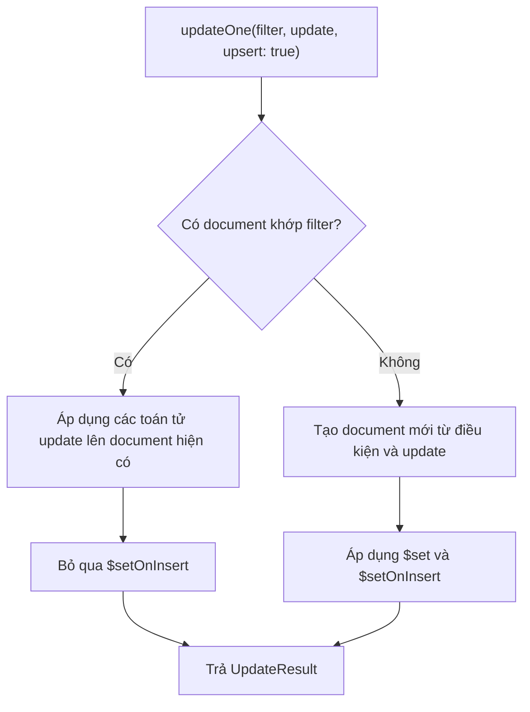

# Upsert và giá trị chỉ dùng khi insert bằng setOnInsert

## 1. Bài toán: tạo nếu chưa có, cập nhật nếu đã tồn tại

Một hệ thống đồng bộ đơn hàng nhận sự kiện từ dịch vụ ngoài. Mỗi sự kiện có `tenantId` và `externalKey`. Nếu lần đầu thấy khóa này, ứng dụng cần tạo một document với trạng thái ban đầu `NEW` và thời điểm tạo. Nếu document đã tồn tại, ứng dụng chỉ cập nhật thời điểm quan sát gần nhất hoặc một vài trường cho phép thay đổi, **không đặt lại trạng thái và ngày tạo**.

Đó là bài toán điển hình của **upsert**: *update if found, insert if missing*. MongoDB cung cấp tùy chọn `upsert: true` cho một số thao tác cập nhật; toán tử `$setOnInsert` cho phép khai báo **những giá trị chỉ được gán khi thao tác tạo document mới**.

Bài thuộc chương **Ghi và cập nhật** trong module **SPRING_DATA_MONGODB**. Trong phạm vi sử dụng Spring Data MongoDB để kết nối và ánh xạ document, thao tác qua `MongoTemplate` hoặc repository, thiết kế truy vấn, aggregation, index, transaction, reactive access, kiểm thử và chẩn đoán hiệu năng, upsert là một cơ chế quan trọng vì nó nằm ở giao điểm giữa **đúng dữ liệu, tính đồng thời và hiệu năng ghi**.

Sau bài học, bạn có thể:

1. Mô tả chính xác hai nhánh của upsert và vai trò của `$setOnInsert`.
2. Phân biệt `$set`, `$setOnInsert`, `insert`, `save` và `updateFirst`.
3. Viết upsert bằng mongosh, `MongoOperations`/`MongoTemplate` và API reactive khi phiên bản hỗ trợ.
4. Thiết kế khóa nghiệp vụ và **unique index** để giảm trùng document khi nhiều request chạy đồng thời.
5. Xử lý đúng `createdAt`, trạng thái ban đầu, `null`/missing, lỗi duplicate key và tác dụng phụ khi retry.
6. Kiểm thử cả nhánh insert lẫn nhánh update bằng BSON thực, `UpdateResult` và tình huống cạnh tranh.

Các ví dụ dùng Java 17+ và Spring Data MongoDB imperative hiện đại. Những khác biệt theo phiên bản MongoDB server, Java driver và Spring Data cần được kiểm tra trong môi trường dự án trước khi triển khai thật.

## 2. Upsert là gì và khác update thông thường như thế nào?

Một lệnh `updateOne(filter, update)` bình thường chỉ sửa document nếu có document khớp. Nếu không có, thao tác có thể trả `matchedCount = 0` mà không tạo gì mới.

Khi thêm tùy chọn `upsert: true`:



| Tình huống | `upsert: false` | `upsert: true` |
| --- | --- | --- |
| Có document khớp | Cập nhật document đó | Cập nhật document đó |
| Không có document khớp | Không tạo document | Tạo một document mới theo quy tắc upsert |
| `$setOnInsert` khi đã khớp | Không có tác dụng | Không có tác dụng |
| `$setOnInsert` khi không khớp | Không tạo document | Góp giá trị vào document mới |

**Cần phân biệt:** Upsert là lựa chọn của thao tác ghi, không phải tên một loại document. Nó cũng không có nghĩa «kiểm tra tồn tại trước ở Java, rồi tùy kết quả gọi insert hoặc update»: MongoDB thực hiện việc tìm và ghi trên server trong một operation.

### 2.1. Ví dụ tối thiểu trong mongosh

```javascript
db.sync_records.updateOne(
  { tenantId: "tenant-a", externalKey: "evt-001" },
  {
    $set: { payloadHash: "sha256:a1", lastSeenAt: ISODate("2026-11-20T03:00:00Z") },
    $setOnInsert: {
      createdAt: ISODate("2026-11-20T03:00:00Z"),
      status: "NEW"
    }
  },
  { upsert: true }
);
```

Nếu đây là lần đầu có khóa `(tenant-a, evt-001)`, một document mới được tạo. Nếu chạy lại với cùng filter và document đã tồn tại, `payloadHash` và `lastSeenAt` có thể thay đổi, nhưng `createdAt` và `status` **không bị gán lại bởi `$setOnInsert`**.

Giá trị như `ISODate(...)` ở ví dụ là BSON Date. Nếu dữ liệu thật dùng String hoặc một kiểu khác cho thời điểm, cần xác định contract và migration thay vì giả định hai kiểu tương đương.

## 3. $set và $setOnInsert khác nhau chính xác ở đâu?

Đây là phần cốt lõi của bài.

| Toán tử | Document đã tồn tại, khớp filter | Document mới do upsert tạo |
| --- | --- | --- |
| `$set` | Ghi hoặc thay field được chỉ định | Ghi field vào document mới |
| `$setOnInsert` | **Bỏ qua** | Ghi field vào document mới |
| `$inc` | Tăng số hiện tại | Khởi tạo/tăng giá trị theo quy tắc operator |
| `$unset` | Xóa field | Không tạo field đó |

Một cách hiểu dễ nhớ:

```text
$set          = "điều này cần đúng sau thao tác, dù insert hay update"
$setOnInsert  = "điều này chỉ được gán khi vừa tạo record"
```

### 3.1. Vì sao đặt createdAt trong $set là sai?

Ví dụ **không phù hợp** nếu cần bảo toàn thời điểm tạo:

```javascript
db.sync_records.updateOne(
  { tenantId: "tenant-a", externalKey: "evt-001" },
  {
    $set: {
      status: "NEW",
      createdAt: new Date(),
      lastSeenAt: new Date()
    }
  },
  { upsert: true }
);
```

Mỗi lần document khớp, lệnh này có thể đặt lại cả `status` và `createdAt`. Nếu một record đang `DONE`, gọi đồng bộ lại có thể đưa nó về `NEW` — lỗi nghiệp vụ nghiêm trọng.

Phiên bản đúng khi chỉ cập nhật thời điểm gần nhất:

```javascript
const now = new Date();

db.sync_records.updateOne(
  { tenantId: "tenant-a", externalKey: "evt-001" },
  {
    $set: { lastSeenAt: now, updatedAt: now },
    $setOnInsert: { createdAt: now, status: "NEW" }
  },
  { upsert: true }
);
```

Sử dụng cùng biến `now` giữ giá trị thời gian nhất quán trong một lời gọi. Trong hệ thống phân tán, việc dùng đồng hồ ứng dụng cần được đánh giá; nếu yêu cầu timestamp do database quyết định, xem xét các operator như `$currentDate` cho các field được cập nhật mỗi lần, cùng với contract riêng cho timestamp insert-only.

### 3.2. $setOnInsert không tự bảo vệ field khỏi mọi thao tác khác

`$setOnInsert` không phải ràng buộc bất biến ở database. Một lệnh khác:

```javascript
db.sync_records.updateOne(
  { tenantId: "tenant-a", externalKey: "evt-001" },
  { $set: { createdAt: ISODate("2030-01-01T00:00:00Z") } }
);
```

vẫn có thể sửa `createdAt` nếu không có validation, quyền hoặc quy tắc khác ngăn lại. `$setOnInsert` chỉ quyết định hành vi **trong lệnh upsert đang xét**.

## 4. Document được tạo từ đâu khi không có bản ghi khớp?

Khi upsert theo cú pháp update operators, MongoDB tạo document mới dựa trên **các điều kiện equality thích hợp trong filter** và các thay đổi của update. Đừng hình dung server «sao chép nguyên vẹn mọi biểu thức của filter» vào document.

### 4.1. Equality filter đơn giản

```javascript
db.sync_records.updateOne(
  {
    tenantId: "tenant-a",
    externalKey: "evt-002"
  },
  {
    $set: { payloadHash: "sha256:b2" },
    $setOnInsert: {
      status: "NEW",
      createdAt: ISODate("2026-11-20T03:05:00Z")
    }
  },
  { upsert: true }
);
```

Document mới có thể có dạng:

```javascript
{
  _id: ObjectId("..."),  // Minh họa: server tạo _id nếu không có.
  tenantId: "tenant-a",
  externalKey: "evt-002",
  payloadHash: "sha256:b2",
  status: "NEW",
  createdAt: ISODate("2026-11-20T03:05:00Z")
}
```

`ObjectId("...")` là ký hiệu minh họa, **không phải chuỗi ObjectId hợp lệ để copy chạy**. Trên database thật, `_id` sẽ mang giá trị cụ thể do server/driver cấp theo cấu hình và filter.

### 4.2. Filter không phải bản thiết kế document

Đừng dùng filter gồm `$or`, `$gte`, điều kiện trạng thái hoặc biểu thức phức tạp rồi mặc định server biết phải tạo field nào với giá trị gì. Với upsert, tốt nhất dùng **khóa nghiệp vụ ổn định được biểu diễn bằng equality rõ ràng**, rồi cung cấp các field khác qua update.

Ví dụ cần tránh:

```javascript
// Rủi ro: status là điều kiện của trạng thái hiện tại,
// không phải khóa định danh duy nhất của bản ghi.
db.sync_records.updateOne(
  {
    tenantId: "tenant-a",
    externalKey: "evt-001",
    status: "NEW"
  },
  {
    $set: { payloadHash: "sha256:new" },
    $setOnInsert: { createdAt: new Date() }
  },
  { upsert: true }
);
```

Nếu bản ghi `evt-001` đã chuyển sang `DONE`, filter không khớp. Upsert có thể **cố tạo bản ghi mới** thay vì từ chối transition. Nếu có unique index đúng khóa nghiệp vụ, thao tác có thể báo duplicate key; nếu không có, nó có thể tạo dữ liệu trùng logic.

**Quy tắc:** Tìm kiếm bằng khóa dùng để xác định **bản ghi nào**; kiểm tra transition bằng điều kiện trạng thái nên nằm trong **lệnh update không upsert**, hoặc được thiết kế riêng với chính sách lỗi rõ ràng.

## 5. Thiết kế schema và khóa nghiệp vụ cho ví dụ

### 5.1. Entity trong Spring Data MongoDB

Giả sử lưu một record cho mỗi khóa sự kiện bên ngoài trong từng tenant:

```java
import java.time.Instant;
import org.bson.types.ObjectId;
import org.springframework.data.annotation.Id;
import org.springframework.data.mongodb.core.mapping.Document;

@Document(collection = "sync_records")
public record SyncRecord(
    @Id ObjectId id,
    String tenantId,
    String externalKey,
    String payloadHash,
    SyncStatus status,
    Instant createdAt,
    Instant updatedAt,
    Instant lastSeenAt
) {}

enum SyncStatus {
    NEW, PROCESSING, DONE, FAILED
}
```

Ở đây `_id` là BSON ObjectId, còn khóa nghiệp vụ là bộ đôi `tenantId + externalKey`. Hai loại ID có mục đích khác nhau: `_id` định danh một document vật lý; cặp khóa nghiệp vụ dùng để nhận biết sự kiện đã được xử lý hoặc đồng bộ trước đó.

`SyncStatus` là enum Java. Trong cấu hình mapping thông dụng, enum được ghi bằng tên String như `"NEW"`; nếu ứng dụng có converter tùy chỉnh, cần xác minh kiểu BSON thật.

### 5.2. Unique index là phần bắt buộc của bất biến

```javascript
db.sync_records.createIndex(
  { tenantId: 1, externalKey: 1 },
  {
    name: "uk_sync_tenant_external",
    unique: true
  }
);
```

Index này giúp database ngăn **hai document có cùng cặp giá trị BSON** của `tenantId` và `externalKey`. Nó cũng có thể hỗ trợ truy vấn equality tìm record theo khóa này.

Trước khi tạo unique index trên dữ liệu đã có, phải tìm và xử lý các bản ghi trùng. Tài khoản ứng dụng không nhất thiết nên có quyền tạo index trên production; quản lý schema/index qua quy trình migration được phê duyệt là cách phổ biến.

**Không chỉ dựa vào annotation:** `@CompoundIndex(unique = true)` có thể mô tả ý định ở entity nhưng việc index có thực sự được tạo hay không phụ thuộc cấu hình index creation và triển khai. Hãy kiểm tra `db.sync_records.getIndexes()`.

### 5.3. Khóa phải ổn định và đủ phạm vi tenant

Với hệ thống nhiều tenant:

- `externalKey` có thể chỉ duy nhất **trong một tenant**, nên dùng index tổng hợp.
- `tenantId` phải đến từ context đáng tin cậy hoặc được service kiểm tra quyền.
- Không dùng một trường hay thay đổi như `status`, `updatedAt` hoặc `payloadHash` làm thành phần khóa định danh upsert nếu business không quy định nó bất biến.
- Xác định chính sách chuẩn hóa String, chữ hoa/thường và collation nếu khóa có dạng tên/mã.

Nếu `externalKey` null hoặc thiếu, unique index và semantics của khóa có thể khác ý định. Validate trước khi upsert; không chấp nhận khóa trống bằng cách «cho database tự xử lý».

## 6. Spring Data MongoDB: MongoOperations.upsert(...)

### 6.1. Viết service đúng hai nhánh

Một implementation minh họa:

```java
import java.time.Instant;
import com.mongodb.client.result.UpdateResult;
import org.springframework.data.mongodb.core.MongoOperations;
import org.springframework.data.mongodb.core.query.Criteria;
import org.springframework.data.mongodb.core.query.Query;
import org.springframework.data.mongodb.core.query.Update;
import org.springframework.stereotype.Service;

@Service
public class SyncRecordService {
    private final MongoOperations mongo;

    public SyncRecordService(MongoOperations mongo) {
        this.mongo = mongo;
    }

    public UpdateResult registerOrTouch(
        String authenticatedTenantId,
        String externalKey,
        String payloadHash
    ) {
        if (authenticatedTenantId == null
            || authenticatedTenantId.isBlank()
            || externalKey == null || externalKey.isBlank()) {
            throw new IllegalArgumentException("Missing stable key");
        }

        Instant now = Instant.now();

        Query query = Query.query(
            Criteria.where("tenantId").is(authenticatedTenantId)
                .and("externalKey").is(externalKey)
        );

        Update update = new Update()
            .set("payloadHash", payloadHash)
            .set("lastSeenAt", now)
            .set("updatedAt", now)
            .setOnInsert("status", SyncStatus.NEW)
            .setOnInsert("createdAt", now);

        return mongo.upsert(query, update, SyncRecord.class);
    }
}
```

Trong thực tế, `authenticatedTenantId` phải lấy từ security context đã xác thực; `payloadHash` cần được validate theo contract. `MongoOperations` là interface, `MongoTemplate` thường là implementation được inject. Phương thức này dùng query theo **khóa nghiệp vụ**, không theo trạng thái tạm thời.

**Chính sách ghi trong ví dụ:** Mỗi lần nhận sự kiện, `payloadHash` có thể được làm mới. Đây là lựa chọn phù hợp cho record thể hiện trạng thái đồng bộ hiện hành. Nếu payload của sự kiện phải bất biến sau lần đầu ghi, phải thay `set("payloadHash", ...)` thành `setOnInsert("payloadHash", ...)` và xây quy tắc xử lý sự kiện trùng riêng.

### 6.2. Những gì được ghi khi insert?

Giả sử chưa có bản ghi tương ứng. Upsert có thể sinh BSON:

```javascript
{
  _id: ObjectId("507f1f77bcf86cd799439011"),
  tenantId: "tenant-a",
  externalKey: "evt-001",
  payloadHash: "sha256:a1",
  lastSeenAt: ISODate("2026-11-20T03:00:00Z"),
  updatedAt: ISODate("2026-11-20T03:00:00Z"),
  createdAt: ISODate("2026-11-20T03:00:00Z"),
  status: "NEW"
}
```

Đây là document minh họa với ObjectId cụ thể để hiển thị đúng cú pháp. Giá trị ObjectId, thời gian và khả năng xuất hiện metadata BSON khác tùy môi trường.

### 6.3. Những gì xảy ra khi đã có bản ghi?

Giả sử record đã là:

```javascript
{
  tenantId: "tenant-a",
  externalKey: "evt-001",
  status: "DONE",
  createdAt: ISODate("2026-11-01T00:00:00Z"),
  payloadHash: "sha256:old"
}
```

Khi gọi `registerOrTouch(...)` với khóa đó, update sửa những field thuộc `$set` như `payloadHash`, `lastSeenAt` và `updatedAt`. **Không** đổi `status: "DONE"` thành `"NEW"` và không đặt lại ngày tạo vì `$setOnInsert` bị bỏ qua trong nhánh matched.

### 6.4. Cách đọc UpdateResult

```java
UpdateResult result = service.registerOrTouch(
    "tenant-a", "evt-001", "sha256:a1"
);

if (result.getUpsertedId() != null) {
    // Nhánh tạo document mới.
} else if (result.getMatchedCount() > 0) {
    // Có document đã tồn tại khớp điều kiện.
} else {
    // Xem lại trạng thái acknowledgment/lỗi và contract.
}
```

Trong ví dụ, `service` là bean `SyncRecordService` đã được inject. Khi write được acknowledge:

| Kết quả | Ý nghĩa thực dụng |
| --- | --- |
| `getUpsertedId() != null` | Server báo có document được tạo bởi upsert |
| `getMatchedCount() == 1` | Tìm thấy document có sẵn khớp filter |
| `getModifiedCount() == 1` | Document hiện có thực sự thay đổi theo phép update |
| `getModifiedCount() == 0` | Có thể là no-op; **không chứng minh** document không tồn tại |

Thao tác thất bại, timeout hoặc kết quả không được acknowledge cần xử lý theo exception và write concern. Không dựa vào `modifiedCount` đơn lẻ để xác định nhánh insert. Trước khi đọc các count, cần hiểu write concern đang áp dụng.

## 7. Nếu chỉ muốn «create if absent» thì sao?

Có hai use case dễ bị trộn lẫn:

1. **Register or touch:** Tạo lần đầu, mỗi lần gọi sau cập nhật `lastSeenAt`.
2. **Create if absent:** Tạo lần đầu, các lần gọi sau **không thay đổi** document.

Trường hợp thứ hai có thể dùng chỉ `$setOnInsert` trong update:

```javascript
db.sync_records.updateOne(
  { tenantId: "tenant-a", externalKey: "evt-once" },
  {
    $setOnInsert: {
      status: "NEW",
      payloadHash: "sha256:original",
      createdAt: new Date()
    }
  },
  { upsert: true }
);
```

Nếu record đã tồn tại, operator `$setOnInsert` không làm gì; trạng thái và payload ban đầu được giữ nguyên **đối với lệnh này**. Có thể xem đây là một cách biểu diễn *insert-if-missing* khi cần dựa vào khóa nghiệp vụ khác `_id`.

Tuy nhiên, `$setOnInsert` không tự bảo đảm «xử lý sự kiện đúng một lần» ở các hệ thống ngoài database. Nếu sau khi upsert còn gửi email, xuất hóa đơn hoặc publish message, phải thiết kế **idempotency và giao dịch/tác dụng phụ** riêng.

### 7.1. Không nhầm create-only với insert(...)

`mongo.insert(entity)` là thao tác tạo document theo ID, thường báo duplicate key nếu ID đã có. Với khóa nghiệp vụ `tenantId + externalKey`, cả insert và upsert đều cần ràng buộc unique phù hợp.

| Nhu cầu | Cách thường dùng |
| --- | --- |
| Tạo document, lỗi nếu khóa đã tồn tại | `insert(...)` với khóa và unique index phù hợp |
| Tạo lần đầu, gọi lại không thay đổi record | Upsert chỉ với `setOnInsert(...)` |
| Tạo lần đầu, gọi lại cập nhật một số field | Upsert với `set(...)` + `setOnInsert(...)` |
| Chỉ sửa document đã tồn tại, không được tạo mới | `updateFirst(...)` không upsert |
| Chuyển trạng thái theo điều kiện | Update có điều kiện ID/tenant/status/version, **không upsert** |

Không có một lựa chọn đúng cho mọi nghiệp vụ. Cần nói rõ ý định và kiểm thử hành vi khi request được gửi lại.

## 8. Không được dùng cùng đường dẫn ở các toán tử xung đột

Một lệnh như sau là **sai ý định**:

```javascript
db.sync_records.updateOne(
  { tenantId: "tenant-a", externalKey: "evt-003" },
  {
    $set: { createdAt: new Date() },
    $setOnInsert: { createdAt: new Date() }
  },
  { upsert: true }
);
```

Hai operator cùng nhắm tới field `createdAt` có thể gây **conflicting update path**. Không nên nghĩ rằng MongoDB sẽ «ưu tiên `$setOnInsert` lúc insert, ưu tiên `$set` lúc update» cho cùng field.

Tương tự, tránh đồng thời thay cả document cha và một trường con trong cùng update:

```javascript
// Không nên kết hợp đường dẫn cha/con xung đột.
{
  $set: { metadata: { source: "A" } },
  $setOnInsert: { "metadata.createdAt": new Date() }
}
```

Hãy tổ chức trường theo **một đường cập nhật rõ ràng**:

- `createdAt` chỉ trong `$setOnInsert`.
- `updatedAt` trong `$set` hoặc cơ chế update-time thích hợp.
- `status` chỉ `$setOnInsert` nếu nó là trạng thái khởi tạo.
- Các field con của `metadata` được cập nhật bằng dot notation nhất quán, tránh chạm đồng thời vào parent path.

Với data conversion và `@Field` đổi tên, hãy kiểm tra path BSON **sau khi mapping**, vì hai property Java khác cách viết cũng có thể trỏ đến cùng field vật lý.

## 9. Giá trị mặc định, null và dữ liệu legacy

### 9.1. $setOnInsert không phải «set if null»

Đây là nhầm lẫn phổ biến nhất:

```javascript
// Document đã có từ trước, nhưng thiếu status.
{ tenantId: "tenant-a", externalKey: "evt-old", createdAt: ISODate("2025-01-01T00:00:00Z") }
```

Khi gọi:

```javascript
db.sync_records.updateOne(
  { tenantId: "tenant-a", externalKey: "evt-old" },
  {
    $set: { lastSeenAt: new Date() },
    $setOnInsert: { status: "NEW" }
  },
  { upsert: true }
);
```

document đã **khớp filter**, nên `status` vẫn **thiếu**. `$setOnInsert` **không** điền field thiếu trên document hiện hữu; nó chỉ chạy trong nhánh tạo document.

### 9.2. Phân biệt missing, null và giá trị hợp lệ

```javascript
db.sync_records.find({ status: { $exists: false } });
db.sync_records.find({ status: { $type: "null" } });
db.sync_records.find({ status: "NEW" });
```

Ba nhóm có ý nghĩa khác nhau. Truy vấn `{ status: null }` thường khớp cả BSON Null và missing, nên không nên dùng khi cần phân loại dữ liệu cần backfill chính xác.

Nếu dữ liệu cũ thiếu `status`, cần **migration/backfill có quy tắc được xác nhận**. Đừng gán `NEW` cho mọi record cũ nếu business không thể xác định chúng thật sự chưa được xử lý.

### 9.3. $set null khác với bỏ qua field

```javascript
// Ghi BSON Null cho field, trên cả hai nhánh nếu thao tác phù hợp.
{ $set: { payloadHash: null } }

// Chỉ khởi tạo BSON Null khi tạo document; không sửa document hiện hữu.
{ $setOnInsert: { optionalNote: null } }
```

Nếu client gửi `payloadHash = null`, cần quyết định null có nghĩa «xóa giá trị cũ» hay «không cập nhật». Đừng tự động gọi `set("payloadHash", null)` nếu nghiệp vụ muốn giữ lại hash hiện hữu khi request không có field đó. Với nghĩa **xóa field**, `$unset` khác với đặt BSON Null.

## 10. Upsert và @CreatedDate/@LastModifiedDate

Trong Spring Data MongoDB, entity auditing có thể hỗ trợ `@CreatedDate` và `@LastModifiedDate` khi cấu hình đúng. Nhưng không nên suy luận rằng mọi lệnh `MongoOperations.upsert(query, update, type)` đều đi qua cùng luồng entity callbacks như `insert(entity)` hoặc `save(entity)`.

Ví dụ:

```java
@org.springframework.data.annotation.CreatedDate
Instant createdAt;

@org.springframework.data.annotation.LastModifiedDate
Instant updatedAt;
```

Hai annotation trên mô tả ý định ở **entity lifecycle**. Trong lệnh upsert dựa trên `Update`, cách rõ ràng nhất cho ví dụ là cung cấp:

```java
Instant now = Instant.now();

Update update = new Update()
    .set("updatedAt", now)
    .setOnInsert("createdAt", now);
```

Nếu dự án có custom callback, `@Version`, server timestamps hay conversion đặc biệt, test riêng đường upsert để biết trường nào thực sự được ghi. Đừng giả định upsert sẽ khởi tạo đầy đủ mọi default nằm ở constructor Java hoặc field initializer, vì server tạo document từ filter/update chứ không nhất thiết tạo entity Java rồi gọi `save`.

## 11. Unique index, race condition và duplicate key

### 11.1. Hai request upsert đồng thời

Giả sử worker A và B cùng nhận `evt-009` khi collection chưa có document tương ứng:

```text
Worker A                              Worker B
   |                                     |
   | upsert (tenant-a, evt-009)          | upsert (tenant-a, evt-009)
   |                                     |
   v                                     v
MongoDB: tìm document matching + quyết định insert/update
   |
   v
Unique index (tenantId, externalKey) bảo vệ bất biến không trùng khóa
```

Upsert **không miễn trừ mọi race condition ứng dụng**. Khi có nhiều thao tác đồng thời, một lệnh có thể insert, lệnh kia có thể update hoặc gặp duplicate-key error tùy điều kiện và thời điểm thực thi. Điều kiện bảo vệ, query filter và unique index đều ảnh hưởng khả năng thành công.

Nếu **không có unique index**, hai upsert cạnh tranh có thể tạo **hai document cùng khóa nghiệp vụ**. Vì vậy, chỉ dùng «một lệnh upsert nguyên tử» không thay thế ràng buộc uniqueness.

### 11.2. Xử lý duplicate-key đúng mục đích

Trong Spring Data, lỗi duplicate key có thể được dịch thành `DuplicateKeyException` hoặc xuất hiện dưới dạng driver exception được bọc. Mẫu xử lý phải phù hợp nghiệp vụ:

1. Xác định có phải duplicate đúng **khóa nghiệp vụ upsert** hay không.
2. Với create-if-absent, có thể đọc lại document theo khóa và xác nhận payload/ý nghĩa có tương thích không.
3. Với register-or-touch, có thể retry theo chính sách có giới hạn và đủ điều kiện, sau khi xác nhận không có xung đột dữ liệu.
4. Không bắt **mọi** exception rồi coi là request trùng hợp lệ.
5. Thực thi retry có idempotency, giới hạn số lần, backoff và quan sát lỗi.

Trường hợp payload của hai request cùng key nhưng khác nội dung cần một **quy tắc xung đột**: giữ bản đầu, giữ bản mới nhất có version hợp lệ, hoặc từ chối. Unique index không quyết định thay nghiệp vụ.

### 11.3. Tạo unique index không tự sửa dữ liệu trùng

Nếu collection cũ đã có hai record với cùng `tenantId + externalKey`, lệnh tạo unique index có thể thất bại. Trước khi triển khai:

```javascript
db.sync_records.aggregate([
  {
    $group: {
      _id: {
        tenantId: "$tenantId",
        externalKey: "$externalKey"
      },
      count: { $sum: 1 },
      ids: { $push: "$_id" }
    }
  },
  { $match: { count: { $gt: 1 } } }
]);
```

Aggregation này để **kiểm kê**; ở collection lớn, `$push` toàn bộ ID cho mỗi nhóm có thể tốn bộ nhớ. Có thể chỉ đếm trước, rồi phân trang/batch để điều tra nhóm trùng. Không tự xóa các document trùng nếu chưa có kế hoạch hợp nhất nghiệp vụ và rollback.

## 12. Không dùng upsert cho chuyển trạng thái có điều kiện

Một đơn chỉ được giao khi ở trạng thái `READY_TO_SHIP`. Nếu viết:

```javascript
// Rủi ro: có thể cố insert bản ghi khi trạng thái không khớp.
db.orders.updateOne(
  {
    _id: "order-01",
    tenantId: "tenant-a",
    status: "READY_TO_SHIP"
  },
  { $set: { status: "SHIPPED" } },
  { upsert: true }
);
```

nếu đơn đã `CANCELLED`, filter không khớp; server có thể cố tạo document thay vì trả «không có đơn ở trạng thái cho phép». Điều này khác với semantics mong muốn của state transition.

Thực hiện đúng:

```javascript
db.orders.updateOne(
  {
    _id: "order-01",
    tenantId: "tenant-a",
    status: "READY_TO_SHIP"
  },
  {
    $set: {
      status: "SHIPPED",
      updatedAt: new Date()
    }
  }
  // Không truyền upsert: true.
);
```

Trong Spring Data:

```java
Query transition = Query.query(
    Criteria.where("id").is(orderId)
        .and("tenantId").is(authenticatedTenantId)
        .and("status").is(OrderStatus.READY_TO_SHIP)
);

Update change = new Update()
    .set("status", OrderStatus.SHIPPED)
    .set("updatedAt", Instant.now());

UpdateResult result =
    mongo.updateFirst(transition, change, OrderDocument.class);
```

Các tên `OrderStatus` và `OrderDocument` trong snippet này đại diện cho mô hình đơn hàng **khác** với `SyncRecord` dùng trong bài. Lệnh nhằm minh họa lựa chọn API theo semantics, không yêu cầu bổ sung file ngoài bài được giao.

Nếu `matchedCount == 0`, service phải phân loại kết quả phù hợp (không tồn tại, sai tenant, trạng thái đã thay đổi) nhưng tránh tiết lộ dữ liệu của tenant khác.

## 13. Upsert không tự xử lý version và toàn bộ validation

### 13.1. Về @Version

`@Version` trong Spring Data MongoDB hỗ trợ optimistic locking ở những đường save/update tương thích. Tuy nhiên, một upsert dùng `Query` và `Update` không mặc nhiên có nghĩa:

- Đã kiểm tra version entity được đọc trước đó.
- Đã chạy toàn bộ business validation của domain.
- Đã kích hoạt mọi callback/auditing giống `save(entity)`.
- Đã bảo đảm document mới có đủ tất cả field bắt buộc theo constructor Java.

Nếu sự kiện đồng bộ có version từ upstream, thiết kế logic version một cách riêng biệt. Ví dụ, khi chỉ được cập nhật từ version cũ sang version mới, cần định nghĩa điều kiện và xử lý xung đột **không làm phát sinh insert ngoài ý muốn**.

### 13.2. Validation ở server và ứng dụng

MongoDB có thể dùng collection schema validation để từ chối document thiếu field hoặc sai kiểu BSON. Tầng ứng dụng cũng cần validate:

| Field | Quy tắc đề xuất |
| --- | --- |
| `tenantId` | Bắt buộc, lấy từ context đáng tin cậy |
| `externalKey` | Bắt buộc, chuẩn hóa theo contract định danh |
| `status` | Giá trị enum hợp lệ, chỉ khởi tạo khi insert |
| `createdAt` | BSON Date, phải có trên bản ghi mới |
| `payloadHash` | Kiểu String/format thống nhất và có chính sách khi thay đổi |
| `updatedAt` | Giá trị thời gian thích hợp, logic cập nhật được kiểm chứng |

Không gán giá trị default cho dữ liệu legacy mà chưa có bằng chứng nghiệp vụ. `$setOnInsert` giúp tạo record **mới** theo hợp đồng, còn dữ liệu **cũ** phải được xử lý bằng migration/backfill khi cần.

## 14. Các biến thể Update và vấn đề mở rộng

### 14.1. Increment và giá trị khởi tạo

Giả sử muốn đếm số lần gặp một khóa. Lệnh:

```javascript
db.sync_records.updateOne(
  { tenantId: "tenant-a", externalKey: "evt-count" },
  {
    $inc: { seenCount: 1 },
    $setOnInsert: { createdAt: new Date(), status: "NEW" }
  },
  { upsert: true }
);
```

Khi insert, `$inc` có thể tạo giá trị bộ đếm ban đầu theo quy tắc toán tử; khi matched, nó tiếp tục tăng. **Retry** request có thể làm số đếm tăng thêm, vì thế đây không phải đếm «số sự kiện logic duy nhất» nếu cùng sự kiện được gửi nhiều lần.

Không được đồng thời `$inc: { seenCount: 1 }` và `$setOnInsert: { seenCount: 0 }` trên cùng path rồi giả định server tự kết hợp; đây là xung đột path cần tránh.

### 14.2. Dữ liệu nested và path conflict

Với metadata nhúng, nên cập nhật tường minh:

```javascript
db.sync_records.updateOne(
  { tenantId: "tenant-a", externalKey: "evt-nested" },
  {
    $set: {
      "metadata.lastSource": "partner-b"
    },
    $setOnInsert: {
      "metadata.firstSource": "partner-a",
      createdAt: new Date()
    }
  },
  { upsert: true }
);
```

Hai field con **khác nhau** có thể cùng xuất hiện trong metadata mới. Tránh đồng thời `$set: { metadata: {...} }` và `$setOnInsert: { "metadata.firstSource": ... }` vì đường dẫn cha/con chồng lấn có thể gây xung đột.

### 14.3. Array và custom conversion

Nếu default insert-only là một array hoặc object, Spring Data chuyển kiểu Java sang BSON qua mapping/converter. Nếu array sẽ tiếp tục được cập nhật ở những lần gọi sau, cần phân biệt:

- `$setOnInsert` chỉ đặt **giá trị khởi tạo**.
- `$addToSet` hoặc `$push` có thể thay đổi array ở các lần update phù hợp.
- Một lệnh chứa nhiều update operator lên cùng array/path có thể xung đột.
- Việc chuyển đổi kiểu và `@Field` alias cần được test trên BSON thực tế.

Đừng dựa vào default array ở constructor Java để kết luận một upsert ở server chắc chắn tạo array đó.

## 15. Upsert trong MongoTemplate, repository và reactive stack

### 15.1. Vì sao dùng MongoTemplate thay vì save?

`MongoTemplate`/`MongoOperations` thích hợp vì có thể tạo điều kiện theo khóa nghiệp vụ và kiểm soát chính xác `$set`, `$setOnInsert`. Repository `save(entity)` không có nghĩa «tìm theo tenantId + externalKey, nếu thiếu mới insert và giữ nguyên createdAt khi matched».

Repository vẫn hữu ích cho việc **đọc**:

```java
import java.util.Optional;
import org.springframework.data.repository.Repository;

public interface SyncRecordReadRepository
    extends Repository<SyncRecord, ObjectId> {

    Optional<SyncRecord> findByTenantIdAndExternalKey(
        String tenantId,
        String externalKey
    );
}
```

`ObjectId` được import từ `org.bson.types.ObjectId` như ở mục 5. Một application service có thể dùng repository hẹp để đọc, còn một command adapter dùng `MongoOperations.upsert(...)` để ghi.

### 15.2. Có fluent API không?

Spring Data MongoDB có các phiên bản cung cấp fluent operations để dựng query/update, nhưng chữ ký và khả năng thay đổi theo phiên bản. Bài dùng `mongo.upsert(query, update, SyncRecord.class)` vì hướng đi rõ và phù hợp với chủ đề. Khi áp dụng cú pháp fluent, kiểm tra API **đúng phiên bản dependency đã khóa** thay vì giả định mọi overload luôn có mặt.

### 15.3. ReactiveMongoOperations

Trong ứng dụng reactive, chọn `ReactiveMongoOperations`/`ReactiveMongoTemplate` tương ứng, thay vì đưa lời gọi blocking vào luồng non-blocking:

```java
import reactor.core.publisher.Mono;
import com.mongodb.client.result.UpdateResult;
import org.springframework.data.mongodb.core.ReactiveMongoOperations;

public class ReactiveSyncWriter {
    private final ReactiveMongoOperations mongo;

    public ReactiveSyncWriter(ReactiveMongoOperations mongo) {
        this.mongo = mongo;
    }

    public Mono<UpdateResult> upsert(
        Query query,
        Update update
    ) {
        return mongo.upsert(query, update, SyncRecord.class);
    }
}
```

`Query` và `Update` được import như mục 6. `Mono<UpdateResult>` biểu diễn kết quả bất đồng bộ của thao tác; consumer phải subscribe trong luồng ứng dụng phù hợp. Reactive không tự thêm unique constraint, idempotency, authorization hay transaction; các vấn đề đó vẫn phải được thiết kế.

## 16. Transactions, sharding và giới hạn cần đối chiếu phiên bản

### 16.1. Atomicity của một document

Upsert bằng `updateOne` nhắm tới một document; các thay đổi của một document là nguyên tử. Điều này **không** đồng nghĩa rằng upsert cùng với gửi email, gọi HTTP hoặc cập nhật nhiều collection khác tự nằm trong một transaction.

Nếu business cần thay đổi đồng thời record đồng bộ và một collection khác, có thể xem xét MongoDB multi-document transaction trên topology hỗ trợ, với `MongoTransactionManager`/transaction manager reactive thích hợp. Cần test rollback và retry cho transient failures.

### 16.2. Upsert trên sharded collection

Với collection sharded, điều kiện upsert, shard key, unique index và các yêu cầu định tuyến có quy tắc **phụ thuộc phiên bản MongoDB và hình dạng operation**. Chẳng hạn, những phiên bản server khác nhau có giới hạn khác nhau về yêu cầu filter chứa shard key đầy đủ.

Do đó, trước khi triển khai upsert trên sharded collection:

1. Ghi nhận MongoDB server version và shard key thực tế.
2. Đối chiếu quy tắc upsert với đúng phiên bản, không áp dụng máy móc ví dụ từ collection không sharded.
3. Xác minh uniqueness: một unique index trên sharded collection có thể cần tuân theo ràng buộc shard-key prefix/khả năng của server.
4. Test cả insert branch, matched branch và cạnh tranh từ nhiều client.
5. Quan sát cách operation được route và những lỗi trùng khóa/không định tuyến được.

Không thêm `hint`, transaction hoặc filter phức tạp chỉ vì mong upsert «an toàn hơn». Các đặc tính này phải phục vụ invariant và được kiểm chứng trên kiến trúc thật.

### 16.3. Server, driver và Spring Data là ba lớp khác nhau

| Lớp | Điều cần kiểm tra |
| --- | --- |
| MongoDB server | `upsert: true`, `$setOnInsert`, sharding, write concern, unique index |
| MongoDB Java driver | `updateOne(..., new UpdateOptions().upsert(true))` và `UpdateResult` |
| Spring Data MongoDB | `MongoOperations.upsert(...)`, `Update.setOnInsert(...)`, enum/ID mapping |
| Spring Boot | Bean MongoTemplate, converter, transaction manager và version dependency |

Không nên suy ra server hỗ trợ một toán tử thì mọi convenience method ở mọi phiên bản Spring Data đều có cùng chữ ký.

## 17. Kiểm tra truy vấn và hiệu năng của upsert

### 17.1. Filter cần có index

Để upsert theo `tenantId + externalKey`, nên có index phù hợp, thường là **unique compound index** như mục 5. Nếu thiếu, MongoDB có thể tốn nhiều công tìm document khớp và hệ thống dễ gặp duplicate logic khi request đồng thời.

Trước khi đo hiệu năng update, xác minh query tìm đúng record:

```javascript
db.sync_records.find({
  tenantId: "tenant-a",
  externalKey: "evt-001"
}).explain("executionStats");
```

Quan sát `winningPlan`, `IXSCAN`/`COLLSCAN`, `totalKeysExamined`, `totalDocsExamined` và `nReturned`. Đây là cách **khảo sát filter** với một `find` tương đương; không phải phép đo đầy đủ chi phí write/lock/journal của upsert.

### 17.2. Đo cả nhánh insert lẫn update

| Tình huống | Điều cần đo |
| --- | --- |
| Insert branch lần đầu | Độ trễ tạo document, index writes, write concern |
| Matched branch | Độ trễ update, số document modified |
| Gọi lại với payload không đổi | Có no-op không, updatedAt/lastSeenAt có cần thay không? |
| Nhiều worker cùng khóa | Duplicate-key rate, retry rate, contention |
| Nhiều tenant | Phân bố khóa, index selectivity và shard routing nếu có |
| Dữ liệu BSON lớn | Document growth, index maintenance, kích thước update |

Nếu ứng dụng cần throughput lớn, theo dõi metric ở app, driver và MongoDB server. Không lấy một lần `find().explain(...)` trên tập bốn record làm kết luận upsert có thể chịu hàng nghìn request mỗi giây.

### 17.3. Phân biệt lỗi query và lỗi index

Nếu upsert liên tục tạo document mới, trước hết kiểm tra **filter có thay đổi giữa các lần gọi không**, ví dụ `externalKey` không được chuẩn hóa, khác chữ hoa/thường hoặc vô tình đưa `status` vào filter. Đừng thêm một index tùy ý để che vấn đề sai khóa nghiệp vụ.

## 18. Kiểm thử hai nhánh và tính đồng thời

### 18.1. Ma trận test tối thiểu

| Test | Kỳ vọng |
| --- | --- |
| Chưa có record, gọi upsert | Tạo một document, `createdAt` và `status=NEW` được ghi |
| Gọi upsert lần hai cùng key | Không tạo document thứ hai |
| Đã có `status=DONE`, gọi lại | `status` vẫn là DONE |
| Đã có `createdAt` cũ, gọi lại | `createdAt` không đổi |
| Cập nhật lastSeenAt | Field theo `$set` thay đổi theo contract |
| Chỉ dùng `setOnInsert` trên document đã tồn tại | Không tự sửa field cũ |
| Document cũ thiếu status | Không được tự backfill bằng `setOnInsert` |
| Hai upsert đồng thời cùng khóa | Tối đa một record logical nhờ unique index; xử lý kết quả/lỗi |
| Hai request cùng khóa nhưng payload khác | Áp dụng chính sách conflict của nghiệp vụ |
| Sai tenant | Không đọc/ghi record của tenant khác |
| Thiếu externalKey | Bị validation từ chối |
| Upsert với trạng thái trong filter | Test phát hiện không được dùng cho state transition |
| Retry sau timeout | Không tạo bản ghi trùng, không phát tác dụng phụ lặp ngoài ý muốn |

### 18.2. Ví dụ kiểm thử Spring Data có MongoDB thật

Khung JUnit 5 dưới đây giả định test context cung cấp `MongoOperations` và index unique đã được tạo trong một database test riêng. Nó minh họa các assertion nghiệp vụ; để chạy cần test configuration, injection, dữ liệu fixture và cleanup phù hợp:

```java
import static org.junit.jupiter.api.Assertions.*;
import java.time.Instant;
import org.junit.jupiter.api.Test;
import org.springframework.data.mongodb.core.MongoOperations;
import org.springframework.data.mongodb.core.query.Criteria;
import org.springframework.data.mongodb.core.query.Query;
import org.springframework.data.mongodb.core.query.Update;

class UpsertIntegrationTest {
    MongoOperations mongo; // Inject từ MongoDB test context.

    @Test
    void setOnInsertMustNotResetExistingState() {
        String tenant = "test-tenant";
        String key = "test-event-001";
        Instant originalTime = Instant.parse("2026-11-01T00:00:00Z");
        Instant newTime = Instant.parse("2026-11-20T03:00:00Z");

        Query keyQuery = Query.query(
            Criteria.where("tenantId").is(tenant)
                .and("externalKey").is(key)
        );

        mongo.upsert(
            keyQuery,
            new Update()
                .set("payloadHash", "sha256:first")
                .setOnInsert("status", SyncStatus.NEW)
                .setOnInsert("createdAt", originalTime),
            SyncRecord.class
        );

        mongo.updateFirst(
            keyQuery,
            new Update().set("status", SyncStatus.DONE),
            SyncRecord.class
        );

        mongo.upsert(
            keyQuery,
            new Update()
                .set("payloadHash", "sha256:second")
                .set("lastSeenAt", newTime)
                .setOnInsert("status", SyncStatus.NEW)
                .setOnInsert("createdAt", newTime),
            SyncRecord.class
        );

        SyncRecord saved = mongo.findOne(keyQuery, SyncRecord.class);
        assertNotNull(saved);
        assertEquals(SyncStatus.DONE, saved.status());
        assertEquals(originalTime, saved.createdAt());
        assertEquals("sha256:second", saved.payloadHash());
        assertEquals(1L, mongo.count(keyQuery, SyncRecord.class));
    }
}
```

Nếu mapping của thời gian hoặc ID khác hợp đồng mong đợi, test sẽ phát hiện. Để test isolation, dùng key riêng cho mỗi test hoặc cleanup collection test được kiểm soát; không chạy ví dụ trên production. Test concurrency cần nhiều worker/thread cùng bắt đầu và bắt đúng loại exception, **không** chỉ chạy tuần tự hai upsert rồi kết luận đã kiểm tra race.

### 18.3. Kiểm tra BSON bằng mongosh

Sau khi chạy test, kiểm tra trực tiếp:

```javascript
db.sync_records.find(
  { tenantId: "test-tenant", externalKey: "test-event-001" },
  {
    status: 1,
    createdAt: 1,
    lastSeenAt: 1,
    payloadHash: 1
  }
);
```

Đừng chỉ assert object Java rồi coi BSON chắc chắn đúng. Với Spring Data custom conversions, BSON type thực tế cho enum/Date/ID mới là contract dữ liệu chung giữa các service.

## 19. Các lỗi thường gặp

| Triệu chứng | Nguyên nhân khả dĩ | Cách xử lý |
| --- | --- | --- |
| Lần đồng bộ lại đặt trạng thái về NEW | Dùng `$set` thay vì `$setOnInsert` cho status | Để status khởi tạo trong `setOnInsert` |
| `createdAt` thay đổi mỗi lần sync | `set("createdAt", now)` chạy trên matched branch | Chỉ `setOnInsert("createdAt", now)` |
| Record cũ thiếu status vẫn thiếu | `setOnInsert` chỉ chạy khi insert | Migration/backfill theo nghiệp vụ |
| Có hai record cùng externalKey | Thiếu unique index hoặc filter không ổn định | Unique compound index, chuẩn hóa key |
| Lỗi duplicate key khi upsert đồng thời | Hai request tranh tạo cùng khóa | Bắt lỗi đúng khóa, đọc lại/retry có kiểm soát |
| Upsert tạo record thay vì báo sai trạng thái | Đưa `status` vào filter và bật upsert | Dùng update không upsert cho transition |
| Server báo conflicting update path | `$set` và `$setOnInsert` cùng field/parent-child | Tách rõ các đường dẫn update |
| Upsert không có field mặc định của entity | Không đi qua tạo entity Java như insert/save | Khai báo đầy đủ bằng `setOnInsert`/`set` |
| `modifiedCount=0` nhưng record tồn tại | No-op hoặc giá trị không thay đổi | Xem `matchedCount` và `upsertedId` |
| Update hash làm mất tính bất biến sự kiện | Dùng `set` cho payload vốn phải write-once | Chuyển sang `setOnInsert`, xác định conflict policy |
| Duplicate retry tạo side effect hai lần | Email/message gửi ngoài transaction | Idempotency/outbox và checkpoint |
| Upsert chậm bất thường | Không có index theo khóa, query lệch BSON type | Kiểm tra filter, index, plan và driver metrics |
| Sharded upsert thất bại | Shard key/filter/unique index không hợp lệ theo version | Xác minh topology và tài liệu phiên bản |
| Record ở tenant khác bị ghi nhầm | Dùng externalKey nhưng không ràng buộc tenant | Đưa tenant vào query và kiểm soát quyền |

## 20. Bài thực hành có lời giải

### Bài 1 — Nhận biết nhánh insert

**Đề bài:** Collection rỗng. Chạy:

```javascript
db.sync_records.updateOne(
  { tenantId: "t1", externalKey: "x1" },
  {
    $set: { lastSeenAt: ISODate("2026-11-20T00:00:00Z") },
    $setOnInsert: { createdAt: ISODate("2026-11-01T00:00:00Z"), status: "NEW" }
  },
  { upsert: true }
);
```

Document mới có những field nào?

**Lời giải:** Có `tenantId`/`externalKey` từ các equality filter thích hợp, `lastSeenAt` từ `$set`, `createdAt` và `status` từ `$setOnInsert` và `_id` được cấp. Không suy diễn các field khác không có trong filter/update hoặc default của Java sẽ tự xuất hiện.

### Bài 2 — Tại sao status không bị đặt lại?

**Đề bài:** Record đã có `status: "DONE"`. Chạy lại đúng upsert ở bài 1.

**Lời giải:** `status` vẫn là `DONE` vì document đã khớp và `$setOnInsert` bị bỏ qua. `lastSeenAt` có thể được cập nhật theo `$set`; `createdAt` được giữ nguyên.

### Bài 3 — Chọn set hay setOnInsert

**Đề bài:** Phân loại các field: `createdAt`, `status NEW ban đầu`, `lastSeenAt`, `updatedAt` và `firstPayloadHash`.

**Lời giải:** Nếu contract quy định `createdAt`, trạng thái ban đầu và `firstPayloadHash` không thay đổi sau insert, dùng `setOnInsert`. Nếu `lastSeenAt` và `updatedAt` phản ánh lần gọi hiện tại, dùng `set`. Nếu hash được phép thay đổi, đặt một field khác như `currentPayloadHash` trong `set`.

### Bài 4 — Vì sao thiếu unique index nguy hiểm?

**Đề bài:** Hai worker cùng upsert `(tenant-a, evt-777)` trên collection chưa có record, không có unique index.

**Lời giải:** Cả hai có thể không tìm thấy record và cố tạo document, dẫn đến bản ghi trùng khóa nghiệp vụ. Upsert không tự tạo unique index; cần index `{ tenantId: 1, externalKey: 1 }` với `unique: true` và kiểm thử cạnh tranh/duplicate-key handling.

### Bài 5 — Không dùng upsert cho state transition

**Đề bài:** Muốn chuyển `READY_TO_SHIP -> SHIPPED` trên đơn đã tồn tại. Có nên dùng upsert với filter gồm trạng thái?

**Lời giải:** Không. Nếu trạng thái đã thay đổi, filter không khớp và upsert có thể cố tạo record mới. Dùng `updateFirst` hoặc `updateOne` không bật upsert, lọc theo ID, tenant và trạng thái hiện tại; phân loại `matchedCount=0`.

### Bài 6 — Tại sao setOnInsert không backfill?

**Đề bài:** Document cũ thiếu `status` nhưng có `externalKey`. Gọi upsert với `setOnInsert("status", NEW)` có điền status không?

**Lời giải:** Không. Document đã khớp filter, vì thế không có insert branch. Muốn backfill phải có quy tắc xác định giá trị đúng rồi chạy update/migration cho tập document phù hợp.

### Bài 7 — Phân tích UpdateResult

**Đề bài:** Sau một lần upsert, `matchedCount = 0`, `modifiedCount = 0`, `upsertedId` có giá trị. Điều gì đã xảy ra?

**Lời giải:** Với acknowledged write, `upsertedId` cho biết server đã tạo document mới. `matchedCount=0` là phù hợp vì không có document tồn tại trước đó được match. Không kết luận rằng thao tác thất bại vì `modifiedCount=0`.

### Bài 8 — Phát hiện xung đột đường dẫn

**Đề bài:** Một Update dùng `set("createdAt", now)` và `setOnInsert("createdAt", now)`. Có đúng nếu muốn update ngày sửa trên record cũ không?

**Lời giải:** Không. Hai toán tử nhắm cùng field, có nguy cơ conflicting update path; ngoài ra `createdAt` không phải ngày sửa. Dùng `set("updatedAt", now)` và `setOnInsert("createdAt", now)`.

### Bài 9 — Idempotency với tác dụng phụ

**Đề bài:** Sau upsert, ứng dụng luôn gửi email «đã tạo sự kiện». Nếu request bị retry, có chắc chỉ một email được gửi không?

**Lời giải:** Không. Lệnh upsert chỉ kiểm soát document MongoDB; bước gửi email không tự giao dịch cùng nó. Dựa vào kết quả nhánh insert và thiết kế outbox/idempotency cho tác dụng phụ, xử lý cả trường hợp timeout khiến client không biết server đã ghi thành công hay chưa.

## 21. Checklist bàn giao

| Câu hỏi review | Tiêu chí đã kiểm chứng |
| --- | --- |
| Nghiệp vụ cần insert-only, update-only hay upsert? | Contract có tên và hành vi rõ ràng |
| Khóa nghiệp vụ ổn định là gì? | Equality filter gồm đúng tenant và external key |
| Có unique index tương ứng? | Xác nhận `getIndexes()` và dữ liệu trùng |
| Field nào chỉ được khởi tạo lần đầu? | Danh sách `setOnInsert` rõ |
| Field nào thay đổi mỗi lần gọi? | Danh sách `set` rõ |
| Có operator nào cùng field/parent-child path không? | Không có xung đột update path |
| Có field null/missing cần chính sách riêng? | Test không nhầm `setOnInsert` với backfill |
| Có enum/ID/Date conversion đặc biệt? | Kiểm tra BSON thực tế |
| Có dùng `@CreatedDate`/`@Version`? | Test đúng đường upsert, không dựa vào giả định |
| Có tác vụ state transition không nên insert? | Dùng update không upsert |
| Retry và duplicate key xử lý thế nào? | Có conflict policy, giới hạn retry và idempotency |
| Có tác dụng phụ ngoài MongoDB không? | Thiết kế outbox/đối soát nếu cần |
| Dữ liệu sharded không? | Xác nhận shard key/unique constraint theo server version |
| Query có index hỗ trợ không? | Filter và `explain` với dữ liệu đại diện |
| Đã test nhánh insert/matched/concurrency chưa? | Integration test và BSON assertions |
| Quyền tenant đã được kiểm tra? | Không tin external tenantId từ request |

### Ghi nhớ

1. **Upsert** là «cập nhật nếu có, tạo nếu chưa có»; chỉ dùng khi **cả hai nhánh** đều phù hợp nghiệp vụ.
2. **`$setOnInsert`** chỉ gán field khi upsert **tạo document mới**. Nó không áp dụng khi matched, cũng không tự điền field thiếu hoặc null trên document cũ.
3. Dùng **`$set`** cho field phải thay đổi ở những lần update thông thường; tránh dùng nó cho `createdAt` hoặc trạng thái ban đầu cần giữ nguyên.
4. Với Spring Data MongoDB, `MongoOperations.upsert(Query, Update, EntityClass)` và `Update.setOnInsert(...)` cho phép diễn đạt rõ hai nhánh; hãy xem `UpdateResult.getUpsertedId()` và `getMatchedCount()` để phân biệt kết quả.
5. Upsert **không thay thế unique index**: cạnh tranh đồng thời, duplicate key và retry vẫn cần được thiết kế.
6. Đừng dùng upsert cho state transition hoặc update chỉ được phép trên document đã tồn tại; với các trường hợp ấy, dùng update **không upsert** với điều kiện trạng thái/tenant phù hợp.
7. Test cả BSON, index, concurrency, audit, version và những tác dụng phụ bên ngoài database; sau đó mới tối ưu hiệu năng ghi.
