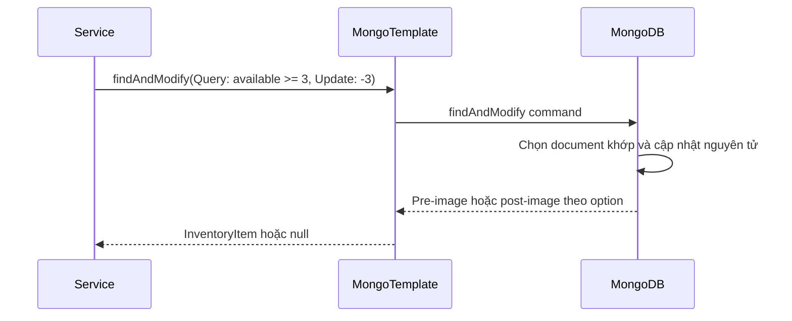

# findAndModify: trả dữ liệu trước hoặc sau cập nhật

Trong MongoDB, nghiệp vụ đôi khi cần **vừa thay đổi một document, vừa biết trạng thái của document ấy**: trừ hàng tồn rồi trả số lượng mới, chuyển trạng thái đơn hàng, hoặc lấy một công việc đang chờ rồi đánh dấu đã nhận. Nếu thực hiện hai lời gọi `findOne` và `updateFirst` riêng biệt, dữ liệu có thể bị request khác sửa trong khoảng giữa hai lần gọi.

**`MongoTemplate.findAndModify(…)`** của **Spring Data MongoDB** thực hiện thao tác **tìm một document khớp, cập nhật document đó và trả một phiên bản của chính document được chọn** bằng một lệnh MongoDB. Mặc định, kết quả là **bản trước cập nhật** (*pre-image*). Với `FindAndModifyOptions.options().returnNew(true)`, kết quả là **bản sau cập nhật** (*post-image*).

Bài thuộc chương **Ghi và cập nhật** của module `SPRING_DATA_MONGODB`. Ta sẽ kết hợp `Query`/`Criteria`, `Update`, `MongoTemplate`, Fluent API, typed mapping, optimistic locking, reactive access, test và chẩn đoán hiệu năng. Các nguyên tắc này cũng liên quan đến repository, index, transaction và thao tác điều kiện trên dữ liệu BSON.

> **Ghi nhớ trước:** `returnNew(true)` **chỉ đổi phiên bản document được trả về**; nó **không** thay đổi điều kiện tìm kiếm, biến một thao tác thành upsert, hoặc tự tạo optimistic locking. Những hành vi đó được quyết định bởi `Query`, `Update`, `upsert` và điều kiện phiên bản tương ứng.

## 1. Mục tiêu học tập

Sau khi đọc bài, bạn có thể:

1. So sánh `findAndModify` với `findOne` + `updateFirst`, `updateFirst` và `findAndRemove`.
2. Giải thích vì sao `findAndModify` mặc định trả bản **trước** và cách bật `returnNew(true)` để lấy bản **sau**.
3. Phân biệt bốn trường hợp có/không tìm thấy document và có/không bật upsert.
4. Viết `MongoTemplate.findAndModify` có query, update, options và entity class.
5. Sử dụng `Sort` trong `Query` để xác định **document nào** được cập nhật nếu có nhiều document khớp.
6. Xây dựng cập nhật điều kiện kiểu **compare-and-set** ngay trên một document.
7. Hiểu `@Version`, `matchedCount`, giá trị `null` và giới hạn kết quả được trả.
8. Kiểm soát field mapping, projection, giá trị BSON, index, write concern và retry.
9. Dùng Fluent MongoDB API và `ReactiveMongoTemplate` với semantics tương ứng.
10. Viết integration test xác minh pre-image, post-image, no match, upsert và thao tác đồng thời.

## 2. Bài toán: cập nhật hàng tồn và biết số lượng

Giả sử kho có một document:

```javascript
{
  _id: "INV-1001",
  warehouse_id: "WH-01",
  sku: "SKU-A",
  available: 10,
  reserved: 0,
  status: "ACTIVE",
  updated_at: ISODate("2026-11-20T08:00:00Z")
}
```

Nghiệp vụ “đặt giữ 3 sản phẩm” có hai yêu cầu:

1. Chỉ cho phép giữ hàng nếu `available >= 3`.
2. Nếu thành công, trả **số lượng còn lại** để hiển thị và ghi nhận kết quả chính xác của thao tác.

Đừng làm như sau:

```java
// CÁCH DỄ GẶP RACE CONDITION:
InventoryItem before = template.findById(id, InventoryItem.class);
if (before != null && before.available() >= quantity) {
    template.updateFirst(
        Query.query(Criteria.where("id").is(id)),
        new Update().inc("available", -quantity),
        InventoryItem.class
    );
}
```

Hai request có thể cùng đọc `available=10` trước khi request nào kịp cập nhật. Hơn nữa, kết quả `before` không nhất thiết là bản thực sự được dùng làm điều kiện cho lệnh update.

Dùng `findAndModify` giúp dồn việc **kiểm tra còn hàng và cập nhật** vào cùng thao tác trên một document.



## 3. Entity minh họa và dữ liệu lưu trữ

Ta dùng một Java record để thể hiện document:

```java
package dev.learning.inventory;

import java.time.Instant;

import org.springframework.data.annotation.Id;
import org.springframework.data.mongodb.core.mapping.Document;
import org.springframework.data.mongodb.core.mapping.Field;

@Document("inventory_items")
public record InventoryItem(
        @Id String id,
        @Field("warehouse_id") String warehouseId,
        String sku,
        int available,
        int reserved,
        String status,
        @Field("updated_at") Instant updatedAt) {
}
```

Trong Java, property là `warehouseId` và `updatedAt`; trong BSON, các field tương ứng là `warehouse_id` và `updated_at`.

`MongoTemplate` dùng domain class `InventoryItem.class` để áp dụng thông tin ánh xạ, không chỉ để chọn kiểu kết quả trả về. Khi dùng `Criteria.where("warehouseId")` trong lời gọi có kiểu miền, Spring Data có thể chuyển sang `warehouse_id`.

Dữ liệu mẫu:

```javascript
db.inventory_items.insertOne({
  _id: "INV-1001",
  warehouse_id: "WH-01",
  sku: "SKU-A",
  available: 10,
  reserved: 0,
  status: "ACTIVE",
  updated_at: ISODate("2026-11-20T08:00:00Z")
});
```

Chạy lệnh này trong **database thử nghiệm riêng**. Lệnh insert trùng `_id` sẽ gây duplicate-key error; không chạy nguyên bản nhiều lần trên collection sản xuất.

## 4. Chữ ký MongoTemplate.findAndModify

Các overload thường dùng:

```java
<T> T findAndModify(
    Query query, UpdateDefinition update, Class<T> entityClass);

<T> T findAndModify(
    Query query, UpdateDefinition update,
    FindAndModifyOptions options, Class<T> entityClass);

<T> T findAndModify(
    Query query, UpdateDefinition update,
    Class<T> entityClass, String collectionName);

<T> T findAndModify(
    Query query, UpdateDefinition update,
    FindAndModifyOptions options,
    Class<T> entityClass, String collectionName);
```

Các tham số mang ý nghĩa:

| Tham số | Vai trò |
| --- | --- |
| `Query` | Điều kiện xác định document và có thể mang `Sort`, field projection, collation. |
| `UpdateDefinition` / `Update` | Những toán tử cần áp dụng: `$set`, `$inc`, `$unset`, `$addToSet`… |
| `FindAndModifyOptions` | Chọn `returnNew`, `upsert`, một số tùy chọn khác. |
| `entityClass` | Cung cấp metadata mapping để truy vấn/cập nhật và ánh xạ kết quả về Java. |
| `collectionName` | Chỉ định collection thay cho tên suy ra từ `@Document`. |
| Giá trị trả về | Một entity đã được map, hoặc `null` nếu không có document để trả. |

Một lệnh `findAndModify` thao tác **tối đa một document** khớp. Nó không cập nhật tất cả document như `updateMulti`.

## 5. Mặc định trả document trước cập nhật

Ví dụ trừ hàng và cộng số lượng đã giữ:

```java
import org.springframework.data.mongodb.core.MongoTemplate;
import org.springframework.data.mongodb.core.query.Criteria;
import org.springframework.data.mongodb.core.query.Query;
import org.springframework.data.mongodb.core.query.Update;

Query query = Query.query(
    Criteria.where("id").is("INV-1001")
            .and("warehouseId").is("WH-01")
            .and("status").is("ACTIVE")
            .and("available").gte(3));

Update change = new Update()
    .inc("available", -3)
    .inc("reserved", 3)
    .set("updatedAt", java.time.Instant.now());

InventoryItem before = mongoTemplate.findAndModify(
    query, change, InventoryItem.class);
```

Nếu database ban đầu có `available=10` và `reserved=0`:

```text
Giá trị trả về before:
  available = 10
  reserved  = 0

Document trong MongoDB sau lệnh:
  available = 7
  reserved  = 3
```

Đây **không phải cập nhật thất bại**. `findAndModify` đã cập nhật thành công, nhưng **mặc định trả trạng thái cũ**.

Nếu cần số lượng đã có **trước khi giữ hàng** cho audit, tính biến động hoặc xác định tồn kho ban đầu, đây là hành vi hữu ích.

Không nên gọi `findOne` lần nữa chỉ để xác minh lệnh đã cập nhật nếu kết quả trước đã đủ và nghiệp vụ không cần giá trị mới; đọc lại phát sinh round trip và document có thể tiếp tục bị thay đổi.

## 6. returnNew(true): trả document sau cập nhật

Bật tùy chọn `returnNew(true)`:

```java
import org.springframework.data.mongodb.core.FindAndModifyOptions;

FindAndModifyOptions options =
    FindAndModifyOptions.options().returnNew(true);

InventoryItem after = mongoTemplate.findAndModify(
    query,
    change,
    options,
    InventoryItem.class
);
```

Nếu đây là **một lần chạy độc lập** với dữ liệu ban đầu là `10/0`, giá trị trả về sẽ là:

```text
Giá trị trả về after:
  available = 7
  reserved  = 3

Document sau cập nhật:
  available = 7
  reserved  = 3
```

**Không chạy nối tiếp ví dụ ở mục 5 rồi giả định `after.available()==7`:** hai lệnh sẽ trừ hàng **hai lần** nếu cả hai đều khớp điều kiện. Mỗi ví dụ mô tả một thao tác riêng với dữ liệu ban đầu được đặt lại.

Để được dùng ngay trong service:

```java
public InventoryItem reserveAndGetUpdated(
        String id, String warehouseId, int quantity) {

    if (quantity <= 0) {
        throw new IllegalArgumentException("quantity phải > 0");
    }

    Query query = Query.query(
        Criteria.where("id").is(id)
                .and("warehouseId").is(warehouseId)
                .and("status").is("ACTIVE")
                .and("available").gte(quantity));

    Update update = new Update()
        .inc("available", -quantity)
        .inc("reserved", quantity)
        .set("updatedAt", java.time.Instant.now());

    InventoryItem updated = mongoTemplate.findAndModify(
        query,
        update,
        FindAndModifyOptions.options().returnNew(true),
        InventoryItem.class);

    if (updated == null) {
        throw new IllegalStateException(
            "Không tìm thấy hàng hoặc không đủ tồn kho");
    }
    return updated;
}
```

Trong ứng dụng thật, `warehouseId` phải nằm trong phạm vi **được phép** của người gọi và có thể cần lấy từ context xác thực; không được tin một mã kho từ request mà không kiểm tra quyền truy cập.

## 7. Bảng hành vi của returnNew và upsert

`FindAndModifyOptions` có hai cờ dễ bị nhầm:

- `returnNew`: trả **bản trước** hay **bản sau**.
- `upsert`: khi không có document khớp, **có được chèn document mới không**.

| Có document khớp? | `upsert` | `returnNew` | Thao tác | Kết quả thường gặp |
| --- | --- | --- | --- | --- |
| Có | `false` | `false` (mặc định) | Update document đó | **Pre-image** |
| Có | `false` | `true` | Update document đó | **Post-image** |
| Không | `false` | `false` hoặc `true` | Không cập nhật và không tạo mới | `null` |
| Có | `true` | `false` | Update document đó | **Pre-image** |
| Có | `true` | `true` | Update document đó | **Post-image** |
| Không | `true` | `true` | **Insert** document mới | Document **mới được chèn** |
| Không | `true` | `false` | **Insert** document mới | Không có pre-image có ý nghĩa; **không dựa vào kết quả để suy thành công** |

**Lưu ý về hàng cuối:** ở mức MongoDB, một số trường hợp `upsert=true` và `returnNew=false` có thể trả `null` hoặc biểu diễn pre-image rỗng tùy lệnh và `sort`; vì vậy **không thiết kế nghiệp vụ dựa vào giá trị trả về trong trường hợp upsert mới này**. Muốn lấy document vừa chèn, hãy dùng `upsert(true).returnNew(true)`.

Còn khi không bật upsert, không có document khớp thì **không tạo mới**. Đây là mặc định phù hợp cho nghiệp vụ **update-only**.

### 7.1. Không được đánh đồng null với “không có ID”

`null` từ `findAndModify` có thể vì:

- Không có document mang ID đó.
- Document có nhưng `status` không còn khớp.
- Điều kiện `available >= quantity` không còn đúng.
- Đã có request khác đổi version hoặc điều kiện trạng thái.
- Query đang nhắm nhầm database, collection hoặc dùng sai BSON type của ID.

Nếu muốn trả lỗi HTTP chi tiết, có thể đọc thêm để phân biệt nguyên nhân **sau khi thao tác thất bại**, nhưng phép đọc phụ này không phải một snapshot nguyên tử của trạng thái lúc update và không được dùng để tự ý bỏ qua điều kiện bảo vệ.

## 8. Upsert có chủ đích và $setOnInsert

Một ứng dụng đồng bộ có thể cho phép “nếu cấu hình chưa có thì tạo, nếu có thì cập nhật”.

Ví dụ collection `settings` có mỗi tenant một document; đây là nghiệp vụ **create-or-update**, không phải reserve tồn kho:

```java
Query query = Query.query(
    Criteria.where("id").is("SETTINGS-tenant-a")
);

Update update = new Update()
    .set("timezone", "Asia/Ho_Chi_Minh")
    .setOnInsert("createdAt", java.time.Instant.now());

TenantSettings result = mongoTemplate.findAndModify(
    query,
    update,
    FindAndModifyOptions.options()
        .upsert(true)
        .returnNew(true),
    TenantSettings.class
);
```

Giả định entity:

```java
import java.time.Instant;
import org.springframework.data.annotation.Id;
import org.springframework.data.mongodb.core.mapping.Document;

@Document("settings")
public record TenantSettings(
    @Id String id,
    String timezone,
    Instant createdAt) {
}
```

`$setOnInsert` chỉ ghi `createdAt` khi **upsert tạo mới**, không sửa ngày tạo của document đã tồn tại.

Một số lưu ý:

- Nếu query chứa `_id` ổn định, việc tạo trùng cùng ID bị unique index trên `_id` bảo vệ; vẫn phải xử lý lỗi trùng trong xung đột concurrent upsert khi điều kiện/index không đủ chặt.
- Không dùng upsert để “cập nhật bản đã có” trong endpoint **update-only**, vì có thể **tái tạo document đã xóa**.
- Nếu query chứa điều kiện bất đẳng thức hoặc nhiều field phức tạp, nội dung document upsert được tạo không đơn giản là toàn bộ query; hãy kiểm tra BSON thực tế và bảo đảm những field bắt buộc được thiết lập.
- Nếu entity ID thuộc kiểu `Long` hoặc kiểu đặc thù, cung cấp giá trị `_id` phù hợp; nếu thiếu ID, MongoDB có thể sinh ObjectId không tương thích với model.

## 9. Sort chọn document nào được cập nhật

Khi `Query` khớp **nhiều document**, `findAndModify` chỉ thao tác với **một** document. Nếu không có `sort`, đừng dựa vào thứ tự tự nhiên của collection để đoán bản nào.

Một bài toán điển hình: lấy một job đang chờ xử lý với mức ưu tiên cao nhất.

Giả định entity `QueueJob`:

```java
package dev.learning.jobs;

import java.time.Instant;
import org.springframework.data.annotation.Id;
import org.springframework.data.mongodb.core.mapping.Document;
import org.springframework.data.mongodb.core.mapping.Field;

@Document("queue_jobs")
public record QueueJob(
    @Id String id,
    @Field("tenant_id") String tenantId,
    String status,
    int priority,
    Instant createdAt,
    String claimedBy,
    Instant claimedAt) {
}
```

Chọn job `READY` theo `priority DESC`, rồi `createdAt ASC`, cuối cùng `id ASC` để quyết định duy nhất:

```java
import org.springframework.data.domain.Sort;

Query query = Query.query(
    Criteria.where("tenantId").is(authorizedTenantId)
            .and("status").is("READY"));

query.with(Sort.by(
    Sort.Order.desc("priority"),
    Sort.Order.asc("createdAt"),
    Sort.Order.asc("id")));

Update claim = new Update()
    .set("status", "CLAIMED")
    .set("claimedBy", workerId)
    .set("claimedAt", java.time.Instant.now());

QueueJob claimed = mongoTemplate.findAndModify(
    query,
    claim,
    FindAndModifyOptions.options().returnNew(true),
    QueueJob.class
);
```

Nếu hai worker cùng nhận job:

- MongoDB thực hiện cập nhật từng document theo semantics nguyên tử.
- Sau khi worker thứ nhất chuyển `status` thành `CLAIMED`, document đó không còn thỏa điều kiện `READY` của worker tiếp theo.
- Worker tiếp theo có thể nhận job khác, hoặc `null` nếu không còn job phù hợp.

**Điều kiện `status="READY"` nằm trong query** là phần bảo vệ chính. Chỉ sắp xếp và sau đó gọi update không đủ.

### 9.1. Vì sao phải thêm ID vào sort?

Nếu hai job có cùng `priority` và `createdAt`, sort chỉ theo hai field đó không bảo đảm thứ tự ổn định. Thêm `id` (được map thành `_id`) làm tie-breaker giúp lựa chọn xác định hơn và thiết kế index rõ ràng.

### 9.2. Index cho claim queue

Truy vấn ở trên có hai equality filters và ba trường sort. Một compound index ứng viên:

```javascript
db.queue_jobs.createIndex(
  {
    tenant_id: 1,
    status: 1,
    priority: -1,
    createdAt: 1,
    _id: 1
  },
  { name: "tenant_status_priority_created_id" }
);
```

Hãy kiểm tra query plan với filter/sort tương đương trước khi kết luận index tối ưu; `findAndModify` còn phải cập nhật document và có thể phải đọc toàn document để trả về entity.

## 10. Cập nhật có điều kiện: không cần đọc trước

Câu hỏi “còn đủ hàng không?” nên nằm trong query của **chính thao tác update**:

```java
Query query = Query.query(
    Criteria.where("id").is("INV-1001")
        .and("available").gte(3));

Update update = new Update()
    .inc("available", -3)
    .inc("reserved", 3);

InventoryItem after = mongoTemplate.findAndModify(
    query, update,
    FindAndModifyOptions.options().returnNew(true),
    InventoryItem.class
);
```

Nếu `after == null`, thao tác không giữ thêm hàng. Hai request tranh chấp sẽ được MongoDB đánh giá điều kiện ghi khi lần lượt thực hiện thao tác trên document; điều này giúp tránh trừ tồn kho xuống dưới 0 **nếu tất cả các đường ghi tuân thủ cùng invariant**.

Đối chiếu:

| Cách làm | Điều kiện và update ở đâu? | Rủi ro |
| --- | --- | --- |
| `findOne` rồi `save` không có version | Kiểm tra và ghi ở hai lệnh | Lost update, trạng thái đã cũ |
| `findOne` rồi `updateFirst` theo ID | Kiểm tra trước, update chỉ lọc ID | Có thể ghi dù invariant đã thay đổi |
| `findAndModify` với `available >= q` | Kiểm tra và update trong một lệnh | Giữ invariant một document nếu mọi writer tuân thủ |
| `updateFirst` với `available >= q` | Kiểm tra và update trong một lệnh | Cũng nguyên tử, nhưng chỉ nhận `UpdateResult` |
| `save` versioned entity | Kiểm tra version trong cơ chế locking | Phù hợp lưu aggregate toàn phần, có xử lý xung đột |

**Cần phân biệt:** cả `updateFirst` với query điều kiện và `findAndModify` đều có thể cung cấp cập nhật nguyên tử cho một document. `findAndModify` đặc biệt hữu ích khi ứng dụng **cần chính document trước hoặc sau cập nhật**, hoặc **cần sort để chọn một document**.

## 11. @Version và optimistic locking

Spring Data MongoDB hỗ trợ `@Version` cho entity. Với `findAndModify` trên một entity có version, tài liệu Spring Data cho biết **version có thể được tự tăng** nếu `Update` chưa tự chỉ định nó. Tuy nhiên, **tự tăng version không đồng nghĩa tự kiểm tra expectedVersion của caller**.

Ví dụ versioned entity:

```java
import org.springframework.data.annotation.Id;
import org.springframework.data.annotation.Version;
import org.springframework.data.mongodb.core.mapping.Document;

@Document("versioned_orders")
public record VersionedOrder(
    @Id String id,
    String status,
    @Version Long version) {
}
```

Muốn chỉ chuyển `DRAFT → SUBMITTED` khi document vẫn ở version mà service đã đọc:

```java
public VersionedOrder submitIfUnchanged(
        MongoTemplate template,
        String orderId,
        long expectedVersion) {

    Query query = Query.query(
        Criteria.where("id").is(orderId)
            .and("version").is(expectedVersion)
            .and("status").is("DRAFT"));

    Update update = new Update()
        .set("status", "SUBMITTED");

    VersionedOrder result = template.findAndModify(
        query,
        update,
        FindAndModifyOptions.options().returnNew(true),
        VersionedOrder.class
    );

    if (result == null) {
        throw new IllegalStateException(
            "Không tìm thấy hoặc phiên bản/trạng thái đã thay đổi");
    }
    return result;
}
```

Nếu hai request đọc `version=0`:

```text
Request A: filter id=X, version=0, status=DRAFT
Request B: filter id=X, version=0, status=DRAFT

A cập nhật thành công -> version tăng lên 1
B không còn document khớp -> findAndModify trả null
```

Điểm phân biệt với `repository.save` trên versioned entity: với query tùy biến này, kết quả thường là **null khi không match**, **không tự động** là `OptimisticLockingFailureException` chỉ vì query chứa `version`. Service cần chuyển `null` thành xung đột nghiệp vụ phù hợp.

Các lưu ý:

- Khi dùng `Update` có `@Version`, kiểm tra API cụ thể để tránh **tăng version hai lần** (đừng vừa `inc("version",1)` thủ công vừa dựa vào auto increment).
- Cần write concern **có xác nhận** để nhận biết kết quả ghi đáng tin cậy.
- Nếu có đường ghi bằng Java Driver thô không tăng version hoặc không kiểm tra điều kiện, chiến lược locking toàn hệ thống có thể mất hiệu lực.
- Version không thay thế unique index; tạo trùng ID vẫn phải xử lý duplicate-key error.

## 12. Pre-image, post-image và auditing

Hai kiểu trả về phục vụ hai nhóm nghiệp vụ.

### 12.1. Khi cần pre-image

- Biết số lượng tồn kho **trước** khi trừ.
- Lấy trạng thái cũ để tính thay đổi.
- Ghi một sự kiện audit với giá trị *old* (nếu hệ thống có cơ chế ghi audit tin cậy).
- Kiểm tra giá trị trước xử lý trong cùng thao tác find-and-update.

Ví dụ:

```java
InventoryItem before = template.findAndModify(
    query,
    new Update().inc("available", -1),
    InventoryItem.class
);

if (before != null) {
    int previousAvailable = before.available();
}
```

**Cảnh báo:** nếu ứng dụng nhận pre-image rồi ghi audit vào collection khác bằng lệnh riêng, **hai lần ghi không tự động nguyên tử cùng nhau**. Khi cần bảo đảm cập nhật tồn kho và audit/outbox cùng thành công, phải thiết kế transaction trên topology hỗ trợ hoặc cơ chế tương đương.

### 12.2. Khi cần post-image

- Trả trạng thái mới qua API sau khi đặt giữ hàng.
- Trả job vừa claim, gồm worker và thời điểm claim.
- Lấy version mới sau chuyển trạng thái.
- Tránh đọc lại document chỉ để lấy các field vừa được thay đổi.

```java
InventoryItem updated = template.findAndModify(
    query,
    new Update().inc("reserved", 1),
    FindAndModifyOptions.options().returnNew(true),
    InventoryItem.class
);
```

### 12.3. Một lệnh không trả cả hai bản

`findAndModify` tiêu chuẩn chọn **một** trong hai phiên bản, không trả đồng thời một object `before` và một object `after` đầy đủ. Nếu cần cả hai:

- Có thể suy ra một số giá trị sau từ pre-image và `Update` **nếu phép biến đổi hoàn toàn xác định và không có logic khác**; không phù hợp cho mọi loại update.
- Hoặc thiết kế một thao tác riêng có version/transaction/outbox tùy hợp đồng.
- Hoặc dùng tính năng change stream/document pre/post images của MongoDB khi nhu cầu audit/event thực sự đòi hỏi, sau khi cân nhắc cấu hình và chi phí.

Không nên thực hiện `findOne` sau khi cập nhật rồi gọi đó là “post-image nguyên tử của lần cập nhật trước”: document có thể đã bị sửa tiếp trước khi đọc.

## 13. Projection: trả ít field, nhưng hiểu hệ quả

Bạn có thể giới hạn field của document trả về bằng `Query.fields()`:

```java
Query query = Query.query(
    Criteria.where("id").is("INV-1001"));

query.fields()
    .include("id")
    .include("available")
    .include("reserved");

InventoryItem partial = mongoTemplate.findAndModify(
    query,
    new Update().inc("available", -1),
    FindAndModifyOptions.options().returnNew(true),
    InventoryItem.class
);
```

Với projection như trên, `partial` chỉ là một **biểu diễn tải một phần**: các field `warehouseId`, `sku`, `status`, `updatedAt` có thể bị bỏ trống hoặc dùng giá trị mặc định trong object Java. Nếu entity dùng record với constructor validate bắt buộc, quá trình mapping có thể thất bại vì thiếu property.

Do đó:

- Chỉ dùng projection khi chắc chắn lớp đích có thể nhận dữ liệu thiếu.
- **Không `save` lại** entity chỉ được tải một phần: có thể ghi đè hoặc xóa dữ liệu khác.
- Nếu API trả một read DTO, dùng lớp DTO/mapping thích hợp và kiểm thử field thật đã đọc.
- `_id` được MongoDB trả mặc định trong nhiều inclusion projection, trừ khi loại rõ ràng.

Việc giảm field trả về có thể giảm băng thông và thời gian materialize object, nhưng MongoDB vẫn phải cập nhật document; đừng hiểu projection là bảo đảm covered query hoặc không chạm dữ liệu gốc.

## 14. Field mapping và kiểu dữ liệu với findAndModify

Vì bạn truyền `InventoryItem.class`, Spring Data có thông tin:

```java
Query q = Query.query(
    Criteria.where("warehouseId").is("WH-01"));

Update u = new Update()
    .set("updatedAt", java.time.Instant.now());
```

Ý định BSON:

```javascript
{
  query: { warehouse_id: "WH-01" },
  update: { $set: { updated_at: ISODate("...") } }
}
```

`@Id` cũng ánh xạ property `id` thành `_id`. Với `@Id String`, chuỗi hex 24 ký tự có thể được chuyển thành BSON ObjectId; với `@MongoId String`, semantics chuyển kiểu khác. Cần test đúng ID thực tế của collection.

Một số bẫy:

- Dùng tên Java `warehouseId` ở API Java Driver raw sẽ không được driver tự đổi thành `warehouse_id`.
- `Instant` được chuyển thành BSON Date theo conversion được cấu hình; kiểm tra precision/time zone.
- `BigDecimal` có thể lưu string hoặc Decimal128 tùy cấu hình, ảnh hưởng `$gte`/`$lt`.
- Custom converters có thể đổi biểu diễn của value object, cả khi ghi và khi tạo query.
- Với cập nhật nested field, dùng property path đúng: `Update.set("address.city", "Hue")` có thể được Spring Data map theo `@Field` của object lồng nhau.

Khi cần thao tác collection có tên khác mặc định mà vẫn giữ domain mapping, dùng overload:

```java
InventoryItem value = mongoTemplate.findAndModify(
    query, update, options,
    InventoryItem.class, "inventory_items_2026");
```

Không nhầm overload có **collection name** với việc bỏ domain class: ở đây vẫn có `InventoryItem.class` để mapping.

## 15. So sánh với updateFirst, save, findAndRemove và findAndReplace

| API | Thao tác | Dữ liệu trả về | Dùng khi |
| --- | --- | --- | --- |
| `updateFirst` | Cập nhật document đầu tiên khớp query, không tự upsert | `UpdateResult` (matched/modified counts) | Không cần bản trước/sau |
| `findAndModify` | Tìm và cập nhật một document | Pre-image hoặc post-image, có thể `null` | Cần dữ liệu document và/hoặc sort chọn mục tiêu |
| `findAndRemove` | Tìm và xóa một document | Document đã xóa hoặc `null` | Cần trả dữ liệu của document bị xóa |
| `findAndReplace` | Tìm và **thay toàn document** | Bản trước/sau tùy options | Cần replacement toàn phần |
| `save` | Lưu entity; có thể insert/upsert hoặc replacement tùy trạng thái/version | Entity được lưu | Tác vụ lưu aggregate toàn phần |
| `upsert` | Update hoặc insert nếu không có match | `UpdateResult` | Create-or-update, không cần post-image |

**`findAndRemove`** là API dễ đọc hơn nếu muốn xóa và trả document bị xóa. `FindAndModifyOptions` có cờ `remove` tương ứng ở cấp thấp nhưng không nên trộn “xóa” vào flow cập nhật thông thường.

**`findAndReplace`** khác `findAndModify` với `$set`: replacement thay nội dung document, nên thiếu field trong replacement có thể làm mất field cũ.

Nếu chỉ cần biết `matchedCount`, `updateFirst` thường ít chi phí trả về dữ liệu hơn. `findAndModify` không trả `UpdateResult` chứa `matchedCount/modifiedCount`; nó trả document đã map hoặc `null`.

## 16. Fluent API cho thao tác findAndModify

`MongoTemplate` cung cấp Fluent update API, thuận tiện khi muốn đặt domain type ngay ở đầu:

```java
InventoryItem before = mongoTemplate
    .update(InventoryItem.class)
    .matching(Query.query(
        Criteria.where("id").is("INV-1001")
            .and("available").gte(2)))
    .apply(new Update().inc("available", -2))
    .findAndModifyValue();
```

Theo mặc định, `before` là pre-image.

Lấy post-image:

```java
InventoryItem after = mongoTemplate
    .update(InventoryItem.class)
    .matching(Query.query(
        Criteria.where("id").is("INV-1001")
            .and("available").gte(2)))
    .apply(new Update().inc("available", -2))
    .withOptions(
        FindAndModifyOptions.options().returnNew(true))
    .findAndModifyValue();
```

Đây là **hai ví dụ lựa chọn riêng**. Nếu chạy liên tiếp chúng, giá trị sẽ bị trừ hai lần. Fluent API không đổi semantics; nó giúp chuỗi thao tác đọc dễ hơn và thể hiện entity type rõ ràng.

Nếu muốn một kết quả kiểu `Optional<T>`, các API Fluent có biến thể phù hợp trong những version Spring Data hỗ trợ. Khi sử dụng `findAndModifyValue()`, bạn vẫn phải xử lý **nullable result** theo contract method.

## 17. ReactiveMongoTemplate: Mono của trước/sau

Với reactive access, `ReactiveMongoTemplate.findAndModify` mang cùng ý nghĩa nhưng trả về `Mono<T>`.

```java
import reactor.core.publisher.Mono;

Mono<InventoryItem> afterMono =
    reactiveMongoTemplate.findAndModify(
        query,
        new Update().inc("available", -1),
        FindAndModifyOptions.options().returnNew(true),
        InventoryItem.class
    );
```

Điểm khác quan trọng:

- Khi không có document khớp, `Mono` thường **hoàn thành rỗng**, không phát phần tử `null` (Reactor không cho phép `null` làm giá trị `onNext`).
- Dùng `switchIfEmpty` để chuyển thành lỗi hoặc một nhánh xử lý nghiệp vụ.
- `Mono` là publisher *cold* trong cách dùng thông thường; **subscribe nhiều lần** có thể thực hiện thao tác cập nhật nhiều lần. Hãy cẩn thận với retry, resubscribe và các luồng được chia sẻ.
- Không gọi `block()` tùy tiện trong event loop của ứng dụng reactive.
- Khi dùng `ReactiveMongoRepository`, không nên kỳ vọng `save` cung cấp pre-/post-image giống `findAndModify`; mỗi API có semantics riêng.

Ví dụ:

```java
Mono<InventoryItem> result =
    reactiveMongoTemplate.findAndModify(
        query,
        update,
        FindAndModifyOptions.options().returnNew(true),
        InventoryItem.class
    ).switchIfEmpty(Mono.error(
        new IllegalStateException(
            "Không tìm thấy hoặc điều kiện không thỏa")));
```

Nếu nghiệp vụ cần idempotency khi retry HTTP hay message consumer, hãy bảo vệ bằng khóa nghiệp vụ riêng. Một lần retry **tại tầng ứng dụng** có thể tạo thao tác mới, khác với retryable write do driver xử lý theo cơ chế riêng.

## 18. Transaction, atomicity, write concern và retry

### 18.1. Atomicity của một document

MongoDB bảo đảm thao tác ghi trên **một document** là nguyên tử theo semantics của server. Khi `findAndModify` dùng một predicate có điều kiện như `available >= quantity`, việc kiểm tra và sửa document được thực hiện trong cùng lệnh.

Nhưng:

- Hai document khác nhau **không tự động** được cập nhật như một transaction.
- Ghi audit sang collection khác bằng lời gọi tiếp theo **không tự động** thuộc cùng transaction.
- Việc đọc/đồng bộ từ nơi khác trước đó có thể đã cũ.
- Một transaction nhiều document đòi hỏi topology, session và transaction manager phù hợp.

### 18.2. Write concern

Nếu dùng write concern không xác nhận, ứng dụng không nên dựa vào việc phát hiện lỗi cập nhật để kết luận chính xác. Với optimistic locking, Spring Data yêu cầu acknowledged write concern để báo lỗi xung đột đáng tin cậy.

Trong transaction, write concern thường được áp dụng ở mức transaction theo chính sách phù hợp; không tự chèn write concern riêng cho từng lệnh trong transaction nếu trái contract MongoDB.

### 18.3. Retryable writes và chi phí

Theo tài liệu MongoDB, với retryable writes, `findAndModify` có thể cần sao chép toàn document vào cấu trúc phụ trên các thành viên replica set trước khi cập nhật. Vì vậy, với document lớn hoặc replica set lớn, nó **có thể đắt hơn `updateOne`** trong trường hợp không cần pre/post-image.

Nếu API chỉ cần trạng thái “đã cập nhật” hoặc số bản ghi khớp, `updateFirst` có thể phù hợp hơn. Nếu cần post-image đúng của thao tác, `findAndModify` có giá trị nhưng phải đo chi phí thực tế.

**Idempotency:** khi ứng dụng chủ động gọi lại cùng một `findAndModify` với `$inc` sau lỗi timeout, nó có thể tăng/trừ **thêm lần nữa** nếu query vẫn khớp. Retry của driver với retryable write và retry nghiệp vụ của service không đồng nghĩa. Với thanh toán, giữ hàng hoặc job claim có side effect, cần khóa idempotency và chiến lược xử lý kết quả không rõ ràng.

## 19. Performance: sort, index và lượng dữ liệu trả

### 19.1. Query theo ID

Nếu query xác định bằng `_id`, MongoDB mặc định có unique index `_id`. Đây thường là đường truy cập chọn lọc cho một document; đừng thêm index khác chỉ vì dùng `findAndModify`.

### 19.2. Query chọn job theo priority

Một command chọn job theo `tenant_id`/`status` và sort theo `priority`/`createdAt` nên thử compound index:

```javascript
db.queue_jobs.createIndex(
  { tenant_id: 1, status: 1, priority: -1, createdAt: 1, _id: 1 },
  { name: "tenant_status_priority_created_id" }
);
```

Kiểm tra truy vấn tìm tương đương:

```javascript
db.queue_jobs.find({
  tenant_id: "tenant-a",
  status: "READY"
}).sort({
  priority: -1,
  createdAt: 1,
  _id: 1
}).limit(1).explain("executionStats");
```

Quan sát `winningPlan`, `totalKeysExamined`, `totalDocsExamined`, có stage `SORT` hay không. Plan của lệnh `find` chỉ là một **chỉ báo hữu ích** để xem access path, không phải phép đo đầy đủ chi phí và concurrency của `findAndModify`. Dùng profiler/command monitoring thích hợp để xem thao tác cập nhật thật.

### 19.3. Chỉ số thực tế

- Tỉ lệ `null` khi không có match.
- Độ trễ p50/p95/p99 của `findAndModify`.
- Kích thước document/BSON trả về.
- Tần suất xung đột CAS/version.
- Tỉ lệ timeout, retry và duplicated work.
- `keysExamined/docsExamined` của filter/sort tương ứng.
- Tỉ lệ lock contention và tải ghi tại MongoDB Server.

Cần đánh giá **dữ liệu thật hoặc workload đại diện**; không kết luận chỉ dựa vào collection vài chục document.

## 20. Kiểm thử tích hợp: pre-image và post-image

Các test dưới đây minh họa hành vi với Spring Boot, `MongoTemplate` và MongoDB test riêng. Không chạy thử trên production.

### 20.1. Mẫu test setup

```java
package dev.learning.inventory;

import static org.assertj.core.api.Assertions.assertThat;

import java.time.Instant;
import java.util.UUID;

import org.junit.jupiter.api.Test;
import org.springframework.beans.factory.annotation.Autowired;
import org.springframework.boot.test.context.SpringBootTest;
import org.springframework.data.mongodb.core.FindAndModifyOptions;
import org.springframework.data.mongodb.core.MongoTemplate;
import org.springframework.data.mongodb.core.query.Criteria;
import org.springframework.data.mongodb.core.query.Query;
import org.springframework.data.mongodb.core.query.Update;

@SpringBootTest
class FindAndModifyIntegrationTest {

    @Autowired
    MongoTemplate template;

    private String insertInventory(int available, int reserved) {
        String id = "INV-" + UUID.randomUUID();
        template.insert(new InventoryItem(
            id, "WH-01", "SKU-A",
            available, reserved, "ACTIVE",
            Instant.parse("2026-11-20T08:00:00Z")));
        return id;
    }

    private static Query eligible(String id, int quantity) {
        return Query.query(
            Criteria.where("id").is(id)
                .and("warehouseId").is("WH-01")
                .and("status").is("ACTIVE")
                .and("available").gte(quantity));
    }

    @Test
    void defaultReturnsPreImage() {
        String id = insertInventory(10, 0);

        InventoryItem before = template.findAndModify(
            eligible(id, 3),
            new Update()
                .inc("available", -3)
                .inc("reserved", 3),
            InventoryItem.class);

        assertThat(before).isNotNull();
        assertThat(before.available()).isEqualTo(10);
        assertThat(before.reserved()).isEqualTo(0);

        InventoryItem stored =
            template.findById(id, InventoryItem.class);

        assertThat(stored).isNotNull();
        assertThat(stored.available()).isEqualTo(7);
        assertThat(stored.reserved()).isEqualTo(3);
    }

    @Test
    void returnNewGivesPostImage() {
        String id = insertInventory(10, 0);

        InventoryItem after = template.findAndModify(
            eligible(id, 3),
            new Update()
                .inc("available", -3)
                .inc("reserved", 3),
            FindAndModifyOptions.options().returnNew(true),
            InventoryItem.class);

        assertThat(after).isNotNull();
        assertThat(after.available()).isEqualTo(7);
        assertThat(after.reserved()).isEqualTo(3);
    }

    @Test
    void failedConditionDoesNotUpdate() {
        String id = insertInventory(2, 0);

        InventoryItem result = template.findAndModify(
            eligible(id, 3),
            new Update().inc("available", -3),
            FindAndModifyOptions.options().returnNew(true),
            InventoryItem.class);

        assertThat(result).isNull();

        InventoryItem stored =
            template.findById(id, InventoryItem.class);

        assertThat(stored).isNotNull();
        assertThat(stored.available()).isEqualTo(2);
    }
}
```

Mỗi test dùng ID ngẫu nhiên có tiền tố, hạn chế ảnh hưởng lẫn nhau và tránh chuỗi ID trông như ObjectId hex 24 ký tự. `MongoTemplate` phải trỏ đến database test, được cấu hình bằng URI hoặc Testcontainers/Service Connection phù hợp dự án.

### 20.2. Test upsert + returnNew

Một test bổ sung:

```java
@Test
void upsertReturnsInsertedDocumentWhenReturnNewIsTrue() {
    String id = "SETTINGS-" + java.util.UUID.randomUUID();

    TenantSettings created = template.findAndModify(
        Query.query(Criteria.where("id").is(id)),
        new Update()
            .set("timezone", "Asia/Ho_Chi_Minh")
            .setOnInsert("createdAt",
                java.time.Instant.parse("2026-11-20T08:00:00Z")),
        FindAndModifyOptions.options()
            .upsert(true)
            .returnNew(true),
        TenantSettings.class);

    assertThat(created).isNotNull();
    assertThat(created.id()).isEqualTo(id);
    assertThat(created.timezone())
        .isEqualTo("Asia/Ho_Chi_Minh");
}
```

Test này có thể đưa vào class test riêng cho `TenantSettings`; nếu đặt cùng class, cần dùng chung `MongoTemplate` đã inject và import các class liên quan.

### 20.3. Test đồng thời

Tạo inventory có `available=5`, cho hai tác vụ đồng thời cùng giữ `3`. Khi cả hai đều dùng query `available >= 3` và cập nhật `available -= 3` trong **một lệnh**, kỳ vọng:

- Một thao tác thành công và trả document.
- Một thao tác không còn document khớp và trả `null`.
- `available` cuối cùng bằng 2, `reserved` tăng đúng một lần.

Để test đáng tin, dùng `CountDownLatch`/barrier để hai thao tác bắt đầu gần nhau và thực sự nối tới MongoDB test; không chỉ chạy hai lời gọi tuần tự rồi gọi là “concurrency test”. Nếu cần xác nhận idempotency khi ứng dụng retry, bổ sung scenario có reservation ID hoặc operation key riêng.

### 20.4. Test sort chọn đúng job

Tạo nhiều `QueueJob` `READY`, có priority khác nhau và có cặp bằng priority/timestamp. Dùng `Query.with(Sort.by(...))`, `findAndModify` đổi trạng thái thành `CLAIMED`. Assert:

- Document được trả có priority cao nhất, tie-breaker rõ.
- Chỉ một document được đổi sang `CLAIMED`.
- Lần gọi tiếp không nhận lại document đã claim.
- Document tenant khác không bị chạm vào.

## 21. Sai lầm thường gặp

| Sai lầm | Vì sao sai | Cách khắc phục |
| --- | --- | --- |
| Gọi `findAndModify` rồi kỳ vọng nhận số lượng mới | Mặc định trả pre-image | Dùng `returnNew(true)`. |
| Bật `returnNew(true)` rồi nghĩ thao tác sẽ tạo document | Tùy chọn chỉ chọn bản trả về | Bật `upsert(true)` **nếu nghiệp vụ cho phép tạo**. |
| Không tìm thấy kết quả rồi cho rằng ID không tồn tại | Query có thể còn filter status, available, version | Xử lý no-match thống nhất; đọc thêm chỉ để chẩn đoán. |
| Chạy hai ví dụ pre/post liên tiếp không reset dữ liệu | Cập nhật xảy ra hai lần | Mỗi test có fixture riêng. |
| Dùng `findOne` rồi `updateFirst` theo ID | Có race giữa đọc và ghi | Đặt điều kiện nghiệp vụ vào cùng query update. |
| Nghĩ `findAndModify` sửa mọi document khớp | Chỉ sửa một document | Dùng `updateMulti` nếu cần cập nhật nhiều. |
| Không có sort khi nhiều document khớp | Document được chọn không xác định | Dùng sort có tie-breaker `_id`. |
| Có sort nhưng không có index thích hợp | Có thể phải scan/sort nhiều document | Thiết kế compound index, xem `explain`. |
| Nghĩ tự tăng `@Version` là đã so expected version | Update query không biết caller muốn version nào | Thêm `version` vào filter để CAS. |
| `returnNew(false)` với upsert mới nhưng dựa vào pre-image | Không có bản cũ có ý nghĩa | Dùng `returnNew(true)`, test upsert. |
| Save lại partial entity được trả về | Có thể xóa field chưa tải | Dùng read DTO hoặc tránh save partial. |
| Chỉ lấy pre-image rồi ghi audit ngoài transaction | Audit và update không nguyên tử cùng nhau | Transaction/outbox theo yêu cầu. |
| Cho client tự truyền tenant trong cursor/job query | Có thể truy cập sai dữ liệu | Lấy tenant từ principal và kiểm tra quyền. |
| Retry thao tác `$inc` vô điều kiện | Có thể tăng/trừ thêm lần nữa | Idempotency key và điều kiện nghiệp vụ. |
| Dùng `findAndModify` cho mọi update không cần dữ liệu trả | Chi phí dư, nhất là document lớn | Dùng `updateFirst` và `UpdateResult` khi phù hợp. |

## 22. Bài tập thực hành

### Bài 1 — Đọc trước hay sau?

Với inventory `available=8`, `reserved=1`, thực hiện `$inc available:-2, reserved:+2`. Dự đoán giá trị trả về khi `returnNew=false` và `returnNew=true`.

*Gợi ý:* pre-image `8/1`, post-image `6/3`. Hai kết quả thuộc hai lần chạy **độc lập**.

### Bài 2 — Từ chối khi không đủ tồn kho

Viết `Query` lọc `id` và `available>=quantity`, `Update` trừ hàng. Dự đoán kết quả khi available=2, quantity=3 và giải thích vì sao không có lượng tồn âm.

### Bài 3 — Chọn job ưu tiên

Collection có job `READY` ở ba mức priority. Dùng `Sort.desc("priority")`, `Sort.asc("createdAt")`, `Sort.asc("id")` rồi claim bằng `findAndModify`. Thêm index phù hợp và test hai worker cùng gọi.

### Bài 4 — Upsert và document mới

Viết `findAndModify` với `upsert(true).returnNew(true)` cho cấu hình tenant. Dùng `$setOnInsert` đặt ngày tạo và giải thích vì sao không dùng upsert trên endpoint chỉ được update.

### Bài 5 — Optimistic compare-and-set

Entity có `@Version Long version`. Hai request cùng đọc version 0. Viết query thêm `version=0` và update status, dự đoán kết quả của lần gọi thứ hai.

### Bài 6 — Trả dữ liệu trước để audit

Thiết kế flow cần biết trạng thái cũ nhưng phải ghi audit sang collection khác. Giải thích vì sao riêng `findAndModify` không bảo đảm cả update và audit cùng thành công, và khi nào cần transaction hoặc outbox.

### Bài 7 — Reactive no-match

Viết `Mono<InventoryItem>` từ `ReactiveMongoTemplate.findAndModify`, dùng `switchIfEmpty` để trả lỗi, không gọi `block()`.

### Bài 8 — Chọn API và đo hiệu năng

Khi service chỉ cần kết quả `matchedCount`, so sánh `findAndModify` với `updateFirst`. Đề xuất chỉ số và `explain` cần quan sát trên collection lớn, có index tương ứng.

## 23. Checklist trước khi phát hành

- [ ] Xác định rõ caller cần **pre-image**, **post-image** hay chỉ số lượng match.
- [ ] Với post-image, đặt `FindAndModifyOptions.options().returnNew(true)`.
- [ ] Chỉ bật `upsert(true)` nếu được phép tạo document mới.
- [ ] Xử lý `null`/`Mono.empty()` khi không có document khớp.
- [ ] Đặt điều kiện bất biến nghiệp vụ vào **Query của chính lệnh cập nhật**.
- [ ] Nếu cần CAS, thêm expected version/status; không chỉ dựa vào auto-increment.
- [ ] Dùng `Sort` có tie-breaker khi query khớp nhiều document.
- [ ] Dùng entity class typed để mapping `@Field`, ID, BSON và version.
- [ ] Không save lại entity đọc một phần từ projection.
- [ ] Bảo đảm tenant/user filter lấy từ nguồn xác thực.
- [ ] Kiểm thử cả pre/post/no-match/upsert và nhiều request cạnh tranh.
- [ ] Đánh giá chi phí `findAndModify` trên document lớn và retryable writes.
- [ ] Giữ write concern được xác nhận, thiết kế retry/idempotency.
- [ ] Dùng transaction/outbox nếu cần atomicity **nhiều document**.
- [ ] Xác minh query/index qua profiler và `explain` tương ứng, không chỉ nhìn code.

## 24. Tài liệu chính thức

1. [Spring Data MongoDB — Saving, Updating, and Removing Documents](https://docs.spring.io/spring-data/mongodb/reference/mongodb/template-crud-operations.html): `findAndModify`, `returnNew`, `upsert`, `@Version` và Fluent API.
2. [Spring Data MongoDB — MongoOperations Javadoc](https://docs.spring.io/spring-data/mongodb/docs/current/api/org/springframework/data/mongodb/core/MongoOperations.html): các overload `findAndModify` và kiểu kết quả nullable.
3. [Spring Data MongoDB — FindAndModifyOptions Javadoc](https://docs.spring.io/spring-data/mongodb/docs/current/api/org/springframework/data/mongodb/core/FindAndModifyOptions.html): `options()`, `returnNew(boolean)`, `upsert(boolean)` và `remove(boolean)`.
4. [Spring Data MongoDB — Querying Documents](https://docs.spring.io/spring-data/mongodb/reference/mongodb/template-query-operations.html): `Query`, `Criteria`, `Sort`, field projection và type mapping.
5. [MongoDB Manual — findAndModify Command](https://www.mongodb.com/docs/manual/reference/command/findandmodify/): một lệnh cập nhật, chọn document, pre/post-image, sort và upsert.
6. [MongoDB Manual — findAndModify Helper](https://www.mongodb.com/docs/manual/reference/method/db.collection.findandmodify/): bảng behavior và chi phí retryable writes; helper `mongosh` này đã được khuyến nghị thay bằng các phương thức `findOneAndUpdate/…`, còn Spring Data vẫn cung cấp API `findAndModify`.
7. [MongoDB Manual — Atomicity and Transactions](https://www.mongodb.com/docs/manual/core/write-operations-atomicity/): nguyên tử trên một document và điều kiện cập nhật.
8. [MongoDB Manual — Indexes and Sort](https://www.mongodb.com/docs/manual/tutorial/sort-results-with-indexes/): chọn index cho query có sort.
9. [MongoDB Manual — Explain Results](https://www.mongodb.com/docs/manual/reference/explain-results/): đo plan và số documents/keys examined.

**Kết luận:** `findAndModify` giúp Spring Data MongoDB **tìm, cập nhật một document và trả về một phiên bản của chính document ấy**. Mặc định là bản **trước**, `returnNew(true)` lấy bản **sau**. Hãy tách biệt lựa chọn phiên bản trả về với `upsert`, đặt điều kiện nghiệp vụ vào query nguyên tử, dùng sort/index phù hợp và kiểm thử kỹ xung đột đồng thời. Với thao tác không cần document trả về, cân nhắc `updateFirst` để tiết kiệm chi phí.
