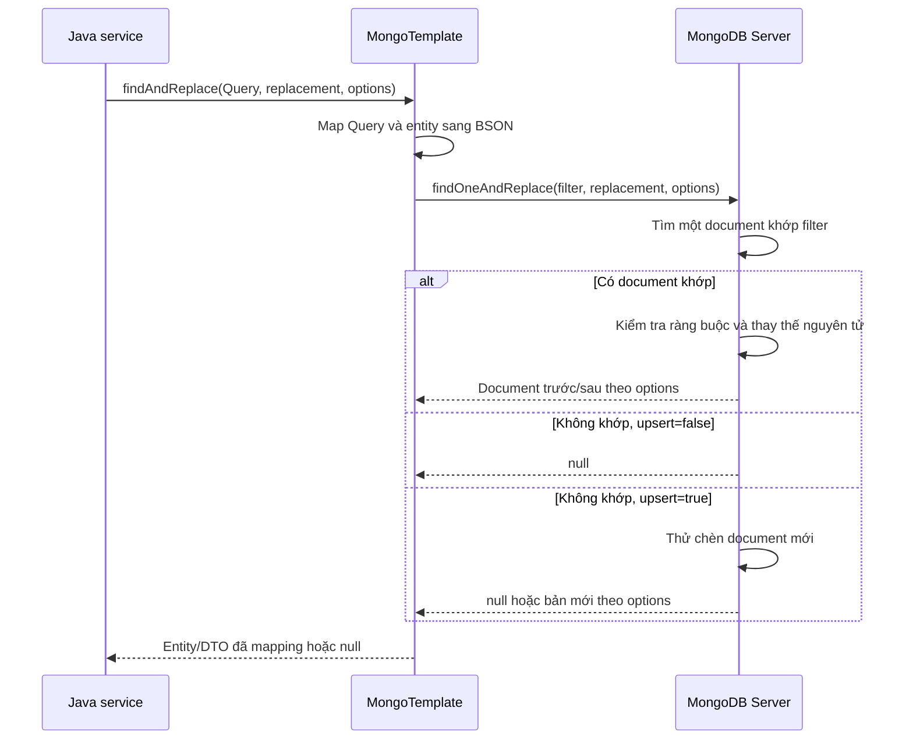

# `findAndReplace` và thay thế có điều kiện

Trong **Spring Data MongoDB**, có sự khác nhau quan trọng giữa **cập nhật một vài field** và **thay thế toàn bộ document**. Khi cần đổi một thuộc tính như `stock` hoặc `status`, toán tử `$set`/`$inc` thường phù hợp hơn. Nhưng khi nghiệp vụ yêu cầu thay **toàn bộ trạng thái được quản lý của một document**, đồng thời chỉ thực hiện nếu bản ghi còn đúng trạng thái, tenant hoặc phiên bản mong đợi, `MongoTemplate.findAndReplace(...)` là một công cụ đáng cân nhắc.

`findAndReplace` gửi thao tác tìm và thay thế **một document**; nó cho phép chỉ định `Query` thay vì chỉ dựa vào ID như `save`. MongoDB Server kiểm tra điều kiện tìm và thực hiện thay thế trong **cùng một thao tác trên document**, nên ứng dụng có thể xây cơ chế **compare-and-swap (CAS)** theo `revision` hoặc trạng thái. Tuy nhiên, replace **không giữ lại những field bị thiếu trong object thay thế**. Nếu nhầm một DTO đọc/projection với trạng thái đầy đủ, ứng dụng có thể xóa dữ liệu cũ mà không nhận thấy.

Bài học thuộc chương **Ghi và cập nhật** của module `SPRING_DATA_MONGODB`: kết nối và ánh xạ BSON qua `MongoTemplate` hoặc repository, truy vấn, index, transaction, reactive access, kiểm thử và chẩn đoán dữ liệu. Nội dung tập trung vào **`findAndReplace` và thay thế có điều kiện**, không đồng nhất chúng với `save`, `findAndModify` hay `updateFirst`.

Sau bài, bạn có thể:

- Phân biệt `findAndReplace`, `save`, `replace`, `findAndModify` và update bằng `$set`.
- Xây `Query` chứa `_id`, `tenantId`, `status` hoặc `revision` để **thay document chỉ khi điều kiện còn đúng**.
- Giải thích quy tắc **`_id` bất biến** và vì sao **replacement entity không nên mang ID** trong `findAndReplace`.
- Kiểm soát **bản ghi trước/sau**, kết quả không khớp, thứ tự khi nhiều document cùng khớp, upsert và unique index.
- Tự xây optimistic concurrency theo `revision`, tránh ghi đè bằng entity chỉ đọc một phần, và kiểm thử bằng MongoDB thật.

## 1. Phân biệt replace với update theo field

Cho document ban đầu:

```javascript
// Collection: catalogItems
{
  _id: "ITEM-101",
  tenantId: "T-A",
  sku: "BK-101",
  name: "Sổ tay",
  status: "DRAFT",
  priceVnd: NumberLong("85000"),
  stock: 42,
  description: "Bìa cứng",
  tags: ["office", "gift"],
  revision: NumberLong("3"),
  updatedAt: ISODate("2026-11-01T00:00:00Z")
}
```

Nếu chỉ cập nhật tên:

```javascript
db.catalogItems.updateOne(
  { _id: "ITEM-101", tenantId: "T-A" },
  { $set: { name: "Sổ tay mới" } }
);
```

Field `stock`, `description` và `tags` **vẫn còn**. Nhưng nếu thay thế document:

```javascript
// Chỉ chạy trong database thử nghiệm: ví dụ CỐ Ý thiếu field.
db.catalogItems.findOneAndReplace(
  { _id: "ITEM-101", tenantId: "T-A" },
  {
    tenantId: "T-A",
    name: "Sổ tay mới",
    status: "ACTIVE"
    // Các field khác không được đưa vào replacement.
  },
  { returnDocument: "after" }
);
```

Các field cũ không hiện diện trong replacement (`sku`, `stock`, `description`, `tags`, `revision`...) **có thể bị loại khỏi document lưu trữ**. MongoDB sẽ giữ `_id` cũ khi replacement không cung cấp `_id`; đó **không phải** cơ chế merge các field còn lại.

| Thao tác | Mục đích | Dữ liệu không đề cập |
| --- | --- | --- |
| `updateOne` với `$set`/`$inc` | Sửa các field được chỉ định | Giữ nguyên các field khác |
| `MongoTemplate.updateFirst` | Update theo field và điều kiện Spring Data | Giữ nguyên các field khác trừ các toán tử đã nêu |
| `MongoTemplate.findAndModify` | Update bằng toán tử rồi trả bản trước/sau | Giữ nguyên field không đụng tới |
| `MongoTemplate.findAndReplace` | Tìm bằng query rồi **thay thế một document**; có thể trả bản trước/sau | Field không được mapping trong replacement có thể bị mất |
| `MongoTemplate.replace` | Thay thế một document theo query, trả `UpdateResult` | Cũng là replace, nhưng loại kết quả khác |
| `MongoTemplate.save` | Ghi entity theo cơ chế mapping/ID và version | Không phải partial update; có thể thay thế document |

**Quy tắc chọn:** khi API yêu cầu `PATCH /catalog/{id}/status`, nên ưu tiên `$set` và điều kiện nghiệp vụ. Khi API có ý nghĩa `PUT` **thay toàn bộ representation**, cùng validation rõ ràng, replace có thể phù hợp. Không nên cho một endpoint PATCH gọi `findAndReplace` chỉ vì cần lấy document mới.

## 2. `findAndReplace` hoạt động ra sao?



Những điểm cần nhớ:

1. **Chỉ một document** được thay, kể cả khi filter khớp nhiều document. Nếu không xác định duy nhất, sort (nếu khai báo) có thể ảnh hưởng lựa chọn.
2. Filter và thay thế được thực thi trên server trong một thao tác, tránh khoảng trống giữa `findOne` và `replaceOne` làm hai lệnh riêng.
3. Mặc định **không upsert**. Nếu không tìm thấy, API trả `null` (hoặc `Optional.empty()` với fluent API).
4. Mặc định kết quả trả về là **document trước khi thay thế**; `returnNew()` yêu cầu document mới.
5. **`_id` không được thay đổi**. Hướng dẫn Spring Data cho `findAndReplace` yêu cầu **replacement entity không mang ID riêng** để MongoDB giữ `_id` hiện có.
6. Replacement là **document đầy đủ**, không chấp nhận các update operator như `$set` ở cấp cao nhất.

### 2.1. Vì sao chỉ biết ID là chưa đủ?

Giả sử màn hình quản trị đọc sản phẩm khi `revision = 3`. Trong lúc nhân viên sửa, hệ thống khác đã cập nhật sản phẩm lên `revision = 4`. Nếu chỉ tìm bằng ID rồi replace, người dùng có thể **ghi đè dữ liệu mới hơn**.

Filter có điều kiện:

```javascript
{
  _id: "ITEM-101",
  tenantId: "T-A",
  revision: NumberLong("3"),
  status: "DRAFT"
}
```

Chỉ khớp nếu **tất cả** điều kiện còn đúng tại thời điểm MongoDB xử lý lệnh. Nếu đã chuyển sang revision 4 hoặc status khác, replace **không xảy ra**. Đây là nền tảng của thay thế có điều kiện.

### 2.2. `findAndReplace` khác `findAndModify`

Tên gần giống nhưng input quyết định bản chất:

```java
// PATCH: chỉ đổi status, các field khác giữ nguyên.
template.findAndModify(
        query,
        new Update().set("status", "ACTIVE"),
        FindAndModifyOptions.options().returnNew(true),
        CatalogItem.class);

// REPLACE: ghi lại toàn bộ state, không phải chỉ status.
template.findAndReplace(
        query,
        completeReplacement,
        FindAndReplaceOptions.options().returnNew());
```

Đây là các đoạn code trong service với `template`, `query` và `completeReplacement` được khai báo. `FindAndModifyOptions` và `FindAndReplaceOptions` là hai loại khác nhau; không dùng tùy chọn của API này cho API kia. `findAndModify` nhận `Update`/`UpdateDefinition`, còn `findAndReplace` nhận **entity thay thế**.

## 3. Entity và dữ liệu thực hành

Ta dùng entity có ID String ổn định và một trường `revision` **do ứng dụng tự quản lý**. Không dùng `@Version` trong ví dụ chính, vì bài muốn thể hiện rõ điều kiện phiên bản và giá trị revision của **replacement**.

```java
import java.time.Instant;
import java.util.List;
import org.springframework.data.mongodb.core.mapping.Document;
import org.springframework.data.mongodb.core.mapping.MongoId;

@Document(collection = "catalogItems")
public record CatalogItem(
        @MongoId String id,
        String tenantId,
        String sku,
        String name,
        String status,
        long priceVnd,
        int stock,
        String description,
        List<String> tags,
        long revision,
        Instant updatedAt
) {}
```

Trong `findAndReplace`, object Java dùng làm replacement phải có `id == null`. Lệnh tìm sẽ chứa `_id` cần thay, MongoDB giữ `_id` của document cũ. Nếu muốn dùng ID trong kết quả, `returnNew()` trả lại entity đã ánh xạ từ document sau thao tác.

Tạo dữ liệu mẫu trên database test:

```javascript
db.catalogItems.insertOne({
  _id: "ITEM-101",
  tenantId: "T-A",
  sku: "BK-101",
  name: "Sổ tay",
  status: "DRAFT",
  priceVnd: NumberLong("85000"),
  stock: 42,
  description: "Bìa cứng",
  tags: ["office", "gift"],
  revision: NumberLong("3"),
  updatedAt: ISODate("2026-11-01T00:00:00Z")
});
```

Trong môi trường test, chỉ insert khi document chưa tồn tại hoặc reset fixture có kiểm soát. Đừng chạy lại câu lệnh trên production. Để mã SKU duy nhất **theo tenant**, có thể dùng:

```javascript
db.catalogItems.createIndex(
  { tenantId: 1, sku: 1 },
  { unique: true }
);
```

Index unique này bảo vệ ràng buộc nghiệp vụ; không làm `revision` tự tăng, cũng không tự kiểm tra tenant trong mọi query. Service phải lấy `tenantId` từ context xác thực chứ không tin giá trị do client tùy ý gửi.

## 4. Thực hành `findAndReplace` có điều kiện theo revision

Yêu cầu nghiệp vụ: nhân viên chỉnh sửa toàn bộ thông tin của `ITEM-101` khi sản phẩm vẫn ở trạng thái `DRAFT` và có `revision = 3`. Nếu một người khác vừa cập nhật, phải **từ chối ghi đè**, thay vì “lưu lại bản đang cầm”.

### 4.1. Tạo replacement đầy đủ

Ví dụ một service nhận toàn bộ dữ liệu mong muốn sau khi lưu, đã qua validation:

```java
import java.time.Instant;
import java.util.List;
import org.springframework.data.mongodb.core.FindAndReplaceOptions;
import org.springframework.data.mongodb.core.MongoTemplate;
import org.springframework.data.mongodb.core.query.Criteria;
import org.springframework.data.mongodb.core.query.Query;
import org.springframework.stereotype.Service;

@Service
public class CatalogReplaceService {

    private final MongoTemplate template;

    public CatalogReplaceService(MongoTemplate template) {
        this.template = template;
    }

    public CatalogItem publishDraft(
            String itemId, String authorizedTenantId,
            long expectedRevision, String sku, String name,
            long priceVnd, int stock, String description,
            List<String> tags
    ) {
        if (itemId == null || itemId.isBlank()
                || authorizedTenantId == null || authorizedTenantId.isBlank()) {
            throw new IllegalArgumentException("Thiếu ID hoặc tenant");
        }
        if (expectedRevision < 0 || priceVnd < 0 || stock < 0
                || name == null || name.isBlank()
                || sku == null || sku.isBlank()) {
            throw new IllegalArgumentException("Dữ liệu không hợp lệ");
        }
        if (expectedRevision == Long.MAX_VALUE) {
            throw new IllegalArgumentException("Revision không thể tăng");
        }

        Query query = Query.query(
                Criteria.where("_id").is(itemId)
                        .and("tenantId").is(authorizedTenantId)
                        .and("status").is("DRAFT")
                        .and("revision").is(expectedRevision));

        // Quan trọng: id == null trong replacement!
        CatalogItem replacement = new CatalogItem(
                null,
                authorizedTenantId,
                sku,
                name,
                "ACTIVE",
                priceVnd,
                stock,
                description,
                tags == null ? List.of() : List.copyOf(tags),
                expectedRevision + 1,
                Instant.now()
        );

        CatalogItem after = template.findAndReplace(
                query,
                replacement,
                FindAndReplaceOptions.options().returnNew());

        if (after == null) {
            throw new CatalogReplaceConflictException(
                    "Không tìm thấy document khớp tenant/status/revision");
        }
        return after;
    }
}
```

Trong ví dụ, `CatalogReplaceConflictException` là exception nghiệp vụ đơn giản có thể định nghĩa như sau:

```java
public class CatalogReplaceConflictException
        extends RuntimeException {
    public CatalogReplaceConflictException(String message) {
        super(message);
    }
}
```

**Ý nghĩa của mã:**

1. `Query` chứa `_id`, `tenantId`, `status` và `revision` **đang mong đợi**.
2. `replacement` chứa **toàn bộ field muốn lưu sau thay thế**, gồm `sku`, `stock`, `description`, `tags`, tenant và revision mới.
3. `id = null` trong replacement để không tạo một `_id` mới hoặc trái với `_id` gốc; MongoDB giữ ID cũ.
4. `FindAndReplaceOptions.options().returnNew()` chọn **trả bản sau** khi thay thế; không bật upsert.
5. Khi không khớp, `after == null`: có thể ID không tồn tại, tenant khác, status khác hoặc revision cũ. Service không nên tự tiết lộ thông tin tenant khác chỉ để phân biệt lỗi.

Ví dụ cần được đặt trong ứng dụng Spring Data MongoDB có `MongoTemplate` được cấu hình và repository/entity được scan. Nếu DTO đầu vào chỉ chứa một phần field, **không dùng nó để dựng replacement như thể là trạng thái đầy đủ**. Kiểm tra tính toàn vẹn các trường bắt buộc và quy tắc xóa field trước khi gọi.

### 4.2. Ý nghĩa tương đương ở MongoDB Server

```javascript
db.catalogItems.findOneAndReplace(
  {
    _id: "ITEM-101",
    tenantId: "T-A",
    status: "DRAFT",
    revision: NumberLong("3")
  },
  {
    tenantId: "T-A",
    sku: "BK-101",
    name: "Sổ tay cao cấp",
    status: "ACTIVE",
    priceVnd: NumberLong("99000"),
    stock: 42,
    description: "Bìa cứng, giấy định lượng cao",
    tags: ["office", "premium"],
    revision: NumberLong("4"),
    updatedAt: ISODate("2026-11-20T03:00:00Z")
  },
  { returnDocument: "after" }
);
```

Khi document ban đầu khớp, result là document mới có `_id: "ITEM-101"` và `revision: 4`. Nếu request thứ hai vẫn gửi `revision = 3`, nó không thể khớp sau lần thay đầu và sẽ nhận `null`, **không thay thế lại document**. MongoDB áp dụng việc kiểm tra filter và replace trên **một document** theo ngữ nghĩa nguyên tử cấp document.

### 4.3. Vì sao không tách find và replace thành hai lệnh?

Một cách dễ sai:

```java
// Anti-pattern: không đủ để chống ghi đè đồng thời.
CatalogItem before = template.findById("ITEM-101", CatalogItem.class);
if (before != null && before.status().equals("DRAFT")) {
    // Có thể request khác đã sửa document ngay tại đây.
    template.save(someOtherCopy);
}
```

Giữa lúc đọc và lúc ghi có một **race window**. Chuyển điều kiện vào filter của chính lệnh `findAndReplace` giúp không ghi nếu trạng thái đã thay đổi (với điều kiện mọi đường ghi liên quan cũng duy trì revision đúng cách).

### 4.4. Lấy bản cũ hay bản mới?

Mặc định `findAndReplace(query, replacement)` trả document **trước** thay thế nếu có khớp, còn `returnNew()` trả document mới. Ví dụ:

```java
CatalogItem before = template.findAndReplace(query, replacement);

CatalogItem after = template.findAndReplace(
        anotherQuery,
        anotherReplacement,
        FindAndReplaceOptions.options().returnNew());
```

Hai lời gọi là **hai thao tác ghi khác nhau**; đoạn trên chỉ so sánh chữ ký API, **không được chạy liên tiếp với cùng dữ liệu để “lấy trước và sau”**. Nếu cần cả hai trạng thái, phải thiết kế nguồn dữ liệu/audit phù hợp; `findAndReplace` thông thường chọn một trong hai bằng option, không trả cả hai trong một response.

| Cấu hình | Document khớp | Không khớp, upsert tắt |
| --- | --- | --- |
| Mặc định | Trả document **trước** replace | `null` |
| `returnNew()` | Trả document **sau** replace | `null` |
| API fluent `findAndReplace()` | Thường trả `Optional<T>` | `Optional.empty()` |

Nhiều chương trình thấy result `null` rồi hiểu “không có document có ID đó”. Điều này **không đủ chính xác** nếu filter còn `tenantId`, `status` hoặc `revision`. Result `null` chỉ nói **không có document khớp tất cả điều kiện được yêu cầu**, trừ các lỗi ghi riêng.

## 5. Quy tắc `_id`: bất biến khi thay thế

Tài liệu MongoDB quy định replacement document **không thể chỉ định `_id` khác `_id` của document đang được thay**. Tài liệu Spring Data cho `findAndReplace` còn nhấn mạnh: **replacement entity không nên chứa ID**, bởi ID của document hiện có do MongoDB giữ lại.

### 5.1. Tại sao `id = null` là đúng ở đây?

Ví dụ:

```java
CatalogItem replacement = new CatalogItem(
        null, "T-A", "BK-101", "Tên mới", "ACTIVE",
        99_000L, 42, "Mô tả mới", List.of("premium"),
        4L, Instant.now());

// Query vẫn chỉ đích ITEM-101:
Query query = Query.query(Criteria.where("_id").is("ITEM-101"));

CatalogItem result = template.findAndReplace(
        query, replacement,
        FindAndReplaceOptions.options().returnNew());
```

MongoDB giữ `_id = "ITEM-101"` trong document mới. Do đó `result.id()` có thể là `"ITEM-101"` mặc dù `replacement.id()` là `null`. **Trả về object cũ mới là nguồn dữ liệu sau thao tác**; đừng giả định `replacement` tự được gán ID khi đó là một record bất biến.

### 5.2. Không đổi ID bằng replace

Không nên cố:

```javascript
db.catalogItems.findOneAndReplace(
  { _id: "ITEM-101" },
  { _id: "ITEM-999", tenantId: "T-A", name: "Tên mới" }
);
// Lỗi do cố thay _id của document đang tồn tại.
```

Nếu nghiệp vụ đổi mã hiển thị, hãy sử dụng field nghiệp vụ như `sku` hoặc `displayCode`, không thay khóa `_id`. Muốn chuyển ID của một document tồn tại thường phải thiết kế **migration tạo bản ghi mới + cập nhật reference + xóa bản cũ**, với cơ chế nhất quán riêng.

### 5.3. Kiểu BSON của ID phải khớp

`"507f1f77bcf86cd799439011"` là BSON String **khác** `ObjectId("507f1f77bcf86cd799439011")`. Với entity `@MongoId String id` như bài này, ID được giữ ở dạng String theo mapping. Với `@Id String id`, Spring Data có thể chuyển một số chuỗi 24-hex hợp lệ thành ObjectId.

Khi query không khớp dù nhìn ID giống nhau, kiểm tra BSON thô:

```javascript
db.catalogItems.aggregate([
  {
    $project: {
      _id: 1,
      idType: { $type: "$_id" },
      revisionType: { $type: "$revision" }
    }
  },
  { $limit: 10 }
]);
```

Lỗi mapping String/ObjectId có thể biểu hiện thành `result == null` thay vì lỗi ghi. Không suy rằng document không tồn tại nếu chưa đối chiếu BSON type và query thực tế.

## 6. `upsert`: chỉ bật khi nghiệp vụ cho phép tạo mới

Mặc định `findAndReplace` **không tạo document** khi filter không khớp. `FindAndReplaceOptions.options().upsert()` đổi hành vi thành “**nếu có thì thay thế, nếu không có thì thử insert**”. Đây là yêu cầu nghiệp vụ khác hẳn “sửa nếu revision còn đúng”.

### 6.1. Ví dụ upsert theo ID ổn định

Giả sử một hệ thống nhận toàn bộ catalog item từ một nguồn chuẩn; ID `"ITEM-NEW-1"` đã được hệ thống xác nhận là định danh duy nhất. Khi chưa có document, cho phép tạo mới; khi đã có, thay thế toàn bộ dữ liệu được quản lý.

```java
import java.time.Instant;
import java.util.List;
import org.springframework.data.mongodb.core.FindAndReplaceOptions;
import org.springframework.data.mongodb.core.MongoTemplate;
import org.springframework.data.mongodb.core.query.Criteria;
import org.springframework.data.mongodb.core.query.Query;

// Đoạn method service đã inject MongoTemplate.
CatalogItem replaceOrCreate(
        MongoTemplate template,
        String id,
        String authorizedTenantId
) {
    if (id == null || id.isBlank()) {
        throw new IllegalArgumentException("ID phải rõ ràng");
    }

    Query query = Query.query(
            Criteria.where("_id").is(id)
                    .and("tenantId").is(authorizedTenantId));

    // Replacement không có ID: _id đến từ equality trong Query,
    // hoặc được MongoDB giữ lại khi document cũ tồn tại.
    CatalogItem replacement = new CatalogItem(
            null, authorizedTenantId, "BK-NEW",
            "Sổ nhập khẩu", "ACTIVE", 120_000L, 10,
            "Dữ liệu nguồn chuẩn", List.of("imported"),
            1L, Instant.now());

    return template.findAndReplace(
            query,
            replacement,
            FindAndReplaceOptions.options()
                    .upsert()
                    .returnNew());
}
```

Theo ngữ nghĩa MongoDB, nếu không có document khớp và filter có equality `_id = id`, khi upsert có thể dùng ID đó cho document được chèn. Nếu **không có `_id` ở cả query lẫn replacement**, server sẽ sinh `ObjectId`; ID mới này có thể **không phù hợp kiểu ID** của entity/domain.

Đây là lý do không nên bật `upsert` cho một query rộng như `{ status: "DRAFT" }`: khi không còn document DRAFT, thao tác có thể **tạo document ngoài dự định**. Với upsert trong ứng dụng đa tenant, phải kiểm soát ràng buộc định danh và luôn xác minh tenant.

### 6.2. Không bật upsert trong thao tác CAS theo revision

Xét một document đang ở `revision = 4`, nhưng client cũ gửi `expectedRevision = 3`. Nếu query là:

```javascript
{ _id: "ITEM-101", tenantId: "T-A", revision: NumberLong("3") }
```

thì document tồn tại nhưng **không khớp filter**. Với `upsert = true`, MongoDB có thể thử **chèn document khác theo query** thay vì báo xung đột một cách đơn giản. Vì `_id = "ITEM-101"` đã tồn tại, thao tác này có thể gặp **duplicate key**, tùy filter và dữ liệu.

Trong chức năng “sửa khi không ai thay đổi”, giữ `upsert = false`, kiểm tra kết quả `null` và trả lỗi conflict/không thấy phù hợp. Chỉ dùng upsert khi mục đích thật sự là **create-or-replace** và khóa lọc được thiết kế cho nó.

### 6.3. Unique index và vấn đề cạnh tranh

Hai request đồng thời cùng upsert theo một khóa nghiệp vụ không được bảo đảm “chỉ tạo một document” nếu thiếu ràng buộc unique. Hãy dùng **`_id` ổn định** hoặc unique index như `{tenantId:1, sku:1}`, và xử lý duplicate key/retry theo nghiệp vụ.

`upsert` không thay thế xác thực ID, tenant, schema hoặc quyền ghi. Một yêu cầu bên ngoài không được tự chỉ định ID của tenant khác rồi dùng replace-or-create để ghi vào dữ liệu không thuộc quyền.

## 7. Query phải chọn đúng **một** document

### 7.1. Khi filter quá rộng

Ví dụ nguy hiểm:

```java
Query query = Query.query(
        Criteria.where("status").is("DRAFT"));

// Không rõ DRAFT nào sẽ bị thay nếu có nhiều document.
template.findAndReplace(query, replacement);
```

`findAndReplace` chỉ thay **một** document trong tập kết quả. Nếu có 100 document DRAFT và không có sort để xác định lựa chọn, “document đầu tiên” **không phải một quy tắc nghiệp vụ ổn định**.

Tốt nhất hãy tìm bằng `_id` hoặc một **khóa unique** kết hợp tenant. Nếu nghiệp vụ thật sự chọn “bản DRAFT cũ nhất”, cần sort tường minh:

```java
import org.springframework.data.domain.Sort;

Query query = Query.query(
        Criteria.where("tenantId").is("T-A")
                .and("status").is("DRAFT"));

query.with(Sort.by(
        Sort.Order.asc("updatedAt"),
        Sort.Order.asc("id")));

CatalogItem old = template.findAndReplace(
        query, replacement);
```

Trường hợp này vẫn chỉ thay **một document**. Với workload đồng thời và thay thế hàng loạt, cần thiết kế quy trình phù hợp; không dùng một query rộng rồi lặp vô hạn mà không kiểm soát số lần chạy.

### 7.2. Query field name được mapping

Với các thuộc tính Java có `@Field("field_name")` hoặc converter, `MongoTemplate` sẽ mapping tên field trong `Query` theo entity metadata. Hãy thống nhất khi viết điều kiện `tenantId`, `revision` và `_id`; kiểm tra BSON thô nếu dữ liệu từ hệ khác không qua mapping của Spring.

Ví dụ khi `sku` được lưu thành `product_code` bằng `@Field`, query viết theo property Java `sku` thường được mapper chuyển sang field BSON tương ứng. Không trộn ngẫu nhiên tên Java và tên vật lý rồi dựa vào việc test với dữ liệu quá ít.

### 7.3. Projection kết quả trả về không phải projection replacement

Có thể yêu cầu chỉ trả một số field của document trước/sau bằng query fields, ví dụ:

```java
Query query = Query.query(
        Criteria.where("_id").is("ITEM-101")
                .and("tenantId").is("T-A"));

query.fields()
        .include("name")
        .include("status")
        .include("revision");
```

Projection áp dụng cho **document trả về cho client**, **không làm replacement biến thành `$set`**. Server vẫn nhận replacement đầy đủ và có thể loại các field bị thiếu. Entity kết quả nếu được map sang domain `CatalogItem` có thể chỉ chứa một phần giá trị; **không đem entity partial này đi `save` lần nữa**.

Nếu cần response DTO cho API, Spring Data hỗ trợ fluent find-and-replace với `.as(ProjectionType.class)` trong những phiên bản tương ứng. Cần kiểm tra constructor/property mapping và không dùng DTO đó như một entity đủ dữ liệu để thay thế.

## 8. `findAndReplace`, `replace`, `save` hay `updateFirst`?

Nhu cầu “ghi document” không phải lúc nào cũng cần tìm và trả bản trước/sau. Bảng sau giúp chọn API theo ý định:

| Nhu cầu | API ưu tiên | Điểm khác biệt |
| --- | --- | --- |
| Tạo document mới, trùng ID phải lỗi | `repository.insert` / `MongoTemplate.insert` | Chỉ tạo, không thay |
| Lưu entity đầy đủ theo ID và mapping/version | `repository.save` hoặc `MongoTemplate.save` | Hành vi entity mới/cũ và `@Version` cần hiểu rõ |
| Thay toàn bộ một document theo query, cần bản trước/sau | **`MongoTemplate.findAndReplace`** | Thao tác find + replace một document, có returnNew |
| Thay toàn bộ một document, chỉ cần matched/modified count | **`MongoTemplate.replace`** | Trả `UpdateResult`, không cần tải document cũ/mới |
| Chỉ sửa vài field hoặc tăng một số | `MongoTemplate.updateFirst` với `$set`/`$inc` | Không xóa các field khác |
| Sửa vài field và cần bản trước/sau | `MongoTemplate.findAndModify` | Nhận `Update` thay vì replacement |
| Nhiều lệnh cập nhật có filter riêng | `MongoTemplate.bulkOps` | Nhiều thao tác, không tự thành transaction |

### 8.1. `replace` khi chỉ cần `UpdateResult`

Ví dụ Spring Data MongoDB có thể thay document mà không tải trạng thái trước/sau về Java:

```java
import com.mongodb.client.result.UpdateResult;
import org.springframework.data.mongodb.core.ReplaceOptions;

UpdateResult result = template.replace(
        Query.query(Criteria.where("_id").is("ITEM-101")
                .and("tenantId").is("T-A")
                .and("revision").is(3L)),
        replacement,
        ReplaceOptions.none());

if (result.getMatchedCount() == 0) {
    // Không có document khớp tất cả điều kiện.
}
```

Đây là đoạn code trong scope có `template` và `replacement` đầy đủ. `replace` cũng có rủi ro mất field bị bỏ qua, và `_id` hiện có không được phép thay. Lợi thế của nó là `UpdateResult` cho biết số document match/modify; nếu không cần đọc lại một document lớn, đây có thể là lựa chọn phù hợp hơn về dữ liệu trả về.

### 8.2. `findAndModify` khi chỉ đổi trạng thái

Nếu endpoint chỉ muốn chuyển `DRAFT → ACTIVE`, hãy dùng:

```java
import org.springframework.data.mongodb.core.FindAndModifyOptions;
import org.springframework.data.mongodb.core.query.Update;

CatalogItem after = template.findAndModify(
        Query.query(
            Criteria.where("_id").is(itemId)
                    .and("tenantId").is(tenantId)
                    .and("status").is("DRAFT")
                    .and("revision").is(expectedRevision)),
        new Update()
                .set("status", "ACTIVE")
                .inc("revision", 1)
                .set("updatedAt", Instant.now()),
        FindAndModifyOptions.options().returnNew(true),
        CatalogItem.class);
```

Lệnh này **chỉ đổi ba field** và giữ `sku`, `priceVnd`, `stock`, `description`, `tags`. Khi chỉ cần patch, `findAndModify` thường diễn đạt ý định an toàn hơn `findAndReplace`. Vẫn cần xử lý `after == null` và xác thực điều kiện tenant/role.

### 8.3. Không save entity chỉ tải một phần

Giả sử trước đó ứng dụng chạy projection chỉ lấy `_id`, `name` và `revision`. Nếu sau đó dựng một replacement từ entity thiếu field, các field như `stock` hay `tags` có nguy cơ biến mất. Điều này xảy ra kể cả khi **revision vẫn khớp**: optimistic concurrency không tự bù dữ liệu chưa tải.

Đối với một replace toàn document hợp lệ, nguồn dữ liệu phải là:

- Command/DTO **đầy đủ và được kiểm tra** theo schema version rõ ràng; hoặc
- Entity đọc **đầy đủ** từ database và được sửa trong bộ điều kiện phù hợp.

Ngay cả entity đọc đầy đủ vẫn có thể gây lost update nếu không dùng revision/version. Ngược lại, update theo field giữ dữ liệu không liên quan nhưng vẫn cần điều kiện CAS nếu nhiều request cùng sửa một field.

## 9. Revision thủ công, `@Version` và tính nhất quán

Trong bài này, `CatalogItem.revision` là **field số thông thường**, không có `@Version`. Service tự đặt:

- Filter: `revision == expectedRevision`.
- Replacement: `revision == expectedRevision + 1`.
- Không khớp: báo conflict/không thấy và không thực hiện thay thế.

Đây là cơ chế **CAS do ứng dụng tự xây dựng**, không phải Spring Data tự động tăng revision. Để nó đáng tin, **mọi đường ghi vào cùng document** đều phải tham gia quy tắc revision; nếu một job khác cập nhật `priceVnd` bằng `$set` nhưng **không tăng revision**, request CAS khác có thể không phát hiện được thay đổi đó.

### 9.1. Nếu dùng `@Version` thì sao?

Spring Data MongoDB hỗ trợ `@Version` cho optimistic locking ở những thao tác phù hợp như `save` của entity versioned. Khi ghi bằng `save`, framework có thể đưa version cũ vào điều kiện và tăng version mới, rồi báo `OptimisticLockingFailureException` nếu không khớp với điều kiện ghi được xác nhận.

Tuy nhiên, **không nên tự suy rằng `findAndReplace` áp dụng tất cả cơ chế `@Version` giống `save`**. Khả năng xử lý version và callback tùy API, metadata và phiên bản. Nếu chọn `findAndReplace` cho một quy trình CAS có yêu cầu nghiêm ngặt, hãy làm rõ bằng test thực hoặc dùng **filter version + replacement version** có chủ đích như ví dụ này.

Không nên đồng thời áp dụng hai cách tăng version mâu thuẫn, ví dụ tự tăng trong replacement nhưng một đường khác còn dùng `save` với quy ước version khác. Nếu hệ thống sử dụng `@Version`, mọi cách ghi từ repository, template, bulk, raw driver và job migration cần có chiến lược nhất quán.

### 9.2. Trạng thái cần kiểm tra trong chính filter

Khi người quản trị chỉ được duyệt sản phẩm đang `DRAFT`, việc kiểm tra:

```java
if ("DRAFT".equals(item.status())) {
    // ...
}
```

trước đó tại Java không đủ, vì request khác có thể đổi trạng thái trong lúc chờ. Cần đặt điều kiện `status == "DRAFT"` **trong query replace**. Nếu có transition không hợp lệ như `ARCHIVED → ACTIVE`, query với `status` giúp từ chối dù client gửi trạng thái cũ.

Tương tự, một đơn hàng chỉ có thể thay toàn bộ nếu `tenantId` hợp lệ và `revision` khớp. Đừng dùng `_id` đơn lẻ khi ID có thể xuất hiện trong nhiều luồng của ứng dụng với ranh giới tenant/permission khác nhau.

### 9.3. Không khớp query khác lỗi MongoDB

Phân biệt các kết quả:

| Tình huống | Hành vi điển hình | Xử lý ứng dụng |
| --- | --- | --- |
| Filter khớp, replacement hợp lệ | Thay thế, trả bản trước/sau | Trả kết quả thành công |
| Không có document khớp, upsert tắt | Kết quả `null` | Xử lý not found/conflict theo chính sách |
| Filter revision cũ | Không khớp, `null` | Có thể yêu cầu tải lại và gửi revision mới |
| Replacement vi phạm unique index `sku` | Lỗi duplicate key | Trả xung đột mã SKU; không coi là `null` |
| Replacement cố đổi `_id` | Lỗi ghi/mapping | Sửa hợp đồng ID; không retry y nguyên |
| Lỗi mạng khi đang gửi | Client có thể không rõ server đã ghi chưa | Đối soát bằng ID/revision, retry theo quy tắc idempotent |
| BSON document quá 16 MiB | Driver/server từ chối | Giảm document, tách dữ liệu phù hợp |

**Đừng viết `catch (Exception) { return null; }`** vì sẽ trộn “không khớp filter” với duplicate key, lỗi mạng, lỗi schema và lỗi server. Xử lý riêng lỗi xung đột/không tìm thấy và lỗi hệ thống.

## 10. Tính nguyên tử, transaction và trạng thái nhiều document

MongoDB bảo đảm thao tác ghi trên **một document** là nguyên tử, bao gồm `findOneAndReplace`. Khi query có `revision = 3` và replacement có `revision = 4`, một thao tác cạnh tranh khác không thể chen vào **giữa việc kiểm tra filter và áp dụng replacement** trên cùng document.

Nhưng điều này **không có nghĩa toàn bộ nghiệp vụ nhiều document đã thành transaction**. Ví dụ khi duyệt sản phẩm, hệ thống còn cần:

1. Thay document `catalogItems`.
2. Tạo document `auditEvents`.
3. Cập nhật `categoryStatistics` hoặc publish message tới hệ thống khác.

Chỉ có thao tác thứ nhất được `findAndReplace` bao phủ. Các thao tác thứ hai và thứ ba không tự động cùng commit/rollback. Nếu yêu cầu nhiều document cùng thành công, cần **transaction MongoDB** trên topology hỗ trợ và transaction manager phù hợp. Khi phát sự kiện ra hệ thống ngoài, dùng workflow outbox/idempotency hoặc cơ chế bù phù hợp; transaction MongoDB không tự rollback một HTTP request đã gửi.

### 10.1. Ví dụ ranh giới transaction

```java
import org.springframework.transaction.annotation.Transactional;

@Transactional
public void publishAndAudit(/* input đã xác thực */) {
    // 1. Gọi findAndReplace với điều kiện status/revision.
    // 2. Nếu result == null, ném exception nghiệp vụ để rollback.
    // 3. insert auditEvents khi replacement thành công.
}
```

Đây là **minh họa cấu trúc**, không phải code nghiệp vụ hoàn chỉnh. `@Transactional` chỉ có tác dụng với MongoDB khi app đã cấu hình transaction manager và deployment hỗ trợ. Phải kiểm tra proxy invocation, session/transaction context và cách exception dẫn tới rollback. Không bật transaction nhiều document mặc định cho mọi lệnh replace một document vì nó tạo thêm chi phí.

### 10.2. Có nên ghi audit chỉ từ giá trị trả về?

Mặc định `findAndReplace` trả document **trước** thay thế, nên hữu ích khi muốn biết dữ liệu cũ để tính delta/audit. `returnNew()` trả document mới. Tuy nhiên, **một thao tác trả trước hoặc sau không tự đảm bảo record audit đã được ghi**; cần transaction/outbox hoặc logic khôi phục.

Đối với những yêu cầu kiểm toán nghiêm ngặt, cần xác định:

- Audit lưu bản trước, sau hay cả hai?
- Ai được sửa/xóa log và dữ liệu cá nhân?
- Nếu audit insert lỗi sau khi replacement đã thành công, có rollback hoặc workflow bù không?
- Nếu client gửi lại yêu cầu vì timeout, có tạo sự kiện audit trùng không?

Không đưa mọi chi tiết nhạy cảm của document vào application log theo thói quen.

## 11. Reactive `findAndReplace`

Trong ứng dụng reactive, `ReactiveMongoTemplate`/`ReactiveMongoOperations` có phương thức tương ứng trả `Mono<T>`. Nguyên tắc thay thế toàn document và điều kiện query **không đổi**; khác biệt chính là cách subscribe, xử lý lỗi và hủy.

```java
import reactor.core.publisher.Mono;
import org.springframework.data.mongodb.core.FindAndReplaceOptions;
import org.springframework.data.mongodb.core.ReactiveMongoTemplate;
import org.springframework.data.mongodb.core.query.Criteria;
import org.springframework.data.mongodb.core.query.Query;

public class ReactiveCatalogReplaceService {
    private final ReactiveMongoTemplate template;

    public ReactiveCatalogReplaceService(
            ReactiveMongoTemplate template) {
        this.template = template;
    }

    public Mono<CatalogItem> replaceIfRevisionMatches(
            String itemId,
            String authorizedTenantId,
            long expectedRevision,
            CatalogItem replacement
    ) {
        if (replacement == null || replacement.id() != null
                || !authorizedTenantId.equals(replacement.tenantId())
                || replacement.revision() != expectedRevision + 1) {
            return Mono.error(
                    new IllegalArgumentException("Replacement không hợp lệ"));
        }

        Query query = Query.query(
                Criteria.where("_id").is(itemId)
                        .and("tenantId").is(authorizedTenantId)
                        .and("revision").is(expectedRevision));

        return template.findAndReplace(
                query,
                replacement,
                FindAndReplaceOptions.options().returnNew())
                .switchIfEmpty(Mono.error(
                        new CatalogReplaceConflictException(
                                "Document không khớp revision")));
    }
}
```

Ví dụ trên chỉ minh họa kiểu kết quả và điều kiện; với production cần validation `itemId`/tenant, tránh overflow `expectedRevision + 1`, kiểm soát field được phép sửa và bảo đảm tất cả field replacement đầy đủ. `Mono.empty()` được chuyển thành conflict theo hợp đồng ứng dụng.

Không gọi blocking `MongoTemplate.findAndReplace` trên event loop rồi bọc vào `Mono.just(...)`; nếu ứng dụng reactive, dùng API reactive. Cần cấu hình transaction reactive riêng nếu workflow bao gồm nhiều document và có yêu cầu nguyên tử.

## 12. Kiểm thử nghiệp vụ thay thế có điều kiện

Unit test có thể kiểm tra việc tạo `Query`/entity, nhưng không đủ để chứng minh:

- `_id` được giữ nguyên khi replacement có ID null.
- Filter `tenantId + status + revision` ngăn ghi đè đúng.
- Replacement thiếu field có thể làm mất dữ liệu.
- `returnNew()` và mặc định trả document trước khác nhau.
- Unique index, kiểu BSON và lỗi `upsert` hoạt động như thiết kế.

Nên có **integration test trên MongoDB test instance thật** (có thể sử dụng Testcontainers) với `@DataMongoTest`, không chạy trên collection production hoặc database chia sẻ.

### 12.1. Test replace theo revision và ID

Ví dụ Spring Boot 3.x, Java 17+ với `CatalogItem` ở mục 3:

```java
import static org.assertj.core.api.Assertions.assertThat;

import java.time.Instant;
import java.util.List;
import org.junit.jupiter.api.BeforeEach;
import org.junit.jupiter.api.Test;
import org.springframework.beans.factory.annotation.Autowired;
import org.springframework.boot.test.autoconfigure.data.mongo.DataMongoTest;
import org.springframework.data.mongodb.core.FindAndReplaceOptions;
import org.springframework.data.mongodb.core.MongoTemplate;
import org.springframework.data.mongodb.core.query.Criteria;
import org.springframework.data.mongodb.core.query.Query;

@DataMongoTest
class FindAndReplaceIntegrationTest {

    @Autowired
    MongoTemplate template;

    @BeforeEach
    void seed() {
        // Chỉ trên MongoDB test riêng.
        template.remove(new Query(), CatalogItem.class);
        template.insert(new CatalogItem(
                "ITEM-TEST", "T-A", "BK-TEST", "Tên cũ",
                "DRAFT", 85_000L, 42,
                "Mô tả gốc", List.of("office", "gift"),
                3L, Instant.parse("2026-11-01T00:00:00Z")));
    }

    @Test
    void conditionalReplaceKeepsIdAndRejectsStaleRevision() {
        Query query = Query.query(
                Criteria.where("_id").is("ITEM-TEST")
                        .and("tenantId").is("T-A")
                        .and("status").is("DRAFT")
                        .and("revision").is(3L));

        CatalogItem replacement = new CatalogItem(
                null, "T-A", "BK-TEST", "Tên mới",
                "ACTIVE", 99_000L, 30,
                "Mô tả mới", List.of("premium"),
                4L, Instant.parse("2026-11-20T00:00:00Z"));

        CatalogItem after = template.findAndReplace(
                query,
                replacement,
                FindAndReplaceOptions.options().returnNew());

        assertThat(after).isNotNull();
        assertThat(after.id()).isEqualTo("ITEM-TEST");
        assertThat(after.name()).isEqualTo("Tên mới");
        assertThat(after.revision()).isEqualTo(4L);
        assertThat(after.tags()).containsExactly("premium");

        // Query cũ revision=3 không còn khớp.
        CatalogItem rejected = template.findAndReplace(
                query,
                replacement,
                FindAndReplaceOptions.options().returnNew());

        assertThat(rejected).isNull();
        CatalogItem stored =
                template.findById("ITEM-TEST", CatalogItem.class);
        assertThat(stored).isNotNull();
        assertThat(stored.revision()).isEqualTo(4L);
    }

    @Test
    void mismatchedTenantCannotReplaceDocument() {
        Query wrongTenant = Query.query(
                Criteria.where("_id").is("ITEM-TEST")
                        .and("tenantId").is("T-B"));

        CatalogItem replacement = new CatalogItem(
                null, "T-B", "BK-OTHER", "Sai tenant",
                "ACTIVE", 1L, 1, null, List.of(),
                1L, Instant.now());

        CatalogItem result = template.findAndReplace(
                wrongTenant, replacement);
        assertThat(result).isNull();

        CatalogItem stored =
                template.findById("ITEM-TEST", CatalogItem.class);
        assertThat(stored).isNotNull();
        assertThat(stored.tenantId()).isEqualTo("T-A");
        assertThat(stored.name()).isEqualTo("Tên cũ");
    }

    @Test
    void defaultReturnsOldDocumentButDatabaseHasNewData() {
        Query query = Query.query(
                Criteria.where("_id").is("ITEM-TEST")
                        .and("tenantId").is("T-A"));

        CatalogItem replacement = new CatalogItem(
                null, "T-A", "BK-TEST", "Tên vừa thay",
                "DRAFT", 85_000L, 42,
                "Mô tả mới", List.of("office"),
                4L, Instant.parse("2026-11-20T00:00:00Z"));

        // Không bật returnNew: kết quả là document trước thay.
        CatalogItem before = template.findAndReplace(
                query, replacement);

        assertThat(before).isNotNull();
        assertThat(before.name()).isEqualTo("Tên cũ");

        CatalogItem stored =
                template.findById("ITEM-TEST", CatalogItem.class);
        assertThat(stored).isNotNull();
        assertThat(stored.name()).isEqualTo("Tên vừa thay");
        assertThat(stored.id()).isEqualTo("ITEM-TEST");
    }

    @Test
    void upsertNeedsExplicitStableIdInQuery() {
        Query query = Query.query(
                Criteria.where("_id").is("ITEM-UP-1")
                        .and("tenantId").is("T-A"));

        CatalogItem replacement = new CatalogItem(
                null, "T-A", "BK-UP", "Sản phẩm mới",
                "DRAFT", 10_000L, 0,
                "Nạp dữ liệu", List.of(),
                1L, Instant.parse("2026-11-20T00:00:00Z"));

        CatalogItem result = template.findAndReplace(
                query, replacement,
                FindAndReplaceOptions.options().upsert().returnNew());

        assertThat(result).isNotNull();
        assertThat(result.id()).isEqualTo("ITEM-UP-1");
        assertThat(template.findById(
                "ITEM-UP-1", CatalogItem.class)).isNotNull();
    }
}
```

`@DataMongoTest` chỉ khởi tạo slice thích hợp; nó **không tự bảo đảm có MongoDB Server**. Dự án phải cấu hình MongoDB test instance, URI/database riêng và dọn dữ liệu giữa các ca. Việc kiểm tra `CatalogItem` đã được mapping thành công ở trên không thay thế kiểm tra BSON raw hoặc index ở các test bổ sung.

### 12.2. Những test biên cần bổ sung

| Tình huống | Kết quả cần xác minh |
| --- | --- |
| Document có `revision = 3`, request mong 3 | Replace thành công, revision thành 4 |
| Document có `revision = 4`, request mong 3 | Không có document khớp; dữ liệu không thay |
| Tenant trong query khác tenant của document | Không thay document của tenant khác |
| Status trong query là `DRAFT`, thực tế `ACTIVE` | Không thay document |
| Replacement có ID khác document gốc | Server/mapping từ chối; không thể đổi `_id` |
| Replacement có ID null | `_id` của document hiện có được giữ nguyên |
| Replacement thiếu `stock`/`tags` | Test tái hiện được mất/đổi giá trị field; không dùng kiểu replacement đó cho production |
| `returnNew()` tắt | Kết quả Java là bản trước thao tác |
| `returnNew()` bật | Kết quả Java là bản mới |
| Không khớp và `upsert` tắt | Không tạo bản ghi mới |
| Không khớp và `upsert` bật | Có thể tạo document; ID/unique key đúng thiết kế |
| `upsert` đồng thời cùng SKU | Unique index bảo vệ trùng mã; retry có quy tắc |
| Replacement đổi `sku` thành mã trùng | Lỗi unique index, không biến thành `null` |
| Có hai document cùng khớp một query không unique | Chỉ một bị thay; cần sort nếu có chính sách chọn |
| Query dùng ObjectId trong khi lưu `_id` String | Không khớp; kiểm tra type BSON |
| Đường update khác không tăng revision | CAS có thể không phát hiện thay đổi; kiểm tra quy ước mọi writer |
| Kết nối lỗi sau gửi lệnh | Không kết luận thất bại chắc chắn; đối soát trạng thái đã ghi |

### 12.3. Kiểm tra BSON raw sau thay thế

Spring Data có thể áp converter hoặc mặc định cho một số field Java; đọc entity đã mapping lại không phải lúc nào cũng cho biết field **vắng mặt**, **bằng null** hay **bị đổi type**. Dùng `mongosh` để kiểm tra:

```javascript
db.catalogItems.findOne({ _id: "ITEM-TEST" });

db.catalogItems.aggregate([
  { $match: { _id: "ITEM-TEST" } },
  {
    $project: {
      _id: 1,
      revision: 1,
      revisionType: { $type: "$revision" },
      skuType: { $type: "$sku" },
      stockType: { $type: "$stock" },
      tagsType: { $type: "$tags" },
      descriptionType: { $type: "$description" }
    }
  }
]);
```

`$type` có thể cho biết field bị thiếu qua giá trị `"missing"`. Nếu code vô tình replace document thiếu field, phải kiểm tra/khôi phục từ bản sao lưu, sự kiện nguồn hoặc dữ liệu chính thức; **không có thao tác `findAndReplace` tự động hoàn tác trạng thái bị xóa**.

### 12.4. Kiểm tra filter và index

Với query CAS theo ID, index mặc định trên `_id` giúp xác định document đích. Các điều kiện `tenantId`, `status`, `revision` vẫn rất quan trọng để **bảo vệ tính đúng đắn**, dù filter theo `_id` có độ chọn lọc cao.

```javascript
db.catalogItems.find({
  _id: "ITEM-101",
  tenantId: "T-A",
  status: "DRAFT",
  revision: NumberLong("3")
}).explain("executionStats");
```

`explain` kiểm tra được kế hoạch của phần **truy vấn tương đương**, nhưng không mô phỏng toàn bộ chi phí replace, response BSON và network. Nếu hệ thống tìm theo `tenantId + sku` thay vì `_id`, cần index phù hợp (và unique nếu mỗi tenant chỉ có một SKU).

Đừng tạo index tổng hợp gồm mọi field chỉ vì filter CAS liệt kê chúng. Với query equality trên `_id` duy nhất, lợi ích của một index bổ sung phải được đánh giá bằng thực tế workload và chi phí ghi.

## 13. Chẩn đoán lỗi thường gặp

| Triệu chứng | Nguyên nhân khả dĩ | Cách xử lý |
| --- | --- | --- |
| `findAndReplace` trả `null` | ID không tồn tại, tenant khác, status hoặc revision không khớp | Kiểm tra filter từng điều kiện trên dữ liệu được phép truy cập |
| Trả về dữ liệu **cũ** dù database đã cập nhật | Mặc định trả document trước khi replace | Bật `FindAndReplaceOptions.options().returnNew()` |
| Mất `description`, `tags`, `stock` | Replacement không đầy đủ; đây là ngữ nghĩa thay toàn document | Dùng update theo field hoặc yêu cầu representation đầy đủ |
| Cố dùng `$set` bên trong replacement | Replace không chấp nhận update operator làm top-level field | Dùng `findAndModify`/`updateFirst` với `Update` |
| Lỗi khi replacement mang ID khác | `_id` bất biến | Để replacement ID null và filter theo ID hiện có |
| Upsert sinh `ObjectId` không khớp entity ID | Không chỉ định `_id` trong query/replacement | Dùng khóa ID tường minh/chuẩn hóa mapping trước upsert |
| Bật upsert cho query theo revision cũ | Có thể cố insert một document mới và lỗi duplicate key | Tắt upsert đối với compare-and-swap |
| Có hai document trùng `sku` sau upsert | Thiếu unique index hoặc khóa logic không nhất quán | Tạo unique index, kiểm soát key/tenant, xử lý retry |
| Revision thay đổi bất thường | Các writer không thống nhất cách tăng revision/version | Định nghĩa một quy tắc và kiểm thử mọi đường ghi |
| Query theo ID “nhìn đúng” nhưng không khớp | `String` và `ObjectId` khác kiểu BSON | Kiểm tra `$type`, `@Id`/`@MongoId`, converter |
| Một request thay nhầm document | Filter không duy nhất, thiếu sort hoặc tenant | Dùng `_id`/unique key, thêm tenant, sort khi thực sự cần |
| Không biết cập nhật đã thành công sau timeout | Response bị mất nhưng lệnh có thể đã hoàn tất | Đối soát ID/revision, dùng idempotency/command ID |
| Không thấy data cũ sau khi bật projection kết quả | Projection chỉ giới hạn field trả về | Phân biệt data được **trả** và data được **lưu** |
| API chạy nhanh trong test nhưng chậm ở production | Nhiều document, index không đúng, response lớn, contention | Đo command time, index, payload, write concern, số request cạnh tranh |

### 13.1. Quy trình điều tra một conflict

Với yêu cầu đổi `DRAFT → ACTIVE` khi `revision = 3`:

1. Xác nhận `itemId`, tenant và revision của client **được phép** sử dụng.
2. Đọc document bằng `_id + tenantId` trong phạm vi phân quyền; kiểm tra `revision` và `status` hiện tại.
3. Nếu revision đã đổi, trả conflict và yêu cầu tải lại trạng thái (hoặc áp dụng quy tắc merge nghiệp vụ có kiểm soát).
4. Nếu status không còn DRAFT, giải thích transition bị từ chối, không tự ghi lại.
5. Nếu document đã mất, trả thông báo not found theo chính sách tránh lộ tenant.
6. Nếu document và điều kiện có vẻ khớp nhưng result vẫn null, kiểm tra **kiểu BSON**, converter, tên field và khả năng request khác đã ghi đúng thời điểm.

Không thay query thành `{ _id: id }` để “cho thành công” khi mục tiêu ban đầu là chống ghi đè; như vậy chỉ che lỗi bằng cách bỏ ràng buộc quan trọng.

### 13.2. Khi không biết kết quả sau lỗi mạng

`findAndReplace` có thể đã được server xử lý nhưng client mất kết nối trước khi nhận response. Với CAS revision, một lần retry **cùng expectedRevision cũ** có thể trả `null` vì chính lần đầu đã tăng revision.

Vì vậy, **`null` sau retry không chứng minh lần đầu chưa ghi**. Nếu nghiệp vụ cần kết quả đúng khi retry, thiết kế request ID/idempotency key, lưu trạng thái command hoặc đối soát document mới với revision/nội dung mong đợi. Không tự động cộng revision thêm lần nữa chỉ vì client báo timeout.

## 14. Bài tập: thay một đơn hàng chỉ khi còn `PENDING`

Giả sử collection `orders` chứa:

```javascript
{
  _id: "ORDER-500",
  tenantId: "SHOP-A",
  status: "PENDING",
  customerId: "CUS-101",
  shippingAddress: { city: "Đà Nẵng", street: "Đường A" },
  lines: [
    { sku: "BK-101", quantity: 2, unitPriceVnd: NumberLong("85000") }
  ],
  totalVnd: NumberLong("170000"),
  revision: NumberLong("5")
}
```

Yêu cầu nghiệp vụ:

1. Nhân viên chỉ được **thay toàn bộ địa chỉ và dòng hàng** nếu đơn vẫn `PENDING` và revision đúng.
2. Không được thay `_id` hoặc `tenantId`.
3. Khi thay thành công, revision phải tăng đúng một lần.
4. Nếu revision khác hoặc đơn đã `PAID`, không được thay.
5. Cần trả document **sau** thay thế để giao diện hiển thị.
6. Nếu nhân viên chỉ muốn cập nhật địa chỉ, nên chọn thao tác nào?

### 14.1. Phương án `findAndReplace`

Filter logic:

```javascript
{
  _id: "ORDER-500",
  tenantId: "SHOP-A",
  status: "PENDING",
  revision: NumberLong("5")
}
```

Replacement đầy đủ phải chứa **tất cả field được hệ thống sở hữu** cần giữ lại sau thay thế, không chỉ hai field mới. Một thao tác minh họa tại MongoDB:

```javascript
db.orders.findOneAndReplace(
  {
    _id: "ORDER-500",
    tenantId: "SHOP-A",
    status: "PENDING",
    revision: NumberLong("5")
  },
  {
    tenantId: "SHOP-A",
    status: "PENDING",
    customerId: "CUS-101",
    shippingAddress: { city: "Đà Nẵng", street: "Đường B" },
    lines: [
      { sku: "BK-101", quantity: 3, unitPriceVnd: NumberLong("85000") }
    ],
    totalVnd: NumberLong("255000"),
    revision: NumberLong("6")
  },
  { returnDocument: "after" }
);
```

Khi thao tác khớp, ID vẫn là `"ORDER-500"`, số lượng sách đổi từ 2 thành 3, tổng tiền đã được tính lại đúng và revision thành 6. Nếu một request khác đã chuyển đơn sang PAID hoặc revision 6 trước đó, filter không khớp và không có replacement.

**Quan trọng:** Không chấp nhận một `totalVnd` tùy ý từ client mà không xác minh; phải tính toán lại từ giá và số lượng theo nguồn dữ liệu có thẩm quyền, kiểm tra chính sách giá và tính nhất quán của `lines`. Một thao tác replace nguyên tử không bảo đảm tính đúng đắn của dữ liệu đầu vào.

### 14.2. Nếu chỉ đổi địa chỉ thì sao?

Một PATCH chỉ đổi `shippingAddress` phù hợp với:

```javascript
db.orders.findOneAndUpdate(
  {
    _id: "ORDER-500",
    tenantId: "SHOP-A",
    status: "PENDING",
    revision: NumberLong("5")
  },
  {
    $set: { shippingAddress: { city: "Đà Nẵng", street: "Đường B" } },
    $inc: { revision: NumberLong("1") }
  },
  { returnDocument: "after" }
);
```

Ở đây không đụng tới `lines` hoặc `totalVnd`. Đây là ví dụ cho việc **lựa chọn thao tác theo phạm vi thay đổi**: dùng replace khi thật sự thay trạng thái đầy đủ, dùng update operator khi chỉ cần patch.

### 14.3. Câu hỏi phản biện

- Nếu một document `orders` chứa metadata mới `fraudReview` do hệ thống chống gian lận ghi, replacement từ phiên bản ứng dụng cũ có giữ metadata đó không? **Không tự động.** Cần quy định quyền sở hữu schema, update theo field hoặc mô hình document riêng.
- Nếu query chỉ lọc `status: "PENDING"` nhưng có hàng triệu đơn PENDING, document nào bị thay? **Không xác định theo ý nghĩa nghiệp vụ** nếu không có khóa unique/sort rõ ràng.
- Nếu upsert bật khi revision không khớp, kết quả có chắc là conflict? **Không**; có thể thành insert attempt/duplicate key.
- Nếu cần ghi audit và gửi message cùng lúc, một replace có bao phủ chúng không? **Không**; cần transaction/workflow riêng.

## 15. Checklist trước khi triển khai

1. **Có thật sự muốn thay toàn bộ document?** Nếu chỉ thay vài field, dùng `$set`/`$inc` qua `updateFirst`/`findAndModify`.
2. **Đã có bộ dữ liệu thay thế đầy đủ và đã validation?** Không dựng replacement từ projection/entity chỉ đọc một phần.
3. **Replacement có ID riêng không?** Với Spring Data `findAndReplace`, nên để `id == null` để giữ `_id` hiện có.
4. **Filter có định danh duy nhất và tenant đã xác thực không?** Không thay theo trạng thái chung nếu không có quy tắc chọn rõ.
5. **Có cần status/revision trong filter không?** Nếu cần CAS, đặt điều kiện ngay trong lệnh thay và tăng revision đúng một lần.
6. **Mọi đường ghi khác có duy trì revision không?** Nếu không, CAS không phát hiện được tất cả thay đổi.
7. **Muốn trả document trước hay sau?** Mặc định trả trước; dùng `returnNew()` khi cần bản mới.
8. **Khi result null sẽ làm gì?** Phân biệt không khớp filter với các lỗi MongoDB; tránh lộ thông tin tenant khác.
9. **Có bật upsert không?** Chỉ bật nếu nghiệp vụ là create-or-replace, khóa filter ổn định và có unique constraint.
10. **BSON type và index có phù hợp không?** Kiểm tra String/ObjectId, unique key, query explain.
11. **Cần transaction hoặc audit ngoài document không?** Replace chỉ nguyên tử ở cấp document.
12. **Dùng reactive?** Chọn API reactive và quản lý `Mono.empty()`/lỗi; đừng chặn event loop.
13. **Có integration test MongoDB thật không?** Kiểm tra ID giữ nguyên, conflict, version, upsert, dữ liệu bị bỏ sót và BSON raw.

**Quy tắc ghi nhớ:** **`findAndReplace` là “tìm một document bằng điều kiện rồi thay nguyên document”, không phải `$set`.** Thay thế có điều kiện an toàn khi **filter mang khóa và revision/status mong đợi**, replacement chứa **đầy đủ trạng thái muốn lưu**, ID được giữ nguyên và ứng dụng xử lý rõ kết quả trước/sau hoặc không khớp. Khi chỉ muốn chỉnh vài thuộc tính, hãy chọn **`findAndModify` hoặc `updateFirst`** để tránh mất dữ liệu ngoài ý muốn.

### Tài liệu tham khảo

- [Spring Data MongoDB — Saving, Updating, and Removing Documents](https://docs.spring.io/spring-data/mongodb/reference/mongodb/template-crud-operations.html): `findAndReplace`, `replace`, `save` và các quy tắc ID.
- [Spring Data MongoDB — MongoOperations API](https://docs.spring.io/spring-data/mongodb/docs/current/api/org/springframework/data/mongodb/core/MongoOperations.html): các overload của `findAndReplace` và kiểu kết quả.
- [Spring Data MongoDB — FindAndReplaceOptions API](https://docs.spring.io/spring-data/mongodb/docs/current/api/org/springframework/data/mongodb/core/FindAndReplaceOptions.html): `upsert()` và `returnNew()`.
- [MongoDB — `db.collection.findOneAndReplace()`](https://www.mongodb.com/docs/manual/reference/method/db.collection.findoneandreplace/): filter, replacement, `_id`, return document và upsert.
