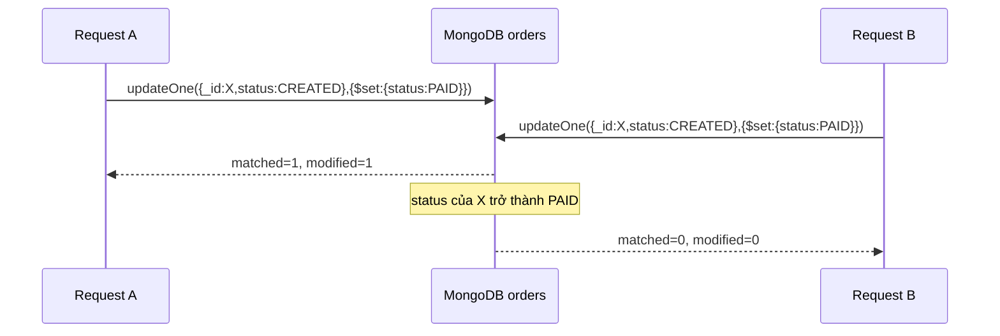
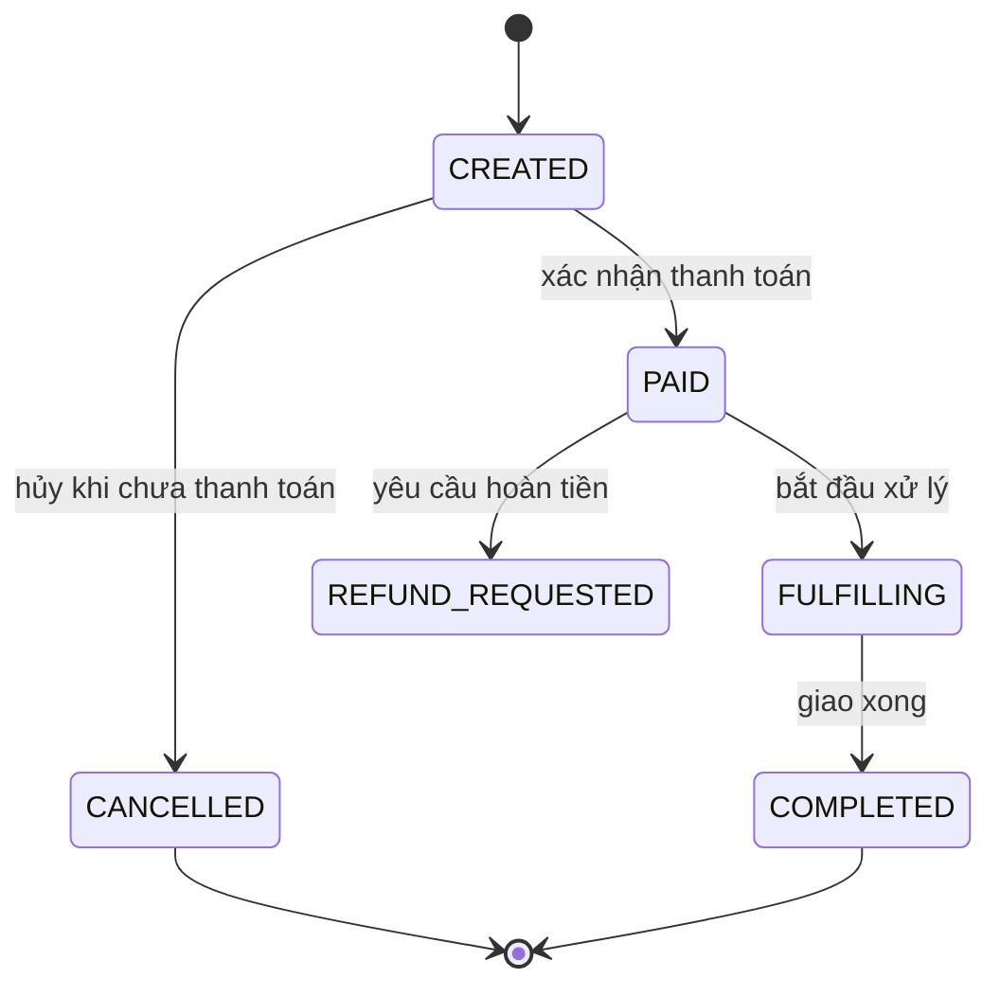

# Điều kiện cập nhật nguyên tử theo quy tắc nghiệp vụ

## 1. Bài toán: cập nhật đúng khi nhiều request xảy ra đồng thời

Trong ứng dụng **Spring Data MongoDB**, lệnh cập nhật thường không chỉ có nghĩa “đặt một field thành giá trị mới”. Nó còn phải bảo vệ **quy tắc nghiệp vụ**: đơn hàng chỉ chuyển từ `CREATED` sang `PAID` khi thanh toán hợp lệ, tồn kho không được âm, phiếu giảm giá không được sử dụng quá số lần cho phép, hoặc tác vụ không được nhận bởi hai worker cùng lúc.

Giả sử hai request cùng đọc một đơn đang ở trạng thái `CREATED`. Cả hai đều kiểm tra hợp lệ rồi cùng cố gắng chuyển trạng thái sang `PAID`. Nếu điều kiện nằm **chỉ trong Java**, hai request có thể cùng tin mình là người đầu tiên hoàn tất thao tác. Vấn đề này còn rõ hơn khi hai người mua cùng cố đặt những sản phẩm chỉ còn một đơn vị tồn kho.

Giải pháp cốt lõi là **conditional atomic update**: đưa **điều kiện tiên quyết** và **thay đổi dữ liệu** vào cùng một thao tác ghi trên MongoDB. Mẫu tổng quát:

```javascript
db.collection.updateOne(
  { _id: someId, condition: expectedValue },
  { $set: { condition: newValue } }
)
```

MongoDB bảo đảm thao tác ghi trên **một document** có tính nguyên tử, kể cả khi thay đổi nhiều field trong document đó. Khi hai thao tác đồng thời cạnh tranh, điều kiện của từng thao tác cập nhật được kiểm tra theo trạng thái document phù hợp với quá trình thực thi ghi. Vì vậy, nếu thao tác đầu làm điều kiện của thao tác sau không còn đúng, thao tác sau không cập nhật được document đó.

Trong Spring Data MongoDB, các thành phần chủ chốt:

| Thành phần | Vai trò |
| --- | --- |
| `Criteria` | Diễn đạt điều kiện nghiệp vụ phải đúng **lúc cập nhật** |
| `Query` | Đóng gói điều kiện theo ID, tenant, status, số lượng... |
| `Update` | Diễn đạt thay đổi nguyên tử như `set`, `inc`, `unset`, `currentDate` |
| `MongoTemplate.updateFirst(...)` | Cập nhật document đầu tiên thỏa điều kiện, trả `UpdateResult` |
| `MongoTemplate.findAndModify(...)` | Cập nhật có điều kiện và trả document trước/sau ghi |
| `@Version` | Hỗ trợ optimistic locking trong quy trình lưu entity |
| Unique index | Bảo đảm bất biến **duy nhất** ở database, không phải chỉ trong Java |

Bài học tập trung vào hai quy tắc:

1. **Đơn hàng:** chỉ thực hiện chuyển `CREATED → PAID` đúng một lần đối với document phù hợp.
2. **Tồn kho:** chỉ đặt trước `quantity` sản phẩm khi `available >= quantity`, không để số tồn âm trong thao tác cập nhật.

Sau đó, ta phân biệt nguyên tử trên một document với transaction nhiều document, cách đọc kết quả, xử lý retry, idempotency và kiểm thử cạnh tranh.

## 2. Hiểu chính xác phạm vi “nguyên tử”

MongoDB bảo đảm tính nguyên tử của **một thao tác ghi trên một document**. Một lệnh `updateOne` có thể vừa kiểm tra điều kiện, vừa `$set` trạng thái, `$inc` bộ đếm và đặt thời gian cập nhật mà không để request khác quan sát được trạng thái “mới đổi một nửa” của chính document ấy.



Sơ đồ minh họa một lịch thực thi có thể xảy ra: request A thắng và request B không còn khớp trạng thái cũ. Nếu B thắng thì kết quả ngược lại; **không bảo đảm request nào thắng trước**.

Các giới hạn quan trọng:

- **Một document:** nhiều field trong document được thay đổi nguyên tử trong cùng thao tác.
- **Nhiều document:** hai lệnh `updateOne` trên `orders` và `inventory` là **hai thao tác độc lập**; chúng không trở thành một transaction chỉ vì được gọi tuần tự trong một method Java.
- **Nhiều document trong `updateMany`:** mỗi document được cập nhật nguyên tử riêng, nhưng toàn bộ thao tác không có bảo đảm nguyên tử như một khối nhiều document.
- **Mạng và kết quả trả về:** timeout/đứt kết nối sau khi gửi lệnh không luôn chứng minh rằng database chưa ghi. Retry cần tính tới idempotency và kết quả không chắc chắn.
- **Điều kiện truy vấn:** phải có các điều kiện bảo vệ bất biến, không chỉ `_id`. Một lệnh `$inc` không có điều kiện số dư có thể làm số dư âm dù bản thân phép tăng/giảm được thực thi nguyên tử.
- **Durability:** tính nguyên tử của thao tác khác với chính sách xác nhận ghi và độ bền dữ liệu khi có lỗi máy/chuyển primary. Chọn write concern/read concern phù hợp yêu cầu hệ thống.

**Phân biệt:** tính nguyên tử ngăn trạng thái trung gian của **một lần ghi**; nó không tự bảo đảm mọi quy trình nghiệp vụ gồm thanh toán bên ngoài, gửi email và cập nhật nhiều collection đều xảy ra cùng lúc.

## 3. Dữ liệu và entity để thực hành

Giả sử database `shop_atomic_demo` có hai collection:

- `orders`: mỗi đơn có ID, tenant, trạng thái và thời điểm thanh toán.
- `inventory`: mỗi sản phẩm của một tenant có `available` (có thể bán) và `reserved` (đã giữ chỗ).

### Các document BSON mẫu

```javascript
use shop_atomic_demo

db.orders.insertMany([
  {
    _id: "ORD-1001",
    tenant_id: "SHOP-A",
    status: "CREATED",
    paid_at: null
  },
  {
    _id: "ORD-1002",
    tenant_id: "SHOP-A",
    status: "PAID",
    paid_at: ISODate("2026-11-10T08:00:00Z")
  }
])

db.inventory.insertOne({
  _id: "SHOP-A:BOOK-101",
  tenant_id: "SHOP-A",
  sku: "BOOK-101",
  available: NumberLong("3"),
  reserved: NumberLong("0")
})
```

Những lệnh insert chỉ chạy trên **database thực hành trống**. Nếu chạy lại với cùng `_id`, MongoDB báo duplicate key. Không thử các lệnh cập nhật tồn kho hoặc đổi trạng thái trên dữ liệu production.

### Entity `OrderDocument`

Ví dụ sử dụng Java 17 và API quen thuộc của Spring Boot 3.x với `spring-boot-starter-data-mongodb`. Cấu hình MongoDB cục bộ có thể là `spring.data.mongodb.uri=mongodb://localhost:27017/shop_atomic_demo`; thông tin xác thực và kết nối cho môi trường thật phải được cấu hình riêng.

```java
package com.example.shop;

import java.time.Instant;
import org.springframework.data.mongodb.core.mapping.Document;
import org.springframework.data.mongodb.core.mapping.Field;
import org.springframework.data.mongodb.core.mapping.FieldType;
import org.springframework.data.mongodb.core.mapping.MongoId;

@Document(collection = "orders")
public class OrderDocument {

    @MongoId(FieldType.STRING)
    private String id;

    @Field("tenant_id")
    private String tenantId;

    private String status;

    @Field("paid_at")
    private Instant paidAt;

    protected OrderDocument() {}

    public OrderDocument(
            String id, String tenantId, String status, Instant paidAt) {
        this.id = id;
        this.tenantId = tenantId;
        this.status = status;
        this.paidAt = paidAt;
    }

    public String getId() { return id; }
    public String getTenantId() { return tenantId; }
    public String getStatus() { return status; }
    public Instant getPaidAt() { return paidAt; }
}
```

### Entity `InventoryDocument`

```java
package com.example.shop;

import org.springframework.data.mongodb.core.mapping.Document;
import org.springframework.data.mongodb.core.mapping.Field;
import org.springframework.data.mongodb.core.mapping.FieldType;
import org.springframework.data.mongodb.core.mapping.MongoId;

@Document(collection = "inventory")
public class InventoryDocument {

    @MongoId(FieldType.STRING)
    private String id;

    @Field("tenant_id")
    private String tenantId;

    private String sku;
    private long available;
    private long reserved;

    protected InventoryDocument() {}

    public InventoryDocument(
            String id, String tenantId, String sku,
            long available, long reserved) {
        this.id = id;
        this.tenantId = tenantId;
        this.sku = sku;
        this.available = available;
        this.reserved = reserved;
    }

    public String getId() { return id; }
    public String getTenantId() { return tenantId; }
    public String getSku() { return sku; }
    public long getAvailable() { return available; }
    public long getReserved() { return reserved; }
}
```

Hai entity dùng `@MongoId(FieldType.STRING)` để ánh xạ property `id` sang `_id` là BSON String. `@Field("tenant_id")` và `@Field("paid_at")` mô tả tên field lưu trữ. Các ví dụ `Criteria.where("tenantId")` trong `MongoTemplate` có ngữ cảnh entity sẽ được mapping sang `tenant_id`; trong `mongosh` phải dùng tên BSON vật lý.

## 4. Mẫu sai: đọc trước, kiểm tra trong Java, ghi sau

Đoạn mã dưới đây minh họa cách làm **không an toàn khi nhiều request chạy đồng thời**:

```java
// KHÔNG dùng đây làm cơ chế bảo vệ chuyển trạng thái.
OrderDocument order =
    mongoTemplate.findById("ORD-1001", OrderDocument.class);

if (order != null && "CREATED".equals(order.getStatus())) {
    // Một request khác có thể đổi status sau dòng if.
    Query byId = Query.query(Criteria.where("id").is(order.getId()));
    mongoTemplate.updateFirst(
        byId,
        new Update().set("status", "PAID"),
        OrderDocument.class
    );
}
```

Lỗ hổng nằm giữa **read** và **write**:

1. Request A đọc `status = CREATED`.
2. Request B cũng đọc `status = CREATED`.
3. A cập nhật `status = PAID`.
4. B tiếp tục cập nhật vì điều kiện của B đã được kiểm tra trước đó trong bộ nhớ Java.

Nếu hai request đồng thời kích hoạt thêm hành động nghiệp vụ như cấp quyền, gửi thông báo hoặc xác nhận giao dịch, hệ thống có nguy cơ xử lý hai lần. Thêm `synchronized` trong một instance ứng dụng cũng không bảo vệ được khi chạy nhiều JVM hoặc nhiều pod.

**Sửa đúng:** đặt `status = CREATED` trong **filter của lệnh ghi** và chỉ cho phép code tiếp tục khi kết quả báo thao tác chuyển trạng thái thành công.

## 5. Compare-and-set: chuyển trạng thái đơn hàng có điều kiện

Ta muốn:

> Chỉ đơn `ORD-1001` của `SHOP-A` đang ở `CREATED` mới được chuyển sang `PAID`, đồng thời ghi thời điểm thanh toán.

Trong `mongosh`:

```javascript
db.orders.updateOne(
  {
    _id: "ORD-1001",
    tenant_id: "SHOP-A",
    status: "CREATED"
  },
  {
    $set: {
      status: "PAID",
      paid_at: ISODate("2026-11-20T08:00:00Z")
    }
  }
)
```

Lần đầu, với dữ liệu mẫu, kết quả thông thường có `matchedCount: 1` và `modifiedCount: 1`. Nếu gọi lại chính lệnh đó, `status` không còn là `CREATED` nên `matchedCount: 0` và `modifiedCount: 0`. Đây là cách **compare-and-set (CAS)** đơn giản: chỉ đổi từ trạng thái mong đợi sang trạng thái mới.

### Ví dụ `MongoTemplate.updateFirst`

```java
import java.time.Instant;
import com.mongodb.client.result.UpdateResult;
import org.springframework.data.mongodb.core.query.Criteria;
import org.springframework.data.mongodb.core.query.Query;
import org.springframework.data.mongodb.core.query.Update;

String authorizedTenantId = "SHOP-A";
String orderId = "ORD-1001";
Instant paidAt = Instant.parse("2026-11-20T08:00:00Z");

Query query = Query.query(
    Criteria.where("id").is(orderId)
        .and("tenantId").is(authorizedTenantId)
        .and("status").is("CREATED")
);

Update change = new Update()
    .set("status", "PAID")
    .set("paidAt", paidAt);

UpdateResult result =
    mongoTemplate.updateFirst(query, change, OrderDocument.class);

boolean transitioned = result.getModifiedCount() == 1;
```

`id` được ánh xạ thành `_id`, `tenantId` thành `tenant_id` và `paidAt` thành `paid_at` khi Spring Data dùng metadata của `OrderDocument`.

**Giải thích:** không cần khóa Java bao quanh hai thao tác đọc–ghi, vì phần **so sánh và thay đổi** đã được gửi cùng nhau trong một lệnh MongoDB. Khi hai request cùng thực hiện trên một đơn, chỉ một request có thể thành công với điều kiện `status = CREATED`, miễn là tất cả đường cập nhật trạng thái đều tôn trọng quy tắc này.

Điều kiện `tenantId` không tự thực hiện phân quyền. Giá trị `authorizedTenantId` phải được lấy từ ngữ cảnh người dùng đã xác thực/cấp quyền, không được coi chuỗi tenant do caller tự gửi là bằng chứng được truy cập đơn.

## 6. Hiểu `matchedCount`, `modifiedCount` và kết quả thất bại

`MongoTemplate.updateFirst(...)` trả `com.mongodb.client.result.UpdateResult` khi thao tác được driver xác nhận. Các chỉ số quan trọng:

| Thuộc tính | Ý nghĩa |
| --- | --- |
| `getMatchedCount()` | Số document khớp filter; với `updateFirst` thông thường là 0 hoặc 1 |
| `getModifiedCount()` | Số document thực sự thay đổi dữ liệu, có thể thấp hơn matched |
| `getUpsertedId()` | ID document được chèn do upsert, nếu thao tác dùng upsert |
| Ngoại lệ khi ghi | Có thể là lỗi kết nối, duplicate key, write concern...; không phải mọi lỗi đều được biểu diễn bằng count = 0 |

Với điều kiện chuyển `CREATED → PAID`, một document khớp filter sẽ đổi `status`, vì vậy `modifiedCount == 1` là tín hiệu chuyển trạng thái thành công. Tuy nhiên **không áp dụng suy luận này cho mọi update**:

```javascript
// Nếu status vốn đã là "PAID", lệnh này có thể:
// matchedCount = 1, modifiedCount = 0.
db.orders.updateOne(
  { _id: "ORD-1002" },
  { $set: { status: "PAID" } }
)
```

Đối với thao tác kiểu “đảm bảo status cuối cùng bằng PAID”, `matchedCount = 1, modifiedCount = 0` có thể không phải thất bại nghiệp vụ. Ngược lại, trong **chuyển trạng thái có điều kiện** với `status = CREATED` và `$set status = PAID`, `modifiedCount = 0` chứng tỏ không chuyển thành công theo điều kiện đó.

Nếu `matchedCount = 0`, các nguyên nhân có thể bao gồm:

- Đơn không tồn tại.
- Đơn thuộc tenant khác hoặc caller không có quyền truy cập.
- Đơn đã ở `PAID`, `CANCELLED` hoặc trạng thái khác `CREATED`.
- Trạng thái bị một request khác thay đổi trước khi thao tác ghi của request hiện tại.

**Không tùy tiện đoán nguyên nhân từ số 0**. Nếu API cần trả phản hồi khác nhau cho từng trường hợp, có thể đọc lại document theo quyền đã được xác thực để phân biệt, nhưng đó là **một thao tác đọc sau ghi thất bại** và trạng thái vẫn có thể thay đổi tiếp; kết quả chỉ phản ánh thời điểm đọc. Với nghiệp vụ cần giữ kín sự tồn tại của tài nguyên thuộc tenant khác, có thể cố ý trả một lỗi chung.

### Quyết định kết quả ở tầng service

```java
package com.example.shop;

import java.time.Instant;
import com.mongodb.client.result.UpdateResult;
import org.springframework.data.mongodb.core.MongoTemplate;
import org.springframework.data.mongodb.core.query.Criteria;
import org.springframework.data.mongodb.core.query.Query;
import org.springframework.data.mongodb.core.query.Update;
import org.springframework.stereotype.Service;

@Service
public class OrderPaymentService {

    private final MongoTemplate template;

    public OrderPaymentService(MongoTemplate template) {
        this.template = template;
    }

    public boolean markPaidOnce(
            String authorizedTenantId,
            String orderId,
            Instant paidAt) {
        if (authorizedTenantId == null
                || authorizedTenantId.isBlank()
                || orderId == null || orderId.isBlank()
                || paidAt == null) {
            throw new IllegalArgumentException("Đầu vào không hợp lệ");
        }

        Query precondition = Query.query(
            Criteria.where("id").is(orderId)
                .and("tenantId").is(authorizedTenantId)
                .and("status").is("CREATED")
        );

        Update change = new Update()
            .set("status", "PAID")
            .set("paidAt", paidAt);

        UpdateResult result =
            template.updateFirst(precondition, change,
                OrderDocument.class);

        return result.getModifiedCount() == 1;
    }
}
```

Giá trị `true` ở đây là sự kiện **đã thực hiện chuyển trạng thái tại database**; `false` nghĩa là không có lần chuyển `CREATED → PAID` nào thành công từ lời gọi này. Service không tự quyết định chuyện thanh toán với cổng bên ngoài: xác nhận tiền thực sự được thu phải đến từ quy trình tích hợp thanh toán đã được thiết kế và xác thực riêng.

## 7. `findAndModify`: cập nhật và nhận document kết quả

Đôi khi API cần trả **trạng thái sau khi cập nhật**, chứ không chỉ một boolean. Nếu viết `updateFirst` rồi `findById`, đó là hai thao tác tách biệt; một request khác có thể thay đổi document giữa chúng.

`MongoTemplate.findAndModify(...)` giúp cập nhật có điều kiện và trả document trong một thao tác `findAndModify` ở MongoDB:

```java
import java.time.Instant;
import org.springframework.data.mongodb.core.FindAndModifyOptions;
import org.springframework.data.mongodb.core.query.Criteria;
import org.springframework.data.mongodb.core.query.Query;
import org.springframework.data.mongodb.core.query.Update;

Query condition = Query.query(
    Criteria.where("id").is("ORD-1001")
        .and("tenantId").is("SHOP-A")
        .and("status").is("CREATED")
);

Update change = new Update()
    .set("status", "PAID")
    .set("paidAt", Instant.parse("2026-11-20T08:00:00Z"));

OrderDocument updated = mongoTemplate.findAndModify(
    condition,
    change,
    FindAndModifyOptions.options().returnNew(true),
    OrderDocument.class
);

if (updated == null) {
    // Không có document đáp ứng điều kiện tại thời điểm ghi.
} else {
    // updated.getStatus() là "PAID" đối với lần chuyển này.
}
```

Một số khác biệt:

- `returnNew(true)` yêu cầu document **sau khi cập nhật**; nếu không bật, API theo mặc định thường trả document **trước khi cập nhật**.
- `updated == null` biểu diễn không tìm thấy document thỏa điều kiện, với chế độ không upsert.
- Đây không phải cách đọc toàn bộ collection; filter phải đủ cụ thể (ví dụ `_id` + tenant + trạng thái).
- Với thao tác cần trả dữ liệu chỉ một lần, nó có thể thuận tiện hơn hai lời gọi update rồi find; nhưng cần đo chi phí trả document so với chỉ cần `UpdateResult`.

Trong hệ thống nhiều worker nhận việc, cách tương tự có thể dùng `findAndModify` trên document `status = "PENDING"` với sort và update trạng thái sang `PROCESSING`. Điều kiện và thay đổi nằm trong một thao tác; nhưng việc xử lý công việc sau khi đã claim vẫn cần cơ chế lease/timeout và khôi phục khi worker chết.

## 8. Giữ tồn kho không âm bằng `$gte` và `$inc`

Bất biến nghiệp vụ:

\[
\text{available} \ge 0
\]

Khi khách đặt trước `quantity` sản phẩm, ta muốn giảm `available` và tăng `reserved` với tổng lượng không thay đổi:

\[
\begin{aligned}
\text{available}_{new} &= \text{available}_{old} - \text{quantity}\\
\text{reserved}_{new}  &= \text{reserved}_{old} + \text{quantity}
\end{aligned}
\]

**Không viết**:

```java
// KHÔNG an toàn khi có nhiều request.
InventoryDocument item = mongoTemplate.findById(
    "SHOP-A:BOOK-101", InventoryDocument.class);

if (item != null && item.getAvailable() >= 2) {
    // Có thể không còn đủ hàng khi update chạy.
    mongoTemplate.updateFirst(
        Query.query(Criteria.where("id").is(item.getId())),
        new Update().inc("available", -2)
            .inc("reserved", 2),
        InventoryDocument.class
    );
}
```

Hai request đều có thể đọc `available = 3`, cùng kiểm tra đủ hàng rồi cùng trừ 2. Sau hai lần ghi, `available = -1` dù mỗi lần `$inc` là nguyên tử.

**Đúng:** đưa điều kiện `available >= quantity` vào filter của chính thao tác update:

```javascript
db.inventory.updateOne(
  {
    _id: "SHOP-A:BOOK-101",
    tenant_id: "SHOP-A",
    available: { $gte: NumberLong("2") }
  },
  {
    $inc: {
      available: NumberLong("-2"),
      reserved: NumberLong("2")
    }
  }
)
```

Với tồn kho ban đầu `available = 3`, hai request cùng cố giữ 2 sản phẩm: **chỉ một request có thể cập nhật thành công**; request thứ hai không còn thỏa `available >= 2`. Kết quả sau khi một request thắng là `available = 1`, `reserved = 2`.

### `MongoTemplate` thực thi điều kiện tồn kho

```java
import com.mongodb.client.result.UpdateResult;
import org.springframework.data.mongodb.core.query.Criteria;
import org.springframework.data.mongodb.core.query.Query;
import org.springframework.data.mongodb.core.query.Update;

long quantity = 2L;

Query enoughStock = Query.query(
    Criteria.where("id").is("SHOP-A:BOOK-101")
        .and("tenantId").is("SHOP-A")
        .and("available").gte(quantity)
);

Update reserve = new Update()
    .inc("available", -quantity)
    .inc("reserved", quantity);

UpdateResult result = mongoTemplate.updateFirst(
    enoughStock,
    reserve,
    InventoryDocument.class
);

boolean reserved = result.getModifiedCount() == 1;
```

Chỉ gọi khi `quantity > 0` và đã kiểm tra giới hạn hợp lệ. Nếu `quantity = 0`, một lệnh `$inc` có thể không tạo thay đổi nhưng vẫn khớp document; nếu âm, biểu thức `available >= quantity` trở nên vô nghĩa cho nghiệp vụ giữ hàng. Với `quantity > 0`, lần giữ hàng thành công sẽ thay đổi hai giá trị.

### Service hoàn chỉnh cho một SKU

```java
package com.example.shop;

import com.mongodb.client.result.UpdateResult;
import org.springframework.data.mongodb.core.MongoTemplate;
import org.springframework.data.mongodb.core.query.Criteria;
import org.springframework.data.mongodb.core.query.Query;
import org.springframework.data.mongodb.core.query.Update;
import org.springframework.stereotype.Service;

@Service
public class InventoryReservationService {

    private final MongoTemplate template;

    public InventoryReservationService(MongoTemplate template) {
        this.template = template;
    }

    public boolean reserve(
            String authorizedTenantId, String sku, long quantity) {
        if (authorizedTenantId == null
                || authorizedTenantId.isBlank()
                || sku == null || sku.isBlank()
                || quantity <= 0 || quantity > 1_000_000) {
            throw new IllegalArgumentException(
                "Dữ liệu giữ hàng không hợp lệ");
        }

        String inventoryId = authorizedTenantId + ":" + sku;

        Query query = Query.query(
            Criteria.where("id").is(inventoryId)
                .and("tenantId").is(authorizedTenantId)
                .and("sku").is(sku)
                .and("available").gte(quantity)
        );

        Update update = new Update()
            .inc("available", -quantity)
            .inc("reserved", quantity);

        UpdateResult result = template.updateFirst(
            query, update, InventoryDocument.class);

        return result.getModifiedCount() == 1;
    }
}
```

Đây là ví dụ cho hệ thống nơi mỗi tenant và SKU có **một document tồn kho** được nhận diện bằng một ID thống nhất. Ghép chuỗi ID bằng dấu `:` chỉ an toàn khi mã tenant/SKU được chuẩn hóa, không gây va chạm; thực tế có thể dùng UUID kỹ thuật và **compound unique index** trên `(tenant_id, sku)` thay vì ghép ID thủ công.

Việc giữ tồn kho của **một SKU trong một document** được bảo vệ bằng điều kiện trên document ấy. Giữ hàng cho **nhiều SKU**, đồng thời tạo đơn hoặc phát hành voucher ở collection khác, là nghiệp vụ nhiều document: cần chiến lược khác nếu yêu cầu tất cả cùng thành công hoặc tất cả cùng thất bại.

## 9. Atomic update có nhiều field không đồng nghĩa optimistic locking

Với document chứa trạng thái và bộ đếm, một `Update` có thể kết hợp nhiều thay đổi:

```java
Update update = new Update()
    .set("status", "PROCESSING")
    .inc("attempts", 1)
    .currentDate("updatedAt");
```

Nếu dùng trong `updateFirst` và mapping `updatedAt` thích hợp, các field được thay đổi trong **cùng document** qua một lệnh, không để lộ trạng thái mới chỉ một phần. Điều này vẫn **khác** với optimistic locking:

- **Conditional update:** lọc bằng một điều kiện nghiệp vụ cụ thể, ví dụ `status == CREATED` hoặc `available >= quantity`.
- **Optimistic locking:** dựa vào một giá trị phiên bản đã đọc trước đó; chỉ cập nhật nếu version chưa đổi, nhằm phát hiện một thay đổi đồng thời bất kỳ làm version không còn khớp.

`@Version` trong Spring Data MongoDB hỗ trợ cơ chế optimistic locking khi sử dụng quy trình lưu entity thích hợp. Nhưng khi tự viết `MongoTemplate.updateFirst`, **không nên giả định framework đã tự gắn điều kiện version bằng giá trị mà caller từng đọc**. Nếu yêu cầu compare-and-set theo version, phải bảo đảm câu lệnh ghi thực sự chứa điều kiện `version = expectedVersion` hoặc dùng API lưu có bảo đảm optimistic locking tương ứng.

### Ví dụ cập nhật có điều kiện version tường minh

Giả sử document quản lý cấu hình có `version` là số nguyên:

```javascript
db.settings.updateOne(
  { _id: "shop-a:rules", version: NumberLong("3") },
  {
    $set: { enabled: true },
    $inc: { version: NumberLong("1") }
  }
)
```

Nếu hai request cùng đọc `version = 3` rồi đều cố ghi với filter này, chỉ thao tác đến trước đổi được version thành 4; thao tác còn lại không khớp. Đây là mẫu **compare-and-set theo version**. Cần thống nhất kiểu BSON của version, giới hạn tràn số, và cách nhận biết kết quả xung đột.

### Ví dụ entity với `@Version`

```java
import org.springframework.data.annotation.Version;

@Version
private Long version;
```

Có thể đặt field này trong entity cần kiểm soát optimistic locking. Spring Data sử dụng giá trị version để kiểm tra sự thay đổi đồng thời đối với các lệnh ghi thuộc cơ chế versioning của nó, chẳng hạn các thao tác `save` thích hợp. Với acknowledged write concern, một xung đột có thể được báo qua `OptimisticLockingFailureException`.

**Đừng thêm `@Version` chỉ để “tự động giải quyết mọi vấn đề”:** phiên bản không giải quyết mã nghiệp vụ trùng giữa document, không thay thế điều kiện `available >= quantity` và không biến hai collection thành một đơn vị nguyên tử.

## 10. Idempotency: thao tác nguyên tử không có nghĩa gọi lặp vô hại

Một khái niệm thường bị nhầm với atomicity là **idempotency**: gọi cùng một yêu cầu nhiều lần vẫn tạo ra kết quả nghiệp vụ tương đương một lần.

Mẫu chuyển `CREATED → PAID` với filter `status = CREATED` có một đặc điểm hữu ích: sau lần chuyển thành công, những lần gọi lại **không thực hiện cùng chuyển trạng thái nữa**. Tuy nhiên, nó chưa bảo đảm toàn bộ quy trình thanh toán bên ngoài idempotent, vì cổng thanh toán và các sự kiện liên quan có đời sống riêng.

Với tồn kho, chỉ có điều kiện `available >= quantity` thì **chưa idempotent theo request**. Nếu còn nhiều hàng:

```text
Tồn ban đầu: available = 10, reserved = 0
Request giữ 2:   available = 8, reserved = 2   (thành công)
Retry giữ 2:     available = 6, reserved = 4   (vẫn thành công)
```

Mỗi lần giảm tồn là nguyên tử và không âm, nhưng **cùng một yêu cầu** đã giữ hàng hai lần. Cách khắc phục là có **mã yêu cầu duy nhất** như `reservationId`/`idempotencyKey`, và bảo đảm chỉ một lần ghi được công nhận cho mã đó.

### Một mẫu idempotency ngay trong một document

Nếu số request được ghi dấu trên mỗi sản phẩm **nhỏ và có giới hạn**, có thể dùng array `applied_request_ids` để lưu các mã đã áp dụng, đồng thời cập nhật tồn kho và thêm dấu trong **cùng lệnh trên một document**:

```javascript
const requestId = "RES-ORDER-5001";
const quantity = NumberLong("2");
const negativeQuantity = NumberLong("-2");

db.inventory.updateOne(
  {
    _id: "SHOP-A:BOOK-101",
    tenant_id: "SHOP-A",
    available: { $gte: quantity },
    applied_request_ids: { $ne: requestId }
  },
  {
    $inc: {
      available: negativeQuantity,
      reserved: quantity
    },
    $addToSet: {
      applied_request_ids: requestId
    }
  }
)
```

Điều kiện `applied_request_ids: { $ne: requestId }` chỉ cho phép ghi khi request chưa được áp dụng trên document đó. `$inc` và `$addToSet` cùng thuộc một lệnh cập nhật document nguyên tử; một retry của **cùng mã** sẽ không giảm tồn lần nữa.

**Giới hạn rất quan trọng:** array này tăng theo số request; MongoDB có giới hạn kích thước một document BSON (16 MiB) nên không phù hợp với một SKU có lịch sử giữ hàng vô hạn. Không tự xóa mã cũ khỏi dấu vết idempotency nếu hệ thống vẫn cho phép retry request đó, vì sau khi xóa dấu, retry có thể áp dụng thêm lần nữa.

Trong hệ thống lớn, thường cần **bảng/collection ghi nhận yêu cầu với unique index**, cùng một thiết kế transaction hoặc quy trình đảm bảo nhất quán giữa việc ghi dấu và điều chỉnh tồn kho. **Ghi hai document riêng lẻ bằng hai lệnh mà không có transaction không tự bảo đảm idempotency** khi một lệnh thành công còn lệnh kia thất bại.

### Retry khi kết quả ghi không rõ

Nếu ứng dụng gửi lệnh rồi mất kết nối trước khi nhận kết quả, không biết chắc lệnh đã được áp dụng hay chưa. Không nên cứ gọi lại một lệnh `$inc` không có idempotency key. Ngoài tính năng retryable writes của driver (có phạm vi và điều kiện nhất định), hệ thống vẫn phải có quy tắc **business-level idempotency** cho những lần client hoặc job retry toàn bộ yêu cầu.

Với chuyển trạng thái `CREATED → PAID`, nếu lần retry nhận `matchedCount = 0`, cần phân biệt “lần trước đã hoàn tất” và “đơn bị hủy bởi thao tác khác” theo quy tắc nghiệp vụ và trạng thái hiện tại. Tuyệt đối không suy ra chắc chắn rằng request đã thành công chỉ vì không còn khớp `CREATED`.

## 11. Chuyển trạng thái theo sơ đồ nghiệp vụ

Các trạng thái đơn hàng có thể có một sơ đồ chuyển đổi đơn giản:



Không nên mở một API ghi tùy ý `set("status", newStatus)` cho mọi trạng thái. Mỗi transition nên có **điều kiện nguồn**, kiểm tra quyền, kiểm tra dữ liệu bắt buộc và tác dụng phụ được định nghĩa.

Ví dụ transition `CREATED → CANCELLED`:

```java
Query query = Query.query(
    Criteria.where("id").is(orderId)
        .and("tenantId").is(authorizedTenantId)
        .and("status").is("CREATED")
);

Update change = new Update()
    .set("status", "CANCELLED")
    .set("cancelledAt", java.time.Instant.now());

UpdateResult result =
    mongoTemplate.updateFirst(query, change, OrderDocument.class);

boolean cancelled = result.getModifiedCount() == 1;
```

Đoạn này minh họa thêm một field `cancelledAt` khi nghiệp vụ cần ghi thời điểm hủy; trong ứng dụng hoàn chỉnh, hãy khai báo field tương ứng trong entity, kèm `@Field("cancelled_at")` hoặc tên BSON được thống nhất. Không nên để tên Java/BSON mơ hồ.

**Nếu yêu cầu hủy và yêu cầu thanh toán chạy đồng thời**, cùng filter `status = CREATED` sẽ bảo đảm **chỉ một transition** từ `CREATED` có thể thành công trên document này. Tuy vậy, đã thu tiền ở hệ thống bên ngoài thì chuyển thành `CANCELLED` không tự hoàn tiền; cần một quy trình nghiệp vụ riêng.

### Gắn thêm điều kiện thời gian hoặc trạng thái phụ

Một quy tắc có thể là “chỉ hủy khi đơn chưa hết hạn”, hoặc “worker chỉ claim tác vụ có lease đã hết hạn”. Có thể đưa thêm các trường vào filter:

```java
Query query = Query.query(
    Criteria.where("id").is(orderId)
        .and("status").is("CREATED")
        .and("expiresAt").gt(java.time.Instant.now())
);
```

Ví dụ này yêu cầu field `expiresAt` được lưu với BSON Date và đồng hồ ứng dụng đủ tin cậy cho tiêu chí thời gian; nếu nhiều node có đồng hồ lệch nhau, cần làm rõ nguồn thời gian hoặc dùng cơ chế thời gian phù hợp. Mỗi đường ghi status cũng phải áp dụng đúng transition, nếu không một API khác vẫn có thể bỏ qua bất biến.

## 12. Một document có array: điều kiện và cập nhật phần tử

Quy tắc nghiệp vụ đôi khi nằm trong **một phần tử array** của document, ví dụ mỗi đơn có `lines` chứa `sku` và `remaining`. Muốn trừ số lượng còn có thể giao cho một dòng hàng, cần bảo đảm cùng phần tử vừa có đúng SKU vừa còn đủ số lượng.

Ví dụ MongoDB:

```javascript
{
  _id: "ORD-2001",
  tenant_id: "SHOP-A",
  lines: [
    { sku: "BOOK-101", remaining: NumberLong("3") },
    { sku: "BOOK-202", remaining: NumberLong("1") }
  ]
}
```

Ta có thể sử dụng `$elemMatch` trong filter và **positional update operator** `$` để cập nhật phần tử đầu tiên khớp điều kiện:

```javascript
db.orders.updateOne(
  {
    _id: "ORD-2001",
    tenant_id: "SHOP-A",
    lines: {
      $elemMatch: {
        sku: "BOOK-101",
        remaining: { $gte: NumberLong("2") }
      }
    }
  },
  {
    $inc: { "lines.$.remaining": NumberLong("-2") }
  }
)
```

Ý nghĩa: chỉ giảm `remaining` của một dòng `BOOK-101` nếu **chính dòng đó** có ít nhất 2 đơn vị. Không viết hai điều kiện độc lập `"lines.sku"` và `"lines.remaining"` khi mục tiêu là cùng một phần tử: hai điều kiện có thể khớp hai phần tử khác nhau.

Khi một SKU có thể lặp nhiều lần trong array, positional `$` chỉ cập nhật phần tử đầu tiên phù hợp trong trường hợp này. Nếu bài toán cần cập nhật nhiều phần tử có điều kiện, MongoDB hỗ trợ `arrayFilters` và các positional operator khác, nhưng phải thiết kế chính xác quy tắc đối với trùng SKU. Thường nên có một ID ổn định cho mỗi line item hoặc chuẩn hóa SKU duy nhất theo đơn.

**Giới hạn:** thao tác trên array vẫn nguyên tử **trong một document**, nhưng nếu cập nhật đồng thời ở document tồn kho khác thì không tạo được bất biến xuyên collection chỉ nhờ một lệnh này.

## 13. `upsert`, unique index và điều kiện ghi mới

`upsert` có nghĩa: nếu không có document khớp filter, có thể **insert** document mới thay vì chỉ update. Đây là công cụ hữu ích cho cấu hình hoặc bộ đếm, nhưng rất nguy hiểm nếu dùng trong thao tác đòi hỏi “chỉ cập nhật khi trạng thái cũ hợp lệ”.

Ví dụ sau **không nên dùng để xác nhận thanh toán**:

```javascript
// KHÔNG phù hợp cho transition chỉ khi đơn đã tồn tại.
db.orders.updateOne(
  { _id: "ORD-9999", status: "CREATED" },
  { $set: { status: "PAID" } },
  { upsert: true }
)
```

Nếu không có đơn phù hợp, upsert có thể tạo ra document mới với trạng thái `PAID` dù chưa từng có đơn. Nếu document với cùng `_id` đã tồn tại nhưng trạng thái khác, upsert có thể vấp lỗi duplicate key hoặc hành vi xung đột khác tùy điều kiện. Đây không phải chuyển trạng thái hợp lệ.

**Quy tắc:** đối với `CREATED → PAID` hoặc `available >= quantity`, hãy sử dụng **update không upsert**, vì thất bại khi không khớp mới là tín hiệu cần xử lý.

Trong những trường hợp thật sự cần “tạo nếu chưa tồn tại”, dùng `upsert` phải:

- Định nghĩa chính xác khóa định danh hoặc **unique index** theo phạm vi nghiệp vụ.
- Chỉ định giá trị mặc định lúc insert qua `$setOnInsert` khi phù hợp.
- Xử lý cạnh tranh chèn đồng thời, có thể có duplicate key thay vì kết quả tự động gộp.
- Phân biệt `matchedCount`, `modifiedCount` và `upsertedId` trong `UpdateResult`.
- Không dùng riêng “`find` rồi `insert`” để bảo đảm duy nhất vì có race condition.

Ví dụ một cấu hình theo tenant có unique ID:

```javascript
db.shop_settings.updateOne(
  { _id: "SHOP-A:CHECKOUT" },
  {
    $set: { enabled: true },
    $setOnInsert: { created_by: "system" }
  },
  { upsert: true }
)
```

Lệnh này phù hợp với mục tiêu **tạo cấu hình nếu chưa có**, nhưng không đồng nghĩa mọi field trong cấu hình được cập nhật theo CAS. Nếu cần bảo vệ phiên bản cấu hình, phải thêm điều kiện version hoặc các bất biến tương ứng.

## 14. Khi nào cần transaction nhiều document hoặc outbox?

Quy tắc “giữ hàng nếu còn đủ” trên `InventoryDocument` rất phù hợp với cập nhật nguyên tử của **một document**. Nhưng một nghiệp vụ mua hàng có thể cần:

1. Chuyển đơn hàng từ `CREATED` sang `CONFIRMED`.
2. Giảm hàng có thể bán và tăng hàng đã giữ ở document tồn kho.
3. Ghi một sự kiện gửi tới hệ thống vận chuyển hoặc thanh toán.

Nếu lệnh 1 thành công nhưng lệnh 2 thất bại do hết hàng, database có thể còn một đơn ở trạng thái không hợp lệ. Hai lệnh được gọi nối tiếp trong Java **không tạo giao dịch ACID xuyên document**.

### Transaction với MongoDB khi thật sự cần

MongoDB hỗ trợ transaction nhiều document trong cấu hình triển khai phù hợp, thường là **replica set hoặc sharded cluster**, không phải MongoDB standalone thông thường. Spring Data MongoDB có `MongoTransactionManager` giúp các thao tác đồng bộ cùng tham gia một transaction.

Ví dụ cấu hình cơ bản:

```java
package com.example.shop;

import org.springframework.context.annotation.Bean;
import org.springframework.context.annotation.Configuration;
import org.springframework.data.mongodb.MongoDatabaseFactory;
import org.springframework.data.mongodb.MongoTransactionManager;

@Configuration
public class MongoTransactionConfig {

    @Bean
    MongoTransactionManager transactionManager(
            MongoDatabaseFactory databaseFactory) {
        return new MongoTransactionManager(databaseFactory);
    }
}
```

Một service minh họa tạo đơn và giữ kho:

```java
package com.example.shop;

import java.time.Instant;
import org.springframework.data.mongodb.core.MongoTemplate;
import org.springframework.stereotype.Service;
import org.springframework.transaction.annotation.Transactional;

@Service
public class CheckoutService {

    private final InventoryReservationService inventory;
    private final MongoTemplate template;

    public CheckoutService(
            InventoryReservationService inventory,
            MongoTemplate template) {
        this.inventory = inventory;
        this.template = template;
    }

    @Transactional
    public void createAndReserve(
            String authorizedTenantId, String orderId,
            String sku, long quantity) {

        boolean reserved =
            inventory.reserve(authorizedTenantId, sku, quantity);

        if (!reserved) {
            throw new IllegalStateException(
                "Không đủ tồn kho hoặc SKU không hợp lệ");
        }

        template.insert(new OrderDocument(
            orderId, authorizedTenantId, "CONFIRMED",
            (Instant) null));
    }
}
```

Ví dụ chỉ dùng để minh họa **ranh giới transaction**, chưa bao gồm xác thực input, định danh đơn, idempotency và tính phí. Trong môi trường đúng, nếu thao tác chèn đơn ném exception khiến transaction rollback, thao tác giữ hàng trong cùng transaction cũng bị rollback. Điều này đòi hỏi:

- `MongoTransactionManager` được đăng ký và ứng dụng dùng đúng template/transaction context.
- MongoDB có hỗ trợ transaction và cấu hình replica set/sharded cluster hợp lệ.
- Gọi qua Spring proxy có quản lý transaction (không giả định self-invocation tự kích hoạt `@Transactional`).
- Xử lý lỗi transaction, xung đột ghi và retry **toàn bộ transaction** một cách an toàn.

Transaction không nên được dùng tràn lan cho mọi update một document: nó có chi phí và độ phức tạp cao hơn. Với ví dụ không có yêu cầu phải ghi hai document cùng lúc, một conditional atomic update đơn lẻ là đủ.

### Outbox và hệ thống bên ngoài

**Transaction MongoDB không thể tự rollback một API thanh toán hoặc email đã gửi bên ngoài.** Đối với nghiệp vụ “cập nhật đơn + phát sự kiện”, có thể dùng **transactional outbox**: lưu thay đổi dữ liệu và event vào cùng transaction trong database, sau đó một worker gửi event và đánh dấu đã xử lý. Người nhận cũng cần idempotency vì event có thể được gửi lại.

Nếu chỉ cần ghi một event nhỏ trong cùng **document đơn hàng**, đôi khi có thể ghi dấu phát sự kiện cùng transition rồi để worker quét và xử lý, nhưng phải cân nhắc vòng đời event, kích thước document và tính bền vững của quy trình giao hàng. Không gửi webhook rồi nghĩ rằng `updateFirst` thành công sẽ bảo đảm webhook chỉ chạy một lần.

## 15. Index và hiệu năng của conditional update

Điều kiện nguyên tử phải **đúng về nghiệp vụ trước**, rồi mới xem index. Tuy vậy, một lệnh update có filter không hiệu quả có thể gây tải lớn trên collection nhiều document.

### Truy vấn theo `_id`

```javascript
db.orders.updateOne(
  { _id: "ORD-1001", tenant_id: "SHOP-A", status: "CREATED" },
  { $set: { status: "PAID" } }
)
```

Vì `_id` là duy nhất và có index mặc định, truy vấn theo một ID cụ thể thường có tập ứng viên rất nhỏ. Đặt thêm tenant và status trong filter nhằm **bảo vệ điều kiện nghiệp vụ**; không nhất thiết cần một compound index trên cả ba field cho từng thao tác tìm theo `_id`.

### Truy vấn theo khóa nghiệp vụ

Khi tồn kho được truy vấn theo `tenant_id` và `sku` thay vì `_id`, có thể dùng compound unique index:

```javascript
db.inventory.createIndex(
  { tenant_id: 1, sku: 1 },
  {
    unique: true,
    name: "inventory_tenant_sku_unique"
  }
)
```

Index giúp MongoDB không có hai document tồn kho cho cùng cặp tenant/SKU, đồng thời hỗ trợ truy vấn theo khóa đó. Trước khi tạo unique index trên dữ liệu hiện có, phải phát hiện và xử lý khóa trùng, null/missing và quy tắc chuẩn hóa SKU.

Một filter kiểu `available >= quantity` còn được áp dụng trên document đúng SKU. Khi đã tìm theo một ID/khóa duy nhất, không nên tạo thêm hàng loạt index riêng cho `available` chỉ vì nó xuất hiện trong điều kiện.

### Đo đường tìm document

Có thể quan sát một **truy vấn find tương đương** filter của update:

```javascript
db.inventory.find({
  _id: "SHOP-A:BOOK-101",
  tenant_id: "SHOP-A",
  available: { $gte: NumberLong("2") }
}).explain("executionStats")
```

Đây là phép đo **đường truy vấn tìm document**, không phải đo trực tiếp toàn bộ chi phí của `updateOne`. Kiểm tra `winningPlan`, `IXSCAN`/`COLLSCAN`, `totalKeysExamined`, `totalDocsExamined` và `nReturned`. Độ trễ cập nhật thực còn gồm lock contention, ghi index, journaling, write concern, replication và retry.

Nếu nhiều request cùng cập nhật **một document tồn kho nóng**, ngay cả một index tuyệt vời cũng không loại bỏ cạnh tranh ghi tại document đó. Có thể phải xem lại thiết kế dữ liệu, giới hạn throughput, hàng đợi xử lý hoặc chia partition tồn kho theo nhu cầu thật. Không tự chia document nếu việc chia phá vỡ bất biến “tổng tồn không âm”.

## 16. Reactive conditional update

Trong Spring Data MongoDB reactive, điều kiện và thay đổi vẫn được biểu diễn bằng `Query` và `Update`. Thay `MongoTemplate` bằng `ReactiveMongoTemplate`; phương thức cập nhật trả về `Mono<UpdateResult>` thay vì `UpdateResult` đồng bộ:

```java
import java.time.Instant;
import org.springframework.data.mongodb.core.ReactiveMongoTemplate;
import org.springframework.data.mongodb.core.query.Criteria;
import org.springframework.data.mongodb.core.query.Query;
import org.springframework.data.mongodb.core.query.Update;
import reactor.core.publisher.Mono;

Query condition = Query.query(
    Criteria.where("id").is(orderId)
        .and("tenantId").is(authorizedTenantId)
        .and("status").is("CREATED")
);

Update change = new Update()
    .set("status", "PAID")
    .set("paidAt", Instant.now());

Mono<Boolean> transitioned =
    reactiveMongoTemplate
        .updateFirst(condition, change, OrderDocument.class)
        .map(result -> result.getModifiedCount() == 1);
```

Đoạn mã thuộc component đã inject `ReactiveMongoTemplate` và có biến `orderId`, `authorizedTenantId`. Reactive repository và reactive template không làm thay đổi tính nguyên tử của **một document** ở MongoDB.

Một số điểm cần chú ý:

- `Mono` thực thi khi được subscribe; không tạo `Query`/`Update` mutable dùng chung rồi sửa trong nhiều subscription không kiểm soát.
- Không gọi `block()` trong đường xử lý reactive chỉ để chờ kết quả.
- Nếu cần transactional workflow nhiều document trong reactive, dùng cơ chế quản lý transaction **reactive** và context phù hợp; `MongoTransactionManager` đồng bộ không tự quản lý transaction reactive.
- Retry ở tầng Reactor như `retryWhen(...)` phải xét **idempotency**. Không retry vô điều kiện một thao tác `$inc` có thể đã thành công nhưng client chưa nhận được kết quả.

Phương thức của reactive template còn có phiên bản `findAndModify` để trả về document khi cần, nhưng điều kiện CAS vẫn phải được gửi trong query. Reactive không thay thế unique index hay kiểm tra quyền truy cập.

## 17. Kiểm thử trên MongoDB thật, kể cả tranh chấp đồng thời

Các đặc tính cạnh tranh phải được kiểm thử với **MongoDB thật** ở môi trường kiểm thử cô lập, ví dụ MongoDB dành riêng cho bài test hoặc Testcontainers. Một mock trả `UpdateResult` giả không chứng minh được lệnh cập nhật hoạt động nguyên tử dưới tải đồng thời.

Ví dụ dưới đây sử dụng Spring Boot 3.x và `@DataMongoTest`. Nó chủ động tạo dữ liệu theo kiểu BSON được mapping bởi hai entity. Cần thiết lập kết nối MongoDB test an toàn trước khi chạy.

```java
package com.example.shop;

import java.time.Instant;
import java.util.concurrent.Callable;
import java.util.concurrent.CountDownLatch;
import java.util.concurrent.ExecutorService;
import java.util.concurrent.Executors;
import java.util.concurrent.Future;
import org.bson.Document;
import org.junit.jupiter.api.BeforeEach;
import org.junit.jupiter.api.Test;
import org.springframework.beans.factory.annotation.Autowired;
import org.springframework.boot.test.autoconfigure.data.mongo.DataMongoTest;
import org.springframework.data.mongodb.core.MongoTemplate;

import static org.assertj.core.api.Assertions.assertThat;

@DataMongoTest
class ConditionalAtomicUpdateTest {

    @Autowired
    MongoTemplate template;

    private OrderPaymentService payments;
    private InventoryReservationService inventory;

    @BeforeEach
    void seedIsolatedDatabase() {
        // CHỈ dùng trên database test cô lập.
        template.getCollection("orders")
            .deleteMany(new Document());
        template.getCollection("inventory")
            .deleteMany(new Document());

        template.insert(new OrderDocument(
            "ORD-1001", "SHOP-A", "CREATED", null));

        template.insert(new InventoryDocument(
            "SHOP-A:BOOK-101", "SHOP-A", "BOOK-101",
            3, 0));

        payments = new OrderPaymentService(template);
        inventory = new InventoryReservationService(template);
    }

    @Test
    void aPaymentTransitionSucceedsOnlyOnce() {
        Instant paidAt =
            Instant.parse("2026-11-20T08:00:00Z");

        assertThat(payments.markPaidOnce(
            "SHOP-A", "ORD-1001", paidAt)).isTrue();

        assertThat(payments.markPaidOnce(
            "SHOP-A", "ORD-1001", paidAt)).isFalse();

        OrderDocument stored =
            template.findById("ORD-1001", OrderDocument.class);

        assertThat(stored).isNotNull();
        assertThat(stored.getStatus()).isEqualTo("PAID");
        assertThat(stored.getPaidAt()).isEqualTo(paidAt);
    }

    @Test
    void reservationNeverMakesStockNegative() {
        assertThat(inventory.reserve(
            "SHOP-A", "BOOK-101", 2)).isTrue();

        assertThat(inventory.reserve(
            "SHOP-A", "BOOK-101", 2)).isFalse();

        InventoryDocument stored = template.findById(
            "SHOP-A:BOOK-101", InventoryDocument.class);

        assertThat(stored).isNotNull();
        assertThat(stored.getAvailable()).isEqualTo(1);
        assertThat(stored.getReserved()).isEqualTo(2);
    }

    @Test
    void twoConcurrentReservationsCannotBothTakeTwo()
            throws Exception {
        ExecutorService pool =
            Executors.newFixedThreadPool(2);
        CountDownLatch gate = new CountDownLatch(1);

        try {
            Callable<Boolean> request = () -> {
                gate.await();
                return inventory.reserve(
                    "SHOP-A", "BOOK-101", 2);
            };

            Future<Boolean> first = pool.submit(request);
            Future<Boolean> second = pool.submit(request);
            gate.countDown();

            int successCount = (first.get() ? 1 : 0)
                + (second.get() ? 1 : 0);

            assertThat(successCount).isEqualTo(1);

            InventoryDocument stored = template.findById(
                "SHOP-A:BOOK-101", InventoryDocument.class);

            assertThat(stored).isNotNull();
            assertThat(stored.getAvailable()).isEqualTo(1);
            assertThat(stored.getReserved()).isEqualTo(2);
        } finally {
            pool.shutdownNow();
        }
    }
}
```

**Giới hạn của ví dụ test:**

- `deleteMany(new Document())` xóa **toàn bộ document** của collection trong database đang kết nối. Tuyệt đối không chạy trên production hoặc database dùng chung.
- `@DataMongoTest` giúp nạp thành phần Spring Data, nhưng không tự bảo đảm MongoDB test an toàn đã tồn tại; cần cấu hình test database riêng.
- Hai worker trong test dùng kết nối từ `MongoTemplate` đã được cấu hình; test không chứng minh rằng những hệ thống bên ngoài hoặc transaction nhiều collection cũng nguyên tử.
- Các kiểm thử cạnh tranh nên lặp lại dưới tải đại diện và được bổ sung kiểm thử fault injection, timeout/retry và write concern khi ứng dụng yêu cầu độ tin cậy cao.

### Bộ trường hợp cần bổ sung

| Trường hợp | Kỳ vọng |
| --- | --- |
| Transition lần đầu từ `CREATED` | Một update thành công, status và `paid_at` đổi cùng lúc |
| Gọi lại transition sau `PAID` | Không đổi `paid_at`, count chuyển trạng thái bằng 0 |
| Đơn thuộc tenant khác | Không cập nhật, không rò rỉ dữ liệu |
| Trạng thái `CANCELLED` | Không thể chuyển thành `PAID` bằng transition `CREATED → PAID` |
| Hai request cùng chuyển trạng thái | Có nhiều nhất một lần thành công |
| Tồn kho 3, hai request giữ 2 | Chỉ một request thành công; tồn cuối không âm |
| Tồn kho 3, request giữ 0 hoặc -1 | Service từ chối trước khi gửi query |
| Hai request có cùng idempotency key | Một yêu cầu nghiệp vụ chỉ được áp dụng một lần theo thiết kế đã chọn |
| Mất kết nối sau khi gửi ghi | Phải xử lý kết quả không chắc chắn và retry an toàn |
| Transaction tạo đơn + giữ tồn | Hoặc cả hai commit, hoặc rollback khi thao tác trong transaction thất bại |
| Field `available` sai kiểu BSON | Không được âm thầm xử lý như số đúng |

## 18. Những lỗi thường gặp và hướng xử lý

| Triệu chứng | Nguyên nhân thường gặp | Hướng xử lý |
| --- | --- | --- |
| Hai request cùng “thành công” theo Java | Kiểm tra trạng thái trong `find` trước, update chỉ lọc theo ID | Đưa trạng thái mong đợi vào filter của chính lệnh update |
| Tồn kho bị âm dù dùng `$inc` | Không kiểm tra `available >= quantity` trong filter | Dùng `$gte` cùng `$inc` trong một lệnh |
| `modifiedCount = 0` bị coi là lỗi database | Có thể không khớp filter hoặc cập nhật không thay giá trị | Phân biệt matched/modified và ngữ nghĩa từng transition |
| Retry `$inc` làm giữ hàng hai lần | Thao tác nguyên tử nhưng không idempotent theo request | Dùng idempotency key và cơ chế ghi dấu nhất quán |
| Gọi lại chuyển trạng thái bị trả false nhưng đơn đã PAID | Trạng thái không còn là `CREATED` | Định nghĩa rõ phản hồi retry, đọc trạng thái khi cần và kiểm tra request identity |
| Cập nhật đúng order nhưng sai tenant | Filter thiếu tenant hoặc caller kiểm soát tenant | Đưa scope đã xác thực vào điều kiện update |
| `findAndModify` trả status cũ | Chưa bật `returnNew(true)` | Dùng tùy chọn trả document sau ghi |
| Thao tác upsert tạo đơn không hợp lệ | Dùng `upsert(true)` cho lệnh chuyển trạng thái | Không upsert trong transition bắt buộc document đã tồn tại |
| Hai collection lệch trạng thái | Cập nhật nhiều document theo nhiều lệnh độc lập | Dùng transaction khi cần và phù hợp, hoặc saga/bù |
| Event thanh toán gửi trùng | Gửi event ngoài DB mà không có idempotency/outbox | Dùng outbox và deduplication ở consumer |
| `@Version` có mà update vẫn ghi ngoài dự kiến | Raw/template update không mang expected version trong filter | Kiểm tra câu lệnh và dùng save optimistic locking hoặc explicit CAS |
| Update chậm dù có index | Nhiều request tranh chấp cùng một document nóng | Đo contention, đánh giá lại mô hình partition/throughput |
| Reactive `retryWhen` làm thao tác lặp | Retry một thao tác `$inc` mà kết quả lần trước không chắc chắn | Thiết kế idempotency trước khi bật retry |
| `@LastModifiedDate` không đổi như mong đợi | Partial update không nhất thiết gọi mọi callback lifecycle như save entity | Set thời gian cập nhật trong lệnh ghi hoặc kiểm tra cơ chế auditing tương ứng |

**Một nguyên tắc chẩn đoán:** không gom mọi `modifiedCount = 0` thành “hết hàng”. Trong filter có thể đồng thời có ID, tenant, SKU, status và số lượng. API có thể cần một truy vấn đọc riêng sau thất bại để cho thông điệp hữu ích, nhưng phải duy trì phân quyền và không coi đọc lại là trạng thái bất biến.

## 19. Checklist áp dụng conditional atomic update

Trước khi triển khai một nghiệp vụ ghi dữ liệu bằng Spring Data MongoDB, hãy tự trả lời:

1. **Bất biến nào phải luôn đúng?** Ví dụ `available >= 0` hoặc `status` chỉ đi qua những transition hợp lệ.
2. **Bất biến nằm trong một document hay nhiều document?** Nếu trong một document, ưu tiên một lệnh conditional update.
3. **Filter chứa giá trị kỳ vọng chưa?** Ví dụ `status = CREATED`, `available >= quantity` hoặc `version = expectedVersion`.
4. **Filter đã giới hạn đúng tenant và định danh chưa?** Tenant phải đến từ ngữ cảnh đã xác thực.
5. **Thay đổi có nằm trong một lệnh không?** Dùng `$set`/`$inc`/`$unset` cho các field liên quan cùng document.
6. **Đọc kết quả thế nào?** Hiểu khác biệt `matchedCount`, `modifiedCount` và ngoại lệ.
7. **Có cần document sau update không?** Cân nhắc `findAndModify(..., returnNew(true))`.
8. **Nếu retry, thao tác có idempotent không?** Đặc biệt với `$inc` và các tác dụng phụ bên ngoài.
9. **Có nhiều collection hoặc hệ thống ngoài không?** Cân nhắc transaction, saga/outbox và deduplication.
10. **Index và khóa duy nhất đã phù hợp chưa?** Kiểm tra đường tìm document và khả năng tranh chấp.
11. **Đã kiểm thử concurrency/failure chưa?** Test hai request tranh chấp, retry, timeout và dữ liệu sai kiểu.
12. **Ứng dụng dùng reactive?** Giữ `Query`/`Update` có điều kiện, dùng reactive template và không gọi `block()` trong request.

### Bài tập 1: trừ tồn kho đúng cách

**Câu hỏi:** Sản phẩm còn 5 đơn vị, hai request đồng thời muốn mua 4. Điều kiện MongoDB nào giúp không âm kho?

**Đáp án:** Filter theo định danh sản phẩm (và tenant) kết hợp `available: { $gte: 4 }`, update `$inc: { available: -4 }`. Chỉ một request có thể cập nhật từ 5 xuống 1.

### Bài tập 2: nguyên tử và idempotent có giống nhau không?

**Câu hỏi:** Vì sao cập nhật `$inc` số tồn với filter `available >= quantity` vẫn có thể xử lý trùng một request?

**Đáp án:** Mỗi lần gọi đều nguyên tử và tránh âm, nhưng nếu còn đủ tồn thì retry cùng request vẫn có thể giảm tiếp. Cần idempotency key và quy tắc ghi dấu nhất quán.

### Bài tập 3: trạng thái cạnh tranh

**Câu hỏi:** Đơn đang `CREATED`, có yêu cầu `PAID` và `CANCELLED` cùng lúc. Làm sao chỉ một transition thắng?

**Đáp án:** Cả hai update đều phải lọc `_id`, tenant và `status = CREATED`, rồi `$set` sang trạng thái riêng. Sau khi một update thắng, điều kiện của update còn lại không còn đúng.

### Bài tập 4: kết quả không chắc chắn

**Câu hỏi:** Client gặp timeout sau lệnh giảm tồn; có thể lập tức chạy lại cùng `$inc` không?

**Đáp án:** Không được retry tùy tiện khi chưa có cơ chế idempotency. Lần trước có thể đã commit; cần request ID, trạng thái ghi dấu và chính sách retry an toàn.

### Bài tập 5: nhiều document

**Câu hỏi:** Gọi `updateFirst` trên `inventory`, sau đó `insert` vào `orders` trong một method Java có nguyên tử trên cả hai document không?

**Đáp án:** Không. Muốn bất biến toàn cục, cần transaction MongoDB được cấu hình đúng hoặc thiết kế quy trình bù/idempotency phù hợp.

### Bài tập 6: chọn `UpdateResult` hay `findAndModify`

**Câu hỏi:** API chỉ cần biết đơn có chuyển `CREATED → PAID` thành công hay không, dùng gì? Nếu cần trả status sau chuyển thì sao?

**Đáp án:** `updateFirst` trả `UpdateResult` là đủ cho boolean chuyển trạng thái. Nếu cần nhận document mới trong cùng thao tác, dùng `findAndModify` với `returnNew(true)`.

**Kết luận:** **Điều kiện cập nhật nguyên tử theo quy tắc nghiệp vụ** có nghĩa là đưa **điều kiện phải đúng** và **thao tác thay đổi** vào cùng một lệnh MongoDB trên document. Với Spring Data MongoDB, `Criteria` + `Query` + `Update` kết hợp `MongoTemplate.updateFirst` hoặc `findAndModify` giúp xây dựng những transition có kiểm soát và ràng buộc như không âm kho. Nhưng **atomicity không đồng nghĩa idempotency**, không bảo đảm nhiều document cùng commit và không thay thế phân quyền, index, transaction hoặc quy trình xử lý lỗi. Hãy kiểm thử cạnh tranh, đọc đúng kết quả ghi và thiết kế retry trước khi đưa vào sản xuất.
