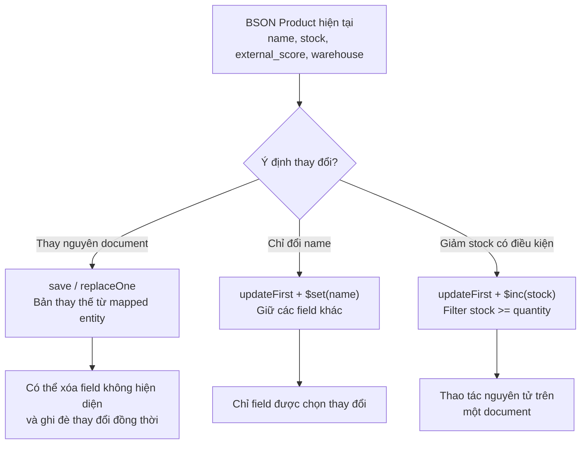

# Lựa chọn save hay update để tránh ghi đè không chủ ý

## 1. Bối cảnh và mục tiêu

Trong **Spring Data MongoDB**, cùng một ý định nghiệp vụ như “đổi tên sản phẩm” có thể được thực hiện bằng `repository.save(product)`, `mongoTemplate.save(product)`, `mongoTemplate.updateFirst(...)` hoặc cập nhật bằng lệnh BSON `$set`. Những cách này **không có ngữ nghĩa tương đương**.

Với hệ thống **Mini Commerce** có `Product`, `Customer` và `Order`, quyết định sai có thể gây hậu quả nghiêm trọng:

- Ghi đè số lượng tồn kho vừa được giao dịch khác cập nhật.
- Làm mất trường dữ liệu do dịch vụ bên ngoài quản lý, dù field Java đánh dấu `@ReadOnlyProperty`.
- Lưu lại một entity chỉ được đọc bằng projection, khiến các field chưa nạp bị xóa.
- Mất cập nhật (lost update) khi hai request cùng đọc và `save` một phiên bản cũ của document.
- Thay thế toàn bộ mảng `OrderLine` dù chỉ muốn đổi một field cụ thể.

Bài thuộc chương **Ghi và cập nhật** của Spring Data MongoDB. Ta tập trung vào việc lựa chọn đúng giữa **ghi cả document**, **cập nhật một phần**, **cập nhật có điều kiện**, **upsert** và **find-and-modify**. Những kỹ thuật này liên hệ trực tiếp với mapping, repository, query/aggregation, index, transaction, reactive access, kiểm thử và chẩn đoán hiệu năng dữ liệu.

Sau bài học, bạn có thể:

1. Giải thích sự khác biệt giữa `insert`, `save` và các thao tác `update` của `MongoTemplate`.
2. Nhận biết vì sao `save` trên document đã tồn tại có thể **thay thế toàn bộ nội dung được mapping**.
3. Dùng `$set`, `$inc`, `$unset`, `$addToSet` và `$setOnInsert` để sửa đúng trường cần thiết.
4. Viết thao tác giảm tồn kho **nguyên tử có điều kiện**, không dùng chuỗi “đọc → tính → save” dễ mất cập nhật.
5. Áp dụng `@Version`/optimistic locking, kiểm tra `UpdateResult` và thiết kế retry/idempotency hợp lý.
6. Hiểu tác động của `@ReadOnlyProperty`, `@Transient`, projection, mapping callback và auditing.
7. Cập nhật field nhúng hoặc phần tử array mà không thay thế toàn bộ object/mảng.
8. Kiểm thử raw BSON trước/sau update, kiểm tra index và biết lúc nào cần transaction.

**Điều kiện thực hành:** Java 17+, Spring Boot với `spring-boot-starter-data-mongodb`, MongoDB đang hoạt động, hiểu `@Document`, `@Id`, `MongoRepository`, `MongoTemplate`, `Query`/`Criteria`, BSON và các phép cập nhật MongoDB. Ví dụ dùng API đồng bộ; cuối bài có đối chiếu nhánh reactive.

## 2. Tư duy quan trọng nhất: document là một đơn vị lưu trữ

Giả sử collection `products` có document:

```json
{
  "_id": "prod-001",
  "sku": "LAP-001",
  "name": "Bàn phím cơ Mini",
  "category": "phu-kien",
  "active": true,
  "stock": 20,
  "price": { "$numberDecimal": "129900.00" },
  "external_score": { "$numberDecimal": "9.50" },
  "warehouse": {
    "aisle": "A1",
    "shelf": "S2"
  }
}
```

Trong Mini Commerce, `Product.name` do dịch vụ catalog quản lý; `stock` do dịch vụ tồn kho cập nhật; `external_score` do một bộ xử lý ngoài cập nhật; `warehouse` có thể do hệ thống kho bổ sung. Nếu một đối tượng Java `Product` không có đủ các field trên mà bị lưu lại theo cách **thay thế document**, các field không được ghi vào bản thay thế sẽ **biến mất**.

### 2.1. Thay thế document và cập nhật field là hai phép toán khác nhau



| Mục tiêu | Cách thường phù hợp | Điều cần thận trọng |
| --- | --- | --- |
| Tạo sản phẩm mới, không muốn ghi đè | `insert` | Trùng `_id`/unique key phải báo lỗi |
| Lưu toàn bộ entity được quản lý nhất quán | `save` | Ghi cả document, dễ xóa field không có trong entity |
| Đổi một hoặc vài field | `updateFirst` với `$set` | Kiểm tra filter và `UpdateResult` |
| Trừ tồn khi số lượng đủ | `$inc` với điều kiện `stock >= qty` | Không dùng read-modify-save không bảo vệ |
| Cập nhật nhiều document thỏa điều kiện | `updateMulti` | Từng document atomic, không tự tạo transaction toàn bộ |
| Cập nhật rồi cần document mới | `findAndModify` với `returnNew(true)` | Điều kiện, sort, projection và concurrency |
| Tạo nếu chưa tồn tại | `upsert` + `$setOnInsert` | Unique index/idempotency để tránh race |
| Cố ý thay cả document | `findAndReplace` hoặc `replaceOne` | Bảo toàn `_id`, kiểm tra field không được phép mất |

**Nguyên tắc:** chọn thao tác theo **ý định nghiệp vụ**, chứ không dựa vào việc method nào viết ngắn hơn.

## 3. Tạo dữ liệu mẫu: Product và repository

Để làm nổi bật rủi ro, ví dụ `Product` có một trường `externalScore` chỉ đọc và một trường `warehouse` không được đưa vào Java entity.

```java
package com.example.minicommerce.domain;

import java.math.BigDecimal;

import org.springframework.data.annotation.Id;
import org.springframework.data.annotation.ReadOnlyProperty;
import org.springframework.data.mongodb.core.mapping.Document;
import org.springframework.data.mongodb.core.mapping.Field;
import org.springframework.data.mongodb.core.mapping.FieldType;

@Document(collection = "products")
public class Product {

    @Id
    private String id;

    private String sku;
    private String name;
    private String category;
    private boolean active;
    private int stock;

    @Field(targetType = FieldType.DECIMAL128)
    private BigDecimal price;

    @ReadOnlyProperty
    @Field("external_score")
    private BigDecimal externalScore;

    public Product() {}

    public Product(String id, String sku, String name,
                   String category, boolean active,
                   int stock, BigDecimal price) {
        this.id = id;
        this.sku = sku;
        this.name = name;
        this.category = category;
        this.active = active;
        this.stock = stock;
        this.price = price;
    }

    public String getId() { return id; }
    public void setId(String id) { this.id = id; }

    public String getSku() { return sku; }
    public void setSku(String sku) { this.sku = sku; }

    public String getName() { return name; }
    public void setName(String name) { this.name = name; }

    public String getCategory() { return category; }
    public void setCategory(String category) {
        this.category = category;
    }

    public boolean isActive() { return active; }
    public void setActive(boolean active) { this.active = active; }

    public int getStock() { return stock; }
    public void setStock(int stock) { this.stock = stock; }

    public BigDecimal getPrice() { return price; }
    public void setPrice(BigDecimal price) { this.price = price; }

    public BigDecimal getExternalScore() { return externalScore; }
}
```

Trong ví dụ:

- `@Id` ánh xạ `id` thành BSON `_id`.
- `@Field(targetType = FieldType.DECIMAL128)` giữ tiền ở dạng BSON Decimal128.
- `@ReadOnlyProperty` cho phép đọc `external_score` nhưng **không ghi field đó khi mapping sang BSON**.
- `warehouse` tồn tại trong document nhưng **không có property** trong Java class.

Repository:

```java
package com.example.minicommerce.repository;

import org.springframework.data.mongodb.repository.MongoRepository;
import com.example.minicommerce.domain.Product;

public interface ProductRepository
        extends MongoRepository<Product, String> {
}
```

Lớp `Product` và `ProductRepository` nằm trong hai Java file riêng. Ví dụ sử dụng ID String `"prod-001"` để không phải xét chuyển đổi `String ↔ ObjectId` trong phạm vi bài này.

## 4. insert: chỉ tạo mới và báo lỗi khi đụng khóa

`insert` được dùng khi **ý định là tạo mới**:

```java
Product product = new Product(
    "prod-001",
    "LAP-001",
    "Bàn phím cơ Mini",
    "phu-kien",
    true,
    20,
    new BigDecimal("129900.00")
);

Product created = mongoTemplate.insert(product);
```

Một lựa chọn tương đương về ý định ở repository:

```java
Product created = productRepository.insert(product);
```

Nếu document có cùng `_id` đã tồn tại, lệnh insert bị MongoDB từ chối bằng duplicate key error. Đây là một đặc tính **hữu ích** khi bạn không muốn request “tạo mới” âm thầm biến thành “ghi đè bản hiện hữu”.

**Đừng nhầm:**

- `insert`: yêu cầu chèn document mới.
- `save`: nếu entity được nhận diện là mới thì insert; với entity đã tồn tại, có thể thực hiện logic ghi/thay thế document.
- Một request tạo mới có thể cần **unique index trên `sku`**, không chỉ dựa vào `_id`. Hai document khác ID nhưng cùng SKU vẫn có thể cùng tồn tại nếu không có ràng buộc riêng.

Tạo unique index cho SKU nếu yêu cầu nghiệp vụ là duy nhất:

```javascript
db.products.createIndex({ sku: 1 }, { unique: true });
```

Trước khi tạo index ở collection đang có dữ liệu, cần kiểm kê SKU trùng và kế hoạch xử lý. `existsBySku` trước khi insert chỉ cải thiện thông báo; nó **không thay unique index** vì hai request có thể vượt qua kiểm tra cùng lúc.

## 5. save: ghi cả document, không phải PATCH

### 5.1. MongoTemplate.save và MongoRepository.save

```java
Product loaded =
    mongoTemplate.findById("prod-001", Product.class);

if (loaded == null) {
    throw new IllegalStateException("Product not found");
}

loaded.setName("Bàn phím cơ Mini V2");
mongoTemplate.save(loaded);
```

Với repository:

```java
Product loaded = productRepository.findById("prod-001")
    .orElseThrow();

loaded.setName("Bàn phím cơ Mini V2");
productRepository.save(loaded);
```

Hai cách đi qua cơ chế mapping entity. Với document đã tồn tại, `save` về bản chất là **ghi lại trạng thái entity như một bản document thay thế**, không phải chỉ ghi field `name` được setter thay đổi.

Nếu Java entity không có field `warehouse` và đánh dấu `externalScore` là `@ReadOnlyProperty`, bản BSON thay thế **không có các field đó**. Dữ liệu đang có ở database không tự được giữ lại.

### 5.2. Phân tích before/after

Trước khi `save`:

```javascript
{
  _id: "prod-001",
  sku: "LAP-001",
  name: "Bàn phím cơ Mini",
  stock: 20,
  price: NumberDecimal("129900.00"),
  external_score: NumberDecimal("9.50"),
  warehouse: { aisle: "A1", shelf: "S2" }
}
```

Sau khi load `Product`, đổi `name` và gọi `save`, document có thể thành:

```javascript
{
  _id: "prod-001",
  sku: "LAP-001",
  name: "Bàn phím cơ Mini V2",
  category: null,
  active: false,
  stock: 20,
  price: NumberDecimal("129900.00"),
  _class: "com.example.minicommerce.domain.Product"
}
```

Document after ở đây là **minh họa rủi ro**, không phải snapshot BSON chính xác cho mọi cấu hình/null serialization. Kết quả thực tế còn phụ thuộc entity được nạp đầy đủ hay không, mapping null, converter và metadata. Điểm quan trọng: `warehouse` và `external_score` **có thể mất**, vì bản thay thế không chứa chúng. Đừng nghĩ `@ReadOnlyProperty` có nghĩa “framework giữ nguyên field cũ trong database khi save”.

Nếu `save` một đối tượng tự tạo có ID đã tồn tại nhưng chỉ điền vài property, rủi ro mất dữ liệu **càng lớn**. `save` không đọc document cũ rồi merge từng field thiếu cho bạn.

### 5.3. Khi nào save phù hợp?

`save` vẫn là lựa chọn hợp lý nếu:

- Entity là **aggregate root** được một thành phần sở hữu trọn vẹn.
- Đối tượng được nạp **đầy đủ**, mapping không bỏ các field mà cần giữ.
- Có cơ chế concurrency phù hợp, ví dụ `@Version` khi cần chống lost update.
- Ý định nghiệp vụ thực sự là **thay thế toàn bộ trạng thái** entity.
- Contract/schema đã xác định các field bị loại trong bản thay thế là điều mong muốn.

Ngược lại, nếu nhiều service cùng sở hữu những phần khác nhau của một document, hoặc request chỉ sửa một trường, hãy ưu tiên **partial update**.

## 6. Nguy cơ đặc biệt: projection, @Transient và @ReadOnlyProperty

### 6.1. Projection không phải entity hoàn chỉnh

Giả sử API danh sách sản phẩm chỉ cần `sku` và `name`:

```java
Query summaryQuery = Query.query(
    Criteria.where("active").is(true));

summaryQuery.fields()
    .include("sku")
    .include("name");

List<Product> summaries =
    mongoTemplate.find(summaryQuery, Product.class);
```

Các object `Product` được dựng từ projection có thể không có `stock`, `price`, `category` hoặc các field khác. Gọi `save(summary)` có nguy cơ **thay thế document bằng dữ liệu không đầy đủ**.

**Thực hành an toàn:** trả DTO/interface projection cho màn hình đọc; không đưa entity đọc một phần vào một đường `save`. Nếu người dùng chỉnh tên từ trang danh sách, service nhận ID + tên mới và thực hiện `$set("name", ...)` có kiểm tra quyền.

### 6.2. @Transient không bảo toàn field BSON

`@Transient` loại một property khỏi ánh xạ persistence. Nếu document đang có field đó, việc `save` bản entity không có field tương ứng vẫn có thể khiến field bị xóa trong phép thay thế.

`@ReadOnlyProperty` khác ở chỗ field **có thể đọc được** vào entity nhưng **không được ghi** ra BSON. Nó không phải cơ chế “merge giữ nguyên giá trị cũ”. Chỉ **partial update** hoặc chiến lược thay thế có chủ đích mới đáp ứng yêu cầu không đụng các field ngoài phạm vi.

### 6.3. Unknown field từ service khác

MongoDB có schema linh hoạt, nên đôi khi một service mới thêm `warehouse.lastCountedAt` vào document. Một phiên bản cũ của ứng dụng không có property này mà `save` toàn bộ `Product` có thể xóa field mới. Đây là rủi ro khi **rolling deploy** nhiều phiên bản hoặc nhiều hệ thống cùng ghi chung collection.

Đừng áp dụng `save` cho một aggregate đa chủ sở hữu mà không kiểm soát schema và hợp đồng cập nhật của mọi writer.

## 7. Partial update với Query và Update

### 7.1. Chỉ đổi tên bằng $set

Trong Spring Data MongoDB:

```java
import com.mongodb.client.result.UpdateResult;
import org.springframework.data.mongodb.core.query.Criteria;
import org.springframework.data.mongodb.core.query.Query;
import org.springframework.data.mongodb.core.query.Update;

Query filter = Query.query(
    Criteria.where("id").is("prod-001"));

Update changes = new Update()
    .set("name", "Bàn phím cơ Mini V2");

UpdateResult result =
    mongoTemplate.updateFirst(filter, changes, Product.class);

if (result.getMatchedCount() == 0) {
    throw new IllegalStateException("Product not found");
}
```

Filter dùng **Java property `id`** và khi thực thi trên `Product.class` được mapping thành BSON `_id`. `updateFirst` áp dụng modifier BSON `$set` thay vì thay thế toàn document.

BSON tương đương:

```javascript
db.products.updateOne(
  { _id: "prod-001" },
  { $set: { name: "Bàn phím cơ Mini V2" } }
);
```

Các field khác như `stock`, `price`, `warehouse` và `external_score` **được giữ nguyên**, trừ khi có writer khác thay đổi chúng.

### 7.2. MatchedCount khác ModifiedCount

`UpdateResult` cung cấp:

| Thuộc tính | Ý nghĩa |
| --- | --- |
| `getMatchedCount()` | Số document khớp filter |
| `getModifiedCount()` | Số document thực sự bị sửa |
| `getUpsertedId()` | ID được tạo do upsert, nếu có |
| `wasAcknowledged()` | Server đã xác nhận thao tác theo write concern chưa |

Nếu cập nhật `name` bằng đúng giá trị cũ, `matchedCount` có thể là **1** nhưng `modifiedCount` bằng **0**. Vì vậy không được mặc định `modifiedCount == 0` nghĩa là không tìm thấy document.

Đối với lệnh update có điều kiện mà cần biết có quyền/đủ hàng hay không, `matchedCount == 0` thường là tín hiệu phù hợp hơn. Đảm bảo ứng dụng dùng **acknowledged write concern** khi cần đọc các số liệu hoặc phát hiện optimistic lock failure; unacknowledged writes không cung cấp mức bảo đảm tương đương.

### 7.3. $unset khác $set null

```java
Update removeLegacyValue = new Update()
    .unset("legacyPromoCode");
```

Tương đương:

```javascript
{ $unset: { legacyPromoCode: "" } }
```

`$unset` xóa **field**, trong khi `$set: { legacyPromoCode: null }` giữ field tồn tại với BSON Null. Sự khác biệt ảnh hưởng `$exists`, validation, aggregation và các quy tắc index. Chọn theo schema thay vì coi hai cách là một.

### 7.4. Đặt nhiều field cùng một lệnh

```java
Update change = new Update()
    .set("name", "Bàn phím V2")
    .set("active", true)
    .currentDate("updatedAt");

mongoTemplate.updateFirst(
    Query.query(Criteria.where("id").is("prod-001")),
    change,
    Product.class);
```

Một thao tác update sửa nhiều field **trên cùng document** là atomic ở mức document. `updatedAt` cần được quy định rõ trong schema; `currentDate` tạo giá trị ngày giờ tại server, khác việc tính timestamp ở JVM. Nếu entity chưa có property `updatedAt`, hãy xác minh mapping cho field mới trước khi dựa vào nó.

## 8. Bài toán tồn kho: vì sao đọc → tính → save dễ sai?

Giả sử tồn kho của `prod-001` là **20**. Hai khách đặt hàng cùng lúc:

```text
Request A: đọc stock = 20
Request B: đọc stock = 20

Request A: mua 3 -> tính stock = 17
Request B: mua 5 -> tính stock = 15

Request A: save Product(stock=17)
Request B: save Product(stock=15)

Kết quả cuối = 15, nhưng đúng ra phải là 12
```

Đây là lỗi **lost update**. Kết quả cập nhật cuối thắng, khiến giao dịch mua của A bị ghi đè ở field stock (và có thể còn các field khác). Một transaction bao quanh riêng từng lần read/save cũng không đủ để suy diễn correctness nếu cách kiểm soát xung đột không phù hợp; cần thao tác có điều kiện hoặc optimistic locking.

### 8.1. Dùng $inc có điều kiện tồn kho đủ

Trong Spring Data:

```java
public boolean reserveStock(
        String productId, int quantity, MongoTemplate template) {

    if (quantity <= 0) {
        throw new IllegalArgumentException(
            "Quantity must be positive");
    }

    Query enoughStock = Query.query(
        Criteria.where("id").is(productId)
            .and("active").is(true)
            .and("stock").gte(quantity));

    Update decrement = new Update()
        .inc("stock", -quantity);

    UpdateResult result = template.updateFirst(
        enoughStock, decrement, Product.class);

    return result.getMatchedCount() == 1;
}
```

MongoDB logic:

```javascript
db.products.updateOne(
  {
    _id: "prod-001",
    active: true,
    stock: { $gte: 3 }
  },
  { $inc: { stock: -3 } }
);
```

Đây là **một thao tác ghi nguyên tử trên một document**: điều kiện `stock >= quantity` được kiểm tra trong cùng update, nên các request cạnh tranh không được phép trừ xuống dưới 0 thông qua **đường cập nhật này**.

Nếu hai request mua 3 và 5 từ stock 20, các thao tác `$inc` thành công tuần tự sẽ đưa stock về **12**. Nếu chỉ còn 2 sản phẩm và một request mua 3, filter không khớp, `matchedCount == 0`; service nên báo không đủ hàng hoặc xử lý theo trạng thái nghiệp vụ.

**Cảnh báo:** `$inc` **không idempotent**. Nếu client retry cùng thao tác sau khi mất kết nối mà không biết request đầu đã thành công, tồn kho có thể bị trừ **hai lần**. Cần request ID/idempotency key, bản ghi đặt hàng duy nhất, transaction hoặc quy trình điều phối phù hợp cho luồng bán hàng thực tế.

### 8.2. Kiểm tra biến động stock không tạo bảng thay thế

`$inc` không lấy trạng thái entity đang có trong JVM làm nguồn sự thật, mà sửa trên giá trị hiện thời ở server. Đây chính là lý do nó an toàn hơn `stock = loaded.stock - quantity` khi nhiều request cạnh tranh.

Nhưng `$inc` chỉ bảo đảm atomicity trong **một Product document**. Nếu một `Order` có ba sản phẩm, cần đảm bảo giảm tồn của ba Product và tạo Order nhất quán theo chính sách giao dịch; xem phần transaction.

### 8.3. Không dùng $set từ giá trị stock đã cũ

Ví dụ dễ gây lỗi:

```java
Product loaded = mongoTemplate.findById(
    "prod-001", Product.class);

int newStock = loaded.getStock() - quantity;

mongoTemplate.updateFirst(
    Query.query(Criteria.where("id").is("prod-001")),
    new Update().set("stock", newStock),
    Product.class);
```

Đoạn này dùng partial update nhưng **vẫn có lost update** vì `newStock` được tính từ một lần đọc cũ. **Partial update không tự giải quyết race condition** nếu giá trị mới được tính từ dữ liệu đã lỗi thời. Với phép cộng/trừ số lượng, ưu tiên `$inc`; với tính toán phức tạp, dùng điều kiện dựa trên version hoặc compare-and-set.

## 9. @Version và optimistic locking khi cần save

Nếu một aggregate thực sự cần `save` toàn bộ, Spring Data MongoDB hỗ trợ optimistic locking bằng `@Version`.

Ví dụ entity độc lập để minh họa:

```java
package com.example.minicommerce.domain;

import org.springframework.data.annotation.Id;
import org.springframework.data.annotation.Version;
import org.springframework.data.mongodb.core.mapping.Document;

@Document(collection = "versioned_products")
public class VersionedProduct {

    @Id
    private String id;
    private String name;
    private int stock;

    @Version
    private Long version;

    public VersionedProduct() {}

    public VersionedProduct(String id, String name, int stock) {
        this.id = id;
        this.name = name;
        this.stock = stock;
    }

    public String getId() { return id; }
    public String getName() { return name; }
    public void setName(String name) { this.name = name; }
    public int getStock() { return stock; }
    public void setStock(int stock) { this.stock = stock; }
    public Long getVersion() { return version; }
}
```

`version` là một field persistence được Spring Data dùng để phát hiện xung đột ghi. Giá trị ban đầu và cách tăng có thể phụ thuộc kiểu wrapper/primitive cùng vòng đời entity, nên tránh hardcode version bắt đầu bằng một con số cụ thể trong logic nghiệp vụ.

### 9.1. Hai người cùng sửa một bản

```java
VersionedProduct first = mongoTemplate.findById(
    "prod-v1", VersionedProduct.class);
VersionedProduct second = mongoTemplate.findById(
    "prod-v1", VersionedProduct.class);

first.setName("Bàn phím bản A");
mongoTemplate.save(first); // Lưu và tăng version.

second.setName("Bàn phím bản B");
mongoTemplate.save(second); // Có thể ném OptimisticLockingFailureException.
```

Giả sử cả hai đọc version `v`. Lệnh `save(first)` ghi với điều kiện version hiện hành vẫn bằng `v` và chuyển sang version kế tiếp. Khi `save(second)` sử dụng version cũ, điều kiện không còn khớp và Spring Data báo xung đột.

Để sử dụng cơ chế này đáng tin cậy:

- Bật **acknowledged write concern** (ví dụ `ACKNOWLEDGED`).
- Đảm bảo mọi đường ghi quan trọng **tôn trọng version**; raw driver có thể bỏ qua cơ chế version của Spring Data.
- Không nuốt `OptimisticLockingFailureException` rồi báo thành công.
- Thiết kế thông báo conflict, reload/merge hoặc retry có giới hạn theo nghiệp vụ.

**Giới hạn:** `@Version` giúp tránh lost update giữa các writer tuân thủ cùng protocol, nhưng **không giữ các field unknown hoặc @ReadOnlyProperty trong document** khi `save` thay thế bản BSON. Đây là **hai loại rủi ro khác nhau**: concurrency và replacement schema.

### 9.2. Partial update có @Version: đừng giả định tự khóa

Spring Data có hỗ trợ cập nhật version trong nhiều thao tác `MongoTemplate.update*` khi `@Version` không được đề cập tường minh trong `Update`. Nhưng việc **tự tăng version** không đồng nghĩa query đã kiểm tra **expected version của request**.

Khi cần compare-and-set, đưa version kỳ vọng vào **filter**:

```java
long expectedVersion = 7L;

Query matchingVersion = Query.query(
    Criteria.where("id").is("prod-v1")
        .and("version").is(expectedVersion));

Update change = new Update()
    .set("name", "Bàn phím mới");

UpdateResult result = mongoTemplate.updateFirst(
    matchingVersion, change, VersionedProduct.class);

if (result.getMatchedCount() == 0) {
    throw new IllegalStateException(
        "Product not found or version conflict");
}
```

Nếu framework tự tăng `@Version` cho update đó, **không cần tự tăng version một lần nữa**. Nếu ứng dụng điều khiển field version tường minh, hãy thống nhất toàn bộ protocol và kiểm thử BSON sau ghi, tránh tăng hai lần hoặc không tăng.

## 10. findAndModify: cập nhật nguyên tử và nhận lại document

`updateFirst` trả `UpdateResult`, không trả ngay entity sau cập nhật. Nếu nghiệp vụ cần đọc **trạng thái sau update**, có thể dùng `findAndModify`:

```java
import org.springframework.data.mongodb.core.FindAndModifyOptions;
import org.springframework.data.mongodb.core.query.Criteria;
import org.springframework.data.mongodb.core.query.Query;
import org.springframework.data.mongodb.core.query.Update;

public Product reserveAndReturn(
        String productId, int quantity, MongoTemplate template) {

    if (quantity <= 0) {
        throw new IllegalArgumentException("Invalid quantity");
    }

    Query query = Query.query(
        Criteria.where("id").is(productId)
            .and("active").is(true)
            .and("stock").gte(quantity));

    Update decrement = new Update().inc("stock", -quantity);

    return template.findAndModify(
        query,
        decrement,
        FindAndModifyOptions.options().returnNew(true),
        Product.class
    );
}
```

- Nếu trả `null`: không có document phù hợp (sản phẩm không tồn tại, inactive hoặc thiếu stock).
- Với `returnNew(true)`: trả entity **sau** cập nhật. Mặc định nhiều API find-and-modify có thể trả bản **trước** cập nhật nếu không chỉ định.
- Điều kiện kiểm tra stock và `$inc` diễn ra trong cùng một thao tác server.
- Kết quả được đọc qua mapping của `Product.class`, nhưng không nên xem nó là bằng chứng của tất cả các field unknown trong BSON.

**Phân biệt hai bước:** gọi `updateFirst` rồi `findById` là **hai thao tác**, có thể có update khác xen vào giữa. `findAndModify` cho phép nhận kết quả cập nhật của chính thao tác trong một lời gọi nguyên tử trên document.

Khi có nhiều document phù hợp, `findAndModify` có thể cần `Query.with(Sort...)` để xác định document nào được chọn; nếu query nhắm ID duy nhất thì không phát sinh sự mơ hồ đó.

## 11. updateFirst và updateMulti: phạm vi tác động

Ví dụ chỉ vô hiệu hóa **một** sản phẩm theo SKU:

```java
mongoTemplate.updateFirst(
    Query.query(Criteria.where("sku").is("LAP-001")),
    new Update().set("active", false),
    Product.class);
```

Nếu yêu cầu vô hiệu hóa **mọi** sản phẩm trong một danh mục:

```java
UpdateResult result = mongoTemplate.updateMulti(
    Query.query(Criteria.where("category").is("phu-kien")),
    new Update().set("active", false),
    Product.class);
```

Với `updateMulti`, mỗi document được cập nhật nguyên tử, nhưng **toàn bộ nhóm nhiều document không tự trở thành một transaction**. Nếu một lỗi xảy ra giữa chừng, cần phân tích kết quả và kế hoạch retry/rollback.

**Lưu ý về an toàn:**

1. Luôn kiểm tra điều kiện lọc; một `new Query()` với `updateMulti` có thể cập nhật cả collection.
2. Bổ sung `tenantId`, soft-delete hoặc điều kiện phân quyền khi hệ thống yêu cầu.
3. Cân nhắc `limit` nghiệp vụ hoặc xử lý theo batch nếu cập nhật một lượng document lớn.
4. Ghi log mục đích, ID của batch và số document được cập nhật; đừng ghi dữ liệu nhạy cảm bừa bãi vào log.

## 12. upsert và $setOnInsert: tạo nếu chưa tồn tại

`upsert` kết hợp **query + update**; nếu tìm thấy document thì cập nhật, nếu không tìm thấy thì tạo document mới. Nó khác `save` trên một entity hoàn chỉnh.

Giả sử một service đồng bộ catalog từ hệ thống nguồn, dựa trên SKU:

```java
public UpdateResult upsertCatalogProduct(
        String sku, String name,
        BigDecimal price, MongoTemplate template) {

    if (sku == null || sku.isBlank()) {
        throw new IllegalArgumentException("SKU is required");
    }

    Query bySku = Query.query(Criteria.where("sku").is(sku));

    Update change = new Update()
        .set("name", name)
        .set("price", price)
        .setOnInsert("sku", sku)
        .setOnInsert("stock", 0)
        .setOnInsert("active", false);

    return template.upsert(bySku, change, Product.class);
}
```

Ý nghĩa:

- Nếu `sku` đã có: chỉ các field `name` và `price` được `$set`; **không reset stock/active**.
- Nếu chưa có: MongoDB tạo document, áp dụng giá trị `$set` và `$setOnInsert`, phù hợp schema.
- Nếu tạo mới, `UpdateResult.getUpsertedId()` có thể cung cấp ID mới.
- Khi entity có `@Version`, cần kiểm thử quy tắc tạo version ban đầu/cập nhật version của framework; đừng giả định mọi đường ghi có cùng vòng đời như `save`.

### 12.1. Vì sao upsert vẫn cần unique index?

Hai request đồng thời cùng không tìm thấy `sku` có thể chạy đua để tạo document. Một **unique index trên `sku`** là cơ chế bảo đảm cuối cùng rằng không tồn tại hai sản phẩm cùng business key (khi yêu cầu là duy nhất).

`upsert` không phải phương pháp thay thế cho unique constraint hoặc idempotency. Khi duplicate-key exception xảy ra do race, service có thể đọc lại và quyết định retry **theo nghiệp vụ**.

### 12.2. Tránh overwrite bằng $setOnInsert

Nếu nghiệp vụ chỉ cần “tạo mặc định nếu chưa có, không động tới dữ liệu hiện hữu”, dùng:

```java
Update defaults = new Update()
    .setOnInsert("sku", sku)
    .setOnInsert("name", defaultName)
    .setOnInsert("stock", 0);

mongoTemplate.upsert(
    Query.query(Criteria.where("sku").is(sku)),
    defaults,
    Product.class);
```

Khi đã có document, `$setOnInsert` **không sửa giá trị cũ**. Đây là hợp đồng khác với việc dùng `$set` cho cả dữ liệu mặc định và dữ liệu đang tồn tại.

## 13. Cập nhật object nhúng và array: giữ đúng phạm vi

### 13.1. Chỉ đổi thành phố trong địa chỉ nhúng

`Order` có `shippingAddressSnapshot` chứa `recipient`, `street`, `city` và `country`. Nếu chỉ sửa `city`, hãy chọn đường dẫn cụ thể:

```java
Update changeCity = new Update()
    .set("shippingAddressSnapshot.city", "Da Nang");

mongoTemplate.updateFirst(
    Query.query(Criteria.where("id").is("order-001")),
    changeCity,
    Order.class);
```

BSON:

```javascript
db.orders.updateOne(
  { _id: "order-001" },
  { $set: { "shippingAddressSnapshot.city": "Da Nang" } }
);
```

Nếu dùng `.set("shippingAddressSnapshot", newAddress)` thì **toàn bộ object nhúng** ở path đó sẽ được thay bằng giá trị mới; những field khác trong embedded document có thể mất. Tương tự `save(Order)` có thể ghi cả root document theo trạng thái entity.

Trong Mini Commerce, địa chỉ đơn hàng thường là **snapshot tại thời điểm đặt**. Thay đổi snapshot sau khi thanh toán phải được quản lý bằng chính sách nghiệp vụ/audit, không chỉ dựa vào API update.

### 13.2. Mảng OrderLine: cập nhật đúng một phần tử

Giả sử `Order.lines` là array có phần tử `OrderLine`:

```javascript
{
  _id: "order-001",
  lines: [
    { sku: "LAP-001", quantity: 1, unitPrice: NumberDecimal("129900.00") },
    { sku: "MOU-001", quantity: 2, unitPrice: NumberDecimal("49000.00") }
  ]
}
```

Để sửa `quantity` của một dòng có SKU phù hợp trong array, MongoDB hỗ trợ **arrayFilters**:

```javascript
db.orders.updateOne(
  { _id: "order-001" },
  {
    $set: {
      "lines.$[line].quantity": 3
    }
  },
  {
    arrayFilters: [
      { "line.sku": "LAP-001" }
    ]
  }
);
```

Trong Spring Data MongoDB, `Update.filterArray(...)` hỗ trợ điều kiện cho identifier:

```java
Update updateLine = new Update()
    .set("lines.$[line].quantity", 3)
    .filterArray("line.sku", "LAP-001");

mongoTemplate.updateFirst(
    Query.query(Criteria.where("id").is("order-001")),
    updateLine,
    Order.class);
```

**Chú ý:**

- `$[line]` chọn **các phần tử** thỏa array filter có identifier `line`; nếu SKU trùng trong cùng order, nhiều dòng có thể bị sửa. Nếu cần một dòng cụ thể, nên có `lineId` duy nhất và filter theo ID.
- Các điều kiện truyền vào `filterArray` có quy tắc chuyển đổi riêng; một số overload truyền trực tiếp đến driver **không tự map tên field** như query entity thông thường. Phải kiểm tra BSON field thực tế.
- Không thay mảng `lines` bằng một danh sách đã đọc cũ chỉ để sửa một phần tử.
- Trong hệ thống bán hàng, sửa số lượng dòng đã chốt có thể cần tính lại `lineTotal`, `totalAmount` và điều chỉnh stock bằng logic nhất quán.

### 13.3. $push và $addToSet

Với mảng nhãn của `Product`:

```java
Update appendEveryTime = new Update()
    .push("tags", "featured");

Update addIfAbsent = new Update()
    .addToSet("tags", "featured");
```

`$push` có thể thêm phần tử trùng; `$addToSet` thêm nếu giá trị chưa có theo phép so sánh BSON phù hợp. Chọn theo nhu cầu. Với mảng ngày càng lớn, cần cân nhắc giới hạn document và mô hình lưu thay thế.

## 14. findAndReplace: khi nào thay document là có chủ đích?

Nếu yêu cầu thực sự là “thay toàn bộ aggregate bằng trạng thái mới”, `findAndReplace` (hoặc raw `replaceOne`) giúp thể hiện ý định rõ hơn thao tác `$set`.

Ví dụ mô tả luồng:

```java
// Ví dụ khái niệm: replacement là Product hoàn chỉnh,
// đã được validate và có đầy đủ các field thuộc aggregate.
Product replacement = loadCompleteReplacementFromTrustedSource();

Query byId = Query.query(
    Criteria.where("id").is("prod-001"));

Product previousOrNew = mongoTemplate.findAndReplace(
    byId, replacement);
```

Đoạn trên minh họa API với một hàm `loadCompleteReplacementFromTrustedSource()` do **ứng dụng phải tự triển khai**; nó không phải một snippet tự chạy độc lập. Để có lựa chọn trả bản cũ/mới hoặc upsert, dùng overload `FindAndReplaceOptions` phù hợp phiên bản Spring Data đang dùng.

Trước khi thay document:

- `_id` của document là immutable; replacement không được đổi ID.
- Document thay thế phải chứa **đầy đủ dữ liệu cần được bảo toàn**.
- Unknown fields và các trường không được converter ghi sẽ mất nếu thay thế không chứa chúng.
- Nếu có `@Version`, dùng protocol kiểm tra version/điều kiện đúng phiên bản.
- Kiểm thử trên BSON thật để so sánh tập field before/after.

**Nếu chỉ sửa hai field, không nên dùng replacement.**

## 15. Lifecycle callbacks, auditing và dấu thời gian

Đọc và ghi một entity qua `save` có thể kích hoạt các entity callbacks/auditing của Spring Data, chẳng hạn tính toán `@CreatedDate` hoặc `@LastModifiedDate` khi đã cấu hình auditing.

Nhưng `MongoTemplate.updateFirst(...)` thực hiện **cập nhật trường trực tiếp tại database**, không đi qua cùng vòng đời materialization và callback của một lần `save(entity)`. Do đó không nên mặc định mọi sự kiện/validation ở entity sẽ được gọi khi partial update.

Ví dụ ứng dụng dùng `updatedAt`:

```java
Update change = new Update()
    .set("name", "Bàn phím Mini V3")
    .currentDate("updatedAt");

mongoTemplate.updateFirst(
    Query.query(Criteria.where("id").is("prod-001")),
    change, Product.class);
```

Đây là **chính sách cập nhật timestamp tường minh**, không tự động xác minh rằng entity callback đã chạy. Nếu dự án dùng `@LastModifiedDate` trong `save`, hãy định nghĩa cách timestamp được cập nhật nhất quán trong **mọi đường ghi**: repository, template, raw driver, batch và migration.

Tương tự với bean validation và domain invariants:

- `@NotNull` ở DTO/entity không tự chặn mọi raw MongoDB update.
- MongoDB JSON Schema validation có thể bảo vệ dữ liệu ngay tại collection khi được cấu hình.
- Service cần validate quyền và quy tắc nghiệp vụ trước khi gọi update.
- Update pipeline/bulk operations có thể có hành vi lifecycle khác `save`; hãy test khi dùng.

## 16. BulkOperations: nhanh hơn không có nghĩa là an toàn hơn

Khi đồng bộ hàng nghìn sản phẩm, `MongoTemplate.bulkOps(...)` có thể gộp nhiều lệnh update.

```java
import org.springframework.data.mongodb.core.BulkOperations;
import org.springframework.data.mongodb.core.query.Query;
import org.springframework.data.mongodb.core.query.Update;

BulkOperations bulk = mongoTemplate.bulkOps(
    BulkOperations.BulkMode.ORDERED,
    Product.class);

bulk.updateOne(
    Query.query(Criteria.where("sku").is("LAP-001")),
    new Update().set("active", false));

bulk.updateOne(
    Query.query(Criteria.where("sku").is("MOU-001")),
    new Update().set("active", false));

bulk.execute();
```

Đây là những **partial updates**, không phải hai lần `save` toàn document.

Các lưu ý quan trọng:

- `ORDERED` thực thi theo thứ tự batch và dừng xử lý theo semantics của lỗi; `UNORDERED` có thể tối ưu thông lượng khác nhưng không bảo đảm thứ tự.
- Bulk không tự tạo transaction xuyên nhiều document.
- Những tính năng gắn với vòng đời từng entity như callback/optimistic locking `@Version` **không nên được giả định hoạt động giống `save`** trong bulk operations.
- Batch có thể bị retry; lựa chọn lệnh **idempotent** như `$set` khác với `$inc` không idempotent.
- Cần kiểm tra kết quả tổng hợp, logging và khả năng chạy lại khi lỗi một phần.

## 17. Transaction: khi cập nhật nhiều document phải nhất quán

Một thao tác `updateFirst` trên **một** Product document được MongoDB thực thi nguyên tử. Nhưng một đơn hàng thực tế có thể cần:

1. Trừ tồn kho của ba Product khác nhau.
2. Tạo Order và các OrderLine.
3. Ghi nhận trạng thái thanh toán hoặc outbox event.

Nếu invariant yêu cầu **tất cả cùng thành công hoặc tất cả cùng rollback**, cần cân nhắc transaction nhiều document trên MongoDB topology hỗ trợ, qua `MongoTransactionManager` và transaction management của Spring.

Ví dụ ý tưởng ở tầng service:

```java
import org.springframework.transaction.annotation.Transactional;

@Transactional
public void placeOrder(PlaceOrderCommand command) {
    // 1. Với từng sản phẩm: update stock >= quantity bằng $inc.
    // 2. Nếu bất kỳ lần update nào matchedCount == 0:
    //    báo lỗi để transaction rollback.
    // 3. Insert Order với snapshot giá/dòng hàng đã validate.
    // 4. Chỉ commit khi mọi thao tác thành công.
}
```

Đoạn trên là **khung ý tưởng**, không phải implementation hoàn chỉnh; `PlaceOrderCommand` phải được định nghĩa và dịch vụ phải có transaction manager, MongoDB replica set/sharded topology phù hợp.

**Bốn điều quan trọng:**

- Transaction không biến `save` full replacement thành partial update.
- Transaction không tự loại bỏ xung đột logic hoặc retry không idempotent.
- Nếu service bên ngoài MongoDB tham gia (payment/email), cần thiết kế outbox/saga hoặc coordination riêng; MongoDB transaction không tự rollback thao tác mạng ở hệ thống khác.
- Transaction có chi phí và giới hạn topology; không dùng transaction nhiều document chỉ để đổi một field của một document.

## 18. Reactive MongoDB: cùng semantics, cách thực thi khác

Với `ReactiveMongoTemplate`, update trả publisher, ví dụ:

```java
import com.mongodb.client.result.UpdateResult;
import org.springframework.data.mongodb.core.query.Criteria;
import org.springframework.data.mongodb.core.query.Query;
import org.springframework.data.mongodb.core.query.Update;
import reactor.core.publisher.Mono;

Query enough = Query.query(
    Criteria.where("id").is("prod-001")
        .and("stock").gte(3));

Update decrement = new Update().inc("stock", -3);

Mono<UpdateResult> result =
    reactiveMongoTemplate.updateFirst(
        enough, decrement, Product.class);
```

Đoạn code thuộc service có `ReactiveMongoTemplate` được inject; publisher được thực thi khi **subscribe**. Để chuyển kết quả thành nghiệp vụ:

```java
Mono<Boolean> reserved = reactiveMongoTemplate
    .updateFirst(enough, decrement, Product.class)
    .map(update -> update.getMatchedCount() == 1);
```

Không gọi `block()` trong event loop WebFlux; không đặt xử lý I/O blocking trong converter hoặc callback reactive. **Reactive không thay đổi** semantics của `save`, `$set`, `$inc`, `upsert`, optimistic locking hay transaction; nó chỉ thay cách tổ chức luồng I/O.

Nếu một pipeline reactive có retry, đặc biệt lưu ý `$inc` có thể chạy lại khi subscribe/retry, gây trừ tồn kho lặp. Idempotency vẫn là yêu cầu nghiệp vụ chứ không phải tính năng tự có của Reactor.

## 19. Chẩn đoán hiệu năng và kiểm tra truy vấn cập nhật

Lệnh update cần filter đúng, nhất là khi thực thi nhiều lần trên collection lớn.

### 19.1. Index theo ID và business key

MongoDB có index `_id` mặc định. Với truy vấn giảm stock:

```javascript
{
  _id: "prod-001",
  active: true,
  stock: { $gte: 3 }
}
```

Index `_id` giúp tìm nhanh document duy nhất; các điều kiện active và stock được kiểm tra trên document đó. **Không cần tự động tạo thêm compound index** cho mọi field chỉ vì filter có ba điều kiện và ID đã chọn lọc duy nhất.

Với `upsert` theo SKU hoặc query danh mục:

```javascript
db.products.createIndex({ sku: 1 }, { unique: true });

db.products.createIndex({ category: 1, active: 1 });
```

Chọn index thứ hai theo workload thật: truy vấn theo category/active đủ thường xuyên mới có lợi. Index làm tăng chi phí ghi, dung lượng và maintenance.

### 19.2. Explain cho filter

```javascript
db.products.find({
  sku: "LAP-001"
}).explain("executionStats");
```

Theo dõi `winningPlan`, `totalKeysExamined`, `totalDocsExamined` và `nReturned`. `find().explain(...)` giúp kiểm tra **query shape tương tự**, không mặc nhiên là plan chính xác của mọi lệnh `updateOne`; có thể dùng database profiler/command monitoring để xem update thực tế trên phiên bản MongoDB đang vận hành.

### 19.3. Giám sát lỗi và kết quả ghi

Mỗi đường ghi quan trọng nên có:

- Tên operation và business key (ví dụ `orderId`, `productId`) ở mức log phù hợp.
- Kiểm tra matched/modified count hoặc ID mới từ upsert.
- Phân biệt “không khớp vì không tồn tại”, “không đủ hàng”, “version conflict” và “write failure” khi hợp đồng nghiệp vụ yêu cầu.
- Quy tắc retry có giới hạn; chỉ retry tự động những thao tác và lỗi được thiết kế **idempotent** hoặc đã có request ID bảo vệ.
- Kiểm thử dữ liệu trước/sau, cả field mà application **không sở hữu**.

Không log số điện thoại khách hàng, token thanh toán hoặc toàn bộ document nhạy cảm chỉ để chẩn đoán một update.

## 20. Kiểm thử bằng MongoDB thật: phát hiện mất dữ liệu

Một mock `MongoTemplate` không chứng minh `save` xóa field chưa biết, còn `$set` bảo toàn. Nên dùng MongoDB thật hoặc Testcontainers và database riêng cho test.

### 20.1. Test chứng minh partial update giữ field bên ngoài

```java
package com.example.minicommerce;

import static org.junit.jupiter.api.Assertions.*;

import java.math.BigDecimal;

import org.bson.Document;
import org.bson.types.Decimal128;
import org.junit.jupiter.api.Test;
import org.springframework.beans.factory.annotation.Autowired;
import org.springframework.boot.test.context.SpringBootTest;
import org.springframework.data.mongodb.core.MongoTemplate;
import org.springframework.data.mongodb.core.query.Criteria;
import org.springframework.data.mongodb.core.query.Query;
import org.springframework.data.mongodb.core.query.Update;

import com.example.minicommerce.domain.Product;

@SpringBootTest
class ProductPartialUpdateIntegrationTest {

    @Autowired
    MongoTemplate template;

    @Test
    void setChangesOnlyNameAndPreservesExternalFields() {
        String id = "update-test-001";
        var raw = template.getCollection("products");
        raw.deleteOne(new Document("_id", id));

        try {
            raw.insertOne(new Document("_id", id)
                .append("sku", "UPDATE-001")
                .append("name", "Tên ban đầu")
                .append("category", "phu-kien")
                .append("active", true)
                .append("stock", 10)
                .append("price",
                    new Decimal128(new BigDecimal("129900.00")))
                .append("external_score",
                    new Decimal128(new BigDecimal("9.50")))
                .append("warehouse",
                    new Document("aisle", "A1")));

            template.updateFirst(
                Query.query(Criteria.where("id").is(id)),
                new Update().set("name", "Tên mới"),
                Product.class);

            Document after =
                raw.find(new Document("_id", id)).first();
            assertNotNull(after);
            assertEquals("Tên mới", after.getString("name"));
            assertEquals(10, after.getInteger("stock"));
            assertTrue(after.containsKey("external_score"));
            assertTrue(after.containsKey("warehouse"));
        } finally {
            raw.deleteOne(new Document("_id", id));
        }
    }
}
```

Test dùng raw driver để tạo hai field **ngoài phạm vi ghi** của Product, sau đó xác nhận `$set` giữ chúng. Chỉ dọn fixture trong **database test riêng**.

### 20.2. Test phát hiện rủi ro của save

Trong một test **khác** với ID riêng, seed document tương tự. Đọc thành `Product`, sửa tên và `save`:

```java
Product loaded = template.findById(
    "update-test-002", Product.class);
assertNotNull(loaded);

loaded.setName("Tên sau save");
template.save(loaded);

Document after = template.getCollection("products")
    .find(new Document("_id", "update-test-002"))
    .first();

assertNotNull(after);
assertFalse(after.containsKey("warehouse"));
assertFalse(after.containsKey("external_score"));
```

Đoạn test này giả định fixture `update-test-002` **đã được chèn trước** với `warehouse` và `external_score` như ở test 20.1; cần bọc trong `try/finally` và xóa fixture riêng khi ghép vào test class thực tế. Mục tiêu là **phơi bày hành vi replacement**, không khuyến nghị gọi `save` để cố tình xóa dữ liệu.

### 20.3. Test giảm tồn kho có điều kiện

Ví dụ viết test với stock ban đầu 5:

```java
Query enough = Query.query(
    Criteria.where("id").is("stock-test-001")
        .and("stock").gte(3));

Update decrement = new Update().inc("stock", -3);

UpdateResult first =
    template.updateFirst(enough, decrement, Product.class);
assertEquals(1L, first.getMatchedCount());

UpdateResult second =
    template.updateFirst(enough, decrement, Product.class);
assertEquals(0L, second.getMatchedCount());
```

Test giả định fixture `stock-test-001` đã tồn tại với `stock = 5` và code đã import `UpdateResult`, `Query`, `Criteria`, `Update`. Sau lần trừ thứ nhất, stock còn 2, nên lần trừ thứ hai không vượt qua điều kiện `stock >= 3`. Thêm assertion raw BSON stock bằng 2 và dọn fixture khi hoàn thiện test.

Test hai cập nhật tuần tự chứng minh **ngữ nghĩa điều kiện**, nhưng chưa thay thế stress test concurrency hoặc kiểm thử toàn bộ luồng tạo Order và idempotency.

### 20.4. Ma trận kiểm thử khuyến nghị

| Trường hợp | Kết quả mong đợi |
| --- | --- |
| `insert` trùng `_id` | Duplicate key, không overwrite |
| `save` entity đầy đủ | Ghi lại nội dung được mapping |
| `save` entity có unknown field | Unknown field có thể bị xóa |
| `save` với `@ReadOnlyProperty` | Field chỉ đọc không tự được giữ lại |
| `save` entity chỉ nạp bằng projection | Phát hiện rủi ro mất dữ liệu |
| `updateFirst` với `$set("name")` | Giữ `stock`, `warehouse` và `external_score` |
| `$unset` so với `$set(null)` | Phân biệt missing và BSON Null |
| `$inc` với stock đủ | Matched = 1, stock giảm đúng |
| `$inc` với stock thiếu | Matched = 0, stock không âm |
| `$set(stock)` từ stale read | Test chỉ ra nguy cơ lost update |
| `@Version` hai entity cùng version | Save thứ hai báo optimistic locking conflict |
| Upsert theo SKU | Tạo mới hoặc chỉ sửa những field được chỉ định |
| `$setOnInsert` trên document cũ | Không reset stock/active |
| ArrayFilters theo `lineId` | Chỉ dòng hàng được chọn bị sửa |
| Audit timestamp khi update | Áp dụng chính sách đồng nhất |
| Bulk update | Có theo dõi kết quả và xử lý lỗi một phần |
| Reactive update | Publisher trả kết quả đúng, không dùng `block()` |

## 21. Những lỗi thường gặp và cách xử lý

| Dấu hiệu | Nguyên nhân | Cách xử lý |
| --- | --- | --- |
| Đổi tên sản phẩm làm mất field warehouse | `save` thay toàn document bằng entity thiếu field | Dùng `$set` cho field cần đổi |
| `@ReadOnlyProperty` vẫn bị mất khi save | Read-only không phải merge/preserve BSON | Dùng partial update hoặc thay chiến lược sở hữu field |
| Đọc projection rồi save làm mất giá/tồn | Entity thiếu field bị lưu lại | Dùng DTO đọc; update theo ID và field cụ thể |
| Stock cuối sai khi nhiều request mua | Read-modify-save hoặc `$set` từ stale read | `$inc` với `stock >= qty`, hoặc optimistic locking |
| Stock bị trừ hai lần khi retry | `$inc` không idempotent | Dùng request ID/idempotency protocol |
| `modifiedCount == 0` bị hiểu là not found | Update đặt lại đúng giá trị cũ | Kiểm tra `matchedCount` |
| Cập nhật SKU trùng dù đã gọi exists | Check-then-insert race | Unique index và xử lý duplicate key |
| `@Version` không bắt conflict với raw driver | Writer ngoài không tuân thủ version protocol | Thống nhất đường ghi và concurrency policy |
| Update có tự tăng version nhưng vẫn lost update | Filter không kiểm tra expected version | Thêm version vào filter cho CAS |
| Đổi thành phố làm mất đường/số nhà | `$set` cả object address thay vì dotted field | `$set("shippingAddressSnapshot.city", ...)` |
| Cập nhật dòng hàng sửa nhiều dòng cùng SKU | Array filter không chọn phần tử duy nhất | Sử dụng `lineId`/filter duy nhất |
| Tạo document mới reset stock | Dùng `$set` thay vì `$setOnInsert` | Phân biệt create defaults và update fields |
| Bulk ghi dữ liệu sai khi retry | Không có idempotency/không theo dõi partial failure | Thiết kế batch ID và retry an toàn |
| `@LastModifiedDate` không cập nhật | Partial update bỏ qua save callbacks | Set timestamp rõ ràng trong update |
| UpdateMulti sửa cả collection | Query rỗng/quá rộng hoặc thiếu tenant filter | Validate filter, scope, authorization |
| Ghi thành công nhưng API vẫn trả entity cũ | `updateFirst` chỉ trả UpdateResult | Dùng `findAndModify(returnNew)` khi cần trạng thái sau ghi |
| Transaction không bảo vệ khỏi mất field | Transaction không đổi semantics replacement | Dùng patch đúng phạm vi và kiểm thử schema |

## 22. Bài tập thực hành

**Bài tập 1 — So sánh insert/save/update.** Tạo `Product` có SKU, tên, giá và stock. Dùng `insert` hai lần với cùng ID để quan sát duplicate key. Tiếp theo sửa tên bằng `save` rồi bằng `updateFirst + $set`; ghi lại hình dạng raw BSON.

**Bài tập 2 — Field bên ngoài.** Dùng raw driver thêm `external_score` và `warehouse` vào Product. Đọc entity rồi `save`, quan sát field bị mất; sau đó reset fixture và thử `$set("name")` để chứng minh các field được bảo toàn.

**Bài tập 3 — Partial projection.** Dùng `Query.fields().include("sku").include("name")` để nạp một entity không đầy đủ; giải thích vì sao không được gọi `save`. Viết một API PATCH chỉ nhận ID và tên mới.

**Bài tập 4 — Tồn kho nguyên tử.** Từ stock 5, thực hiện hai request mua 3. Dùng `$inc` với filter `stock >= qty`, xác nhận chỉ một request thành công. Giải thích vì sao phép cập nhật không idempotent khi retry.

**Bài tập 5 — Optimistic locking.** Tạo entity có `@Version` trong collection test riêng, nạp hai bản cùng version, save bản A rồi save bản B. Bắt conflict, reload và chọn chiến lược merge/retry.

**Bài tập 6 — Upsert và $setOnInsert.** Cấu hình upsert theo SKU với giá trị mặc định stock 0/active false. Chạy lần đầu và lần hai, bảo đảm stock/active không bị reset trên document đã có. Thử hai lời gọi đồng thời, giải thích vai trò của unique index.

**Bài tập 7 — Object nhúng và array.** Tạo Order có địa chỉ nhúng và hai OrderLine. Dùng dotted `$set` chỉ sửa `city`; tiếp theo dùng `arrayFilters` sửa đúng một `lineId`. Chứng minh các field khác được giữ lại.

**Bài tập 8 — Quan sát và transaction.** Tạo luồng đặt hàng giảm tồn ở hai Product rồi insert Order. Xác định invariant cần transaction; thêm idempotency key và mô tả xử lý retry khi một request đã commit nhưng HTTP response bị mất.

**Bài tập mở rộng — Reactive/bulk.** Viết `ReactiveMongoTemplate.updateFirst` trả `Mono<UpdateResult>`; dùng `StepVerifier` kiểm tra matched count. Hoặc đồng bộ một lô sản phẩm bằng `BulkOperations` và xây quy tắc retry không ghi đè các trường do hệ thống khác quản lý.

### Câu hỏi tự kiểm tra

1. Vì sao `save` không phù hợp với HTTP PATCH chỉ đổi một trường?
2. Sự khác biệt giữa `insert`, `save` và `upsert` là gì?
3. Khi một Java entity thiếu property `warehouse`, điều gì có thể xảy ra khi `save` document đang có field đó?
4. Vì sao `@ReadOnlyProperty` không bảo đảm giữ nguyên field khi save?
5. Vì sao `$inc("stock", -quantity)` cùng filter `stock >= quantity` ngăn bán âm mà `$set(stock = loaded.stock - quantity)` không làm được?
6. `matchedCount` và `modifiedCount` khác nhau thế nào?
7. `@Version` ngăn loại lỗi nào, và vì sao nó không tự giải quyết vấn đề unknown fields?
8. Khi nào cần `findAndModify(returnNew(true))` thay vì `updateFirst`?
9. `$setOnInsert` hữu ích thế nào với upsert?
10. Phân biệt update một field nhúng, thay cả object nhúng và cập nhật một phần tử array?
11. Vì sao nhiều update trên nhiều Product có thể cần transaction, còn một `$inc` trên một Product thì không?
12. Những test raw BSON nào giúp phát hiện ghi đè không chủ ý trước khi triển khai?

**Kết quả mong đợi:** người học biết chọn **insert khi tạo mới**, **save khi thực sự sở hữu toàn bộ document và đã bảo vệ concurrency**, **partial update khi chỉ sửa field**, **$inc có điều kiện cho tồn kho**, **upsert/$setOnInsert cho quy tắc tạo-if-absent**, và **findAndModify khi cần trạng thái sau ghi**. Quyết định đúng giúp bảo vệ dữ liệu Mini Commerce, tránh lost update, không xóa field của service khác và chuẩn bị tốt cho transaction, reactive access, kiểm thử và vận hành.

## Tài liệu tham khảo

- [Spring Data MongoDB — Saving, Updating, and Removing Documents](https://docs.spring.io/spring-data/mongodb/reference/mongodb/template-crud-operations.html): `insert`, `save`, `Update`, `findAndModify`, `upsert` và bulk operations.
- [Spring Data MongoDB — Optimistic Locking](https://docs.spring.io/spring-data/mongodb/reference/mongodb/template-crud-operations.html#mongo-template.optimistic-locking): `@Version` và lỗi optimistic lock.
- [Spring Data MongoDB — Object Mapping](https://docs.spring.io/spring-data/mongodb/reference/mongodb/mapping/mapping.html): mapping, field alias và property lifecycle.
- [Spring Data MongoDB — Auditing](https://docs.spring.io/spring-data/mongodb/reference/mongodb/auditing.html): auditing và callback.
- [MongoDB — Update Documents](https://www.mongodb.com/docs/manual/tutorial/update-documents/): modifier `$set`, `$inc`, `$unset` và cách cập nhật từng field.
- [MongoDB — Replace Documents](https://www.mongodb.com/docs/manual/reference/method/db.collection.replaceOne/): replacement và `_id` immutable.
- [MongoDB — Update Operators](https://www.mongodb.com/docs/manual/reference/operator/update/): `$setOnInsert`, `$addToSet` và các toán tử cập nhật.
- [MongoDB — Array Filters](https://www.mongodb.com/docs/manual/reference/operator/update/positional-filtered/): `$[identifier]` cho phần tử mảng.
- [MongoDB — Atomicity and Transactions](https://www.mongodb.com/docs/manual/core/write-operations-atomicity/): atomicity của một document, điều kiện cập nhật và transaction.
