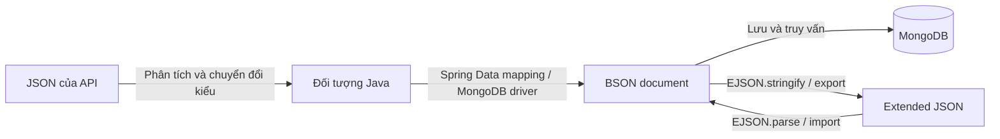

# JSON, Extended JSON, BSON và ý nghĩa của kiểu dữ liệu

MongoDB thường được giới thiệu là cơ sở dữ liệu lưu *document giống JSON*. Cách nói đó hữu ích để hình dung cấu trúc dữ liệu, nhưng chưa đủ khi xây dựng ứng dụng thực tế: MongoDB dùng **BSON** để biểu diễn document, còn **Extended JSON** là cách viết những kiểu BSON thành văn bản JSON có thể trao đổi. Phân biệt ba khái niệm này giúp tránh lỗi mất độ chính xác của số, nhầm chuỗi với ngày tháng, truy vấn sai `_id`, hoặc ánh xạ sai dữ liệu trong Spring Data MongoDB.

Trong module **SPRING_DATA_MONGODB**, kiến thức này là nền tảng để kết nối MongoDB, ánh xạ document sang đối tượng Java và thao tác qua `MongoTemplate` hoặc repository. Nó cũng ảnh hưởng trực tiếp đến thiết kế truy vấn, aggregation, index, transaction, reactive access, kiểm thử và chẩn đoán hiệu năng dữ liệu: nếu dữ liệu lưu sai kiểu, những thao tác ở các bước sau dễ cho kết quả không mong muốn.

## 1. Mục tiêu học tập

Sau bài này, bạn có thể:

1. Giải thích vai trò của JSON, Extended JSON và BSON trong cùng một luồng dữ liệu MongoDB.
2. Nhận diện các kiểu BSON quan trọng và đọc được hai dạng Extended JSON: *Canonical* và *Relaxed*.
3. Chọn kiểu phù hợp cho mã định danh, tiền tệ, số đếm, thời gian, tệp nhị phân và document lồng nhau.
4. Dùng `mongosh` để kiểm tra kiểu thực tế của trường, phân biệt trường `null` với trường không tồn tại.
5. Ánh xạ kiểu BSON sang kiểu Java bằng Spring Data MongoDB và dự phòng lỗi khi import, export hoặc tích hợp API.

## 2. Ba lớp biểu diễn của một document

| Khái niệm | Bản chất | Dùng ở đâu | Điều cần nhớ |
| --- | --- | --- | --- |
| **JSON** | Định dạng văn bản với object, array, string, number, boolean và `null` | API HTTP, tệp cấu hình, thông điệp giữa dịch vụ | Không có kiểu ObjectId, ngày tháng, Decimal128 hay binary riêng biệt. |
| **BSON** (*Binary JSON*) | Định dạng nhị phân có mã kiểu cho từng giá trị | MongoDB lưu trữ document và giao tiếp với driver | Có nhiều kiểu hơn JSON; kiểu là một phần của dữ liệu, không chỉ là cách hiển thị. |
| **Extended JSON** (*EJSON*) | Quy ước JSON chứa các cấu trúc đặc biệt để biểu diễn kiểu BSON | Export/import, log, dữ liệu mẫu, trao đổi document dưới dạng văn bản | Các khóa như `$oid`, `$date`, `$numberLong` diễn đạt kiểu BSON tương ứng. |

Ví dụ một đối tượng JSON thuần:

```json
{
  "_id": "507f1f77bcf86cd799439011",
  "orderedAt": "2025-01-01T00:00:00Z",
  "total": 19.90,
  "itemCount": 2
}
```

Văn bản này không chỉ rõ `_id` là chuỗi hay `ObjectId`, `orderedAt` là chuỗi hay BSON Date, `total` là số dấu phẩy động hay Decimal128, và `itemCount` là số nguyên 32 bit hay 64 bit. Các quyết định đó tùy thuộc vào bộ phân tích dữ liệu và cách ứng dụng tạo document.

Một document có cùng ý nghĩa nghiệp vụ nhưng được biểu diễn bằng **Extended JSON v2, chế độ Canonical**:

```json
{
  "_id": { "$oid": "507f1f77bcf86cd799439011" },
  "orderedAt": { "$date": { "$numberLong": "1735689600000" } },
  "total": { "$numberDecimal": "19.90" },
  "itemCount": { "$numberInt": "2" }
}
```

Trong đó `orderedAt` là BSON Date biểu diễn số mili giây từ Unix epoch, `total` là BSON Decimal128, `itemCount` là BSON Int32 và `_id` là BSON ObjectId. Khi dữ liệu được ghi vào MongoDB, driver chuyển các giá trị này sang BSON; MongoDB không lưu nguyên văn các khóa `$numberDecimal` hay `$oid` như trường con của document khi chúng được xử lý đúng như EJSON.



**Phân biệt quan trọng:** cú pháp như `ObjectId("...")`, `ISODate("...")` hay `NumberDecimal("...")` trong `mongosh` là các hàm/tiện ích của môi trường shell, **không phải cú pháp JSON chuẩn**. Một file `.json` hợp lệ không thể trực tiếp chứa lời gọi các hàm này.

## 3. BSON có những kiểu dữ liệu nào?

BSON gắn mã kiểu vào giá trị. Các loại sau thường gặp khi lập trình MongoDB:

| Kiểu BSON | Ví dụ trong `mongosh` | EJSON Canonical đặc trưng | Tình huống sử dụng |
| --- | --- | --- | --- |
| String | `"Hà Nội"` | `"Hà Nội"` | Tên, mã nghiệp vụ dạng chữ, mô tả. |
| ObjectId | `ObjectId("507f1f77bcf86cd799439011")` | `{"$oid":"507f1f77bcf86cd799439011"}` | `_id` mặc định phổ biến của document. |
| Int32 | `NumberInt(2)` | `{"$numberInt":"2"}` | Số lượng, bộ đếm nằm trong phạm vi 32 bit. |
| Int64 (Long) | `NumberLong("9007199254740993")` | `{"$numberLong":"9007199254740993"}` | Bộ đếm lớn, giá trị nguyên 64 bit. |
| Double | `19.9` | `{"$numberDouble":"19.9"}` | Số đo, dữ liệu tính toán chấp nhận sai số nhị phân. |
| Decimal128 | `NumberDecimal("19.90")` | `{"$numberDecimal":"19.90"}` | Tiền tệ, phép tính thập phân cần kiểm soát độ chính xác. |
| Boolean | `true` | `true` | Trạng thái đúng/sai. |
| Null | `null` | `null` | Giá trị rỗng được lưu rõ ràng. |
| Date | `ISODate("2025-01-01T00:00:00Z")` | `{"$date":{"$numberLong":"1735689600000"}}` | Thời điểm xảy ra sự kiện. |
| Embedded Document | `{ "city": "Đà Nẵng" }` | Object JSON lồng nhau | Dữ liệu có cấu trúc thuộc cùng thực thể. |
| Array | `["java", "mongo"]` | Array JSON | Danh sách nhãn, dòng hàng, lịch sử ngắn. |
| Binary | `BinData(0, "AQID")` | `{"$binary":{"base64":"AQID","subType":"00"}}` | Dữ liệu byte và phân loại binary subtype. |
| Regular Expression | `/^sp/i` | `{"$regularExpression":{"pattern":"^sp","options":"i"}}` | Giá trị regex được lưu dưới dạng BSON. |
| Timestamp | `Timestamp({t: 1, i: 1})` | `{"$timestamp":{"t":1,"i":1}}` | Kiểu chuyên biệt thường thấy trong cơ chế nội bộ như oplog. |
| MinKey / MaxKey | `MinKey()` / `MaxKey()` | `{"$minKey":1}` / `{"$maxKey":1}` | Giá trị biên đặc biệt trong thứ tự BSON. |

Ngoài ra còn có các kiểu ít gặp hoặc đã cũ như `Undefined`, `Symbol`, `JavaScript` và một số kiểu dành cho mục đích nội bộ. Khi thiết kế schema mới, không nên dùng các kiểu đã bị ngừng khuyến nghị chỉ để thay cho `null` hay String.

### 3.1. Số nguyên, số thực và số thập phân

Đây là nhóm dễ gây lỗi nhất:

- **Int32** lưu số nguyên có dấu từ `-2147483648` đến `2147483647`.
- **Int64** lưu số nguyên có dấu từ `-9223372036854775808` đến `9223372036854775807`.
- **Double** là số dấu phẩy động nhị phân IEEE 754, phù hợp nhiều bài toán thống kê và đo lường nhưng không biểu diễn chính xác mọi phân số thập phân như `0.1`.
- **Decimal128** là số dấu phẩy động thập phân với tối đa 34 chữ số có nghĩa. Nó hữu ích cho số tiền và các giá trị có quy tắc làm tròn cụ thể, nhưng vẫn có giới hạn phạm vi và độ chính xác.

Ví dụ:

```javascript
db.measurements.insertOne({
  readings: NumberInt(25),
  totalEvents: NumberLong("9007199254740993"),
  average: 0.1,
  charge: NumberDecimal("0.10")
});
```

Trong JavaScript, kiểu `Number` có thể biểu diễn chính xác mọi số nguyên chỉ đến `2^53 - 1` (`9007199254740991`). Số nguyên lớn nên được truyền dưới dạng chuỗi vào công cụ tạo Int64 tương ứng, thay vì đi qua một giá trị `Number` đã mất độ chính xác. Cũng vì vậy, không nên chuyển một BSON Long lớn thành JSON number thuần rồi mặc nhiên tin rằng ứng dụng JavaScript nhận lại đúng giá trị.

MongoDB có thể so sánh các kiểu số với nhau theo giá trị số trong nhiều truy vấn, nhưng **kiểu BSON vẫn quan trọng** đối với `$type`, chuyển đổi kiểu, phép tính, serialization và tính nhất quán của dữ liệu. Không nên coi Int32, Int64, Double và Decimal128 là hoán đổi được trong thiết kế schema.

Với trường tiền, hãy chọn một quy ước rõ ràng: Decimal128 cho số thập phân, hoặc lưu số nguyên theo đơn vị nhỏ nhất (ví dụ số đồng/xu nếu mô hình nghiệp vụ cho phép). Dùng Double cho tiền có thể dẫn tới sai số ngoài ý muốn khi cộng trừ, đối soát hoặc làm tròn.

### 3.2. ObjectId và chuỗi mã định danh

`ObjectId` là giá trị BSON 12 byte, thường được hiển thị bằng chuỗi hex 24 ký tự. MongoDB tạo chỉ mục duy nhất cho trường `_id`; kiểu `_id` có thể là ObjectId, String hoặc một kiểu được hỗ trợ khác tùy thiết kế.

Hai giá trị sau có hình thức gần giống nhau nhưng **khác kiểu**:

```javascript
{ _id: ObjectId("507f1f77bcf86cd799439011") }
{ _id: "507f1f77bcf86cd799439011" }
```

Nếu `_id` thực tế là ObjectId, truy vấn trực tiếp bằng chuỗi thuần không tương đương truy vấn bằng ObjectId:

```javascript
db.users.findOne({ _id: ObjectId("507f1f77bcf86cd799439011") });
```

ObjectId có một thành phần thời gian tạo gần đúng ở độ phân giải giây, nhưng **không thay thế trường thời gian nghiệp vụ** như `createdAt`. Không nên dựa vào ObjectId để suy ra thứ tự tuyệt đối giữa mọi document được tạo ở những máy khác nhau.

### 3.3. Date khác String và khác Timestamp

BSON Date lưu thời điểm dưới dạng **số nguyên 64 bit tính bằng mili giây từ Unix epoch UTC**. Múi giờ là vấn đề ở cách diễn giải/hiển thị tại ứng dụng; BSON Date không lưu kèm tên múi giờ như `Asia/Ho_Chi_Minh`.

```javascript
// BSON Date: hỗ trợ so sánh thời gian theo giá trị thời điểm.
{ createdAt: ISODate("2025-01-01T00:00:00Z") }

// BSON String: chỉ là văn bản có hình thức giống thời gian.
{ createdAt: "2025-01-01T00:00:00Z" }
```

Hai giá trị này không có cùng kiểu. Nếu dùng ngày tháng cho truy vấn khoảng thời gian, index TTL hoặc tính toán ngày giờ, hãy lưu đúng BSON Date. Kiểu BSON **Timestamp** (`t` và `i`) có mục đích khác Date, thường liên quan đến vận hành MongoDB; không dùng nó làm trường thời gian thông thường của ứng dụng.

### 3.4. Document lồng nhau, array, null và trường thiếu

Một document có thể chứa object lồng nhau và mảng:

```javascript
{
  customer: { name: "An", address: { city: "Huế" } },
  items: [{ sku: "BK-01", quantity: NumberInt(2) }],
  note: null
}
```

`note: null` có nghĩa trường tồn tại với giá trị Null; một document **không chứa `note`** là trường thiếu. Hai trạng thái này có thể cần logic ứng dụng khác nhau. MongoDB cho phép phần tử của mảng có nhiều kiểu, nhưng mảng đồng nhất kiểu thường dễ kiểm thử, lập chỉ mục và ánh xạ sang `List<T>` hơn. Một BSON document có giới hạn kích thước tối đa thông thường **16 MiB**; dữ liệu lớn nên cân nhắc mô hình lưu trữ phù hợp thay vì dồn hết vào một document.

## 4. Extended JSON v2: Canonical và Relaxed

Extended JSON có hai cách biểu diễn thường dùng:

| Chế độ | Mục tiêu | Ví dụ một Int32 | Hệ quả |
| --- | --- | --- | --- |
| **Canonical** | Bảo toàn thông tin kiểu ở dạng văn bản rõ ràng | `{"$numberInt":"2"}` | Phù hợp khi cần đọc/ghi chính xác kiểu BSON. |
| **Relaxed** | Dễ đọc, gần với JSON thông thường | `2` | Một số chi tiết kiểu số có thể không thể suy ra chỉ từ văn bản. |

Với cùng document ở mục 2, **Relaxed Extended JSON** có thể trông như sau:

```json
{
  "_id": { "$oid": "507f1f77bcf86cd799439011" },
  "orderedAt": { "$date": "2025-01-01T00:00:00Z" },
  "total": { "$numberDecimal": "19.90" },
  "itemCount": 2
}
```

Các chi tiết cần ghi nhớ:

1. **ObjectId** được biểu diễn qua `$oid`; **Decimal128** qua `$numberDecimal` trong cả hai chế độ.
2. **Date** ở Canonical dùng `$date` bọc `$numberLong` (mili giây UTC). Relaxed thường dùng chuỗi ISO 8601 trong `$date` với các thời điểm nằm trong phạm vi được hỗ trợ để định dạng như vậy.
3. **Int32/Int64/Double** ở Canonical có wrapper tương ứng; Relaxed ưu tiên giá trị JSON number khi có thể, nên không phải lúc nào cũng giữ được sự phân biệt kiểu khi chuyển qua công cụ JSON thông thường.
4. **Binary** dùng `$binary` với `base64` và `subType`; không nên bỏ thông tin subtype khi muốn khôi phục nguyên kiểu.
5. **Double đặc biệt** như `NaN` hoặc `Infinity` không phải giá trị number hợp lệ của JSON chuẩn; Extended JSON dùng wrapper, ví dụ `{"$numberDouble":"NaN"}`.

Extended JSON không biến mọi chương trình JSON thành chương trình hiểu BSON. Nếu một API nhận chuỗi `{ "$date": "..." }` như object JSON bình thường mà không dùng bộ giải mã EJSON, nó có thể hiểu đó là một object có trường tên `$date`, chứ không phải Date. Ngược lại, đối với dữ liệu trao đổi thuần JSON, đôi khi cách đúng là công khai hợp đồng API như `id: string`, `createdAt: ISO-8601 string`, `amount: decimal string`, rồi chuyển kiểu có kiểm soát tại ranh giới API.

### 4.1. Tự quan sát bằng `mongosh`

Các ví dụ sau chạy trong **`mongosh`**, không phải trong một file JSON tĩnh:

```javascript
const doc = {
  _id: ObjectId("507f1f77bcf86cd799439011"),
  orderedAt: ISODate("2025-01-01T00:00:00Z"),
  total: NumberDecimal("19.90"),
  itemCount: NumberInt(2)
};

print(EJSON.stringify(doc, null, 2, { relaxed: false })); // Canonical
print(EJSON.stringify(doc, null, 2, { relaxed: true }));  // Relaxed

const restored = EJSON.parse(EJSON.stringify(doc, null, 0, { relaxed: false }));
print(EJSON.stringify(restored, null, 2, { relaxed: false }));
```

Với dữ liệu cần trao đổi giữa hệ thống, hãy thống nhất phiên bản EJSON và quy tắc chuyển đổi kiểu. Đọc một bản xuất bằng parser JSON thuần rồi ghi lại có thể làm mất thông tin kiểu hoặc độ chính xác, đặc biệt với số nguyên lớn, Date và Decimal128.

## 5. Kiểu dữ liệu quyết định hành vi truy vấn

Giả sử collection `orders` được tạo bằng lệnh sau trong `mongosh`:

```javascript
db.orders.insertOne({
  _id: ObjectId("507f1f77bcf86cd799439011"),
  orderedAt: ISODate("2025-01-01T00:00:00Z"),
  total: NumberDecimal("19.90"),
  itemCount: NumberInt(2),
  customer: { code: "C001", city: "Hà Nội" },
  tags: ["online", "paid"]
});
```

### 5.1. Xác định kiểu thực đang lưu

Toán tử aggregation `$type` trả tên kiểu BSON của biểu thức:

```javascript
db.orders.aggregate([
  {
    $project: {
      _id: 0,
      idType: { $type: "$_id" },
      orderedAtType: { $type: "$orderedAt" },
      totalType: { $type: "$total" },
      itemCountType: { $type: "$itemCount" },
      tagsType: { $type: "$tags" }
    }
  }
]);
```

Với document vừa chèn, kết quả tương ứng là `objectId`, `date`, `decimal`, `int`, `array`. Đây là phép kiểm tra hữu ích khi nghi ngờ dữ liệu được import bằng sai kiểu.

Trong *query predicate*, `$type` dùng để lọc document:

```javascript
db.orders.find({ total: { $type: "decimal" } });
db.orders.find({ orderedAt: { $type: "string" } });
```

Hai cách dùng `$type` có ngữ cảnh khác nhau: một bên là **biểu thức aggregation** trả tên kiểu, bên kia là **điều kiện truy vấn** chọn document theo kiểu BSON.

### 5.2. So sánh ngày tháng và phân biệt null/missing

```javascript
// Khoảng [2025-01-01, 2025-02-01): dùng BSON Date.
db.orders.find({
  orderedAt: {
    $gte: ISODate("2025-01-01T00:00:00Z"),
    $lt: ISODate("2025-02-01T00:00:00Z")
  }
});

// Lưu ý: { field: null } chọn cả giá trị Null lẫn trường thiếu.
db.orders.find({ couponCode: null });

// Chỉ lấy document có giá trị thực sự thuộc kiểu Null.
db.orders.find({ couponCode: { $type: "null" } });

// Chỉ lấy document không có trường này.
db.orders.find({ couponCode: { $exists: false } });
```

MongoDB sử dụng quy tắc so sánh theo kiểu BSON; nhiều phép so sánh truy vấn có cơ chế *type bracketing*. Các kiểu số có xử lý so sánh chéo nhóm số, nhưng chuỗi thời gian không tự biến thành Date chỉ vì hình thức giống ISO 8601. Chọn sai kiểu có thể làm truy vấn bỏ sót document, hoặc khiến thứ tự sắp xếp không phản ánh ý nghĩa nghiệp vụ.

### 5.3. Index và dữ liệu lẫn kiểu

Giả sử cùng một trường `total` được lưu không nhất quán:

```javascript
{ total: NumberDecimal("19.90") }
{ total: "19.90" }
{ total: 19.90 }
```

Ba document lần lượt dùng Decimal128, String và Double. Index trên `total` vẫn có thể lưu các khóa này, nhưng truy vấn, sắp xếp, aggregation và chuyển đổi kiểu sẽ khó kiểm soát hơn. Riêng chuỗi `"100"` và `"20"` có thứ tự từ điển khác thứ tự số thông thường (trừ khi dùng quy tắc collation phù hợp với mục tiêu). Vì vậy:

- Chốt kiểu của từng trường trước khi ghi dữ liệu.
- Dùng `$type` để phát hiện document lệch schema.
- Đo hiệu năng truy vấn bằng `explain()` sau khi chọn kiểu và tạo index; sự tồn tại của index tự nó không bảo đảm truy vấn tối ưu.
- Với schema có ràng buộc quan trọng, xem xét **collection validation** dùng `$jsonSchema`.

Ví dụ tạo một collection mới có kiểm tra kiểu:

```javascript
db.createCollection("typed_orders", {
  validator: {
    $jsonSchema: {
      bsonType: "object",
      required: ["total", "orderedAt", "itemCount"],
      properties: {
        total: { bsonType: "decimal" },
        orderedAt: { bsonType: "date" },
        itemCount: { bsonType: "int" }
      }
    }
  }
});
```

Ví dụ này chỉ minh họa ràng buộc kiểu. Quy tắc `required`, khoảng giá trị, kiểu `_id`, cách xử lý document cũ và mức áp dụng validation cần được thiết kế theo nhu cầu thực tế.

## 6. Ánh xạ BSON với Java và Spring Data MongoDB

Ứng dụng Java không nên dựa vào hình thức JSON để đoán kiểu. Spring Data MongoDB sử dụng cơ chế mapping và MongoDB Java Driver để chuyển giữa đối tượng Java và BSON; các annotation có thể giúp quy định cách lưu dữ liệu.

| Kiểu dữ liệu trong mô hình | Kiểu BSON thường dùng | Ghi chú khi mapping |
| --- | --- | --- |
| `String` | String | Định danh String có thể cần cấu hình rõ ràng nếu liên quan `_id`. |
| `Integer` / `int` | Int32 | Cẩn thận trường cũ có thể đã lưu Long hoặc Double. |
| `Long` / `long` | Int64 | Tránh đưa số lớn qua JSON number của JavaScript. |
| `Double` / `double` | Double | Dùng cho dữ liệu chấp nhận số dấu phẩy động. |
| `BigDecimal` | String theo cách mapping mặc định thông dụng của Spring Data, hoặc Decimal128 khi chỉ định | Dùng `@Field(targetType = FieldType.DECIMAL128)` để lưu BSON Decimal128. |
| `Instant` / `Date` | BSON Date | Thích hợp cho thời điểm UTC; kiểm soát múi giờ ở ranh giới ứng dụng. |
| `List<T>` | BSON Array | Kiểu phần tử cần phù hợp với dữ liệu đã lưu. |
| POJO/record lồng nhau | Embedded document | Dùng cho thành phần của document cha. |
| `byte[]` hoặc kiểu nhị phân tương ứng | Binary | Có thể cần quan tâm binary subtype/codec tùy dữ liệu. |

Ví dụ định nghĩa một document bằng Java record (trong dự án Spring Data MongoDB hỗ trợ Java record):

```java
import java.math.BigDecimal;
import java.time.Instant;
import java.util.List;

import org.springframework.data.annotation.Id;
import org.springframework.data.mongodb.core.mapping.Document;
import org.springframework.data.mongodb.core.mapping.Field;
import org.springframework.data.mongodb.core.mapping.FieldType;

@Document(collection = "orders")
public record OrderDocument(
    @Id String id,
    @Field(targetType = FieldType.DECIMAL128) BigDecimal total,
    Instant orderedAt,
    int itemCount,
    List<LineItem> lines
) {
    public record LineItem(String sku, int quantity) {}
}
```

Repository có thể làm việc trực tiếp với kiểu miền này:

```java
import java.math.BigDecimal;
import java.util.List;

import org.springframework.data.mongodb.repository.MongoRepository;

public interface OrderRepository
        extends MongoRepository<OrderDocument, String> {
    List<OrderDocument> findByTotalGreaterThan(BigDecimal amount);
}
```

Annotation `@Field(targetType = FieldType.DECIMAL128)` thể hiện ý định lưu số tiền dưới BSON Decimal128; nếu để mặc định, cách mapping `BigDecimal` phải được kiểm tra theo cấu hình converter và phiên bản Spring Data đang dùng. Đừng giả định Jackson đang xuất JSON theo cách nào thì MongoDB cũng lưu BSON đúng như vậy.

### 6.1. Những điểm cần kiểm tra trong dự án

**Trường `_id`:** Spring Data có cơ chế chuyển đổi với các trường được đánh dấu `@Id`. Một `String` hợp lệ theo định dạng ObjectId có thể được chuyển thành BSON ObjectId khi lưu hoặc truy vấn, trong khi giá trị String khác có thể được giữ nguyên. Nếu bắt buộc `_id` luôn là BSON String hoặc ObjectId, hãy xác định chiến lược ID và cân nhắc `@MongoId` với `FieldType` tương ứng thay vì chỉ dựa vào hình thức dữ liệu.

**Tiền tệ:** `BigDecimal` của Java có biểu diễn thập phân phù hợp cho nhiều bài toán tiền tệ, nhưng chỉ lưu thành Decimal128 khi mapping được cấu hình phù hợp. Decimal128 có độ chính xác hữu hạn; cần quy ước scale, rounding và xử lý đầu vào vượt giới hạn.

**Thời gian:** `Instant` thể hiện một thời điểm trên trục thời gian, thuận tiện khi lưu BSON Date. `LocalDate` hoặc `LocalDateTime` không tự mang thông tin múi giờ: trước khi biến thành thời điểm UTC cần xác định quy tắc chuyển đổi. Nếu nghiệp vụ cần lưu múi giờ gốc, hãy lưu riêng thông tin múi giờ bên cạnh thời điểm.

**Kiểu dữ liệu cũ:** khi cùng một trường từng được lưu dưới dạng String, Long và Decimal128, converter hoặc phép truy vấn có thể gặp trường hợp không thống nhất. Cần kiểm tra dữ liệu hiện hữu trước khi đổi annotation của mô hình.

### 6.2. Kiểm tra loại BSON bằng `MongoTemplate`

Ví dụ truy vấn theo Date và theo kiểu dữ liệu, dùng trực tiếp các API của Spring Data:

```java
import java.time.Instant;
import java.util.Date;

import org.springframework.data.mongodb.core.MongoTemplate;
import org.springframework.data.mongodb.core.query.Criteria;
import org.springframework.data.mongodb.core.query.Query;

public final class OrderQueries {
    private final MongoTemplate mongoTemplate;

    public OrderQueries(MongoTemplate mongoTemplate) {
        this.mongoTemplate = mongoTemplate;
    }

    public long countOrdersSince(Instant start) {
        Query query = new Query(
            Criteria.where("orderedAt").gte(Date.from(start))
        );
        return mongoTemplate.count(query, OrderDocument.class);
    }
}
```

Ở ví dụ trên, `Date.from(start)` nêu rõ ý định truy vấn theo thời điểm. Với các trường có annotation mapping đặc biệt, nên dùng kiểu Java phù hợp với trường miền và xác nhận truy vấn thực tế trong bài kiểm thử tích hợp. Truy vấn dựa trên số tiền cần dùng cùng quy ước Decimal128 từ mô hình tới BSON.

## 7. Lỗi thường gặp và cách chẩn đoán

| Hiện tượng | Nguyên nhân có thể | Cách kiểm tra / xử lý |
| --- | --- | --- |
| Truy vấn `_id` không tìm thấy document | `_id` là ObjectId nhưng đối số là String, hoặc ngược lại | Dùng aggregation `$type` với `$_id`; thống nhất chính sách ID trong mapping. |
| Truy vấn khoảng thời gian bỏ sót bản ghi | Một số document lưu ngày dưới String | Nhóm theo `$type` và chuyển dữ liệu về BSON Date có quy tắc múi giờ rõ ràng. |
| Tổng tiền sai ở vài chữ số cuối | Giá trị đã qua Double hoặc JS Number | Theo dõi kiểu từ nguồn; lưu Decimal128 hoặc số nguyên đơn vị nhỏ nhất. |
| Long lớn bị thay đổi sau khi xuất/nhập JSON | JSON parser xử lý số bằng IEEE 754 Double | Dùng EJSON Canonical hoặc hợp đồng API truyền số nguyên lớn như String. |
| Converter Java gặp dữ liệu không mong đợi | Trường trong collection lẫn nhiều kiểu | Kiểm tra `$type`, tạo chiến lược làm sạch và kiểm thử với dữ liệu cũ. |
| Truy vấn `field: null` trả nhiều document | Điều kiện này khớp cả Null lẫn trường thiếu | Dùng `$type: "null"` hoặc `$exists: false` tùy ý định. |
| Log JSON hiển thị số thường nhưng DB mang kiểu khác | Đang xem Relaxed EJSON hoặc JSON từ serializer khác | Xuất Canonical EJSON hoặc kiểm tra bằng `$type`. |

Để đếm những kiểu đang xuất hiện trong một trường, có thể dùng aggregation:

```javascript
db.orders.aggregate([
  { $group: { _id: { $type: "$total" }, count: { $sum: 1 } } },
  { $sort: { count: -1 } }
]);
```

Kết quả có thể gồm `_id: "decimal"`, `"string"`, `"double"`, hoặc `"missing"`. Đó là bước khảo sát trước khi sửa schema. Khi cần chuyển dữ liệu cũ, hãy xác định thứ tự chuyển đổi, độ chính xác, giá trị không hợp lệ và cách khôi phục; phép đổi một String hoặc Double sang Decimal128 không thể tự sửa những chữ số đã mất ở bước trước.

## 8. Thực hành ngắn

### Bài tập 1: phân biệt kiểu sau khi nhập dữ liệu

Chạy trong một collection thử nghiệm:

```javascript
db.bson_lab.insertMany([
  { key: "A", amount: NumberDecimal("12.50"), at: ISODate("2025-01-01T00:00:00Z") },
  { key: "B", amount: "12.50", at: "2025-01-01T00:00:00Z" },
  { key: "C", amount: 12.50, at: ISODate("2025-01-01T00:00:00Z") }
]);

db.bson_lab.aggregate([
  {
    $project: {
      _id: 0,
      key: 1,
      amountType: { $type: "$amount" },
      atType: { $type: "$at" }
    }
  }
]);
```

**Đáp án kỳ vọng:** `A` có `amountType: "decimal"`, `atType: "date"`; `B` là `"string"`, `"string"`; `C` là `"double"`, `"date"`. Hình thức chuỗi hoặc số hiển thị không quyết định kiểu dữ liệu thực tế.

### Bài tập 2: xuất chính xác một số nguyên lớn

```javascript
const bigId = { value: NumberLong("9007199254740993") };
print(EJSON.stringify(bigId, null, 2, { relaxed: false }));
```

**Đáp án kỳ vọng:** trường `value` được biểu diễn qua `{"$numberLong":"9007199254740993"}`. Nếu chuyển sang JSON number rồi xử lý bằng JavaScript `Number`, giá trị này có nguy cơ bị làm tròn.

### Bài tập 3: chọn kiểu cho ứng dụng bán hàng

Một đơn hàng có mã định danh, đơn giá, số lượng, thời điểm đặt hàng và danh sách dòng hàng. Hãy đề xuất kiểu BSON, sau đó giải thích lựa chọn.

**Gợi ý đáp án:** `_id` dùng ObjectId nếu hệ thống chọn ID do MongoDB sinh; `unitPrice` dùng Decimal128 theo quy ước tiền tệ; `quantity` dùng Int32 nếu phạm vi phù hợp; `orderedAt` dùng Date; `lines` dùng Array của embedded documents với schema ổn định. Khi ứng dụng dùng Spring Data MongoDB, xác nhận `BigDecimal` ánh xạ Decimal128 và `Instant` ánh xạ Date, đồng thời kiểm thử trường `_id` ở cả lần ghi và lần truy vấn.

## 9. Những nguyên tắc cần mang sang các bài tiếp theo

1. **Thiết kế kiểu trước khi thiết kế truy vấn.** Cùng một giá trị nhìn thấy trên màn hình có thể là BSON String, Int32, Int64, Double, Decimal128, ObjectId hoặc Date.
2. **Dùng Canonical Extended JSON khi cần kiểm tra tính toàn vẹn kiểu.** Relaxed phù hợp cho việc đọc, nhưng không phải chứng cứ đầy đủ về kiểu số ban đầu.
3. **Đặt quy tắc chuyển đổi tại ranh giới hệ thống.** JSON API, code Java, driver MongoDB và BSON trên server cần thống nhất cách biểu diễn ID, ngày giờ, số tiền và số nguyên lớn.
4. **Đo bằng dữ liệu thực.** Dùng `$type`, `aggregate()`, schema validation và bài kiểm thử tích hợp để phát hiện sai lệch trước khi xây query, aggregation, index hoặc migration phức tạp.

Nắm được các nguyên tắc này giúp các lớp repository, `MongoTemplate` và các truy vấn của Spring Data MongoDB diễn đạt đúng ý nghĩa của dữ liệu, thay vì chỉ tình cờ hoạt động trên một vài document mẫu.
