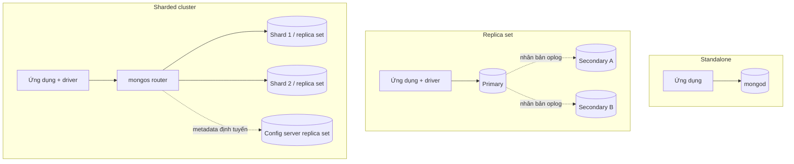
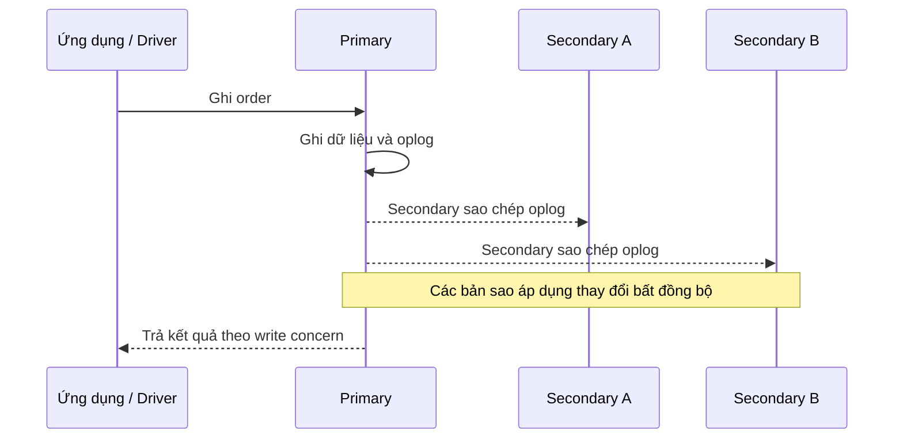

# Standalone, replica set, sharded cluster và MongoDB Atlas

> **Chương:** Nền tảng MongoDB  
> **Phạm vi module:** `SPRING_DATA_MONGODB` — sử dụng Spring Data MongoDB để kết nối, ánh xạ document và thao tác MongoDB qua `MongoTemplate` hoặc repository; tiếp tục học thiết kế truy vấn, aggregation, index, transaction, reactive access, kiểm thử và chẩn đoán hiệu năng. Bài này giải thích cách MongoDB được triển khai và vì sao topology ảnh hưởng trực tiếp đến hành vi ứng dụng Spring.

## 1. Vì sao phải hiểu topology trước khi viết repository?

Hai ứng dụng cùng dùng `MongoRepository<Order, String>` có thể lưu document và chạy cùng một phương thức `findById()`, nhưng khả năng chịu lỗi, độ trễ, đường đi của truy vấn và transaction rất khác nhau nếu MongoDB phía sau được triển khai dưới các dạng khác nhau.

**Topology** là cách các tiến trình MongoDB, vai trò và kết nối được tổ chức. Cần phân biệt bốn khái niệm:

- **Standalone:** một tiến trình `mongod` hoạt động độc lập.
- **Replica set:** nhiều tiến trình `mongod` duy trì các bản sao của cùng một tập dữ liệu để hỗ trợ tính sẵn sàng cao và phục hồi khi node gặp sự cố.
- **Sharded cluster:** dữ liệu của một collection có thể được phân phối giữa nhiều **shard** để mở rộng dung lượng và tải truy vấn/ghi theo chiều ngang. Mỗi shard trong triển khai production thường là một replica set.
- **MongoDB Atlas:** dịch vụ MongoDB được quản lý trên cloud. Atlas có thể cung cấp những cấu hình triển khai khác nhau, trong đó có replica set và sharded cluster; **Atlas không phải một cơ chế nhân bản hay phân mảnh mới đứng cùng cấp với ba topology trên**.

### Sơ đồ khái niệm



Đây là sơ đồ vai trò, không phải cấu hình triển khai đầy đủ. Ví dụ, production thường dùng **nhiều `mongos`** và nhiều thành viên cho mỗi replica set; driver có thể kết nối trực tiếp đến nhiều địa chỉ node của replica set để tự phát hiện primary hiện hành.

## 2. Standalone: một máy chủ MongoDB độc lập

Ở chế độ standalone, một `mongod` tự quản lý dữ liệu của mình, không tham gia giao thức đồng thuận và bầu chọn primary của replica set. Ứng dụng gửi yêu cầu đến tiến trình đó.

```text
Spring Boot / MongoTemplate / MongoRepository
                 |
                 v
        mongod:27017 (standalone)
                 |
                 v
              dữ liệu
```

**Điểm mạnh:** cài đặt đơn giản, ít thành phần, phù hợp cho học lệnh CRUD, truy vấn, aggregation, thử index hoặc một môi trường phát triển ngắn hạn. **Hạn chế:** nếu tiến trình, máy chủ hoặc storage gặp sự cố, không có thành viên MongoDB khác tự động tiếp quản. Một bản sao lưu định kỳ có thể giúp khôi phục dữ liệu, nhưng bản sao lưu **không thay thế cơ chế failover**.

Với các tính năng phụ thuộc session/transaction trong môi trường hiện đại, cần đặc biệt lưu ý: **multi-document transaction không được hỗ trợ trên standalone**. Vì thế việc kiểm thử `@Transactional` với MongoDB phải diễn ra trên topology tương thích, chẳng hạn replica set một node trong môi trường test hoặc replica set nhiều node khi cần kiểm thử failover. Atomic update trên **một document** vẫn là khả năng cơ bản của MongoDB và không cần transaction nhiều document.

Ví dụ URI cho MongoDB chạy trên máy phát triển:

```properties
MONGODB_URI=mongodb://localhost:27017/shop
```

URI này chỉ minh họa một máy chủ không yêu cầu xác thực. Với triển khai thật, URI có thể cần thông tin đăng nhập, TLS, timeout và những tùy chọn khác. `localhost` có nghĩa là **máy đang chạy ứng dụng**; nếu ứng dụng ở trong container, đây thường không phải tên máy của MongoDB container khác.

## 3. Replica set: nhân bản và tự động chọn primary

Replica set là nhóm các `mongod` duy trì cùng một tập dữ liệu logic. Trong vận hành thông thường, có **một primary** tiếp nhận các thao tác ghi và nhiều **secondary** sao chép thay đổi từ oplog. Các secondary có thể phục vụ thao tác đọc nếu cấu hình read preference cho phép.

### 3.1. Primary, secondary, election và oplog



- **Primary:** nhận các lệnh ghi thông thường của ứng dụng; khi primary không còn đủ điều kiện làm primary, replica set có thể tổ chức bầu chọn.
- **Secondary:** theo dõi và áp dụng các thao tác từ **oplog** (nhật ký các thao tác có thể nhân bản). Vì quá trình nhân bản bất đồng bộ, secondary có thể bị trễ so với primary.
- **Election:** các thành viên có quyền bầu chọn phối hợp chọn primary mới. Một thành viên phải đạt điều kiện và nhận đủ phiếu bầu theo cơ chế majority; trong lúc chuyển primary, ứng dụng có thể gặp lỗi tạm thời hoặc tăng độ trễ.
- **Arbiter:** có thể tham gia bầu chọn nhưng **không lưu bản sao dữ liệu**. Arbiter không thay thế secondary chứa dữ liệu khi cần tăng độ bền và khả năng phục hồi.

Một cấu hình phổ biến cho tính sẵn sàng cao là **ba thành viên có dữ liệu và quyền bầu chọn** ở các vùng lỗi phù hợp. Đây là ví dụ thiết kế, không phải công thức đúng cho mọi mức tải và ngân sách. Nếu hệ thống không duy trì được majority có khả năng bầu chọn, nó có thể không có primary để nhận ghi dù vẫn còn một số node đang chạy. Nhân bản cũng không ngăn lỗi nghiệp vụ hay thao tác xóa nhầm được sao chép tới các thành viên; vẫn phải có chiến lược backup/restore.

### 3.2. Read preference, write concern và read concern

Ba cấu hình thường bị nhầm lẫn:

| Cơ chế | Trả lời câu hỏi nào? | Hệ quả điển hình |
| --- | --- | --- |
| **Read preference** | Đọc từ thành viên nào? | `primary` là lựa chọn mặc định phổ biến; `secondary`/`secondaryPreferred` có thể phân phối tải đọc nhưng dễ gặp dữ liệu trễ. |
| **Write concern** | Một thao tác ghi cần mức xác nhận nào? | `w: "majority"` yêu cầu xác nhận từ đa số thành viên có quyền bầu chọn lưu dữ liệu theo quy tắc của MongoDB, tăng khả năng ghi đã xác nhận tồn tại qua failover so với xác nhận chỉ từ một node. |
| **Read concern** | Đọc dữ liệu với mức đảm bảo hiển thị nào? | `majority` đọc dữ liệu đã được majority commit, với các điều kiện và semantics của phiên bản đang dùng. |

Ba thiết lập này không tương đương nhau. `readPreference=secondary` **không** tự đảm bảo dữ liệu mới nhất. `writeConcern=majority` **không** có nghĩa là ứng dụng sẽ không bao giờ phải retry hoặc xử lý lỗi không rõ kết quả. Một hệ thống yêu cầu đọc ngay thay đổi vừa ghi cần thiết kế thêm semantics phù hợp, ví dụ đọc từ primary hoặc sử dụng session với causal consistency khi cần và khi điều kiện bảo đảm được đáp ứng.

**Ví dụ nghiệp vụ:** sau khi thanh toán thành công, UI chuyển ngay sang màn hình chi tiết đơn hàng. Nếu lần đọc tiếp theo được chuyển sang một secondary đang chậm, UI có thể nhìn thấy trạng thái `PENDING` cũ. Đây là lựa chọn nhất quán/độ trễ của ứng dụng, không phải lỗi của repository. Đối với luồng này, đọc từ primary thường dễ dự đoán hơn.

### 3.3. Kết nối replica set từ Spring Data MongoDB

```properties
# Các hostname phải được ứng dụng phân giải và kết nối được.
MONGODB_URI=mongodb://db1.example.net:27017,db2.example.net:27017,db3.example.net:27017/shop?replicaSet=rs0&readPreference=primary&w=majority
```

Driver có cơ chế **khám phá topology**, theo dõi sự thay đổi primary và chọn server phù hợp cho từng thao tác. Cần khai báo các địa chỉ thực sự truy cập được từ môi trường ứng dụng. Danh sách seed ban đầu không thay thế cấu hình thành viên chính xác của replica set trên server; các hostname mà replica set tự công bố cũng phải được phân giải và kết nối được.

Failover không có nghĩa mọi request đang chạy sẽ tự động thành công: một số lệnh có thể thất bại, bị timeout hoặc có kết quả không chắc chắn. Retryable reads/writes có các điều kiện áp dụng riêng. Ở tầng nghiệp vụ, cần dùng idempotency key hoặc điều kiện cập nhật phù hợp cho lệnh có tác động tài chính, tồn kho và gửi sự kiện.

**Replica set mở rộng độ sẵn sàng và tùy chọn đọc; nó không tự phân phối dữ liệu ghi của một collection lên nhiều primary.** Khi cần chia dữ liệu và ghi theo nhiều nhóm máy chủ, hãy xem sharding.

## 4. Sharded cluster: chia dữ liệu giữa nhiều shard

Một sharded cluster kết hợp **phân vùng dữ liệu** với các thành phần định tuyến và metadata:

| Thành phần | Nhiệm vụ |
| --- | --- |
| **Shard** | Giữ một phần dữ liệu được phân mảnh; triển khai production thông thường dùng replica set cho mỗi shard. |
| **`mongos`** | Router nhận truy vấn từ ứng dụng, xác định shard cần truy cập theo metadata và hợp nhất kết quả khi cần. |
| **Config server replica set (CSRS)** | Lưu metadata cấu hình sharding và thông tin định tuyến của cluster. |
| **Balancer** | Cơ chế điều phối di chuyển các dải dữ liệu/chunk để phân phối dữ liệu giữa shard theo chính sách hiện hành. |
| **Shard key** | Trường hoặc tổ hợp trường quyết định cách dữ liệu của collection được phân bố và định tuyến. |

Trong một cluster, không phải mọi collection đều nhất thiết được sharding; collection không được sharding có cách bố trí riêng theo chính sách của cluster. Ứng dụng thường kết nối **`mongos`**, không gửi request nghiệp vụ trực tiếp đến từng shard hay config server.

### 4.1. Shard key quyết định nhiều hơn khả năng chia dữ liệu

Giả sử collection `orders` có hàng trăm triệu document và hầu hết truy vấn đi theo `customerId`. Ta có thể cân nhắc shard key từ `customerId`; nhưng cần xem số lượng khách hàng, độ lệch tải theo từng khách hàng, nhu cầu tra cứu bằng `_id`, truy vấn theo thời gian và các thao tác ghi.

MongoDB hỗ trợ các cách phân vùng, trong đó phổ biến là:

- **Ranged sharding:** chia theo các khoảng giá trị của shard key. Hữu ích cho truy vấn theo khoảng và có thể định tuyến có mục tiêu, nhưng một khóa tăng liên tục như timestamp có thể tạo vùng nhận ghi quá nóng nếu thiết kế không phù hợp.
- **Hashed sharding:** phân phối theo giá trị băm của shard key, thường giúp rải đều những giá trị khóa đa dạng và tải ghi; đánh đổi là truy vấn theo khoảng giá trị khóa gốc thường khó tận dụng việc định tuyến một dải shard liên tiếp.

**Cardinality** (độ đa dạng giá trị), tần suất giá trị, tính đơn điệu, kích thước dữ liệu của từng khóa và **mẫu truy vấn thực tế** là những tiêu chí quan trọng. Một khóa ít giá trị khác nhau hoặc bị một vài giá trị chi phối có thể gây tập trung dữ liệu/tải. Sharding không tự sửa được thiết kế truy vấn xấu.

### 4.2. Targeted query và scatter-gather

Ví dụ một collection phân mảnh theo `customerId`:

```javascript
// Có điều kiện trên shard key: mongos thường định tuyến được đến shard liên quan.
db.orders.find({ customerId: "C-42", status: "PAID" })

// Thiếu shard key: có thể phải gửi đến nhiều shard rồi gộp kết quả.
db.orders.find({ status: "PAID" })
```

Truy vấn thứ hai có thể là **scatter-gather**, làm tăng số shard phải truy cập và khối lượng công việc hợp nhất. Một index trên `status` tại các shard vẫn có thể hữu ích, nhưng index không thay thế thông tin định tuyến từ shard key. Ngoài ra, tùy kiểu khóa và ranh giới phân vùng, một truy vấn có shard key vẫn có thể cần nhiều shard; không nên mặc định mọi truy vấn có shard key chỉ đi đúng một node.

### 4.3. Chunk, balancing và thay đổi shard key

MongoDB quản lý phạm vi dữ liệu phân mảnh bằng metadata; cách chia chunk và di chuyển dữ liệu có thể thay đổi theo phiên bản và trạng thái cluster. Khi dữ liệu tăng hoặc phân bố không đều, balancer có thể di chuyển chunk/phạm vi dữ liệu giữa các shard để cân bằng. Quá trình di chuyển tốn tài nguyên mạng, I/O và có thể ảnh hưởng độ trễ, vì thế cần giám sát trong giai đoạn tăng trưởng và bảo trì.

Chọn sai shard key có thể rất tốn kém để sửa. Một số phiên bản MongoDB hỗ trợ thao tác như **refine shard key** hoặc **reshard collection**, nhưng đây là các thay đổi vận hành cần đánh giá điều kiện hỗ trợ, tài nguyên và thời điểm thực hiện. Không nên mặc định có thể đổi shard key dễ như đổi tên một cột Java.

### 4.4. Transaction và giới hạn khi truy cập nhiều shard

Một thao tác cập nhật **một document** vẫn có tính nguyên tử. Transaction nhiều document có thể hoạt động trên sharded cluster khi topology và phiên bản hỗ trợ, kể cả khi dữ liệu trải qua nhiều shard; đổi lại là thêm phối hợp phân tán, yêu cầu vận hành và chi phí độ trễ. Khả năng này không biến một sharded cluster thành lựa chọn tối ưu mặc định cho mọi nghiệp vụ quan hệ chặt chẽ.

Ví dụ URI kết nối tới các router `mongos` mà ứng dụng truy cập được:

```properties
MONGODB_URI=mongodb://router1.example.net:27017,router2.example.net:27017/shop?retryWrites=true&w=majority
```

Không khai báo `replicaSet=...` của **một shard** khi kết nối đến các `mongos`; cluster có nhiều shard với các replica set riêng. Trong thực tế, các tùy chọn và khả năng retry cần tương thích phiên bản driver/server và cấu hình cluster.

## 5. MongoDB Atlas: MongoDB được quản lý trên cloud

**MongoDB Atlas** là dịch vụ của MongoDB, Inc. giúp triển khai, theo dõi và vận hành MongoDB trên các nền tảng cloud được hỗ trợ. Người dùng chọn gói triển khai, vùng đặt dữ liệu, cấu hình tài nguyên, bảo mật và các tính năng liên quan; Atlas đảm nhận nhiều thao tác hạ tầng theo khả năng của gói.

Các chức năng thường gặp bao gồm:

- **Provisioning, quản lý node và bảo trì:** giảm công việc dựng và cấu hình từng tiến trình MongoDB thủ công.
- **Bảo mật kết nối:** quản lý database user, cơ chế giới hạn mạng (IP access list, private endpoint hoặc kết nối mạng riêng tùy gói), TLS và các chính sách truy cập.
- **Giám sát và công cụ chẩn đoán:** quan sát độ trễ, tải truy vấn, index và sức khỏe cluster tùy tính năng khả dụng.
- **Backup/restore và khả năng sẵn sàng:** phụ thuộc loại cluster, tier, cấu hình và tính năng đã bật; phải kiểm tra RPO/RTO và chính sách backup cụ thể.
- **Lựa chọn topology:** các tier/kiểu triển khai phù hợp có thể cung cấp replica set hoặc sharded cluster; khả năng autoscaling và phân vùng phụ thuộc gói.

Atlas **không thay thế** các quyết định về document model, shard key, index, `readPreference`, `writeConcern`, quyền truy cập tối thiểu hay bảo vệ dữ liệu. Atlas giúp giảm gánh nặng vận hành máy chủ, nhưng vẫn có chi phí cloud, giới hạn theo gói, độ trễ mạng, yêu cầu quản trị dữ liệu và ràng buộc vùng triển khai.

### Quy trình kết nối ứng dụng Spring với Atlas

1. Tạo một deployment phù hợp nhu cầu, chọn region gần ứng dụng và xem xét yêu cầu dự phòng.
2. Tạo **database user** với quyền hạn cần thiết; không dùng thông tin quản trị toàn quyền cho mọi service.
3. Thiết lập kết nối mạng cho môi trường chạy ứng dụng; production ưu tiên kiểm soát dải IP và private networking khi phù hợp. Tránh mở quyền mạng rộng không cần thiết.
4. Lấy MongoDB connection string từ Atlas, đặt trong secret manager hoặc biến môi trường, kiểm tra khả năng phân giải DNS SRV và TLS từ môi trường ứng dụng.
5. Kiểm thử đọc, ghi, timeout, hành vi reconnect và các yêu cầu nhất quán với cấu hình thực tế.

URI Atlas thường dùng định dạng **`mongodb+srv://`**, trong đó driver tra cứu bản ghi DNS SRV/TXT để khám phá các endpoint và tùy chọn theo cơ chế connection string:

```text
mongodb+srv://<db-user>:<url-encoded-password>@<cluster-hostname>/shop?retryWrites=true&w=majority
```

Đây là cú pháp minh họa; hãy dùng hostname Atlas cung cấp. Mật khẩu có ký tự đặc biệt phải được mã hóa URL theo quy tắc connection string. Không ghi mật khẩu thật vào repository, log hoặc bài hướng dẫn; nếu kết nối qua mạng riêng hay quy định doanh nghiệp, cần cấu hình tương ứng.

## 6. So sánh lựa chọn triển khai

| Tiêu chí | Standalone | Replica set | Sharded cluster | MongoDB Atlas |
| --- | --- | --- | --- | --- |
| Mục tiêu chính | Đơn giản, thử nghiệm | Sẵn sàng cao, nhân bản dữ liệu | Mở rộng lưu trữ và tải theo nhiều shard | Dịch vụ quản lý triển khai MongoDB |
| Nhân bản dữ liệu | Không có sẵn ở mức topology | Các member chứa cùng dữ liệu logic | Thường mỗi shard có replica set | Theo kiểu deployment/tier đã chọn |
| Failover tự động | Không | Có thể bầu primary mới khi đạt điều kiện | Theo replica set của shard và thiết kế cluster | Theo triển khai và điều kiện dịch vụ |
| Mở rộng tải ghi của một collection | Chủ yếu nâng cấp máy | Chủ yếu nâng cấp primary và tối ưu mô hình | Có thể phân phối qua nhiều shard nhờ shard key | Tùy cấu hình replica set/sharded, tier và scaling |
| Độ phức tạp vận hành tự quản | Thấp | Trung bình | Cao | Atlas thực hiện nhiều tác vụ hạ tầng, nhưng ứng dụng vẫn cần vận hành dữ liệu |
| Multi-document transaction | Không | Có khi đủ điều kiện | Có khi đủ điều kiện, có thể tốn chi phí phân tán | Phụ thuộc topology và tính năng triển khai |
| Trường hợp thường dùng | Học tập, local dev | Dịch vụ production chưa cần sharding | Dữ liệu/tải lớn đã chứng minh nhu cầu chia shard | Đội ngũ muốn dùng MongoDB trên cloud với dịch vụ quản lý |

**Cách quyết định thực tế:**

1. Đánh giá yêu cầu sẵn sàng, backup/restore, khối lượng dữ liệu, throughput, latency và ngân sách.
2. Với ứng dụng production cần phục hồi node lỗi, cân nhắc replica set thay cho standalone; thiết kế region/zone, phiếu bầu và tính nhất quán theo nghiệp vụ.
3. Đo giới hạn thực sự của mô hình/index/primary và nâng cấu hình thích hợp trước khi quyết định sharding; sharding thêm chi phí vận hành và phụ thuộc nhiều vào shard key.
4. Đánh giá **Atlas song song với lựa chọn topology**, dựa trên khả năng vận hành nội bộ, region, bảo mật, kiểm soát chi phí và tính năng theo tier. Atlas không có nghĩa là luôn phải sharding.

## 7. Tác động trực tiếp lên Spring Data MongoDB

Ứng dụng vẫn dùng `MongoTemplate`, `MongoRepository`, `ReactiveMongoTemplate` hoặc `ReactiveMongoRepository`. Các abstraction này giúp code thao tác document tương tự ở nhiều topology, nhưng **không che giấu được giới hạn của server**.

### 7.1. Cấu hình URI và driver

Với một ứng dụng Spring Boot có phiên bản hỗ trợ property sau:

```yaml
# application.yml
spring:
  data:
    mongodb:
      uri: ${MONGODB_URI}
```

Tên property tự động cấu hình có thể thay đổi giữa các thế hệ Spring Boot; **đối chiếu tài liệu cho phiên bản đang dùng**. Bản thân MongoDB connection string và vai trò topology vẫn là những khái niệm của MongoDB Java Driver. Biến môi trường `MONGODB_URI` có thể chứa URI standalone, replica set, `mongos` hoặc Atlas như các ví dụ trên; có thể bổ sung timeout, pool size, retry policy và các thiết lập khác theo nhu cầu vận hành.

Đừng gắn địa chỉ primary hiện tại vào code: primary có thể thay đổi sau election. Driver phải khám phá các thành viên qua địa chỉ mạng khả dụng. Với Docker/Kubernetes hoặc kết nối xuyên mạng, lỗi hostname tự công bố, DNS/TLS, firewall, IP allowlist và kết nối pool thường dễ bị nhầm thành lỗi Spring Data.

### 7.2. Transaction không được kích hoạt chỉ nhờ annotation

```java
@Service
public class PaymentService {
    @Transactional
    public void confirmOrder(String orderId) {
        // Minh họa điểm đặt transaction boundary trong service.
        // Các thao tác MongoDB thực tế cần dùng cùng transaction context.
    }
}
```

Đoạn code chỉ minh họa vị trí annotation, **không phải một transaction chạy được chỉ bằng cách copy**. Để `@Transactional` quản lý MongoDB transaction cần topology MongoDB hỗ trợ, driver/session phù hợp, **`MongoTransactionManager`** cho stack imperative hoặc **`ReactiveMongoTransactionManager`** cho stack reactive, cùng cấu hình transaction management và cách gọi đúng ngữ cảnh. Tính sẵn có của transaction manager không tự bảo đảm mọi thao tác ngoài session tham gia cùng transaction. Với standalone, multi-document transaction sẽ không hoạt động.

### 7.3. Truy vấn, aggregation và index vẫn phải thiết kế theo topology

```java
public interface OrderRepository extends MongoRepository<Order, String> {
    List<Order> findByCustomerIdOrderByCreatedAtDesc(String customerId);
}
```

Với replica set, index `{ customerId: 1, createdAt: -1 }` có thể hỗ trợ tốt phương thức trên. Với sharded collection, cần thêm câu hỏi: **`customerId` có nằm trong shard key không?** Nếu thiếu thông tin định tuyến, truy vấn có thể được gửi tới nhiều shard dù trên từng shard có index tốt. Tương tự, aggregation dùng `MongoTemplate` có thể cần tổng hợp kết quả từ nhiều shard và sinh chi phí mạng/tài nguyên đáng kể.

Với reactive access, việc dùng driver reactive thay đổi mô hình I/O của ứng dụng, **không thay đổi** quy tắc election, shard routing hoặc điều kiện transaction ở server. Không nên kết luận reactive nhanh hơn chỉ vì cluster là Atlas hay sharded.

### 7.4. Chọn môi trường kiểm thử đúng tính năng

| Bài kiểm thử | Topology tối thiểu phù hợp | Lý do |
| --- | --- | --- |
| CRUD và mapping `@Document`, `@Id` | Standalone thường đủ | Xác nhận chuyển đổi Java ↔ BSON và repository cơ bản. |
| Transaction nhiều document và rollback | Replica set có cấu hình transaction phù hợp | Standalone không hỗ trợ loại transaction này. |
| Election, failover, secondary lag | Replica set có nhiều thành viên | Replica set một node không mô phỏng được chuyển primary giữa các máy. |
| Scatter-gather, shard key, balancer | Sharded cluster | Replica set không có cơ chế phân vùng theo shard key. |
| Kết nối Atlas, DNS SRV, TLS, quyền mạng | Atlas deployment hoặc môi trường mô phỏng tương đương có chủ đích | Lỗi mạng/cloud và policy không thể kiểm chứng chỉ bằng unit test. |

Có thể dùng Testcontainers MongoDB hoặc môi trường test riêng để dựng topology phù hợp, nhưng phải xác minh container/thiết lập đã cung cấp đúng chức năng cần test. Đừng kết luận một bài test transaction trên một standalone đang thành công chỉ vì service trả HTTP 200: cần kiểm tra transaction thực sự bắt đầu, commit và rollback theo tình huống lỗi.

## 8. Quan sát và chẩn đoán theo từng topology

Một số lệnh `mongosh` giúp phân biệt vấn đề topology với lỗi truy vấn. Chạy trên đúng endpoint và dùng tài khoản có quyền phù hợp:

```javascript
// Server tự khai báo loại node và trạng thái phù hợp trong hello response.
db.adminCommand({ hello: 1 })

// Chỉ dùng khi kết nối vào replica set và có quyền thích hợp.
rs.status()

// Chỉ dùng khi kết nối tới mongos của sharded cluster.
sh.status()

// Kiểm tra cách MongoDB thực thi truy vấn ở nơi có dữ liệu.
db.orders.find({ customerId: "C-42" })
  .sort({ createdAt: -1 })
  .explain("executionStats")
```

| Triệu chứng | Hướng kiểm tra ban đầu |
| --- | --- |
| Kết nối được một node nhưng app báo server selection timeout | Hostname replica set công bố, DNS, firewall, TLS, URI `replicaSet`, trạng thái election. |
| Ghi tạm thời thất bại sau node lỗi | Primary hiện tại, majority, write concern, timeout, retryable writes và idempotency của nghiệp vụ. |
| Đọc ra trạng thái cũ | Read preference, secondary lag, read concern, session và yêu cầu read-after-write. |
| Truy vấn chậm trên sharded cluster | Shard key trong bộ lọc, số shard được truy cập, index trên shard, skew/hot shard, chi phí aggregation. |
| Atlas app không kết nối dù CRUD local chạy tốt | Network access, private endpoint, DNS SRV, TLS, tài khoản, quyền database, region và secret. |
| Ghi chậm dù CPU còn thấp | Write concern, disk I/O, replication lag, hot shard, connection pool và giới hạn tier. |

Các công cụ như metrics, profiler, slow query log và `explain("executionStats")` cần được đọc trong bối cảnh của query shape, tải thật và quyền truy cập. `explain` trong một sharded cluster có thể cho thấy kế hoạch ở nhiều shard; không nên chỉ nhìn một con số thời gian tổng mà bỏ qua routing, số document quét và lượng dữ liệu trả về.

## 9. Tình huống chọn topology

**Tình huống A — ứng dụng học tập:** bạn xây dựng CRUD cho tài liệu và thử `MongoRepository`. Một standalone trên máy phát triển là đủ để hiểu ánh xạ document, query và index. Nếu bài học chuyển sang rollback đa document, hãy dùng replica set phù hợp trong môi trường test.

**Tình huống B — hệ thống xử lý đơn hàng production:** dịch vụ cần tiếp tục làm việc khi một node bị lỗi và thường có thể quản lý dữ liệu trên một tập node. Replica set là lựa chọn thường được xem xét; cần thiết kế backup, monitoring, read/write concern và logic phục hồi lỗi của ứng dụng.

**Tình huống C — nền tảng dữ liệu đa khách hàng với dữ liệu rất lớn:** tải ghi và lưu trữ vượt khả năng mở rộng hợp lý của một nhóm primary. Sharded cluster có thể phù hợp nếu truy vấn có khóa định tuyến tốt và đội ngũ đủ khả năng quản lý shard key, balancing và tình huống dữ liệu lệch. Cần kiểm chứng bằng benchmark và dữ liệu đại diện.

**Tình huống D — nhóm muốn giảm công sức vận hành database:** nhóm có thể chọn Atlas để được hỗ trợ triển khai và giám sát trên cloud, rồi **vẫn phải chọn** cấu hình replica set hay sharded cluster thích hợp theo workload và tier. Quyết định Atlas chủ yếu trả lời câu hỏi *ai quản lý hạ tầng MongoDB và bằng dịch vụ nào*, còn quyết định sharding trả lời câu hỏi *dữ liệu được phân phối như thế nào*.

## 10. Câu hỏi tự kiểm tra và bài thực hành

1. Vì sao ba node `mongod` độc lập không tương đương một replica set ba node? Những thành phần nào tham gia vào việc chọn primary?
2. Khi primary vừa thay đổi và một API bị timeout, vì sao phải xem xét retry, idempotency và write concern cùng nhau?
3. `readPreference=secondary` có đảm bảo người dùng đọc ngay trạng thái mới sau khi ghi hay không? Hãy mô tả một tình huống sai lệch.
4. Vì sao shard key là quyết định liên quan cả lưu trữ **lẫn** hiệu năng truy vấn? Truy vấn thiếu shard key gây ra điều gì?
5. Nếu dùng Atlas, ứng dụng Spring có cần `MongoTemplate`/repository khác với khi kết nối MongoDB tự quản không? Điều gì thay đổi ở kết nối và vận hành?
6. Hãy chọn topology tối thiểu cho một bài test xác minh rollback khi cập nhật hai document; giải thích vì sao standalone chưa đủ.

**Bài thực hành đề xuất:** tạo collection `orders` với `customerId`, `status` và `createdAt`; viết repository lấy lịch sử theo khách hàng. Trong một môi trường MongoDB phù hợp, chạy truy vấn và kiểm tra `explain("executionStats")`. Tiếp đó, mô tả điều gì sẽ khác nhau nếu triển khai thành replica set rồi sharded cluster theo `customerId`: đường kết nối của driver, failover, số node có thể tiếp nhận thao tác và cách `mongos` định tuyến truy vấn. Không cần dựng sharded cluster để trả lời bằng sơ đồ và phân tích truy vấn.

## 11. Ghi nhớ

- **Standalone** ưu tiên sự đơn giản, thích hợp cho học tập và thao tác dữ liệu cơ bản nhưng không cung cấp failover bằng replication.
- **Replica set** sao chép cùng dữ liệu giữa các node, bầu primary và hỗ trợ tính sẵn sàng cao; phải hiểu lag, majority, read/write concern và retry.
- **Sharded cluster** phân phối dữ liệu theo shard key, dùng `mongos` để định tuyến và config server để quản lý metadata; hiệu quả phụ thuộc mẫu truy vấn và cách chia dữ liệu.
- **Atlas** là dịch vụ quản lý MongoDB, không phải một topology thay thế replica set/sharding.
- Với **Spring Data MongoDB**, repository và template giúp đơn giản hóa code Java, nhưng tính đúng đắn của transaction, khả năng chịu lỗi và hiệu năng vẫn phụ thuộc topology, cấu hình driver và thiết kế dữ liệu.
