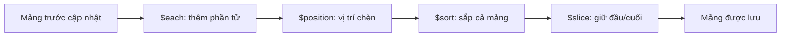

# push, each, position, slice và sort

## 1. Vì sao thao tác array cần được thiết kế cẩn thận?

Trong ứng dụng sử dụng **Spring Data MongoDB**, một document thường chứa array để biểu diễn dữ liệu có vòng đời phụ thuộc document cha: các nhãn của sản phẩm, những lần truy cập gần đây, điểm số tốt nhất, hoặc một danh sách nhỏ các trạng thái đã xảy ra.

Ví dụ hồ sơ người chơi có hai mảng:

- `recentActions`: chỉ giữ **4 hoạt động gần nhất**, mới nhất nằm trước.
- `bestRuns`: chỉ giữ **3 lượt chơi điểm cao nhất**, sắp giảm dần theo `score`, hòa điểm thì theo `runId`.

Nếu dùng Java đọc document, thêm phần tử vào `List` rồi `repository.save(...)`, ứng dụng có thể gặp ba vấn đề:

1. Hai request cùng đọc một bản cũ và cùng `save` có thể ghi đè thay đổi của nhau.
2. Toàn bộ document cùng các mảng phải được tải và ánh xạ, dù chỉ cần thêm một phần tử.
3. Việc giữ thứ tự và giới hạn số phần tử bị phân tán ở nhiều service, dễ tạo dữ liệu không đồng nhất.

MongoDB có toán tử cập nhật **`$push`**, kết hợp các modifier **`$each`**, **`$position`**, **`$slice`** và **`$sort`**. Với một lệnh cập nhật, ta có thể thêm nhiều phần tử, đặt vị trí, sắp xếp **toàn bộ mảng sau khi thêm**, rồi cắt mảng theo giới hạn. Spring Data MongoDB biểu diễn các thao tác đó qua `Update.push(...)` và `MongoTemplate.updateFirst(...)` hoặc một số API cập nhật khác.

Bài thuộc chương **Thao tác array** của module **SPRING_DATA_MONGODB**. Mục tiêu là hiểu chính xác BSON và semantics cập nhật, viết câu lệnh `mongosh`, xây update trong Java, xử lý concurrency, index, reactive access, transaction, kiểm thử và chẩn đoán hiệu năng.

**Phân biệt ngay:** `$sort`/`$slice` nằm *bên trong `$push`* là **modifier của thao tác ghi vào array**; chúng không phải `sort` của truy vấn, stage `$sort` của aggregation hay projection `$slice` chỉ giới hạn dữ liệu được đọc.

## 2. Chuẩn bị dữ liệu mẫu

Dùng collection `player_profiles` trên **database kiểm thử**:

```javascript
db.player_profiles.insertOne({
  _id: "player-01",
  displayName: "Nguyễn Minh",
  active: true,
  recentActions: ["login", "open-dashboard"],
  bestRuns: [
    { runId: "r1", score: 72 },
    { runId: "r2", score: 90 },
    { runId: "r3", score: 81 }
  ],
  updatedAt: ISODate("2026-11-20T02:00:00Z")
});
```

Một document có các field:

| BSON field | Kiểu BSON | Mục đích |
| --- | --- | --- |
| `_id` | `string` | Định danh hồ sơ |
| `recentActions` | `array` chứa `string` | Lịch sử hoạt động gọn |
| `bestRuns` | `array` chứa `object` | Tối đa ba lượt điểm cao nhất |
| `bestRuns[].runId` | `string` | ID một lượt chơi |
| `bestRuns[].score` | `int` (với số nhỏ được ghi bằng shell theo cách thông thường) | Điểm |
| `updatedAt` | `date` | Thời điểm cập nhật |

Trong ví dụ, giá trị điểm là số nguyên. Nếu collection cũ trộn `score` kiểu string, int, double và null, phép sort có thể cho kết quả khó hiểu vì MongoDB phải so sánh theo kiểu BSON. Hãy xác minh dữ liệu thực tế trước khi sử dụng sort cho quy tắc nghiệp vụ quan trọng.

Không có ràng buộc mặc định nào bảo đảm phần tử `runId` trong mảng là duy nhất. `$push` không tự tạo tính duy nhất.

## 3. Bản đồ các toán tử và modifier

`$push` là **update operator**. Các modifier bên trong nó thay đổi cách cập nhật mảng:

| Thành phần | Tác dụng | Ví dụ |
| --- | --- | --- |
| `$push` | Đưa giá trị vào một field dạng array | `{$push:{recentActions:"checkout"}}` |
| `$each` | Thêm nhiều giá trị dưới dạng **nhiều phần tử** | `{$each:["a","b"]}` |
| `$position` | Chọn vị trí chèn của giá trị mới | `{$position:0}` |
| `$slice` | Giữ số phần tử đầu/cuối sau khi cập nhật | `{$slice:4}` hoặc `{$slice:-4}` |
| `$sort` | Sắp xếp toàn bộ mảng sau khi thêm | `{$sort:{score:-1}}` |
| `$addToSet` | Toán tử khác: thêm giá trị nếu chưa có theo phép so sánh MongoDB | `{$addToSet:{tags:"java"}}` |

Cú pháp chung:

```javascript
db.player_profiles.updateOne(
  { _id: "player-01" },
  {
    $push: {
      someArray: {
        $each: [value1, value2],
        $position: 0,
        $sort: { someField: -1 },
        $slice: 5
      }
    }
  }
);
```

Đây là **khung cú pháp**, không phải lệnh có thể chạy nguyên văn vì `someArray` và `value1`/`value2` chỉ là tên minh họa.

**Quy tắc bắt buộc:** muốn dùng `$position`, `$sort` hoặc `$slice` bên trong `$push` thì phải có `$each`; khi chỉ cần sắp xếp hoặc cắt mảng hiện có, có thể đặt `$each: []`.

### 3.1. Thứ tự thực thi không phụ thuộc thứ tự viết modifier

MongoDB xử lý `$push` với các modifier theo thứ tự:

1. **Chèn các phần tử** ở vị trí xác định (`$position`, hoặc cuối mảng nếu bỏ qua).
2. **Sắp xếp toàn bộ mảng** sau khi chèn, nếu có `$sort`.
3. **Cắt mảng** theo `$slice`, nếu có.
4. **Ghi mảng kết quả** vào document.



Ví dụ đặt `$slice` trước `$sort` trong BSON không có nghĩa MongoDB cắt trước rồi mới sort. **Vị trí modifier trong JSON không quyết định thứ tự thực thi.**

Khi kết hợp `$position` và `$sort`, thứ tự chèn ban đầu có thể không còn thể hiện ở kết quả cuối vì `$sort` sắp lại toàn bộ mảng. Chỉ dùng cả hai khi thật sự cần và hiểu rõ semantics.

## 4. `$push` cơ bản: thêm một phần tử

Thêm một hoạt động ở **cuối** mảng:

```javascript
db.player_profiles.updateOne(
  { _id: "player-01" },
  { $push: { recentActions: "view-product" } }
);
```

Nếu ban đầu `recentActions` là:

```json
["login", "open-dashboard"]
```

thì kết quả:

```json
["login", "open-dashboard", "view-product"]
```

`$push` thêm phần tử mới vào cuối theo mặc định; nó **không tự cắt mảng**, không tự sắp xếp và không kiểm tra trùng lặp.

### 4.1. Field không tồn tại, field null và field không phải array

| Trạng thái trước cập nhật | Hành vi `$push` |
| --- | --- |
| Field không tồn tại | MongoDB tạo field array với giá trị mới |
| Field đã là array | Thêm giá trị theo quy tắc |
| Field là `null` | Lỗi vì không phải array hợp lệ |
| Field là string/object/scalar khác | Lỗi vì không phải array |

Nếu collection cũ có `recentActions: null`, `$push` không phải một lệnh “tự sửa schema” cho mọi trường hợp. Hãy định nghĩa schema migration hoặc validation dữ liệu cũ thay vì mong dữ liệu `null` được tự biến thành `[]`.

### 4.2. Push một array khác với push nhiều phần tử

Giả sử muốn thêm hai nhãn:

```javascript
db.products.updateOne(
  { _id: "product-01" },
  { $push: { tags: ["spring", "mongodb"] } }
);
```

Nếu `tags` là array, giá trị mới `["spring","mongodb"]` được đưa vào như **một phần tử array lồng nhau**, ví dụ:

```javascript
{ tags: ["java", ["spring", "mongodb"]] }
```

Muốn thêm hai nhãn riêng biệt, phải dùng `$each`. Đây là lỗi phổ biến khi truyền Java `List<String>` vào `Update.push(...).value(list)`.

## 5. `$each`: thêm nhiều phần tử đúng cách

### 5.1. Trường hợp cơ bản

```javascript
db.player_profiles.updateOne(
  { _id: "player-01" },
  {
    $push: {
      recentActions: {
        $each: ["view-product", "add-to-cart"]
      }
    }
  }
);
```

Với mảng ban đầu `["login","open-dashboard"]`, kết quả là:

```json
[
  "login",
  "open-dashboard",
  "view-product",
  "add-to-cart"
]
```

Hai giá trị nằm ở **hai phần tử**. Nếu ứng dụng ghi sự kiện theo thứ tự thời gian, hãy bảo đảm thứ tự của tập `$each` phản ánh quy tắc nghiệp vụ; MongoDB không tự suy ra timestamp hay thứ tự mới/cũ từ nội dung chuỗi.

### 5.2. `$each` rỗng có ích khi sort/slice

Đây là cú pháp hợp lệ:

```javascript
db.player_profiles.updateOne(
  { _id: "player-01" },
  {
    $push: {
      bestRuns: {
        $each: [],
        $sort: { score: -1, runId: 1 },
        $slice: 3
      }
    }
  }
);
```

Không thêm phần tử mới, nhưng vẫn có thể **sắp xếp và cắt** mảng đang có. Đây có thể là kỹ thuật sửa thứ tự/giới hạn một mảng đã tồn tại. Hãy thử trên bản sao dữ liệu trước khi sử dụng như migration hàng loạt.

Không nhầm `$each: []` trong một cấu trúc có modifier với `$push: {}` rỗng. Từ MongoDB 5.0, biểu thức update operator rỗng có semantics no-op riêng; không dùng cách viết rỗng để thay thế logic kiểm soát mảng.

## 6. `$position`: chèn ở đầu, giữa hoặc gần cuối

### 6.1. Chèn vào đầu bằng `$position: 0`

Muốn lưu **hoạt động mới nhất trước**, dùng:

```javascript
db.player_profiles.updateOne(
  { _id: "player-01" },
  {
    $push: {
      recentActions: {
        $each: ["open-help", "read-guide"],
        $position: 0
      }
    }
  }
);
```

Với mảng ban đầu:

```json
["login", "open-dashboard"]
```

kết quả là:

```json
["open-help", "read-guide", "login", "open-dashboard"]
```

`$position:0` có nghĩa bắt đầu chèn ở đầu array. Thứ tự hai phần tử trong `$each` vẫn được giữ ở đoạn chèn. Nếu quy ước “mới nhất trước” áp dụng cho từng sự kiện, caller phải gửi thứ tự sự kiện thích hợp, không chỉ dựa vào `$position`.

### 6.2. Chèn tại vị trí dương

`$position: 1` chèn **trước phần tử hiện có ở chỉ số 1**, dịch phần tử từ vị trí đó về sau:

```javascript
db.examples.insertOne({
  _id: "position-demo",
  values: ["A", "D"]
});

db.examples.updateOne(
  { _id: "position-demo" },
  {
    $push: {
      values: {
        $each: ["B", "C"],
        $position: 1
      }
    }
  }
);

// values: ["A", "B", "C", "D"]
```

Vị trí là chỉ số **zero-based**, không phải số trang hoặc vị trí đếm từ 1. Nếu chỉ số lớn hơn độ dài array, phần tử có thể được thêm cuối; cần thử hành vi đúng trên server đang dùng.

### 6.3. Vị trí âm

MongoDB hỗ trợ `$position` âm từ các phiên bản tương ứng: `-1` biểu thị vị trí liên quan đến cuối mảng, ví dụ trước phần tử cuối. Khi `$each` có nhiều phần tử và `$position` âm, semantics của vị trí cuối cùng có những quy tắc riêng, nên không suy diễn giống thao tác `list.add(index, value)` trong Java.

Với yêu cầu “thêm cuối” đơn giản, **bỏ `$position`** dễ hiểu hơn. Với yêu cầu “mới nhất trước”, dùng `0`. Chỉ dùng vị trí âm khi có test rõ về phần tử và kết quả mong muốn.

## 7. `$slice` trong `$push`: giữ mảng có giới hạn

**`$slice` trong cập nhật `$push`** quyết định giữ bao nhiêu phần tử **sau khi đã chèn và sắp xếp (nếu có)**.

| Giá trị | Hành vi |
| --- | --- |
| `$slice: 4` | Giữ **4 phần tử đầu** |
| `$slice: -4` | Giữ **4 phần tử cuối** |
| `$slice: 0` | Làm rỗng mảng |
| Không khai báo | Không tự rút gọn độ dài |

### 7.1. Mới nhất trước và giữ 4 phần tử

Giả sử mảng `recentActions` hiện có:

```json
["open-dashboard", "login", "previous-session"]
```

Lệnh:

```javascript
db.player_profiles.updateOne(
  { _id: "player-01" },
  {
    $push: {
      recentActions: {
        $each: ["view-product", "add-to-cart"],
        $position: 0,
        $slice: 4
      }
    }
  }
);
```

Kết quả:

```json
[
  "view-product",
  "add-to-cart",
  "open-dashboard",
  "login"
]
```

Giá trị `"previous-session"` bị loại vì sau khi chèn có 5 phần tử và chỉ giữ 4 phần tử đầu.

**Cần hiểu “mới nhất trước” theo nguồn dữ liệu:** nếu `"add-to-cart"` xảy ra *sau* `"view-product"`, nhưng `$each` gửi theo thứ tự ở trên, thì phần tử đầu tiên không thật sự là sự kiện mới nhất. Ứng dụng cần sắp `$each` theo quy ước, hoặc lưu timestamp và dùng `$sort` thay vì dùng vị trí chèn làm bằng chứng thời gian.

### 7.2. Append cuối và giữ 4 phần tử gần nhất

Nếu mảng sắp theo **cũ nhất → mới nhất**, không dùng `$position`, thay vào đó dùng `$slice: -4`:

```javascript
db.player_profiles.updateOne(
  { _id: "player-01" },
  {
    $push: {
      recentActions: {
        $each: ["view-product", "add-to-cart"],
        $slice: -4
      }
    }
  }
);
```

Với mảng ban đầu `["login","open-dashboard","previous-session"]`, kết quả là:

```json
[
  "open-dashboard",
  "previous-session",
  "view-product",
  "add-to-cart"
]
```

Phần tử đầu cũ nhất `"login"` bị loại. **Dấu của `$slice` có ý nghĩa nghiệp vụ khác nhau**: số dương giữ đầu, số âm giữ cuối.

### 7.3. Cẩn thận `$slice: 0`

```javascript
db.player_profiles.updateOne(
  { _id: "player-01" },
  {
    $push: {
      recentActions: {
        $each: [],
        $slice: 0
      }
    }
  }
);
```

Lệnh này có thể **làm rỗng toàn bộ mảng**. Không coi `0` là “không giới hạn” hay “không làm gì”. Khi kích thước giữ lại được lấy từ cấu hình, kiểm tra giá trị và không cho cấu hình sai biến thành thao tác xóa lịch sử.

## 8. `$sort` trong `$push`: sắp xếp toàn bộ array

### 8.1. Sắp xếp mảng scalar

Ví dụ mảng điểm số:

```javascript
db.examples.insertOne({
  _id: "score-demo",
  scores: [75, 95, 80]
});

db.examples.updateOne(
  { _id: "score-demo" },
  {
    $push: {
      scores: {
        $each: [88, 99],
        $sort: -1,
        $slice: 3
      }
    }
  }
);

// scores: [99, 95, 88]
```

Ở đây:

- `$sort: -1` là sắp giảm dần theo **giá trị của từng phần tử scalar**.
- `$sort: 1` là sắp tăng dần.
- `$slice: 3` giữ ba điểm cao nhất **sau khi sắp xếp**.

Một cách thường dùng để duy trì “top K” là **`$each + $sort + $slice` trong một update**.

### 8.2. Sắp xếp array chứa subdocument

Với `bestRuns`, mỗi phần tử là object có `runId` và `score`:

```javascript
db.player_profiles.updateOne(
  { _id: "player-01" },
  {
    $push: {
      bestRuns: {
        $each: [
          { runId: "r4", score: 95 },
          { runId: "r5", score: 84 }
        ],
        $sort: {
          score: -1,
          runId: 1
        },
        $slice: 3
      }
    }
  }
);
```

Giả sử ban đầu:

```json
[
  {"runId":"r1","score":72},
  {"runId":"r2","score":90},
  {"runId":"r3","score":81}
]
```

Kết quả:

```json
[
  {"runId":"r4","score":95},
  {"runId":"r2","score":90},
  {"runId":"r5","score":84}
]
```

MongoDB sắp xếp **cả các phần tử cũ lẫn mới** trước khi cắt. Nếu có hai lượt cùng điểm, `runId:1` cung cấp khóa phụ để dễ dự đoán thứ tự. Nếu `runId` không duy nhất trong mảng, hoặc mọi khóa sort đều bằng nhau, thứ tự giữa các phần tử hòa điểm chưa chắc có ý nghĩa nghiệp vụ ổn định.

**Cú pháp quan trọng:** trong `$sort` của `$push`, field `score` là đường dẫn **tương đối trong từng phần tử**. Viết `$sort: {"bestRuns.score": -1}` không phải cách đúng để sắp các subdocument theo `score`.

### 8.3. Collation và kiểu dữ liệu khi sort

Với phần tử string, quy tắc so sánh có thể phụ thuộc collation của thao tác cập nhật. Nếu yêu cầu sắp theo tiếng Việt không phân biệt hoa/thường, phải thiết kế collation có chủ đích và kiểm thử với dữ liệu thật; không giả định `$sort:1` luôn tương đương cách sắp của giao diện.

Với điểm số, nên giữ kiểu BSON nhất quán: `int` hoặc `long` theo hợp đồng. Nếu `score` được ghi lúc là `"100"` (string), lúc là `100` (number), MongoDB sẽ dựa vào quy tắc so sánh BSON, không tự parse string thành số. Điều đó có thể làm bảng xếp hạng sai.

## 9. Phân biệt các loại `sort` và `slice`

Trong ứng dụng có ba nơi sử dụng từ “sort”:

| Cú pháp | Đối tượng bị sắp xếp |
| --- | --- |
| `query.with(Sort.by(...))` | **Danh sách document** trả về bởi truy vấn |
| `{$push:{runs:{$each:[], $sort:{score:-1}}}}` | **Phần tử trong array `runs`** của document đang cập nhật |
| `{$sort:{score:-1}}` trong aggregation | Các document đi qua stage của pipeline |

Tương tự, “slice” có ba ngữ cảnh:

| Cú pháp | Tác dụng |
| --- | --- |
| `$slice` trong `$push` update | **Thay đổi array được lưu** và giữ đầu/cuối |
| `{arrayField:{$slice:3}}` trong projection của `find` | **Chỉ giới hạn array trong kết quả đọc**, không sửa document |
| `$slice` trong aggregation expression | Lấy một đoạn array khi tạo/biến đổi output pipeline |

Ví dụ projection đọc:

```javascript
db.player_profiles.find(
  { _id: "player-01" },
  {
    _id: 1,
    recentActions: { $slice: 2 }
  }
);
```

Lệnh chỉ trả hai phần tử đầu của `recentActions`; **array đầy đủ vẫn nằm trong database**. Còn `$slice` trong `$push` thay đổi luôn dữ liệu lưu. Không nhầm hai cơ chế khi xây API danh sách hoặc xử lý lịch sử.

## 10. Viết entity Spring Data MongoDB

Giả sử ứng dụng có model:

```java
import java.time.Instant;
import java.util.List;

import org.springframework.data.mongodb.core.mapping.Document;
import org.springframework.data.mongodb.core.mapping.FieldType;
import org.springframework.data.mongodb.core.mapping.MongoId;

@Document(collection = "player_profiles")
public record PlayerProfile(
    @MongoId(FieldType.STRING)
    String id,
    String displayName,
    boolean active,
    List<String> recentActions,
    List<ScoreEntry> bestRuns,
    Instant updatedAt
) {
    public record ScoreEntry(
        String runId,
        int score
    ) {}
}
```

Một vài điểm thiết kế:

- `id` là khóa chính BSON `_id` dạng string theo `@MongoId(FieldType.STRING)`.
- `recentActions` và `bestRuns` đều là array trong MongoDB.
- `ScoreEntry` là **subdocument**, không cần collection riêng nếu chỉ có ý nghĩa bên trong hồ sơ.
- Nếu điểm cần nhiều thông tin như mùa giải, thời điểm chơi hoặc nguồn dữ liệu, có thể thêm field vào subdocument và thiết kế lại sort.
- `updatedAt` cần được cập nhật cùng thao tác update nếu dùng để đồng bộ giao diện hoặc hỗ trợ job.

Với `PlayerProfile` được đọc qua repository, chỉnh `List` trong Java rồi gọi `save` có thể tạo rủi ro ghi đè khi nhiều request cập nhật đồng thời. Trong các ví dụ dưới đây ta sử dụng **`MongoTemplate.updateFirst(...)`** để gửi một lệnh update nguyên tử trên document.

## 11. Java builder: `Update.push(...).value(...)` và `.each(...)`

### 11.1. Push một giá trị

```java
import com.mongodb.client.result.UpdateResult;

import org.springframework.data.mongodb.core.MongoTemplate;
import org.springframework.data.mongodb.core.query.Criteria;
import org.springframework.data.mongodb.core.query.Query;
import org.springframework.data.mongodb.core.query.Update;

public long appendAction(
    MongoTemplate template,
    String playerId,
    String action
) {
    Query q = Query.query(
        Criteria.where("_id").is(playerId)
    );

    Update update = new Update()
        .push("recentActions")
        .value(action);

    UpdateResult result =
        template.updateFirst(q, update, PlayerProfile.class);

    return result.getModifiedCount();
}
```

`Update.push("recentActions")` trả về **`Update.PushOperatorBuilder`**. `value(action)` kết thúc thao tác `$push` đơn giản và trả về `Update`. Ví dụ này thêm phần tử vào cuối; nếu chỉ muốn giữ một tập con của lịch sử, dùng `$each` kết hợp `$slice` ở phần tiếp theo.

### 11.2. Push nhiều giá trị

```java
Update update = new Update()
    .push("recentActions")
    .each("view-product", "add-to-cart");
```

Tương đương về ý nghĩa với:

```javascript
{
  $push: {
    recentActions: {
      $each: ["view-product", "add-to-cart"]
    }
  }
}
```

**Cú pháp Java cần nhớ:** trong Spring Data MongoDB, `.each(Object...)` **trả về `Update`**, còn `.atPosition(...)`, `.slice(...)` và `.sort(...)` trả về `PushOperatorBuilder`. Vì vậy các modifier phải được đặt **trước `.each(...)`** khi dùng cùng một builder.

Đúng:

```java
Update update = new Update()
    .push("recentActions")
    .atPosition(0)
    .slice(4)
    .each("view-product", "add-to-cart");
```

Không đúng theo chaining API:

```java
// Sai: each(...) trả về Update, không còn là PushOperatorBuilder.
Update update = new Update()
    .push("recentActions")
    .each("view-product", "add-to-cart")
    .slice(4); // Không phải method slice của Update.
```

Dù thứ tự các modifier trong BSON không quyết định thứ tự thực thi, **thứ tự gọi Java builder có ảnh hưởng đến việc biên dịch**.

## 12. Java: `atPosition`, `slice` và `sort`

### 12.1. Giữ bốn hoạt động mới nhất ở đầu

```java
import java.time.Instant;

import com.mongodb.client.result.UpdateResult;

import org.springframework.data.mongodb.core.MongoTemplate;
import org.springframework.data.mongodb.core.query.Criteria;
import org.springframework.data.mongodb.core.query.Query;
import org.springframework.data.mongodb.core.query.Update;

public boolean prependRecentActions(
    MongoTemplate template,
    String playerId,
    String first,
    String second,
    Instant now
) {
    Query query = Query.query(
        Criteria.where("_id").is(playerId)
            .and("active").is(true)
    );

    Update update = new Update()
        .push("recentActions")
        .atPosition(0)
        .slice(4)
        .each(first, second);

    // Update đã được builder trả lại; có thể thêm $set.
    update.set("updatedAt", now);

    UpdateResult result = template.updateFirst(
        query,
        update,
        PlayerProfile.class
    );

    return result.getModifiedCount() == 1;
}
```

Lệnh trên:

1. Chỉ cập nhật hồ sơ đang hoạt động.
2. Chèn hai hoạt động vào đầu array.
3. Giữ tối đa bốn phần tử đầu.
4. Cập nhật `updatedAt` trong **cùng một thao tác ghi**.
5. Trả về `false` nếu không có document nào thực sự được sửa.

Nếu `first` và `second` có thứ tự thời gian khác với định nghĩa nghiệp vụ, hãy sắp hai giá trị trước khi gọi. `$position` không tự xác định cái nào “mới nhất”.

### 12.2. Giữ ba điểm cao nhất với thứ tự phụ

```java
import java.time.Instant;

import org.springframework.data.domain.Sort;
import org.springframework.data.mongodb.core.query.Update;

PlayerProfile.ScoreEntry newEntry =
    new PlayerProfile.ScoreEntry("r4", 95);

Update topThree = new Update()
    .push("bestRuns")
    .sort(
        Sort.by(
            Sort.Order.desc("score"),
            Sort.Order.asc("runId")
        )
    )
    .slice(3)
    .each(newEntry);

topThree.set("updatedAt", Instant.now());
```

Khi thực hiện với `MongoTemplate.updateFirst(...)`, Spring Data chuyển `ScoreEntry` sang subdocument và đặt `$sort`/`$slice` vào update BSON. `sort(Sort)` là cách dành cho **array chứa object**, còn `sort(Sort.Direction)` hữu ích cho **array chứa scalar**.

Ví dụ array số nguyên:

```java
Update scores = new Update()
    .push("scores")
    .sort(Sort.Direction.DESC)
    .slice(5)
    .each(91, 77, 100);
```

Có thể thêm `.atPosition(0)` trước `.sort(...)` nếu có lý do, nhưng khi sắp xếp toàn bộ array, vị trí chèn sẽ không phải tiêu chí quyết định vị trí cuối.

### 12.3. Tên field trong sort và mapping

Nếu `ScoreEntry` dùng `@Field("score_value")` thay vì property `score`, cần kiểm tra BSON của lệnh cập nhật thực sự. `$sort` trong `$push` áp dụng trên **field của từng subdocument BSON**, nên nó phải trỏ tới đường field được lưu. Không được giả định việc ánh xạ nested field trong mọi trường hợp tuân cùng logic với một `Query.sort` trên entity.

Để bài học dễ đối chiếu, ví dụ giữ `runId` và `score` trùng tên Java/BSON. Khi dùng custom converters, field naming strategy hoặc legacy schema, viết integration test xác minh thứ tự mảng và tên field thực tế.

## 13. Một update nguyên tử tốt hơn đọc-sửa-save khi có nhiều request

Giả sử hai request đều muốn thêm một `ScoreEntry` vào `bestRuns`.

**Cách dễ mất cập nhật:**

```text
T1: Request A đọc PlayerProfile với bestRuns = [r1, r2]
T2: Request B đọc cùng bestRuns = [r1, r2]
T3: A thêm r3 trong Java rồi save()
T4: B thêm r4 trên bản cũ rồi save()
→ Có nguy cơ r3 bị mất trong document cuối.
```

**Cách dùng update operator:**

```java
Update update = new Update()
    .push("bestRuns")
    .sort(Sort.by(
        Sort.Order.desc("score"),
        Sort.Order.asc("runId")
    ))
    .slice(3)
    .each(new PlayerProfile.ScoreEntry("r4", 95));

template.updateFirst(
    Query.query(Criteria.where("_id").is("player-01")),
    update,
    PlayerProfile.class
);
```

MongoDB áp dụng một lệnh cập nhật trên một document **nguyên tử**, bao gồm việc chèn, sort và slice trong lệnh đó. Các request được áp dụng tuần tự trên cùng document theo cơ chế ghi của MongoDB. Như vậy không cần đọc `bestRuns` vào Java rồi thay thế cả mảng.

Nhưng có hai giới hạn:

- `$push` **không chống ghi lặp**. Retry cùng request có thể thêm một `runId` trùng.
- Tính nguyên tử một document **không** bảo đảm nhiều document hoặc dịch vụ khác cùng commit/rollback.

Với bảng xếp hạng cần mỗi lượt chơi duy nhất, có thể lưu kết quả mỗi lượt trong một collection riêng có unique index theo `runId`, rồi cập nhật array top K như dữ liệu dẫn xuất, hoặc dùng quy tắc kiểm soát trùng ở cấp nghiệp vụ. Không coi việc thêm một phần tử chỉ vì `runId` mới là mặc nhiên an toàn khi có retry.

## 14. Thêm nếu chưa tồn tại: `$addToSet` khác `$push`

MongoDB có `$addToSet` để thêm phần tử nếu giá trị tương ứng chưa có trong array:

```javascript
db.products.updateOne(
  { _id: "product-01" },
  {
    $addToSet: {
      tags: { $each: ["spring", "mongodb"] }
    }
  }
);
```

So sánh:

| Tiêu chí | `$push` | `$addToSet` |
| --- | --- | --- |
| Cho phép trùng giá trị | Có | Chặn thêm giá trị được coi là đã tồn tại |
| Hỗ trợ `$each` | Có | Có |
| Hỗ trợ `$position` | Có | Không |
| Hỗ trợ `$sort` modifier | Có | Không |
| Hỗ trợ `$slice` modifier | Có | Không |
| Đảm bảo set đúng nghĩa cho array lịch sử đã trùng | Không | Không tự xóa bản sao trùng cũ |

Với array subdocument, phép so sánh bằng nhau còn phụ thuộc cấu trúc/giá trị document. Hai object có cùng `runId` nhưng `score` khác nhau **không nhất thiết được coi là cùng một phần tử**. Vì vậy `$addToSet` không phải ràng buộc unique theo một subfield.

Nếu muốn “mỗi `runId` chỉ có một lần” khi nhiều request cạnh tranh, có thể kết hợp điều kiện `runId` chưa có trong mảng và cập nhật nguyên tử theo một thiết kế đã test, hoặc tốt hơn là một collection riêng với unique index nếu dữ liệu có vòng đời và khối lượng độc lập.

## 15. Kiểm tra điều kiện và chống ghi sai

### 15.1. Filter chỉ cập nhật khi trạng thái cho phép

Ví dụ chỉ thêm hoạt động khi hồ sơ còn hoạt động:

```java
Query q = Query.query(
    Criteria.where("_id").is("player-01")
        .and("active").is(true)
);

Update update = new Update()
    .push("recentActions")
    .atPosition(0)
    .slice(4)
    .each("open-guide");

UpdateResult result = template.updateFirst(
    q, update, PlayerProfile.class
);

if (result.getMatchedCount() != 1) {
    throw new IllegalStateException(
        "Hồ sơ không tồn tại hoặc không hoạt động"
    );
}
```

Ở đây `getMatchedCount()` báo số document khớp filter, còn `getModifiedCount()` báo số document thực sự thay đổi. Với một thao tác đẩy phần tử hợp lệ, hai số thường giống nhau nhưng không nên dùng thay thế một cách máy móc cho mọi update, nhất là khi phép cập nhật là no-op.

### 15.2. Chống lặp bằng idempotency key

Nếu `POST /scores` có thể bị gửi lại vì mạng lỗi, cần một mã định danh request hoặc `runId` không thay đổi khi retry. Giải pháp chặt chẽ thường là:

1. Lưu một bản ghi cho từng `runId` trong collection kết quả, có **unique index** trên khóa nghiệp vụ phù hợp.
2. Chỉ khi bản ghi mới được chấp nhận, đưa nó vào array top K hoặc phát sự kiện cập nhật bảng xếp hạng.
3. Thiết kế cập nhật top K có thể chạy lặp mà không phá dữ liệu; nếu đó là dữ liệu dẫn xuất, có thể rebuild từ nguồn.
4. Nếu ghi vào nhiều collection phải cùng commit/rollback, cân nhắc MongoDB transaction ở deployment hỗ trợ hoặc chiến lược eventual consistency/idempotent.

Không mặc định transaction MongoDB bao gồm cổng thanh toán, broker hay API bên ngoài. Trong một document, điều kiện filter và update operator giải quyết được nhiều bài toán mà không cần transaction đa document.

### 15.3. Optimistic locking và `@Version`

Với những thao tác **đọc-sửa-save** cần bảo vệ trước cập nhật đồng thời, Spring Data hỗ trợ `@Version`. Tuy nhiên, không nên giả định mọi lệnh `MongoTemplate.updateFirst(...)` tùy ý đều dùng version trong filter giống một `repository.save(entity)`. Nếu cần optimistic concurrency cho update operator, hãy thiết kế điều kiện version và cách tăng version nhất quán, kiểm thử hành vi Spring Data đang sử dụng, tránh tự tăng đúp nếu framework đã xử lý version.

## 16. Giới hạn tăng trưởng của mảng và kích thước document

`$push` có vẻ tiện, nhưng một array không giới hạn có thể khiến document tăng liên tục. MongoDB có giới hạn **16 MiB** cho BSON document thông thường; ngoài ra array dài làm tăng chi phí ghi, đọc, serialize và ảnh hưởng tới index.

### 16.1. Khi nào dùng array nhỏ?

Phù hợp:

- 3–10 kết quả top K có độ dài cố định.
- Một số nhãn của sản phẩm, nếu số lượng bị kiểm soát.
- Một cửa sổ vài chục hoạt động gần đây dùng cho hiển thị.

Cần xem xét collection con riêng:

- Hàng triệu event/audit log của một người dùng.
- Dữ liệu chat nhiều năm.
- Lịch sử thanh toán hoặc chứng từ cần bất biến và truy vấn độc lập.
- Quan hệ một-nhiều tăng không giới hạn hoặc cần phân trang từng phần tử.

Nếu chỉ cần “latest N” để hiển thị, nên phân biệt **nguồn dữ liệu đầy đủ** và **cache/materialized recent N**. `$slice` làm mất phần tử ngoài top N từ array; đừng lưu *chỉ* mảng bị cắt nếu nghiệp vụ còn cần lịch sử đầy đủ để đối soát.

### 16.2. Array update và chi phí index

MongoDB có thể sử dụng **multikey index** cho field nằm trong array, ví dụ:

```javascript
db.player_profiles.createIndex({
  "bestRuns.score": -1
});
```

Index này có thể hỗ trợ query lọc document dựa trên điểm của phần tử:

```javascript
db.player_profiles.find({
  "bestRuns.score": { $gte: 90 }
});
```

Tuy nhiên, **index trên phần tử không bắt buộc** để thực hiện `$sort` nằm trong `$push`. `$sort` của update sắp xếp nội dung array trong một document, không tương đương việc query planner dùng index để sort nhiều document.

Nếu thường xuyên sửa array có index multikey, chi phí duy trì index cũng tăng. Không tạo index chỉ vì thấy có `$sort` trong `$push`; chọn index theo **mẫu truy vấn đọc**. Đo bằng `explain("executionStats")` và theo dõi tốc độ ghi.

## 17. Truy vấn và projection dữ liệu sau cập nhật

Đọc một hồ sơ:

```javascript
db.player_profiles.findOne({
  _id: "player-01"
});
```

Chỉ đọc top 2 runs để hiển thị, không thay đổi mảng đã lưu:

```javascript
db.player_profiles.find(
  { _id: "player-01" },
  {
    _id: 1,
    bestRuns: { $slice: 2 }
  }
);
```

Trong Spring Data MongoDB, với `Query.fields()` có API projection tương ứng theo phiên bản. Với một ví dụ đơn giản, có thể dùng JSON query hoặc aggregation `$project` nếu cần tính toán phức tạp.

Ví dụ aggregation trả số phần tử và phần đầu mảng:

```javascript
db.player_profiles.aggregate([
  { $match: { _id: "player-01" } },
  {
    $project: {
      displayName: 1,
      bestRunCount: { $size: "$bestRuns" },
      topTwo: { $slice: ["$bestRuns", 2] }
    }
  }
]);
```

`$size` yêu cầu đối số array; nếu dữ liệu cũ thiếu field hoặc chứa null, phải dùng biểu thức kiểm tra kiểu/giá trị trước khi gọi. Kết quả aggregation có shape khác entity, có thể ánh xạ sang DTO hoặc `org.bson.Document` bằng `MongoTemplate.aggregate(...)`.

Nếu `bestRuns` phải luôn là top 3 đã sort, integration test phải xác minh **bản thân dữ liệu lưu** đúng; một projection top 2 không chứng minh array gốc đã được cắt.

## 18. ReactiveMongoTemplate: cập nhật array theo luồng không chặn

Với ứng dụng Spring WebFlux, `ReactiveMongoTemplate` cũng hỗ trợ thao tác update với `Query` và `Update` tương tự imperative, nhưng trả publisher reactive.

```java
import com.mongodb.client.result.UpdateResult;

import org.springframework.data.domain.Sort;
import org.springframework.data.mongodb.core.ReactiveMongoTemplate;
import org.springframework.data.mongodb.core.query.Criteria;
import org.springframework.data.mongodb.core.query.Query;
import org.springframework.data.mongodb.core.query.Update;

import reactor.core.publisher.Mono;

public Mono<UpdateResult> addScoreReactive(
    ReactiveMongoTemplate template,
    String playerId,
    PlayerProfile.ScoreEntry entry
) {
    Query query = Query.query(
        Criteria.where("_id").is(playerId)
    );

    Update update = new Update()
        .push("bestRuns")
        .sort(
            Sort.by(
                Sort.Order.desc("score"),
                Sort.Order.asc("runId")
            )
        )
        .slice(3)
        .each(entry);

    return template.updateFirst(
        query,
        update,
        PlayerProfile.class
    );
}
```

Reactive API không biến `$push` thành “atomic nhiều document” và không tự giải quyết duplicate retry. Các publisher cần được subscribe qua luồng thích hợp; không gọi `block()` trong event loop của WebFlux.

Nếu cần transaction đa document trên MongoDB hỗ trợ, sử dụng `ReactiveMongoTransactionManager` với reactive transaction context phù hợp; không dùng manager imperative rồi mặc định cùng transaction.

## 19. Kiểm thử tích hợp: đảm bảo array thật sự đúng sau update

Unit test chỉ kiểm tra đối tượng `Update` chưa chứng minh MongoDB đã xử lý modifiers đúng hoặc Spring Data đã ánh xạ tên field. Hãy viết **integration test trên MongoDB thật**, có thể dùng Testcontainers cùng Spring Boot test setup.

### 19.1. Tình huống cần kiểm chứng

| Tình huống | Kết quả cần xác minh |
| --- | --- |
| Push một scalar | Một phần tử được thêm ở cuối |
| Push một `List` như giá trị | Mảng lồng nhau, không phải nhiều phần tử |
| Push `$each` | Mỗi giá trị thành một phần tử |
| `$position:0` | Phần tử mới nằm ở đầu, có thứ tự đúng |
| `$slice:4` | Giữ bốn phần tử đầu |
| `$slice:-4` | Giữ bốn phần tử cuối |
| `$slice:0` | Array rỗng |
| `$sort:-1` trên số | Các giá trị scalar giảm dần |
| `$sort:{score:-1,runId:1}` trên object | Thứ tự điểm và khóa phụ đúng |
| `$each:[]` + sort/slice | Sắp/cắt array cũ không cần phần tử mới |
| Field thiếu | `$push` tạo array |
| Field null hoặc scalar | Server báo lỗi type |
| Retry cùng `runId` | Xác định chính sách trùng hoặc idempotency |
| Hai request cùng cập nhật | Không mất thay đổi vì read-modify-save |
| Converter/`@Field` lồng nhau | BSON field và thứ tự được kiểm chứng |

### 19.2. Ví dụ JUnit 5 với `MongoTemplate`

Mẫu test sau giả định dự án có MongoDB test riêng, `@DataMongoTest` được cấu hình và document chưa tồn tại:

```java
import static org.assertj.core.api.Assertions.assertThat;

import java.time.Instant;
import java.util.List;

import org.bson.Document;
import org.junit.jupiter.api.Test;
import org.springframework.beans.factory.annotation.Autowired;
import org.springframework.boot.test.autoconfigure.data.mongo.DataMongoTest;
import org.springframework.data.domain.Sort;
import org.springframework.data.mongodb.core.MongoTemplate;
import org.springframework.data.mongodb.core.query.Criteria;
import org.springframework.data.mongodb.core.query.Query;
import org.springframework.data.mongodb.core.query.Update;

@DataMongoTest
class PlayerArrayUpdateIntegrationTest {

    @Autowired MongoTemplate template;

    @Test
    void pushesSortsAndSlicesTopThreeRuns() {
        String id = "array-update-test-01";

        template.insert(new PlayerProfile(
            id,
            "Nguyễn Minh",
            true,
            List.of("login"),
            List.of(
                new PlayerProfile.ScoreEntry("r1", 72),
                new PlayerProfile.ScoreEntry("r2", 90),
                new PlayerProfile.ScoreEntry("r3", 81)
            ),
            Instant.parse("2026-11-20T02:00:00Z")
        ));

        Update update = new Update()
            .push("bestRuns")
            .sort(
                Sort.by(
                    Sort.Order.desc("score"),
                    Sort.Order.asc("runId")
                )
            )
            .slice(3)
            .each(
                new PlayerProfile.ScoreEntry("r4", 95),
                new PlayerProfile.ScoreEntry("r5", 84)
            );

        template.updateFirst(
            Query.query(Criteria.where("_id").is(id)),
            update,
            PlayerProfile.class
        );

        PlayerProfile result =
            template.findById(id, PlayerProfile.class);

        assertThat(result).isNotNull();
        assertThat(result.bestRuns())
            .extracting(PlayerProfile.ScoreEntry::runId)
            .containsExactly("r4", "r2", "r5");

        Document raw = template.getCollection("player_profiles")
            .find(com.mongodb.client.model.Filters.eq("_id", id))
            .first();

        assertThat(raw).isNotNull();
        assertThat(raw.get("bestRuns")).isInstanceOf(List.class);
        assertThat(raw.getList("bestRuns", Document.class))
            .hasSize(3);
    }
}
```

Test kiểm tra **mapping Java** lẫn BSON thông qua driver raw. Để test chạy lặp, phải cô lập database hoặc dọn đúng dữ liệu `id` của test, không xóa collection dùng chung. Đây là mã minh họa; bước soạn bài **không chạy test/Gradle**.

### 19.3. Test vị trí và cắt array

Một test bổ sung nên:

1. Tạo `recentActions=["A","B","C"]`.
2. Gọi `Update.push("recentActions").atPosition(0).slice(4).each("X","Y")`.
3. Đọc lại array, mong đợi `["X","Y","A","B"]`.
4. Thử đổi sang `slice(-4)`, xác minh giữ bốn phần tử cuối sau thao tác tương ứng.
5. Thử `$slice:0` trên bản ghi test riêng để thấy mảng rỗng.
6. Thử field `recentActions: null` và xác minh lỗi server, không nuốt exception.

Đối với concurrency test, dùng hai request thực sự gọi `updateFirst` trên cùng document; kiểm tra sau cùng không vi phạm kích thước top K và thứ tự sort. Vì hai yêu cầu chạy đồng thời có thể được MongoDB tuần tự hóa theo thứ tự khác nhau, không đặt kỳ vọng về request nào luôn được áp dụng trước.

## 20. Chẩn đoán: khi array update không có kết quả như mong muốn

| Triệu chứng | Điều cần kiểm tra |
| --- | --- |
| Sau push có một phần tử là array | Đã `$push` trực tiếp một array thay vì dùng `$each` |
| Thứ tự mới/cũ ngược mong đợi | `$position` sai hoặc thứ tự các giá trị trong `$each` chưa đúng |
| Mảng bị cắt nhầm đầu/cuối | Dấu của `$slice` sai |
| Mảng bị rỗng | `$slice:0` |
| Sort không theo điểm | Dùng `{"bestRuns.score":-1}` thay vì `{"score":-1}` trong `$sort` modifier |
| `.slice(...)` không biên dịch sau `.each(...)` | `each` trả về `Update`, phải gọi modifier trước `each` |
| Document không thay đổi | Filter `_id`/`active` sai, type BSON ID không khớp hoặc update là no-op |
| Server báo không thể push | Target field là null/scalar thay vì array |
| Array còn trùng `runId` | `$push` không chống trùng theo subfield |
| Top K kết quả thay đổi khi cùng điểm | Thiếu khóa phụ `runId`/`achievedAt` phù hợp |
| Chi phí ghi tăng | Array lớn, index multikey, document tăng kích thước, tần suất update cao |
| Projection trả 2 phần tử nhưng DB còn 100 | Dùng projection `$slice` khi đọc, không phải update `$slice` |
| Concurrent requests làm mất kết quả | Logic load-list rồi save lại entity thay vì update operator |
| Giá trị score có thứ tự lạ | BSON type không đồng nhất: string, number, null |
| Không thể phân tích lịch sử đã bị cắt | Dùng array top K như nguồn dữ liệu duy nhất |

Khi gặp lỗi, đọc document thực tế bằng `mongosh` và sử dụng `$type` để xác định field có đúng array và phần tử có đúng kiểu hay không:

```javascript
db.player_profiles.aggregate([
  { $match: { _id: "player-01" } },
  {
    $project: {
      _id: 0,
      recentActionsType: { $type: "$recentActions" },
      bestRunsType: { $type: "$bestRuns" },
      bestRunsCount: {
        $cond: [
          { $isArray: "$bestRuns" },
          { $size: "$bestRuns" },
          null
        ]
      }
    }
  }
]);
```

Đây là phép quan sát, không tự sửa dữ liệu. Nếu collection lớn và nhiều bản ghi sai schema, có thể thống kê theo `$type` trên một phạm vi được cho phép trước khi migration.

## 21. Hiệu năng, index và việc giữ dữ liệu hợp lý

Một lệnh `$push` kết hợp modifier có thể giảm số round-trip so với `findById → sửa Java → save`, nhưng vẫn có chi phí:

- MongDB phải cập nhật array và có thể sắp xếp nhiều phần tử trong document.
- Nếu field có index multikey, các thay đổi có thể làm phát sinh chi phí cập nhật index.
- Nếu array/dữ liệu nested quá lớn, thao tác ghi tốn bộ nhớ và dễ chạm giới hạn kích thước document.
- Một document là điểm nóng khi rất nhiều client cùng cập nhật mảng của nó; có thể xảy ra write conflict hoặc tăng độ trễ.

Đối với top K **nhỏ và cố định**, `$push + $sort + $slice` thường là một cách thiết kế dễ hiểu. Đối với tập dữ liệu lớn/không giới hạn, cân nhắc collection `player_runs` riêng với index hỗ trợ query top N:

```javascript
db.player_runs.createIndex({
  playerId: 1,
  score: -1,
  runId: 1
});

db.player_runs.find({ playerId: "player-01" })
  .sort({ score: -1, runId: 1 })
  .limit(3)
  .explain("executionStats");
```

Với mô hình collection con, bảng xếp hạng có thể được truy vấn không cần duy trì một array top K trong hồ sơ. Nếu vẫn cần cache top K cho UI, thiết kế cách đồng bộ và phục hồi sau lỗi.

**Index lưu ý:** `$sort` trong update không tự có một index riêng để tối ưu thứ tự array. `explain("executionStats")` hữu ích cho **các query đọc** dùng `player_runs` hoặc truy vấn theo field array; không dùng nó như thước đo trực tiếp cho toàn bộ chi phí update. Muốn đo ghi, quan sát write latency, profiler/metrics và index maintenance trên dữ liệu phù hợp.

## 22. Tài liệu chính thức và tương thích phiên bản

Những API chính trong Spring Data MongoDB:

- `Update.push(String)` mở builder cho `$push`.
- `PushOperatorBuilder.value(Object)` ghi một giá trị (kết thúc builder).
- `PushOperatorBuilder.each(Object...)` ghi nhiều phần tử bằng `$each` (trả về `Update`).
- `PushOperatorBuilder.atPosition(int)` thêm `$position`.
- `PushOperatorBuilder.slice(int)` thêm `$slice`.
- `PushOperatorBuilder.sort(Sort)` hoặc `sort(Sort.Direction)` thêm `$sort`.

Chữ ký `sort`, `slice`, `atPosition` và `each` đã có trên các dòng Spring Data MongoDB phổ biến, nhưng dự án vẫn cần đối chiếu **Javadoc đúng phiên bản dependency thực tế**, đặc biệt nếu dùng custom converter, field mapping hoặc fluent API bổ sung.

Tài liệu tham khảo:

- [Spring Data MongoDB – Update.PushOperatorBuilder](https://docs.spring.io/spring-data/mongodb/docs/current/api/org/springframework/data/mongodb/core/query/Update.PushOperatorBuilder.html)
- [Spring Data MongoDB – Update API](https://docs.spring.io/spring-data/mongodb/reference/api/java/org/springframework/data/mongodb/core/query/Update.html)
- [MongoDB Manual – `$push`](https://www.mongodb.com/docs/manual/reference/operator/update/push/)
- [MongoDB Manual – `$each`](https://www.mongodb.com/docs/manual/reference/operator/update/each/)
- [MongoDB Manual – `$position`](https://www.mongodb.com/docs/manual/reference/operator/update/position/)
- [MongoDB Manual – `$slice` (update)](https://www.mongodb.com/docs/manual/reference/operator/update/slice/)
- [MongoDB Manual – `$sort` (update)](https://www.mongodb.com/docs/manual/reference/operator/update/sort/)

## 23. Bài thực hành và checklist trước khi triển khai

### 23.1. Bài thực hành

1. Tạo document hồ sơ có `recentActions` và `bestRuns` như ví dụ.
2. Thêm một phần tử bằng `$push`, kiểm tra vị trí mặc định ở cuối.
3. Thử `$push` trực tiếp một array để nhìn thấy nested array; sau đó dùng `$each` để sửa cách thêm.
4. Thêm hai hoạt động ở đầu bằng `$position:0`, giữ tối đa bốn phần tử bằng `$slice:4`.
5. Chuyển sang quy ước “cũ nhất trước”, thử `$slice:-4`.
6. Thử `$sort:-1` trên mảng điểm scalar và `$sort:{score:-1,runId:1}` trên array subdocument.
7. Thêm `r4`, `r5` rồi chỉ giữ top 3, đối chiếu kết quả BSON thật.
8. Viết cùng thao tác bằng `new Update().push(...).sort(...).slice(...).each(...)`; thử `each(...)` trước modifier và giải thích vì sao Java không biên dịch.
9. Dùng `MongoTemplate.updateFirst` với filter `active=true`; kiểm tra `matchedCount`/`modifiedCount`.
10. Ghi lại cùng request hai lần để nhận ra `$push` không đảm bảo idempotency; đề xuất giải pháp theo `runId`.
11. Viết integration test với document có array thiếu/null/scalar và sort tie-break.
12. So sánh mô hình array top K với collection con và index khi lượng dữ liệu tăng.

### 23.2. Checklist

| Câu hỏi | Điều cần xác minh |
| --- | --- |
| Array có bị tăng vô hạn không? | Giới hạn phần tử hoặc tách collection con |
| Dùng `$push` hay `$addToSet`? | Cho phép trùng hay cần semantics khác |
| Cần nhiều giá trị? | Dùng `$each`, tránh nested array ngoài ý muốn |
| Chèn ở đâu? | `$position` mặc định cuối, `0` là đầu |
| Giữ phần nào? | `$slice:N` giữ đầu; `-N` giữ cuối; `0` làm rỗng |
| Sắp như thế nào? | `$sort:1/-1` cho scalar, object sort spec cho subdocument |
| Modifier chạy theo thứ tự nào? | Chèn → sort → slice, bất kể thứ tự trong BSON |
| Builder Java gọi đúng chưa? | `atPosition/sort/slice` trước `each` |
| Tên field và BSON type có đúng? | Mapping `@Field`, kiểu array, kiểu score |
| Cần chống trùng/đồng thời? | Idempotency, unique index, filter và atomic update |
| Có chạm giới hạn document không? | Array bounded và dữ liệu snapshot có kế hoạch |
| Có index multikey không? | Chỉ tạo theo truy vấn đọc, đo chi phí ghi |
| Có reactive hoặc transaction không? | Dùng đúng template/context, không đồng nhất atomic một document với đa document |
| Đã kiểm thử trên MongoDB thật? | Ghi qua Spring Data, đọc BSON thô, xác minh thứ tự và giới hạn |

**Kết luận:** Trong Spring Data MongoDB, `Update.push(...)` kết hợp **`$each`**, **`$position`**, **`$sort`** và **`$slice`** giúp quản lý một array ngay trong **một thao tác cập nhật document nguyên tử**. `$each` thêm nhiều phần tử; `$position` chọn chỗ chèn; MongoDB luôn **chèn → sắp xếp → cắt**; `$slice` giới hạn số phần tử được giữ lại. Hãy nhớ thứ tự builder Java kết thúc bằng `each(...)`, phân biệt update với projection, thiết kế idempotency, giới hạn tăng trưởng array và kiểm thử trên BSON thực tế để tránh sai lệch dữ liệu.

