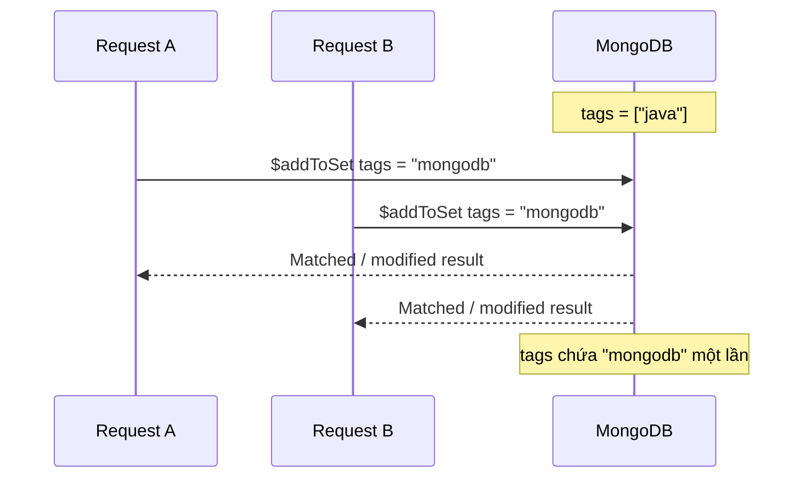

# addToSet và giới hạn đảm bảo không trùng

Trong **Spring Data MongoDB**, một document có thể chứa các trường mảng như danh sách thẻ (`tags`), người được gán (`reviewers`), mã sản phẩm (`skuIds`) hoặc các nhãn trạng thái. Khi thêm một phần tử, câu hỏi không chỉ là **“thêm vào cuối mảng”** mà còn là **“nếu phần tử đã có thì có được thêm nữa không?”**. MongoDB cung cấp toán tử **`$addToSet`** để thêm giá trị vào array **chỉ khi array chưa có giá trị được MongoDB coi là bằng nó**.

Bài học thuộc chương **Thao tác array** trong module **SPRING_DATA_MONGODB**. Trọng tâm là dùng `Update.addToSet(...)` và `$each` bằng `MongoTemplate`, hiểu tiêu chuẩn so sánh phần tử, giới hạn bảo đảm không trùng, tính nguyên tử khi nhiều request cập nhật cùng một document, và thời điểm phải dùng một thiết kế dữ liệu khác. Đặc biệt, **`$addToSet` không phải ràng buộc UNIQUE tổng quát** cho mọi phần tử hay mọi document.

## 1. $addToSet giải quyết vấn đề gì?

Giả sử một bài viết có danh sách nhãn:

```javascript
{
  _id: ObjectId("674000000000000000000301"),
  tenant_id: "T1",
  title: "Spring Data MongoDB",
  tags: ["java", "mongodb"]
}
```

Dùng `$push` để thêm nhãn `"java"`:

```javascript
db.articles.updateOne(
  {
    _id: ObjectId("674000000000000000000301"),
    tenant_id: "T1"
  },
  { $push: { tags: "java" } }
);
```

Kết quả có thể là `["java", "mongodb", "java"]` — một phần tử bị lặp. Nếu yêu cầu là **mỗi chuỗi nhãn chỉ xuất hiện một lần**, dùng `$addToSet`:

```javascript
db.articles.updateOne(
  {
    _id: ObjectId("674000000000000000000301"),
    tenant_id: "T1"
  },
  { $addToSet: { tags: "java" } }
);
```

Khi `"java"` đã có, thao tác không thêm một bản sao mới. Nếu đổi giá trị thành `"spring-data"` và giá trị ấy chưa có, MongoDB thêm phần tử vào array:

```javascript
db.articles.updateOne(
  {
    _id: ObjectId("674000000000000000000301"),
    tenant_id: "T1"
  },
  { $addToSet: { tags: "spring-data" } }
);
```

Sự khác nhau cơ bản:

| Toán tử | Nếu giá trị chưa có | Nếu giá trị đã có |
| --- | --- | --- |
| `$push` | Thêm một phần tử | **Vẫn thêm**, có thể tạo trùng |
| `$addToSet` | Thêm một phần tử | **Không thêm bản sao mới** nếu so sánh bằng |
| `$pull` | Không áp dụng theo nghĩa thêm | Xóa các phần tử array khớp điều kiện |
| `$set` lên cả field array | Thay giá trị array theo yêu cầu | Không tự kiểm tra uniqueness |

Tên **“ToSet”** diễn đạt ý định giữ tính giống tập hợp, nhưng field trên MongoDB **vẫn là BSON Array**, không biến thành kiểu BSON Set riêng. MongoDB không tự sắp xếp array hoặc chuyển thành Java `Set`; thứ tự hiển thị và semantics của mảng vẫn cần được xử lý theo yêu cầu nghiệp vụ.

## 2. Bốn giới hạn cần nhớ ngay từ đầu

1. **Không loại các phần tử đã trùng từ trước.** Nếu array hiện có `["java", "java"]`, gọi `$addToSet: {tags: "java"}` giữ nguyên cả hai bản sao; toán tử chỉ ngăn **thêm bản sao mới** của giá trị ấy.
2. **So sánh cả giá trị BSON**, không tự hiểu khóa nghiệp vụ. Hai object có cùng `userId` nhưng khác `role` có thể vẫn là **hai document khác nhau** trong array.
3. **Không bảo đảm duy nhất giữa nhiều document.** Hai bài viết khác nhau đều có nhãn `"java"` là hợp lệ, trừ khi thiết kế một ràng buộc dữ liệu riêng.
4. **Không tự chuẩn hóa chuỗi, array hoặc cấu trúc.** `"Java"`, `"java"`, `" java "` có thể được coi là các giá trị khác nhau theo quy tắc so sánh/collation; application phải xác định cách chuẩn hóa phù hợp.

Do đó hãy phân biệt hai mục tiêu: **duy nhất theo giá trị được so sánh** trong **một array của một document**, và **duy nhất theo một thuộc tính nghiệp vụ** trên một hay nhiều document. `$addToSet` chỉ trực tiếp phục vụ mục tiêu đầu tiên.

## 3. Tính nguyên tử trong một document

Khi hai request gần như đồng thời cùng muốn thêm `"mongodb"` vào `tags` của **cùng một document**, dùng `$addToSet` trên server tránh được kiểu race condition thường gặp khi làm read-modify-write ở Java:



MongoDB thực hiện cập nhật **nguyên tử ở cấp một document**. Trong điều kiện field array đúng kiểu và giá trị so sánh giống nhau, hai thao tác `$addToSet` không cần service đọc array trước rồi tự kiểm tra. Server kiểm tra sự tồn tại của phần tử trong lúc cập nhật.

So với cách không nên dùng:

```java
Article loaded = articleRepository.findById(articleId).orElseThrow();

if (!loaded.getTags().contains("mongodb")) {
    loaded.getTags().add("mongodb");
    articleRepository.save(loaded);
}
```

Đoạn trên có ít nhất hai vấn đề:

- Hai request có thể **đều đọc array cũ** trước khi bên kia lưu; kiểm tra `contains` không phải thao tác nguyên tử trên server.
- `save(entity)` có thể **lưu/thay thế trạng thái document rộng hơn**, gây lost update hoặc mất field không được ánh xạ, nhất là khi entity không có `@Version` phù hợp.

Dùng `$addToSet` giúp giải bài toán thêm phần tử đúng bằng giá trị, nhưng không tự giải quyết mọi cạnh tranh nghiệp vụ khác — ví dụ phải giới hạn số người tham gia, giữ thứ tự ưu tiên hoặc cập nhật đồng thời nhiều document.

## 4. Dữ liệu và entity cho thực hành Spring Data MongoDB

Collection `articles`:

```javascript
{
  _id: ObjectId("674000000000000000000301"),
  tenant_id: "T1",
  title: "Spring Data MongoDB",
  tags: ["java", "mongodb"],
  reviewers: [
    { userId: "U-01", role: "EDITOR" }
  ]
}
```

Entity và value object Java:

```java
import java.util.List;
import org.bson.types.ObjectId;
import org.springframework.data.annotation.Id;
import org.springframework.data.mongodb.core.mapping.Document;
import org.springframework.data.mongodb.core.mapping.Field;

record Reviewer(String userId, String role) {}

@Document(collection = "articles")
public class Article {
    @Id
    private ObjectId id;

    @Field("tenant_id")
    private String tenantId;

    private String title;
    private List<String> tags;
    private List<Reviewer> reviewers;

    public Article() {}

    public ObjectId getId() { return id; }
    public String getTenantId() { return tenantId; }
    public String getTitle() { return title; }
    public List<String> getTags() { return tags; }
    public List<Reviewer> getReviewers() { return reviewers; }
}
```

`List<String>` và `List<Reviewer>` phản ánh đúng BSON Array. Chúng ta không dùng `Set<String>` chỉ vì toán tử có tên `addToSet`: tập hợp Java có chính sách `equals/hashCode` riêng, còn MongoDB xét BSON value trong array, và khi đọc một document vốn đã chứa giá trị lặp thì cần quan sát được dữ liệu thực.

Để tra cứu, `MongoRepository` có thể dùng làm API đọc:

```java
import org.bson.types.ObjectId;
import org.springframework.data.mongodb.repository.MongoRepository;

interface ArticleRepository
        extends MongoRepository<Article, ObjectId> {
}
```

Nhưng **ghi phần tử array theo tính nguyên tử** thuận tiện hơn qua `MongoTemplate` hoặc custom repository triển khai `MongoOperations`, thay vì đọc `Article` rồi thay `List` và `save`.

## 5. MongoTemplate.Update.addToSet

Chọn một article trong **đúng tenant** bằng `Query`, rồi dùng `Update`:

```java
import com.mongodb.client.result.UpdateResult;
import org.bson.types.ObjectId;
import org.springframework.data.mongodb.core.MongoTemplate;
import org.springframework.data.mongodb.core.query.Criteria;
import org.springframework.data.mongodb.core.query.Query;
import org.springframework.data.mongodb.core.query.Update;

public class ArticleTagService {
    private final MongoTemplate template;

    public ArticleTagService(MongoTemplate template) {
        this.template = template;
    }

    public UpdateResult addTag(
            ObjectId articleId, String tenantId, String tag) {

        Query target = Query.query(
            Criteria.where("id").is(articleId)
                    .and("tenantId").is(tenantId)
        );

        Update update = new Update()
            .addToSet("tags", tag);

        return template.updateFirst(target, update, Article.class);
    }
}
```

Bộ lọc ứng với BSON `_id` và `tenant_id`; `tags` là tên field. `Update.addToSet("tags", tag)` được ánh xạ sang `$addToSet` trong lệnh MongoDB. Những field còn lại trong document không bị thay thế.

```javascript
db.articles.updateOne(
  {
    _id: ObjectId("674000000000000000000301"),
    tenant_id: "T1"
  },
  {
    $addToSet: { tags: "spring-data" }
  }
);
```

**Không có chuyện MongoDB tự trả một entity `Article` mới** cho `updateFirst`; phương thức trả `UpdateResult`. Nếu API cần trả array sau cập nhật, có thể đọc lại, hoặc cân nhắc `findAndModify` với `returnNew(true)` để cập nhật và lấy document mới trong một thao tác.

Đối với hệ thống đa tenant, `tenantId` phải đến từ ngữ cảnh xác thực đáng tin cậy; không dùng chỉ một tham số do client tự đặt rồi coi như đã phân quyền.

## 6. $each: thêm nhiều giá trị, vẫn tránh trùng

Nếu muốn thêm nhiều nhãn trong một update, dùng **`$each` modifier** của `$addToSet`:

```javascript
db.articles.updateOne(
  { _id: ObjectId("674000000000000000000301"), tenant_id: "T1" },
  {
    $addToSet: {
      tags: {
        $each: ["java", "reactive", "mongodb", "spring-data"]
      }
    }
  }
);
```

Giả sử `tags` đã là `["java", "mongodb"]`, chỉ các giá trị **chưa được xem là có trong array** mới được thêm; `"java"` và `"mongodb"` không tạo bản sao mới. Trong Spring Data:

```java
Update update = new Update()
    .addToSet("tags")
    .each("java", "reactive", "mongodb", "spring-data");

UpdateResult result = mongoTemplate.updateFirst(
    Query.query(Criteria.where("id").is(articleId)
                        .and("tenantId").is("T1")),
    update,
    Article.class
);
```

**Khác biệt rất quan trọng:** đưa một Java `List` vào `addToSet("tags", list)` không đồng nghĩa `$each`. Một giá trị là **array** có thể được thêm nguyên như **một phần tử array lồng**, làm thay đổi schema dự kiến.

Ví dụ trên mongosh:

```javascript
// Nếu field tags ban đầu là []:
db.articles.updateOne(
  { _id: someId },
  { $addToSet: { tags: ["java", "mongodb"] } }
);
// Có thể tạo: tags = [["java", "mongodb"]]
// chứ không phải: ["java", "mongodb"].

// Đúng khi muốn thêm từng giá trị:
db.articles.updateOne(
  { _id: someId },
  { $addToSet: { tags: { $each: ["java", "mongodb"] } } }
);
// tags = ["java", "mongodb"] nếu trước đó không có chúng.
```

Dù `$each` xử lý nhiều giá trị, MongoDB **không cam kết thứ tự cuối cùng** của phần tử được thêm bởi `$addToSet`. Không dựa vào vị trí trong array làm thứ tự nghiệp vụ sau thao tác này; nếu cần sắp xếp, hãy sort khi đọc hoặc quản lý một mô hình dữ liệu khác.

## 7. Field thiếu, field không phải array và array đã lặp

Ba trạng thái đầu vào có hành vi khác nhau.

| Giá trị field hiện tại | `$addToSet: {tags: "java"}` |
| --- | --- |
| Field `tags` **không tồn tại** | MongoDB tạo field array và thêm `"java"` |
| `tags: []` | Thêm `"java"` |
| `tags: ["java"]` | Không thêm |
| `tags: ["java", "java"]` | **Giữ hai bản trùng cũ**, không thêm lần ba |
| `tags: "java"` | Lỗi vì field hiện tại không phải array |
| `tags: null` | Lỗi vì field hiện tại không phải array |
| `tags: ["Java"]` | So sánh `"java"` với giá trị cũ theo quy tắc BSON/collation; không tự chuẩn hóa chữ hoa/thường |

Với schema cũ có `tags` không nhất quán, phải kiểm tra loại dữ liệu trước khi triển khai `$addToSet` hàng loạt:

```javascript
db.articles.aggregate([
  {
    $group: {
      _id: { $type: "$tags" },
      count: { $sum: 1 }
    }
  },
  { $sort: { count: -1 } }
]);
```

Kết quả có thể gồm `array`, `null`, `missing` hoặc `string`. Nếu field có kiểu sai, cần quy trình migration/clean-up; **không mặc định `$addToSet` sẽ biến string thành array**.

Đặc biệt, khi array **đã trùng từ trước**, chạy lại `$addToSet` không sửa dữ liệu. Muốn dọn trùng phải xây dựng quá trình migration có chủ đích, quyết định quy tắc so sánh, xử lý thứ tự và những tham chiếu liên quan. Không thực hiện thay nguyên array một cách tùy tiện khi còn writer hoạt động.

## 8. Giá trị trong BSON quyết định thế nào là “bằng”?

MongoDB không gọi `equals()` của Java object khi đang cập nhật array trên server. Nó so sánh các phần tử dựa trên **giá trị BSON** theo ngữ nghĩa của toán tử và cấu hình truy vấn/collation thích hợp.

### 8.1. Chuỗi: cần chuẩn hóa từ phía ứng dụng

Các chuỗi sau có thể mang cùng nghĩa với người dùng nhưng không nhất thiết là cùng giá trị so sánh:

```javascript
["Java", "java", " java ", "JAVA"]
```

`$addToSet` không tự trim, lowercase, chuẩn hóa Unicode hay quyết định nhãn nào là tên chuẩn. Một chính sách đơn giản cho tag dạng slug có thể là:

```java
import java.util.Locale;

public final class Tags {
    private Tags() {}

    public static String normalize(String raw) {
        if (raw == null) {
            throw new IllegalArgumentException("Thiếu tag");
        }
        String tag = raw.trim().toLowerCase(Locale.ROOT);
        if (tag.isEmpty() || tag.length() > 64) {
            throw new IllegalArgumentException("Tag không hợp lệ");
        }
        return tag;
    }
}
```

Tầng service gọi `Tags.normalize(raw)` **trước khi** đưa vào `addToSet`. Tùy ứng dụng, cần quy định riêng về Unicode normalization, dấu tiếng Việt, khoảng trắng, ký tự cho phép và collation. Nếu truy vấn có **collation** hoặc collection/index dùng collation đặc biệt, kết quả so sánh chuỗi có thể khác với kỳ vọng byte-for-byte; hãy test trên MongoDB thật với cấu hình collation đang vận hành.

Không nên chỉnh lại toàn bộ array sau mỗi lần ghi nếu chỉ muốn bảo đảm tính nhất quán của một tag mới; tốt hơn giữ quy tắc chuẩn hóa thống nhất trên **mọi đường ghi**, rồi migration dữ liệu cũ một lần có kiểm soát.

### 8.2. Kiểu BSON: chuỗi số không phải số

Giá trị `"42"` (BSON String) và `42` (BSON numeric type) không cùng ý nghĩa kiểu dữ liệu. `ObjectId("...")` và chuỗi hex tương ứng cũng không phải cùng một BSON value. Nếu array dùng để chứa ID, hãy quyết định rõ **`List<ObjectId>` hay `List<String>`** và kiểm thử round-trip.

Tránh xây array ID có lúc lưu BSON ObjectId, lúc lưu BSON String chỉ vì cả hai có cùng dạng hiển thị. Khi truy vấn membership hoặc kiểm tra trùng, sự khác biệt kiểu có thể khiến việc tra cứu không khớp.

### 8.3. Embedded document: so sánh toàn bộ document

Giả sử array `reviewers` chứa:

```javascript
reviewers: [
  { userId: "U-01", role: "EDITOR" }
]
```

Thao tác sau không thêm document mới nếu **giá trị toàn bộ document** đã khớp:

```javascript
db.articles.updateOne(
  { _id: someId },
  {
    $addToSet: {
      reviewers: { userId: "U-01", role: "EDITOR" }
    }
  }
);
```

Nhưng nếu thay `role` thì MongoDB có thể thêm phần tử thứ hai, dù `userId` không đổi:

```javascript
db.articles.updateOne(
  { _id: someId },
  {
    $addToSet: {
      reviewers: { userId: "U-01", role: "REVIEWER" }
    }
  }
);
// Có thể có cả hai phần tử với cùng userId="U-01".
```

**Quan trọng hơn:** MongoDB yêu cầu **cùng các field, cùng giá trị và cùng thứ tự field** khi so sánh embedded document cho `$addToSet`. Hai BSON document `{userId:"U-01",role:"EDITOR"}` và `{role:"EDITOR",userId:"U-01"}` không được xem là trùng trong ngữ cảnh so sánh này. Vì thế, nếu ứng dụng tạo embedded documents bằng nhiều serializer khác nhau, khả năng giữ uniqueness dựa trên toàn bộ BSON object càng khó dự đoán.

Trong Java, `new Reviewer("U-01","EDITOR")` có thể được converter chuyển sang một BSON document, nhưng bạn **không nên** dùng `Reviewer.equals()` hoặc `hashCode()` làm bằng chứng rằng `$addToSet` sẽ cùng nhận định về tính trùng. Để bảo đảm duy nhất theo `userId`, cần một chiến lược khác.

## 9. Nếu chỉ muốn duy nhất theo một thuộc tính: $addToSet chưa đủ

Một yêu cầu thường gặp: **mỗi `userId` chỉ xuất hiện tối đa một lần trong `reviewers`**, nhưng mỗi phần tử có thêm role, joinedAt, trạng thái v.v. Khi đó `$addToSet` trên toàn bộ subdocument không giải được bài toán, vì hai subdocument cùng `userId` nhưng khác field khác vẫn được xem là khác.

Có ba hướng thiết kế.

### A. Chỉ lưu danh sách ID

Nếu cần kiểm tra thành viên, lưu:

```javascript
reviewer_ids: ["U-01", "U-02"]
```

Rồi dùng:

```java
new Update().addToSet("reviewerIds", "U-03");
```

Ưu điểm: sự trùng được xác định theo **chính giá trị ID**; hệ thống đơn giản nếu không cần gắn nhiều metadata cho từng thành viên.

Nhược điểm: nếu cần vai trò hoặc thông tin thay đổi theo từng thành viên, phải có model lưu metadata khác hoặc lookup tới collection khác.

### B. Conditional $push theo userId

Nếu vẫn muốn array các subdocument và cần **chặn phần tử mới có cùng `userId`**, có thể dùng một **update nguyên tử có filter kiểm tra chưa tồn tại**:

```javascript
db.articles.updateOne(
  {
    _id: ObjectId("674000000000000000000301"),
    tenant_id: "T1",
    reviewers: {
      $not: {
        $elemMatch: { userId: "U-03" }
      }
    }
  },
  {
    $push: {
      reviewers: { userId: "U-03", role: "REVIEWER" }
    }
  }
);
```

Bộ lọc yêu cầu **không có phần tử reviewers nào có `userId="U-03"`**, sau đó `$push` phần tử mới. Đối với một document, điều kiện và update được server thực thi như **một write nguyên tử**: các request cạnh tranh sẽ không chỉ dựa vào kết quả đọc cũ từ phía Java. Nếu đã có phần tử cùng userId, `matchedCount` có thể bằng 0 ngay cả khi article tồn tại.

Spring Data MongoTemplate:

```java
Query target = Query.query(
    Criteria.where("id").is(articleId)
        .and("tenantId").is("T1")
        .and("reviewers").not()
            .elemMatch(Criteria.where("userId").is("U-03"))
);

Update change = new Update().push(
    "reviewers", new Reviewer("U-03", "REVIEWER")
);

UpdateResult added = mongoTemplate.updateFirst(
    target, change, Article.class
);
```

Cần **integration test trên Spring Data version thực tế** để bảo đảm biểu thức `Criteria.not().elemMatch(...)` được mapping đúng, đặc biệt khi field/embedded property dùng `@Field`. Điều kiện này áp dụng lên array có schema đúng; dữ liệu cũ chứa duplicates không được sửa. Khi cần đổi `role` của người đã có, sử dụng cập nhật phần tử có điều kiện hoặc `arrayFilters` theo `userId`, không thêm một subdocument mới.

### C. Tách thành collection quan hệ riêng

Nếu reviewer là quan hệ nhiều-nhiều với metadata, cần index tìm kiếm theo reviewer, cập nhật role thường xuyên hoặc số thành viên tăng lớn, cân nhắc:

```javascript
// article_reviewers
{
  article_id: ObjectId("674000000000000000000301"),
  user_id: "U-03",
  role: "REVIEWER"
}
```

Đặt **compound unique index**:

```javascript
db.article_reviewers.createIndex(
  { article_id: 1, user_id: 1 },
  { unique: true, name: "article_reviewer_unique" }
);
```

Index này thực thi quy tắc **một userId cho mỗi article** ngay ở collection quan hệ, kể cả khi nhiều request ghi đồng thời. Nếu phải cập nhật cả `articles` lẫn `article_reviewers` trong một nghiệp vụ, cần xem xét transaction đa document và chính sách nhất quán phù hợp.

## 10. Unique multikey index không tự chống trùng trong cùng array

Một hiểu nhầm quan trọng là “chỉ cần đặt unique index trên array `tags` thì mỗi giá trị trong array sẽ duy nhất”. **Không đúng.**

MongoDB có **unique multikey index** để áp dụng uniqueness lên các **index key giữa những document khác nhau**; nó **không dùng để cấm những phần tử trùng lặp nằm trong cùng một array của một document**. Ví dụ index:

```javascript
db.articles.createIndex(
  { tenant_id: 1, tags: 1 },
  { unique: true }
);
```

không phải là giải pháp cho `tags` unique **trong mỗi article**. Ngược lại, nó còn có thể **cấm hai article khác nhau trong cùng tenant** cùng chứa tag `"java"`, điều phần lớn hệ thống gắn nhãn **không mong muốn**.

| Mong muốn | Giải pháp phù hợp hơn |
| --- | --- |
| Một bài không thêm trùng giá trị tag exact | `$addToSet` cho `tags` |
| Tag được chuẩn hóa không phân biệt hoa/thường theo quy ước | Chuẩn hóa đầu vào, dữ liệu cũ và test collation |
| Không trùng `reviewers.userId` trong một bài | Conditional `$push` theo `$elemMatch`, hoặc tách collection |
| Hai document không cùng một khóa nghiệp vụ | Unique index trên field/compound fields đó |
| Mỗi article–reviewer chỉ một record, có metadata | Collection quan hệ + unique `(article_id,user_id)` |

Một index phục vụ truy vấn membership như `{tags:1}` vẫn có thể hữu ích để tìm bài chứa tag; không cần khai báo nó là `unique` chỉ để giúp `$addToSet`.

## 11. Điều gì xảy ra khi retry hoặc upsert?

### Lặp lại cùng $addToSet

Khi mọi giá trị đã được chuẩn hóa và phép so sánh giống nhau, gọi `$addToSet` lặp lại trên **một document còn tồn tại** sẽ không bổ sung thêm phần tử exact-trùng. Đây là đặc tính hữu ích để xử lý retry khi client gặp lỗi mạng hoặc user gửi lại request.

Tuy nhiên, không vì vậy mà coi toàn bộ request **idempotent** nếu service còn gửi email, ghi audit, tăng counter hoặc cập nhật những field khác. Và một lỗi mạng khi chờ xác nhận không đủ chứng minh lệnh ghi đã hay chưa được server áp dụng; hãy thiết kế toàn bộ workflow theo yêu cầu idempotency thực tế.

### $addToSet kết hợp upsert

Khi dùng `mongoTemplate.upsert` với `$addToSet`, nếu không có document phù hợp MongoDB có thể **tạo document mới** với field array chứa giá trị được thêm. Nhưng cần lưu ý:

- Filter phải xác định rõ khóa nghiệp vụ/`_id` và phạm vi tenant.
- Field bắt buộc của document mới nên được cấp bằng `$setOnInsert` hoặc một quá trình tạo document riêng.
- Nếu nhiều request cạnh tranh upsert theo khóa nghiệp vụ không có unique index, có thể phát sinh nhiều document thay vì một.
- Nếu chỉ muốn thêm tag cho **article đã tồn tại**, ưu tiên `updateFirst` **không upsert** và kiểm tra `matchedCount`.

Ví dụ `upsert` phải dùng có chủ đích:

```java
Update upsert = new Update()
    .addToSet("tags", "java")
    .setOnInsert("tenantId", "T1")
    .setOnInsert("title", "Bài mới");

UpdateResult result = mongoTemplate.upsert(
    Query.query(Criteria.where("id").is(articleId)
                        .and("tenantId").is("T1")),
    upsert,
    Article.class
);
```

Đây chỉ là ví dụ về API: nếu entity có nhiều field bắt buộc hoặc có validation phức tạp, tách hẳn bước tạo mới và bổ sung tag sẽ dễ kiểm soát hơn. Cần kiểm tra các điều kiện bằng trong filter được đưa vào document insert thế nào theo phiên bản MongoDB và mapping, không dựa vào side effect ngầm.

## 12. Kết quả UpdateResult: kiểm tra đúng ý nghĩa

`MongoTemplate.updateFirst(...)` trả `UpdateResult`, không trả số lượng phần tử mới được thêm. Với một article:

```java
UpdateResult r = mongoTemplate.updateFirst(
    target,
    new Update().addToSet("tags", "java"),
    Article.class
);

long matched = r.getMatchedCount();
long modified = r.getModifiedCount();
```

| Kết quả | Cách hiểu |
| --- | --- |
| `matched = 0` | Không có document khớp ID, tenant và các điều kiện khác |
| `matched = 1, modified = 1` | Document đã thay đổi vì lệnh update có tác dụng |
| `matched = 1, modified = 0` | Document khớp nhưng update không làm thay đổi BSON; với lệnh chỉ `$addToSet` có thể là vì giá trị đã có |
| `modified = 1` cùng nhiều toán tử update | Không kết luận chỉ nhờ con số này rằng **tag** vừa được thêm; field khác cũng có thể thay đổi |

Nếu entity có `@Version`, một số đường `MongoTemplate` update có thể còn cập nhật field version; khi đó ngay cả `$addToSet` không thêm phần tử cũng có thể khiến document bị sửa vì version. Vì vậy muốn dùng `modifiedCount` để kết luận **“giá trị tag mới được thêm”**, cần chắc rằng lệnh không còn toán tử/update metadata khác gây thay đổi.

`UpdateResult` không có phép đếm “bao nhiêu phần tử trong `$each` vừa được thêm”. Nếu nghiệp vụ phải biết chính xác tập giá trị mới, cần đọc trạng thái với mô hình consistency thích hợp hoặc dùng một cơ chế ghi có thể chứng minh thành công theo ID/unique constraint riêng.

## 13. Chẩn đoán bằng raw BSON và index

Khi `$addToSet` “không hoạt động” hoặc báo lỗi, hãy xem document thật:

```javascript
db.articles.findOne(
  { _id: ObjectId("674000000000000000000301"), tenant_id: "T1" },
  { tags: 1, reviewers: 1 }
);
```

Đối với tình huống schema không nhất quán, dùng `$type` phân loại field, hoặc kiểm tra một số document cụ thể trước khi migration.

Để tra cứu bài theo tag, BSON array hỗ trợ query membership:

```javascript
db.articles.find({ tenant_id: "T1", tags: "java" });
```

Một index có thể hữu ích:

```javascript
db.articles.createIndex(
  { tenant_id: 1, tags: 1 },
  { name: "articles_by_tenant_tag" }
);
```

Đây là **non-unique multikey index** phục vụ tìm kiếm bài có phần tử tag; không áp đặt uniqueness giữa các article. Kiểm tra:

```javascript
db.articles.find({ tenant_id: "T1", tags: "java" })
    .explain("executionStats");
```

Quan sát `winningPlan`, `totalKeysExamined`, `totalDocsExamined` và độ chọn lọc tag. Một tag phổ biến trong đa số bài có thể khiến index ít hiệu quả; cần cân nhắc thêm query filter, sort và dữ liệu thực tế.

Với array lớn, mỗi thao tác thêm phần tử còn có chi phí cập nhật document/index và nguy cơ chạm **giới hạn kích thước BSON document 16 MiB**. `$addToSet` không tự giới hạn số phần tử trong array. Nếu cần tối đa 10 reviewer, phải đặt điều kiện cập nhật/validation riêng; nếu hàng chục nghìn phần tử, cân nhắc collection quan hệ thay vì nhúng toàn bộ.

## 14. So sánh $push, $addToSet, $pull và arrayFilters

Những thao tác cùng làm việc với array nhưng phục vụ mục tiêu khác nhau:

| Ý định | Lựa chọn | Giới hạn |
| --- | --- | --- |
| Append log sự kiện, cho phép lặp | `$push` | Không tự chống trùng |
| Thêm nhãn nếu chưa có giá trị exact | `$addToSet` | Không xóa trùng cũ, không unique theo một field |
| Thêm nhiều nhãn theo giá trị | `$addToSet + $each` | Không đảm bảo sắp xếp |
| Xóa tất cả phần tử bằng/khớp điều kiện | `$pull` | Cần kiểm tra điều kiện để không xóa quá rộng |
| Đổi thuộc tính của một phần tử array | Positional operator / `arrayFilters` | Cần lựa chọn phần tử đúng, không mặc định chỉ một match |
| Bảo đảm uniqueness theo khóa riêng giữa documents | Unique index ở collection phù hợp | Không giải quyết duplicates trong cùng array bằng unique multikey index |

Ví dụ xóa nhãn:

```java
UpdateResult removed = mongoTemplate.updateFirst(
    Query.query(Criteria.where("id").is(articleId)
                        .and("tenantId").is("T1")),
    new Update().pull("tags", "java"),
    Article.class
);
```

`$pull` loại những phần tử khớp trong array; nếu trước đó có hai bản `"java"` thì có thể xóa **cả hai**, khác với mục đích thêm độc nhất của `$addToSet`. Khi thao tác trên mảng subdocument, lọc theo một property cần chú ý ngữ nghĩa điều kiện, tránh cập nhật/xóa nhầm nhiều phần tử.

## 15. Kiểm thử tích hợp: kiểm tra đúng array trong MongoDB

Không nên chỉ mock `MongoTemplate` rồi giả định `$addToSet` giữ dữ liệu không trùng. Integration test cần dùng MongoDB thực (ví dụ Testcontainers) và đọc **raw document BSON** để quan sát điều gì được lưu.

Ví dụ JUnit 5 + Spring Boot test slice:

```java
import static org.assertj.core.api.Assertions.assertThat;

import java.util.List;
import java.util.UUID;
import org.bson.Document;
import org.bson.types.ObjectId;
import org.junit.jupiter.api.Test;
import org.springframework.beans.factory.annotation.Autowired;
import org.springframework.boot.test.autoconfigure.data.mongo.DataMongoTest;
import org.springframework.data.mongodb.core.MongoTemplate;
import org.springframework.data.mongodb.core.query.Criteria;
import org.springframework.data.mongodb.core.query.Query;
import org.springframework.data.mongodb.core.query.Update;

import static com.mongodb.client.model.Filters.eq;

@DataMongoTest
class ArticleAddToSetIntegrationTest {
    @Autowired MongoTemplate template;

    @Test
    void addToSetPreventsNewDuplicatesButDoesNotCleanOldOnes() {
        ObjectId id = new ObjectId();
        String tenant = "test-" + UUID.randomUUID();

        template.getCollection("articles").insertOne(
            new Document("_id", id)
                .append("tenant_id", tenant)
                .append("title", "Bài test")
                .append("tags", List.of("java", "java"))
        );

        Query byIdAndTenant = Query.query(
            Criteria.where("id").is(id)
                .and("tenantId").is(tenant)
        );

        var same = template.updateFirst(
            byIdAndTenant,
            new Update().addToSet("tags", "java"),
            Article.class
        );
        assertThat(same.getMatchedCount()).isEqualTo(1);
        assertThat(same.getModifiedCount()).isZero();

        var add = template.updateFirst(
            byIdAndTenant,
            new Update().addToSet("tags").each(
                "mongodb", "mongodb", "spring-data"),
            Article.class
        );
        assertThat(add.getModifiedCount()).isEqualTo(1);

        Document raw = template.getCollection("articles")
            .find(eq("_id", id)).first();

        assertThat(raw).isNotNull();
        List<String> tags = raw.getList("tags", String.class);

        assertThat(tags)
            .containsExactlyInAnyOrder(
                "java", "java", "mongodb", "spring-data");
    }

    @Test
    void addToSetCreatesMissingArray() {
        ObjectId id = new ObjectId();
        String tenant = "test-" + UUID.randomUUID();

        template.getCollection("articles").insertOne(
            new Document("_id", id)
                .append("tenant_id", tenant)
                .append("title", "Không có tags")
        );

        Query target = Query.query(
            Criteria.where("id").is(id).and("tenantId").is(tenant)
        );

        template.updateFirst(
            target,
            new Update().addToSet("tags", "java"),
            Article.class
        );

        Document raw = template.getCollection("articles")
            .find(eq("_id", id)).first();

        assertThat(raw).isNotNull();
        assertThat(raw.getList("tags", String.class))
            .containsExactly("java");
    }
}
```

Các test chèn raw BSON để độc lập với đường ghi entity. Chúng xác nhận ba quy tắc: **giá trị đã có không thêm bản sao mới**, **array đã trùng vẫn có thể còn trùng**, và **field thiếu có thể được tạo thành array**. Test dùng database cô lập; không chạy những thao tác insert/update trên collection production.

Nên thêm các test quan trọng khác:

1. `tags: "java"` hoặc `tags: null`: `$addToSet` phải báo lỗi vì field không phải array.
2. Thêm cả một array không dùng `$each`: xác nhận có nguy cơ nested array.
3. Hai embedded documents có cùng `userId` nhưng khác `role`: `$addToSet` không đảm bảo uniqueness theo `userId`.
4. Đổi thứ tự field trong embedded document: kiểm tra quy tắc equality của BSON.
5. Hai update đồng thời thêm cùng một tag: test kết quả array chỉ có một tag đó khi bắt đầu từ schema hợp lệ.
6. Filter theo tenant không đúng: `matchedCount=0` và document ở tenant khác giữ nguyên.
7. Conditional `$push` với `$not/$elemMatch`: kiểm tra không thể thêm reviewer có cùng userId, kể cả khi role khác.
8. Đọc mảng qua Java repository rồi save: quan sát khác biệt concurrency và đường ghi so với atomic update.
9. Trường có `@Version`: xác minh điều kiện version và cách `modifiedCount` bị ảnh hưởng.

## 16. ReactiveMongoTemplate và $addToSet

Trong ứng dụng WebFlux, update vẫn dựa trên `$addToSet` của MongoDB nhưng đường gọi dùng reactive driver và trả publisher:

```java
import com.mongodb.client.result.UpdateResult;
import org.bson.types.ObjectId;
import org.springframework.data.mongodb.core.ReactiveMongoTemplate;
import org.springframework.data.mongodb.core.query.Criteria;
import org.springframework.data.mongodb.core.query.Query;
import org.springframework.data.mongodb.core.query.Update;
import reactor.core.publisher.Mono;

Mono<UpdateResult> addTagReactive(
        ReactiveMongoTemplate template,
        ObjectId articleId,
        String tenantId,
        String tag) {

    Query target = Query.query(
        Criteria.where("id").is(articleId)
            .and("tenantId").is(tenantId)
    );

    return template.updateFirst(
        target,
        new Update().addToSet("tags", Tags.normalize(tag)),
        Article.class
    );
}
```

`Mono<UpdateResult>` là mô tả thao tác: truy vấn thường được thực thi khi có **subscription**. Không dùng `block()` trong WebFlux event loop hoặc tự `subscribe()` rồi bỏ qua lỗi write. Nếu nghiệp vụ ghi nhiều document cùng nhau, phải xem xét `ReactiveMongoTransactionManager` cùng Reactor Context và hạ tầng MongoDB hỗ trợ.

Atomicity của `$addToSet` trên một document giữ nguyên dù phía Java dùng sync hay reactive. Khác biệt nằm ở mô hình I/O và vòng đời publisher, không phải tiêu chuẩn uniqueness.

## 17. Những sai lầm phổ biến

| Sai lầm | Hậu quả | Cách xử lý |
| --- | --- | --- |
| Tin `$addToSet` luôn biến array thành tập hợp không trùng | Trùng cũ vẫn tồn tại | Làm sạch dữ liệu cũ có kiểm soát |
| Tin subdocument chỉ cần cùng `userId` là trùng | Có thể thêm nhiều subdocument cùng userId | Dùng conditional update hoặc collection riêng |
| Bỏ qua thứ tự field embedded document | BSON subdocument có thể khác khi thứ tự field khác | Chuẩn hóa serialization hoặc tránh dùng cả document làm khóa |
| Dùng `addToSet("tags", List.of(...))` để thêm nhiều tag | Có thể tạo nested array | Dùng `addToSet("tags").each(...)` |
| Dùng `$addToSet` trên field scalar/null | Lệnh update lỗi | Migration/validation schema trước |
| Tin unique multikey index cấm duplicate trong cùng array | Không thực thi ràng buộc mong muốn | Chọn unique index đúng collection/khóa hoặc `$addToSet` |
| Dùng read–contains–save như atomic operation | Race condition, lost update | Dùng operator trên server |
| Cho rằng `modifiedCount=0` luôn vì tag đã có | Có thể document không khớp hoặc update khác | Kiểm tra matchedCount và toàn bộ operator |
| Không chuẩn hóa tag | `"Java"` và `"java"` trở thành hai nhãn logic tương tự | Chuẩn hóa và test collation |
| Không giới hạn kích thước array | Document lớn, tăng chi phí update/index | Thiết kế limit hoặc collection riêng |
| Dùng chung array trên nhiều tenant mà không lọc tenant | Ghi sai phạm vi | Luôn ràng buộc tenant từ auth context |
| Không xử lý lỗi write concern/retry | Không biết server có áp dụng update chưa | Idempotency và xác nhận ghi thích hợp |

## 18. Câu hỏi tự kiểm tra và bài thực hành

**1.** `tags=["java","java"]`; gọi `$addToSet tags="java"` thì còn bao nhiêu `"java"`?  
**Đáp án:** vẫn là **hai**; toán tử không xóa duplicates đã tồn tại.

**2.** `$addToSet` có chống trùng theo `userId` nếu mỗi phần tử là `{userId, role}` không?  
**Đáp án:** không; nó so sánh toàn bộ BSON document, không chỉ một property.

**3.** Có thể thay `addToSet("tags").each("java","mongodb")` bằng `addToSet("tags", List.of(...))` không?  
**Đáp án:** không nên; một array được truyền như một giá trị có thể trở thành một phần tử array lồng.

**4.** Tại sao `Update.addToSet` tốt hơn `getTags().contains(...)` rồi `repository.save` khi hai request cùng cập nhật một article?  
**Đáp án:** server thực hiện kiểm tra và thêm trong một update nguyên tử trên document, tránh read-modify-write race đơn giản.

**5.** Nếu field `tags` chưa tồn tại, `$addToSet` có tạo nó không?  
**Đáp án:** có, MongoDB tạo array chứa giá trị mới. Nếu field đã tồn tại nhưng không phải array thì có thể lỗi.

**6.** Unique multikey index `{tenant_id:1,tags:1}` có bảo đảm mỗi article không có hai tag giống nhau không?  
**Đáp án:** không; nó ràng buộc các index key giữa document khác nhau, không cấm duplicates trong một array của cùng document.

**7.** Muốn mỗi article chỉ có một reviewer theo `userId` và lưu cả role, cần làm gì?  
**Đáp án:** có thể dùng conditional `$push` với `$not/$elemMatch` hoặc tách thành collection với unique index `(article_id,user_id)`.

**8.** Có thể dựa hoàn toàn vào thứ tự array sau `$addToSet` để phân quyền ưu tiên không?  
**Đáp án:** không; MongoDB không cam kết thứ tự phần tử được thêm bởi toán tử này. Nên dùng field thứ tự tường minh nếu nghiệp vụ yêu cầu.

**Bài thực hành:** tạo document `articles` có `tags=["java","java"]`, dùng `MongoTemplate.updateFirst` gọi `addToSet("tags","java")` rồi `addToSet("tags").each("mongodb","spring-data")`; đọc raw BSON để xác nhận trùng cũ còn nguyên, các tag mới có mặt đúng một lần. Thử field thiếu, scalar, embedded reviewer thay role, conditional `$push` theo `userId` và unique multikey index trên một collection test riêng. Cuối cùng đo query/filter bằng `explain("executionStats")` và thử hai request đồng thời cập nhật cùng một article.

**Kết luận:** **`$addToSet` chỉ ngăn thêm một giá trị trùng theo ngữ nghĩa so sánh BSON trong một array của một document ở thời điểm update**. Nó **không dọn trùng cũ**, **không bảo đảm unique theo một property của embedded document**, **không bảo đảm duy nhất giữa các document** và **không tự giới hạn kích thước array**. Trong Spring Data MongoDB, hãy chọn `Update.addToSet` hoặc `$each` cho bài toán phù hợp; với khóa nghiệp vụ, dữ liệu lớn hoặc quy tắc unique phức tạp, cần thêm chuẩn hóa, conditional update, unique index hoặc thiết kế collection riêng.

