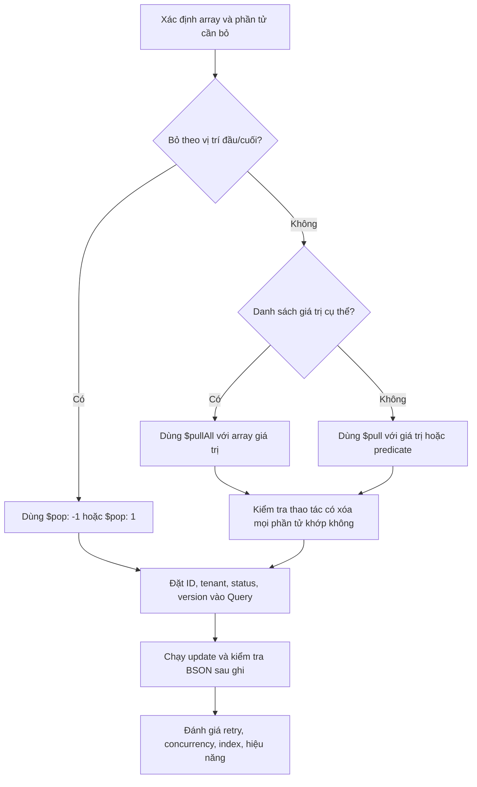

# pull, pullAll và pop

Trong MongoDB, một document có thể chứa nhiều **array**: nhãn của sản phẩm (`tags`), các mã lỗi đã xử lý (`errorCodes`), các phần tử giỏ hàng (`items`), hoặc một danh sách sự kiện ngắn (`recentEvents`). Khi cần loại bỏ phần tử, cập nhật toàn bộ array bằng cách đọc entity, sửa `List` trong Java rồi `save` lại thường không phải cách tốt nhất: giữa lúc đọc và ghi, một request khác có thể đã thêm hoặc sửa phần tử, dẫn đến ghi đè dữ liệu.

**Spring Data MongoDB** cung cấp `MongoTemplate` và `Update` để gửi trực tiếp các toán tử array xuống MongoDB. Ba toán tử quan trọng có mục đích khác nhau:

- **`$pull`**: xóa **tất cả phần tử** có giá trị hoặc thỏa một điều kiện.
- **`$pullAll`**: xóa **tất cả lần xuất hiện** của **mỗi giá trị** trong một danh sách xác định.
- **`$pop`**: xóa **một phần tử** ở **đầu** hoặc **cuối** array theo vị trí, không dựa trên nội dung.

Bài thuộc chương **Thao tác array**, tập trung vào hành vi BSON, cách viết `mongosh` và API tương đương trong `MongoTemplate`, kết hợp truy vấn có điều kiện, optimistic locking, kiểm thử và chẩn đoán hiệu năng. Các kỹ thuật này giúp chỉnh sửa document chính xác mà không phải thay thế toàn bộ entity, nhưng vẫn đòi hỏi kiểm soát quyền, trạng thái và tính nhất quán nghiệp vụ.

Sau bài học, bạn có thể:

1. Phân biệt rõ `$pull`, `$pullAll` và `$pop` bằng tập dữ liệu và kết quả dự kiến.
2. Dùng `$pull` với giá trị scalar và điều kiện trên embedded document.
3. Dùng `$pullAll` với nhiều giá trị, hiểu sự khác nhau với `$pull` kết hợp `$in`.
4. Dùng `$pop: -1` và `$pop: 1` để xóa một phần tử đầu/cuối.
5. Viết các thao tác tương đương bằng `Update.pull`, `Update.pullAll` và `Update.pop` với `MongoTemplate`.
6. Đặt điều kiện tenant, ID, trạng thái và version trong cùng một lệnh cập nhật.
7. Nhận diện thao tác idempotent, rủi ro retry, phần tử trùng, điều kiện race và thay đổi vị trí index.
8. Kiểm thử đúng BSON, thứ tự phần tử và kết quả `matchedCount`/`modifiedCount`.

## 1. Mô hình dữ liệu và nguyên tắc array

Giả sử một tài liệu giỏ hàng thử nghiệm:

```javascript
{
  _id: ObjectId("665f1f2a4b6c7d8e9f001234"),
  tenantId: "T1",
  status: "DRAFT",
  tags: ["sale", "new", "sale", "outdated"],
  errorCodes: ["E01", "E02", "E01", "E03"],
  items: [
    { lineId: "L1", sku: "BK-01", quantity: 2 },
    { lineId: "L2", sku: "PEN-01", quantity: 5 },
    { lineId: "L3", sku: "BK-01", quantity: 1 }
  ],
  recentEvents: ["created", "item-added", "coupon-applied"]
}
```

MongoDB lưu `tags`, `errorCodes`, `items` và `recentEvents` dưới **BSON array**. Mảng có thứ tự và có thể chứa các phần tử trùng nhau. MongoDB không mặc định xem `tags` như một `Set`.

| Trường hợp | Mong muốn | Toán tử |
| --- | --- | --- |
| Bỏ **mọi** nhãn `sale`, kể cả khi bị lặp | Lọc theo giá trị | `$pull` |
| Bỏ đồng thời `E01` và `E03` ở mọi vị trí | Danh sách giá trị đích | `$pullAll` |
| Xóa tất cả dòng hàng có `sku = BK-01` | Điều kiện trong object của từng phần tử | `$pull` |
| Bỏ một sự kiện cũ nhất nằm đầu array | Xóa theo vị trí đầu | `$pop: -1` |
| Bỏ một sự kiện cuối cùng | Xóa theo vị trí cuối | `$pop: 1` |
| Chỉ xóa **một** phần tử có nội dung bằng X trong các bản sao X | Không phải hành vi trực tiếp của `$pull`/`$pullAll` | Cần chiến lược chọn phần tử có ID hoặc vị trí một cách có kiểm soát |

**Điểm mấu chốt:** `$pull` và `$pullAll` không xóa “phần tử đầu tiên khớp”; chúng loại bỏ **mọi phần tử phù hợp** trong array. `$pop` thì luôn nhắm một đầu mảng, không tìm kiếm phần tử theo giá trị.

## 2. `$pull`: xóa mọi phần tử theo giá trị hoặc điều kiện

### 2.1. Xóa tất cả lần xuất hiện của một scalar

Ví dụ mảng:

```javascript
tags: ["sale", "new", "sale", "outdated"]
```

Lệnh:

```javascript
db.cart_array_lab.updateOne(
  { _id: cartId, tenantId: trustedTenantId, status: "DRAFT" },
  { $pull: { tags: "sale" } }
);
```

Kết quả mong đợi:

```javascript
tags: ["new", "outdated"]
```

Cả **hai** giá trị `"sale"` đều bị xóa. Các phần tử còn lại vẫn giữ thứ tự tương đối trong mảng. Không cần tìm chỉ số xuất hiện của từng giá trị.

`$pull` thích hợp cho việc dọn nhãn, bỏ một mã khỏi danh sách, bỏ các bản ghi con theo trạng thái hay loại các embedded document thỏa một điều kiện.

### 2.2. Xóa các số thỏa so sánh

```javascript
// Ví dụ document có scores: [45, 60, 90, 75, 100].
db.test_scores.updateOne(
  { _id: scoreDocumentId },
  { $pull: { scores: { $lt: 60 } } }
);
// Kết quả: scores = [60, 90, 75, 100].
```

`{ $lt: 60 }` là **điều kiện** áp vào từng phần tử trong array `scores`. Không có ý nghĩa “xóa phần tử ở index nhỏ hơn 60”.

Các toán tử query như `$gt`, `$gte`, `$lte`, `$in`, `$nin` có thể được dùng khi phù hợp với BSON type và điều kiện mong muốn. Với số tiền, ngày giờ hoặc ID, phải xác định đúng kiểu BSON trước khi so sánh.

### 2.3. `$pull` trên array chứa embedded document

Giả sử:

```javascript
items: [
  { lineId: "L1", sku: "BK-01", quantity: 2 },
  { lineId: "L2", sku: "PEN-01", quantity: 5 },
  { lineId: "L3", sku: "BK-01", quantity: 1 }
]
```

Muốn xóa các dòng có cùng `sku`:

```javascript
db.cart_array_lab.updateOne(
  { _id: cartId, tenantId: trustedTenantId, status: "DRAFT" },
  { $pull: { items: { sku: "BK-01" } } }
);
```

Kết quả chỉ còn:

```javascript
items: [
  { lineId: "L2", sku: "PEN-01", quantity: 5 }
]
```

**Lưu ý quan trọng:** điều kiện `{ sku: "BK-01" }` khớp **mọi embedded document có field `sku` như vậy**, dù object còn có `lineId`, `quantity` và các field khác. Nếu giỏ hàng có nhiều dòng cùng SKU nhưng mỗi dòng cần vòng đời riêng, hãy xóa **theo `lineId` duy nhất**, không theo SKU:

```javascript
{
  $pull: {
    items: { lineId: "L1" }
  }
}
```

Điều kiện trên chỉ xóa dòng có `lineId = L1` nếu giá trị đó thực sự duy nhất trong array. Ràng buộc duy nhất bên trong array không tự sinh ra chỉ vì code Java gọi nó là `lineId`; cần thiết kế invariant/validation cho dữ liệu.

### 2.4. Nhiều điều kiện phải khớp trên **cùng phần tử**

```javascript
db.cart_array_lab.updateOne(
  { _id: cartId, tenantId: trustedTenantId },
  {
    $pull: {
      items: {
        sku: "BK-01",
        quantity: { $lte: 1 }
      }
    }
  }
);
```

MongoDB đánh giá các điều kiện `sku` và `quantity` trên **cùng embedded document** trong array `items`. Nếu dữ liệu ở mục 2.3 chưa bị thay đổi, chỉ dòng L3 bị xóa, còn L1 có `quantity = 2` nên được giữ.

Không cần đặt `$elemMatch` quanh toàn bộ điều kiện của một document trong `$pull`. Toán tử `$pull` đã áp điều kiện lên **từng phần tử array** để tìm phần tử cần loại.

### 2.5. Dùng `$in` khi có tập giá trị

```javascript
db.cart_array_lab.updateOne(
  { _id: cartId, tenantId: trustedTenantId },
  {
    $pull: {
      tags: { $in: ["sale", "outdated"] }
    }
  }
);
```

Với mảng scalar String, ví dụ này loại mọi `sale` và `outdated`, tương đương về mục đích với `$pullAll` theo hai giá trị ấy. Nhưng `$pull` còn có thể diễn đạt **điều kiện** như `$lte`, điều kiện trong embedded document và biểu thức lọc phức tạp hơn.

### 2.6. Không nhầm filter chọn document và điều kiện xóa phần tử

Một lệnh update có hai lớp điều kiện:

```javascript
db.cart_array_lab.updateOne(
  {
    tenantId: "T1",
    status: "DRAFT",
    "items.sku": "BK-01"
  },
  {
    $pull: { items: { sku: "BK-01" } }
  }
);
```

- Query `{ tenantId, status, "items.sku" }` chọn **document cha** nào được cập nhật.
- `$pull: { items: { sku: "BK-01" } }` chọn **phần tử của array** nào bị xóa.

Nếu chỉ có filter `"items.sku": "BK-01"` mà phần update lại `$pull: { tags: "sale" }`, MongoDB sẽ xóa nhãn `sale` ở các giỏ hàng chứa SKU đó — không xóa SKU khỏi `items`. Cần luôn review **cả hai lớp** trước khi thực hiện.

## 3. `$pullAll`: xóa tất cả lần xuất hiện của nhiều giá trị

### 3.1. Cú pháp và hành vi

Với:

```javascript
errorCodes: ["E01", "E02", "E01", "E03"]
```

Lệnh:

```javascript
db.cart_array_lab.updateOne(
  { _id: cartId, tenantId: trustedTenantId },
  {
    $pullAll: {
      errorCodes: ["E01", "E03"]
    }
  }
);
```

Kết quả:

```javascript
errorCodes: ["E02"]
```

`$pullAll` nhận một **array chứa những giá trị cần xóa**; nó loại bỏ mọi phần tử bằng từng giá trị đó. Vì `E01` xuất hiện hai lần, cả hai đều bị xóa. Thứ tự danh sách đầu vào của `$pullAll` không quy định thứ tự xóa.

### 3.2. So sánh `$pullAll` và `$pull` với `$in`

```javascript
// Danh sách chính xác các giá trị scalar:
{ $pullAll: { tags: ["sale", "outdated"] } }

// Điều kiện $in trên từng giá trị:
{ $pull: { tags: { $in: ["sale", "outdated"] } } }
```

Với `tags` là array String, cả hai đều nhằm loại mọi `sale` và `outdated`. Tuy nhiên, về mục đích:

| `$pullAll` | `$pull` |
| --- | --- |
| Danh sách giá trị cần xóa | Một giá trị hoặc **điều kiện** xác định phần tử cần xóa |
| Thích hợp với array scalar có giá trị đích đã biết | Thích hợp với scalar và embedded document có predicate |
| Không dùng để diễn đạt `quantity <= 0` như một bộ lọc | Dùng được `{ quantity: { $lte: 0 } }` với object trong array |
| Loại mọi lần xuất hiện của các giá trị đích | Loại mọi phần tử khớp điều kiện |

Không truyền một query operator document như `{ $lte: 0 }` làm “giá trị” cho `$pullAll` rồi mong nó hoạt động như `$pull`. `$pullAll` được thiết kế để so khớp **giá trị trong danh sách**, không phải để diễn giải mỗi phần tử danh sách thành điều kiện truy vấn tùy ý.

### 3.3. Embedded document và vấn đề equality

Khi muốn loại object con theo một trường như `sku`, hãy dùng `$pull` với predicate:

```javascript
{ $pull: { items: { sku: "BK-01" } } }
```

`$pullAll` không nên là lựa chọn đầu tiên cho embedded document phức tạp. Muốn dùng nó, bạn phải xác định chính xác **giá trị object cần so khớp**, kể cả hình dạng BSON; các khác biệt về trường bổ sung hoặc cách biểu diễn có thể làm việc so khớp không như mong đợi. `$pull` theo `lineId` hoặc thuộc tính nghiệp vụ phù hợp thường bền vững hơn khi schema có thể phát triển.

### 3.4. Collection đầu vào rỗng và validation

Một service có thể nhận danh sách nhãn cần xóa từ API. Nếu danh sách rỗng, cách xử lý dễ hiểu nhất là **không gọi update**, trả kết quả “không có gì cần thay đổi”. Điều này tránh phụ thuộc các chi tiết hành vi của operator với toán hạng rỗng giữa những phiên bản MongoDB khác nhau.

Với danh sách từ request, nên giới hạn số phần tử, độ dài từng giá trị, các giá trị được phép và loại bỏ duplicate của **danh sách đầu vào** khi không cần chúng. Những giới hạn đó giúp giảm tải và làm hợp đồng API rõ ràng hơn.

## 4. `$pop`: xóa đúng một phần tử ở đầu hoặc cuối

### 4.1. Xóa phần tử cuối

```javascript
recentEvents: ["created", "item-added", "coupon-applied"]
```

```javascript
db.cart_array_lab.updateOne(
  { _id: cartId, tenantId: trustedTenantId },
  { $pop: { recentEvents: 1 } }
);
// Kết quả: ["created", "item-added"]
```

Giá trị `1` nghĩa là **xóa phần tử cuối cùng**. Không phải xóa “một phần tử có giá trị bằng 1”.

### 4.2. Xóa phần tử đầu

```javascript
db.cart_array_lab.updateOne(
  { _id: cartId, tenantId: trustedTenantId },
  { $pop: { recentEvents: -1 } }
);
// Trên mảng gốc: ["item-added", "coupon-applied"].
```

Giá trị `-1` nghĩa là **xóa phần tử đầu tiên**. Ví dụ kết quả trên giả định chạy lệnh này **trên mảng gốc**, không phải chạy sau thao tác xóa cuối ở mục 4.1.

### 4.3. `$pop` khác `$pull` như thế nào?

| Dữ liệu đầu vào | Thao tác | Kết quả |
| --- | --- | --- |
| `["A","B","A"]` | `$pull: { tags: "A" }` | `["B"]` |
| `["A","B","A"]` | `$pullAll: { tags: ["A"] }` | `["B"]` |
| `["A","B","A"]` | `$pop: { tags: 1 }` | `["A","B"]` |
| `["A","B","A"]` | `$pop: { tags: -1 }` | `["B","A"]` |

`$pop` không thể xóa “phần tử đầu tiên có giá trị A” mà giữ phần tử A cuối nếu A đang ở giữa mảng. Nó chỉ lấy **một đầu** của array. Nếu cần chọn bằng điều kiện, dùng data model có ID cho từng phần tử hoặc thiết kế riêng; đừng chọn `$pop` chỉ vì muốn xóa “một” phần tử.

### 4.4. Không xem `$pop` là queue/stack đáng tin cậy hoàn chỉnh

Một array có thể mô phỏng một hàng đợi ngắn, nhưng `$pop` **không trả nội dung phần tử đã xóa**. Nếu nhiều worker cùng cần “lấy phần tử rồi xử lý”, chỉ gọi `$pop` không cho worker biết chính xác phần tử nào mình vừa lấy, và cơ chế retry/audit cũng chưa được giải quyết.

Nếu cần atomic “lấy và đánh dấu một việc” theo điều kiện, hãy xem mô hình collection chứa từng job với `findAndModify` hoặc workflow khác. Với lịch sử ngắn trong một document, `$pop` có thể hữu ích để bỏ sự kiện đầu/cuối khi đã có chính sách giữ lại phù hợp.

## 5. Hành vi khi array rỗng, thiếu hoặc sai BSON type

MongoDB update operator làm việc với **BSON array**, không phải với mọi kiểu dữ liệu.

| Trạng thái field | Với `$pull`/`$pullAll`/`$pop` |
| --- | --- |
| Array có phần tử phù hợp | Xóa theo quy tắc của operator |
| Array có phần tử nhưng không khớp `$pull`/`$pullAll` | Không xóa phần tử nào |
| Array rỗng `[]` | Không có phần tử để xóa; thường không đổi document |
| Field không tồn tại | Không có array để xóa; thông thường không có thay đổi |
| Field là scalar String, Number hoặc object thay vì array | Có thể bị từ chối vì đường dẫn không phải array; cần kiểm tra dữ liệu |
| Array có `null` hoặc nhiều BSON type | So khớp phụ thuộc BSON type và toán tử; không suy đoán từ JSON hiển thị |

Nếu collection đã có dữ liệu lịch sử không thống nhất, kiểm tra bằng `$type` trước:

```javascript
db.cart_array_lab.aggregate([
  {
    $group: {
      _id: { tagsType: { $type: "$tags" } },
      documents: { $sum: 1 }
    }
  }
]);
```

Nếu có `tags` là String ở một số document và array ở số khác, đừng chạy bulk update rồi giả định mọi bản ghi được sửa thành công. Hãy thiết kế migration hoặc validation để chuẩn hóa schema.

### Mảng có phần tử trùng không phải lỗi của MongoDB

`["sale","sale"]` là array hợp lệ. Nếu domain yêu cầu mỗi tag chỉ xuất hiện một lần, cần bảo vệ invariant ở **đường ghi**, ví dụ cân nhắc `$addToSet` thay vì `$push` khi thêm tag, kèm kiểm tra dữ liệu cũ. `$pull` có thể dọn các bản sao hiện có nhưng không tự cấm request tương lai thêm lại tag trùng.

## 6. Ánh xạ array vào Java với Spring Data MongoDB

Một entity mẫu, dùng collection riêng để thử nghiệm:

```java
import java.util.ArrayList;
import java.util.List;
import org.bson.types.ObjectId;
import org.springframework.data.annotation.Id;
import org.springframework.data.annotation.Version;
import org.springframework.data.mongodb.core.mapping.Document;

@Document(collection = "cart_array_lab")
public class CartDocument {
    @Id
    private ObjectId id;

    private String labRun;
    private String tenantId;
    private String status;
    private List<String> tags = new ArrayList<>();
    private List<String> errorCodes = new ArrayList<>();
    private List<CartLine> items = new ArrayList<>();
    private List<String> recentEvents = new ArrayList<>();

    @Version
    private Long version;

    protected CartDocument() {}

    public CartDocument(
            String labRun,
            String tenantId,
            String status,
            List<String> tags,
            List<String> errorCodes,
            List<CartLine> items,
            List<String> recentEvents) {
        this.labRun = labRun;
        this.tenantId = tenantId;
        this.status = status;
        this.tags = tags;
        this.errorCodes = errorCodes;
        this.items = items;
        this.recentEvents = recentEvents;
    }

    public ObjectId getId() { return id; }
    public String getLabRun() { return labRun; }
    public String getTenantId() { return tenantId; }
    public String getStatus() { return status; }
    public List<String> getTags() { return tags; }
    public List<String> getErrorCodes() { return errorCodes; }
    public List<CartLine> getItems() { return items; }
    public List<String> getRecentEvents() { return recentEvents; }
    public Long getVersion() { return version; }

    public static class CartLine {
        private String lineId;
        private String sku;
        private int quantity;

        protected CartLine() {}

        public CartLine(
                String lineId,
                String sku,
                int quantity) {
            this.lineId = lineId;
            this.sku = sku;
            this.quantity = quantity;
        }

        public String getLineId() { return lineId; }
        public String getSku() { return sku; }
        public int getQuantity() { return quantity; }
    }
}
```

`List<String>` thường trở thành BSON array String và `List<CartLine>` thành BSON array chứa embedded document. `@Id` ánh xạ `id` Java thành `_id` trong MongoDB. `@Version` cho phép một số đường ghi Spring Data tự quản lý optimistic locking/tăng version; cách cập nhật version cụ thể cần kiểm tra ở phiên bản Spring Data MongoDB của dự án.

**Không bắt buộc đọc cả entity để xóa một phần tử.** Với `MongoTemplate`, có thể tạo `Query` và `Update`, gửi lệnh trực tiếp đến MongoDB. Điều này giảm nguy cơ ghi đè các field khác so với việc đọc `List`, sửa trên Java rồi gọi `save` thay thế document.

## 7. `MongoTemplate.Update.pull` — xóa theo giá trị hoặc điều kiện

### 7.1. Xóa nhãn theo giá trị String

```java
import com.mongodb.client.result.UpdateResult;
import org.bson.types.ObjectId;
import org.springframework.data.mongodb.core.MongoTemplate;
import org.springframework.data.mongodb.core.query.Criteria;
import org.springframework.data.mongodb.core.query.Query;
import org.springframework.data.mongodb.core.query.Update;

public UpdateResult removeTag(
        MongoTemplate template,
        ObjectId cartId,
        String trustedTenantId,
        String tag) {

    Query scope = Query.query(
        Criteria.where("id").is(cartId)
            .and("tenantId").is(trustedTenantId)
            .and("status").is("DRAFT")
    );

    Update change = new Update().pull("tags", tag);

    return template.updateFirst(
        scope, change, CartDocument.class
    );
}
```

Với `tag = "sale"`, lệnh tương đương về nội dung phần update với:

```javascript
{ $pull: { tags: "sale" } }
```

Mọi phần tử `"sale"` đều bị xóa. `Update.pull` nhận giá trị Java, **không nhận raw JSON để parse thành query**. Do đó người dùng nhập chuỗi `{"$ne":"sale"}` vẫn là String nếu được truyền dưới kiểu `String`; nó không tự trở thành toán tử `$ne`.

Tuy nhiên, phải kiểm tra giá trị `tag` về độ dài, định dạng và tập nhãn hợp lệ nếu nghiệp vụ yêu cầu. Parameter binding an toàn và kiểm tra nghiệp vụ là hai việc khác nhau.

### 7.2. Xóa dòng theo `lineId`

Với array embedded document, dùng một BSON predicate do server tạo:

```java
import org.bson.Document;

public UpdateResult removeLine(
        MongoTemplate template,
        ObjectId cartId,
        String trustedTenantId,
        String lineId) {

    Query scope = Query.query(
        Criteria.where("id").is(cartId)
            .and("tenantId").is(trustedTenantId)
            .and("status").is("DRAFT")
    );

    Update change = new Update().pull(
        "items",
        new Document("lineId", lineId)
    );

    return template.updateFirst(
        scope, change, CartDocument.class
    );
}
```

Trong ví dụ này, `lineId` là một giá trị String; tên field `lineId` được đặt cố định trong code. `Document` được xây bằng giá trị đã xác thực, không phải `Document.parse(...)` từ một đoạn JSON tùy ý của client.

**Lưu ý mapping:** khi tạo predicate bên trong `$pull` bằng `Document` thô, cần dùng đúng **tên BSON thực tế của field con**. Nếu `CartLine.lineId` được lưu dưới `@Field("line_id")`, phải kiểm tra kết quả mapping và điều chỉnh predicate cho schema BSON, không mặc định raw `Document("lineId", ...)` được đổi tên giống property path Java. Test integration giúp xác nhận.

### 7.3. Xóa các dòng không còn số lượng

```java
Update clearEmptyLines = new Update().pull(
    "items",
    new Document("quantity", new Document("$lte", 0))
);

UpdateResult result = template.updateFirst(
    Query.query(
        Criteria.where("id").is(cartId)
            .and("tenantId").is(trustedTenantId)
            .and("status").is("DRAFT")
    ),
    clearEmptyLines,
    CartDocument.class
);
```

Predicate `quantity <= 0` được đánh giá trên từng object trong array `items`. Nếu array chứa nhiều dòng thỏa điều kiện, **tất cả** đều bị xóa trong một update trên document cha.

Một lỗi cần tránh: loại bỏ dòng có `quantity <= 0` bằng `$pull` không thay thế việc ứng dụng **ngăn quantity âm khi ghi**. Nó là thao tác dọn dữ liệu đã tồn tại, không phải toàn bộ quy tắc quản lý tồn kho.

## 8. `MongoTemplate.Update.pullAll` — danh sách giá trị cụ thể

Trong Spring Data MongoDB, phương thức `Update.pullAll` nhận array các giá trị Java. Ví dụ:

```java
public UpdateResult removeErrorCodes(
        MongoTemplate template,
        ObjectId cartId,
        String trustedTenantId) {

    Query scope = Query.query(
        Criteria.where("id").is(cartId)
            .and("tenantId").is(trustedTenantId)
            .and("status").is("DRAFT")
    );

    Update change = new Update().pullAll(
        "errorCodes",
        new Object[] { "E01", "E03" }
    );

    return template.updateFirst(
        scope, change, CartDocument.class
    );
}
```

Phần update BSON:

```javascript
{
  $pullAll: {
    errorCodes: ["E01", "E03"]
  }
}
```

Đây là thao tác loại bỏ tất cả lần xuất hiện của `E01` và `E03`, không phụ thuộc thứ tự chúng xuất hiện.

### 8.1. Khi đầu vào là danh sách từ API

```java
import java.util.Collection;
import java.util.LinkedHashSet;

public Update createRemoveTagsUpdate(
        Collection<String> requestedTags) {

    if (requestedTags == null || requestedTags.isEmpty()) {
        throw new IllegalArgumentException(
            "Cần ít nhất một tag để xóa"
        );
    }
    if (requestedTags.size() > 20) {
        throw new IllegalArgumentException(
            "Không xóa quá 20 tag trong một request"
        );
    }

    for (String tag : requestedTags) {
        if (tag == null || tag.isBlank() || tag.length() > 40) {
            throw new IllegalArgumentException(
                "Tag không hợp lệ"
            );
        }
    }

    Object[] tags = new LinkedHashSet<>(requestedTags).toArray();
    return new Update().pullAll("tags", tags);
}
```

Đây là một hàm xây `Update`, không tự gọi MongoDB. Khi dùng trong service, bạn vẫn phải tạo Query chứa ID và tenant đáng tin cậy, rồi gọi `template.updateFirst(...)`. Việc loại trùng **input** không làm thay đổi ý nghĩa loại mọi lần xuất hiện của những tag đó trong BSON array.

### 8.2. Khi nào nên chuyển sang `$pull` với `$in`?

Nếu một service có thêm điều kiện như “xóa mã trong tập A **và** thỏa một đặc tính của object”, `$pullAll` không đủ biểu đạt. Với mảng scalar, một `$pull` sử dụng `$in` có thể dùng cùng danh sách; với embedded document, nên viết predicate cụ thể theo field.

Tránh truyền trực tiếp `Object[]` chứa các `Document` query operators vào `pullAll` như thể mỗi `Document` là một điều kiện. Chúng là các **giá trị** cần so sánh theo cơ chế `$pullAll`.

## 9. `MongoTemplate.Update.pop` — xóa ở hai đầu

Spring Data MongoDB hỗ trợ `Update.Position.FIRST` và `Update.Position.LAST` để thể hiện vị trí xóa:

```java
public UpdateResult discardOldestEvent(
        MongoTemplate template,
        ObjectId cartId,
        String trustedTenantId) {

    Query scope = Query.query(
        Criteria.where("id").is(cartId)
            .and("tenantId").is(trustedTenantId)
            .and("status").is("DRAFT")
    );

    Update change = new Update().pop(
        "recentEvents", Update.Position.FIRST
    );

    return template.updateFirst(
        scope, change, CartDocument.class
    );
}
```

Tương đương:

```javascript
{ $pop: { recentEvents: -1 } }
```

Để bỏ phần tử cuối:

```java
Update change = new Update().pop(
    "recentEvents", Update.Position.LAST
);
```

Tương đương:

```javascript
{ $pop: { recentEvents: 1 } }
```

**Không nhầm** `Update.Position.FIRST` với phần tử có `index = 0` trong mọi trường hợp query khác: ở API này nó đặc biệt chỉ định phép `$pop` phía đầu mảng. Tương tự, `LAST` nghĩa là cuối mảng, không phải phần tử có giá trị lớn nhất.

### 9.1. Tránh retry `$pop` không kiểm soát

Ví dụ mảng `["created", "updated", "confirmed"]`:

```text
pop FIRST lần 1 -> ["updated", "confirmed"]
pop FIRST lần 2 -> ["confirmed"]
```

Hai lần `$pop` liên tiếp làm mất **hai** phần tử. Nếu client timeout và gửi lại **một request nghiệp vụ mới** mà không có khóa idempotency hoặc điều kiện bảo vệ, kết quả có thể khác mong muốn.

Một cơ chế retryable write của MongoDB Driver có quy tắc riêng để tránh áp dụng hai lần cùng một lệnh retry được nhận diện, nhưng điều đó **không có nghĩa** mọi lần retry ở tầng HTTP/service tự được nhận diện là cùng một thao tác. Nếu cần “chỉ xóa một lần theo một yêu cầu”, hãy thiết kế idempotency key, expected state/version hoặc thao tác theo ID phần tử.

### 9.2. `$pop` không trả phần tử vừa bị xóa

`MongoTemplate.updateFirst(...)` trả về `UpdateResult`, không phải phần tử vừa bị pop. Nếu yêu cầu ứng dụng là “lấy sự kiện đầu để xử lý rồi xóa nó”, chỉ dùng `$pop` không cho kết quả đó. Không được đọc phần tử đầu bằng một query riêng rồi `$pop` và mặc định phần tử bị xóa chính là phần tử đã đọc: ghi đồng thời có thể làm đầu mảng thay đổi.

Với hàng đợi công việc đáng tin cậy, thường cần mô hình collection document riêng và thao tác `findAndModify` claim job hoặc một hạ tầng hàng đợi phù hợp.

## 10. Kết quả cập nhật: `matchedCount`, `modifiedCount` và version

Khi gọi `MongoTemplate.updateFirst`:

```java
UpdateResult result = template.updateFirst(
    scope,
    new Update().pull("tags", "sale"),
    CartDocument.class
);

if (!result.wasAcknowledged()) {
    throw new IllegalStateException(
        "Write concern chưa xác nhận kết quả"
    );
}

long matched = result.getMatchedCount();
long modified = result.getModifiedCount();
```

| Chỉ số | Diễn giải |
| --- | --- |
| `matchedCount = 0` | Không có document cha nào thỏa query (có thể sai ID, tenant hoặc status) |
| `matchedCount = 1` | Có một document cha khớp filter của `updateFirst` |
| `modifiedCount = 0` | Không document nào được ghi thành thay đổi theo lệnh update |
| `modifiedCount = 1` | Có một document bị thay đổi, **không** có nghĩa đã xóa đúng một phần tử array |

Một `$pull` có thể xóa **nhiều phần tử** trong **một document**, nhưng `modifiedCount` vẫn chỉ là 1. `UpdateResult` không nói trực tiếp “đã xóa bao nhiêu phần tử trong mảng”. Để kiểm tra nội dung, đọc lại document hoặc sử dụng cơ chế kiểm thử phù hợp.

### 10.1. Ảnh hưởng của `@Version`

Ví dụ `CartDocument` dùng `@Version`. Với các đường cập nhật Spring Data hỗ trợ, version có thể được tự tăng khi field đó không có trong `Update`; một câu lệnh như `$pull` không tìm được phần tử vẫn có thể làm **document thay đổi vì version tăng**.

Vì vậy:

- **Đừng** lấy `modifiedCount = 1` làm bằng chứng chắc chắn rằng phần tử array đã được xóa.
- Nếu client gửi `expectedVersion`, thêm nó vào query để kiểm tra phiên bản đã đọc:

```java
Query scope = Query.query(
    Criteria.where("id").is(cartId)
        .and("tenantId").is(trustedTenantId)
        .and("status").is("DRAFT")
        .and("version").is(expectedVersion)
);

UpdateResult result = template.updateFirst(
    scope, new Update().pull("tags", tag),
    CartDocument.class
);
```

Khi match bằng 0, có thể do document không tồn tại, không đủ quyền, trạng thái không phù hợp hoặc version đã thay đổi. Xử lý conflict theo chính sách API mà không tiết lộ sự tồn tại của document ở tenant khác.

Với cập nhật theo `Query`, việc framework **tăng version** và việc nó **so khớp expected version của client** là hai khái niệm khác nhau. Phải đưa version vào Query nếu cần compare-and-set; đừng giả định một field `@Version` trên class tự bảo đảm mọi lệnh update đều kiểm tra version mà client đã nhìn thấy.

### 10.2. Idempotency: phải tính cả filter và metadata

Trên một array **đứng yên** và chỉ xét nội dung array:

- `$pull` lặp lại với cùng giá trị/điều kiện: sau lần đầu không còn phần tử khớp.
- `$pullAll` lặp lại với cùng danh sách: sau lần đầu không còn các giá trị đó.
- `$pop` lặp lại: tiếp tục xóa thêm một phần tử mỗi lần cho đến khi mảng rỗng.

Nhưng nếu toàn bộ update còn **tăng version**, **ghi updatedAt**, hoặc worker khác có thể thêm lại phần tử giữa hai lần gọi, việc retry `$pull`/`$pullAll` không nhất thiết là một thao tác hoàn toàn không thay đổi hệ thống. Hãy tách **idempotent của toán tử trên nội dung array** khỏi **idempotent của toàn bộ API nghiệp vụ**.

## 11. Thực hành `mongosh`: so sánh ba toán tử trên dữ liệu cách ly

Mục tiêu là quan sát từng kết quả mà không tác động dữ liệu người khác. Các lệnh dưới đây dùng database `spring_data_training` và collection `cart_array_lab`, sinh một marker `labRun` duy nhất cho mỗi phiên.

### 11.1. Tạo dữ liệu

Mở `mongosh` vào MongoDB **thử nghiệm**, chạy:

```javascript
use spring_data_training

const lab = db.getCollection("cart_array_lab");
const labRun = "array-operations-004-" + new ObjectId().toHexString();
const tenant1 = labRun + "-T1";
const tenant2 = labRun + "-T2";

const ownCart = lab.insertOne({
  labRun: labRun,
  tenantId: tenant1,
  status: "DRAFT",
  tags: ["sale", "new", "sale", "outdated"],
  errorCodes: ["E01", "E02", "E01", "E03"],
  items: [
    { lineId: "L1", sku: "BK-01", quantity: 2 },
    { lineId: "L2", sku: "PEN-01", quantity: 5 },
    { lineId: "L3", sku: "BK-01", quantity: 1 }
  ],
  recentEvents: ["created", "item-added", "coupon-applied"]
});

const anotherTenant = lab.insertOne({
  labRun: labRun,
  tenantId: tenant2,
  status: "DRAFT",
  tags: ["sale"],
  errorCodes: ["E01"],
  items: [{ lineId: "L9", sku: "BK-01", quantity: 3 }],
  recentEvents: ["created"]
});

const finalCart = lab.insertOne({
  labRun: labRun,
  tenantId: tenant1,
  status: "CONFIRMED",
  tags: ["sale"],
  errorCodes: ["E03"],
  items: [],
  recentEvents: ["created", "confirmed"]
});

const cartId = ownCart.insertedId;

printjson({
  labRun: labRun,
  tenant1: tenant1,
  tenant2: tenant2,
  cartId: cartId
});
print(lab.countDocuments({ labRun: labRun })); // Dự kiến: 3.
```

Tiếp tục các lệnh trong **cùng phiên `mongosh`** để giữ các biến `lab`, `labRun`, `tenant1`, `tenant2` và `cartId`.

### 11.2. `$pull` tất cả nhãn trùng

```javascript
const pullResult = lab.updateOne(
  {
    _id: cartId,
    labRun: labRun,
    tenantId: tenant1,
    status: "DRAFT"
  },
  { $pull: { tags: "sale" } }
);

printjson({
  matchedCount: pullResult.matchedCount,
  modifiedCount: pullResult.modifiedCount
});
printjson(lab.findOne(
  { _id: cartId },
  { _id: 0, tags: 1 }
));
// Dự kiến: tags = ["new", "outdated"].
```

Hai lần xuất hiện của `sale` bị xóa cùng một lệnh. `modifiedCount = 1` nếu document được thay đổi, **không** phải “đã xóa một phần tử”. Có thể kiểm tra số lượng phần tử trước/sau bằng phép đọc raw riêng trong bài tập.

### 11.3. `$pullAll` nhiều mã lỗi

```javascript
const pullAllResult = lab.updateOne(
  { _id: cartId, labRun: labRun, tenantId: tenant1 },
  {
    $pullAll: {
      errorCodes: ["E01", "E03"]
    }
  }
);

printjson(pullAllResult);
printjson(lab.findOne(
  { _id: cartId },
  { _id: 0, errorCodes: 1 }
));
// Dự kiến: errorCodes = ["E02"].
```

Nếu tiếp tục xóa `E01` hoặc `E03` từ một mảng đã không còn các giá trị đó, phần array không còn gì để thay đổi. Trên phép update raw này (không có phần tăng version tự động của Spring Data), `modifiedCount` thường là 0.

### 11.4. `$pull` theo điều kiện trên embedded document

Xóa riêng dòng L1:

```javascript
lab.updateOne(
  { _id: cartId, labRun: labRun, tenantId: tenant1 },
  {
    $pull: {
      items: { lineId: "L1" }
    }
  }
);

printjson(lab.findOne(
  { _id: cartId },
  { _id: 0, items: 1 }
));
// Còn L2 (PEN-01) và L3 (BK-01).
```

Sau đó xóa dòng SKU BK-01 với quantity thấp:

```javascript
lab.updateOne(
  { _id: cartId, labRun: labRun, tenantId: tenant1 },
  {
    $pull: {
      items: {
        sku: "BK-01",
        quantity: { $lte: 1 }
      }
    }
  }
);

printjson(lab.findOne(
  { _id: cartId },
  { _id: 0, items: 1 }
));
// Dự kiến: chỉ còn dòng L2.
```

Ví dụ này cho thấy điều kiện `sku` và `quantity` cùng xét một object trong array. Các field khác của document cha không bị thay thế bởi một lệnh save toàn bộ.

### 11.5. `$pop` đầu và cuối

```javascript
lab.updateOne(
  { _id: cartId, labRun: labRun, tenantId: tenant1 },
  { $pop: { recentEvents: -1 } }
);

printjson(lab.findOne(
  { _id: cartId },
  { _id: 0, recentEvents: 1 }
));
// Dự kiến: ["item-added", "coupon-applied"].

lab.updateOne(
  { _id: cartId, labRun: labRun, tenantId: tenant1 },
  { $pop: { recentEvents: 1 } }
);

printjson(lab.findOne(
  { _id: cartId },
  { _id: 0, recentEvents: 1 }
));
// Dự kiến: ["item-added"].
```

Nếu thực hiện thêm `$pop: -1`, phần tử `item-added` bị xóa và array rỗng. Những lần `pop` tiếp theo không có phần tử để loại bỏ; ứng dụng nên chủ động xác định khi nào dừng.

### 11.6. Xác minh điều kiện tenant và trạng thái

Thử yêu cầu xóa `sale` của document CONFIRMED:

```javascript
const blockedByStatus = lab.updateOne(
  {
    _id: finalCart.insertedId,
    labRun: labRun,
    tenantId: tenant1,
    status: "DRAFT"
  },
  { $pull: { tags: "sale" } }
);

printjson({
  matchedCount: blockedByStatus.matchedCount,
  modifiedCount: blockedByStatus.modifiedCount
});
// Dự kiến: 0, 0. Trạng thái CONFIRMED không khớp.
```

Thử query sai tenant:

```javascript
const blockedByTenant = lab.updateOne(
  {
    _id: anotherTenant.insertedId,
    labRun: labRun,
    tenantId: tenant1
  },
  { $pull: { tags: "sale" } }
);

printjson({
  matchedCount: blockedByTenant.matchedCount,
  modifiedCount: blockedByTenant.modifiedCount
});
// Dự kiến: 0, 0. Document này thuộc tenant2.

printjson(lab.findOne(
  { _id: anotherTenant.insertedId },
  { _id: 0, tenantId: 1, tags: 1 }
));
// tags vẫn là ["sale"].
```

**Lưu ý:** trên hệ thống thực, `tenant1` không được lấy trực tiếp từ input chưa xác thực. Khi xử lý request của T1, service lấy tenant từ session/token đã kiểm tra và đưa vào bộ lọc MongoDB.

### 11.7. Kiểm tra loại BSON của các array

```javascript
lab.aggregate([
  { $match: { _id: cartId } },
  {
    $project: {
      _id: 0,
      tagsType: { $type: "$tags" },
      itemsType: { $type: "$items" },
      eventsType: { $type: "$recentEvents" },
      tagCount: { $size: "$tags" },
      lineCount: { $size: "$items" }
    }
  }
]);
// Dự kiến: các type = "array", tagCount = 2, lineCount = 1.
```

`$size` trong aggregation yêu cầu toán hạng là array; nếu dữ liệu không đúng kiểu, cần dùng validation hoặc biểu thức kiểm tra trước. Ví dụ này chỉ áp dụng cho `cartId` đã được tạo với schema chuẩn.

### 11.8. Dọn dữ liệu đúng phiên

```javascript
const beforeCleanup = lab.countDocuments({ labRun: labRun });
print("Số document chuẩn bị dọn: " + beforeCleanup);

const deleted = lab.deleteMany({ labRun: labRun });
printjson({ deletedCount: deleted.deletedCount });

print(lab.countDocuments({ labRun: labRun })); // 0.
```

Lệnh cleanup chỉ xóa **ba document của phiên vừa tạo** nếu không có document khác dùng cùng marker. Không thay `{ labRun: labRun }` bằng `{}` và không gọi `drop()` trên collection dùng chung.

## 12. Tính nguyên tử, concurrency và giới hạn nghiệp vụ

### 12.1. Một document: cập nhật array là nguyên tử

Một lệnh:

```javascript
db.cart_array_lab.updateOne(
  { _id: cartId, tenantId: trustedTenantId, status: "DRAFT" },
  {
    $pull: {
      tags: "sale"
    }
  }
);
```

được MongoDB áp dụng nguyên tử lên **document cha**. Các phần tử array được loại bỏ trong cùng một thao tác trên document, không có trạng thái trung gian của riêng lệnh `$pull` mà một query khác nhìn thấy nửa array đã cập nhật.

Tuy nhiên, **một thao tác nguyên tử trên document** không bảo đảm một workflow nhiều document hoặc nhiều collection là transaction. Khi cần đồng bộ giỏ hàng với kho, đơn hàng hoặc bảng audit thuộc collection khác, phải thiết kế tính nhất quán, transaction hoặc cơ chế bù phù hợp.

### 12.2. Không đọc rồi ghi lại toàn bộ List khi chỉ muốn xóa một phần tử

Mẫu dễ gây lost update:

```java
// MINH HỌA RỦI RO; không phải cách khuyến nghị cho update đơn giản.
CartDocument cart = template.findById(
    cartId, CartDocument.class
);
cart.getTags().removeIf("sale"::equals);
template.save(cart);
```

Giữa `findById` và `save`, request khác có thể thêm tag hoặc sửa danh sách. `save` thay thế/ghi document dựa trên entity đã đọc, có nguy cơ mất thay đổi mới nếu không có optimistic locking/kiểm soát concurrency. Trong khi đó, `Update.pull` tác động trực tiếp vào array ở thời điểm thao tác MongoDB được thực thi.

Nếu nghiệp vụ yêu cầu tính lại nhiều field theo logic phức tạp, có thể cần update pipeline, compare-and-set, version hoặc transaction; không dùng `$pull` như đáp án cho mọi loại thay đổi.

### 12.3. Phần tử array có thể thay đổi index sau khi xóa

Array là danh sách có thứ tự. Xóa một phần tử làm các phần tử phía sau dịch chỉ số:

```text
Trước: [L1, L2, L3]  (index 0, 1, 2)
Xóa L1
Sau:   [L2, L3]      (index 0, 1)
```

Nếu client giữ `index = 1` trong khi request khác vừa xóa L1, client có thể vô tình sửa **L3** thay vì L2. Với phần tử có vòng đời riêng, nên gắn `lineId` bất biến và dùng điều kiện theo ID đó. Tránh xem vị trí array là định danh lâu dài.

### 12.4. Query theo array và update array là hai hành vi khác nhau

`$elemMatch` thường dùng để **chọn document cha** có một phần tử array thỏa tập điều kiện. `$pull` dùng điều kiện để **loại phần tử**. Nếu cần tìm các giỏ hàng có dòng `sku = BK-01` và `quantity <= 1` trên **cùng dòng**, query có thể dùng:

```javascript
db.cart_array_lab.find({
  items: {
    $elemMatch: {
      sku: "BK-01",
      quantity: { $lte: 1 }
    }
  }
});
```

Còn khi xóa:

```javascript
{
  $pull: {
    items: {
      sku: "BK-01",
      quantity: { $lte: 1 }
    }
  }
}
```

Phân biệt rõ chúng để tránh tạo một query lựa chọn document quá rộng hoặc một update làm mất nhiều phần tử ngoài ý định.

### 12.5. Không dùng `$pop` cho dữ liệu mà việc xóa cần được xác nhận cụ thể

Ví dụ một worker cần lấy “job A” khỏi hàng đợi. `$pop` chỉ xóa đầu/cuối và không trả job; một worker khác có thể thêm job vào đầu hoặc thay đổi cấu trúc trong lúc chạy workflow. Nếu phần tử cần định danh, hãy chọn mô hình lưu trữ có trạng thái/ID riêng và lệnh claim có điều kiện. Nếu cần event history chỉ giữ N mục gần nhất, xem xét cách thiết kế bounded array và chính sách dọn dữ liệu phù hợp.

## 13. Index, hiệu năng và cập nhật nhiều document

### 13.1. Chọn đúng document cần cập nhật trước khi xét phần tử array

Với nhiều giỏ hàng thuộc một tenant, bạn có thể tìm các document có chứa SKU:

```javascript
db.cart_array_lab.find({
  tenantId: "T1",
  status: "DRAFT",
  "items.sku": "BK-01"
});
```

Một index ghép có thể được xem xét:

```javascript
db.cart_array_lab.createIndex(
  {
    tenantId: 1,
    status: 1,
    "items.sku": 1
  },
  { name: "idx_tenant_status_sku" }
);
```

Vì `items.sku` là field nằm trong array embedded document, chỉ mục có thể là **multikey index**. Nó giúp MongoDB xác định document **có phần tử khớp** trong nhiều trường hợp, nhưng không có nghĩa engine không cần xem xét các phần tử array trong document khi thực hiện `$pull`.

Trước khi tạo index, cần đánh giá tần suất truy vấn, độ chọn lọc của tenant/status/SKU, kích thước array và chi phí cập nhật index khi có thay đổi. Không tạo index trên mọi phần tử chỉ vì chúng xuất hiện trong JSON.

### 13.2. `explain` dùng để kiểm tra điều kiện đọc tương đương

```javascript
db.cart_array_lab.find({
  tenantId: "TENANT_THUC_TE",
  status: "DRAFT",
  "items.sku": "BK-01"
}).explain("executionStats");
```

Quan sát `winningPlan`, `totalKeysExamined`, `totalDocsExamined`, `nReturned` và các stage đọc nếu có. Một bộ dữ liệu ba document không đủ để kết luận index tối ưu trong production. Với thao tác update, ngoài việc chọn document nhanh, còn phải tính chi phí sửa BSON, cập nhật index, replication, lượng dữ liệu ghi và ảnh hưởng concurrency.

### 13.3. `updateMulti` không phải một transaction toàn tập

Nếu cần dọn nhãn `deprecated` khỏi **tất cả** giỏ DRAFT của T1:

```java
Query scope = Query.query(
    Criteria.where("tenantId").is(trustedTenantId)
        .and("status").is("DRAFT")
);

UpdateResult result = template.updateMulti(
    scope,
    new Update().pull("tags", "deprecated"),
    CartDocument.class
);
```

`updateMulti` có thể tác động nhiều document; từng thao tác trên một document có tính nguyên tử riêng, nhưng **toàn bộ tập document không mặc định được commit/rollback như một transaction**. Cần xử lý kết quả thực tế, lỗi giữa chừng, retry và mục tiêu nhất quán.

Không cho phép một API bất kỳ của user khởi tạo `updateMulti` trên collection chung chỉ bằng một bộ lọc sơ sài. Với một operation diện rộng, nên có chính sách xác định phạm vi, giới hạn batch, quan sát số lượng và khả năng phục hồi theo môi trường.

### 13.4. Kích thước document và mảng lớn

MongoDB có giới hạn kích thước BSON document (thông thường **16 MiB**). Một mảng tăng không kiểm soát có thể khiến thao tác ghi thất bại và việc truy vấn/cập nhật trở nên đắt đỏ. `$pull`, `$pullAll` và `$pop` giúp loại phần tử, nhưng không thay thế quyết định **dữ liệu nào nên nằm trong cùng document**.

Nếu `recentEvents` có thể chứa hàng triệu sự kiện, mô hình collection `events` với từng document có ID, timestamp và index riêng thường dễ quản lý retention, phân trang và audit hơn một array khổng lồ trong một document cha.

Đối với yêu cầu chỉ giữ vài sự kiện gần nhất, cân nhắc chính sách bounded array khi **thêm** phần tử (ví dụ khả năng `$push` với `$each`/`$slice`), thay vì dựa vào nhiều lần `$pop` để dọn lịch sử. Cách chọn còn phụ thuộc tính chất dữ liệu và yêu cầu giữ lại thứ tự.

## 14. Kiểm thử tích hợp: khác biệt nằm ở nội dung array

Một unit test chỉ xác nhận `Update.pull("tags", "sale")` được tạo không đủ để chứng minh MongoDB đã xóa **mọi** phần tử trùng. Cần kiểm thử với database thực hoặc Testcontainers MongoDB, có fixture chứa duplicate, embedded document và tenant khác.

### 14.1. Ma trận kiểm thử

| Trường hợp | Dữ liệu đầu vào | Kết quả cần xác minh |
| --- | --- | --- |
| `$pull` scalar có duplicate | `["A","B","A"]` | Còn `["B"]` |
| `$pull` scalar không tồn tại | `["A","B"]`, xóa C | Không có phần tử bị mất |
| `$pull` embedded document theo ID | L1, L2 và L3 | Chỉ các dòng cùng `lineId` đích bị loại |
| `$pull` nhiều điều kiện | BK-01 có quantity 2 và 1 | Chỉ dòng quantity phù hợp bị loại |
| `$pullAll` | `["E01","E02","E01","E03"]` | Còn `["E02"]` |
| `$pop` FIRST | `["A","B","C"]` | Còn `["B","C"]` |
| `$pop` LAST | `["A","B","C"]` | Còn `["A","B"]` |
| Tenant khác | Document của T2 | Không đổi khi query scoped T1 |
| Status không cho phép | Giỏ CONFIRMED | Không đổi khi chỉ cho sửa DRAFT |
| Array rỗng | `[]` | Không tạo phần tử ảo, không lỗi logic ứng dụng |
| Query có version cũ | Version đã được tăng bởi request khác | Không có document match khi dùng expected version |
| Sai BSON type | `tags` là String thay vì array | Phát hiện sai schema và có kế hoạch migration |

Quan trọng nhất là test **nội dung array sau ghi**, không chỉ dựa vào `modifiedCount`; với `@Version`, một document có thể thay đổi do version dù phần array không có phần tử cần xóa.

### 14.2. Ví dụ `@DataMongoTest` với JUnit 5

Ví dụ giả định ứng dụng Spring Boot được cấu hình MongoDB riêng cho test; import/cách tạo test slice có thể thay đổi giữa các phiên bản Spring Boot. `CartDocument` là entity ở mục 6.

```java
import static org.junit.jupiter.api.Assertions.*;
import static com.mongodb.client.model.Filters.eq;

import java.util.List;
import java.util.UUID;
import org.bson.Document;
import org.junit.jupiter.api.Test;
import org.springframework.beans.factory.annotation.Autowired;
import org.springframework.boot.test.autoconfigure.data.mongo.DataMongoTest;
import org.springframework.data.mongodb.core.MongoTemplate;
import org.springframework.data.mongodb.core.query.Criteria;
import org.springframework.data.mongodb.core.query.Query;
import org.springframework.data.mongodb.core.query.Update;

@DataMongoTest
class CartArrayOperationsTest {
    @Autowired
    MongoTemplate template;

    private CartDocument newCart(
            String run, String tenant, String status) {
        return new CartDocument(
            run,
            tenant,
            status,
            List.of("sale", "new", "sale", "outdated"),
            List.of("E01", "E02", "E01", "E03"),
            List.of(
                new CartDocument.CartLine("L1", "BK-01", 2),
                new CartDocument.CartLine("L2", "PEN-01", 5),
                new CartDocument.CartLine("L3", "BK-01", 1)
            ),
            List.of("created", "item-added", "coupon-applied")
        );
    }

    private Query scope(
            CartDocument cart, String trustedTenantId) {
        return Query.query(
            Criteria.where("id").is(cart.getId())
                .and("tenantId").is(trustedTenantId)
                .and("status").is("DRAFT")
        );
    }

    private Document raw(CartDocument cart) {
        Document doc = template.getCollection("cart_array_lab")
            .find(eq("_id", cart.getId()))
            .first();
        assertNotNull(doc);
        return doc;
    }

    private void cleanup(String run) {
        template.remove(
            Query.query(Criteria.where("labRun").is(run)),
            CartDocument.class
        );
    }

    @Test
    void pullAndPullAllRemoveEveryMatchingValue() {
        String run = UUID.randomUUID().toString();
        String tenant = run + "-T1";
        CartDocument cart = template.insert(
            newCart(run, tenant, "DRAFT")
        );

        try {
            template.updateFirst(
                scope(cart, tenant),
                new Update().pull("tags", "sale"),
                CartDocument.class
            );

            template.updateFirst(
                scope(cart, tenant),
                new Update().pullAll(
                    "errorCodes",
                    new Object[] { "E01", "E03" }
                ),
                CartDocument.class
            );

            Document stored = raw(cart);
            assertEquals(
                List.of("new", "outdated"),
                stored.getList("tags", String.class)
            );
            assertEquals(
                List.of("E02"),
                stored.getList("errorCodes", String.class)
            );
        } finally {
            cleanup(run);
        }
    }

    @Test
    void pullEmbeddedLinesByStableLineId() {
        String run = UUID.randomUUID().toString();
        String tenant = run + "-T1";
        CartDocument cart = template.insert(
            newCart(run, tenant, "DRAFT")
        );

        try {
            template.updateFirst(
                scope(cart, tenant),
                new Update().pull(
                    "items", new Document("lineId", "L1")
                ),
                CartDocument.class
            );

            List<Document> items = raw(cart).getList(
                "items", Document.class
            );

            assertEquals(2, items.size());
            assertEquals("L2", items.get(0).getString("lineId"));
            assertEquals("L3", items.get(1).getString("lineId"));
        } finally {
            cleanup(run);
        }
    }

    @Test
    void popFirstThenLastAndRejectWrongTenant() {
        String run = UUID.randomUUID().toString();
        String tenant = run + "-T1";
        String otherTenant = run + "-T2";
        CartDocument cart = template.insert(
            newCart(run, tenant, "DRAFT")
        );

        try {
            long noMatch = template.updateFirst(
                scope(cart, otherTenant),
                new Update().pop(
                    "recentEvents", Update.Position.FIRST
                ),
                CartDocument.class
            ).getMatchedCount();

            assertEquals(0L, noMatch);

            template.updateFirst(
                scope(cart, tenant),
                new Update().pop(
                    "recentEvents", Update.Position.FIRST
                ),
                CartDocument.class
            );
            assertEquals(
                List.of("item-added", "coupon-applied"),
                raw(cart).getList("recentEvents", String.class)
            );

            template.updateFirst(
                scope(cart, tenant),
                new Update().pop(
                    "recentEvents", Update.Position.LAST
                ),
                CartDocument.class
            );
            assertEquals(
                List.of("item-added"),
                raw(cart).getList("recentEvents", String.class)
            );
        } finally {
            cleanup(run);
        }
    }
}
```

Bài kiểm thử này kiểm tra cả **giá trị BSON lưu thực**, thứ tự còn lại và phạm vi tenant. Nếu test dùng Spring Data MongoDB với `@Version`, version có thể tăng theo mỗi update; test cố ý không suy ra số phần tử xóa từ `modifiedCount`.

Mã trong bài mang tính **thực hành**, chưa được chạy trong workspace khi soạn tài liệu. Trước khi dùng ở một dự án, cấu hình MongoDB test độc lập, phiên bản Spring Boot/Spring Data thích hợp và xác nhận các API biên dịch, thực thi đúng.

### 14.3. Kiểm thử đồng thời và retry

Ngoài test từng lệnh, hãy mô phỏng:

1. Client A và B cùng đọc một CartDocument có version 2.
2. B cập nhật array trước, version thay đổi.
3. A gửi update có `expectedVersion = 2`.
4. Xác minh A không còn match và không ghi đè thay đổi của B.

Thử một request `pop FIRST` bị gửi lại **như yêu cầu mới**; kết quả phải được phân tích theo hợp đồng idempotency của service. Nếu API nghiệp vụ chỉ được xóa một lần, thiết kế để lần gửi lại không vô tình xóa phần tử kế tiếp.

## 15. Lỗi thường gặp và cách xử lý

| Triệu chứng | Nguyên nhân thường gặp | Cách xử lý |
| --- | --- | --- |
| Muốn xóa một tag nhưng tất cả tag trùng đều mất | `$pull` xóa **mọi phần tử khớp** | Nếu cần định danh từng phần tử, dùng object có ID hoặc mô hình khác |
| Muốn bỏ dòng L1 nhưng tất cả dòng cùng SKU đều mất | `$pull` theo `sku` không duy nhất | Lọc theo `lineId` duy nhất và kiểm thử invariant |
| `$pullAll` không hoạt động như predicate | Các phần tử toán hạng là **giá trị**, không phải query conditions | Dùng `$pull` cho điều kiện như `$lte` |
| `$pullAll` không loại embedded document mong đợi | Giá trị object không khớp BSON đang lưu | Dùng `$pull` theo field thích hợp, xem raw BSON |
| `$pop: 1` xóa phần tử không mong muốn | `1` nghĩa là **cuối** mảng | Dùng `-1` để xóa đầu |
| `$pop` bị retry và mất thêm phần tử | Request gửi lại tạo một lần cập nhật mới | Thiết kế idempotency và điều kiện trạng thái |
| `$pop` không trả phần tử bị xóa | `UpdateResult` không chứa pre-image array element | Chọn workflow/hệ thống queue có thao tác claim phù hợp |
| `modifiedCount = 1` nhưng tag không biến mất | Document có thể đổi do `@Version` hoặc update field khác | Đọc BSON sau ghi, không suy ra số phần tử bị xóa từ count |
| `matchedCount = 0` dù ID đúng | Tenant, status, version hoặc điều kiện khác không khớp | Review toàn bộ Query và chính sách lỗi |
| Chỉnh sửa sai phần tử sau khi xóa | Index array bị dịch, client lưu index cũ | Dùng ID ổn định cho phần tử |
| Raw script ghi nhầm tên field | `@Field` đổi tên BSON nhưng script dùng tên Java | Kiểm tra field thực trong MongoDB và integration test |
| Query chọn document đúng nhưng không xóa phần tử | Filter cha khớp, predicate `$pull` không khớp array | Kiểm tra cả Query và Update, BSON type và nội dung |
| Bulk update xóa nhầm dữ liệu tenant khác | Query không giới hạn tenant hoặc điều kiện bị đặt sai nhánh OR | Đưa tenant ra ngoài `$or`, test cross-tenant |
| Update trên array bị lỗi | Field có BSON String/object thay vì array | Dùng `$type` khảo sát, migration/validator |
| Sau `$pull` vẫn có duplicate trong lần ghi kế tiếp | Đường thêm dữ liệu dùng `$push` mà không kiểm soát | Cân nhắc `$addToSet` và ràng buộc domain |
| Array quá dài làm query/update chậm | Mô hình nhúng không giới hạn, document và multikey index lớn | Bounded array, retention, collection riêng hoặc batch |
| Test không phát hiện xóa sai nhiều phần tử | Chỉ assert `modifiedCount` | Assert raw array, thứ tự và ID còn lại |

## 16. Quy trình chọn toán tử



Trước khi đưa vào production, rà soát:

1. **Muốn xóa mấy phần tử?** Một phần tử theo vị trí hay tất cả phần tử khớp giá trị/điều kiện?
2. **Array chứa kiểu gì?** Scalar, embedded document hay nhiều BSON type lẫn nhau?
3. **Predicate có đủ hẹp?** Xóa theo SKU có làm mất nhiều dòng cần giữ không? Có `lineId` phù hợp không?
4. **Document cha nào được phép sửa?** Query có ID, tenant đáng tin cậy, status và điều kiện concurrency không?
5. **Có yêu cầu trả phần tử đã xóa?** `UpdateResult` chỉ trả count của document update; không phải pre-image phần tử.
6. **Có thể retry không?** `$pop` không idempotent nếu coi request mới là thao tác mới; `$pull`/`$pullAll` cũng có side effect metadata nếu có version/updatedAt.
7. **Array có giới hạn kích thước không?** Có phù hợp nhúng trong một document hay cần collection riêng?
8. **Có test dữ liệu trùng không?** Fixture phải chứa hai phần tử giống nhau và ca khác tenant/trạng thái.
9. **Có đánh giá index không?** Index giúp chọn document nhưng còn chi phí chỉnh sửa array và ghi index.
10. **Có yêu cầu cập nhật nhiều collection không?** Một update trên một document không tự là transaction đa document.

## 17. Bài tập thực hành

**Bài 1 — Dự đoán kết quả.** Với array `["A","B","A","C"]`, tính kết quả riêng cho `$pull: {x:"A"}`, `$pullAll: {x:["A","C"]}`, `$pop: {x:-1}` và `$pop: {x:1}`. Giải thích vì sao số phần tử bị xóa khác nhau.

**Bài 2 — Xóa theo scalar.** Tạo một document có `tags = ["sale","new","sale","old"]`. Dùng `mongosh` xóa `sale`, đọc lại BSON và xác nhận còn `["new","old"]`. Viết `Update.pull(...)` tương đương trong Spring Data MongoDB.

**Bài 3 — Xóa nhiều giá trị.** Với `errorCodes = ["E01","E02","E01","E03"]`, viết `$pullAll` xóa `E01` và `E03`. So sánh với `$pull` sử dụng `$in`. Khi nào không được thay `$pull` bằng `$pullAll`?

**Bài 4 — Embedded document.** Dữ liệu `items` có L1 và L3 cùng SKU BK-01 nhưng quantity khác nhau. Viết một lệnh `$pull` chỉ xóa `lineId = L1`, và một lệnh khác xóa các dòng BK-01 với `quantity <= 1`. Dự đoán từng kết quả và giải thích vì sao không dùng `$pop`.

**Bài 5 — Đầu và cuối array.** Tạo `recentEvents = ["created","updated","confirmed"]`, chạy `$pop -1` rồi `$pop 1`. Kiểm tra thứ tự array còn lại. Viết code Java với `Update.Position.FIRST`/`LAST`.

**Bài 6 — Retry.** Client gửi `pop FIRST`, request timeout và client gọi lại. Dựa trên mảng ba phần tử, mô tả nguy cơ. Đề xuất một hợp đồng idempotency hoặc mô hình lưu event/job có ID để không xử lý sai.

**Bài 7 — Tenant và trạng thái.** Viết `MongoTemplate.updateFirst` xóa tag chỉ khi `id` đúng, `tenantId` lấy từ context đáng tin cậy và `status = DRAFT`. Tạo một document CONFIRMED và một document tenant T2 để kiểm chứng chúng không bị sửa.

**Bài 8 — Version.** Tạo entity có `@Version`; client A đọc version cũ, client B cập nhật trước. Cho A gửi `$pull` với expected version và xác minh `matchedCount = 0`. Giải thích khác biệt giữa “version tự tăng” và “so khớp version đã đọc”.

**Bài 9 — Kiểm thử BSON.** Viết `@DataMongoTest` lưu `tags` có duplicate, gọi `Update.pull`, rồi đọc raw `Document` từ driver để assert chính xác array sau cập nhật. Giải thích tại sao chỉ assert `modifiedCount == 1` là chưa đủ.

**Bài 10 — Data model.** Một hệ thống lưu 200.000 events trong một document và muốn dùng `$pop` như queue xử lý. Phân tích vấn đề kích thước BSON, tải ghi, concurrency, retry và audit; đề xuất collection job/event riêng nếu phù hợp.

**Bài 11 — Index.** Cho query theo `tenantId`, `status` và `items.sku`. Đề xuất index ghép, dùng `explain("executionStats")` trên dataset đại diện rồi nêu phần nào của cập nhật array không được chỉ số index “làm thay” cho server.

**Bài 12 — Mảng sai kiểu.** Một số document có `tags` là BSON String, số khác là array. Viết aggregation sử dụng `$type` để thống kê tình trạng và đề xuất migration hoặc validator trước khi thực hiện bulk `$pull`.

**Bài 13 — Logic nghiệp vụ.** Giỏ hàng cần trừ tồn kho trong collection `inventory` khi xóa dòng hàng trong `carts`. Giải thích vì sao `$pull` nguyên tử trên giỏ hàng chưa đảm bảo toàn bộ hai collection nhất quán. Thiết kế transaction hoặc workflow bù/idempotency phù hợp.

### Ghi nhớ

**`$pull` xóa mọi phần tử thỏa giá trị hoặc điều kiện; `$pullAll` xóa mọi lần xuất hiện của các giá trị được liệt kê; `$pop` xóa đúng một phần tử ở đầu (`-1`) hoặc cuối (`1`) mảng.** Trong Spring Data MongoDB, ba thao tác tương ứng với `Update.pull(...)`, `Update.pullAll(...)` và `Update.pop(..., Update.Position.FIRST/LAST)`, thường được thực thi bằng `MongoTemplate.updateFirst(...)` hoặc `updateMulti(...)` theo phạm vi mong muốn.

Để thao tác an toàn, hãy bảo đảm **query chọn đúng document cha**, **predicate chọn đúng phần tử array**, và ứng dụng **không nhầm số document bị sửa với số phần tử bị xóa**. Kiểm tra BSON thực tế, khả năng retry, version, tenant, dữ liệu trùng và giới hạn kích thước array trước khi dùng trong hệ thống có nhiều request đồng thời.
