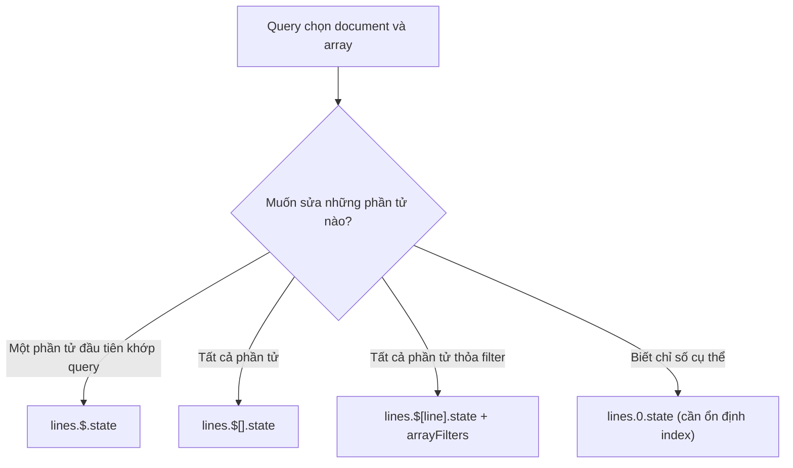
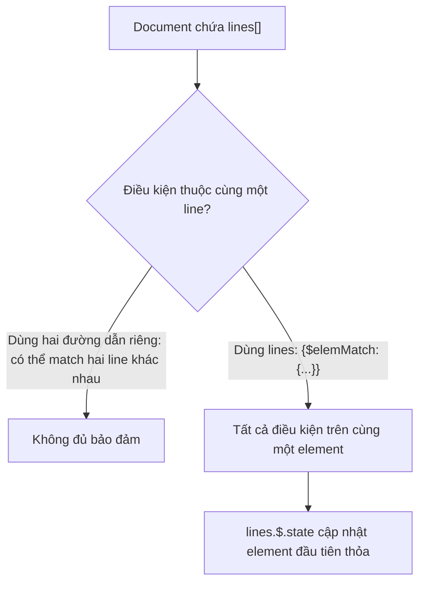

# Toán tử vị trí $ và điều kiện xác định phần tử

## 1. Bài toán: cập nhật đúng một phần tử trong array

Trong **Spring Data MongoDB**, một document thường chứa mảng các giá trị hoặc mảng các object con: danh sách sản phẩm trong đơn hàng, các trạng thái duyệt, nhãn sản phẩm, lịch sử thao tác, thông tin liên hệ. Khi chỉ muốn sửa **một phần tử** của mảng, đọc toàn bộ document rồi thay toàn bộ array không phải lúc nào cũng là lựa chọn tốt.

Giả sử một đơn hàng được lưu như sau:

```javascript
{
  _id: "order-101",
  tenantId: "shop-01",
  status: "OPEN",
  lines: [
    {
      lineId: "line-1",
      sku: "SKU-A",
      quantity: NumberInt("2"),
      state: "OPEN"
    },
    {
      lineId: "line-2",
      sku: "SKU-B",
      quantity: NumberInt("5"),
      state: "OPEN"
    },
    {
      lineId: "line-3",
      sku: "SKU-A",
      quantity: NumberInt("1"),
      state: "OPEN"
    }
  ]
}
```

Yêu cầu: **đổi trạng thái của line có `lineId = "line-2"` thành `RESERVED`**, giữ nguyên các line khác.

MongoDB cung cấp **positional update operator `$`**, cho phép tham chiếu phần tử mảng **đầu tiên** khớp điều kiện truy vấn:

```javascript
db.orders.updateOne(
  {
    _id: "order-101",
    tenantId: "shop-01",
    "lines.lineId": "line-2"
  },
  {
    $set: { "lines.$.state": "RESERVED" }
  }
);
```

Ý tưởng: điều kiện query chọn document và phần tử mảng mục tiêu; đường dẫn `lines.$.state` cập nhật `state` của phần tử được xác định bởi phép match. Nếu các line được định danh chính xác, ứng dụng không cần tự nạp, sửa rồi ghi đè toàn bộ mảng.

**Mục tiêu bài học** trong chương *Thao tác array* của module **SPRING_DATA_MONGODB**: hiểu ý nghĩa của `$`, xây điều kiện xác định phần tử bằng `Query`/`Criteria`, phân biệt `$elemMatch` với các điều kiện độc lập, xử lý giới hạn của `$`, áp dụng `MongoTemplate`/`ReactiveMongoTemplate`, và kiểm thử cập nhật chính xác khi có dữ liệu trùng hoặc ghi đồng thời.

## 2. Phân biệt bốn cách tham chiếu phần tử

| Cách viết | Ý nghĩa | Ví dụ |
| --- | --- | --- |
| `lines.0.state` | Vị trí chỉ số 0 cố định trong mảng | `$set: {"lines.0.state": "OPEN"}` |
| `lines.$.state` | **Phần tử đầu tiên khớp điều kiện array của query** | `$set: {"lines.$.state": "RESERVED"}` |
| `lines.$[].state` | **Mọi phần tử** trong array của document khớp | `$set: {"lines.$[].state": "CANCELLED"}` |
| `lines.$[line].state` | **Mọi phần tử thỏa array filter** có identifier `line` | `$set: {"lines.$[line].state": "RESERVED"}` |

Ba ký hiệu `$`, `$[]` và `$[identifier]` không thể xem là tương đương:

- **`$`** liên kết với phần tử mảng mà *điều kiện query đã match*; chỉ cập nhật phần tử đầu tiên tương ứng trong mỗi document được cập nhật.
- **`$[]`** tác động mọi phần tử của array, kể cả khi query ban đầu chỉ lọc document.
- **`$[identifier]`** tác động các phần tử đáp ứng `arrayFilters` được truyền cùng update; có thể cập nhật nhiều phần tử trong cùng một document.



Đối với một hệ thống mà nhiều line có cùng SKU, dùng `lineId` sẽ rõ ràng hơn dùng SKU để xác định một line. Nhưng **MongoDB không tự bảo đảm `lineId` duy nhất *trong một array* chỉ vì có `_id` ở document cha**; ứng dụng phải kiểm soát bất biến đó.

## 3. Entity và dữ liệu mẫu Spring Data

Ví dụ dùng hai Java record. Để các ví dụ dễ kiểm tra BSON, `_id` được lưu thành BSON String.

```java
package example.orders;

public record OrderLine(
    String lineId,
    String sku,
    int quantity,
    String state
) {}
```

```java
package example.orders;

import java.util.List;
import org.springframework.data.mongodb.core.mapping.Document;
import org.springframework.data.mongodb.core.mapping.FieldType;
import org.springframework.data.mongodb.core.mapping.MongoId;

@Document(collection = "orders")
public record PurchaseOrder(
    @MongoId(FieldType.STRING) String id,
    String tenantId,
    String status,
    List<OrderLine> lines
) {}
```

`@MongoId(FieldType.STRING)` giúp thể hiện rõ giá trị ID là chuỗi, không tự chuyển đổi một chuỗi có hình thức giống ObjectId sang BSON ObjectId. Trong typed query qua `MongoTemplate`, trường `id` sẽ được ánh xạ sang `_id`.

Một repository cơ bản:

```java
package example.orders;

import org.springframework.data.mongodb.repository.MongoRepository;

public interface PurchaseOrderRepository
        extends MongoRepository<PurchaseOrder, String> {
}
```

Repository có thể dùng cho thao tác CRUD thông thường; với cập nhật phần tử mảng bằng `$`, ví dụ dưới đây dùng `MongoTemplate` để mô tả điều kiện và update cụ thể. Điều này tránh việc nạp một entity đầy đủ rồi ghi đè mảng khi chỉ muốn thay một field.

## 4. Positional $: phần tử đầu tiên được query xác định

### 4.1. Cú pháp MongoDB

```javascript
db.orders.updateOne(
  {
    _id: "order-101",
    tenantId: "shop-01",
    "lines.lineId": "line-2"
  },
  { $set: { "lines.$.state": "RESERVED" } }
);
```

Sau lệnh, chỉ line-2 có `state = "RESERVED"`. Các trường `quantity`, `sku` và các line khác giữ nguyên.

Ký hiệu `$` trong `lines.$.state` là **placeholder vị trí phần tử được match**, **không phải tên field có ký tự `$` được lưu trong document**. MongoDB xác định vị trí phù hợp từ điều kiện query rồi áp dụng update.

### 4.2. Code Spring Data MongoTemplate

```java
package example.orders;

import com.mongodb.client.result.UpdateResult;
import org.springframework.data.mongodb.core.MongoTemplate;
import org.springframework.data.mongodb.core.query.Criteria;
import org.springframework.data.mongodb.core.query.Query;
import org.springframework.data.mongodb.core.query.Update;

public class OrderLineUpdateService {

    private final MongoTemplate template;

    public OrderLineUpdateService(MongoTemplate template) {
        this.template = template;
    }

    public boolean reserveLine(
            String authorizedTenantId,
            String orderId,
            String lineId) {

        Query query = Query.query(
            Criteria.where("id").is(orderId)
                .and("tenantId").is(authorizedTenantId)
                .and("lines.lineId").is(lineId)
        );

        Update update = new Update()
            .set("lines.$.state", "RESERVED");

        UpdateResult result = template.updateFirst(
            query, update, PurchaseOrder.class
        );

        return result.getMatchedCount() == 1;
    }
}
```

`Update` chỉ là mô tả; thao tác thực hiện khi gọi `updateFirst`. Với document theo ID duy nhất, `updateFirst` nhắm một document; `$` xác định phần tử mảng đầu tiên match trong document đó.

**Vì sao cần đủ ba điều kiện?**

1. `id` xác định đơn hàng.
2. `tenantId` bảo vệ phạm vi tenant ở tầng truy vấn; giá trị tenant phải đến từ nguồn xác thực của server.
3. `lines.lineId` là phần giúp MongoDB xác định vị trí `$`. Nếu document tồn tại nhưng không có lineId tương ứng, query không khớp và update không xảy ra.

Không nên chỉ dùng `Criteria.where("id").is(orderId)` rồi `set("lines.$.state", ...)`: thiếu điều kiện xác định phần tử thì server không có vị trí array phù hợp cho toán tử `$`.

### 4.3. matchedCount khác modifiedCount

Nếu line-2 vốn đã có state `RESERVED`, update có thể có `matchedCount == 1` và `modifiedCount == 0`. Đây không phải tình huống “không tìm thấy”, mà là một phép ghi **không làm thay đổi giá trị**.

```java
UpdateResult result = template.updateFirst(
    query, update, PurchaseOrder.class
);

if (result.wasAcknowledged()) {
    System.out.println("matched=" + result.getMatchedCount());
    System.out.println("modified=" + result.getModifiedCount());
}
```

`matchedCount == 0` có thể do order không tồn tại, tenant không phù hợp hoặc không có line match. Nếu API muốn trả lỗi khác nhau cho các trường hợp này, service cần thiết kế kiểm tra bổ sung mà vẫn chú ý khả năng thay đổi dữ liệu giữa các lệnh.

## 5. Dùng $ với array các giá trị đơn giản

Toán tử vị trí không chỉ áp dụng cho array object. Với mảng String:

```javascript
{
  _id: "product-101",
  tags: ["sale", "featured", "sale"]
}
```

Đổi **lần xuất hiện đầu tiên** của tag `sale`:

```javascript
db.products.updateOne(
  { _id: "product-101", tags: "sale" },
  { $set: { "tags.$": "clearance" } }
);
```

Sau update:

```javascript
{
  _id: "product-101",
  tags: ["clearance", "featured", "sale"]
}
```

Điều kiện `tags: "sale"` khớp document có một phần tử array bằng `sale`; `tags.$` trỏ đến **phần tử đầu tiên tương ứng**. Phần tử `sale` ở cuối mảng không bị đổi.

Trong Spring Data:

```java
Query query = Query.query(
    Criteria.where("id").is("product-101")
        .and("tags").is("sale")
);

Update update = new Update().set("tags.$", "clearance");
```

Đây là ví dụ dành cho một entity `Product` có `List<String> tags`; cần dùng `updateFirst(query, update, Product.class)` với đúng mapping trong ứng dụng. Nếu yêu cầu là **đổi tất cả tag `sale`**, `$` không đáp ứng; cần `$[identifier]` hoặc chiến lược xử lý array phù hợp.

## 6. Vì sao nhiều điều kiện trên cùng array có thể match sai phần tử?

### 6.1. Bẫy điều kiện đường dẫn độc lập

Giả sử một đơn hàng:

```javascript
{
  _id: "order-ambiguous",
  tenantId: "shop-01",
  lines: [
    { lineId: "line-A", sku: "SKU-A", quantity: 2, state: "OPEN" },
    { lineId: "line-B", sku: "SKU-B", quantity: 9, state: "OPEN" }
  ]
}
```

Yêu cầu: **đặt RESERVED cho line SKU-A nếu số lượng line đó ít nhất 5**.

Một filter nhìn qua tưởng đúng:

```javascript
{
  "lines.sku": "SKU-A",
  "lines.quantity": { $gte: 5 }
}
```

Nhưng MongoDB có thể khớp document vì **SKU-A ở phần tử thứ nhất**, còn **quantity >= 5 ở phần tử thứ hai**. Hai điều kiện đường dẫn độc lập **không tự bảo đảm cùng một element**.

Khi cập nhật bằng `lines.$.state` dựa trên một query có nhiều điều kiện array mơ hồ như vậy, mục tiêu cập nhật có thể không phản ánh điều kiện nghiệp vụ thực sự.

### 6.2. Dùng $elemMatch để ràng buộc cùng phần tử

```javascript
db.orders.updateOne(
  {
    _id: "order-ambiguous",
    tenantId: "shop-01",
    lines: {
      $elemMatch: {
        sku: "SKU-A",
        quantity: { $gte: 5 }
      }
    }
  },
  { $set: { "lines.$.state": "RESERVED" } }
);
```

Query này **không match** document ví dụ, vì không có line nào vừa là SKU-A vừa có quantity >= 5. Như vậy nó không cập nhật nhầm line của SKU-B.



### 6.3. Criteria.elemMatch trong Spring Data

```java
Query query = Query.query(
    new Criteria().andOperator(
        Criteria.where("id").is("order-ambiguous"),
        Criteria.where("tenantId").is("shop-01"),
        Criteria.where("lines").elemMatch(
            Criteria.where("sku").is("SKU-A")
                .and("quantity").gte(5)
        )
    )
);

Update update = new Update()
    .set("lines.$.state", "RESERVED");

UpdateResult result = template.updateFirst(
    query, update, PurchaseOrder.class
);
```

Với document ví dụ, `result.getMatchedCount() == 0`. Nếu đổi quantity của line SKU-A thành 7, query sẽ match và `$` cập nhật line SKU-A.

**Quy tắc thực hành:** Khi vị trí được xác định từ **nhiều thuộc tính của object trong array**, `$elemMatch` là cách biểu diễn rõ ràng rằng các điều kiện phải đúng trên **cùng một phần tử**. Nó cũng giúp bảo vệ các lệnh update có điều kiện tồn kho hoặc trạng thái.

## 7. Kết hợp $ với điều kiện số lượng để cập nhật nguyên tử

Trong nghiệp vụ, một line chỉ được giảm quantity nếu còn đủ. Không nên làm:

```java
// KHÔNG an toàn khi hai request đồng thời:
PurchaseOrder order = template.findById(
    orderId, PurchaseOrder.class
);
// Tìm line, trừ quantity trong Java, rồi save cả entity.
```

Hai request có thể đọc cùng số lượng, tự tính số còn lại và ghi đè kết quả của nhau. Một lựa chọn tốt hơn là **điều kiện và phép giảm trong cùng lệnh update**.

```java
import com.mongodb.client.result.UpdateResult;
import org.springframework.data.mongodb.core.query.Criteria;
import org.springframework.data.mongodb.core.query.Query;
import org.springframework.data.mongodb.core.query.Update;

public boolean reserveQuantity(
        MongoTemplate template,
        String authorizedTenantId,
        String orderId,
        String lineId,
        int requested) {

    if (requested <= 0) {
        throw new IllegalArgumentException(
            "requested phải lớn hơn 0"
        );
    }

    Query query = Query.query(
        new Criteria().andOperator(
            Criteria.where("id").is(orderId),
            Criteria.where("tenantId").is(authorizedTenantId),
            Criteria.where("lines").elemMatch(
                Criteria.where("lineId").is(lineId)
                    .and("quantity").gte(requested)
                    .and("state").is("OPEN")
            )
        )
    );

    Update update = new Update()
        .inc("lines.$.quantity", -requested);

    UpdateResult result = template.updateFirst(
        query, update, PurchaseOrder.class
    );

    return result.getMatchedCount() == 1;
}
```

Tương đương MongoDB:

```javascript
db.orders.updateOne(
  {
    _id: "order-101",
    tenantId: "shop-01",
    lines: {
      $elemMatch: {
        lineId: "line-2",
        quantity: { $gte: 3 },
        state: "OPEN"
      }
    }
  },
  { $inc: { "lines.$.quantity": -3 } }
);
```

Nếu line-2 có quantity 5, lần đầu trừ 3 sẽ còn 2. Lần tiếp theo cùng điều kiện `quantity >= 3` không khớp, nên quantity không âm.

**Phạm vi bảo đảm:** đây là cập nhật nguyên tử **trên một document MongoDB**. Nó không biến những thao tác khác như ghi thanh toán, tạo shipment hoặc sửa document tồn kho của một collection khác thành một transaction. Nếu request bị gửi lặp, `$inc` vẫn không idempotent; cần kiểm soát request ID/transaction/workflow nếu việc trừ hai lần không được phép.

### 7.1. Cần kiểm soát lineId duy nhất trong array

Nếu vì lỗi dữ liệu có hai element có cùng `lineId`, `$` chỉ sửa **element đầu tiên** khớp. Không dùng nó như công cụ cập nhật đồng thời cả hai element, cũng không suy ra uniqueness chỉ vì tên trường là `lineId`.

Đặt quy tắc tạo lineId, validation trước khi ghi, test dữ liệu trùng. **Unique multikey index không bảo đảm mỗi giá trị chỉ xuất hiện một lần trong cùng một array của một document** theo cách một số người kỳ vọng; cần ràng buộc domain cho tính duy nhất nội bộ mảng.

## 8. updateFirst và updateMulti khác nhau thế nào với positional $?

Hai câu hỏi phải tách riêng:

1. **Có bao nhiêu document được cập nhật?** Do `updateFirst` hoặc `updateMulti` quyết định.
2. **Trong mỗi document, có bao nhiêu element của array được sửa?** Do `$`, `$[]` hay `$[identifier]` quyết định.

Ví dụ có hai order cùng chứa SKU-A. Dùng:

```java
Query query = Query.query(
    Criteria.where("tenantId").is("shop-01")
        .and("lines.sku").is("SKU-A")
);
Update update = new Update()
    .set("lines.$.state", "CHECKED");

// Một document khớp:
template.updateFirst(query, update, PurchaseOrder.class);

// Mọi document khớp; trong mỗi document, chỉ element match đầu tiên:
template.updateMulti(query, update, PurchaseOrder.class);
```

`updateMulti` với `$` **không** có nghĩa mọi element SKU-A trong cùng một order đều được đổi. Nó có nghĩa nhiều document có thể được cập nhật, và **mỗi document chỉ có phần tử phù hợp đầu tiên** bị sửa bởi positional `$`.

Nếu muốn cập nhật **mọi line SKU-A trong một order**, dùng `$[identifier]` với `arrayFilters` (phần 9).

## 9. Khi nào thay $ bằng $[] hoặc $[identifier]?

### 9.1. $[]: mọi phần tử của array

Yêu cầu hủy toàn bộ line của một order:

```javascript
db.orders.updateOne(
  { _id: "order-101", tenantId: "shop-01" },
  { $set: { "lines.$[].state": "CANCELLED" } }
);
```

Spring Data:

```java
Update update = new Update()
    .set("lines.$[].state", "CANCELLED");
```

Không cần điều kiện array trong query để chọn từng phần tử vì `$[]` có nghĩa **tất cả** element trong array của document được chọn. Đây là một phép cập nhật rộng: nên giới hạn document bằng ID/tenant/status và kiểm tra quyền nghiệp vụ.

### 9.2. $[identifier]: mọi phần tử thỏa arrayFilters

Yêu cầu: đổi trạng thái **tất cả** line có SKU-A trong một order:

```javascript
db.orders.updateOne(
  { _id: "order-101", tenantId: "shop-01" },
  { $set: { "lines.$[line].state": "CHECKED" } },
  {
    arrayFilters: [
      { "line.sku": "SKU-A" }
    ]
  }
);
```

Với document mẫu, cả line-1 và line-3 đều được đổi, không chỉ line-1.

Spring Data MongoDB cung cấp `Update.filterArray`:

```java
import org.springframework.data.mongodb.core.query.Criteria;
import org.springframework.data.mongodb.core.query.Update;

Update update = new Update()
    .set("lines.$[line].state", "CHECKED")
    .filterArray(Criteria.where("line.sku").is("SKU-A"));
```

Khi dùng typed operation, chú ý: phần **array filter** được truyền trực tiếp xuống driver, không nhất thiết được ánh xạ tên field như điều kiện typed `Query`. Với field có `@Field`, hãy kiểm tra **tên BSON thật** trong array filter; nếu dùng tên Java không đúng, câu update có thể không sửa phần tử nào.

Một số lưu ý:

- Tên `line` trong `$[line]` phải nhất quán với identifier `line` trong array filter.
- Array filter được dùng để chọn **element**, không thay thế điều kiện chọn **document** hoặc kiểm tra tenant.
- Một document được match nhưng không có element thỏa array filter có thể cho `matchedCount > 0` và `modifiedCount == 0`.
- Có thể thêm nhiều điều kiện cho identifier nếu nghiệp vụ yêu cầu, ví dụ `line.sku` và `line.state`.

### 9.3. Nhiều cấp array cần filtered positional operators

Ví dụ một document có `batches[]` và bên trong mỗi batch lại có `lines[]`. Positional `$` thông thường **không dùng để đi qua nhiều cấp array lồng nhau** bằng cách lặp `$`. MongoDB hỗ trợ kết hợp `$[]` và `$[identifier]` cùng arrayFilters để chỉ định các phần tử theo từng tầng.

```javascript
db.orders.updateOne(
  { _id: "order-nested", tenantId: "shop-01" },
  {
    $set: {
      "batches.$[batch].lines.$[line].state": "CHECKED"
    }
  },
  {
    arrayFilters: [
      { "batch.batchId": "batch-1" },
      { "line.lineId": "line-2" }
    ]
  }
);
```

Ví dụ mô tả mô hình `batches` khác entity `PurchaseOrder` ở phần 3; hãy xây entity/mapping tương ứng nếu áp dụng thật. Kiểm thử nested update trên dữ liệu BSON thực tế trước khi dùng production.

## 10. Các giới hạn quan trọng của toán tử vị trí $

### 10.1. Query phải xác định array cần cập nhật

Sai ý định:

```javascript
db.orders.updateOne(
  { _id: "order-101" },
  { $set: { "lines.$.state": "RESERVED" } }
);
```

Filter chỉ xác định document, **không xác định element của `lines`**. MongoDB không có vị trí khớp cho `$`. Hãy đưa điều kiện của array `lines` vào query hoặc chuyển sang `$[]`/`$[identifier]` theo mục tiêu.

### 10.2. Không dùng positional $ cho upsert tạo document

Trong upsert, nếu **không có document khớp**, MongoDB sẽ phải tạo một document mới. Positional `$` không có element mảng nào để tham chiếu, nên không phải cú pháp hợp lệ cho nhánh chèn:

```javascript
// Không dùng mẫu này khi có thể phải insert:
db.orders.updateOne(
  { _id: "order-new", "lines.lineId": "line-1" },
  { $set: { "lines.$.state": "OPEN" } },
  { upsert: true }
);
```

Muốn thêm đơn hàng mới, hãy khởi tạo document/mảng theo schema rõ ràng. Nếu muốn thêm một line vào order hiện hữu, xem `$push` hoặc `$addToSet` và quy tắc kiểm soát trùng; đừng dùng `$` như một cách tự tạo phần tử.

### 10.3. Tránh truy vấn bằng phủ định trực tiếp trên array

Các query có phủ định trên array như `$ne`, `$not`, `$nin` có những giới hạn khi dùng với `$`. Nếu điều kiện phủ định là cần thiết, MongoDB yêu cầu cấu trúc match phù hợp, thường cần đặt nó trong `$elemMatch` để xác định element.

Ví dụ, “sửa line có state khác `CANCELLED`” không thể viết tùy tiện chỉ bằng điều kiện `lines.state: {$ne: "CANCELLED"}` rồi tin rằng `lines.$` luôn chọn đúng element. `$ne` trên field mảng có thể khớp document vì ngữ nghĩa của toàn mảng/field missing, không diễn đạt trực tiếp **phần tử nào** cần sửa.

Thường rõ ràng hơn nếu dùng điều kiện trạng thái được cho phép, chẳng hạn `state: "OPEN"`; hoặc dùng `$[line]` với array filter được xác thực nếu cần chọn nhiều phần tử.

### 10.4. Nhiều array trong filter tạo sự mơ hồ

Nếu query đồng thời match các array `lines` và `coupons`, positional `$` có thể không chỉ rõ một cách đáng tin cậy vị trí của array muốn cập nhật trong những tình huống phức tạp. Với nhiều array, cần đơn giản hóa query, tách nghiệp vụ hoặc sử dụng `$[identifier]` có filter chỉ rõ.

**Quy tắc:** dùng `$` khi điều kiện match một array rõ ràng; dùng `$elemMatch` khi điều kiện phải áp dụng cùng element; dùng filtered positional operator khi có nhiều element, nhiều array hoặc nhiều tầng lồng nhau.

### 10.5. Sort document không chọn element trong array

Thêm `query.with(Sort.by(...))` có thể ảnh hưởng document nào được chọn trong những API có hỗ trợ sort, nhưng **không phải cơ chế lựa chọn element** trong `lines`. `$` luôn được xác định bằng điều kiện match array. Nếu cần chọn “line mới nhất” hoặc “line có giá thấp nhất”, hãy lưu khóa xác định phù hợp hoặc thiết kế aggregation/update pipeline, thay vì cho rằng sort trên document sẽ sắp xếp lại phần tử array cho `$`.

## 11. Xóa field khác với xóa phần tử array

Một lỗi phổ biến là dùng `$unset` rồi tưởng array ngắn đi.

### 11.1. Xóa một thuộc tính của element

```javascript
db.orders.updateOne(
  { _id: "order-101", "lines.lineId": "line-2" },
  { $unset: { "lines.$.legacyCode": "" } }
);
```

Lệnh này xóa **field `legacyCode` bên trong line được match**, nhưng vẫn giữ line đó trong array.

### 11.2. Unset cả vị trí không giống pull element

Nếu `$unset` nhắm trực tiếp một phần tử mảng như `"lines.$"`, MongoDB có thể thay phần tử bằng `null` nhằm giữ vị trí, **không tự dồn các phần tử về bên trái**.

Nếu nghiệp vụ muốn **xóa hẳn line có lineId** khỏi mảng:

```javascript
db.orders.updateOne(
  { _id: "order-101", tenantId: "shop-01" },
  { $pull: { lines: { lineId: "line-2" } } }
);
```

`$pull` loại các phần tử thỏa điều kiện, không chỉ phần tử match đầu tiên. Nếu `lineId` bị trùng, có thể có nhiều element bị xóa; vì vậy bất biến lineId duy nhất vẫn quan trọng.

## 12. findAndModify và các phép cập nhật cần kết quả mới

`MongoTemplate.updateFirst` trả `UpdateResult`, không trực tiếp trả document sau update. Khi service cần lấy trạng thái mới trong cùng thao tác, có thể dùng `findAndModify`:

```java
import org.springframework.data.mongodb.core.FindAndModifyOptions;
import org.springframework.data.mongodb.core.query.Criteria;
import org.springframework.data.mongodb.core.query.Query;
import org.springframework.data.mongodb.core.query.Update;

Query query = Query.query(
    Criteria.where("id").is("order-101")
        .and("tenantId").is("shop-01")
        .and("lines.lineId").is("line-2")
);

Update update = new Update()
    .set("lines.$.state", "RESERVED");

PurchaseOrder updated = template.findAndModify(
    query,
    update,
    FindAndModifyOptions.options().returnNew(true),
    PurchaseOrder.class
);
```

`returnNew(true)` yêu cầu **document sau khi sửa**. Nếu không có document khớp và không bật upsert, kết quả có thể là `null`. Lưu ý toàn bộ entity `PurchaseOrder` có thể được trả về — với document chứa array rất lớn, chi phí I/O và mapping cũng lớn. Nếu chỉ cần xác nhận đã sửa, `UpdateResult` có thể hiệu quả hơn.

Không nên đọc document trước rồi sửa trong Java nếu mục tiêu là bảo vệ đồng thời trên cùng một element; điều kiện query + update là lựa chọn trực tiếp hơn.

## 13. Tính nguyên tử, idempotency và ghi đồng thời

MongoDB đảm bảo một lệnh update hợp lệ trên **một document** là nguyên tử. Khi một thao tác `$inc` đã đi kèm điều kiện `$elemMatch` về quantity, việc match và sửa trên document đó không bị tách thành “đọc rồi ghi” ở client.

Nhưng ba khái niệm khác nhau:

| Khái niệm | Ví dụ | Giới hạn |
| --- | --- | --- |
| **Atomic update** | Giảm `lines.$.quantity` với điều kiện còn đủ | Chỉ bảo đảm thao tác trên document được cập nhật |
| **Idempotency** | Một request gửi lại không được trừ thêm lần nữa | `$inc` không tự idempotent |
| **Transaction nhiều document** | Giảm tồn kho và tạo payment/order record khác | Cần cơ chế giao dịch/workflow riêng |

Đối với cập nhật trạng thái:

```java
Query query = Query.query(
    new Criteria().andOperator(
        Criteria.where("id").is(orderId),
        Criteria.where("tenantId").is(authorizedTenantId),
        Criteria.where("lines").elemMatch(
            Criteria.where("lineId").is(lineId)
                .and("state").is("OPEN")
        )
    )
);

Update update = new Update()
    .set("lines.$.state", "RESERVED");
```

Nhờ `state == "OPEN"` nằm trong **cùng filter** với lineId, chỉ line còn OPEN mới được chuyển trạng thái. Khi request thứ hai chạy sau request đầu đã chuyển thành RESERVED, nó không còn match. Tuy nhiên, nếu có workflow chuyển ngược RESERVED → OPEN thì request trùng đến muộn vẫn có thể tạo thay đổi ngoài ý muốn. Khi cần chống trùng request nghiêm ngặt, hãy dùng request ID, version, hoặc state machine và cơ chế idempotency được thiết kế cho nghiệp vụ.

### 13.1. Version trong document cha

Nếu nhiều thao tác cập nhật những phần khác nhau của cùng order phải tuân thủ điều kiện version, có thể thêm field version vào **document cha** và thực hiện compare-and-set:

```java
Query query = Query.query(
    new Criteria().andOperator(
        Criteria.where("id").is(orderId),
        Criteria.where("tenantId").is(authorizedTenantId),
        Criteria.where("version").is(expectedVersion),
        Criteria.where("lines").elemMatch(
            Criteria.where("lineId").is(lineId)
                .and("state").is("OPEN")
        )
    )
);

Update update = new Update()
    .set("lines.$.state", "RESERVED")
    .inc("version", 1L);
```

Đây là **quản lý version thủ công** với field số thông thường. Nếu entity thật gắn `@Version` và Spring Data có cơ chế tự tăng version trên đường update đó, cần chọn một chiến lược nhất quán, tránh tăng version hai lần hoặc tạo xung đột. Và version của document cha không làm cập nhật nhiều document thành transaction.

## 14. ReactiveMongoTemplate: cùng toán tử, kết quả là Mono

Trong môi trường **Spring Data MongoDB reactive**, cùng `Query` và `Update` có thể được sử dụng:

```java
package example.orders;

import org.springframework.data.mongodb.core.ReactiveMongoTemplate;
import org.springframework.data.mongodb.core.query.Criteria;
import org.springframework.data.mongodb.core.query.Query;
import org.springframework.data.mongodb.core.query.Update;
import reactor.core.publisher.Mono;

public class ReactiveOrderLineService {

    private final ReactiveMongoTemplate template;

    public ReactiveOrderLineService(ReactiveMongoTemplate template) {
        this.template = template;
    }

    public Mono<Boolean> reserveLine(
            String authorizedTenantId,
            String orderId,
            String lineId) {

        Query query = Query.query(
            new Criteria().andOperator(
                Criteria.where("id").is(orderId),
                Criteria.where("tenantId").is(authorizedTenantId),
                Criteria.where("lines").elemMatch(
                    Criteria.where("lineId").is(lineId)
                        .and("state").is("OPEN")
                )
            )
        );

        Update update = new Update()
            .set("lines.$.state", "RESERVED");

        return template.updateFirst(
            query, update, PurchaseOrder.class
        ).map(result -> result.getMatchedCount() == 1);
    }
}
```

`Mono<Boolean>` biểu diễn kết quả cập nhật bất đồng bộ. Khi publisher hoàn tất, ứng dụng có thể xử lý true/false và lỗi driver ở tầng service/controller; **không gọi `block()` trong luồng WebFlux** chỉ để lấy kết quả.

Mô hình reactive không thay đổi ngữ nghĩa của `$`, `$elemMatch` hay tính nguyên tử trên một document. Nó cũng không tự đảm bảo idempotency hoặc phân quyền tenant.

## 15. Index và hiệu năng khi tìm element trong array

### 15.1. Index theo tenant và lineId

Với query:

```javascript
db.orders.find({
  tenantId: "shop-01",
  "lines.lineId": "line-2"
});
```

một index ứng viên là:

```javascript
db.orders.createIndex(
  { tenantId: 1, "lines.lineId": 1 },
  { name: "by_tenant_lineId" }
);
```

Vì `lines` là array, MongoDB tạo **multikey index** trên đường dẫn `lines.lineId`. Index giúp tìm document chứa một line theo điều kiện. Nó **không tự chọn hộ** element cho phép update nếu query còn thiếu điều kiện rõ ràng, và không bảo đảm phần tử lineId là duy nhất trong từng array.

Với lệnh có `_id` cụ thể, index `_id` sẵn có có thể đã đủ nhanh để tìm document; compound index trên `tenantId + lines.lineId` chỉ nên tạo sau khi xác nhận workload thực sự cần. Index trên mảng lớn cũng tăng chi phí ghi và dung lượng.

### 15.2. Index cho nhiều field cùng element

Nếu query thường dùng:

```javascript
{
  tenantId: "shop-01",
  lines: {
    $elemMatch: {
      sku: "SKU-A",
      quantity: { $gte: 5 }
    }
  }
}
```

có thể đánh giá index theo `tenantId` và các field trong cùng array:

```javascript
db.orders.createIndex({
  tenantId: 1,
  "lines.sku": 1,
  "lines.quantity": 1
});
```

`$elemMatch` làm rõ các điều kiện thuộc cùng element và còn có thể giúp MongoDB kết hợp một số giới hạn index multikey trong các query thích hợp. Tuy nhiên, hiệu quả phụ thuộc phiên bản MongoDB, data distribution, query shape và thứ tự index; không coi một index compound là câu trả lời cho mọi truy vấn.

### 15.3. Kiểm tra thực tế bằng explain

```javascript
db.orders.find({
  tenantId: "shop-01",
  "lines.lineId": "line-2"
}).explain("executionStats");

db.orders.getIndexes();
```

Xem `winningPlan`, `totalKeysExamined` và `totalDocsExamined`. Đừng đánh giá hiệu năng dựa trên collection chỉ có vài document hoặc mặc định việc thêm index luôn có lợi cho mọi lệnh ghi.

Nếu mỗi order có array hàng chục nghìn phần tử và được cập nhật liên tục, cần cân nhắc giới hạn kích thước BSON document, tăng trưởng mảng, contention của document nóng và khả năng tách line sang collection riêng. Mô hình embedded array phù hợp nhất khi các phần tử có vòng đời và khối lượng hợp lý với document cha.

## 16. An toàn dữ liệu và cách chọn khóa phần tử

### 16.1. LineId tốt hơn chỉ số khi array có thể bị thay đổi

Nếu client gửi `index = 1` rồi server cập nhật `lines.1.state`, một request khác có thể thêm/xóa/sắp xếp lại mảng trước khi lệnh được thực thi, khiến index 1 không còn là line mong muốn.

Sử dụng khóa phần tử bất biến như `lineId` giúp yêu cầu gắn với **định danh nghiệp vụ** thay vì vị trí hiện tại. Nhưng uniqueness phải được bảo vệ khi tạo/sửa mảng; nếu lineId trùng, `$` chỉ cập nhật một phần tử và hệ thống có thể không biết document đang vi phạm invariant.

### 16.2. Không cho client quyết định field path tùy ý

Nguy hiểm:

```java
// Không xây update path từ chuỗi không tin cậy:
Update update = new Update().set(clientPath, clientValue);
```

Kẻ gọi có thể chọn field không được sửa như `tenantId`, giá tiền, version hoặc trạng thái duyệt. Thay vào đó, API nên nhận DTO có các trường được phép, service xác định query, operator và field path **cố định trong code**, validate giá trị và xác thực tenant.

### 16.3. Không đánh đồng update document với authorization

Một lệnh `updateFirst` với filter rõ ràng giúp tránh sửa document ngoài điều kiện, nhưng **không tự bảo đảm user có quyền với tenant hoặc order đó**. Authorization phải xác định tenant/order/role từ server-side identity, không chỉ từ `tenantId` do client truyền.

Nếu lệnh sửa một array chứa thông tin nhạy cảm, cần kiểm soát cả quyền trên document cha và quyền thực hiện chuyển trạng thái trên element. Ví dụ không cho hủy một line đã được giao hàng dù query và phép `$set` đều hợp lệ về cú pháp.

## 17. Kiểm thử tích hợp: xác định đúng phần tử và dữ liệu không đổi

Kiểm thử nên xác minh **document BSON thực tế**, không chỉ kiểm tra một object Java trước và sau `save`. Đặc biệt cần test:

- Đúng lineId được đổi, hai line còn lại không đổi.
- Nhiều SKU trùng nhau không làm cập nhật sai phần tử.
- Hai điều kiện trên line phải thuộc cùng element.
- Trường hợp query không match trả `matchedCount == 0`.
- `$[identifier]` sửa mọi element được filter, khác `$`.
- Cập nhật quantity có điều kiện không làm âm số lượng.

### 17.1. JUnit test với MongoTemplate và raw BSON

Ví dụ tích hợp sử dụng Spring Boot Mongo test slice và MongoDB test có thể kết nối:

```java
package example.orders;

import static com.mongodb.client.model.Filters.eq;
import static org.junit.jupiter.api.Assertions.*;

import java.util.List;
import java.util.UUID;
import org.bson.Document;
import org.junit.jupiter.api.Test;
import org.springframework.beans.factory.annotation.Autowired;
import org.springframework.boot.test.autoconfigure.data.mongo.DataMongoTest;
import org.springframework.data.mongodb.core.MongoTemplate;
import org.springframework.data.mongodb.core.query.Criteria;
import org.springframework.data.mongodb.core.query.Query;
import org.springframework.data.mongodb.core.query.Update;

@DataMongoTest
class PositionalUpdateTest {

    @Autowired
    MongoTemplate template;

    @Test
    void changesOnlyTheMatchedLine() {
        String suffix = UUID.randomUUID().toString();
        String id = "order-" + suffix;
        String tenant = "tenant-" + suffix;

        template.save(new PurchaseOrder(
            id, tenant, "OPEN",
            List.of(
                new OrderLine("line-1", "SKU-A", 2, "OPEN"),
                new OrderLine("line-2", "SKU-B", 5, "OPEN"),
                new OrderLine("line-3", "SKU-A", 1, "OPEN")
            )
        ));

        Query query = Query.query(
            Criteria.where("id").is(id)
                .and("tenantId").is(tenant)
                .and("lines.lineId").is("line-2")
        );

        var result = template.updateFirst(
            query,
            new Update().set("lines.$.state", "RESERVED"),
            PurchaseOrder.class
        );

        assertEquals(1L, result.getMatchedCount());
        assertEquals(1L, result.getModifiedCount());

        Document raw = template.getCollection("orders")
            .find(eq("_id", id))
            .first();
        assertNotNull(raw);

        List<Document> lines = raw.getList(
            "lines", Document.class
        );
        assertNotNull(lines);
        assertEquals(3, lines.size());
        assertEquals("OPEN", lines.get(0).getString("state"));
        assertEquals("RESERVED", lines.get(1).getString("state"));
        assertEquals("OPEN", lines.get(2).getString("state"));
        assertEquals(5, lines.get(1).getInteger("quantity"));

        PurchaseOrder loaded =
            template.findById(id, PurchaseOrder.class);
        assertNotNull(loaded);
        assertEquals("line-2", loaded.lines().get(1).lineId());
        assertEquals("RESERVED", loaded.lines().get(1).state());
    }
}
```

Test chỉ update `state` của line-2; dữ liệu SKU-A ở line-1 và line-3 vẫn nguyên. Việc đọc raw BSON xác nhận phép update xảy ra đúng vị trí thay vì chỉ kiểm tra một object Java đã dựng trong bộ nhớ.

`@DataMongoTest` không tự bảo đảm MongoDB server luôn được khởi chạy trong mọi môi trường. Có thể sử dụng Testcontainers MongoDB hoặc một instance kiểm thử riêng, với cấu hình/annotation phù hợp phiên bản Spring Boot/Spring Data của dự án.

### 17.2. Test $elemMatch ngăn kết hợp hai line khác nhau

Thêm một test với hai line:

```java
@Test
void elementMatchPreventsCrossElementConditions() {
    String suffix = UUID.randomUUID().toString();
    String id = "order-mix-" + suffix;
    String tenant = "tenant-" + suffix;

    template.save(new PurchaseOrder(
        id, tenant, "OPEN",
        List.of(
            new OrderLine("line-A", "SKU-A", 2, "OPEN"),
            new OrderLine("line-B", "SKU-B", 9, "OPEN")
        )
    ));

    Query query = Query.query(
        new Criteria().andOperator(
            Criteria.where("id").is(id),
            Criteria.where("tenantId").is(tenant),
            Criteria.where("lines").elemMatch(
                Criteria.where("sku").is("SKU-A")
                    .and("quantity").gte(5)
            )
        )
    );

    var result = template.updateFirst(
        query,
        new Update().set("lines.$.state", "RESERVED"),
        PurchaseOrder.class
    );

    assertEquals(0L, result.getMatchedCount());

    PurchaseOrder unchanged =
        template.findById(id, PurchaseOrder.class);
    assertNotNull(unchanged);
    assertEquals("OPEN", unchanged.lines().get(0).state());
    assertEquals("OPEN", unchanged.lines().get(1).state());
}
```

Đoạn test được thêm **bên trong class `PositionalUpdateTest`** ở trên; `template` dùng chung do Spring inject. Nó chứng minh điều kiện SKU-A và quantity >= 5 phải cùng nằm trên một phần tử, thay vì hợp lệ nhờ hai phần tử khác nhau.

### 17.3. Test nhiều phần tử với filtered positional operator

```java
@Test
void filteredPositionalChangesAllMatchingSkus() {
    String suffix = UUID.randomUUID().toString();
    String id = "order-filtered-" + suffix;
    String tenant = "tenant-" + suffix;

    template.save(new PurchaseOrder(
        id, tenant, "OPEN",
        List.of(
            new OrderLine("line-1", "SKU-A", 2, "OPEN"),
            new OrderLine("line-2", "SKU-B", 5, "OPEN"),
            new OrderLine("line-3", "SKU-A", 1, "OPEN")
        )
    ));

    Query query = Query.query(
        Criteria.where("id").is(id)
            .and("tenantId").is(tenant)
    );

    Update update = new Update()
        .set("lines.$[line].state", "CHECKED")
        .filterArray(Criteria.where("line.sku").is("SKU-A"));

    var result = template.updateFirst(
        query, update, PurchaseOrder.class
    );
    assertEquals(1L, result.getMatchedCount());

    PurchaseOrder loaded =
        template.findById(id, PurchaseOrder.class);
    assertNotNull(loaded);
    assertEquals("CHECKED", loaded.lines().get(0).state());
    assertEquals("OPEN", loaded.lines().get(1).state());
    assertEquals("CHECKED", loaded.lines().get(2).state());
}
```

Test minh họa sự khác nhau giữa `$` và `$[line]`: hai phần tử cùng SKU-A được thay đổi. Với lệnh thay toàn bộ array, test tương tự có thể dùng `$[]` và xác nhận tất cả element được đổi.

### 17.4. Test phép giảm số lượng có điều kiện

Với một line quantity 2, gọi `reserveQuantity(..., requested=3)` phải cho kết quả false, vì không có element thỏa `quantity >= 3`. Sau đó đọc lại raw BSON để xác nhận quantity vẫn bằng 2. Với requested=1, test kỳ vọng quantity thành 1, và chỉ line được chọn thay đổi.

Nên bổ sung test đồng thời hai request khi quan trọng, nhưng phải thiết kế fixture có thể tái hiện race/concurrency một cách có kiểm soát. Một lần chạy không gặp lỗi race không chứng minh code đọc–sửa–`save` an toàn; kết luận chính về atomicity dựa trên ngữ nghĩa thao tác ghi của MongoDB.

## 18. Sai lầm thường gặp và cách chẩn đoán

| Triệu chứng | Nguyên nhân có thể | Hướng xử lý |
| --- | --- | --- |
| MongoDB báo không tìm được positional match | Query chỉ lọc document, không có điều kiện trên array | Thêm điều kiện xác định phần tử hoặc dùng `$[]`/`$[id]` |
| Update sai line khi query nhiều thuộc tính | Các điều kiện array match các element khác nhau | Sử dụng `$elemMatch` |
| Chỉ line đầu tiên đổi dù nhiều line trùng SKU | `$` chỉ cập nhật phần tử match đầu tiên | Dùng `$[identifier]` nếu cần mọi element |
| Cập nhật toàn bộ line ngoài dự kiến | Dùng `$[]` khi chỉ muốn một line | Đổi sang `$` hoặc `$[identifier]` |
| Upsert thất bại với `lines.$` | Không có array element để tham chiếu ở nhánh insert | Tách khởi tạo document khỏi update vị trí |
| `matched=1` nhưng `modified=0` | Field đã có giá trị; hoặc arrayFilter không khớp element | Kiểm tra trạng thái và `UpdateResult` |
| `matched=0` | Sai ID, tenant hoặc điều kiện line không đạt | Xem filter và quyền truy cập |
| Quantity bị giảm hai lần | `$inc` được retry mà không có idempotency | Request ID/state machine hoặc giao dịch nghiệp vụ |
| `$unset` không làm array ngắn lại | Unset phần tử array có thể để lại null | Dùng `$pull` nếu muốn loại element |
| Nhiều line cùng lineId | Thiếu invariant của array | Validate uniqueness trong order |
| ArrayFilters không match sau khi thêm `@Field` | ArrayFilters không được map giống typed Query | Kiểm tra tên BSON thật trong filter |
| Query chậm khi array lớn | Thiếu index phù hợp hoặc document quá lớn/nóng | `explain` và cân nhắc mô hình tách collection |
| Reactive update khác kỳ vọng | Cú pháp query/array match sai, không phải do Mono | Kiểm tra raw BSON và publisher error |
| Update nhầm tenant | Tenant lấy từ client hoặc thiếu filter bắt buộc | Gắn tenant từ security context server |

### Quy trình điều tra nhanh

1. Xem raw document: array có tồn tại, kiểu BSON đúng và các element ra sao?
2. Viết rõ mục tiêu: **một element đầu tiên**, **mọi element** hay **mọi element thỏa điều kiện**?
3. Kiểm tra query có điều kiện trên **đúng array** mà `$` sẽ tham chiếu.
4. Nếu có nhiều điều kiện trên element, kiểm tra đã dùng `$elemMatch` chưa.
5. Xác nhận tên field BSON, nhất là với `@Field` và `arrayFilters`.
6. Kiểm tra `matchedCount`, `modifiedCount` và lỗi driver.
7. Tái hiện bằng dữ liệu có hai SKU trùng, hai lineId lỗi hoặc hai line có thuộc tính chéo nhau.
8. Đánh giá index, kích thước array và quyền cập nhật.

## 19. Bài tập thực hành

### Bài 1 — Cập nhật đúng một line

Tạo order có ba line như phần đầu, trong đó SKU-A xuất hiện hai lần nhưng lineId khác nhau. Dùng `MongoTemplate` với `lines.lineId` và `Update.set("lines.$.state", ...)` để sửa line-3. Kiểm tra raw BSON và bảo đảm line-1 không bị đổi.

### Bài 2 — $elemMatch và điều kiện chéo

Tạo hai line: `{sku:"A",quantity:2}` và `{sku:"B",quantity:9}`. So sánh query dùng `lines.sku == "A"` cùng `lines.quantity >= 5` với query dùng `lines: {$elemMatch:{sku:"A",quantity:{$gte:5}}}`. Giải thích vì sao kết quả match document có thể khác nhau và tác động đến update `lines.$`.

### Bài 3 — Một, tất cả và có filter

Với array có ba trạng thái `OPEN`, hãy dùng:

1. `$` để sửa phần tử đầu tiên match SKU-A.
2. `$[]` để sửa mọi phần tử.
3. `$[line]` với `arrayFilters` để sửa mọi line có SKU-A.

So sánh số element bị thay đổi, `matchedCount` và `modifiedCount`.

### Bài 4 — Giảm quantity an toàn

Viết service nhận `lineId` và `requested`, lọc bằng `$elemMatch` có `quantity >= requested` rồi `inc("lines.$.quantity", -requested)`. Chứng minh trường hợp tồn kho không đủ không trừ âm, và phân tích điều gì xảy ra nếu cùng request được retry hai lần.

### Bài 5 — Xóa field và xóa element

Với array line có `legacyCode`, dùng `$unset` để loại field `legacyCode` chỉ trong line-2; sau đó dùng `$pull` để xóa line-2 khỏi mảng. Kiểm tra raw BSON, giải thích vì sao unset không tương đương pull.

### Bài 6 — Nested arrays

Thiết kế document `batches[]` chứa `lines[]`. Viết update với `$[batch]` và `$[line]` cùng hai array filter. Giải thích vì sao không nên cố sử dụng hai positional `$` để đi qua hai tầng array.

### Câu hỏi tự kiểm tra

- Vì sao `$` chỉ cập nhật phần tử match đầu tiên của một array?
- Điều kiện `lines.sku == "A"` và `lines.quantity >= 5` có chắc cùng một line không?
- Khi nào dùng `$elemMatch`?
- `$` khác `$[]` và `$[identifier]` ở điểm nào?
- Tại sao `$` không phù hợp cho nhánh insert của upsert?
- Nếu hai line có cùng lineId, `$` có cập nhật cả hai không?
- Khi `matchedCount = 1` và `modifiedCount = 0`, có nhất thiết query sai không?
- Vì sao `$inc` trên một element có thể atomic nhưng không idempotent?
- Một unique multikey index có tự bảo đảm không có hai lineId trùng trong cùng array của một document không?
- Tại sao `$unset` trên array element không dùng để xóa và dồn phần tử?

## Ghi nhớ

Trong **Spring Data MongoDB**, positional update operator **`$`** tham chiếu **phần tử đầu tiên của array được điều kiện query xác định**. Khi nhiều thuộc tính phải khớp **trên cùng một object con**, hãy dùng **`$elemMatch`** để tránh nhầm giữa các element. Nếu muốn sửa **mọi element**, dùng **`$[]`**; nếu muốn sửa **mọi element thỏa điều kiện riêng**, dùng **`$[identifier]` với `arrayFilters`**. Đừng dùng `$` cho upsert tạo document, đừng kỳ vọng `$unset` xóa phần tử array, và đừng coi update nguyên tử là bảo đảm idempotency. Hãy xác minh raw BSON, tên field, filter tenant, kết quả `UpdateResult` và kiểm thử với dữ liệu trùng khi xây thao tác array an toàn.

## Tài liệu tham khảo

- [MongoDB Manual — Positional $ Update Operator](https://www.mongodb.com/docs/manual/reference/operator/update/positional/)
- [MongoDB Manual — All Positional $[] Operator](https://www.mongodb.com/docs/manual/reference/operator/update/positional-all/)
- [MongoDB Manual — Filtered Positional $[identifier] Operator](https://www.mongodb.com/docs/manual/reference/operator/update/positional-filtered/)
- [MongoDB Manual — $elemMatch Query Operator](https://www.mongodb.com/docs/manual/reference/operator/query/elemMatch/)
- [Spring Data MongoDB Reference — Updating Documents](https://docs.spring.io/spring-data/mongodb/reference/mongodb/template-crud-operations.html)
- [Spring Data MongoDB API — Update](https://docs.spring.io/spring-data/mongodb/docs/current/api/org/springframework/data/mongodb/core/query/Update.html)
