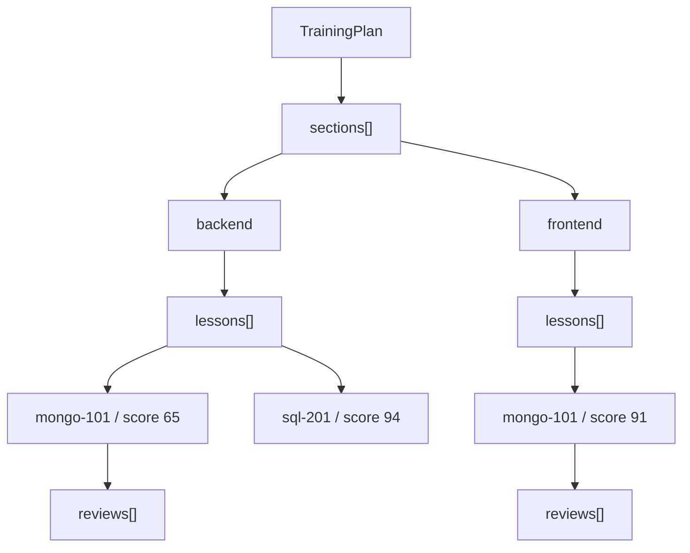

# Array lồng nhau và phối hợp nhiều điều kiện

Trong MongoDB, một document có thể chứa nhiều mảng lồng nhau: `sections[]` gồm các `lessons[]`, và mỗi lesson lại chứa `reviews[]`. Lưu theo cấu trúc này giúp đọc một aggregate đầy đủ, nhưng truy vấn và cập nhật cần trả lời chính xác: **nhiều điều kiện phải đúng trên cùng một phần tử, hay có thể đúng trên những phần tử khác nhau?**

Bài thuộc chương **Thao tác array** của module `SPRING_DATA_MONGODB`. Chúng ta sẽ phối hợp `MongoTemplate`, `Query`, `Criteria`, `Update`, `$elemMatch`, `$[]`, `$[identifier]`, `arrayFilters`, aggregation, multikey index và kiểm thử để xử lý mảng nhiều cấp. Các kỹ thuật này cũng liên quan tới query derivation, transaction, reactive access, schema mapping và tối ưu hiệu năng.

> **Nguyên tắc:** `Query` chọn **document**; `$elemMatch` buộc nhiều điều kiện đúng trên **một phần tử array**; `arrayFilters` kết hợp với `$[identifier]` chọn **phần tử được cập nhật**. Với nhiều tầng mảng, cần xác định đúng phạm vi ở **từng tầng**.

## 1. Mục tiêu học tập

Sau bài này, bạn có thể:

1. Giải thích tại sao dot notation có thể khớp **những phần tử khác nhau**.
2. Dùng `$elemMatch` trên một array object và lồng nhiều `$elemMatch` qua các cấp.
3. Kết hợp `AND`, `OR`, `$in`, `$all`, `$size`, `$not` và phân biệt điều kiện tồn tại với điều kiện trên mọi phần tử.
4. Viết Java `Criteria.elemMatch` tương đương BSON trên MongoDB.
5. Phân biệt `$elemMatch` dùng trong query, projection và aggregation `$filter`.
6. Chọn đúng positional operator `$`, `$[]` hay `$[identifier]`.
7. Cập nhật nested arrays bằng `Update.filterArray` và hiểu vì sao filter này **không được Spring Data tự mapping**.
8. Phối hợp document filter, filtered positional update và optimistic version trong một thao tác nguyên tử trên một document.
9. Thiết kế multikey index và kiểm tra `explain("executionStats")`.
10. Viết integration test phát hiện false positive, cập nhật ngoài phạm vi và thay đổi đồng thời.

## 2. Dữ liệu ví dụ: sections, lessons, reviews

Giả sử hệ thống đào tạo lưu collection `training_plans`. Một document:

```javascript
{
  _id: "PLAN-MIXED",
  tenant_id: "tenant-a",
  sections: [
    {
      code: "backend",
      lessons: [
        {
          key: "mongo-101", status: "READY", score: 65,
          reviews: [
            { reviewer: "mentor", approved: false },
            { reviewer: "qa", approved: true }
          ]
        },
        { key: "sql-201", status: "READY", score: 94, reviews: [] }
      ]
    },
    {
      code: "frontend",
      lessons: [
        {
          key: "mongo-101", status: "READY", score: 91,
          reviews: [{ reviewer: "mentor", approved: true }]
        }
      ]
    }
  ],
  version: NumberLong("0")
}
```

Cấu trúc:



Giả sử nghiệp vụ cần tìm **section backend chứa lesson mongo-101 đang READY và score ≥80**. `PLAN-MIXED` **không** thỏa điều kiện: trong backend lesson mongo-101 chỉ score 65; lesson sql-201 đạt 94 nhưng sai key; lesson mongo-101 đạt 91 lại thuộc frontend.

Tạo thêm document `PLAN-OK` để làm trường hợp dương tính:

```javascript
{
  _id: "PLAN-OK",
  tenant_id: "tenant-a",
  sections: [
    {
      code: "backend",
      lessons: [
        {
          key: "mongo-101", status: "READY", score: 88,
          reviews: [
            { reviewer: "mentor", approved: true },
            { reviewer: "qa", approved: false }
          ]
        },
        { key: "sql-201", status: "READY", score: 94, reviews: [] }
      ]
    },
    {
      code: "frontend",
      lessons: [
        { key: "mongo-101", status: "READY", score: 91, reviews: [] }
      ]
    }
  ]
}
```

`PLAN-OK` thực sự có backend/mongo-101/READY/88. Đặt cả hai document vào **database test riêng** để kiểm tra query đúng và sai.

### 2.1. Domain model cho Spring Data

```java
package dev.learning.training;

import java.util.List;
import org.springframework.data.annotation.Id;
import org.springframework.data.annotation.Version;
import org.springframework.data.mongodb.core.mapping.Document;
import org.springframework.data.mongodb.core.mapping.Field;

@Document("training_plans")
public record TrainingPlan(
    @Id String id,
    @Field("tenant_id") String tenantId,
    List<Section> sections,
    @Version Long version) {}

public record Section(String code, List<Lesson> lessons) {}

public record Lesson(
    String key,
    String status,
    int score,
    List<Review> reviews) {}

public record Review(String reviewer, boolean approved) {}
```

Các `public record` phải được đặt trong **các tệp Java riêng** tương ứng. `@Field("tenant_id")` cho thấy tên property Java khác tên BSON; các field trong mảng tạm giữ cùng tên để dễ theo dõi. `@Version` dùng ở phần thao tác đồng thời.

## 3. Dot notation có thể ghép các điều kiện từ nhiều phần tử

Truy vấn tưởng như hợp lý:

```javascript
db.training_plans.find({
  tenant_id: "tenant-a",
  "sections.code": "backend",
  "sections.lessons.key": "mongo-101",
  "sections.lessons.status": "READY",
  "sections.lessons.score": { $gte: 80 }
});
```

**`PLAN-MIXED` cũng có thể khớp**. Các điều kiện trên các đường dẫn mảng là độc lập:

- `sections.code="backend"` lấy từ section backend.
- `sections.lessons.key="mongo-101"` có thể lấy từ một lesson bất kỳ.
- `sections.lessons.score>=80` có thể lấy từ `sql-201` hoặc `frontend/mongo-101`.
- `status="READY"` cũng không bị ràng buộc vào cùng lesson với key/score.

Một ví dụ **chỉ một array** cũng có false positive:

```javascript
{
  lessons: [
    { key: "mongo-101", score: 40 },
    { key: "sql-201", score: 95 }
  ]
}
```

```javascript
// Vẫn có thể match dù mongo-101 chỉ đạt 40:
db.collection.find({
  "lessons.key": "mongo-101",
  "lessons.score": { $gte: 80 }
});
```

Dot notation mô tả **đường dẫn** chứ không tự bảo đảm các điều kiện đúng trên **một phần tử**.

## 4. Một cấp: $elemMatch buộc cùng phần tử

Với array `lessons` trực tiếp ở root:

```javascript
db.collection.find({
  lessons: {
    $elemMatch: {
      key: "mongo-101",
      score: { $gte: 80 }
    }
  }
});
```

`$elemMatch` đòi **ít nhất một lesson** có cả key mongo-101 **và** score ≥80. Hai field không được lấy từ hai lesson khác nhau.

Java `Criteria` tương đương:

```java
import org.springframework.data.mongodb.core.query.Criteria;
import org.springframework.data.mongodb.core.query.Query;

Query query = Query.query(
    Criteria.where("lessons").elemMatch(
        Criteria.where("key").is("mongo-101")
                .and("score").gte(80)
    )
);
```

Đoạn trên dùng cho domain có `lessons` trực tiếp ở root. Với `TrainingPlan` có `sections[]` bên ngoài, **chưa đủ**.

### Chỉ ràng buộc lesson, chưa ràng buộc section

```javascript
db.training_plans.find({
  "sections.code": "backend",
  "sections.lessons": {
    $elemMatch: { key: "mongo-101", score: { $gte: 80 } }
  }
});
```

Query này ràng buộc key + score ở cùng một lesson, nhưng không bắt lesson nằm trong section backend. Với `PLAN-MIXED`, lesson frontend/mongo-101 score 91 vẫn đủ để khớp.

## 5. Hai cấp: lồng $elemMatch tại từng mảng

Truy vấn **đúng**:

```javascript
db.training_plans.find({
  tenant_id: "tenant-a",
  sections: {
    $elemMatch: {
      code: "backend",
      lessons: {
        $elemMatch: {
          key: "mongo-101",
          status: "READY",
          score: { $gte: 80 }
        }
      }
    }
  }
});
```

Giờ một section phải đồng thời là backend **và** chứa một lesson thỏa key + status + score.

| Document | Dot notation độc lập | Hai `$elemMatch` lồng nhau |
| --- | --- | --- |
| `PLAN-MIXED` | Khớp nhầm | **Không khớp** |
| `PLAN-OK` | Khớp | **Khớp** |

Java `MongoTemplate`:

```java
Criteria lesson = Criteria.where("key").is("mongo-101")
    .and("status").is("READY")
    .and("score").gte(80);

Criteria section = Criteria.where("code").is("backend")
    .and("lessons").elemMatch(lesson);

Query query = Query.query(
    Criteria.where("tenantId").is("tenant-a")
        .and("sections").elemMatch(section)
);

List<TrainingPlan> plans =
    mongoTemplate.find(query, TrainingPlan.class);
```

`tenantId` trong `Query` được ánh xạ sang `tenant_id` nhờ metadata domain. Những tên field bên trong `$elemMatch` thuộc phạm vi phần tử tương ứng.

## 6. Ba cấp: thêm điều kiện trên reviews

Yêu cầu: có section backend, trong đó có lesson mongo-101 đang READY, và trong lesson ấy có review của mentor đã được phê duyệt.

```javascript
db.training_plans.find({
  sections: {
    $elemMatch: {
      code: "backend",
      lessons: {
        $elemMatch: {
          key: "mongo-101",
          status: "READY",
          reviews: {
            $elemMatch: { reviewer: "mentor", approved: true }
          }
        }
      }
    }
  }
});
```

`PLAN-MIXED` không khớp: review mentor của backend/mongo-101 là false, mặc dù review qa trong cùng lesson là true và review mentor ở frontend là true. `PLAN-OK` khớp.

```java
Criteria review = Criteria.where("reviewer").is("mentor")
    .and("approved").is(true);

Criteria lesson = Criteria.where("key").is("mongo-101")
    .and("status").is("READY")
    .and("reviews").elemMatch(review);

Criteria section = Criteria.where("code").is("backend")
    .and("lessons").elemMatch(lesson);

Query query = Query.query(
    Criteria.where("sections").elemMatch(section)
);
```

Nghĩ theo phép lượng từ:

```text
Tồn tại section s trong sections:
  s.code == backend
  VÀ tồn tại lesson l trong s.lessons:
    l.key == mongo-101 VÀ l.status == READY
    VÀ tồn tại review r trong l.reviews:
      r.reviewer == mentor VÀ r.approved == true
```

**Query chỉ chọn document root**, không tự thu gọn các array chỉ còn phần tử thỏa điều kiện.

## 7. Phối hợp AND, OR, IN và nhiều phần tử khác nhau

### AND trên một phần tử

```javascript
{
  lessons: {
    $elemMatch: {
      key: "mongo-101",
      status: "READY",
      score: { $gte: 80 }
    }
  }
}
```

Các field trong một `$elemMatch` mặc định được nối bằng AND.

### OR trên cùng một field

Nếu trạng thái cho phép READY hoặc RETRY:

```javascript
{
  lessons: {
    $elemMatch: {
      key: "mongo-101",
      status: { $in: ["READY", "RETRY"] },
      score: { $gte: 80 }
    }
  }
}
```

### OR giữa hai nhóm điều kiện

```javascript
{
  lessons: {
    $elemMatch: {
      $or: [
        { status: "READY", score: { $gte: 80 } },
        { status: "RETRY", score: { $gte: 90 } }
      ]
    }
  }
}
```

Đặt `$or` **trong** `$elemMatch` bảo đảm **một lesson** thỏa một nhánh. Spring Data:

```java
Criteria variants = new Criteria().orOperator(
    Criteria.where("status").is("READY").and("score").gte(80),
    Criteria.where("status").is("RETRY").and("score").gte(90)
);

Criteria hasLesson = Criteria.where("lessons")
    .elemMatch(variants);
```

### Yêu cầu có hai phần tử khác nhau

Nếu nghiệp vụ muốn cùng **một section** có **một lesson READY** và **một lesson DONE**, không bắt buộc cùng lesson, có thể kết hợp nhiều `$elemMatch` qua `$all`:

```javascript
{
  sections: {
    $elemMatch: {
      code: "backend",
      lessons: {
        $all: [
          { $elemMatch: { status: "READY" } },
          { $elemMatch: { status: "DONE" } }
        ]
      }
    }
  }
}
```

Đây là hai yêu cầu **tồn tại** độc lập trên array `lessons` nhưng được ràng buộc **trong cùng section**. Với hai trạng thái loại trừ nhau, hai điều kiện phải do hai phần tử khác nhau thỏa.

## 8. $size, null/missing và phủ định

| Toán tử | Ý nghĩa | Lưu ý |
| --- | --- | --- |
| `$size` | Mảng có đúng N phần tử | Không đếm số phần tử thỏa một điều kiện phức tạp. |
| `$all` | Mảng chứa tất cả giá trị/nhóm phần tử cần thiết | Không có nghĩa tất cả điều kiện đều thuộc cùng phần tử. |
| `$exists` | Field có mặt hoặc vắng mặt | Có mặt không đồng nghĩa khác null. |
| `$ne` | So sánh khác | Với giá trị không null, có thể khớp field vắng mặt. |
| `$not` | Phủ định điều kiện trên field | Cần xét riêng array rỗng hoặc field missing. |
| `$elemMatch` | Tồn tại ít nhất một phần tử thỏa các điều kiện | Không có nghĩa **mọi** phần tử đều thỏa. |

```javascript
// Đúng hai sections:
db.training_plans.find({ sections: { $size: 2 } });
```

Muốn tìm kế hoạch **không có bất kỳ lesson score âm nào**, không thể chỉ viết `score != -1`. Một cách diễn đạt logic là phủ định việc **tồn tại** section chứa lesson có score âm:

```javascript
db.training_plans.find({
  sections: {
    $not: {
      $elemMatch: {
        lessons: {
          $elemMatch: { score: { $lt: 0 } }
        }
      }
    }
  }
});
```

Document thiếu `sections` có thể khớp phủ định. Nếu nghiệp vụ yêu cầu `sections` tồn tại, không null và không rỗng, hãy **thêm schema validation hoặc điều kiện hiện diện phù hợp**.

Một array giá trị đơn giản như `tags:["mongo","java"]` có thể kiểm tra có `"mongo"` bằng equality; không cần `$elemMatch` nếu chỉ kiểm tra một giá trị.

## 9. Projection khác query: trả một hay nhiều phần tử?

Query:

```javascript
db.training_plans.find({
  sections: { $elemMatch: { code: "backend" } }
});
```

chỉ chọn **document root** có ít nhất một section backend. Khi không có projection, kết quả vẫn có thể chứa toàn bộ `sections[]` và `lessons[]`.

Để chỉ trả **phần tử section backend đầu tiên**:

```javascript
db.training_plans.find(
  { tenant_id: "tenant-a" },
  { sections: { $elemMatch: { code: "backend" } } }
);
```

MongoDB `$elemMatch` ở **vị trí projection** trả phần tử **đầu tiên** thỏa điều kiện; nó không tự lọc các lesson bên trong.

Spring Data:

```java
Query query = Query.query(
    Criteria.where("tenantId").is("tenant-a")
);

query.fields().elemMatch(
    "sections",
    Criteria.where("code").is("backend")
);

List<TrainingPlan> results =
    mongoTemplate.find(query, TrainingPlan.class);
```

Đây là một **partial read**. Đừng gọi `save` trên entity chỉ tải một phần: có thể làm mất các section chưa được đọc hoặc xảy ra lỗi optimistic locking.

### Muốn giữ mọi lesson thỏa điều kiện: dùng $filter và $map

```javascript
db.training_plans.aggregate([
  { $match: { tenant_id: "tenant-a" } },
  {
    $project: {
      tenant_id: 1,
      sections: {
        $map: {
          input: {
            $filter: {
              input: "$sections",
              as: "s",
              cond: { $eq: ["$$s.code", "backend"] }
            }
          },
          as: "s",
          in: {
            code: "$$s.code",
            lessons: {
              $filter: {
                input: "$$s.lessons",
                as: "l",
                cond: {
                  $and: [
                    { $eq: ["$$l.key", "mongo-101"] },
                    { $gte: ["$$l.score", 80] }
                  ]
                }
              }
            }
          }
        }
      }
    }
  }
]);
```

Aggregation trên giữ **mọi section backend** và **mọi lesson** của section đó thỏa điều kiện. Nếu một section backend không có lesson đạt chuẩn, nó có thể vẫn xuất hiện với `lessons:[]`; thêm một bước lọc nếu muốn loại section rỗng.

## 10. Positional update: $, $[] và $[identifier]

| Đường dẫn update | Phần tử được sửa | Hạn chế |
| --- | --- | --- |
| `array.$.field` | Phần tử đầu tiên được ràng buộc bởi điều kiện query | Không phù hợp cho traversal nhiều cấp array; dễ nhập nhằng khi query nhiều array. |
| `array.$[].field` | **Tất cả** phần tử trong array thuộc document khớp | Không có filter trên từng phần tử. |
| `array.$[x].field` | **Tất cả** phần tử có identifier `x` thỏa `arrayFilters` | Bắt buộc đăng ký filter cho identifier. |

Ví dụ positional `$` trên **một array ở root**:

```javascript
db.sample.updateOne(
  { "lessons.key": "mongo-101" },
  { $set: { "lessons.$.status": "DONE" } }
);
```

Không dùng `$` cho query traverse nhiều array lồng nhau; dùng `$[]`/`$[identifier]` để quy định rõ phần tử.

**Cập nhật toàn bộ phần tử**:

```javascript
db.training_plans.updateOne(
  { _id: "PLAN-OK" },
  { $set: { "sections.$[].lessons.$[].status": "ARCHIVED" } }
);
```

Lệnh này sửa mọi lesson của mọi section trong `PLAN-OK`. Không dùng khi chỉ muốn đổi một lesson.

**Cập nhật có lọc ở hai cấp**:

```javascript
db.training_plans.updateOne(
  { _id: "PLAN-OK" },
  {
    $set: {
      "sections.$[sec].lessons.$[lesson].status": "DONE"
    }
  },
  {
    arrayFilters: [
      { "sec.code": "backend" },
      { "lesson.key": "mongo-101", "lesson.status": "READY" }
    ]
  }
);
```

Ý nghĩa: trong các section backend, cập nhật **mọi** lesson mongo-101 đang READY. Lesson frontend/mongo-101 không bị đụng tới, nhưng nếu backend có nhiều lesson cùng key thì có thể sửa **nhiều phần tử**.

## 11. MongoTemplate Update.filterArray: điểm khác với typed Query

```java
import com.mongodb.client.result.UpdateResult;
import org.springframework.data.mongodb.core.MongoTemplate;
import org.springframework.data.mongodb.core.query.Criteria;
import org.springframework.data.mongodb.core.query.Query;
import org.springframework.data.mongodb.core.query.Update;

String planId = "PLAN-OK";
String authorizedTenant = "tenant-a";

Query query = Query.query(
    Criteria.where("id").is(planId)
        .and("tenantId").is(authorizedTenant)
);

Update update = new Update()
    .set("sections.$[sec].lessons.$[lesson].status", "DONE")
    .filterArray(Criteria.where("sec.code").is("backend"))
    .filterArray(Criteria.where("lesson.key").is("mongo-101")
        .and("lesson.status").is("READY"));

UpdateResult result = mongoTemplate.updateFirst(
    query, update, TrainingPlan.class);
```

Trong cấu trúc đã mô tả, kết quả mong muốn:

```text
backend / mongo-101: READY -> DONE
backend / sql-201:   READY (không đổi)
frontend / mongo-101: READY (không đổi)
```

### filterArray không tự ánh xạ tên field

Javadoc `Update.filterArray(CriteriaDefinition)` và `Update.filterArray(String,Object)` nói filter **được gửi thẳng tới driver, không tiếp tục type/field mapping**. Vì thế nội dung `arrayFilters` dùng **tên BSON thực**.

Ví dụ sau này `Lesson.key` có alias:

```java
public record Lesson(
    @org.springframework.data.mongodb.core.mapping.Field("lesson_key")
    String key,
    String status,
    int score,
    java.util.List<Review> reviews) {}
```

Khi dữ liệu BSON thực là `lesson_key`:

```java
// SAI: FilterArray không tự chuyển lesson.key thành lesson.lesson_key
update.filterArray(Criteria.where("lesson.key").is("mongo-101"));

// ĐÚNG: dùng tên BSON ở dưới identifier.
update.filterArray(
    Criteria.where("lesson.lesson_key").is("mongo-101"));
```

| Nơi viết field | Có domain mapping? | Quy ước |
| --- | --- | --- |
| `Criteria.where("tenantId")` trong typed `Query` | Có | Property Java |
| `Update.set(...)` với entity class | Có mapping update path tùy API, placeholder được giữ | Property path; xác minh command nếu có alias |
| `Update.filterArray(...)` | **Không**, filter chuyển thẳng cho driver | Tên **BSON** dưới identifier |
| `mongosh` hoặc `org.bson.Document` raw | Không | Tên BSON |

### Một identifier, một filter document

```java
Update update = new Update()
    .set("sections.$[sec].lessons.$[lesson].status", "DONE")
    .filterArray(Criteria.where("sec.code").is("backend"))
    .filterArray(Criteria.where("lesson.key").is("mongo-101")
        .and("lesson.status").is("READY"));
```

Đúng: `lesson.key` và `lesson.status` nằm trong **cùng filter document** cho identifier `lesson`. MongoDB không cho khai báo hai filter documents riêng cùng tên identifier. Identifier phải bắt đầu bằng chữ thường và chỉ dùng chữ/số, ví dụ `sec`, `lesson`, `review`.

## 12. Query chọn document; arrayFilters chọn phần tử

Nếu `Query` chỉ lọc `_id`, MongoDB có thể **match document** dù không còn phần tử thỏa `arrayFilters`. Vì vậy:

- `matchedCount=1` nói rằng document khớp query, **không** nói có lesson được sửa.
- `modifiedCount=0` có thể do không có phần tử khớp hoặc giá trị mới giống giá trị cũ.
- Nếu có `@Version` hoặc Update đổi thêm field khác, document có thể bị sửa ngay cả khi không đổi lesson mục tiêu.

Để nghiệp vụ “READY → DONE” trả thất bại khi không có phần tử phù hợp, thêm nested `$elemMatch` vào **Query cùng lệnh ghi**:

```java
Criteria readyLesson = Criteria.where("key").is("mongo-101")
    .and("status").is("READY");

Criteria matchingSection = Criteria.where("code").is("backend")
    .and("lessons").elemMatch(readyLesson);

Query query = Query.query(
    Criteria.where("id").is(planId)
        .and("tenantId").is(authorizedTenant)
        .and("sections").elemMatch(matchingSection)
);

Update update = new Update()
    .set("sections.$[sec].lessons.$[lesson].status", "DONE")
    .filterArray(Criteria.where("sec.code").is("backend"))
    .filterArray(Criteria.where("lesson.key").is("mongo-101")
        .and("lesson.status").is("READY"));

UpdateResult result = mongoTemplate.updateFirst(
    query, update, TrainingPlan.class);
```

Nếu không còn lesson READY trong section backend, `matchedCount` sẽ là 0. Các điều kiện được kiểm tra trong **chính lệnh cập nhật** trên document, không phải một `findOne` tách rời dễ bị race condition.

**Chú ý:** `$[lesson]` vẫn cập nhật **mọi phần tử khớp**, không phải chỉ một. Nếu cần “chính xác một lesson” thì cần business key duy nhất trong section hoặc mô hình dữ liệu khác. Unique multikey index **không tự đảm bảo** uniqueness giữa các phần tử trong cùng document.

## 13. Cập nhật ba cấp array bằng nhiều identifiers

Yêu cầu: chỉ phê duyệt review **mentor** đang `approved=false` thuộc lesson `mongo-101` của section `backend`, không thay đổi review `qa` hoặc lesson ở frontend.

```javascript
db.training_plans.updateOne(
  { _id: "PLAN-MIXED", tenant_id: "tenant-a" },
  {
    $set: {
      "sections.$[sec].lessons.$[lesson].reviews.$[rev].approved": true
    }
  },
  {
    arrayFilters: [
      { "sec.code": "backend" },
      { "lesson.key": "mongo-101" },
      { "rev.reviewer": "mentor", "rev.approved": false }
    ]
  }
);
```

Ba identifier chọn tuần tự:

1. `sec`: section có code backend.
2. `lesson`: lesson có key mongo-101 trong section đó.
3. `rev`: review có reviewer mentor và approved false trong lesson đó.

Spring Data:

```java
Update update = new Update()
    .set(
        "sections.$[sec].lessons.$[lesson].reviews.$[rev].approved",
        true)
    .filterArray(Criteria.where("sec.code").is("backend"))
    .filterArray(Criteria.where("lesson.key").is("mongo-101"))
    .filterArray(Criteria.where("rev.reviewer").is("mentor")
        .and("rev.approved").is(false));

UpdateResult result = mongoTemplate.updateFirst(
    Query.query(Criteria.where("id").is("PLAN-MIXED")
        .and("tenantId").is("tenant-a")),
    update,
    TrainingPlan.class
);
```

Với document `PLAN-MIXED`, review mentor của backend/mongo-101 chuyển false → true; review qa vẫn true, review mentor ở frontend vốn true không đổi.

**Phân biệt:** điều kiện `rev.approved=false` ở `arrayFilters` chỉ giới hạn phần tử được sửa; nếu query chỉ có ID, `matchedCount` vẫn có thể bằng 1 dù không có review false. Đặt nested `$elemMatch` tương ứng trong `Query` hoặc dùng expected version nếu cần nhận diện một chuyển trạng thái thực sự.

### 13.1. Dùng $[] cho cấp ngoài và $[identifier] cho cấp trong

Nếu muốn sửa mọi lesson mongo-101 đang READY **bất kể section**:

```javascript
db.training_plans.updateOne(
  { _id: "PLAN-OK" },
  {
    $set: {
      "sections.$[].lessons.$[lesson].status": "ARCHIVED"
    }
  },
  {
    arrayFilters: [
      { "lesson.key": "mongo-101", "lesson.status": "READY" }
    ]
  }
);
```

`sections.$[]` chọn mọi section; `lessons.$[lesson]` chọn những lesson thỏa filter. **Frontend cũng có thể bị sửa.** Nếu chỉ muốn backend, thay cấp ngoài bằng `$[sec]` và thêm filter code backend.

### 13.2. Không dùng positional $ cho nhiều array lồng nhau

MongoDB nêu rõ `$` positional chỉ thay thế vị trí phần tử của một array được query ràng buộc; nó **không phù hợp khi phải traverse nhiều array lồng nhau**. Với query đồng thời nhiều array fields, việc xác định vị trí `$` cũng có thể nhập nhằng. Dùng `$[identifier]` hoặc `$[]` để chỉ rõ từng cấp.

## 14. Giới hạn arrayFilters, upsert và dữ liệu thiếu

Những quy tắc cần nhớ:

- Mỗi identifier được sử dụng trong update path cần **đúng một** filter document trong `arrayFilters`.
- Tên identifier bắt đầu bằng chữ thường, chỉ chứa chữ/số.
- `arrayFilters` không cho dùng `$expr`, `$text` hay `$where`.
- `arrayFilters` không dùng cùng cách đó với **aggregation pipeline update**.
- Khi `upsert=true` và không có document khớp (phải **insert**), update có `$[identifier]` hoặc `$[]` yêu cầu **exact equality match** trên field array tương ứng trong query; thiếu điều kiện này có thể khiến server báo lỗi.
- Đường dẫn array dùng cho update phải có cấu trúc phù hợp; MongoDB không tự dựng mọi object/array nhiều cấp chỉ vì có placeholder trong path.

**Khuyến nghị:** cập nhật lesson/review đã tồn tại nên là **update-only**, không tự ý upsert. Tạo mới plan/section/lesson cần luồng riêng có schema validation, uniqueness và kiểm thử idempotency.

### 14.1. Array rỗng và missing field

Nếu `sections:[]`, không có phần tử nào cho `sections.$[sec]`. Nếu field `sections` bị thiếu hoặc có kiểu không phải array, lệnh update path lồng nhau có thể không tác động hoặc báo lỗi tùy toán tử và cấu trúc cụ thể. Cần **định nghĩa schema và kiểm thử** cho ba trạng thái: array rỗng, null, field không tồn tại.

Không mặc định `$elemMatch` coi object đơn lẻ giống array; việc xác thực shape của dữ liệu lịch sử và migration là trách nhiệm của hệ thống.

### 14.2. Không dùng nhiều arrayFilters để thay thế logic Query

`arrayFilters` được đánh giá ở cấp phần tử **của document đã được chọn**, không tự áp dụng phân quyền tenant hoặc xác nhận mọi điều kiện nghiệp vụ ở root. Luôn đưa `tenantId`/`id`/expectedVersion` vào `Query`, từ nguồn server đã xác thực.

## 15. $push, $addToSet, $pull trong nested arrays

Ngoài cập nhật các field của phần tử có sẵn, MongoDB còn có toán tử thêm/bớt mảng:

| Toán tử | Công dụng | Cần tránh |
| --- | --- | --- |
| `$push` | Thêm phần tử; hỗ trợ `$each`/`$slice`/`$sort` | Thêm trùng hoặc làm array tăng không giới hạn. |
| `$addToSet` | Chỉ thêm nếu **toàn giá trị** chưa có | Không đảm bảo unique theo field `key` của object. |
| `$pull` | Xóa mọi phần tử thỏa điều kiện | Có thể xóa nhiều nếu business key trùng. |
| `$pop` | Loại phần tử đầu hoặc cuối | Không tìm theo business key. |
| `$set` | Thay một field hoặc phần tử | Không phải phép thêm; phải có path phù hợp. |

### 15.1. Thêm lesson vào một section đã có

```javascript
db.training_plans.updateOne(
  { _id: "PLAN-OK" },
  {
    $push: {
      "sections.$[sec].lessons": {
        key: "redis-301",
        status: "READY",
        score: 0,
        reviews: []
      }
    }
  },
  { arrayFilters: [{ "sec.code": "backend" }] }
);
```

Nếu có **nhiều section** cùng code backend, `$[sec]` có thể chọn tất cả. Để business rule “mỗi code chỉ có một section” an toàn, ứng dụng phải đảm bảo bất biến uniqueness riêng, không dựa vào việc câu lệnh dùng một identifier.

### 15.2. addToSet không kiểm tra trùng theo lesson.key

Giả sử `lessons[]` đã chứa:

```javascript
{ key: "mongo-101", status: "READY", score: 88 }
```

Mục định thêm:

```javascript
{ key: "mongo-101", status: "DONE", score: 88 }
```

Hai subdocument **khác nhau**, nên `$addToSet` có thể thêm phần tử mới mặc dù `key` trùng. Unique multikey index cũng **không tự động** bảo đảm không trùng key giữa các phần tử trong cùng document. Khi cần unique theo `key`, phải thiết kế logic chèn có điều kiện hoặc đổi mô hình.

### 15.3. Xóa lesson chỉ trong section backend

```javascript
db.training_plans.updateOne(
  { _id: "PLAN-OK" },
  {
    $pull: {
      "sections.$[sec].lessons": { key: "sql-201" }
    }
  },
  { arrayFilters: [{ "sec.code": "backend" }] }
);
```

`$pull` xóa **mọi lesson** với key sql-201 trong array lessons của các section backend đã chọn. Nó không tự xóa toàn bộ section hay review ngoài những lesson bị xóa.

## 16. Khi nào dùng aggregation thay vì query array?

`$elemMatch` là công cụ tìm **document root có ít nhất một phần tử phù hợp**. Nếu muốn **trả tất cả phần tử phù hợp**, tính số lesson đạt yêu cầu hoặc biến đổi mảng ở nhiều cấp, aggregation thường rõ hơn.

| Aggregation operator | Dùng để |
| --- | --- |
| `$unwind` | Tách mỗi phần tử array thành một row pipeline. |
| `$filter` | Chỉ giữ những phần tử đạt điều kiện. |
| `$map` | Biến đổi từng phần tử thành cấu trúc mới. |
| `$reduce` | Tính giá trị tích lũy trên array. |
| `$size` | Đếm phần tử trong array đầu ra. |
| `$group` | Nhóm và thống kê sau khi unwind/project. |

### 16.1. Thống kê số lesson READY theo section

```javascript
db.training_plans.aggregate([
  { $match: { tenant_id: "tenant-a" } },
  { $unwind: "$sections" },
  { $unwind: "$sections.lessons" },
  { $match: { "sections.lessons.status": "READY" } },
  {
    $group: {
      _id: {
        planId: "$_id",
        section: "$sections.code"
      },
      readyCount: { $sum: 1 }
    }
  }
]);
```

Sau hai lần `$unwind`, mỗi pipeline document tương ứng với **một lesson của một section xác định**. Điều kiện `$match` phía sau áp dụng trên lesson hiện hành. Song `$unwind` có thể làm kích thước pipeline tăng đáng kể; khi chỉ cần kiểm tra **tồn tại**, query `$elemMatch` thường đơn giản hơn.

### 16.2. AggregationUpdate không dùng chung arrayFilters

Spring Data có `AggregationUpdate` để tính toán từ trạng thái hiện tại bằng pipeline. MongoDB không cho dùng tùy chọn `arrayFilters` khi update bằng aggregation pipeline. Nếu muốn biến đổi nested arrays bằng pipeline update, thiết kế bằng `$map`, `$cond`, `$filter` và kiểm thử riêng; không bê nguyên `Update.filterArray(...)` từ update document thông thường.

## 17. Multikey index và ràng buộc cùng phần tử

Khi index một field chứa array, MongoDB tạo **multikey index**. Một document có nhiều phần tử có thể tạo nhiều index entries.

Các index ứng viên cho những query khác nhau:

```javascript
db.training_plans.createIndex(
  { tenant_id: 1, "sections.code": 1 },
  { name: "tenant_section" }
);

db.training_plans.createIndex(
  { tenant_id: 1, "sections.lessons.key": 1 },
  { name: "tenant_lesson" }
);
```

Đây là **hai index riêng**, không phải yêu cầu bắt buộc tạo cả hai. Hãy chọn theo workload và đo `explain`. Với compound index chứa nhiều đường dẫn array, MongoDB có **quy tắc giới hạn parallel arrays**; không phải mọi tổ hợp field nhiều array độc lập đều hợp lệ.

### 17.1. $elemMatch giúp kết hợp multikey index bounds

Ví dụ đơn cấp:

```javascript
db.samples.createIndex({
  "lessons.key": 1,
  "lessons.score": 1
});

db.samples.find({
  lessons: {
    $elemMatch: {
      key: "mongo-101",
      score: { $gte: 80 }
    }
  }
});
```

`$elemMatch` trên **path lessons** buộc hai điều kiện thuộc cùng phần tử và, trong điều kiện thích hợp, giúp MongoDB **kết hợp index bounds** chính xác hơn.

Nếu viết các predicate rời rạc:

```javascript
db.samples.find({
  "lessons.key": "mongo-101",
  "lessons.score": { $gte: 80 }
});
```

thì vừa có nguy cơ false positive vừa có thể hạn chế việc compound bounds theo một phần tử. Với nested arrays, cần đặt `$elemMatch` trên path chung đúng cấp để ràng buộc; một `$elemMatch` trên `sections` không nhất thiết đủ để kết hợp bounds của hai field sâu trong `sections.lessons`.

### 17.2. Tránh kết luận hiệu năng từ cú pháp

- Multikey index có thể lớn khi mỗi document chứa nhiều lesson/review.
- Một index cho array không tự làm mọi `$elemMatch` thành covered query.
- Sort dựa trên multikey field có các giới hạn riêng, đôi khi cần sort trong memory.
- Index quá nhiều làm tăng disk, cache pressure và chi phí cập nhật.

Thử `explain("executionStats")` với dữ liệu đại diện, xem `winningPlan`, `totalKeysExamined`, `totalDocsExamined` và `nReturned`. Kiểm tra `indexBounds` và xem có stage `SORT` riêng hay không.

## 18. Nguyên tử một document, version và race condition

Một lệnh cập nhật MongoDB trên **một document** là nguyên tử theo semantics của server: điều kiện query và thay đổi document được xử lý trong cùng thao tác. Nhưng tính nguyên tử đó **không tự bảo đảm** mọi bất biến nghiệp vụ.

### 18.1. Cập nhật kèm expectedVersion

Nếu client đã đọc phiên bản của `TrainingPlan`, thêm version vào chính query:

```java
Query query = Query.query(
    Criteria.where("id").is(planId)
        .and("tenantId").is(authorizedTenant)
        .and("version").is(expectedVersion)
        .and("sections").elemMatch(
            Criteria.where("code").is("backend")
                .and("lessons").elemMatch(
                    Criteria.where("key").is("mongo-101")
                        .and("status").is("READY"))
        )
);

Update update = new Update()
    .set("sections.$[sec].lessons.$[lesson].status", "DONE")
    .filterArray(Criteria.where("sec.code").is("backend"))
    .filterArray(Criteria.where("lesson.key").is("mongo-101")
        .and("lesson.status").is("READY"));

UpdateResult result = mongoTemplate.updateFirst(
    query, update, TrainingPlan.class);

if (result.getMatchedCount() != 1) {
    throw new IllegalStateException(
        "Không tồn tại, sai quyền, sai version hoặc sai trạng thái");
}
```

Trong một số API typed update, Spring Data có thể tự tăng `@Version` nếu chưa được chỉ rõ trong `Update`. Nhưng tự tăng version **không đồng nghĩa tự biết expectedVersion** của caller nếu bạn không đưa vào query.

Đừng tự `inc("version",1)` đồng thời mong Spring Data cũng tự tăng; kiểm tra semantics và integration test đúng phiên bản dự án.

### 18.2. matchedCount/modifiedCount không phải số phần tử

`UpdateResult.getMatchedCount()` đếm **document khớp**, không đếm số lesson/review trong mảng. `getModifiedCount()` đếm **document thay đổi**, không phản ánh số phần tử bên trong bị thay đổi. `modifiedCount=1` hoàn toàn có thể tương ứng với **nhiều lesson** đã sửa trong cùng một document.

### 18.3. Điều kiện đồng thời không thay thế idempotency

Nếu HTTP retry lại một lệnh `$inc` sau timeout, nó có thể thay đổi số liệu thêm lần nữa, trừ khi có khóa idempotency hoặc trạng thái bảo vệ. Việc save một full entity đã đọc cũ sau một filtered array update cũng có thể gây lost update nếu không dùng version.

Nếu nghiệp vụ cần ghi sang hai document (ví dụ `TrainingPlan` và `AuditLog`), tính nguyên tử một document không áp dụng cho cả hai; cần transaction/outbox hoặc cơ chế nhất quán thích hợp.

## 19. Khi nào nên tách nested array ra collection riêng?

Nhúng có ưu điểm: đọc aggregate trong một document, cập nhật các phần tử bên trong nguyên tử và giảm nhu cầu join. Nhưng cần đánh giá:

- MongoDB có giới hạn kích thước BSON document, thông thường **16 MiB**.
- Array tăng liên tục khiến document và các multikey index phình to.
- Nhiều request cập nhật lesson/review khác nhau trong **cùng document** vẫn có thể gây contention.
- Query hoặc thống kê theo lesson/review trên nhiều plan đòi hỏi array traversal, multikey index hoặc `$unwind`.
- Quyền truy cập khác nhau giữa các phần tử có thể khiến logic read/write phức tạp.

Tách `LessonProgress` hoặc `Review` thành document riêng khi phần tử tăng không giới hạn hoặc cần cập nhật/truy vấn độc lập ở tần suất cao. Đổi lại, cập nhật nhiều lesson không còn nguyên tử trong một document, nên có thể cần transaction hoặc eventual consistency có chủ đích.

Không có một quy tắc “luôn nhúng” hay “luôn tách”; chọn theo **mẫu đọc, tần suất ghi, kích thước, yêu cầu nguyên tử và index**.

## 20. Reactive access có cùng semantics array

Với `ReactiveMongoTemplate`, điều kiện `$elemMatch` và `arrayFilters` vẫn có ý nghĩa MongoDB như trên; khác ở kiểu trả về:

```java
import reactor.core.publisher.Flux;
import reactor.core.publisher.Mono;

Flux<TrainingPlan> found =
    reactiveMongoTemplate.find(query, TrainingPlan.class);

Mono<com.mongodb.client.result.UpdateResult> updated =
    reactiveMongoTemplate.updateFirst(
        query, update, TrainingPlan.class);
```

Nếu không có document khớp, một update có thể phát `UpdateResult` với `matchedCount=0`, chứ không nhất thiết là `Mono.empty()`. Kiểm tra kết quả đúng theo contract của method.

Không gọi `block()` tùy tiện trong event loop. Converter/filter không nên thực hiện I/O. Reactive không tự cấp transaction đa document, không bảo đảm phân quyền, và không thay thế optimistic locking hoặc idempotency.

## 21. Integration test: phát hiện false positive và cập nhật đúng cấp

Các test dùng Spring Boot và một **MongoDB test riêng**. Cần có dependency phù hợp và URI/Testcontainers được cấu hình; không chạy với production.

### 21.1. Tạo hai fixture bằng record

```java
package dev.learning.training;

import static org.assertj.core.api.Assertions.assertThat;

import java.util.List;
import java.util.UUID;
import org.junit.jupiter.api.Test;
import org.springframework.beans.factory.annotation.Autowired;
import org.springframework.boot.test.context.SpringBootTest;
import org.springframework.data.mongodb.core.MongoTemplate;
import org.springframework.data.mongodb.core.query.Criteria;
import org.springframework.data.mongodb.core.query.Query;
import org.springframework.data.mongodb.core.query.Update;

@SpringBootTest
class NestedArrayIntegrationTest {

    @Autowired MongoTemplate template;

    private TrainingPlan mixed(String tenant, String id) {
        return new TrainingPlan(id, tenant, List.of(
            new Section("backend", List.of(
                new Lesson("mongo-101", "READY", 65,
                    List.of(new Review("mentor", false),
                            new Review("qa", true))),
                new Lesson("sql-201", "READY", 94, List.of())
            )),
            new Section("frontend", List.of(
                new Lesson("mongo-101", "READY", 91,
                    List.of(new Review("mentor", true)))
            ))
        ), null);
    }

    private TrainingPlan valid(String tenant, String id) {
        return new TrainingPlan(id, tenant, List.of(
            new Section("backend", List.of(
                new Lesson("mongo-101", "READY", 88,
                    List.of(new Review("mentor", true),
                            new Review("qa", false))),
                new Lesson("sql-201", "READY", 94, List.of())
            )),
            new Section("frontend", List.of(
                new Lesson("mongo-101", "READY", 91, List.of())
            ))
        ), null);
    }

    @Test
    void nestedElemMatchRejectsCrossElementFalsePositive() {
        String tenant = "tenant-" + UUID.randomUUID();
        String badId = "PLAN-BAD-" + UUID.randomUUID();
        String goodId = "PLAN-GOOD-" + UUID.randomUUID();

        template.insert(mixed(tenant, badId));
        template.insert(valid(tenant, goodId));

        Query loose = Query.query(
            Criteria.where("tenantId").is(tenant)
                .and("sections.code").is("backend")
                .and("sections.lessons.key").is("mongo-101")
                .and("sections.lessons.score").gte(80)
        );

        List<String> looseIds = template.find(
            loose, TrainingPlan.class
        ).stream().map(TrainingPlan::id).toList();

        assertThat(looseIds).contains(badId, goodId);

        Criteria lesson = Criteria.where("key").is("mongo-101")
            .and("status").is("READY").and("score").gte(80);

        Criteria section = Criteria.where("code").is("backend")
            .and("lessons").elemMatch(lesson);

        Query strict = Query.query(
            Criteria.where("tenantId").is(tenant)
                .and("sections").elemMatch(section)
        );

        List<String> strictIds = template.find(
            strict, TrainingPlan.class
        ).stream().map(TrainingPlan::id).toList();

        assertThat(strictIds).contains(goodId);
        assertThat(strictIds).doesNotContain(badId);
    }
}
```

Để dùng được các test tiếp theo, thêm chúng vào **cùng class** `NestedArrayIntegrationTest` ở trên; chúng sử dụng lại `template` và helper `valid`.

### 21.2. Test cập nhật backend, không sửa frontend

```java
@Test
void filteredUpdateTargetsOnlyBackendLesson() {
    String tenant = "tenant-" + java.util.UUID.randomUUID();
    String id = "PLAN-UPDATE-" + java.util.UUID.randomUUID();

    template.insert(valid(tenant, id));

    Criteria target = Criteria.where("code").is("backend")
        .and("lessons").elemMatch(
            Criteria.where("key").is("mongo-101")
                .and("status").is("READY"));

    Query query = Query.query(
        Criteria.where("id").is(id)
            .and("tenantId").is(tenant)
            .and("sections").elemMatch(target)
    );

    Update change = new Update()
        .set("sections.$[sec].lessons.$[lesson].status", "DONE")
        .filterArray(Criteria.where("sec.code").is("backend"))
        .filterArray(Criteria.where("lesson.key").is("mongo-101")
            .and("lesson.status").is("READY"));

    var result = template.updateFirst(
        query, change, TrainingPlan.class);

    assertThat(result.getMatchedCount()).isEqualTo(1);

    TrainingPlan saved = template.findById(id, TrainingPlan.class);
    assertThat(saved).isNotNull();

    Section backend = saved.sections().get(0);
    Section frontend = saved.sections().get(1);

    assertThat(backend.lessons().get(0).status()).isEqualTo("DONE");
    assertThat(backend.lessons().get(1).status()).isEqualTo("READY");
    assertThat(frontend.lessons().get(0).status()).isEqualTo("READY");
}
```

Nếu thay `sections.$[sec]` thành `sections.$[]`, frontend/mongo-101 cũng có thể bị sửa; assert sẽ phát hiện.

### 21.3. Test query đã không còn target READY

Sau khi test cập nhật `DONE`, chạy lại query yêu cầu `READY` trong backend/mongo-101: `matchedCount` phải bằng 0. Thêm test expectedVersion đã cũ và test nhiều lesson trùng key để xác minh đặc tính “**mọi phần tử khớp**” của `$[identifier]`.

### 21.4. Xác minh BSON raw và command thực

```java
org.bson.Document raw = template
    .getCollection("training_plans")
    .find(new org.bson.Document("_id", id))
    .first();

assertThat(raw).isNotNull();
assertThat(raw.getString("tenant_id")).isEqualTo(tenant);
```

Kiểm tra tên BSON thực và dùng **MongoDB Java Driver CommandListener** hoặc profiler trong môi trường test khi muốn biết update path/`arrayFilters` cuối cùng. Đừng log document production hoặc thông tin cá nhân nhạy cảm. Chỉ xem `update.getUpdateObject()` chưa chắc phản ánh mọi bước mapping trước khi gửi server.

## 22. Sai lầm thường gặp

| Hiện tượng | Nguyên nhân | Hướng giải quyết |
| --- | --- | --- |
| Query trả plan không có lesson đúng toàn bộ tiêu chí | Điều kiện dot notation lấy từ nhiều phần tử | `$elemMatch` đúng cấp. |
| Lesson đúng nhưng section sai | Chỉ `$elemMatch` tại lessons | Thêm `$elemMatch` tại sections. |
| Review từ lesson khác được dùng để match | Không ràng buộc ba cấp | Nested `$elemMatch` đến reviews. |
| Thao tác sửa frontend ngoài ý muốn | Dùng `sections.$[]` | Dùng `$[sec]` có filter code. |
| Update không đổi dù document tồn tại | Sai tên BSON trong `filterArray` | Xem raw BSON và command. |
| `matchedCount=1` nhưng không thấy lesson đổi | Query match root, filter không match element | Thêm nested predicate trong Query. |
| Lỗi vì nhiều filter documents cùng identifier | Vi phạm quy tắc arrayFilters | Gộp điều kiện vào một Criteria. |
| Positional `$` sửa bất ngờ | Query nhiều array hoặc nested arrays | Dùng `$[identifier]`. |
| Dùng `$addToSet` nhưng vẫn trùng key | So sánh toàn object, không theo business key | Thiết kế uniqueness riêng. |
| `$pull` xóa nhiều phần tử | Nó xóa **tất cả** phần tử khớp | Kiểm tra business key và filter. |
| Upsert filtered positional báo thiếu path | Không có exact array equality khi insert | Tách thao tác tạo mới, không upsert tùy tiện. |
| Query `$elemMatch` trả cả array | Query chỉ quyết định document | Projection/aggregation `$filter`. |
| Save entity nhận từ projection làm mất phần tử | Entity chỉ tải một phần | Dùng read DTO, tránh save. |
| Index không giúp query | Multikey bounds, index shape không phù hợp | Xem `explain`, đúng `$elemMatch` path. |
| Compound index bị từ chối | Parallel arrays bị giới hạn | Thiết kế index/mô hình khác. |
| Document ngày càng lớn | Nested array không giới hạn | Phân tích 16 MiB và tách collection nếu cần. |

## 23. Bài tập thực hành

**Bài 1 — False positive.** Với `PLAN-MIXED`, giải thích tại sao dotted query cho backend/mongo-101/score≥80 có thể khớp nhầm.

**Bài 2 — Two-level `$elemMatch`.** Viết MongoDB query và Java `Criteria` để `PLAN-OK` khớp nhưng `PLAN-MIXED` không khớp.

**Bài 3 — Three-level `$elemMatch`.** Tìm plan có section backend, lesson mongo-101 READY và review mentor approved=true trong cùng lesson.

**Bài 4 — AND/OR.** Một lesson được chấp nhận khi (READY và score≥80) hoặc (RETRY và score≥90). Viết `$or` bên trong đúng `$elemMatch`.

**Bài 5 — Có hai trạng thái khác nhau.** Tìm cùng section backend có ít nhất một lesson READY và một lesson DONE. Giải thích vì sao hai phần tử có thể khác nhau.

**Bài 6 — Update hai cấp.** Sửa chỉ backend/mongo-101 READY thành DONE bằng `Update.filterArray`. Kiểm tra frontend không đổi.

**Bài 7 — Alias.** Thêm `@Field("lesson_key")` cho `Lesson.key`; nêu rõ chỗ nào typed query được mapping và chỗ nào filterArray phải tự dùng tên BSON.

**Bài 8 — Update review.** Dùng ba identifiers `sec`, `lesson` và `rev` để chỉ phê duyệt review mentor trong backend/mongo-101.

**Bài 9 — UpdateResult.** Tạo hai lesson trùng key. Giải thích vì sao `matchedCount=1` không nói chỉ một lesson đã sửa.

**Bài 10 — Phủ định.** Tìm plan không tồn tại lesson có score âm; bổ sung điều kiện phân biệt array rỗng và missing theo nghiệp vụ.

**Bài 11 — Index.** Đánh giá index `{tenant_id:1,"sections.lessons.key":1}` và một query `$elemMatch` trên tập dữ liệu test đủ lớn bằng `explain`.

**Bài 12 — Thiết kế.** Với plan có 100.000 reviews và hàng nghìn update/phút, cân nhắc giữ reviews nhúng hay tách thành collection riêng.

## 24. Checklist triển khai và nguồn tham khảo

Trước khi đưa query/update nested arrays vào production:

- [ ] Diễn đạt yêu cầu thành “tồn tại section → tồn tại lesson → tồn tại review” nếu cần.
- [ ] Đặt `$elemMatch` tại **mỗi cấp** có nhiều điều kiện phải đúng cùng phần tử.
- [ ] Không dùng dotted predicates độc lập khi muốn ràng buộc cùng phần tử.
- [ ] Phân biệt `$elemMatch` query, projection và `$filter` aggregation.
- [ ] Chọn `$`, `$[]`, `$[identifier]` đúng phạm vi sửa.
- [ ] Viết đúng một filter document cho mỗi identifier và dùng **tên BSON** trong `filterArray`.
- [ ] Chặn upsert không có exact array equality khi dùng filtered positional.
- [ ] Thêm điều kiện target vào **Query của cùng lệnh update** khi cần biết có match.
- [ ] Dùng tenant filter từ principal đã xác thực và expectedVersion khi cần CAS.
- [ ] Kiểm tra trùng business key trong array và idempotency khi retry.
- [ ] Không `save` một entity chỉ đọc từ field projection.
- [ ] Kiểm thử false positive, cập nhật nhầm section, nhiều phần tử trùng key và schema thiếu.
- [ ] Kiểm tra BSON raw, command thực và index plan.
- [ ] Đánh giá kích thước document, số multikey index entries và giới hạn tăng trưởng.

### Nguồn chính thức

1. [MongoDB Manual — Query an Array of Embedded Documents](https://www.mongodb.com/docs/manual/tutorial/query-array-of-documents/): dot notation và `$elemMatch` trên cùng phần tử.
2. [MongoDB Manual — $elemMatch Query Operator](https://www.mongodb.com/docs/manual/reference/operator/query/elemMatch/): kết hợp điều kiện cùng phần tử array.
3. [MongoDB Manual — $elemMatch Projection](https://www.mongodb.com/docs/manual/reference/operator/projection/elemmatch/): chỉ trả phần tử khớp đầu tiên.
4. [MongoDB Manual — Filtered Positional $[identifier]](https://www.mongodb.com/docs/manual/reference/operator/update/positional-filtered/): arrayFilters và update nested arrays.
5. [MongoDB Manual — All Positional $[]](https://www.mongodb.com/docs/manual/reference/operator/update/positional-all/): thao tác trên mọi phần tử.
6. [MongoDB Manual — Positional $](https://www.mongodb.com/docs/manual/reference/operator/update/positional/): giới hạn khi query qua nhiều array.
7. [Spring Data MongoDB — Querying Documents](https://docs.spring.io/spring-data/mongodb/reference/mongodb/template-query-operations.html): Criteria.elemMatch và Query.fields().
8. [Spring Data MongoDB — Update API](https://docs.spring.io/spring-data/mongodb/reference/api/java/org/springframework/data/mongodb/core/query/Update.html): filterArray được truyền thẳng cho driver, không field/type mapping.
9. [Spring Data MongoDB — CRUD Operations](https://docs.spring.io/spring-data/mongodb/reference/mongodb/template-crud-operations.html): updateFirst, Update và version.
10. [MongoDB Manual — Multikey Indexes](https://www.mongodb.com/docs/manual/core/indexes/index-types/index-multikey/): indexing array và compound multikey limits.
11. [MongoDB Manual — Multikey Index Bounds](https://www.mongodb.com/docs/manual/core/indexes/index-types/index-multikey/multikey-index-bounds/): ràng buộc cùng phần tử để compound bounds.
12. [MongoDB Manual — $filter Aggregation](https://www.mongodb.com/docs/manual/reference/operator/aggregation/filter/): trả nhiều phần tử đạt điều kiện.
13. [MongoDB Manual — Atomicity and Transactions](https://www.mongodb.com/docs/manual/core/write-operations-atomicity/): điều kiện update nguyên tử trên một document.

**Kết luận:** Với array nhiều cấp, phải tách **document nào được chọn** khỏi **phần tử nào được chọn**. `$elemMatch` lồng nhau bảo đảm đúng quan hệ cha–con của điều kiện; `$[identifier]` và `arrayFilters` xác định phần tử để cập nhật. Spring Data hỗ trợ typed query/update, nhưng `arrayFilters` vẫn dùng tên BSON trực tiếp. Kiểm thử các phản ví dụ, điều kiện đồng thời và index trên dữ liệu đại diện trước khi triển khai.

