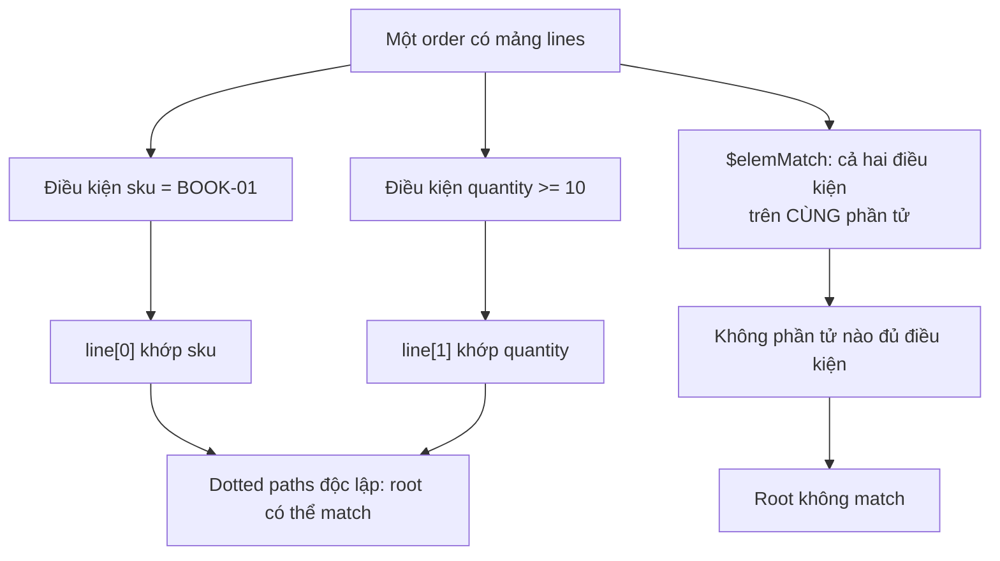

# elemMatch để các điều kiện khớp cùng một phần tử

> **Chương:** Thao tác array  
> **Module:** `SPRING_DATA_MONGODB` — sử dụng Spring Data MongoDB để kết nối, ánh xạ document và thao tác MongoDB qua repository hoặc `MongoTemplate`. Bài học giải thích toán tử MongoDB **`$elemMatch`** trong truy vấn mảng, cách sử dụng qua `Criteria` và `@Query`, cùng những hệ quả với aggregation, multikey index, cập nhật array, transaction, reactive access, kiểm thử và chẩn đoán hiệu năng.

## 1. Bài toán: hai điều kiện đúng nhưng không thuộc cùng dòng hàng

Một đơn hàng có mảng `lines` gồm nhiều object:

```json
{
  "_id": "ORD-101",
  "status": "PAID",
  "lines": [
    { "sku": "BOOK-01", "quantity": 2, "fulfilled": false },
    { "sku": "PEN-02", "quantity": 30, "fulfilled": false }
  ]
}
```

Yêu cầu nghiệp vụ: **tìm đơn hàng có ít nhất một dòng `sku = BOOK-01` và `quantity >= 10`**.

Một cách viết trông hợp lý:

```javascript
db.orders.find({
  "lines.sku": "BOOK-01",
  "lines.quantity": { $gte: 10 }
});
```

Nhưng query trên **vẫn khớp `ORD-101`**:

- Phần tử đầu có `sku = BOOK-01` (nhưng `quantity = 2`).
- Phần tử thứ hai có `quantity = 30` (nhưng `sku = PEN-02`).

MongoDB có thể dùng **hai phần tử khác nhau của cùng mảng** để thỏa các điều kiện dotted path độc lập. Trong đơn này **không có dòng hàng nào** vừa mang mã sách vừa có số lượng ít nhất 10.

Để bắt buộc nhiều điều kiện **cùng đúng trên một phần tử mảng**, dùng `$elemMatch`:

```javascript
db.orders.find({
  lines: {
    $elemMatch: {
      sku: "BOOK-01",
      quantity: { $gte: 10 }
    }
  }
});
```

**`ORD-101` không còn khớp** vì không tìm thấy phần tử đơn lẻ nào thỏa cả hai điều kiện. Đây là ý nghĩa cốt lõi của `$elemMatch`.



**Ghi nhớ:** `$elemMatch` là toán tử **lọc document theo nội dung của một array**. Nó không có nghĩa “trả về duy nhất phần tử khớp” — đó là bài toán **projection** riêng.

## 2. Bộ dữ liệu thử nghiệm để kiểm chứng

Để tránh phỏng đoán, dùng một tập document có chủ đích phân biệt điều kiện độc lập và điều kiện cùng phần tử. Chỉ thực hiện `drop()` trong **database test**:

```javascript
db.orders.drop();

db.orders.insertMany([
  {
    _id: "ORD-101",
    status: "PAID",
    lines: [
      { sku: "BOOK-01", quantity: 2, fulfilled: false },
      { sku: "PEN-02", quantity: 30, fulfilled: false }
    ]
  },
  {
    _id: "ORD-102",
    status: "PAID",
    lines: [
      { sku: "BOOK-01", quantity: 12, fulfilled: false },
      { sku: "PEN-02", quantity: 1, fulfilled: true }
    ]
  },
  {
    _id: "ORD-103",
    status: "PENDING",
    lines: [
      { sku: "BOOK-01", quantity: 5, fulfilled: false },
      { sku: "BOOK-01", quantity: 15, fulfilled: true }
    ]
  },
  {
    _id: "ORD-104",
    status: "PAID",
    lines: []
  },
  {
    _id: "ORD-105",
    status: "PENDING",
    lines: [
      { sku: "BOOK-01", quantity: 1, fulfilled: false }
    ]
  },
  {
    _id: "ORD-106",
    status: "PAID"
  }
]);
```

Để chỉ quan sát ID:

```javascript
db.orders.find(
  {
    lines: {
      $elemMatch: {
        sku: "BOOK-01",
        quantity: { $gte: 10 }
      }
    }
  },
  { _id: 1 }
).sort({ _id: 1 });
```

**Kết quả kỳ vọng:** `ORD-102` và `ORD-103`. Trong `ORD-103`, **dòng thứ hai** thỏa cả hai điều kiện; không bắt buộc tất cả dòng của đơn đều thỏa.

| Đơn | Có `sku=BOOK-01`? | Có `quantity>=10`? | Có **cùng một line** thỏa cả hai? |
| --- | :---: | :---: | :---: |
| `ORD-101` | Có | Có | **Không** |
| `ORD-102` | Có | Có | **Có** |
| `ORD-103` | Có | Có | **Có** |
| `ORD-104` | Không | Không | **Không** |
| `ORD-105` | Có | Không | **Không** |
| `ORD-106` | Không có mảng | Không có mảng | **Không** |

Trên tập này, query dotted path trả `ORD-101`, `ORD-102`, `ORD-103`; query `$elemMatch` chỉ trả `ORD-102`, `ORD-103`. Hãy giữ bộ dữ liệu này để đối chiếu các ví dụ Java tiếp theo.

## 3. Chính xác thì $elemMatch đánh giá điều kiện như thế nào?

Giả sử mảng `A = [e1, e2, ..., en]` và có hai điều kiện `P`, `Q`:

- Query dotted-path độc lập có thể tương ứng với **`tồn tại i: P(ei)`** và **`tồn tại j: Q(ej)`**, với `i` và `j` có thể **khác nhau**.
- `$elemMatch` yêu cầu **`tồn tại i: P(ei) và Q(ei)`** trên **cùng một phần tử**.

Viết dưới dạng logic:

\[
(\exists i: P(e_i)) \land (\exists j: Q(e_j))
\quad\not\equiv\quad
\exists k: [P(e_k) \land Q(e_k)].
\]

Sự khác biệt quan trọng khi mỗi phần tử là một object biểu diễn một giao dịch, dòng hàng, trạng thái, thiết bị, lịch sử sự kiện hoặc một cặp giá trị có quan hệ nội bộ.

### 3.1. $elemMatch là điều kiện tồn tại, không phải “mọi phần tử”

Query:

```javascript
db.orders.find({
  lines: {
    $elemMatch: { sku: "BOOK-01", quantity: { $gte: 10 } }
  }
});
```

chỉ cần **ít nhất một** phần tử đạt yêu cầu. Nó không kiểm tra mọi dòng hàng. Để hỏi “không có dòng nào vi phạm một quy tắc”, có thể suy từ việc không tồn tại phần tử sai, dùng `$not` kết hợp `$elemMatch` một cách có chủ đích; phải kiểm tra kỹ trường hợp mảng vắng/null.

### 3.2. Array rỗng, field thiếu hoặc scalar không khớp

`$elemMatch` đòi hỏi field đích có **kiểu mảng** để tìm phần tử:

- `lines: []`: không có phần tử nào nên không khớp.
- Không có `lines`: không khớp.
- `lines: null`: không khớp.
- `lines: {sku:"BOOK-01",quantity:12}`: là **object đơn**, không phải mảng, nên không khớp `$elemMatch` dù object có thuộc tính đúng.

Ngược lại, query dotted path có thể truy cập object đơn ở những tình huống phù hợp. Do đó, `$elemMatch` cũng giúp **khẳng định tính chất array** của dữ liệu khi một collection chứa nhiều dạng schema lịch sử.

### 3.3. Các toán tử được phép bên trong

`$elemMatch` dùng các điều kiện truy vấn thông thường, ví dụ `$gte`, `$lt`, `$in`, `$exists`, `$regex` hay `$and`/`$or` tùy trường hợp. Không đưa `$where` hoặc `$text` vào `$elemMatch`; MongoDB đặt giới hạn cho những toán tử này.

Ví dụ tìm dòng sách số lượng tối thiểu 10 và chưa hoàn tất:

```javascript
db.orders.find({
  lines: {
    $elemMatch: {
      sku: { $in: ["BOOK-01", "BOOK-02"] },
      quantity: { $gte: 10 },
      fulfilled: false
    }
  }
});
```

Với bộ dữ liệu ở mục 2, `ORD-102` khớp còn `ORD-103` không khớp: dòng `BOOK-01` có `quantity=15` trong `ORD-103` đã `fulfilled=true`. Các điều kiện thuộc **cùng một line**, không được lấy `fulfilled=false` từ line khác.

## 4. So sánh với $and và các dotted path

Nhiều người thử thêm `$and` để giải quyết vấn đề:

```javascript
db.orders.find({
  $and: [
    { "lines.sku": "BOOK-01" },
    { "lines.quantity": { $gte: 10 } }
  ]
});
```

**Không giải quyết được.** `$and` chỉ yêu cầu hai predicate trên root document cùng đúng. Nó **không ràng buộc** cả hai phải dùng cùng phần tử mảng. `ORD-101` vẫn có thể khớp.

| Cách viết | Cùng phần tử? | Ý nghĩa |
| --- | :---: | --- |
| `{"lines.sku":"BOOK-01","lines.quantity":{$gte:10}}` | Không | Có thể dùng hai line khác nhau. |
| `{$and:[{"lines.sku":"BOOK-01"},{"lines.quantity":{$gte:10}}]}` | Không | Chỉ nhóm các điều kiện root. |
| `{lines:{$elemMatch:{sku:"BOOK-01",quantity:{$gte:10}}}}` | **Có** | Ít nhất một line thỏa cả hai. |

**Quy tắc chọn:** nếu các field biểu thị những thuộc tính liên quan **trong cùng một record của mảng**, hãy đánh dấu chính đường biên array bằng `$elemMatch`.

## 5. $elemMatch với mảng giá trị vô hướng

`$elemMatch` không chỉ áp dụng cho mảng object. Giả sử:

```javascript
db.exams.insertMany([
  { _id: "E-1", scores: [50, 95] },
  { _id: "E-2", scores: [85, 70] },
  { _id: "E-3", scores: [60, 75] },
  { _id: "E-4", scores: [] }
]);
```

Mục tiêu: tìm bài thi có **một điểm số trong khoảng [80, 90)**.

Nếu viết:

```javascript
db.exams.find({
  scores: { $gte: 80, $lt: 90 }
});
```

`E-1` có thể khớp vì **95 >= 80** và **50 < 90**, dù **không có điểm nào trong [80,90)**.

Viết đúng:

```javascript
db.exams.find({
  scores: {
    $elemMatch: { $gte: 80, $lt: 90 }
  }
});
```

Chỉ `E-2` khớp (giá trị 85).

### Khi chỉ có một điều kiện?

Với một mảng scalar chuẩn, `{scores:{$gte:80}}` đã có nghĩa **có phần tử đạt ngưỡng 80**. Không nhất thiết thêm `$elemMatch` chỉ để bọc một điều kiện. Tuy nhiên `$elemMatch` có thể giúp yêu cầu **field thực sự là array** khi dữ liệu còn lẫn kiểu scalar.

## 6. Mảng lồng nhau và các mức ràng buộc

Xét một đơn hàng có nhiều kiện hàng, mỗi kiện có các mặt hàng:

```json
{
  "_id": "ORD-PACK",
  "packages": [
    {
      "packageCode": "PK-1",
      "items": [
        { "sku": "BOOK-01", "quantity": 3 },
        { "sku": "PEN-02", "quantity": 20 }
      ]
    },
    {
      "packageCode": "PK-2",
      "items": [
        { "sku": "BOOK-01", "quantity": 12 }
      ]
    }
  ]
}
```

Muốn tìm **một kiện `PK-2`** chứa **một item `BOOK-01` với quantity ít nhất 10**, dùng hai mức `$elemMatch`:

```javascript
db.orders.find({
  packages: {
    $elemMatch: {
      packageCode: "PK-2",
      items: {
        $elemMatch: {
          sku: "BOOK-01",
          quantity: { $gte: 10 }
        }
      }
    }
  }
});
```

`$elemMatch` ngoài ràng buộc **cùng package**; `$elemMatch` trong ràng buộc **cùng item của package đó**. Nếu chỉ dùng các dotted path `packages.packageCode` và `packages.items.quantity`, các điều kiện có thể khớp ở hai package khác nhau.

Với một object nhúng **không phải array**, dấu chấm vẫn đủ để truy cập property, ví dụ `"shippingAddress.city"`. Chỉ đặt `$elemMatch` ở vị trí có **array** cần ràng buộc phần tử.

## 7. Sử dụng Criteria.elemMatch với MongoTemplate

### 7.1. Domain model Java

Một mô hình immutable với value object nhúng, chạy trên Java 17+:

```java
package demo.orders;

import java.util.List;
import org.springframework.data.annotation.Id;
import org.springframework.data.mongodb.core.mapping.Document;

@Document(collection = "orders")
public record Order(
    @Id String id,
    String status,
    List<OrderLine> lines
) {}

record OrderLine(
    String sku,
    int quantity,
    boolean fulfilled
) {}
```

`OrderLine` được lưu **nhúng trong mảng `lines`** của document `Order`; nó không cần một collection riêng. `@DocumentReference` hay `@DBRef` là mô hình khác, không làm cho `$elemMatch` tự join sang document ở collection đích.

### 7.2. Query đúng bằng Criteria

```java
import java.util.List;
import org.springframework.data.mongodb.core.query.Criteria;
import org.springframework.data.mongodb.core.query.Query;

Criteria sameLine = Criteria.where("sku").is("BOOK-01")
    .and("quantity").gte(10);

Query query = Query.query(
    Criteria.where("lines").elemMatch(sameLine)
);

List<Order> orders = mongoTemplate.find(query, Order.class);
```

`mongoTemplate` là bean `MongoTemplate` được inject vào service/test. Query trên biểu đạt:

```javascript
{ lines: { $elemMatch: { sku: "BOOK-01", quantity: { $gte: 10 } } } }
```

Điều quan trọng là đặt `elemMatch(…)` trên **field mảng `lines`**, không phải trên `lines.sku` hay `lines.quantity`.

### 7.3. Query sai và so sánh rõ ràng

```java
// KHÔNG bảo đảm cùng phần tử:
Query unsafe = Query.query(
    Criteria.where("lines.sku").is("BOOK-01")
        .and("lines.quantity").gte(10)
);

// Có bảo đảm cùng phần tử:
Query safe = Query.query(
    Criteria.where("lines").elemMatch(
        Criteria.where("sku").is("BOOK-01")
            .and("quantity").gte(10)
    )
);
```

Với bộ dữ liệu mục 2:

- `unsafe` trả `ORD-101`, `ORD-102`, `ORD-103`.
- `safe` chỉ trả `ORD-102`, `ORD-103`.

Nếu nghiệp vụ còn yêu cầu chỉ tìm các đơn `PAID`:

```java
Query paidOrders = Query.query(
    Criteria.where("status").is("PAID")
        .and("lines").elemMatch(
            Criteria.where("sku").is("BOOK-01")
                .and("quantity").gte(10)
        )
);
```

Lúc này chỉ `ORD-102` khớp tập dữ liệu mẫu, vì `ORD-103` có trạng thái `PENDING`. Điều kiện `status` thuộc **root**, còn các điều kiện `sku` và `quantity` cùng thuộc một **phần tử `lines`**.

### 7.4. Field mapping và @Field

Nếu domain dùng:

```java
// Trong record OrderLine ở một biến thể khác của model:
@Field("item_code") String sku
```

thì field BSON bên trong `lines` mang tên `item_code`. Với `MongoTemplate.find(query, Order.class)`, Spring Data áp dụng mapping metadata theo entity type; để chắc chắn filter dùng đúng BSON path khi triển khai schema đặc thù, kiểm tra query thực thi trong integration test.

Trong `mongosh` và Java Driver thô, luôn sử dụng **tên BSON thật**:

```javascript
db.orders.find({
  lines: {
    $elemMatch: {
      item_code: "BOOK-01",
      quantity: { $gte: 10 }
    }
  }
});
```

Đừng tự suy rằng tên property Java và field BSON trùng nhau nếu class có `@Field`, custom converters hoặc legacy schema.

## 8. Repository @Query và giới hạn của derived query

### 8.1. Khai báo chính xác bằng @Query

```java
package demo.orders;

import java.util.List;
import org.springframework.data.mongodb.repository.MongoRepository;
import org.springframework.data.mongodb.repository.Query;

public interface OrderRepository extends MongoRepository<Order, String> {

    @Query("{ 'lines': { '$elemMatch': { 'sku': ?0, 'quantity': { '$gte': ?1 } } } }")
    List<Order> findWithLineHavingSkuAndMinQuantity(
        String sku, int minQuantity
    );

    @Query("{ 'status': ?0, 'lines': { '$elemMatch': " +
           "{ 'sku': ?1, 'quantity': { '$gte': ?2 }, 'fulfilled': false } } }")
    List<Order> findUnfulfilledLines(
        String status, String sku, int minQuantity
    );
}
```

`?0`, `?1` và `?2` là **placeholder tham số** do Spring Data bind, không phải vị trí nên nối chuỗi input từ người dùng. Đây là JSON query trong annotation, không phải một phép nối collection/server-side join.

### 8.2. Cạm bẫy với tên phương thức suy diễn

Trong một số mô hình, ta có thể viết:

```java
List<Order> findByLinesSkuAndLinesQuantityGreaterThanEqual(
    String sku, int quantity
);
```

Tên method trên biểu đạt **hai điều kiện theo nested path**, nhưng **không tự ràng buộc chúng trong cùng một phần tử mảng**. Spring Data MongoDB có thể tạo filter với hai dotted predicates tương tự `lines.sku` và `lines.quantity`; vì vậy vẫn có rủi ro trả về `ORD-101`.

Khi nghiệp vụ bắt buộc cùng phần tử, dùng `@Query` với `$elemMatch` hoặc `MongoTemplate`/`Criteria.elemMatch`. Nếu dự án dùng custom repository, có thể đặt tên method nghiệp vụ rõ ràng và hiện thực nó với `MongoTemplate` để tránh JSON string quá dài.

### 8.3. Phân trang và count

```java
import org.springframework.data.domain.Page;
import org.springframework.data.domain.Pageable;

@Query("{ 'lines': { '$elemMatch': { 'sku': ?0, 'quantity': { '$gte': ?1 } } } }")
Page<Order> pageByQualifiedLine(
    String sku, int minQuantity, Pageable pageable
);
```

Đây là một **method bổ sung trong interface repository**, không phải method toàn cục ở ngoài class. Khi trả `Page`, Spring Data có thể cần count query cùng filter để tính tổng. `$elemMatch` ở content filter và count filter phải có **cùng semantics**; tránh dùng một count thủ công chỉ với dotted predicates dẫn đến tổng số không khớp content.

Với trang chỉ cần biết còn kết quả hay không, có thể cân nhắc `Slice` để giảm chi phí đếm. Nên có sort ổn định và index phù hợp khi số đơn hàng lớn.

## 9. Query $elemMatch khác projection $elemMatch

**Đây là hai mục đích dùng cùng tên toán tử nhưng ở các vị trí khác nhau.**

### 9.1. Query $elemMatch lọc document cha

```javascript
db.orders.find({
  lines: {
    $elemMatch: {
      sku: "BOOK-01",
      quantity: { $gte: 10 }
    }
  }
});
```

MongoDB trả **những order đủ điều kiện**, và mặc định mảng `lines` trong document trả về vẫn gồm **toàn bộ phần tử**. Ví dụ `ORD-102` vẫn có cả dòng `BOOK-01` và `PEN-02`.

### 9.2. Projection $elemMatch chỉ lấy phần tử đầu tiên khớp

```javascript
db.orders.find(
  { _id: "ORD-103" },
  {
    status: 1,
    lines: {
      $elemMatch: {
        sku: "BOOK-01",
        quantity: { $gte: 10 }
      }
    }
  }
);
```

Trong **projection**, `$elemMatch` chọn **phần tử đầu tiên của mảng** khớp điều kiện và đưa phần tử đó vào mảng kết quả. Với `ORD-103`, chỉ dòng `BOOK-01, quantity=15` được trả trong `lines`. Đây **không** phải mệnh lệnh cập nhật hay xóa những dòng còn lại khỏi database.

Muốn lọc **tất cả** các phần tử thỏa điều kiện trong response, dùng aggregation `$filter` hoặc xử lý projection phù hợp, không dựa vào projection `$elemMatch` chỉ trả phần tử đầu tiên.

### 9.3. Spring Data projection bằng Field.elemMatch

```java
Query oneMatchingLine = Query.query(
    Criteria.where("id").is("ORD-103")
);

oneMatchingLine.fields().elemMatch(
    "lines",
    Criteria.where("sku").is("BOOK-01")
        .and("quantity").gte(10)
);

Order projected =
    mongoTemplate.findOne(oneMatchingLine, Order.class);
```

Ví dụ chỉ minh họa API `Query.fields().elemMatch(…)`. Nếu trả `Order` đầy đủ trong khi projection cắt bớt array, object đọc được là **bản thể không đầy đủ của aggregate**; **không save lại object đó** nếu không muốn vô tình thay thế mảng đầy đủ bằng mảng rút gọn. Trong ứng dụng thật, dùng DTO/projection chuyên dụng cho read-only.

## 10. $filter khi cần trả về tất cả phần tử khớp

Aggregation `$filter` tạo mảng mới chỉ gồm các phần tử thỏa điều kiện:

```javascript
db.orders.aggregate([
  {
    $match: {
      lines: {
        $elemMatch: {
          sku: "BOOK-01",
          quantity: { $gte: 10 }
        }
      }
    }
  },
  {
    $project: {
      status: 1,
      matchingLines: {
        $filter: {
          input: "$lines",
          as: "line",
          cond: {
            $and: [
              { $eq: ["$$line.sku", "BOOK-01"] },
              { $gte: ["$$line.quantity", 10] }
            ]
          }
        }
      }
    }
  }
]);
```

Vai trò hai stage:

1. `$match` với `$elemMatch` **chọn order** có ít nhất một line thỏa yêu cầu.
2. `$project` với `$filter` **chọn tất cả line** thỏa yêu cầu bên trong mỗi order đã chọn.

Với `ORD-103`, `matchingLines` chứa dòng có số lượng 15. Nếu một order có ba dòng phù hợp, `$filter` có thể trả cả ba, trong khi projection `$elemMatch` chỉ trả phần tử đầu tiên.

Lưu ý `$filter` là aggregation expression, không tự thay đổi array trên server. Với collection lớn, đo chi phí aggregation, kích thước output và query plan; projection không cứu được một `$match` thiếu index hoặc quá rộng.

## 11. Sử dụng $elemMatch để cập nhật array: cần thêm positional operator

`$elemMatch` **chọn document** theo nội dung array, còn việc **chọn phần tử để sửa** thuộc update path và positional operator. Không nên nghĩ chỉ cần query `$elemMatch` là MongoDB tự biết phải update field trong mọi phần tử phù hợp.

### 11.1. Cập nhật phần tử đầu tiên khớp bằng $

Ví dụ chỉ đánh dấu **một** dòng thỏa điều kiện:

```javascript
db.orders.updateOne(
  {
    _id: "ORD-102",
    lines: {
      $elemMatch: {
        sku: "BOOK-01",
        quantity: { $gte: 10 }
      }
    }
  },
  {
    $set: { "lines.$.fulfilled": true }
  }
);
```

Positional `$` của update được dùng để định vị **phần tử mảng đầu tiên phù hợp với điều kiện array của query**. Nó không có nghĩa “mọi phần tử thỏa điều kiện”. Cần đặc biệt thận trọng với nhiều array, query dùng phủ định và các tình huống cập nhật sâu; chọn API/positional operator phù hợp và test raw BSON.

Spring Data MongoDB:

```java
Query matchingOrder = Query.query(
    Criteria.where("id").is("ORD-102")
        .and("lines").elemMatch(
            Criteria.where("sku").is("BOOK-01")
                .and("quantity").gte(10)
        )
);

Update markFirst = new Update()
    .set("lines.$.fulfilled", true);

UpdateResult result =
    mongoTemplate.updateFirst(matchingOrder, markFirst, Order.class);
```

`UpdateResult.getMatchedCount()` đếm **document cha** khớp, `getModifiedCount()` đếm **document cha** thực sự sửa — **không** đếm số phần tử array được cập nhật.

### 11.2. Cập nhật tất cả phần tử thỏa điều kiện bằng $[identifier]

Nếu cần cập nhật mọi dòng `BOOK-01` với `quantity >= 10` trong một document, dùng **filtered positional operator** và `arrayFilters`:

```javascript
db.orders.updateOne(
  { _id: "ORD-103" },
  { $set: { "lines.$[line].fulfilled": true } },
  {
    arrayFilters: [
      {
        "line.sku": "BOOK-01",
        "line.quantity": { $gte: 10 }
      }
    ]
  }
);
```

Spring Data:

```java
Query byId = Query.query(
    Criteria.where("id").is("ORD-103")
);

Update markAll = new Update()
    .set("lines.$[line].fulfilled", true)
    .filterArray(
        Criteria.where("line.sku").is("BOOK-01")
            .and("line.quantity").gte(10)
    );

UpdateResult updated =
    mongoTemplate.updateFirst(byId, markAll, Order.class);
```

**Quan trọng:** `Update.filterArray(…)` chuyển filter xuống driver theo quy tắc API (không được Spring Data tự động map tên field/kiểu theo cách của mọi entity mapping). Nếu BSON dùng alias, viết **đúng tên BSON** trong `arrayFilters` và kiểm tra trên phiên bản Spring Data/driver thực tế. `$[line]` và `arrayFilters` là cú pháp cập nhật, không phải tên Java property.

Với `updateOne` như trên, `modifiedCount` có thể vẫn là **1** dù hai hoặc nhiều phần tử array trong cùng một document được sửa.

### 11.3. Không gộp kiểm tra rồi sửa thành hai bước rời rạc

Mẫu có rủi ro:

```java
boolean exists = mongoTemplate.exists(
    Query.query(Criteria.where("lines").elemMatch(
        Criteria.where("sku").is("BOOK-01")
            .and("quantity").gte(10)
    )),
    Order.class
);

// Một request khác có thể thay array ở giữa.
// Sau đó update dựa trên giả định dữ liệu vẫn còn như lúc exists().
```

Để bảo vệ điều kiện, đưa `$elemMatch` vào **filter của chính update**, đồng thời dùng optimistic locking/version hoặc transaction phù hợp nếu nghiệp vụ cần kiểm soát cạnh tranh trên nhiều document. MongoDB bảo đảm atomicity ở **cấp một document** cho một update; không tự có atomicity giữa nhiều document khi gọi `updateMulti`.

## 12. $all và nhiều yêu cầu độc lập trên một array

Giả sử cần đơn có **một dòng sách đủ 10** và **một dòng bút đủ 5**. Đây là **hai yêu cầu tồn tại độc lập** trên cùng mảng, không phải một phần tử mang đồng thời hai SKU.

Có thể dùng `$all` với nhiều `$elemMatch`:

```javascript
db.orders.find({
  lines: {
    $all: [
      {
        $elemMatch: {
          sku: "BOOK-01",
          quantity: { $gte: 10 }
        }
      },
      {
        $elemMatch: {
          sku: "PEN-02",
          quantity: { $gte: 5 }
        }
      }
    ]
  }
});
```

Hai `$elemMatch` này không bắt buộc trỏ tới cùng phần tử; mỗi cái có thể được đáp ứng bởi một phần tử khác. Đây là mô hình đúng khi nghiệp vụ yêu cầu **hai loại dòng hàng**, mỗi loại có số lượng tối thiểu.

Ngược lại, nếu yêu cầu **một dòng** đồng thời đạt nhiều thuộc tính, dùng **một `$elemMatch` duy nhất** với tất cả điều kiện liên quan. Đối với mảng scalar, `$all` còn cho phép yêu cầu những giá trị nhất định hiện diện trong mảng; nhưng `$all` không thay thế `$elemMatch` khi cần gắn các thuộc tính của cùng một embedded document.

## 13. Multikey index và lợi ích của $elemMatch trong query plan

### 13.1. Index trên các field của array

Với collection `orders`, một index ứng viên:

```javascript
db.orders.createIndex({
  "lines.sku": 1,
  "lines.quantity": 1
});
```

Đây là **compound multikey index** trên hai field của cùng mảng embedded documents. MongoDB có các quy tắc riêng cho compound multikey indexes (đặc biệt khi index liên quan nhiều array path), nên chỉ tạo index phù hợp với shape thật và kiểm tra khả năng tạo trên dữ liệu hiện có.

Với query:

```javascript
db.orders.find({
  lines: {
    $elemMatch: {
      sku: "BOOK-01",
      quantity: { $gte: 10 }
    }
  }
}).explain("executionStats");
```

`$elemMatch` không chỉ giúp truy vấn **đúng về logic**; khi các điều kiện cùng xuất phát từ một array path, nó còn có thể giúp MongoDB **kết hợp (compound/intersect) index bounds** một cách phù hợp trên multikey index.

Nếu chỉ dùng:

```javascript
db.orders.find({
  "lines.sku": "BOOK-01",
  "lines.quantity": { $gte: 10 }
}).explain("executionStats");
```

planner không thể suy rằng hai điều kiện áp dụng lên cùng một array element. Do vậy, không được kỳ vọng mức tận dụng bounds và tập kết quả giống `$elemMatch`. Cách chọn index thực tế còn phụ thuộc cardinality, phiên bản MongoDB, kích thước dữ liệu và filter khác.

### 13.2. Đừng coi elemMatch là một phép tăng tốc tuyệt đối

Ngay cả khi dùng `$elemMatch`, MongoDB vẫn có thể phải **FETCH document để xác nhận điều kiện**, tùy index và query. `$elemMatch` không đảm bảo query sẽ luôn được covered hoàn toàn.

Khi chẩn đoán, xem:

- `winningPlan`, `IXSCAN`/`COLLSCAN` và `FETCH`.
- `indexBounds` cho `lines.sku` và `lines.quantity`.
- `totalKeysExamined`, `totalDocsExamined`, số document trả về.
- Chi phí sort/pagination nếu API còn có `Sort` hoặc `Pageable`.
- Phân bố số phần tử array và số lượng giá trị trùng.

Một mảng có hàng nghìn phần tử trên mỗi document có chi phí indexing, update và kích thước document khác với mảng có 2–3 phần tử. Với mảng tăng không giới hạn (ví dụ triệu event), cân nhắc lưu thành **collection con riêng** với khóa cha và index thích hợp thay vì nhúng vô hạn.

### 13.3. Kết hợp điều kiện root và array

Nếu API hay dùng filter `status=PAID` cùng `$elemMatch` trên `lines`, có thể nghiên cứu index:

```javascript
db.orders.createIndex({
  status: 1,
  "lines.sku": 1,
  "lines.quantity": 1
});
```

Đây là ứng viên để **đo**, không phải index bắt buộc. Cần so sánh với workload còn lại, chi phí ghi, multikey bounds và dữ liệu thật. Trước khi tạo trên production, xác minh số index đã có, giới hạn server, tính phù hợp với sharding và hệ quả với write throughput.

## 14. Null, missing, kiểu BSON không đồng nhất và dữ liệu cũ

### 14.1. Field bên trong phần tử có thể thiếu

Xét:

```javascript
{ _id: "N-1", lines: [{ sku: "BOOK-01" }] }
{ _id: "N-2", lines: [{ sku: "BOOK-01", quantity: null }] }
{ _id: "N-3", lines: [{ sku: "BOOK-01", quantity: 10 }] }
```

Filter:

```javascript
{
  lines: {
    $elemMatch: {
      sku: "BOOK-01",
      quantity: { $gte: 10 }
    }
  }
}
```

không nên được coi là phép “điền mặc định quantity=0”; nó chỉ đánh giá dữ liệu hiện có theo semantics so sánh MongoDB. Với ba document minh họa, `N-3` phù hợp vì có giá trị số 10; `N-1` thiếu quantity và `N-2` có null.

Nếu viết `quantity: null` bên trong `$elemMatch`, MongoDB có semantics null-or-missing đối với subfield, nên **cả phần tử có `quantity: null` và phần tử thiếu `quantity`** có thể khớp. Khi chỉ muốn explicit BSON Null, dùng `{quantity:{$type:"null"}}`; khi muốn field có mặt, dùng `$exists: true`.

### 14.2. Tránh lẫn String với Number

```javascript
{ _id: "N-4", lines: [{ sku: "BOOK-01", quantity: "12" }] }
```

`quantity` được lưu thành **BSON String**, không phải numeric. Đừng trông chờ query `$gte: 10` tự parse chuỗi `"12"` thành số nguyên 12. Nếu collection từng có nhiều schema, nên thống kê BSON type rồi migration trước khi phụ thuộc vào index/range query.

### 14.3. Embedded documents hay document references?

`$elemMatch` kiểm tra **nội dung mảng được lưu trong document đang truy vấn**. Nếu `lines` là `List<LineReference>` nhưng MongoDB thực tế chỉ lưu ID hoặc DBRef, query như `"lines.sku"` không tự join đến collection khác.

Các lựa chọn lúc đó:

- Query collection dòng hàng riêng theo `orderId` và các điều kiện cùng document con.
- Denormalize những field thật sự cần cho query vào root, với chính sách đồng bộ.
- Dùng aggregation `$lookup` và các stage thích hợp khi cần join phía server.

Thay đổi từ nhúng sang reference **làm thay đổi schema BSON**; không chỉ sửa kiểu Java rồi giữ nguyên derived query.

## 15. Reactive access và kiểm soát bộ nhớ khi tìm trên mảng

### 15.1. ReactiveMongoTemplate

`ReactiveMongoTemplate` dùng cùng cú pháp `Query`/`Criteria`, nhưng kết quả trả về là publisher:

```java
import reactor.core.publisher.Flux;
import org.springframework.data.mongodb.core.query.Criteria;
import org.springframework.data.mongodb.core.query.Query;

Query query = Query.query(
    Criteria.where("lines").elemMatch(
        Criteria.where("sku").is("BOOK-01")
            .and("quantity").gte(10)
    )
);

Flux<Order> found =
    reactiveMongoTemplate.find(query, Order.class);
```

Khi có subscriber, driver thực thi query theo cơ chế reactive; **semantics `$elemMatch` không thay đổi**. Reactive cũng không biến một query trên collection references thành phép join tự động.

### 15.2. Chỉ lấy dữ liệu cần thiết

Nếu UI hiển thị mỗi đơn một summary nhưng document có hàng nghìn lines, hãy cân nhắc projection/aggregation để giảm lượng dữ liệu trên mạng; không gọi `collectList()` trên một `Flux` không giới hạn chỉ để đổi sang list Java. Sử dụng `limit`/`Pageable`, index, backpressure và độ đồng thời có giới hạn.

Tuy nhiên, cẩn trọng với projection `$elemMatch`: chỉ trả **phần tử đầu tiên khớp**, không phù hợp nếu API cần tất cả dòng đã đủ điều kiện. Khi đó dùng `$filter`/DTO thích hợp.

### 15.3. Transaction và nhất quán

Một thao tác update chỉ thay đổi array của một document là atomic ở **cấp document**; nếu cần cập nhật nhiều document (ví dụ đơn hàng cùng tồn kho ở collection khác), có thể cần transaction trên topology MongoDB hỗ trợ. `$elemMatch` chỉ xác định filter, **không tự mở transaction hoặc khóa các document khác**.

## 16. Integration test: phải có dữ liệu “đánh lừa” dotted query

Nếu mọi phần tử đều có `sku=BOOK-01` và `quantity>=10`, cả hai cách viết query đều trả cùng kết quả — test như vậy **không phát hiện được lỗi logic**. Bộ dữ liệu test phải có **`ORD-101`**: một line đúng SKU nhưng ít quantity, line còn lại nhiều quantity nhưng sai SKU.

### 16.1. Seed dữ liệu thật

Giả định đang dùng MongoDB thử nghiệm riêng, Spring Boot/Spring Data và JUnit 5. Dùng data thực:

```java
import java.util.List;
import org.bson.Document;
import static org.assertj.core.api.Assertions.assertThat;

mongoTemplate.getCollection("orders").insertMany(List.of(
    new Document("_id", "ORD-101")
        .append("status", "PAID")
        .append("lines", List.of(
            new Document("sku", "BOOK-01").append("quantity", 2)
                .append("fulfilled", false),
            new Document("sku", "PEN-02").append("quantity", 30)
                .append("fulfilled", false)
        )),
    new Document("_id", "ORD-102")
        .append("status", "PAID")
        .append("lines", List.of(
            new Document("sku", "BOOK-01").append("quantity", 12)
                .append("fulfilled", false)
        ))
));
```

**Lưu ý:** đoạn seed là phần **bên trong integration test có `MongoTemplate` được inject**, không phải một file Java độc lập. Collection phải được dọn cô lập trước test, và `dropCollection` không được chạy trên database dùng chung/production.

### 16.2. Assert khác biệt đúng trọng tâm

```java
Query dotted = Query.query(
    Criteria.where("lines.sku").is("BOOK-01")
        .and("lines.quantity").gte(10)
);

Query sameElement = Query.query(
    Criteria.where("lines").elemMatch(
        Criteria.where("sku").is("BOOK-01")
            .and("quantity").gte(10)
    )
);

var dottedIds = mongoTemplate.find(dotted, Order.class)
    .stream().map(Order::id).toList();

var elemMatchIds = mongoTemplate.find(sameElement, Order.class)
    .stream().map(Order::id).toList();

assertThat(dottedIds)
    .containsExactlyInAnyOrder("ORD-101", "ORD-102");
assertThat(elemMatchIds)
    .containsExactly("ORD-102");
```

Test này chứng minh lỗi logic được giải quyết: `ORD-101` là false positive nếu hai điều kiện được phép khớp trên hai phần tử khác nhau.

### 16.3. Các test case nên có thêm

| Kịch bản | Điều cần kiểm chứng |
| --- | --- |
| Một line thỏa cả hai điều kiện | `$elemMatch` trả order. |
| Hai line chia nhau hai điều kiện | Dotted query có thể trả order; `$elemMatch` không trả. |
| Hai line cùng thỏa | `$elemMatch` trả order một lần, không nhân bản root document. |
| Mảng rỗng hoặc field mảng thiếu | Không match `$elemMatch`. |
| Field `quantity` null/missing/String | Không bị xem nhầm thành một số nguyên hợp lệ. |
| Array lồng packages/items | Cần đúng số mức `$elemMatch` để gắn điều kiện vào một package/item. |
| Projection `$elemMatch` | Chỉ một phần tử đầu tiên khớp được trả về. |
| Aggregation `$filter` | Trả tất cả phần tử thỏa filter trong projection. |
| Positional update `$` | Đúng phần tử đầu tiên, không sửa line khác. |
| `arrayFilters` và `$[line]` | Các phần tử phù hợp được cập nhật; `modifiedCount` đếm document. |
| Compound multikey index | `explain` cho thấy bounds và kế hoạch thực tế. |
| Reactive query | Kết quả logic giống imperative trên cùng BSON. |

### 16.4. Kiểm tra query plan

Trên dữ liệu test đủ lớn, đo riêng:

```javascript
db.orders.find({
  "lines.sku": "BOOK-01",
  "lines.quantity": { $gte: 10 }
}).explain("executionStats");

db.orders.find({
  lines: {
    $elemMatch: {
      sku: "BOOK-01",
      quantity: { $gte: 10 }
    }
  }
}).explain("executionStats");
```

Đánh giá `nReturned` **và** `totalDocsExamined`/`totalKeysExamined`; nhiều kết quả hơn ở dotted query có thể do **semantics khác**, không thể chỉ kết luận query nào chậm vì số lượng bản ghi trả về khác nhau. Muốn benchmark hiệu năng có ý nghĩa, cần hiểu trước hai query **không tương đương về logic**.

## 17. Lỗi thường gặp và cách chẩn đoán

| Dấu hiệu | Nguyên nhân | Cách xử lý |
| --- | --- | --- |
| Đơn có dòng sách quantity 2 vẫn khớp filter quantity >= 10 | Hai dotted predicates dùng hai phần tử khác nhau. | Dùng một `$elemMatch` đặt trên `lines`. |
| Đã dùng `$and` nhưng vẫn có kết quả sai | `$and` kết hợp root predicates, không khóa cùng phần tử. | Nhóm các điều kiện bên trong `$elemMatch`. |
| `$elemMatch` không khớp dù thấy object có đủ field | Field là object đơn hoặc reference ID, không phải array embedded documents. | Xem raw BSON và sửa query/schema. |
| `$elemMatch` chỉ trả root chứ không rút gọn mảng | Query filter không phải projection. | Dùng projection `$elemMatch` hoặc aggregation `$filter`. |
| Projection `$elemMatch` chỉ có một dòng | Projection chỉ chọn phần tử đầu tiên khớp. | Dùng `$filter` nếu muốn tất cả. |
| Điều kiện array lồng lấy dữ liệu từ hai package khác nhau | Thiếu `$elemMatch` ở cấp package. | Viết nested `$elemMatch` cho mỗi ranh giới array cần kiểm soát. |
| Update chỉ sửa một line dù nhiều line đủ điều kiện | Positional `$` nhắm phần tử đầu tiên. | Dùng `$[identifier]` với `arrayFilters` khi cần mọi line. |
| Query đúng nhưng đọc array rất lớn | Root trả toàn bộ array sau khi match. | Thiết kế projection/DTO hoặc `$filter`, kiểm tra memory. |
| Query chậm dù có index | Multikey bounds chưa tối ưu, array lớn, filter không chọn lọc, index chưa hợp. | Xem `explain` và index path thực tế. |
| Named Java property không khớp tên BSON | Có `@Field`, legacy schema hoặc converter. | Kiểm tra MongoTemplate mapping và raw document. |
| Count của trang khác content | Count query dùng dotted predicates thay vì `$elemMatch`. | Bảo đảm cả hai dùng cùng filter logic. |
| Dữ liệu đổi trong khi cập nhật | Tách bước kiểm tra/ghi, thiếu trạng thái/version. | Đưa điều kiện vào update filter; dùng optimistic locking khi cần. |

**Quy trình debug ngắn:** (1) lấy raw document; (2) xác định field nào là array; (3) vẽ phần tử nào thỏa mỗi predicate; (4) đặt `$elemMatch` trên đúng array; (5) viết query `mongosh`; (6) chuyển sang Spring Data; (7) test dữ liệu false positive; (8) đo `explain` nếu cần tối ưu.

## 18. Bài thực hành: kiểm tra lô hàng đủ số lượng

**Bối cảnh:** hệ thống kho nhận đơn gồm các `lines`; mỗi line có `sku`, `quantity` và `fulfilled`. Nhóm cần tìm các đơn có **một line đủ điều kiện**, hiển thị những line phù hợp và cập nhật trạng thái hoàn thành.

1. Tạo entity `Order` và `OrderLine` ở mục 7, seed các document `ORD-101` đến `ORD-106`.
2. Chạy query dotted `lines.sku=BOOK-01` và `lines.quantity>=10`, ghi lại các ID khớp. Giải thích vì sao `ORD-101` là false positive.
3. Viết `Criteria.where("lines").elemMatch(...)` và phiên bản `@Query`; chứng minh hai cách trả `ORD-102`, `ORD-103`.
4. Thêm điều kiện `status=PAID` ở root. Chứng minh `ORD-103` bị loại dù có line đủ số lượng.
5. Viết query khác yêu cầu line `BOOK-01`, quantity >= 10 và `fulfilled=false` **cùng một phần tử**. Phân tích kết quả cho từng order.
6. Dùng projection `$elemMatch`, so sánh nội dung array được trả với query chỉ filter root.
7. Dùng aggregation `$filter` để trả **mọi line** đạt điều kiện, và giải thích vì sao không tương đương projection `$elemMatch`.
8. Viết update với `lines.$.fulfilled` để sửa phần tử đầu tiên. Sau đó thử `lines.$[line].fulfilled` với `arrayFilters` để sửa mọi phần tử phù hợp.
9. Tạo compound multikey index `{ "lines.sku": 1, "lines.quantity": 1 }`, so sánh `explain("executionStats")` trên dữ liệu đủ lớn.
10. Thêm một document có mảng `packages` chứa mảng `items`; viết nested `$elemMatch` để buộc package code và item quantity phải cùng một package.
11. Viết integration test có document “đánh lừa” như `ORD-101`, thêm test array rỗng, thiếu field, null và sai BSON type.
12. Viết phiên bản reactive với `ReactiveMongoTemplate.find` và xác minh tập ID trùng phiên bản imperative.

### Câu hỏi tự kiểm tra

- Vì sao hai điều kiện `lines.sku` và `lines.quantity` có thể khớp trên hai phần tử khác nhau?
- `$and` có bảo đảm cùng phần tử không? Tại sao?
- Toán tử `$elemMatch` được đặt trên field `lines` hay `lines.sku`?
- `$elemMatch` có buộc mọi phần tử đều hợp lệ không?
- `$elemMatch` hoạt động như thế nào với mảng số `[50,95]` và khoảng `[80,90)`?
- Khi có mảng lồng trong mảng, cần làm gì để giữ quan hệ giữa package và item?
- Query `$elemMatch` khác projection `$elemMatch` ở đâu?
- Vì sao aggregation `$filter` thích hợp hơn để trả mọi phần tử khớp?
- Positional operator `$` khác `$[line]` với `arrayFilters` ở điểm nào?
- Vì sao `modifiedCount=1` không nói rằng chỉ một line được cập nhật?
- `$elemMatch` có thể ảnh hưởng cách MongoDB dùng compound multikey index thế nào?
- Vì sao cần đọc raw BSON trước khi viết query trên object references hoặc alias `@Field`?

## 19. Ghi nhớ và tài liệu đối chiếu

- **Dotted predicates độc lập** trên một array có thể khớp ở **những phần tử khác nhau**.
- **`$elemMatch`** yêu cầu **ít nhất một phần tử** của array thỏa **tất cả điều kiện** nằm bên trong.
- **`$and` không thay thế `$elemMatch`** khi yêu cầu cùng phần tử.
- Spring Data MongoDB dùng `Criteria.where("lines").elemMatch(...)` hoặc `@Query` để diễn đạt điều kiện một cách tường minh.
- **Query `$elemMatch` lọc document cha**; **projection `$elemMatch` chỉ trả phần tử đầu tiên phù hợp**; `$filter` trả tất cả phần tử khớp vào mảng kết quả.
- Với array lồng nhau, đặt `$elemMatch` ở **mỗi cấp array** cần buộc các điều kiện liên quan.
- Khi update, `$elemMatch` chỉ xác định root document; dùng `$` hoặc `$[identifier]`/`arrayFilters` để điều khiển phần tử nào được sửa.
- `$elemMatch` có thể giúp **kết hợp multikey index bounds** trên cùng array path, nhưng phải đo `explain` với dữ liệu thật.
- Dữ liệu thiếu/null/sai BSON type, document references và projection entity không đầy đủ là những nguồn lỗi cần kiểm thử.
- Bảo đảm filter của content query, count query và update có **đúng semantics nghiệp vụ**; reactive hay transaction không tự thay đổi ý nghĩa `$elemMatch`.

Nguồn chính thức để đối chiếu theo phiên bản MongoDB/Spring Data thực tế:

- [MongoDB — `$elemMatch` (query)](https://www.mongodb.com/docs/manual/reference/operator/query/elemMatch/)
- [MongoDB — Query an Array of Embedded Documents](https://www.mongodb.com/docs/manual/tutorial/query-array-of-documents/)
- [MongoDB — `$elemMatch` (projection)](https://www.mongodb.com/docs/manual/reference/operator/projection/elemMatch/)
- [MongoDB — `$filter` (aggregation)](https://www.mongodb.com/docs/manual/reference/operator/aggregation/filter/)
- [MongoDB — Multikey Index Bounds](https://www.mongodb.com/docs/manual/core/indexes/index-types/index-multikey/multikey-index-bounds/)
- [MongoDB — Filtered Positional Operator `$[<identifier>]`](https://www.mongodb.com/docs/manual/reference/operator/update/positional-filtered/)
- [Spring Data MongoDB — Template Query Operations](https://docs.spring.io/spring-data/mongodb/reference/mongodb/template-query-operations.html)
- [Spring Data MongoDB — Updating Documents](https://docs.spring.io/spring-data/mongodb/reference/mongodb/template-crud-operations.html)
- [Spring Data MongoDB — Criteria API](https://docs.spring.io/spring-data/mongodb/reference/api/java/org/springframework/data/mongodb/core/query/Criteria.html)
