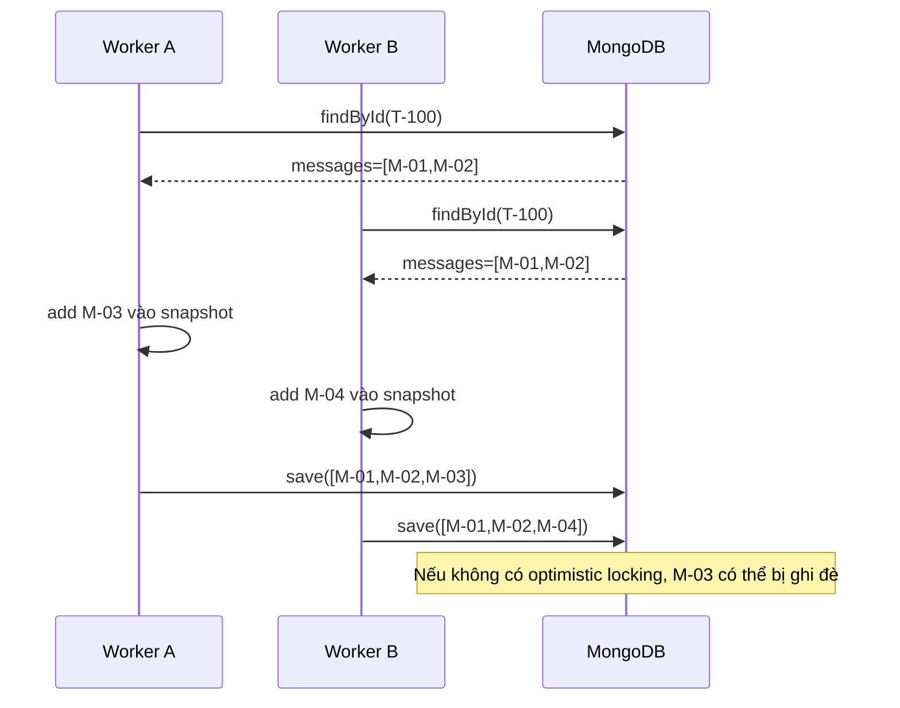

# Cạnh tranh ghi và giới hạn kích thước khi array tăng liên tục trong Spring Data MongoDB

## 1. Bối cảnh: array tiện cho đọc nhưng không phải kho lưu trữ vô hạn

**Spring Data MongoDB** giúp ứng dụng Java thao tác các document MongoDB qua repository hoặc `MongoTemplate`. Một mô hình thường gặp là nhúng danh sách vào document cha: các tin nhắn của ticket, lịch sử trạng thái đơn hàng, danh sách thành viên nhóm, lượt tương tác hoặc các sự kiện gần đây.

Ban đầu thiết kế này rất hấp dẫn: đọc một document có thể nhận toàn bộ dữ liệu cần hiển thị và nhiều thao tác cập nhật chỉ chạm vào **một document**. Nhưng khi array tăng liên tục, hai vấn đề xuất hiện:

1. **Cạnh tranh ghi (write contention):** nhiều request cùng bổ sung, xóa hoặc sửa phần tử của **cùng một document cha**. Việc cập nhật tuần tự từ các snapshot cũ có thể mất dữ liệu; ngay cả cập nhật nguyên tử cũng có thể tạo điểm nóng thông lượng.
2. **Kích thước BSON:** MongoDB giới hạn **một document BSON tối đa 16 MiB**. Giới hạn này tính cả array, các field khác, tên trường và overhead BSON; không phải 16 MiB dành riêng cho nội dung string hoặc các phần tử array.

Bài thuộc chương **Thao tác array** giải thích cách lựa chọn `$push`, `$addToSet`, `$pull`, `$set`, optimistic locking, điều kiện cập nhật nguyên tử, array có giới hạn (*bounded array*) và lúc nào nên tách từng phần tử thành document riêng. Mục tiêu là giữ đúng dữ liệu khi nhiều tác vụ đồng thời, đo được giới hạn thực tế và thiết kế schema phát triển lâu dài.

### 1.1. Ví dụ xuyên suốt: ticket hỗ trợ khách hàng

Một ticket có các tin nhắn:

```javascript
{
  _id: "T-100",
  status: "OPEN",
  messageCount: 2,
  messages: [
    {
      messageId: "M-01",
      authorId: "U-01",
      body: "Tôi cần hỗ trợ",
      createdAt: ISODate("2026-02-01T08:00:00Z")
    },
    {
      messageId: "M-02",
      authorId: "U-02",
      body: "Chúng tôi đã tiếp nhận",
      createdAt: ISODate("2026-02-01T08:01:00Z")
    }
  ]
}
```

Giả sử mỗi phút có hàng trăm tin nhắn tới cùng ticket. Có thể chọn giữ mọi tin trong `messages`, chỉ giữ 50 tin gần nhất, hoặc chuyển mỗi tin thành document riêng. Ba lựa chọn có **độ phức tạp, tính nhất quán và giới hạn dung lượng khác nhau**.

### 1.2. Phân biệt bốn yêu cầu trước khi chọn cách ghi

| Yêu cầu nghiệp vụ | Đặc tính cần bảo đảm | Hướng kỹ thuật cần cân nhắc |
|---|---|---|
| Ghi thêm mọi sự kiện, không mất bản ghi | Lưu trữ không giới hạn theo thời gian | Collection con, mỗi sự kiện là một document |
| Hiển thị 50 sự kiện mới nhất | Chỉ cần cửa sổ gần đây | `$push` cùng `$each`/`$slice` |
| Thêm ID vào tập, không trùng | Uniqueness theo quy tắc rõ ràng | `$addToSet` hoặc unique index ở collection con |
| Tối đa 100 thành viên/tin trong một document | Điều kiện kiểm tra và ghi phải nguyên tử | Conditional update kèm `$push`/`$inc` và filter trạng thái |

Không nên nhúng mọi dữ liệu vào một array chỉ vì MongoDB hỗ trợ array. **Tần suất ghi, nhu cầu truy vấn, vòng đời dữ liệu và giới hạn document** phải được đánh giá ngay khi mô hình hóa.

## 2. Tính nguyên tử của cập nhật một document

MongoDB bảo đảm **mỗi thao tác ghi lên một document là nguyên tử ở phạm vi document đó**, kể cả khi thao tác sửa nhiều trường hoặc phần tử array. Điều này là nền tảng quan trọng của các toán tử cập nhật.

```mermaid
sequenceDiagram
    participant A as Request A
    participant B as Request B
    participant DB as MongoDB: ticket T-100
    A->>DB: $push messages += M-03
    B->>DB: $push messages += M-04
    DB-->>A: Ghi hoàn tất
    DB-->>B: Ghi hoàn tất
    Note over DB: Hai update đơn-document đều nguyên tử; thứ tự ghi có thể khác thứ tự request
```

Hai câu lệnh `$push` độc lập vào cùng array có thể được thực thi nối tiếp ở phía server: nếu cả hai được chấp nhận và không có giới hạn `$slice` loại phần tử, **cả hai giá trị đều có trong array**, thay vì request sau ghi đè toàn bộ danh sách của request trước.

Tuy nhiên, **nguyên tử không đồng nghĩa không có cạnh tranh**:

- Nếu rất nhiều tác vụ ghi vào cùng `_id`, document đó có thể trở thành điểm nóng.
- Thứ tự các phần tử được thêm bởi các request đồng thời **không phải thứ tự thời gian nghiệp vụ được bảo đảm**.
- Một `$push` bị retry sau timeout có thể ghi **trùng phần tử** nếu không có cơ chế idempotency.
- Một cập nhật `$push + $slice` có thể loại phần tử cũ, vì vậy kết quả cuối không nhất thiết chứa mọi sự kiện đã từng được thêm.
- Nếu thao tác nghiệp vụ trải trên **nhiều document**, tính nguyên tử một document không bao trùm tất cả bước.

### 2.1. $push: thêm vào array mà không ghi lại snapshot cũ

```javascript
db.tickets.updateOne(
  { _id: "T-100" },
  {
    $push: {
      messages: {
        messageId: "M-03",
        authorId: "U-01",
        body: "Xin cập nhật tiến độ",
        createdAt: ISODate("2026-02-01T08:02:00Z")
      }
    },
    $inc: { messageCount: 1 }
  }
);
```

`$push` chèn phần tử vào cuối array; `$inc` tăng bộ đếm trong **cùng một lần cập nhật nguyên tử**. Nếu câu lệnh thành công, không có trạng thái trung gian chỉ tăng count nhưng chưa thêm message mà request khác có thể quan sát qua một single-document read thông thường.

Điều kiện để bộ đếm đúng là **mọi đường sửa array đều cập nhật count nhất quán**. Một đường xóa hoặc backfill bỏ quên `messageCount` có thể làm lệch dữ liệu. Nếu chỉ lưu 50 tin gần nhất, `messageCount` nên được đặt tên và định nghĩa là **tổng tin đã nhận** hoặc **số phần tử hiện đang lưu**, không dùng một field cho cả hai ý nghĩa.

### 2.2. $addToSet: loại giá trị trùng theo BSON equality

Khi lưu một array các ID hoặc tag:

```javascript
db.tickets.updateOne(
  { _id: "T-100" },
  { $addToSet: { watcherIds: "U-03" } }
);
```

`$addToSet` chỉ thêm nếu array chưa chứa **giá trị bằng nhau theo quy tắc so sánh của MongoDB**. Hai request đồng thời thêm cùng String `"U-03"` không nhằm tạo hai bản sao giống nhau. Nhưng cần nhớ:

- Nó **không loại bỏ** các giá trị trùng đã tồn tại trước đó.
- Với embedded document, thứ tự field và nội dung document có thể ảnh hưởng việc xem hai giá trị là trùng.
- Nó không bảo đảm uniqueness theo khóa nghiệp vụ như `messageId` nếu hai object khác nhau ở `body` hoặc `createdAt`.
- `$addToSet` không giới hạn số phần tử; array vẫn có thể tăng cho tới giới hạn BSON.

Để bảo đảm uniqueness nghiệp vụ cho nhiều triệu message, một collection con với **unique index** trên `(ticketId, messageId)` thường rõ ràng hơn array embedded.

### 2.3. $pull, $pop và cập nhật phần tử

Xóa tất cả phần tử của array khớp điều kiện:

```javascript
db.tickets.updateOne(
  { _id: "T-100" },
  { $pull: { messages: { messageId: "M-02" } } }
);
```

`$pull` loại **mọi phần tử khớp**, không phải chỉ phần tử đầu tiên. Nếu giữ count ở cùng document, cần thiết kế phép đếm chính xác cho số phần tử thực sự bị xóa; **không** cứ `$pull` một lần thì `$inc: -1` khi có thể có 0 hoặc nhiều phần tử khớp.

`$pop: { messages: 1 }` xóa phần tử cuối; `$pop: { messages: -1 }` xóa phần tử đầu. Đây là thao tác theo **vị trí**, không theo một khóa nghiệp vụ. Nếu có tác vụ đồng thời thêm/xóa, không dùng `$pop` để suy ra chính xác “xóa tin của người dùng X”.

## 3. Mất cập nhật (lost update) khi đọc–sửa–save cả document

### 3.1. Vì sao code Java trông hợp lý vẫn sai?

Một cách triển khai thường thấy:

```java
Ticket ticket = mongoTemplate.findById("T-100", Ticket.class);
ticket.getMessages().add(newMessage);
mongoTemplate.save(ticket);
```

Khi chỉ một request chạy, cách này có vẻ đúng. Nhưng nếu hai request cùng đọc **một phiên bản** ticket trước khi ghi:



`save(...)` thường ghi lại trạng thái entity, không tự hợp nhất hai danh sách được sửa từ snapshot cũ. **Tính nguyên tử của từng thao tác save không ngăn lost update giữa hai thao tác**.

> Lưu ý: với entity có `@Version` và optimistic locking đúng cấu hình, thao tác save của snapshot cũ có thể bị từ chối thay vì âm thầm ghi đè. Phần này mô tả rủi ro của cách đọc–sửa–save **không có cơ chế phát hiện xung đột**.

### 3.2. Ưu tiên toán tử nguyên tử cho thay đổi cục bộ

Nếu mục tiêu chỉ là **thêm một message**, không cần đọc toàn bộ array lên Java. Dùng cập nhật tại server:

```java
import com.mongodb.client.result.UpdateResult;
import org.springframework.data.mongodb.core.MongoTemplate;
import org.springframework.data.mongodb.core.query.Criteria;
import org.springframework.data.mongodb.core.query.Query;
import org.springframework.data.mongodb.core.query.Update;

Query byId = Query.query(Criteria.where("id").is(ticketId));
Update change = new Update()
    .push("messages", newMessage)
    .inc("messageCount", 1);

UpdateResult result = mongoTemplate.updateFirst(
    byId, change, Ticket.class);

if (result.getMatchedCount() != 1L) {
    throw new IllegalArgumentException("Ticket not found");
}
```

`Ticket.class` cung cấp mapping field của Spring Data; các property như `messages` và `messageCount` được chuyển sang BSON tương ứng. Không cần gọi `save(...)` sau `updateFirst(...)` chỉ để “xác nhận” thay đổi: đọc–ghi thêm một lần có thể tạo tranh chấp không cần thiết.

**Khi nào read–modify–save vẫn hợp lý?** Khi business rule cần nhìn nhiều field của một entity, xây một thay đổi phức tạp và dùng `@Version` để từ chối snapshot lỗi thời. Khi chỉ cần `$push`, `$pull` hoặc `$set` một phần tử, atomic update thường đơn giản và hiệu quả hơn.

### 3.3. Không dùng chỉ số phần tử làm danh tính ổn định

Hai request cùng đọc “phần tử thứ 3” rồi sửa bằng:

```javascript
{ $set: { "messages.2.body": "Edited" } }
```

có thể sửa nhầm phần tử nếu tác vụ khác đã `$pull`, `$pop` hoặc thay đổi thứ tự array. Index position biểu thị **vị trí hiện tại**, không phải identity lâu dài.

Khi cần chỉnh message có `messageId` cụ thể, dùng điều kiện theo khóa phần tử hoặc cân nhắc chuyển message thành document độc lập.

## 4. Mô hình Java dùng trong ví dụ Spring Data

Entity ví dụ:

```java
import java.util.ArrayList;
import java.util.List;
import org.springframework.data.annotation.Id;
import org.springframework.data.annotation.Version;
import org.springframework.data.mongodb.core.mapping.Document;

@Document("tickets")
public class Ticket {
    @Id
    private String id;
    private String status;
    private List<TicketMessage> messages = new ArrayList<>();
    private long messageCount;

    @Version
    private Long version;

    protected Ticket() {}

    public Ticket(String id) {
        this.id = id;
        this.status = "OPEN";
    }

    public String getId() { return id; }
    public String getStatus() { return status; }
    public List<TicketMessage> getMessages() { return messages; }
    public long getMessageCount() { return messageCount; }
    public Long getVersion() { return version; }
}
```

Value object cho một message:

```java
import java.time.Instant;

public record TicketMessage(
    String messageId,
    String authorId,
    String body,
    Instant createdAt
) {}
```

Ở đây:

- `@Id` gắn entity với BSON `_id`.
- `messages` là embedded array. Spring Data sẽ ánh xạ `TicketMessage` và `Instant` theo cấu hình converter hiện hành.
- `messageCount` chỉ chính xác khi được cập nhật đồng bộ với các thao tác thêm/xóa theo đúng chính sách nghiệp vụ.
- `@Version` hỗ trợ optimistic locking trên đường thao tác entity tương ứng như `save(...)`; nó **không phải khóa phân tán** và không tự biến một array thành cơ sở dữ liệu độc lập.

Trong các ví dụ raw BSON, một số trường như `version` hoặc type hint `_class` có thể xuất hiện tùy đường ghi/mapping; không cần giả định schema raw minh họa có đầy đủ mọi metadata của entity Spring Data.

## 5. Optimistic locking bằng @Version và conditional update

### 5.1. @Version giải quyết loại xung đột nào?

Giả sử hai người cùng sửa thông tin ticket theo mô hình **đọc–sửa–save**. Khi `Ticket` có `@Version Long version`, Spring Data MongoDB sử dụng phiên bản trong điều kiện của thao tác save/update entity phù hợp và tăng phiên bản khi ghi thành công. Nếu object được đọc từ phiên bản cũ, thao tác ghi có thể ném `OptimisticLockingFailureException` thay vì ghi đè trạng thái mới.

Ví dụ với repository:

```java
import org.springframework.data.mongodb.repository.MongoRepository;

public interface TicketRepository
        extends MongoRepository<Ticket, String> {
}
```

```java
import org.springframework.dao.OptimisticLockingFailureException;

Ticket ticket = ticketRepository.findById("T-100")
    .orElseThrow();

ticket.getMessages().add(new TicketMessage(
    "M-05", "U-03", "Xin bổ sung", java.time.Instant.now()));

try {
    ticketRepository.save(ticket);
} catch (OptimisticLockingFailureException conflict) {
    // Đọc lại bản mới, đánh giá lại quy tắc nghiệp vụ,
    // rồi quyết định retry, trả 409 hoặc yêu cầu người dùng làm lại.
    throw conflict;
}
```

Điểm quan trọng:

1. `@Version` giúp **phát hiện** xung đột optimistic, không tự gộp hai bản danh sách.
2. Khi retry, phải **đọc lại trạng thái mới và áp dụng lại ý định thay đổi**; không lặp `save` trên object lỗi thời.
3. Một thao tác có thể đã thành công ở server nhưng client mất phản hồi; cần thiết kế idempotency trước khi retry để tránh thêm cùng message hai lần.
4. Cơ chế phát hiện thất bại cần write concern có xác nhận; với `WriteConcern.UNACKNOWLEDGED`, ứng dụng không thể dựa vào xác nhận kết quả để xử lý optimistic locking chính xác.

Với throughput ghi cao, nếu mọi request luôn sửa ticket nóng bằng `save` có `@Version`, chúng có thể liên tục xung đột rồi retry. Đây không phải một giải pháp tự động tăng khả năng xử lý; khi nghiệp vụ chỉ thêm phần tử, hãy so sánh với `$push` nguyên tử.

### 5.2. Không mặc định typed updateFirst kiểm tra phiên bản cũ

Spring Data có thể tự tăng trường `@Version` trong một số thao tác update nếu bản thân update chưa đề cập trường version, nhưng điều đó **không đồng nghĩa một `updateFirst(...)` bất kỳ tự có điều kiện so sánh phiên bản đã đọc**. Để đạt kiểu *compare-and-set*, điều kiện query phải chứa phiên bản kỳ vọng hoặc điều kiện trạng thái nghiệp vụ cần được bảo vệ.

Ví dụ cập nhật khi status và version vẫn đúng:

```java
long expectedVersion = 3L; // Lấy từ bản ticket đã đọc.

Query predicate = Query.query(
    Criteria.where("id").is("T-100")
        .and("version").is(expectedVersion)
        .and("status").is("OPEN"));

Update update = new Update()
    .set("status", "RESOLVED");

var outcome = mongoTemplate.updateFirst(
    predicate, update, Ticket.class);

if (outcome.getMatchedCount() == 0L) {
    // Ticket bị đóng/đổi version/xóa, hoặc không tồn tại.
    // Không mặc định đây là lỗi "không tìm thấy".
}
```

Trong ví dụ, `version` là property mapped của `Ticket`. Việc tăng version khi dùng typed update phụ thuộc logic Spring Data/version đang dùng; muốn **chủ động kiểm soát version**, cần đối chiếu API update, cách auto-increment và kiểm thử raw document. Không vô tình tăng version hai lần nếu framework đã tự làm việc đó.

Nếu cần ngăn trạng thái `RESOLVED` bị ghi đè bởi một request khác, điều kiện `status = OPEN` nằm cùng lệnh update. Khi server áp dụng cập nhật một document, predicate liên quan đến dữ liệu đang ghi được đánh giá theo semantics cập nhật nguyên tử; nếu không còn khớp thì update không xảy ra.

## 6. Giới hạn số phần tử dưới cạnh tranh ghi

### 6.1. Kiểm tra độ dài trước rồi $push là không an toàn

Giả sử ticket chỉ được lưu tối đa 100 message trong một document. Cách làm sau có race:

```java
Ticket ticket = mongoTemplate.findById(ticketId, Ticket.class);
if (ticket.getMessages().size() < 100) {
    mongoTemplate.updateFirst(
        Query.query(Criteria.where("id").is(ticketId)),
        new Update().push("messages", newMessage),
        Ticket.class);
}
```

Hai request có thể cùng đọc `size = 99`, đều chấp nhận và cuối cùng array có 101 phần tử. Dù **mỗi `$push` riêng lẻ là nguyên tử**, phép kiểm tra ở Java **không nằm trong** cập nhật nguyên tử.

### 6.2. Gộp kiểm tra và ghi trong một atomic conditional update

Nếu document có `messageCount` phản ánh chính xác số phần tử hiện lưu và **mọi cập nhật đều duy trì count**, có thể đặt điều kiện ngay trong query:

```javascript
db.tickets.updateOne(
  {
    _id: "T-100",
    messageCount: { $lt: 100 },
    "messages.messageId": { $ne: "M-NEW" }
  },
  {
    $push: {
      messages: {
        messageId: "M-NEW",
        authorId: "U-03",
        body: "Một tin nhắn",
        createdAt: ISODate("2026-02-01T08:03:00Z")
      }
    },
    $inc: { messageCount: 1 }
  }
);
```

Predicate và update chạy như **một thao tác single-document**. Với điều kiện dữ liệu đã nhất quán và mọi writer tuân thủ cùng quy tắc:

- Khi count đạt 100, request tiếp theo không khớp; array không vượt giới hạn quy định.
- Hai request đều nhìn thấy count 99 từ trước không tự động vượt qua giới hạn: điều kiện được xét trong quá trình thực thi cập nhật, một request có thể thành công và request kia `matchedCount = 0`.
- Điều kiện `"messages.messageId": { $ne: "M-NEW" }` giúp ngăn việc thêm trùng ID **chừng nào ID còn tồn tại trong array**.

Không biến kết quả `matchedCount = 0` thành kết luận chắc chắn “đã đầy”: nó cũng có thể là ticket không tồn tại, message trùng ID, status không hợp lệ hoặc một lý do predicate khác. Đọc lại để tạo lỗi nghiệp vụ phù hợp khi cần; việc đọc lại chỉ để chẩn đoán, không được trở thành một bước kiểm tra bên ngoài rồi ghi không điều kiện.

### 6.3. Triển khai cùng logic trong MongoTemplate

```java
public boolean appendIfCapacity(
        MongoTemplate template,
        String ticketId,
        TicketMessage message) {

    final long MAX_MESSAGES = 100L;

    Query filter = Query.query(
        Criteria.where("id").is(ticketId)
            .and("messageCount").lt(MAX_MESSAGES)
            .and("messages.messageId").ne(message.messageId()));

    Update modification = new Update()
        .push("messages", message)
        .inc("messageCount", 1);

    return template.updateFirst(filter, modification, Ticket.class)
        .getMatchedCount() == 1L;
}
```

`TicketMessage` cần có `messageId` ổn định. Lấy `messageId` từ một idempotency key được server xác thực/kiểm soát và không dùng nội dung text làm định danh. Trong hệ thống nhiều tenant, phải bổ sung điều kiện tenant tin cậy nếu collection chia sẻ dữ liệu của nhiều tenant; ví dụ giản lược chỉ minh họa giới hạn trên một ticket.

**Giới hạn của ví dụ:**

- `messageCount` phải đúng từ ban đầu; nếu dữ liệu cũ bị lệch count, yêu cầu giới hạn có thể không được bảo vệ.
- Mọi đường xóa/chuyển message phải cập nhật count phù hợp; với `$pull` xóa nhiều phần tử, không được tùy tiện trừ 1.
- `messages` phải thực sự là array; nếu field chứa kiểu khác, `$push` có thể thất bại.
- Nếu document đã lớn gần 16 MiB **trước khi đạt 100 message**, cập nhật vẫn có thể lỗi vì giới hạn BSON.
- Với array đã được cắt giữ N phần tử gần nhất, ID cũ có thể bị đẩy ra, nên điều kiện “ID không nằm trong array” **không đảm bảo idempotency vĩnh viễn**.

### 6.4. Khi count có thể bị lệch thì sao?

Bạn có thể tính số phần tử hiện tại bằng `$size` trong aggregation/query expression, nhưng điều này làm query phức tạp và có thể khó tận dụng index. Một bộ đếm được materialize có thể cải thiện hiệu năng cho điều kiện đơn giản, đổi lại **nghĩa vụ duy trì invariant trên mọi đường ghi**.

Nếu yêu cầu “không được quá 100 phần tử” là bất biến quan trọng, nên có integration test chạy nhiều writer đồng thời, validator/schema phù hợp và chính sách xử lý dữ liệu legacy. Nếu lượng phần tử dự kiến không ngừng tăng, thay vì liên tục nâng `MAX_MESSAGES`, xem xét **chuyển sang collection con**.

## 7. Bounded arrays: chỉ giữ N phần tử gần nhất

Với feed hoạt động, chat preview hoặc danh sách tương tác gần đây, đôi khi chỉ cần 50–100 phần tử mới nhất. MongoDB hỗ trợ thao tác `$push` cùng modifiers `$each` và `$slice` trong **một lệnh cập nhật nguyên tử**.

### 7.1. $push + $each + $slice

```javascript
db.tickets.updateOne(
  { _id: "T-100" },
  {
    $push: {
      recentMessages: {
        $each: [
          {
            messageId: "M-06",
            createdAt: ISODate("2026-02-01T08:06:00Z"),
            body: "Cập nhật mới"
          }
        ],
        $slice: -50
      }
    }
  }
);
```

Với `$slice: -50`, MongoDB giữ **50 phần tử cuối cùng** sau khi thêm. Với `$slice: 50`, MongoDB giữ **50 phần tử đầu tiên** theo thứ tự hiện tại của array. Hai dạng đều giới hạn độ dài, nhưng phục vụ mục tiêu khác nhau. `$each` phải được dùng khi kết hợp các modifiers như `$slice`; thêm một phần tử vẫn được biểu diễn bằng một mảng một phần tử.

Khác biệt với `$pull`:

- `$slice` trong `$push` chỉ giới hạn **cửa sổ array sau cập nhật**.
- `$pull` xóa những phần tử **khớp điều kiện**, không nhằm giữ N phần tử gần nhất.
- Truy vấn projection `$slice` chỉ giới hạn **những phần tử trả về khi đọc**, không rút nhỏ array đã lưu; xem mục 10.

### 7.2. Spring Data MongoTemplate

```java
Update bounded = new Update()
    .push("recentMessages")
    .slice(-50)
    .each(newMessage);

mongoTemplate.updateFirst(
    Query.query(Criteria.where("id").is(ticketId)),
    bounded,
    Ticket.class);
```

Ví dụ này giả định `Ticket` có thêm property `List<TicketMessage> recentMessages` hoặc một entity tương đương; cần khai báo field này trong model thật để mapping được xác định rõ. `Update.PushOperatorBuilder` cho phép biểu đạt `$each`/`$slice`; cú pháp API cụ thể cần đối chiếu với phiên bản Spring Data MongoDB đang dùng.

Một **bounded array không lưu trữ lịch sử đầy đủ**. Dữ liệu bị cắt khỏi array không còn ở document đó. Nếu sản phẩm có yêu cầu audit hoặc tra cứu quá khứ, phải lưu lịch sử đầy đủ **ở nơi khác**, ví dụ collection `ticket_messages`, trước khi dùng preview bounded.

### 7.3. $sort + $slice khi thứ tự thời gian quan trọng

Giữ 50 tin mới nhất theo `createdAt` với thứ tự tăng dần:

```javascript
db.tickets.updateOne(
  { _id: "T-100" },
  {
    $push: {
      recentMessages: {
        $each: [
          {
            messageId: "M-07",
            createdAt: ISODate("2026-02-01T08:07:00Z"),
            body: "Bổ sung"
          }
        ],
        $sort: { createdAt: 1, messageId: 1 },
        $slice: -50
      }
    }
  }
);
```

Trong một thao tác, MongoDB thêm giá trị, sắp xếp array theo trường được chỉ định và giữ 50 phần tử cuối. Việc thêm tie-breaker `messageId` làm thứ tự rõ hơn khi hai tin có cùng timestamp. Tuy nhiên:

- `createdAt` phải có kiểu BSON thống nhất, không trộn String và Date.
- Thứ tự thời gian nghiệp vụ vẫn phụ thuộc nguồn timestamp; request đến muộn có thể có `createdAt` cũ.
- `$sort` trên array có chi phí xử lý với số phần tử hiện tại; nếu N rất lớn hoặc tốc độ ghi cao, document vẫn có thể thành điểm nóng.
- Trật tự trong array không phải cơ chế bảo đảm thứ tự **commit** giữa các request độc lập.

### 7.4. Bounded array không tự hết hot-document contention

Giới hạn 50 phần tử giúp tránh tăng kích thước vô hạn, nhưng **mọi request vẫn cập nhật cùng document `T-100`**. Nếu có 10.000 request/giây vào một ticket duy nhất, giới hạn chiều dài array không phân tán tải ghi.

Khi có nhu cầu append lịch sử lớn và truy vấn theo thời gian, tách mỗi message thành document riêng thường hiệu quả hơn về khả năng tăng trưởng và phân vùng dữ liệu. Có thể vẫn lưu `recentMessages` như một **cache/preview** trong document cha, nhưng xác định rõ nguồn dữ liệu đáng tin cậy (*source of truth*) và chính sách nhất quán.

## 8. Giới hạn BSON 16 MiB và cách đo kích thước thực tế

### 8.1. MongoDB giới hạn document, không giới hạn array bằng số phần tử cố định

MongoDB có giới hạn **16 MiB cho một BSON document**. Array là một phần của document cha, nên:

```text
Document BSON tổng
  = _id, status, version, ...
  + toàn bộ nội dung array messages
  + tên các field, BSON type metadata và overhead
  + các field khác trong ticket

Phải nhỏ hơn hoặc bằng giới hạn BSON document được MongoDB hỗ trợ.
```

Không có con số “mỗi array tối đa 10.000 phần tử” áp dụng chung cho mọi schema. Array của 100.000 số nguyên nhỏ và array của 1.000 chuỗi dài có kích thước hoàn toàn khác nhau. BSON biểu diễn array như document có các key chỉ số ở dạng chuỗi, nên **overhead của chỉ số và cấu trúc BSON cũng tăng theo số phần tử**.

Khi một lệnh update làm document vượt giới hạn, MongoDB có thể từ chối lệnh với lỗi tương ứng; không giả định server tự cắt array hoặc tự chia một document thành nhiều document.

### 8.2. Đo bằng $bsonSize thay vì suy từ JSON

MongoDB cung cấp aggregation expression `$bsonSize`:

```javascript
db.tickets.aggregate([
  {
    $project: {
      _id: 1,
      documentBytes: { $bsonSize: "$$ROOT" },
      messageCountStored: {
        $cond: [
          { $isArray: "$messages" },
          { $size: "$messages" },
          0
        ]
      }
    }
  },
  { $sort: { documentBytes: -1 } },
  { $limit: 20 }
]);
```

`$bsonSize: "$$ROOT"` trả **kích thước BSON của document** trong pipeline. `messageCountStored` được tính từ độ dài array hiện có; nó khác `messageCount` của nghiệp vụ nếu bộ đếm lưu riêng không còn nhất quán.

Tập dữ liệu lớn cần thận trọng với `$sort` theo giá trị computed `documentBytes`: MongoDB có thể phải xét nhiều document trước khi trả top 20. Chỉ chạy trên tập phù hợp, có phạm vi lọc hoặc trong quá trình giám sát được kiểm soát. Với hệ thống nhiều tenant, thêm điều kiện tenant tin cậy trước khi đo nếu cần.

Các lệnh kiểm tra khác:

```javascript
db.tickets.stats();

db.tickets.findOne(
  { _id: "T-100" },
  { _id: 1, messageCount: 1 }
);
```

`stats()` trả số liệu cấp collection, như kích thước dữ liệu và kích thước trung bình theo thông tin server; nó **không thay thế kích thước BSON của một document cụ thể**. `find` projection có thể giảm dữ liệu truyền về nhưng không cho biết toàn bộ document chiếm bao nhiêu nếu không đo.

### 8.3. Đặt ngưỡng cảnh báo thấp hơn giới hạn 16 MiB

Không nên cho phép document tăng đến sát ngưỡng rồi mới sửa thiết kế. Có thể đặt cảnh báo nội bộ khi document vượt một tỷ lệ kích thước tối đa; chọn ngưỡng cụ thể theo tốc độ tăng và độ lớn message, chẳng hạn ở mức vài MiB, **không phải một giới hạn mặc định của MongoDB**.

Các yếu tố cần tính:

- Kích thước lớn nhất của một message, gồm nội dung, metadata và các trường được thêm trong tương lai.
- Tần suất tăng trung bình và các đỉnh lưu lượng của một ticket nóng.
- Kịch bản dữ liệu lệch: một số ít ticket có hàng trăm nghìn message.
- Chi phí đọc một document lớn dù UI chỉ hiển thị vài message.
- Chi phí index multikey nếu index trường trong array, và các lần update khiến document phải thay đổi cấu trúc lưu trữ.

Đặc biệt, **bounded array 50 phần tử vẫn có thể vượt 16 MiB** nếu mỗi phần tử chứa body hoặc metadata rất lớn. Cần validation độ dài, giới hạn kích thước phần tử và không nhúng file/binary lớn vào message. Với dữ liệu nhị phân lớn, cân nhắc giải pháp lưu tệp riêng như GridFS hoặc object storage phù hợp; không dùng GridFS chỉ để giải quyết mô hình event/message có thể tách thành document bình thường.

### 8.4. Không nhầm kích thước BSON với storage size và memory

| Đại lượng | Ý nghĩa |
|---|---|
| `$bsonSize` | Kích thước biểu diễn BSON của một document |
| `collStats`/`stats()` | Số liệu tổng hợp collection/storage/index theo server |
| Kích thước Java object/heap | Chi phí materialize bên ứng dụng, có thể lớn hơn BSON |
| Dữ liệu trả về sau projection | Lượng field được đọc/gửi trong query, không làm nhỏ document đã lưu |
| Giới hạn 16 MiB | Giới hạn **document BSON**, không phải giới hạn số byte của từng field string do ứng dụng tự tính |

Kích thước mà `Document.toJson()` hiển thị không phải phép đo BSON chính xác: Extended JSON có biểu diễn khác và byte encoding khác.

## 9. Index multikey, truy vấn array và chi phí ghi

### 9.1. Index trên phần tử array là multikey

Nếu thường xuyên tìm message theo ID bên trong ticket:

```javascript
db.tickets.createIndex(
  { "messages.messageId": 1 },
  { name: "ix_ticket_message_id" }
);
```

MongoDB có thể tạo **multikey index** vì `messages` là array. Khi một document có nhiều phần tử, index có thể sinh nhiều khóa ứng với các giá trị trong array. Việc append/xóa/sửa phần tử có thể kéo theo chi phí cập nhật index, và một document có array lớn vẫn là một đơn vị cập nhật có cạnh tranh.

Không tạo index cho mọi thuộc tính của message mà không đo workload. Index lớn làm tăng storage, write amplification và chi phí maintenance.

### 9.2. Unique multikey index không thay thế unique theo phần tử trong cùng document

Đặc biệt quan trọng: một **unique multikey index** không nhất thiết ngăn một document duy nhất chứa hai phần tử array có cùng `messageId`. Unique constraint của unique multikey index áp dụng đến các khóa chỉ mục giữa **những document khác nhau** theo quy tắc MongoDB; những khóa index lặp phát sinh trong cùng một document không tạo ra hai document riêng để ràng buộc như kỳ vọng.

Nếu nghiệp vụ yêu cầu mỗi `messageId` chỉ xuất hiện một lần trong một ticket:

- Với array nhỏ và schema chặt, có thể dùng **conditional update** có điều kiện `"messages.messageId": { $ne: id }`.
- Với lịch sử lớn hoặc nhiều writer, dùng **collection con** và unique compound index `{ ticketId: 1, messageId: 1 }`.

Không cho rằng `@Indexed(unique = true)` trên một field lồng trong array sẽ tự kiểm soát uniqueness nghiệp vụ **giữa các phần tử của cùng document**.

### 9.3. $elemMatch tránh điều kiện khớp hai phần tử khác nhau

Ví dụ array có các embedded message:

```javascript
{
  messages: [
    { authorId: "U-01", kind: "QUESTION" },
    { authorId: "U-02", kind: "ANSWER" }
  ]
}
```

Truy vấn:

```javascript
{
  "messages.authorId": "U-01",
  "messages.kind": "ANSWER"
}
```

có thể khớp vì **hai điều kiện nằm ở hai phần tử khác nhau**. Nếu muốn cùng một message của `U-01` có `kind = "ANSWER"`, dùng:

```javascript
{
  messages: {
    $elemMatch: {
      authorId: "U-01",
      kind: "ANSWER"
    }
  }
}
```

Với Spring Data:

```java
Query q = Query.query(
    Criteria.where("messages").elemMatch(
        Criteria.where("authorId").is("U-01")
            .and("kind").is("ANSWER")
    )
);
```

Đoạn code giả định model message thực tế có property `kind`; `TicketMessage` rút gọn ở mục 4 chưa khai báo trường này. Đây là ví dụ minh họa ngữ nghĩa query chứ không phải mã copy nguyên xi vào entity đó.

### 9.4. Cập nhật bằng arrayFilters tránh phụ thuộc vị trí

Nếu cần sửa body của message có `messageId = "M-05"` mà không biết nó nằm tại index nào:

```javascript
db.tickets.updateOne(
  { _id: "T-100" },
  { $set: { "messages.$[m].body": "Nội dung đã chỉnh" } },
  { arrayFilters: [{ "m.messageId": "M-05" }] }
);
```

`$[m]` là filtered positional operator, chỉ những phần tử thỏa `arrayFilters` mới được chỉnh. Cần phân biệt với:

- `messages.$`: positional operator gắn với phần tử phù hợp điều kiện query theo giới hạn tương ứng.
- `messages.$[]`: tất cả phần tử của array.
- `messages.$[m]`: phần tử thỏa predicate trên định danh filter `m`.

Trong Spring Data MongoDB, có thể dùng `Update.filterArray(...)`:

```java
Update change = new Update()
    .set("messages.$[m].body", "Nội dung đã chỉnh")
    .filterArray("m.messageId", "M-05");

mongoTemplate.updateFirst(
    Query.query(Criteria.where("id").is("T-100")),
    change,
    Ticket.class
);
```

Đối với `filterArray(...)`, cần xem hướng dẫn phiên bản API: các điều kiện array filter được truyền tới driver theo dạng phù hợp và **không phải mọi phần trong filter đều được mapper tự đổi tên như một property path bình thường**. Khi có `@Field` hoặc custom converter trong embedded message, phải kiểm tra lệnh BSON cuối cùng.

Array filters tránh sửa theo index cũ, nhưng **không làm một embedded message thành document độc lập**. Nếu body rất lớn, lượng update/sort/index vẫn ảnh hưởng document cha, và nhiều writer tiếp tục tranh chấp.

## 10. Đọc một phần array không giải quyết được giới hạn ghi

Với một ticket đã có 20.000 message, UI chỉ muốn hiển thị 20 phần tử gần nhất. Có thể dùng projection `$slice`:

```javascript
db.tickets.find(
  { _id: "T-100" },
  { messages: { $slice: -20 }, status: 1, messageCount: 1 }
);
```

Với Spring Data:

```java
Query q = Query.query(
    Criteria.where("id").is("T-100"));

q.fields().include("status")
    .include("messageCount")
    .slice("messages", -20);

Ticket partial = mongoTemplate.findOne(q, Ticket.class);
```

**Lưu ý**:

1. Projection giảm số phần tử **trả về cho request**; nó không xóa 19.980 phần tử còn lại khỏi MongoDB.
2. Document vẫn có thể tiến đến **16 MiB** và mọi writer vẫn cập nhật cùng document cha.
3. `partial` chỉ chứa một phần array, **không được gọi `save(partial)`** như entity đầy đủ; việc ghi lại trạng thái không đầy đủ có thể gây mất dữ liệu.
4. Cách truy xuất này phù hợp khi array đã được giới hạn hoặc workload đọc nhỏ; nếu cần pagination sâu trên lịch sử lớn, collection con với index thời gian thường hợp lý hơn.

Projection và thiết kế lưu trữ có mục đích khác nhau. **`$slice` trong update** tác động tới array lưu trữ; **`$slice` trong find projection** chỉ tác động tới kết quả đọc.

## 11. Khi nào tách array thành collection con?

Nếu mỗi ticket có thể sinh **không giới hạn message**, cách an toàn hơn về khả năng tăng trưởng thường là lưu mỗi message thành một document riêng.

### 11.1. Mô hình một document trên mỗi message

Thay vì:

```javascript
// Một document ngày càng lớn:
{
  _id: "T-100",
  messages: [
    { messageId: "M-01", ... },
    { messageId: "M-02", ... }
  ]
}
```

dùng hai collection:

```javascript
// tickets
{ _id: "T-100", status: "OPEN" }

// ticket_messages
{
  _id: "MSG-001",
  ticketId: "T-100",
  messageId: "M-01",
  authorId: "U-01",
  body: "Tôi cần hỗ trợ",
  createdAt: ISODate("2026-02-01T08:00:00Z")
}
{
  _id: "MSG-002",
  ticketId: "T-100",
  messageId: "M-02",
  authorId: "U-02",
  body: "Chúng tôi đã tiếp nhận",
  createdAt: ISODate("2026-02-01T08:01:00Z")
}
```

Mỗi message là một document BSON riêng, nên số message của một ticket không làm tăng kích thước của **một document ticket** đến vô hạn. Vẫn có giới hạn 16 MiB **trên từng document message**, vì vậy `body` và metadata cần validation hợp lý.

### 11.2. Index cho truy vấn theo ticket và uniqueness

```javascript
db.ticket_messages.createIndex(
  { ticketId: 1, messageId: 1 },
  { unique: true, name: "ux_ticket_message_id" }
);

db.ticket_messages.createIndex(
  { ticketId: 1, createdAt: -1, _id: -1 },
  { name: "ix_ticket_message_recent" }
);
```

Index đầu giúp ngăn hai document có cùng cặp `(ticketId, messageId)`. Index thứ hai hỗ trợ lọc theo ticket và xem tin mới nhất với thứ tự ổn định hơn khi nhiều tin có cùng `createdAt`:

```javascript
db.ticket_messages.find({ ticketId: "T-100" })
  .sort({ createdAt: -1, _id: -1 })
  .limit(50);
```

Thiết kế query cần xét các yêu cầu authorization: trong hệ thống multi-tenant, nên có `tenantId` và filter/index phù hợp hoặc tách dữ liệu qua kiến trúc được kiểm soát. Không chỉ dựa vào mã ticket do request cung cấp để xác định quyền truy cập.

### 11.3. Model Spring Data cho collection con

```java
import java.time.Instant;
import org.springframework.data.annotation.Id;
import org.springframework.data.mongodb.core.mapping.Document;

@Document("ticket_messages")
public class StoredTicketMessage {
    @Id
    private String id;
    private String ticketId;
    private String messageId;
    private String authorId;
    private String body;
    private Instant createdAt;

    protected StoredTicketMessage() {}

    public StoredTicketMessage(
            String id, String ticketId, String messageId,
            String authorId, String body, Instant createdAt) {
        this.id = id;
        this.ticketId = ticketId;
        this.messageId = messageId;
        this.authorId = authorId;
        this.body = body;
        this.createdAt = createdAt;
    }

    public String getId() { return id; }
    public String getTicketId() { return ticketId; }
    public String getMessageId() { return messageId; }
    public String getAuthorId() { return authorId; }
    public String getBody() { return body; }
    public Instant getCreatedAt() { return createdAt; }
}
```

Repository:

```java
import org.springframework.data.domain.Page;
import org.springframework.data.domain.Pageable;
import org.springframework.data.mongodb.repository.MongoRepository;

public interface TicketMessageRepository
        extends MongoRepository<StoredTicketMessage, String> {

    Page<StoredTicketMessage> findByTicketId(
        String ticketId, Pageable pageable);
}
```

Ví dụ:

```java
import org.springframework.data.domain.PageRequest;
import org.springframework.data.domain.Sort;

PageRequest recentPage = PageRequest.of(
    0,
    50,
    Sort.by(
        Sort.Order.desc("createdAt"),
        Sort.Order.desc("id"))
);

var messages = ticketMessageRepository.findByTicketId(
    "T-100", recentPage);
```

`findByTicketId(...)` là derived query; `createdAt` và `id` được Spring mapping theo entity con. `Page` có thể cần count query. Với lịch sử dài chỉ cần cuộn tin liên tục, có thể cân nhắc `Slice` hoặc keyset/range pagination thay vì offset sâu, tùy yêu cầu nhất quán và quy mô.

### 11.4. Một message, một insert: giảm hot-document write contention

```java
StoredTicketMessage newEntry = new StoredTicketMessage(
    "MSG-003",
    "T-100",
    "M-03",
    "U-01",
    "Xin cập nhật tiến độ",
    java.time.Instant.now()
);

ticketMessageRepository.insert(newEntry);
```

Hai request thêm hai message độc lập sẽ ghi **hai document khác nhau**. Độ cạnh tranh trên document ticket cha giảm nếu ứng dụng không cập nhật `tickets` cho mỗi message. Tuy nhiên:

- Unique compound index có thể phát hiện message trùng trong phạm vi ticket; duplicate key cần được xử lý như một tình huống nghiệp vụ/idempotency, không âm thầm bỏ mọi lỗi.
- Index, sharding và workload vẫn có thể tạo điểm nóng khác (ví dụ mọi message cùng một shard/range index).
- Nếu mỗi insert message lại ngay lập tức cập nhật `tickets.messageCount` hoặc `tickets.recentMessages`, **document ticket cha vẫn là điểm nóng**. Cần quyết định liệu count/preview có thể cập nhật bất đồng bộ, theo batch hoặc có cơ chế khác.

### 11.5. Idempotency, summary và transaction giữa hai collection

Khi API gửi message có thể retry, nên dùng `messageId` ổn định qua các lần retry và ràng buộc unique trên `(ticketId, messageId)`. Nếu nhận `DuplicateKeyException`, ứng dụng cần kiểm tra message đã lưu có cùng nội dung/owner như request hay không trước khi trả thành công idempotent. Không dùng việc bỏ qua duplicate lỗi vô điều kiện khi có thể tồn tại xung đột thực sự.

Nếu một nghiệp vụ phải **insert message** và **cập nhật tổng đếm ở ticket** với cùng kết quả nguyên tử, cần cân nhắc MongoDB multi-document transaction trên replica set/sharded deployment có hỗ trợ và cấu hình `MongoTransactionManager` đúng. Nhưng transaction **không loại bỏ contention** nếu tất cả request vẫn update cùng document `tickets`.

Một lựa chọn khác: coi collection `ticket_messages` là nguồn dữ liệu chuẩn; `messageCount`/`recentMessages` trên ticket là bản tổng hợp hoặc cache có thể **eventually consistent**, cập nhật qua background worker/stream. Khi chọn cách này, API phải công khai ngữ nghĩa trễ cập nhật và có khả năng sửa lệch/đối chiếu lại.

### 11.6. TTL và retention

TTL index của MongoDB dùng để xóa **document** theo quy tắc thời gian; không có nghĩa một TTL index sẽ tự xóa từng **phần tử embedded** khỏi array và giữ document cha nguyên vẹn. Với lưu trữ theo thời hạn của từng message, collection con có field như `expiresAt` có thể dùng TTL index:

```javascript
db.ticket_messages.createIndex(
  { expiresAt: 1 },
  { expireAfterSeconds: 0, name: "ttl_ticket_messages" }
);
```

MongoDB TTL cleanup không phải scheduler có bảo đảm xóa đúng tại millisecond được chỉ định; quy trình nghiệp vụ không được phụ thuộc vào xóa tức thì. Nếu cần audit retention hoặc legal hold, phải thiết kế riêng chính sách xóa, backup và quyền truy cập.

## 12. Các phương án dữ liệu và đánh đổi

| Mô hình | Điểm mạnh | Điểm yếu / rủi ro | Phù hợp khi |
|---|---|---|---|
| Array nhúng không giới hạn | Đọc một ticket có toàn bộ message | Tăng đến 16 MiB, hot document, khó phân trang sâu | Chỉ khi số phần tử được **giới hạn bởi nghiệp vụ** |
| Bounded array `$push + $slice` | Gọn, một update nguyên tử, kích thước dễ kiểm soát hơn | Mất dữ liệu cũ trong array; hot document vẫn tồn tại | Recent preview, N nhỏ |
| Array kèm conditional count | Có thể thực thi giới hạn số phần tử nguyên tử | Phải giữ count đúng trên mọi đường ghi, vẫn bị 16 MiB | Danh sách thành viên nhỏ, cap cứng |
| Collection con mỗi phần tử một document | Không có giới hạn tổng array theo một document; index/pagination linh hoạt | Nhiều document, cần thiết kế truy vấn/join/summary | Lịch sử, chat, audit, event không giới hạn |
| Bucketing theo khoảng số lượng/thời gian | Cân bằng số document và kích thước mỗi bucket | Rotation/concurrency/index phức tạp; mỗi bucket vẫn có 16 MiB | Dữ liệu chuỗi thời gian có workload rõ |
| Ticket + recent preview + collection con | UI đọc nhanh N tin gần nhất, vẫn lưu full history | Cần xác định source of truth, đồng bộ/repair preview | Hệ thống cần cả feed nhanh và lịch sử đầy đủ |

**Bucket pattern** có thể lưu mỗi 100–500 message thành một bucket document riêng, nhưng mở bucket mới đồng thời phải được thiết kế nguyên tử/idempotent. Bucketing không có nghĩa một array trong bucket được phép vượt 16 MiB. Nếu mỗi bucket được định danh theo ticket và số thứ tự, cần chiến lược cấp số bucket, xử lý race khi bucket đầy và phân trang theo thứ tự các bucket.

Đối với sharding, **một document không được tách thành nhiều shard chỉ vì array lớn**. Sharding có thể phân tán nhiều document trên các shard, nhưng không giải quyết một ticket đơn lẻ quá lớn hoặc quá nóng. Chọn shard key cho collection con phải xét phân bố ticket, tần suất đọc theo ticket, uniqueness/index và quy tắc của phiên bản MongoDB đang dùng.

## 13. Kiểm thử cạnh tranh ghi và giới hạn dung lượng

### 13.1. Test thật, không chỉ mock MongoTemplate

Mock `MongoTemplate.updateFirst(...)` chỉ kiểm tra rằng code có gọi method, không chứng minh hai request đồng thời có mất message hay không. Đối với các bất biến dựa trên atomic update, nên chạy integration test với MongoDB thật, ví dụ MongoDB test đã được cô lập hoặc Testcontainers.

Bộ test tối thiểu:

| Bài test | Điều cần chứng minh |
|---|---|
| Hai writer `$push` ID khác nhau | Cả hai message được lưu, không ghi đè snapshot |
| N writer `$push` + `$inc` | Array length và messageCount đều bằng N nếu không có lỗi |
| N writer cùng thêm một watcher ID bằng `$addToSet` | Chỉ có một giá trị String đó trong array |
| N writer cùng tranh suất cuối khi count = 99, cap 100 | Không writer nào làm vượt cap |
| Hai writer `save` cùng version | Một thao tác thành công, thao tác stale bị phát hiện |
| Retry cùng messageId | Không tạo duplicate theo hợp đồng idempotency |
| `$push + $slice: -50` với N hơn 50 | Array dài tối đa 50 và có tập phần tử theo chính sách |
| `$sort + $slice` | 50 phần tử được giữ đúng thứ tự xác định, kể cả timestamp trùng |
| `$pull` nhiều phần tử | Count được xử lý đúng hoặc đối chiếu lại |
| Document sát giới hạn BSON | Lỗi kích thước được xử lý; không tự bỏ dữ liệu |
| Query theo `$elemMatch` | Điều kiện ràng buộc cùng một phần tử |
| Đọc projection `$slice` rồi save | Hệ thống **không** thực hiện save partial entity |

### 13.2. Integration test nhiều writer dùng $push nguyên tử

Ví dụ JUnit 5, giả định project có `spring-boot-starter-test`, `spring-boot-starter-data-mongodb` và môi trường MongoDB test cô lập:

```java
import java.time.Instant;
import java.util.ArrayList;
import java.util.List;
import java.util.concurrent.CountDownLatch;
import java.util.concurrent.ExecutorService;
import java.util.concurrent.Executors;
import java.util.concurrent.Future;

import org.junit.jupiter.api.Test;
import org.springframework.beans.factory.annotation.Autowired;
import org.springframework.boot.test.autoconfigure.data.mongo.DataMongoTest;
import org.springframework.data.mongodb.core.MongoTemplate;
import org.springframework.data.mongodb.core.query.Criteria;
import org.springframework.data.mongodb.core.query.Query;
import org.springframework.data.mongodb.core.query.Update;

import static org.assertj.core.api.Assertions.assertThat;

@DataMongoTest
class TicketConcurrentAppendTest {
    @Autowired
    MongoTemplate template;

    @Test
    void concurrentAtomicPushesKeepEveryMessage() throws Exception {
        final String id = "T-TEST-CONCURRENT";
        template.getCollection("tickets").deleteOne(
            new org.bson.Document("_id", id));
        template.insert(new Ticket(id));

        final int workers = 40;
        CountDownLatch begin = new CountDownLatch(1);
        ExecutorService executor = Executors.newFixedThreadPool(12);
        List<Future<?>> pending = new ArrayList<>();

        try {
            for (int i = 0; i < workers; i++) {
                final int number = i;
                pending.add(executor.submit(() -> {
                    begin.await();
                    TicketMessage msg = new TicketMessage(
                        "M-" + number, "U-01", "test", Instant.now());
                    var result = template.updateFirst(
                        Query.query(Criteria.where("id").is(id)),
                        new Update()
                            .push("messages", msg)
                            .inc("messageCount", 1),
                        Ticket.class);
                    if (result.getMatchedCount() != 1L) {
                        throw new IllegalStateException("No ticket matched");
                    }
                    return null;
                }));
            }
            begin.countDown();
            for (Future<?> future : pending) {
                future.get();
            }
        } finally {
            executor.shutdownNow();
        }

        Ticket result = template.findById(id, Ticket.class);
        assertThat(result).isNotNull();
        assertThat(result.getMessages()).hasSize(workers);
        assertThat(result.getMessageCount()).isEqualTo(workers);
        assertThat(result.getMessages())
            .extracting(TicketMessage::messageId)
            .doesNotHaveDuplicates();
    }
}
```

**Giải thích kết quả:** các message dùng ID khác nhau, mỗi lời gọi chỉ `$push` một lần và không có `$slice`, nên sau 40 thao tác thành công phải có 40 message. Test **không assert thứ tự** các ID trong array, vì thứ tự scheduling đồng thời không cố định.

Đừng coi một lần test xanh là đủ để chứng minh mọi tình huống race: chạy nhiều lần, thay đổi thread count, thêm retry/fault injection và kiểm thử topology phù hợp. Không chạy cleanup/insert của test này trên database dùng chung hoặc production.

### 13.3. Test tranh suất cuối của array có cap

Đối với `appendIfCapacity(...)` ở mục 6, tạo ticket rỗng với count 0 rồi chạy **120 request đồng thời** với 120 `messageId` khác nhau. Mỗi request dùng điều kiện `messageCount < 100` **ngay trong update**. Kỳ vọng:

```text
Số request:
  120
Số update khớp và thành công:
  100
Số update bị từ chối vì hết chỗ (hoặc không còn khớp):
  20
Số phần tử cuối trong messages:
  100
messageCount cuối:
  100
Không có messageId trùng.
```

Nếu cùng một ticket có các request trùng ID hoặc có writer khác trong test, số thành công có thể khác 100 vì predicate từ chối theo cả uniqueness và capacity; do đó test phải cô lập môi trường và **đảm bảo mỗi ID khác nhau**. Cần kiểm tra `modifiedCount`/`matchedCount` cùng dữ liệu cuối, không dựa vào exception count để suy ra số lần ghi.

### 13.4. Test optimistic locking riêng

Với `TicketRepository` và entity `@Version`:

1. Tạo ticket mới và save một lần để khởi tạo version.
2. Đọc ticket thành **hai instance Java độc lập** trước khi sửa.
3. Thêm `M-A` vào instance thứ nhất, save thành công.
4. Thêm `M-B` vào instance thứ hai (snapshot cũ), thử save.
5. Với optimistic locking và write concern được xác nhận, thao tác thứ hai phải bị phát hiện là stale; kiểm tra `OptimisticLockingFailureException`.
6. Đọc lại ticket và quyết định retry `M-B` theo chính sách idempotency.

Không dùng **cùng một instance object Java** cho cả hai writer trong test; như vậy sẽ có tranh chấp bộ nhớ Java khác với tình huống hai request có snapshot MongoDB độc lập.

## 14. Chẩn đoán khi array và write latency tăng

### 14.1. Dấu hiệu, nguyên nhân và hướng điều tra

| Hiện tượng | Nguyên nhân có thể | Cách kiểm tra / xử lý |
|---|---|---|
| Mất một message sau hai lời gọi `save` | Hai request đọc cùng snapshot, ghi lại whole entity | Dùng atomic `$push` hoặc `@Version` và xử lý xung đột |
| Message bị trùng sau retry | `$push` không có idempotency | Gắn `messageId` ổn định, conditional update hoặc unique index ở collection con |
| `$addToSet` vẫn có hai object cùng `messageId` | Hai object khác nhau ở field khác hoặc thứ tự BSON | Không coi `$addToSet` là unique-by-business-key |
| Array vượt cap sau hai request đồng thời | Kiểm tra size ở Java, ghi sau bằng lệnh khác | Đưa capacity predicate vào cùng atomic update |
| `messageCount` không bằng `messages.length` | Có đường xóa/backfill không cập nhật count | Tìm các đường ghi, đối chiếu và sửa invariant |
| Lỗi document vượt giới hạn BSON | Array/body tăng gần hoặc quá 16 MiB | Đo `$bsonSize`, giới hạn message, tách collection |
| Ghi cùng ticket ngày càng chậm | Hot document, array lớn, index multikey nhiều | Đo latency per ticket, size/index, giảm contention bằng schema con |
| Đọc một ticket tốn nhiều RAM | Materialize toàn array qua repository/template | Dùng projection an toàn, bounded preview hoặc collection con phân trang |
| `$pull` làm biến mất nhiều message | Có nhiều phần tử thỏa predicate | Dùng identity duy nhất, đánh giá `$pull` xóa mọi match |
| `$set messages.2` sửa sai message | Array bị chèn/xóa/đổi thứ tự | Dùng `arrayFilters` theo `messageId` |
| Unique index trên array không bắt được duplicate trong document | Multikey uniqueness không áp như từng phần tử là document độc lập | Dùng conditional update hoặc collection con |
| TTL không xóa message cũ trong embedded array | TTL xóa document, không xóa từng phần tử | Dùng collection message riêng hoặc cleanup explicit |
| `$push + $slice` không thấy message cũ | Đã bị loại khỏi bounded preview | Không dùng preview làm nguồn lưu trữ audit |
| Tăng số shard vẫn nghẽn một ticket | Một document nóng không tách qua shard | Tách message thành document/bucket khác nhau |

### 14.2. Phân tích một lần cập nhật thất bại

Một trường hợp update chậm hoặc trả `matchedCount = 0` có thể đến từ nhiều nguyên nhân. Quy trình điều tra:

1. **Kiểm tra lệnh thực tế:** `updateFirst` đang dùng `$push` hay `save` thay thế? Có `$slice`, `$sort`, `$inc`, `arrayFilters` và điều kiện version/capacity không?
2. **Phân biệt không khớp và lỗi:** `matchedCount=0` là kết quả hợp lệ của predicate không khớp; exception mạng, kích thước BSON, duplicate key hoặc write concern là loại sự cố khác.
3. **Đo document:** đọc `$bsonSize`, độ dài array, kích thước phần tử lớn nhất và mức tăng theo thời gian.
4. **Kiểm tra index:** index trên `messages.messageId`/nested fields có thật sự được dùng và có đáng chi phí ghi không?
5. **Xác định độ nóng:** nhiều request có nhắm tới **cùng một ticketId** không? Phân biệt bottleneck một document với bottleneck pool/network/cluster.
6. **Kiểm tra retry:** một timeout không luôn chứng minh ghi thất bại; nếu client retry non-idempotent `$push` có thể tạo duplicate.
7. **Đối chiếu count:** nếu có `messageCount`, so với độ dài array tại các ticket mẫu và xác minh nghĩa count (tổng lịch sử hay số phần tử hiện còn).

Không đưa vào production một script sửa dữ liệu hàng loạt chỉ vì thấy `messageCount` sai trên vài document. Trước tiên phải xác định **nguồn sai lệch**, xử lý concurrent writes và thiết kế backfill an toàn.

### 14.3. Giám sát chủ động

Các chỉ số hữu ích:

- Phân phối **BSON document size** theo p50/p95/p99 và các trường hợp lớn nhất.
- **Array length** của từng loại dữ liệu cùng tốc độ tăng.
- **Write latency** và số update theo `ticketId`/phân đoạn hot key, với cách lấy mẫu và bảo vệ thông tin nhạy cảm.
- Số lỗi optimistic locking, duplicate key, write conflict và exceeded document size.
- Số lần retry, timeout không xác định kết quả, và tỷ lệ `matchedCount=0` của conditional append.
- Index size, update latency, số document bị scan khi đọc lịch sử và tốc độ xử lý của preview/materialized summary.

Không nên log toàn bộ nội dung message chỉ để xác định ticket nóng. Dùng ID nội bộ đã giới hạn quyền truy cập, các số đếm và số liệu kích thước thay cho nội dung có dữ liệu cá nhân.

## 15. Bài thực hành: thiết kế lịch sử ticket chịu được ghi đồng thời

**Bối cảnh:** một dịch vụ hỗ trợ khách hàng dùng Spring Data MongoDB. Mỗi ticket có thể nhận hàng chục tin đồng thời, và một số ticket có thể tích lũy hàng trăm nghìn tin trong nhiều năm. UI chỉ cần 50 tin mới nhất, nhưng nghiệp vụ cần truy xuất lịch sử đầy đủ và tránh thêm trùng request.

### 15.1. Phần A — Quan sát race

1. Tạo entity `Ticket` và value object `TicketMessage` như mục 4.
2. Trên database test, tạo ticket có hai tin rồi mô phỏng hai request đọc cùng snapshot.
3. Bỏ `@Version` **chỉ trong biến thể test riêng** để quan sát một lần `save` có thể ghi đè tin của request khác.
4. Thêm `@Version`, lặp lại và xác minh thao tác stale bị phát hiện, sau đó giải thích vì sao phải đọc lại trước khi retry.
5. Chuyển đường append sang `MongoTemplate.updateFirst(..., $push + $inc)` và chạy bài test nhiều writer của mục 13.2.

### 15.2. Phần B — So sánh các cơ chế hạn chế array

1. Thử `$addToSet` với watcher ID String. Chạy cùng ID nhiều lần; xác minh không tạo duplicate String.
2. Thử `$addToSet` với hai embedded object cùng `messageId` nhưng khác `body`; giải thích vì sao nó không đủ cho idempotency theo message ID.
3. Giới hạn `messages` tối đa 100 phần tử bằng conditional update với `messageCount < 100`; chạy 120 request có ID khác nhau.
4. Tạo `recentMessages` dùng `$push + $each + $slice: -50`. Xác minh độ dài không vượt 50 và các phần tử cũ không còn trong preview.
5. Thêm `$sort` theo `createdAt` và tie-breaker `messageId`; thử gửi message có timestamp cũ đến muộn.
6. So sánh `$slice` trong update với `$slice` trong find projection; chứng minh projection không giảm `$bsonSize` của document.

### 15.3. Phần C — Kiểm tra giới hạn và thay đổi mô hình

1. Dùng `$bsonSize` thống kê kích thước ticket, ghi lại kích thước theo số message và body trung bình.
2. Mở rộng message body trong môi trường test có kiểm soát; quan sát update thất bại khi document vượt giới hạn, không thử trên dữ liệu thật.
3. Tạo collection `ticket_messages`, mỗi tin một document, với unique compound index `{ ticketId: 1, messageId: 1 }`.
4. Dùng repository tìm 50 tin gần nhất với sort `createdAt`/`_id` và giới hạn kết quả.
5. Giữ `recentMessages` ở ticket như preview tùy chọn; xác định collection nào là **source of truth** và cách sửa preview nếu cập nhật bị trễ.
6. Đo throughput/latency của append khi tất cả tin ghi vào một document so với khi lưu message thành nhiều document.
7. Nêu hệ quả với index, transaction, TTL retention và phân vùng dữ liệu khi mỗi ticket có lịch sử rất dài.

### 15.4. Tiêu chí hoàn thành

Người học đạt yêu cầu khi giải thích và chứng minh được:

- **Single-document atomic update** khác với chuỗi **read–modify–save** khi có concurrency.
- `$push`, `$addToSet` và `$pull` có ngữ nghĩa khác nhau; `$addToSet` không phải uniqueness theo một field bên trong object.
- `@Version` phát hiện xung đột nhưng không tự gộp dữ liệu và không xóa bỏ contention.
- Capacity phải được kiểm tra **cùng thao tác cập nhật**, không phải kiểm tra trước ở Java rồi ghi sau.
- `$push + $slice` có thể giữ bounded preview nhưng không lưu lịch sử đầy đủ.
- BSON document bị giới hạn **16 MiB** và phải đo bằng công cụ đúng.
- Một document nóng vẫn có thể trở thành bottleneck khi array đã được giới hạn.
- Collection con với unique/index/pagination là phương án phù hợp khi lịch sử tăng không giới hạn.

## 16. Tổng kết và checklist quyết định

| Câu hỏi | Hướng xử lý |
|---|---|
| Chỉ thêm một phần tử vào array? | Dùng `$push` nguyên tử thay vì đọc rồi `save` cả entity |
| Chỉ thêm giá trị nếu chưa có trong tập? | `$addToSet`, nhưng hiểu rõ BSON equality và giới hạn uniqueness |
| Có nhiều writer và bất biến về capacity? | Predicate capacity + update trong **một lệnh** |
| Sửa phần tử theo identity? | `arrayFilters` hoặc collection con, tránh index vị trí lỗi thời |
| Cần phát hiện snapshot stale? | `@Version`/CAS và xử lý retry có idempotency |
| Chỉ cần N phần tử gần đây? | `$push` với `$each` và `$slice`; cân nhắc `$sort` |
| Cần đọc N phần tử nhưng giữ toàn bộ array? | Find projection `$slice`, nhưng không giải quyết giới hạn ghi |
| Document gần 16 MiB? | Đo `$bsonSize`, giảm embedding, chuyển sang collection con |
| Array chứa dữ liệu lịch sử vô hạn? | Mỗi phần tử một document hoặc bucket có giới hạn, không để một document phình mãi |
| Có unique multikey index? | Không suy ra uniqueness giữa các phần tử **trong cùng một document** |
| Cần retention theo từng sự kiện? | Collection con và lifecycle/TTL phù hợp |
| Có nhiều shard nhưng một hot ticket? | Sharding không chia một document; cần thay đổi đơn vị lưu trữ |
| Cần báo cáo/summary cùng lịch sử? | Chọn source of truth và mô hình nhất quán rõ ràng |

**Kết luận:** Array nhúng là lựa chọn tốt khi kích thước có thể kiểm soát và cập nhật không tập trung quá mức vào một document. Khi array tăng liên tục hoặc có nhiều writer đồng thời, ưu tiên **toán tử cập nhật nguyên tử, điều kiện ghi có bảo vệ bất biến, idempotency và đo kích thước BSON thực tế**. Nếu lịch sử tăng không giới hạn, thay đổi quan trọng nhất thường không phải tăng timeout hay pool, mà là **tách đơn vị dữ liệu để mỗi phần tử được lưu, index, truy vấn và quản lý vòng đời độc lập**.

**Tài liệu tham khảo:** [MongoDB — Atomicity and Transactions](https://www.mongodb.com/docs/manual/core/write-operations-atomicity/), [MongoDB — BSON Document Size](https://www.mongodb.com/docs/manual/reference/limits/), [MongoDB — $push](https://www.mongodb.com/docs/manual/reference/operator/update/push/), [MongoDB — $addToSet](https://www.mongodb.com/docs/manual/reference/operator/update/addToSet/), [MongoDB — Multikey Indexes](https://www.mongodb.com/docs/manual/core/indexes/index-types/index-multikey/), [Spring Data MongoDB — Template Update Operations](https://docs.spring.io/spring-data/mongodb/reference/mongodb/template-crud-operations.html) và [Spring Data MongoDB — Optimistic Locking](https://docs.spring.io/spring-data/mongodb/reference/mongodb/template-crud-operations.html#mongo-template.optimistic-locking). Đối chiếu API và hành vi driver, annotation, array filters và transaction với phiên bản Spring Data MongoDB/MongoDB Server đang dùng.
