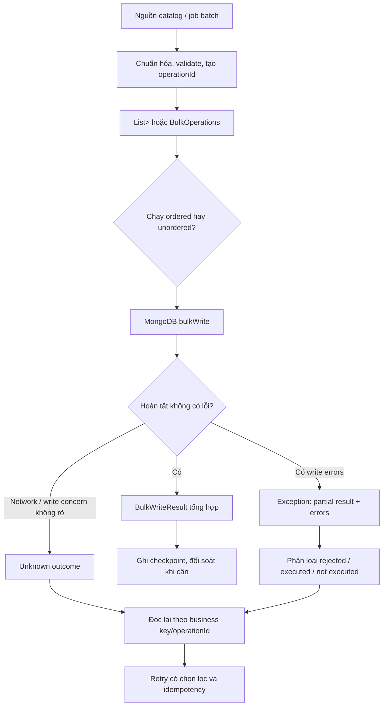

# Đọc BulkWriteResult và xử lý lỗi từng phần

## 1. Bối cảnh và mục tiêu

Trong **Spring Data MongoDB**, thao tác ghi hàng loạt (**bulk write**) giúp gửi nhiều lệnh insert, update, upsert hoặc delete đến MongoDB theo một nhóm, thay vì gọi server cho từng lệnh riêng lẻ. Cơ chế này phù hợp với **Mini Commerce** khi đồng bộ catalog `Product`, cập nhật trạng thái `Order`, nhập danh sách `Customer` hoặc xử lý hàng nghìn bản ghi từ hệ thống nguồn.

Tuy nhiên, bulk write không có nghĩa là “tất cả cùng thành công”. Một nhóm có thể chèn được 70 sản phẩm, cập nhật được 20 sản phẩm, gặp 2 lỗi duplicate key và còn vài thao tác chưa được thực thi. Nếu ứng dụng chỉ log “bulk failed” rồi chạy lại toàn bộ nhóm, dữ liệu có thể bị thêm trùng, ghi đè hoặc **trừ tồn kho hai lần**.

Bài thuộc chương **Ghi hàng loạt**, tập trung vào hai năng lực:

1. **Đọc `BulkWriteResult`** để hiểu số thao tác/document được xác nhận là đã ghi.
2. **Xử lý lỗi từng phần**: nhận diện thao tác nào bị từ chối, những gì đã chạy, những gì chưa chạy và những gì chưa thể khẳng định; từ đó đối soát và retry an toàn.

Sau khi hoàn thành, bạn có thể:

- Giải thích các bộ đếm `getInsertedCount()`, `getMatchedCount()`, `getModifiedCount()`, `getDeletedCount()` và `getUpserts()`.
- Phân biệt **số document** với **số lệnh**, `matched` với `modified`, insert với upsert.
- Chọn `BulkOperations.BulkMode.ORDERED` hoặc `UNORDERED` theo tính phụ thuộc nghiệp vụ.
- Đọc `MongoBulkWriteException` của Java driver khi có nhiều write errors, kể cả danh sách lỗi gắn với **chỉ số request**.
- Xử lý duplicate key, validation error, write concern/network error và **unknown outcome** khác nhau.
- Thiết kế batch có **business key**, operation ID, tính idempotent và checkpoint/đối soát sau lỗi.
- Biết giới hạn của `BulkOperations` với `@Version`, entity callbacks/auditing, transaction, raw driver, reactive và sharded deployment.
- Kiểm thử hai chế độ ordered/unordered và đo lường batch bằng MongoDB thật.

**Điều kiện:** Java 17+, Spring Boot dùng `spring-boot-starter-data-mongodb`, MongoDB đang hoạt động, hiểu `MongoTemplate`, `Query`/`Criteria`, `Update` và các update operators `$set`/`$inc`. Các ví dụ không thay thế quy trình nhập dữ liệu production có backup, xác thực, kiểm soát tenant và giám sát.

## 2. Mô hình Mini Commerce và mục tiêu đồng bộ

Các collection chính:

| Collection | Thực thể | Trường liên quan | Công việc bulk điển hình |
| --- | --- | --- | --- |
| `products` | `Product` | `_id`, `sku`, `name`, `stock`, `unit_price`, `active` | Chèn SKU mới, sửa tên/giá, bật/tắt bán |
| `customers` | `Customer` | `_id`, `email`, `fullName` | Nhập khách hàng từ nguồn tin cậy |
| `orders` | `Order` | `_id`, `customerId`, `status`, `placedAt` | Cập nhật trạng thái các đơn đủ điều kiện |

Ví dụ mỗi record nguồn catalog chứa:

```json
{
  "operationId": "catalog-job-20261120-0001",
  "sku": "KBD-001",
  "name": "Bàn phím Mini",
  "price": "129900.00",
  "active": true
}
```

`operationId` là định danh nghiệp vụ do **ứng dụng quản lý** để truy vết và chống chạy lặp. MongoDB không tự hiểu nó là một bulk request ID; bạn phải thiết kế chính sách lưu/kiểm tra nó. `price` trong Java dùng `BigDecimal` và khi lưu ở sản phẩm có thể ánh xạ thành BSON Decimal128.

Mục tiêu đồng bộ catalog thường là **upsert theo `sku`**, chỉ sửa những field do catalog quản lý và **không reset `stock`** do hệ thống kho đang quản lý. Vì vậy một nhóm `$set`/`$setOnInsert` thường phù hợp hơn thay thế toàn document bằng `save`.

### 2.1. Dữ liệu ví dụ

```javascript
use mini_commerce

db.products.insertMany([
  {
    _id: "bulk-p1",
    sku: "KBD-001",
    name: "Bàn phím cũ",
    active: true,
    stock: 10,
    unit_price: NumberDecimal("99000.00")
  },
  {
    _id: "bulk-p2",
    sku: "MOU-001",
    name: "Chuột cũ",
    active: true,
    stock: 6,
    unit_price: NumberDecimal("59000.00")
  }
]);
```

Chỉ thực hiện trên database thực hành riêng và kiểm tra trước khi insert; chạy lại cùng `_id` sẽ tạo duplicate-key error. Trong các ví dụ Java, **tên property Java** có thể khác tên BSON theo `@Field`, còn raw driver/`mongosh` dùng đúng BSON key.

## 3. Spring Data BulkOperations và Java driver bulkWrite

Có hai đường thực thi phổ biến:

1. **Spring Data MongoDB `BulkOperations`**: nhận `Query`, `Update` và entity class, áp dụng các khả năng mapping của `MongoTemplate`, rồi trả `com.mongodb.bulk.BulkWriteResult` khi `execute()` thành công.
2. **Java Sync Driver `MongoCollection.bulkWrite(...)`**: nhận danh sách `WriteModel<Document>` hoặc `WriteModel<T>` và `BulkWriteOptions`. Khi dùng collection kiểu `Document` từ `mongoTemplate.getCollection(...)`, lệnh **không đi qua mapping entity Java**; code phải dùng BSON field name, BSON value và validation phù hợp.

| Khía cạnh | Spring Data `BulkOperations` | Native Java driver |
| --- | --- | --- |
| Mô tả ghi | `insert(entity)`, `updateOne(Query, Update)`, `updateMulti(...)`, `upsert(...)`, `remove(...)` | `InsertOneModel`, `UpdateOneModel`, `UpdateManyModel`, `DeleteOneModel`, ... |
| Metadata entity | Có khả năng mapping entity/`@Field` | Tùy document/codec; với raw `Document` không tự dùng annotation Spring |
| Chọn chế độ | `BulkMode.ORDERED` / `UNORDERED` | `BulkWriteOptions.ordered(true/false)` |
| Kết quả thành công | `BulkWriteResult` | `BulkWriteResult` |
| Báo lỗi từng phần | Ngoại lệ có thể được tầng Spring dịch/bọc; cần kiểm tra nguyên nhân gốc và phiên bản | `MongoBulkWriteException` cung cấp write errors và partial result |
| Liên kết error index với input | Phải xác nhận cách build/nhóm lệnh của API đang dùng | Chỉ số 0-based ứng với danh sách `WriteModel` gửi vào |
| Entity callbacks/`@Version` | **Không** có cùng hợp đồng như `save(entity)` | Không có Spring callbacks/version protocol |

Khi cần **chính xác operation index** để khôi phục từng record nguồn, API raw driver với danh sách `WriteModel` do ứng dụng xây một-một thường dễ đối chiếu. Khi cần tiện lợi của entity mapping và không có yêu cầu báo lỗi đến từng dòng, `BulkOperations` có thể gọn hơn.

### 3.1. Sơ đồ xử lý



**Không được đồng nhất “không nhận được response” với “server chưa ghi”**. Mất kết nối sau khi server đã thực hiện một phần hoặc toàn bộ batch là tình huống thực tế.

## 4. Viết bulk bằng MongoTemplate

Một entity `Product` tối giản:

```java
package com.example.minicommerce.domain;

import java.math.BigDecimal;
import org.springframework.data.annotation.Id;
import org.springframework.data.mongodb.core.mapping.Document;
import org.springframework.data.mongodb.core.mapping.Field;
import org.springframework.data.mongodb.core.mapping.FieldType;

@Document(collection = "products")
public class Product {
    @Id
    private String id;
    private String sku;
    private String name;
    private boolean active;
    private int stock;

    @Field(name = "unit_price", targetType = FieldType.DECIMAL128)
    private BigDecimal price;

    public Product() {}
    public String getId() { return id; }
    public void setId(String id) { this.id = id; }
    public String getSku() { return sku; }
    public void setSku(String sku) { this.sku = sku; }
    public String getName() { return name; }
    public void setName(String name) { this.name = name; }
    public boolean isActive() { return active; }
    public void setActive(boolean active) { this.active = active; }
    public int getStock() { return stock; }
    public void setStock(int stock) { this.stock = stock; }
    public BigDecimal getPrice() { return price; }
    public void setPrice(BigDecimal price) { this.price = price; }
}
```

Chèn/cập nhật theo SKU bằng `BulkOperations`:

```java
import java.math.BigDecimal;

import com.mongodb.bulk.BulkWriteResult;
import org.springframework.data.mongodb.core.BulkOperations;
import org.springframework.data.mongodb.core.MongoTemplate;
import org.springframework.data.mongodb.core.query.Criteria;
import org.springframework.data.mongodb.core.query.Query;
import org.springframework.data.mongodb.core.query.Update;

public BulkWriteResult syncCatalog(MongoTemplate template) {
    BulkOperations bulk = template.bulkOps(
        BulkOperations.BulkMode.UNORDERED,
        Product.class);

    bulk.upsert(
        Query.query(Criteria.where("sku").is("KBD-001")),
        new Update()
            .set("name", "Bàn phím Mini V2")
            .set("price", new BigDecimal("129900.00"))
            .set("active", true)
            .setOnInsert("stock", 0));

    bulk.upsert(
        Query.query(Criteria.where("sku").is("MOU-001")),
        new Update()
            .set("name", "Chuột Mini V2")
            .set("price", new BigDecimal("69000.00"))
            .setOnInsert("stock", 0));

    return bulk.execute();
}
```

`BulkOperations.execute()` trả kết quả **khi batch hoàn tất thành công theo write concern**. Nếu server báo write errors, không được giả định nó vẫn luôn trả một `BulkWriteResult` bình thường: phải đi qua nhánh exception phù hợp.

Những lưu ý về ví dụ:

- `Query` dùng **property Java `sku`**; `Update.set("price", ...)` được mapping theo entity, có thể dùng alias `unit_price` và BSON Decimal128.
- `$setOnInsert("stock", 0)` chỉ áp dụng khi **upsert tạo document mới**. Nếu SKU đã có, không xóa hoặc reset tồn kho.
- Nếu hai writer cùng upsert một SKU khi chưa có document, cần **unique index trên SKU**, không chỉ dựa vào logic ứng dụng.
- Dùng `UNORDERED` khi các SKU độc lập và hệ thống có thể xử lý lỗi một số SKU mà không dừng toàn batch.
- Ví dụ không có cơ chế lưu operation ID và chưa phải một job đồng bộ production hoàn chỉnh.

## 5. BulkWriteResult biểu thị điều gì?

Lớp kết quả của Java driver:

```java
import com.mongodb.bulk.BulkWriteResult;

BulkWriteResult result = bulk.execute();
```

Các API quan trọng:

| API | Đơn vị đếm | Diễn giải |
| --- | --- | --- |
| `wasAcknowledged()` | Boolean | Server có xác nhận write theo write concern không |
| `getInsertedCount()` | Document | Số document được chèn bởi insert operations |
| `getMatchedCount()` | Document | Số document khớp ở các update operations |
| `getModifiedCount()` | Document | Số document thực sự đổi giá trị, nếu server có cung cấp |
| `isModifiedCountAvailable()` | Boolean | `getModifiedCount()` có khả dụng không |
| `getDeletedCount()` | Document | Số document bị delete operations xóa |
| `getUpserts()` | Danh sách | Các upsert đã **tạo document mới**, kèm index lệnh và ID mới |

Ví dụ cách đọc:

```java
BulkWriteResult result = bulk.execute();

if (!result.wasAcknowledged()) {
    throw new IllegalStateException(
        "Bulk write was not acknowledged");
}

System.out.println("inserted = " + result.getInsertedCount());
System.out.println("matched  = " + result.getMatchedCount());
System.out.println("deleted  = " + result.getDeletedCount());

if (result.isModifiedCountAvailable()) {
    System.out.println("modified = " + result.getModifiedCount());
}

result.getUpserts().forEach(upsert ->
    System.out.println(
        "upsert request index=" + upsert.getIndex() +
        ", new _id=" + upsert.getId()));
```

**Không cộng tất cả con số để ra “số request thành công”.** Đây là những bộ đếm có ý nghĩa khác nhau, và một lệnh updateMany hoặc deleteMany có thể chạm **nhiều document**.

### 5.1. Matched không giống modified

Giả sử đã có:

```javascript
{ _id: "bulk-p1", sku: "KBD-001", active: true }
```

Update:

```javascript
db.products.updateOne(
  { sku: "KBD-001" },
  { $set: { active: true } }
);
```

Server có thể xác nhận:

```text
matchedCount  = 1
modifiedCount = 0
```

Không có lỗi: document đã có đúng giá trị cần lưu. Tương tự, một update với filter không khớp có thể cho `matchedCount = 0`, nhưng đó chưa chắc là write error; ứng dụng phải biết filter có **bắt buộc** khớp hay không.

### 5.2. Insert khác upsert tạo mới

Giả sử batch có:

- Một `InsertOneModel` chèn `prod-new-1`.
- Một `UpdateOneModel(..., upsert=true)` tạo mới `prod-new-2` do filter không khớp.
- Một `UpdateOneModel(..., upsert=true)` khớp `prod-existing` và sửa tên.

Một kết quả có thể có:

```text
insertedCount = 1
matchedCount  = 1
modifiedCount = 1
upserts.size  = 1
```

Upsert mới được ghi trong `getUpserts()`, **không tính vào `insertedCount` của InsertOne**. Nếu muốn báo “số document được tạo mới” theo nghĩa nghiệp vụ, có thể lấy `insertedCount + upserts.size()` **khi đã xác nhận kết quả, semantics và nguồn lệnh phù hợp**.

### 5.3. Lệnh updateMany và deleteMany

Nếu một `UpdateManyModel` khớp 100 document, `matchedCount` có thể tăng 100 chỉ từ **một lệnh**. Nếu một `DeleteManyModel` xóa 7 document, `deletedCount` tăng 7. Vì vậy:

```text
Số requests đã gửi: 3
Matched documents: 100
Deleted documents: 7
```

Không có mâu thuẫn. `BulkWriteResult` tổng hợp **tác động lên document** chứ không phải báo cáo từng request `#0/#1/#2`.

### 5.4. Unacknowledged writes

Khi sử dụng write concern không yêu cầu xác nhận, không được dựa vào các bộ đếm hay exception thông thường để kết luận thành công. Một số getter của `BulkWriteResult` **không khả dụng** trong trường hợp unacknowledged.

Đối với import catalog, cập nhật tồn kho, ghi trạng thái đơn và mọi tác vụ cần checkpoint, chọn **acknowledged write concern** thích hợp theo mức đảm bảo/durability của hệ thống. Không cố tăng throughput bằng cách tắt acknowledgment rồi vẫn log “đã xử lý thành công N bản ghi”.

## 6. ORDERED và UNORDERED quyết định phạm vi lỗi

### 6.1. ORDERED: dừng tại write error đầu tiên

Trong chế độ **ordered**, MongoDB xử lý các thao tác theo thứ tự logic trong bulk và **dừng khi gặp write error**. Điều này hữu ích khi các lệnh phụ thuộc nhau hoặc cần biết rõ “không thực hiện các bước sau lỗi”.

Ví dụ:

```text
Operation #0: UPDATE Product A -> thành công
Operation #1: INSERT Product X với _id đã tồn tại -> duplicate key
Operation #2: UPDATE Product B -> không chạy vì ordered dừng ở #1
```

Kết quả khi lỗi không phải rollback:

- Update `#0` đã thành công **không tự bị đảo ngược**.
- Insert `#1` bị từ chối.
- Operation `#2` không được thực hiện theo semantics dừng của ordered bulk.

`ORDERED` **không biến bulk thành transaction**.

### 6.2. UNORDERED: các lệnh độc lập có thể tiếp tục

Trong chế độ **unordered**, driver/server có thể thay đổi thứ tự và tiếp tục các lệnh khác dù một lệnh bị write error:

```text
Operation #0: UPDATE Product A -> có thể thành công
Operation #1: INSERT Product X trùng _id -> duplicate key
Operation #2: UPDATE Product B -> có thể vẫn thành công
```

Unordered **không bảo đảm thứ tự hoàn thành**. Nếu cùng một document được sửa hai lần bằng `$set` các giá trị khác nhau, kết quả cuối có thể không đúng theo thứ tự bạn thêm lệnh vào danh sách. Hãy thiết kế các thao tác độc lập hoặc nhóm những thao tác phải theo thứ tự vào luồng riêng.

Trong trường hợp lỗi lớn, hỏng kết nối hoặc điều kiện môi trường không cho phép tiếp tục, **không cam kết tất cả lệnh còn lại đều đã thực thi**. Luôn đọc exception và đối soát khi kết quả không đầy đủ.

| Tiêu chí | ORDERED | UNORDERED |
| --- | --- | --- |
| Thứ tự thực hiện | Có hợp đồng thứ tự | Không nên phụ thuộc thứ tự |
| Gặp write error | Dừng ở lỗi đầu tiên theo semantics ordered | Có thể tiếp tục các lệnh độc lập |
| Lệnh đã thành công trước lỗi | Không tự rollback | Không tự rollback |
| Có bảo đảm all-or-nothing? | **Không** | **Không** |
| Tình huống phù hợp | Các thao tác cần thứ tự, batch dễ checkpoint | SKU độc lập, muốn xử lý tối đa |
| Cần đối soát lỗi từng phần? | Có | Có, đặc biệt khi nhiều lỗi |

### 6.3. Lệnh minh họa trong mongosh

```javascript
db.products.bulkWrite(
  [
    {
      updateOne: {
        filter: { _id: "bulk-p1" },
        update: { $set: { name: "Bàn phím V2" } }
      }
    },
    {
      insertOne: {
        document: {
          _id: "bulk-p2",
          sku: "DUPLICATE-KEY"
        }
      }
    },
    {
      updateOne: {
        filter: { _id: "bulk-p2" },
        update: { $set: { name: "Chuột V2" } }
      }
    }
  ],
  { ordered: false }
);
```

Trong fixture có `bulk-p2`, lệnh insert #1 sẽ trùng `_id`. Với unordered, lệnh #2 **có thể vẫn sửa** `bulk-p2`. Thao tác dùng `ordered: true` sẽ dừng sau lỗi insert, nên #2 không chạy; cả hai trường hợp, cập nhật #0 đã thành công không tự rollback.

## 7. Đọc MongoBulkWriteException của Java driver

Khi cần biết **lệnh nào bị lỗi** và mối liên hệ với record nguồn, có thể xây một danh sách `WriteModel<Document>` tại chính ứng dụng rồi dùng `MongoCollection.bulkWrite(...)`.

Các class quan trọng:

```java
import com.mongodb.MongoBulkWriteException;
import com.mongodb.bulk.BulkWriteError;
import com.mongodb.bulk.BulkWriteResult;

import com.mongodb.client.MongoCollection;
import com.mongodb.client.model.BulkWriteOptions;
import com.mongodb.client.model.InsertOneModel;
import com.mongodb.client.model.UpdateOneModel;
import com.mongodb.client.model.WriteModel;
import com.mongodb.client.model.Filters;
import com.mongodb.client.model.Updates;

import org.bson.Document;
```

### 7.1. Danh sách request có ID ổn định

```java
MongoCollection<Document> products =
    mongoTemplate.getCollection("products");

List<WriteModel<Document>> commands = List.of(
    new UpdateOneModel<>(
        Filters.eq("_id", "bulk-p1"),
        Updates.set("name", "Bàn phím V2")),
    new InsertOneModel<>(
        new Document("_id", "bulk-p2")
            .append("sku", "DUPLICATE-KEY")),
    new UpdateOneModel<>(
        Filters.eq("_id", "bulk-p2"),
        Updates.set("name", "Chuột V2"))
);

BulkWriteOptions options = new BulkWriteOptions()
    .ordered(false);
```

Ví dụ này giả định có `MongoTemplate mongoTemplate` và import `java.util.List`. Vì dùng raw `Document`, tất cả đường dẫn `"_id"`, `"name"`, `"sku"` là **BSON keys**, không phải property alias mà Spring tự map.

Trong chương trình nhập dữ liệu thực tế, tạo thêm một list `operationIds` cùng vị trí với `commands`:

```java
List<String> operationIds = List.of(
    "catalog-job-001",
    "catalog-job-002",
    "catalog-job-003"
);

// commands.get(i) tương ứng operationIds.get(i)
```

Đừng lọc/sắp xếp lại chỉ một trong hai list trước khi gửi. Cách tốt hơn ở sản phẩm lớn là một `BatchOperation` chứa cả business ID và `WriteModel` rồi xây hai list trong **một lượt**.

### 7.2. Bắt write error và partial result

```java
import java.util.HashSet;
import java.util.Set;

try {
    BulkWriteResult result = products.bulkWrite(
        commands, options);

    reportSuccessfulBatch(result);

} catch (MongoBulkWriteException ex) {
    BulkWriteResult partial = ex.getWriteResult();

    if (partial != null && partial.wasAcknowledged()) {
        System.out.println(
            "inserted=" + partial.getInsertedCount());
        System.out.println(
            "matched=" + partial.getMatchedCount());
        System.out.println(
            "deleted=" + partial.getDeletedCount());
    }

    Set<Integer> failedIndices = new HashSet<>();

    for (BulkWriteError error : ex.getWriteErrors()) {
        int index = error.getIndex();
        failedIndices.add(index);

        String operationId = operationIds.get(index);

        System.out.println(
            "operation=" + operationId +
            ", requestIndex=" + index +
            ", code=" + error.getCode() +
            ", message=" + error.getMessage());
    }

    if (ex.getWriteConcernError() != null) {
        System.out.println(
            "Bulk also reported a write concern error");
    }

    // Không tự xem các chỉ số không nằm trong failedIndices
    // là chắc chắn đã commit; phải xét ordered/unordered,
    // write concern và tình trạng mạng, rồi đối soát.
}
```

`reportSuccessfulBatch(result)` là hàm do ứng dụng tự định nghĩa để ghi log/metrics/checkpoint, **không phải API sẵn có của Spring Data**. Đoạn ví dụ cần đặt trong một method/service và xử lý ngoại lệ khác (mất kết nối, lỗi mapping) ở tầng trên.

Các điểm cần đọc:

- `ex.getWriteErrors()` là danh sách write errors mà server/driver cung cấp; mỗi `BulkWriteError` có **index 0-based**, **error code** và message.
- `ex.getWriteResult()` có **các bộ đếm thành công đã được phản ánh trong partial result**, không cung cấp kết quả chi tiết cho mọi operation.
- `ex.getWriteConcernError()` nếu xuất hiện cần được xử lý riêng: một số write có thể đã chạy nhưng mức xác nhận/durability chưa đạt.
- `error.getIndex()` ở raw driver liên hệ tới vị trí `WriteModel` trong bulk request; muốn biết SKU hay operation ID, phải duy trì mapping của chính bạn.
- Trong những tình huống batch lớn được driver chia nhỏ, lỗi và chỉ số cần được diễn giải theo API/phiên bản driver sử dụng; đừng tự phỏng đoán nếu các thao tác đã được tổ chức lại ở tầng Spring.

### 7.3. Không bắt đúng loại ngoại lệ có thể làm mất thông tin

`MongoTemplate.bulkOps(...).execute()` có thể đi qua **exception translation/wrapping** của Spring Data, tùy loại lỗi và phiên bản. Vì vậy không giả định mọi lỗi của `BulkOperations` đều đi thẳng ra dưới dạng `MongoBulkWriteException` ở tầng service.

Hướng xử lý:

1. Bắt/ghi nhận ngoại lệ phù hợp của API bạn **thực sự gọi**, chẳng hạn exception thuộc Spring Data hoặc driver.
2. Xem `cause` nếu exception đã được dịch/bọc.
3. Chỉ truy cập partial result/write errors khi ngoại lệ thực tế **có cung cấp**.
4. Nếu không có thông tin chỉ số từng operation hoặc kết quả đáng tin cậy, gắn trạng thái **UNKNOWN_OUTCOME** và đối soát dữ liệu bằng khóa nghiệp vụ.

Không viết code production dựa trên việc “ném lỗi nào cũng chắc có `getWriteErrors()`”. Test với phiên bản Spring Data MongoDB và MongoDB Java driver đang được BOM quản lý.

## 8. Phân loại lỗi và ý nghĩa kết quả từng phần

### 8.1. Bốn trạng thái hữu ích cho job

Một bộ điều phối batch nên phân biệt:

| Trạng thái | Ý nghĩa | Hành động |
| --- | --- | --- |
| `CONFIRMED_SUCCESS` | Có bằng chứng lệnh/điều kiện nghiệp vụ đã áp dụng đúng | Ghi checkpoint, không retry mù quáng |
| `REJECTED` | Server từ chối một write, có error code/index rõ | Phân loại lỗi và sửa input hoặc chính sách |
| `NOT_EXECUTED` | Có bằng chứng lệnh chưa chạy, ví dụ sau lỗi trong ordered batch | Lập kế hoạch tiếp tục từ điểm phù hợp |
| `UNKNOWN_OUTCOME` | Không chứng minh chắc write đã hoặc chưa có hiệu lực | Readback/reconcile trước khi retry |

`BulkWriteResult` của bulk thành công không tự trả về `CONFIRMED_SUCCESS` cho **từng lệnh** updateOne có match hay không. Nếu cần biết một lệnh cụ thể thực sự sửa đúng một document, hãy thiết kế filter/định danh và kiểm tra sau ghi; hoặc cân nhắc API trả kết quả đơn lẻ thay vì bulk.

### 8.2. Những lỗi thường thấy

| Lỗi | Dấu hiệu | Nên xử lý |
| --- | --- | --- |
| Duplicate key | Thường mã MongoDB **11000** | Đối chiếu `_id`/SKU; nếu cùng dữ liệu/idempotent có thể coi là đã áp dụng, nếu khác phải báo conflict |
| Document validation failure | Thường mã **121** | Ghi lại record lỗi, sửa schema/input; không retry cùng input vô hạn |
| Immutable field / invalid update | Server từ chối sửa `_id` hoặc đường dẫn không hợp lệ | Sửa mô hình cập nhật, không retry nguyên trạng |
| Write concern error | Server không đạt điều kiện xác nhận/durability yêu cầu | Trạng thái có thể không chắc chắn; readback/reconcile |
| Network/timeout | Mất phản hồi hoặc không xác định đã ghi đến đâu | Không suy từ timeout rằng chưa ghi; đối soát |
| Concurrent business conflict | `matchedCount == 0` trong update có điều kiện; **không nhất thiết** là write error | Đọc lại version/stock/trạng thái, phân loại theo nghiệp vụ |
| Rate/resource pressure | Timeout, quá tải, write errors môi trường | Giảm batch size, backoff, giám sát server, giữ idempotency |

**Mã 11000 hoặc 121 chỉ là tín hiệu ban đầu**, không quyết định tự động cách khôi phục. Ví dụ duplicate SKU ở một import **không chắc là thành công**: SKU trùng nhưng tên/giá khác có thể là conflict cần người hoặc nguồn dữ liệu ưu tiên giải quyết.

### 8.3. Lỗi của một số operation không bảo đảm biết tất cả operation

Trong unordered bulk, ta có thể biết `#3` và `#8` bị duplicate key nhưng không đủ bằng chứng rằng mọi operation khác đã được commit theo write concern yêu cầu. Trong ordered bulk, các operation sau write error đầu tiên thường **không chạy**, nhưng nếu kèm lỗi kết nối hoặc result không đầy đủ, vẫn cần phân biệt những gì được server xác nhận.

Với lệnh `updateOne` có filter không khớp, MongoDB coi đó là **thao tác hợp lệ**, không tạo `BulkWriteError`. Nếu công việc yêu cầu “mỗi SKU phải có đúng một record được sửa”, thông tin aggregate matched count không cho biết SKU nào không khớp. Cần đối soát theo SKU hoặc chạy lệnh có kết quả riêng.

## 9. Giới hạn của việc suy diễn từ counters

Giả sử gửi 5 thao tác:

```text
#0: updateOne SKU=A, $set name
#1: updateOne SKU=B, $set name
#2: updateMany category=X, $set active
#3: insertOne SKU=C
#4: deleteOne SKU=D
```

Kết quả:

```text
matchedCount  = 12
modifiedCount = 9
insertedCount = 1
deletedCount  = 0
upserts       = []
```

Ta **không thể kết luận** từ bộ đếm này rằng:

- `#0` và `#1` đều đã tìm thấy đúng một SKU.
- `#2` đã sửa đúng 10 document.
- `#4` là lỗi (deleteOne không khớp vẫn có thể thành công với `deletedCount = 0`).
- `matchedCount - modifiedCount` là số operation thất bại.

Muốn chứng minh từng record nguồn, cần **business key**, filter có điều kiện và một bước xác minh/trạng thái riêng. Counters phù hợp cho metrics tổng hợp, nhưng không phải **sổ cái giao dịch**.

## 10. Xây batch có thể đối soát

### 10.1. Mỗi record nguồn có định danh ổn định

Một kế hoạch tối thiểu:

```java
record CatalogChange(
    String operationId,
    String sku,
    String newName,
    String sourceVersion
) {}
```

Các trường có ý nghĩa:

- `operationId`: định danh **một thay đổi**, giữ nguyên qua lần retry.
- `sku`: business key xác định một sản phẩm.
- `sourceVersion`: phiên bản/thứ tự nguồn để tránh sự kiện cũ ghi đè sự kiện mới.
- `newName`: dữ liệu có chủ đích, không phải toàn bộ entity đã nạp.

Khi xử lý:

1. Validate không có hai operation mâu thuẫn cùng SKU trong một batch unordered.
2. Tạo một danh sách **operation plan** duy trì thứ tự/index/operation ID.
3. Ghi metadata batch, phạm vi input, phiên bản schema và số operation dự kiến.
4. Thực hiện bulk; đọc result và exception.
5. Đối chiếu record lỗi hoặc ambiguous qua SKU/sourceVersion; ghi trạng thái cho từng operation.
6. Retry các operation an toàn, với backoff và giới hạn số lần.

### 10.2. Thêm version vào filter

Nếu mỗi nguồn có version tăng dần, hãy dùng điều kiện ngăn bản cũ ghi đè:

```javascript
db.products.updateOne(
  {
    sku: "KBD-001",
    sourceVersion: { $lt: 42 }
  },
  {
    $set: {
      name: "Bàn phím Mini V2",
      sourceVersion: 42
    }
  }
);
```

Đây là **ví dụ chính sách source version**: ứng dụng phải xác định field có mặt, kiểu số và cơ chế tạo version. Nếu document chưa có `sourceVersion`, filter cần xử lý legacy/missing theo cách được kiểm thử, không mặc định ví dụ này khớp mọi document.

Update này an toàn hơn việc `$set` không điều kiện khi một sự kiện cũ chạy lại sau sự kiện mới. Tuy nhiên nếu matched count = 0, phải phân biệt “record không tồn tại” với “đã có version mới hơn”. Aggregate `BulkWriteResult` không tự cho biết câu trả lời theo từng SKU.

### 10.3. Kỹ thuật idempotency theo loại lệnh

| Toán tử/thao tác | Retry cùng input có luôn an toàn? | Lưu ý |
| --- | --- | --- |
| `$set` cùng một giá trị | Tính theo giá trị thường **idempotent** | Nhưng vẫn có thể ghi đè cập nhật **mới hơn** nếu thiếu version |
| `$setOnInsert` với unique business key | Thường thuận lợi cho create-if-absent | Cần unique index và xử lý race |
| `$addToSet` với một phần tử | Tránh thêm trùng phần tử theo BSON equality | Không tự giải quyết thay đổi đồng thời ngoài mảng |
| `$inc` | **Không idempotent** | Retry có thể cộng/trừ lần nữa |
| `$push` | **Không idempotent** | Retry có thể thêm phần tử trùng |
| `deleteOne` theo `_id` xác định | Xóa lại có thể không còn gì để xóa | Nếu dùng filter không độc nhất, retry có thể chọn document khác |
| `insertOne` với `_id`/business key ổn định | Lần hai có thể gặp duplicate | Cần xác minh duplicate là chính record đã chèn |
| Update pipeline phức tạp | Phải xét biểu thức và trạng thái hiện hành | Không giả định an toàn chỉ vì cùng payload |

Trong Mini Commerce, bulk import catalog có thể retry `$set` bảo vệ bằng version, nhưng **bulk trừ stock bằng `$inc`** đòi idempotency protocol mạnh hơn, ví dụ một bản ghi reservation mang order/operation ID với unique index và transaction khi cần.

## 11. Retry sau lỗi: quy trình đúng theo mức chắc chắn

### 11.1. Nhánh write error xác định

Nếu lỗi duplicate key ở operation `#4`:

1. Xem `error.getIndex()` và mapping tới `operationId`.
2. Đọc document đích theo `_id`/`sku`.
3. Nếu dữ liệu đã tương đương và operation có tính idempotent, đánh dấu **đã đạt trạng thái mong muốn** theo chính sách.
4. Nếu business key trùng nhưng dữ liệu khác, xử lý **conflict**, không tự nói thành công.
5. Với validation error, sửa hoặc đưa record vào **dead-letter/quarantine**, không retry vô hạn một payload sai.

### 11.2. Nhánh mạng hoặc write concern không rõ kết quả

Nếu ứng dụng bị timeout sau khi gửi:

```text
send bulk #0..#99
       |
       +-- server thực thi một phần hoặc toàn bộ
       |
       +-- mất kết nối trước khi client nhận phản hồi
```

Client không thể kết luận `#0..#99` chưa chạy. Quá trình an toàn hơn:

- **Không** retry nguyên batch ngay nếu có `$inc`, `$push` hoặc lệnh phụ thuộc thứ tự.
- Đọc lại theo business key và `operationId`/version, kiểm tra **trạng thái cuối**.
- Chỉ tạo retry cho operation chưa đạt trạng thái mong muốn hoặc có chiến lược apply-once đáng tin cậy.
- Giữ nguyên operation ID giữa các lần chạy, ghi attempt count và kết quả xác minh.
- Nếu không thể xác định, dừng để điều tra thay vì thay đổi dữ liệu không thể đảo ngược.

MongoDB driver có các cơ chế retryable writes cho những điều kiện/lệnh được hỗ trợ, nhưng **không nên giả định mọi bulk operation phức tạp, nhiều document hoặc user-level retry đều được thực thi đúng một lần**. Bài toán idempotency của ứng dụng vẫn cần được thiết kế.

### 11.3. Không retry dựa trên mỗi con số getModifiedCount

Một lệnh `$set` không thay đổi giá trị có thể cho `modified=0` dù đã khớp đúng document. Retry kiểu “nếu modified ít hơn số lệnh thì gửi lại toàn bộ” là sai. Tương tự, `updateMany` có thể sửa nhiều document làm modified lớn hơn số lệnh.

Hãy dùng trạng thái nghiệp vụ và kiểm tra kết quả có ý nghĩa, không ép tổng counters thành số “operation đã xử lý”.

## 12. Checkpoint, chunking và bài toán batch lớn

Khi nhập 100.000 sản phẩm, nên chia input thành các **chunk hữu hạn** để:

- Giới hạn bộ nhớ JVM và kích thước request.
- Có checkpoint theo phạm vi record/operation ID.
- Phân lập lỗi, đưa record sai vào vùng xử lý riêng.
- Giảm phạm vi phải đối soát lại sau timeout.
- Điều chỉnh concurrency/rate theo tải thực tế của MongoDB.

Ví dụ quy trình:

```text
Job catalog-20261120
  chunk-0001: operations 0..499    -> completed / reconciled
  chunk-0002: operations 500..999  -> partial / conflict
  chunk-0003: operations 1000..1499 -> pending
```

**Không** ghi checkpoint “chunk done” chỉ vì phương thức `execute()` đã được gọi. Chỉ checkpoint sau khi nhận được kết quả được công nhận, hoặc hoàn tất quy trình đối soát cho các operation ambiguous.

MongoDB driver có giới hạn số write trong một server batch, kích thước BSON/message và có thể tự chia lệnh; việc tự chia chunk vẫn hữu ích ở cấp ứng dụng. Không dựa vào một con số batch size cứng cho mọi phiên bản/topology; hãy đo throughput, lỗi và độ trễ trong môi trường thực.

### 12.1. Ordered không thay thế transaction và checkpoint

Một chunk ordered thất bại ở operation `#350` có thể có hàng trăm operation trước đó đã commit. Muốn chạy tiếp, không được mặc định bắt đầu lại từ `#0` nếu các operation không idempotent. Có thể:

1. Ghi nhận error index và partial result.
2. Đối soát các operation trước lỗi nếu không đủ bằng chứng.
3. Xử lý lỗi của `#350` hoặc đưa vào quarantine.
4. Gửi phần còn lại có kiểm soát và vẫn giữ operation ID ban đầu.

Nếu batch liên quan thứ tự sự kiện của cùng SKU, những operation tiếp theo cần chờ giải quyết conflict hoặc được tái cấu trúc theo version. **Unordered** không phải cách chữa mọi vấn đề throughput.

## 13. Một bước làm sạch lỗi: duplicate key và upsert

Trong đồng bộ catalog, nhiều hệ thống nguồn có thể gửi cùng SKU:

```javascript
db.products.createIndex(
  { sku: 1 },
  { unique: true }
);
```

Upsert an toàn hơn kiểu “nếu không tồn tại thì insert” do nó tạo ra một thao tác update-or-insert tại server, nhưng **không thay unique index** khi nhiều writer cạnh tranh.

```java
Update catalogUpdate = new Update()
    .set("name", "Bàn phím Mini V2")
    .set("active", true)
    .setOnInsert("stock", 0);

bulk.upsert(
    Query.query(Criteria.where("sku").is("KBD-001")),
    catalogUpdate);
```

Nếu upsert đã có SKU, `$setOnInsert` không reset stock. Nếu tạo SKU mới, upsert sẽ xuất hiện trong `BulkWriteResult.getUpserts()` khi có kết quả xác nhận phù hợp.

**Đừng kết luận mọi duplicate key do upsert là benign.** Một import có thể xung đột với dữ liệu ở tenant khác, version mới hơn hoặc một bản ghi đã được chỉnh sửa thủ công. Phải kiểm tra business key, tenant và version.

## 14. @Version, callbacks, auditing và bulk writes

`BulkOperations` không hoạt động giống một vòng lặp `repository.save(entity)` về lifecycle.

Những giới hạn cần biết:

- **Optimistic locking bằng `@Version` không được hỗ trợ theo cùng hợp đồng per-entity khi dùng bulk operations**. Không giả định một bulk update tự kiểm tra expected version của từng object hay sẽ ném `OptimisticLockingFailureException` như `save`.
- **Entity lifecycle callbacks / auditing** không được chạy giống các lời gọi `save(entity)` cho từng bản ghi. Nếu job yêu cầu `updatedAt`, hãy set rõ trong update hoặc có policy thống nhất ở server.
- Nếu entity có converter/alias `@Field`, hãy dùng API mapping phù hợp và test raw BSON; với native driver `Document`, phải cung cấp giá trị và tên BSON chính xác.
- Với giá Decimal128, không gửi raw JavaScript double hoặc BSON String rồi kỳ vọng mapping của Spring Data tự sửa trong native driver.

Nếu cần compare-and-set theo version, có thể thêm điều kiện version vào **filter** và thay đổi version theo **cùng một update**:

```java
Query expected = Query.query(
    Criteria.where("sku").is("KBD-001")
        .and("version").is(7L));

Update change = new Update()
    .set("name", "Bàn phím phiên bản mới")
    .inc("version", 1L);

bulk.updateOne(expected, change);
```

**Đây là protocol ứng dụng phải tự quản lý**, không phải optimistic locking tự động của `BulkOperations`. Vì result chỉ chứa matched count **tổng**, muốn biết chính SKU nào conflict cần đọc lại document hoặc tổ chức một bước kiểm tra riêng. Không tự kết hợp cơ chế `@Version` tự tăng của mapper với `inc("version")` khi chưa kiểm tra hành vi cụ thể của phiên bản đang dùng.

## 15. Transaction và giới hạn atomicity

MongoDB bảo đảm atomicity cho **mỗi thao tác ghi trên một document**, không tự biến cả danh sách bulk operations thành một đơn vị all-or-nothing.

### 15.1. Khi không cần transaction

Đồng bộ 5.000 sản phẩm độc lập bằng `$set` có điều kiện version, mỗi SKU có unique index và checkpoint riêng: một số lỗi có thể được xử lý lại mà không cần rollback toàn bộ job. Ở trường hợp này, unordered bulk + đối soát thường là lựa chọn thực tế.

### 15.2. Khi cần transaction

Luồng đặt hàng có thể phải **giảm stock của nhiều Product** rồi **tạo Order**. Nếu yêu cầu tất cả thành công hoặc tất cả thất bại, cần cân nhắc transaction nhiều document trên topology MongoDB được hỗ trợ, với `MongoTransactionManager` hoặc reactive transaction manager tương ứng.

Trong transaction, vẫn có thể có write errors và abort; kết quả bulk riêng lẻ **không có nghĩa** transaction đã commit. Ghi checkpoint “đã bán hàng” chỉ sau khi commit được xác nhận. Một transaction không thay thế idempotency khi client bị mất phản hồi commit.

**Không đặt một batch nhập hàng trăm nghìn document vào một transaction khổng lồ chỉ để tránh xử lý lỗi từng phần.** Transaction có thời gian, tài nguyên và giới hạn topology; chọn theo invariant nghiệp vụ, không dùng làm cơ chế thay thế thiết kế batch.

### 15.3. Sharded cluster và write concern

Sharding, write concern và mạng có thể ảnh hưởng thời điểm/lượng kết quả được xác nhận. Bulk unordered có thể được chia và điều phối đến nhiều shard; không dựa vào thứ tự hoàn tất. Write concern error có thể làm mức xác nhận chưa đủ dù một phần dữ liệu đã được server xử lý.

Với hệ thống cần độ tin cậy, ghi rõ write concern, read preference/read concern dùng cho đối soát, và yêu cầu durability của job. Không suy diễn mức majority hay exactly-once từ việc chỉ thấy một `BulkWriteResult`.

## 16. Reactive và hiệu năng

Khi dùng `ReactiveMongoTemplate`, Spring Data có bulk operations trả `Mono<BulkWriteResult>`:

```java
import com.mongodb.bulk.BulkWriteResult;
import org.springframework.data.mongodb.core.BulkOperations;
import reactor.core.publisher.Mono;

Mono<BulkWriteResult> result =
    reactiveMongoTemplate.bulkOps(
        BulkOperations.BulkMode.UNORDERED,
        Product.class)
    .updateOne(
        Query.query(Criteria.where("sku").is("KBD-001")),
        new Update().set("active", true))
    .execute();
```

Với API reactive, thao tác thường được thực thi khi publisher được **subscribe**. Dùng Reactor operators để xử lý thành công/lỗi và ghi checkpoint sau khi có kết quả được công nhận; không gọi `block()` trong luồng WebFlux non-blocking.

Đừng giả định reactive tự giảm số write errors, thay đổi semantics ordered/unordered hay làm `$inc` idempotent. Reactive thay đổi **cách điều phối I/O**, không thay đổi các bất biến dữ liệu.

### 16.1. Throughput không chỉ phụ thuộc batch size

Các yếu tố cần benchmark:

- Mức chọn lọc của filter và index (`sku` unique, `_id` mặc định).
- Kích thước document, số trường sửa, số field/index bị cập nhật.
- Ordered/unordered, concurrency và độ phụ thuộc giữa lệnh.
- Write concern và thời gian round-trip.
- BSON encode/mapping/validation ở phía ứng dụng.
- Replica set/sharding và tải server.
- Kích thước chunk, thời gian đối soát/retry sau lỗi.

Khi mỗi batch rất lớn, có thể giảm overhead gửi lệnh nhưng tăng thời gian khôi phục sau lỗi. Tối ưu end-to-end bằng throughput **của các record đã được xác minh**, không chỉ bằng requests/second.

## 17. Kiểm thử integration: ordered, unordered và partial result

Muốn tin phần xử lý lỗi, hãy kiểm thử bằng **MongoDB thật hoặc Testcontainers**. Mock `BulkOperations` không mô phỏng đúng duplicate-key error, index lỗi, hành vi ordered/unordered và partial result của server.

### 17.1. Test chính: unordered vẫn áp dụng operation sau lỗi

Ví dụ `@SpringBootTest` sau sử dụng raw Java driver thông qua `MongoTemplate.getCollection(...)` để giữ đúng **chỉ số trong danh sách WriteModel**.

```java
package com.example.minicommerce;

import static org.junit.jupiter.api.Assertions.*;

import java.util.List;

import com.mongodb.MongoBulkWriteException;
import com.mongodb.WriteConcern;
import com.mongodb.bulk.BulkWriteResult;
import com.mongodb.client.MongoCollection;
import com.mongodb.client.model.BulkWriteOptions;
import com.mongodb.client.model.Filters;
import com.mongodb.client.model.InsertOneModel;
import com.mongodb.client.model.UpdateOneModel;
import com.mongodb.client.model.Updates;
import com.mongodb.client.model.WriteModel;

import org.bson.Document;
import org.junit.jupiter.api.Test;
import org.springframework.beans.factory.annotation.Autowired;
import org.springframework.boot.test.context.SpringBootTest;
import org.springframework.data.mongodb.core.MongoTemplate;

@SpringBootTest
class BulkWritePartialFailureIntegrationTest {

    @Autowired
    MongoTemplate template;

    @Test
    void unorderedReportsDuplicateAndAppliesOtherWrites() {
        String idA = "bulk-test-A";
        String idDuplicate = "bulk-test-DUP";
        String idB = "bulk-test-B";
        List<String> ids = List.of(idA, idDuplicate, idB);

        MongoCollection<Document> coll =
            template.getCollection("products")
                .withWriteConcern(WriteConcern.ACKNOWLEDGED);

        coll.deleteMany(Filters.in("_id", ids));
        try {
            coll.insertMany(List.of(
                new Document("_id", idA)
                    .append("sku", "BULK-TEST-A")
                    .append("stock", 10),
                new Document("_id", idDuplicate)
                    .append("sku", "BULK-TEST-DUP"),
                new Document("_id", idB)
                    .append("sku", "BULK-TEST-B")
                    .append("active", true)
            ));

            List<WriteModel<Document>> writes = List.of(
                new UpdateOneModel<>(
                    Filters.eq("_id", idA),
                    Updates.inc("stock", -2)),
                new InsertOneModel<>(
                    new Document("_id", idDuplicate)
                        .append("sku", "DUPLICATE")),
                new UpdateOneModel<>(
                    Filters.eq("_id", idB),
                    Updates.set("active", false))
            );

            MongoBulkWriteException ex = assertThrows(
                MongoBulkWriteException.class,
                () -> coll.bulkWrite(
                    writes,
                    new BulkWriteOptions().ordered(false)));

            assertEquals(1, ex.getWriteErrors().size());
            assertEquals(1, ex.getWriteErrors().get(0).getIndex());
            assertEquals(11000, ex.getWriteErrors().get(0).getCode());

            BulkWriteResult partial = ex.getWriteResult();
            assertTrue(partial.wasAcknowledged());
            assertEquals(2, partial.getMatchedCount());
            assertTrue(partial.isModifiedCountAvailable());
            assertEquals(2, partial.getModifiedCount());
            assertEquals(0, partial.getInsertedCount());

            Document afterA =
                coll.find(Filters.eq("_id", idA)).first();
            Document afterB =
                coll.find(Filters.eq("_id", idB)).first();

            assertNotNull(afterA);
            assertNotNull(afterB);
            assertEquals(8, afterA.getInteger("stock"));
            assertEquals(false, afterB.getBoolean("active"));
        } finally {
            coll.deleteMany(Filters.in("_id", ids));
        }
    }
}
```

Trong test này:

- Operation `#0` giảm stock từ 10 xuống 8.
- Operation `#1` cố insert `_id` đã tồn tại và tạo lỗi **11000**.
- Với `ordered(false)`, operation `#2` vẫn cập nhật `active = false`.
- Partial result phản ánh 2 document matched và modified; readback kiểm tra **dữ liệu cuối**.

Kết quả trên được thiết kế trên một fixture riêng, sử dụng acknowledged write concern và không có writer cạnh tranh. Không suy từ nó rằng mọi unordered bulk trong môi trường mạng bất ổn đều sẽ luôn hoàn thành mọi operation không lỗi.

### 17.2. Test ordered: operation sau lỗi không chạy

Để kiểm tra ordered, tạo fixture **mới** với ba ID riêng và gửi cùng ba loại lệnh nhưng đặt:

```java
MongoBulkWriteException ex = assertThrows(
    MongoBulkWriteException.class,
    () -> coll.bulkWrite(
        writes,
        new BulkWriteOptions().ordered(true)));

assertEquals(1, ex.getWriteErrors().get(0).getIndex());

// Đọc lại document ứng với operation #2:
Document afterB =
    coll.find(Filters.eq("_id", idB)).first();

assertNotNull(afterB);
assertEquals(true, afterB.getBoolean("active"));
```

Đoạn trên **giả định** biến `coll`/`writes`/`idB` đã được khởi tạo theo một fixture riêng như test 17.1 với `active = true`. Hãy đặt nó trong test method và dọn fixture bằng `try/finally` khi hoàn thiện. Lúc chạy ordered, server dừng ở insert trùng `_id` trước operation `#2`, vì vậy `active` không đổi.

### 17.3. Test Spring Data BulkOperations

Ngoài test native driver, thêm một integration test cho chính cấu hình Spring Data đang dùng:

```java
BulkOperations operations = template.bulkOps(
    BulkOperations.BulkMode.UNORDERED,
    Product.class);

operations.updateOne(
    Query.query(Criteria.where("sku").is("BULK-TEST-A")),
    new Update().set("name", "Tên từ bulk"));

BulkWriteResult result = operations.execute();
assertTrue(result.wasAcknowledged());
assertEquals(1, result.getMatchedCount());
```

Test này **giả định** fixture có đúng một `Product` với SKU `BULK-TEST-A`; cần seed/cleanup như phần trên. Nó kiểm tra mapping/cấu hình của Spring Data; còn test driver kiểm tra khả năng truy xuất error index và partial result.

**Không cần giả lập rằng mọi exception của Spring Data đều có cùng class hoặc getter như `MongoBulkWriteException`.** Khi đưa vào production, thêm test gây duplicate-key error qua chính `BulkOperations.execute()` để biết ngoại lệ được framework chuyển đổi thành gì.

### 17.4. Ma trận test nên bổ sung

| Tình huống | Điều cần chứng minh |
| --- | --- |
| Ordered có lỗi ở #1 | #0 còn tác động, #1 báo lỗi, #2 không chạy |
| Unordered có lỗi ở #1 | Các lệnh độc lập khác có thể thành công |
| Batch không có lỗi | `BulkWriteResult` có counters hợp lý |
| Update đặt lại cùng giá trị | Matched = 1 nhưng modified = 0 |
| Update filter không khớp | Không phải write error, matched không tăng |
| UpdateMany khớp 10 documents | Matched đếm document, không đếm request |
| Upsert tạo mới | Có phần tử trong `getUpserts()`, không tính insertOne |
| Upsert khớp document cũ | Matched tăng, không có upsert mới |
| Duplicate `_id`/`sku` | Error code/index được liên hệ đúng operation ID |
| Validation failure | Đưa record sai vào quarantine, không retry vô hạn |
| Mất phản hồi | Có trạng thái UNKNOWN và bước readback |
| Retry `$inc` | Chứng minh có thể gây thay đổi lần hai |
| Retry `$set` có version | Sự kiện cũ không ghi đè version mới |
| @Field("unit_price") | Spring Data mapping khác raw BSON rõ ràng |
| @Version/auditing | Không giả định bulk giống `save(entity)` |
| Reactive | Publisher trả result/error khi subscribe |
| Transaction | Chỉ checkpoint sau xác nhận commit |

## 18. Vận hành: metrics, logging và dead-letter

Một báo cáo batch có thể gồm:

```text
jobId:             catalog-20261120
chunkId:           chunk-0021
requestedOps:      500
bulkMode:          UNORDERED
acknowledged:      true
insertedDocs:      12
matchedDocs:       476
modifiedDocs:      430
deletedDocs:       0
upsertedDocs:      4
writeErrorCount:   2
unknownOps:        0 (sau đối soát)
reconciledOps:     2
completedAt:       [timestamp from the job]
```

Đây chỉ là **ví dụ hình dạng báo cáo**, không phải dữ liệu thật. Các con số document **không bắt buộc cộng đúng bằng 500 operations**, vì updateMany/không-match/upsert và semantics của counters.

Nên ghi log:

- `jobId`, `chunkId`, `operationId` và business key được phép lưu.
- Mode ordered/unordered, số operation gửi, duration, write concern.
- Counters của `BulkWriteResult` và số lỗi theo error code.
- Trạng thái đối soát cuối và số record ở dead-letter.
- Version/schema của nguồn dữ liệu để replay có kiểm soát.

Không log toàn bộ thông tin cá nhân `Customer`, token, số điện thoại hay dữ liệu thanh toán. Nếu cần lưu payload lỗi để replay, đặt quyền truy cập, retention và mã hóa phù hợp.

### 18.1. Vì sao cần dead-letter/quarantine?

Một record sai schema, thiếu SKU hoặc vi phạm validation có thể không bao giờ tự sửa khi retry. Nếu hệ thống cứ gửi lại, batch sẽ lặp lỗi và gây tải.

Quy trình nên:

1. Lưu record lỗi kèm ID và lý do (đã lọc thông tin nhạy cảm).
2. Cho phép sửa/chuẩn hóa, kiểm tra duplicate source hoặc version.
3. Replay **đúng operation ID** theo chính sách idempotency.
4. Đánh dấu record đã xử lý và lưu lịch sử quyết định.

## 19. Những lỗi thường gặp

| Triệu chứng | Nguyên nhân | Hướng xử lý |
| --- | --- | --- |
| `execute()` ném exception dù nhiều ghi đã thành công | Bulk **partial success** | Đọc partial result/write errors nếu có, đối soát |
| Cộng inserted + matched + deleted để ra số lệnh | Counters đếm document, updateMany có thể khớp nhiều | Ghi metrics riêng cho request và document |
| `getModifiedCount()` nhỏ hơn `getMatchedCount()` | Document khớp nhưng giá trị đã đúng hoặc không đổi | Không coi đó là lỗi |
| `getModifiedCount()` không khả dụng | Driver/server hoặc write concern không cung cấp | Kiểm tra `wasAcknowledged`/`isModifiedCountAvailable` |
| Không thấy upsert trong insertedCount | Upsert tạo mới báo qua `getUpserts()` | Đọc danh sách upserted IDs |
| Duplicate key ở một SKU làm batch dừng | Đang dùng `ORDERED` | Chọn mode theo tính độc lập; xử lý conflict |
| Unordered cho kết quả không theo thứ tự input | Không có bảo đảm order | Không gửi các cập nhật phụ thuộc nhau trong unordered |
| Retry làm stock bị trừ hai lần | `$inc` không idempotent | Operation ID, reservation ledger, reconciliation |
| Retry `$set` ghi đè dữ liệu mới hơn | Không có version/expected state | Filter có sourceVersion, CAS hoặc serialization |
| Chỉ biết hai error indices nhưng không biết SKU | Không giữ mapping index → business key | Tạo operation plan trước khi gửi |
| Spring Data exception không có `getWriteErrors()` | Đã bị dịch/bọc, khác raw driver exception | Xem cause/contract của phiên bản, test đường lỗi |
| UpdateOne không khớp nhưng không báo lỗi | Matched=0 là kết quả hợp lệ của update | Đối soát từng SKU nếu phải khớp |
| Network timeout bị coi là “chưa ghi” | Unknown outcome | Readback trước khi retry |
| Upsert tạo trùng business key | Thiếu unique index hoặc filter không đúng tenant | Unique index + quy tắc conflict |
| @Version không chống lost update trong bulk | Bulk không có per-entity optimistic locking như save | CAS theo filter/version hoặc dùng API khác |
| Timestamp/auditing không cập nhật | Bulk bỏ qua vòng đời save callback | Set thời gian rõ ràng và kiểm thử |
| Ghi giá tiền sai BSON | Raw driver không tự mapping `@Field`/`BigDecimal` | Dùng Decimal128 và BSON key đúng |
| Bulk quá lớn gây tải/khó phục hồi | Chunk không giới hạn | Chia chunk, checkpoint và backpressure |
| Bulk ordered được xem như transaction | Không có atomicity xuyên cả batch | Dùng transaction nếu invariant yêu cầu |
| Metrics thành công nhưng SKU vẫn sai | Chỉ nhìn counters tổng | Đối chiếu trạng thái theo business key |

## 20. Bài tập thực hành và tiêu chí hoàn thành

**Bài tập 1 — Đọc counters.** Tạo batch có `insertOne`, `updateOne` đặt lại cùng giá trị, `updateMany` và `deleteOne`. Trước khi chạy, dự đoán `inserted`, `matched`, `modified`, `deleted` rồi đối chiếu với `BulkWriteResult`. Giải thích vì sao tổng không bằng số request.

**Bài tập 2 — Upsert.** Dùng `BulkOperations` upsert hai SKU đã tồn tại và một SKU mới. Bảo đảm `stock` của SKU cũ không bị reset nhờ `$setOnInsert`, sau đó đọc `getUpserts()` và đếm tổng document tạo mới.

**Bài tập 3 — Ordered vs unordered.** Tạo batch ba lệnh, lệnh thứ hai insert trùng `_id`. Chạy ordered và unordered trên hai fixture riêng. Ghi lại lỗi, partial result và trạng thái document ở operation thứ ba.

**Bài tập 4 — Chỉ số lỗi và operation ID.** Thiết kế `List<BatchOperation>` gồm `operationId`, `sku` và `WriteModel`. Gây hai lỗi duplicate và chứng minh mỗi `BulkWriteError.getIndex()` liên kết đúng record nguồn. Không đặt tên biến index theo “thứ tự hoàn thành”.

**Bài tập 5 — Đối soát.** Giả lập timeout trước khi ứng dụng nhận kết quả. Dùng `sku`/`sourceVersion` để kiểm tra trạng thái và lập danh sách retry; không gửi lại `$inc` mù quáng.

**Bài tập 6 — Chặn sự kiện cũ.** Gửi hai thay đổi name cho cùng SKU, version 41 và 42, theo thứ tự đảo ngược. Thử filter `sourceVersion < newVersion` và giải thích vì sao matched=0 không mặc định là write error.

**Bài tập 7 — Validation và quarantine.** Bật MongoDB JSON Schema/validation phù hợp trên collection test. Gửi một record hợp lệ và một record sai, bắt write error, đưa record sai vào dead-letter, rồi sửa và replay với cùng operation ID.

**Bài tập 8 — Tối ưu chunk.** Import một tập dữ liệu test lớn theo chunk 100, 500 và 1000. Đo throughput, latency, chi phí đối soát và số lỗi. Đánh giá ordered/unordered phù hợp workload thay vì giả định chunk lớn nhất luôn tốt nhất.

**Bài tập mở rộng — Reactive/transaction.** Viết reactive bulk cho catalog, kiểm tra `Mono<BulkWriteResult>`. Mô phỏng luồng đặt hàng cập nhật nhiều Product và tạo Order; xác định khi nào cần transaction cùng một cơ chế idempotency riêng.

### Câu hỏi tự kiểm tra

1. Vì sao `BulkWriteResult` không nói được chắc chắn lệnh updateOne nào đã match?
2. `getInsertedCount()` và `getUpserts()` khác nhau ra sao?
3. `matched` và `modified` khác nhau khi giá trị mới bằng giá trị cũ thế nào?
4. Khi một `updateMany` sửa 50 document, có bao nhiêu “request” đã diễn ra?
5. Ordered và unordered xử lý lệnh sau duplicate-key error khác nhau thế nào?
6. Vì sao bulk ordered vẫn không có all-or-nothing?
7. `BulkWriteError.getIndex()` cần ghép với dữ liệu nguồn nào?
8. Khi nào phải đánh dấu `UNKNOWN_OUTCOME` thay vì `REJECTED`?
9. Tại sao không retry nguyên batch `$inc` sau timeout?
10. `@Version`/auditing hoạt động với bulk có khác `save(entity)` không?
11. Vì sao Spring Data BulkOperations và raw Java driver có thể khác nhau về mapping và ngoại lệ?
12. Khi nào cần transaction đa document thay vì checkpoint đối soát?

**Kết quả mong đợi:** người học đọc đúng các số liệu `BulkWriteResult`, xử lý được `MongoBulkWriteException`, hiểu những lệnh đã/không/chưa rõ đã thực thi, và thiết kế bulk có **đối soát, idempotency, retry có chọn lọc, unique index và quan sát vận hành**. Đây là nền tảng để nhập catalog, cập nhật đơn hàng và tối ưu ghi dữ liệu Spring Data MongoDB mà không đánh đổi tính đúng đắn lấy throughput.

## Tài liệu tham khảo

- [Spring Data MongoDB — Bulk Operations](https://docs.spring.io/spring-data/mongodb/reference/mongodb/template-crud-operations.html): `BulkOperations`, ordered/unordered và hành vi lifecycle/optimistic locking.
- [Spring Data MongoDB — BulkOperations API](https://docs.spring.io/spring-data/mongodb/docs/current/api/org/springframework/data/mongodb/core/BulkOperations.html): các phương thức `insert`, `updateOne`, `updateMulti`, `upsert`, `remove` và `execute`.
- [MongoDB Java Driver — Bulk Write Operations](https://www.mongodb.com/docs/drivers/java/sync/current/crud/bulk/): `WriteModel`, `BulkWriteOptions`, `BulkWriteResult` và ngoại lệ.
- [MongoDB Java Driver — BulkWriteResult API](https://mongodb.github.io/mongo-java-driver/5.2/apidocs/mongodb-driver-core/com/mongodb/bulk/BulkWriteResult.html): các bộ đếm và danh sách upserts.
- [MongoDB Manual — Bulk Write Operations](https://www.mongodb.com/docs/manual/core/bulk-write-operations/): thứ tự thực thi, partial success và hiệu năng.
- [MongoDB Manual — db.collection.bulkWrite()](https://www.mongodb.com/docs/manual/reference/method/db.collection.bulkWrite/): cấu trúc lệnh, `ordered` và kết quả ghi.
- [MongoDB Manual — Write Concern](https://www.mongodb.com/docs/manual/reference/write-concern/): mức xác nhận và ý nghĩa write concern error.
- [MongoDB Manual — Atomicity and Transactions](https://www.mongodb.com/docs/manual/core/write-operations-atomicity/): atomicity theo document và giới hạn bulk không transaction.
