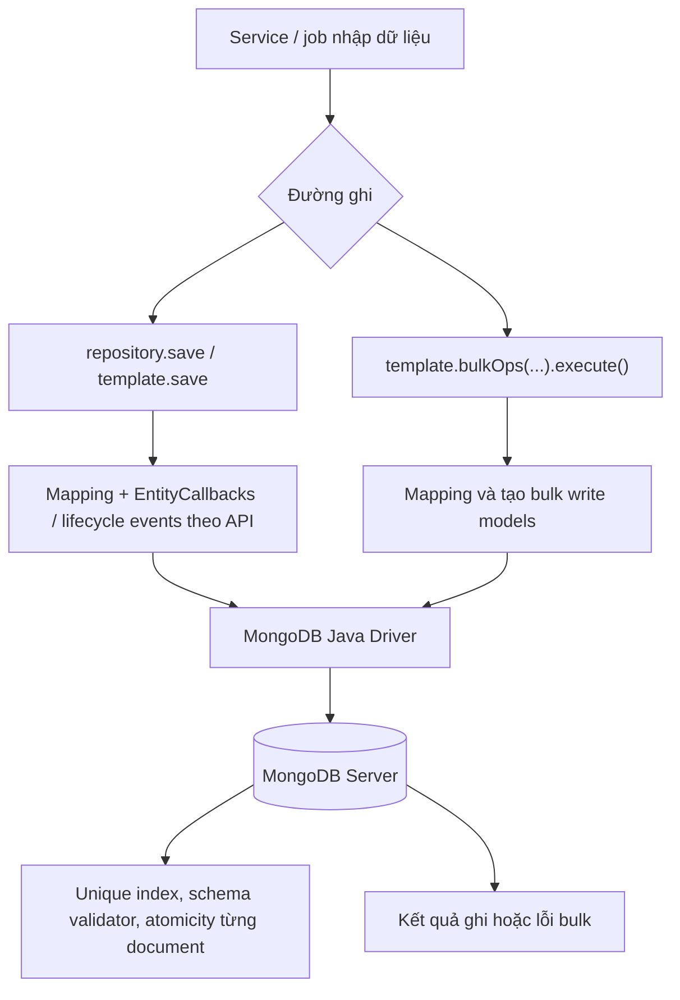
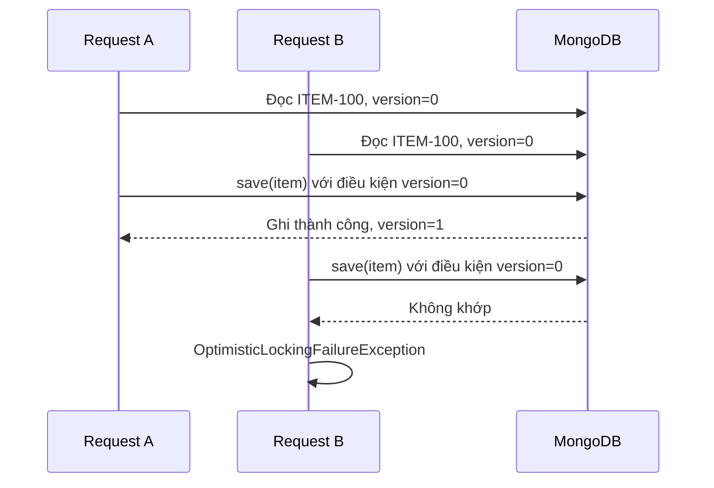

# Giới hạn optimistic locking, callback và lifecycle event trong bulk

**Bulk write** là cách gom nhiều thao tác ghi gửi tới MongoDB, chẳng hạn thêm sản phẩm, cập nhật tồn kho, đánh dấu hàng ngừng bán hoặc xóa các bản ghi cũ. Trong **Spring Data MongoDB**, `MongoTemplate.bulkOps(...)` cung cấp giao diện `BulkOperations` để xây các lệnh `insert`, `updateOne`, `updateMulti`, `upsert`, `remove` và một số thao tác thay thế theo phiên bản API. Bulk giúp giảm chi phí điều phối nhiều request, nhưng **không có nghĩa mỗi thao tác được xử lý giống `repository.save(entity)`**.

Ba giới hạn cần hiểu trước khi đưa bulk vào production là:

1. **Optimistic locking:** `@Version` tự động bảo vệ các thao tác lưu entity phù hợp, nhưng không được giả định bulk tự sinh kiểm tra version, ném `OptimisticLockingFailureException` cho từng phần tử hoặc trả từng kết quả CAS.
2. **Entity callback và lifecycle event:** bulk không cung cấp cùng hợp đồng callback/event từng entity như các đường `MongoTemplate.insert/save`. Hệ quả là những tác vụ dựa trên `BeforeConvertCallback`, `BeforeSaveCallback`, `AbstractMongoEventListener` hay auditing có thể **không chạy như mong đợi**.
3. **Kết quả và tính nguyên tử:** bulk là **tập nhiều thao tác ghi**, không tự trở thành giao dịch tất cả-cùng-thành-công. `BulkWriteResult` thường là tổng số tác động, không phải bản đồ kết quả chi tiết cho từng entity.

Bài học thuộc chương **Ghi hàng loạt** của module `SPRING_DATA_MONGODB`: làm việc với MongoDB qua repository hoặc `MongoTemplate`, kiểm soát ánh xạ BSON, truy vấn, aggregation, index, transaction, reactive access, kiểm thử và chẩn đoán hiệu năng. Nội dung tập trung vào **giới hạn của optimistic locking, callback và lifecycle event trong bulk**, cùng cách thiết kế an toàn khi không thể dựa vào các cơ chế tiện ích của thao tác ghi entity đơn lẻ.

Sau bài này, bạn có thể:

- Phân biệt `MongoRepository.saveAll`, `MongoTemplate.insert(Collection)` và `BulkOperations` về ý định, callback, version và số kết quả.
- Giải thích optimistic locking bằng `@Version` trên `save` và cách làm **compare-and-set (CAS)** thủ công trong bulk.
- Hiểu tại sao `BeforeConvertCallback`, `BeforeSaveCallback`, `@LastModifiedDate` hoặc application lifecycle event không nên là nguồn sự thật của một lệnh bulk.
- Dùng filter `_id + tenantId + version`, toán tử `$set`/`$inc` và kiểm tra `BulkWriteResult`.
- Thiết kế audit/outbox, retry, batch, transaction và integration test để không đánh đổi tính đúng đắn lấy throughput.

## 1. Ba lớp xử lý khác nhau: Spring Data, driver và MongoDB Server



**Spring Data MongoDB** chuyển property Java thành field BSON qua metadata/converter; **MongoDB Java Driver** gửi các lệnh ghi; **MongoDB Server** thực thi điều kiện query, index, update operator và tính nguyên tử của từng document. Không nên đồng nhất **Spring entity lifecycle** với **điều kiện MongoDB Server**:

| Khả năng | Ai quyết định? | Bulk có mặc nhiên bảo đảm không? |
| --- | --- | --- |
| `$inc`, `$set`, `$unset`, filter `version` | MongoDB Server | **Có**, nếu bạn thực sự đưa vào lệnh ghi |
| Unique index và collection validation | MongoDB Server | **Có**, như các lệnh ghi tương ứng |
| Một update trên một document là nguyên tử | MongoDB Server | **Có**, cho riêng thao tác/document đó |
| Nhiều document rollback cùng nhau | Transaction đã cấu hình trên deployment hỗ trợ | **Không** nếu chỉ dùng bulk |
| Tự kiểm tra `@Version` của entity như `save` | Spring Data với những API hỗ trợ | **Không được mặc định tin** |
| `BeforeConvertCallback`, `BeforeSaveCallback`, lifecycle event | Tầng callback/event Spring Data | **Có giới hạn**, phụ thuộc đường API/phiên bản |
| `@CreatedDate`, `@LastModifiedDate` từ auditing | Spring Data auditing callback | **Không được mặc định tin** |
| Một kết quả riêng cho từng lệnh CAS | Cách trả `BulkWriteResult`/driver | Thường chỉ có số **tổng hợp** |

Trong tài liệu Spring Data MongoDB 4.5, bulk được mô tả là không phát lifecycle events. Các tài liệu mới hơn diễn đạt rằng việc phát lifecycle events **bị giới hạn** trong bulk. Vì vậy, **không xây invariants dựa vào callback/event tự động của một API bulk khi chưa có integration test theo phiên bản cụ thể**. Sự khác biệt theo phiên bản không làm thay đổi nguyên tắc: logic bảo vệ dữ liệu quan trọng phải được thể hiện ngay trong filter/update hoặc một workflow có bảo đảm tường minh.

## 2. So sánh `save`, `saveAll`, `insert` và `bulkOps`

Các API đều có thể ghi nhiều hoặc một document, nhưng không đồng nghĩa nhau:

| API | Ý định phổ biến | Xử lý version/callback | Điều cần lưu ý |
| --- | --- | --- | --- |
| `repository.save(entity)` | Lưu một entity mới/cũ | Có cơ chế mapping và optimistic locking theo `@Version` ở các đường hỗ trợ | Entity partial có thể làm mất field khi replace |
| `repository.saveAll(entities)` | Lưu nhiều entity theo trạng thái `isNew` | Implementation có thể dùng đường insert nhiều bản ghi hoặc lưu từng entity; không được mặc định hành vi mọi phần tử giống nhau | Không mặc định là bulk update có điều kiện hoặc transaction |
| `template.insert(collection, Entity.class)` | Insert một collection entity mới | Batch insert có các hành vi callback/mapping riêng | Trùng unique index có thể gây lỗi/ghi một phần |
| `template.bulkOps(BulkMode, Entity.class)` | Gom các insert/update/remove/replace thành bulk | Không cung cấp hợp đồng per-entity như `save` đối với version, callback và events | Phải tự định nghĩa query CAS, audit, timestamps và xử lý kết quả |
| `template.updateFirst(query, update, ...)` | Update một document theo điều kiện | Các quy tắc version của update khác `save`; cần đối chiếu API | Trả `UpdateResult` của chính thao tác |
| `template.findAndModify(...)` | Update có điều kiện và lấy bản trước/sau | Dễ xử lý kết quả riêng một document | Thường phù hợp khi cần phản hồi rõ từng CAS |

Trong `SimpleMongoRepository` thông dụng, `saveAll` có thể tối ưu khi **tất cả entity đều mới**, còn tập mới/cũ có thể đi qua `save` từng bản ghi. Không thể thay `saveAll` bằng `bulkOps.updateOne` rồi mặc định auditing, optimistic locking và event listener vẫn hoạt động như cũ.

### 2.1. Tập lệnh có thể tiết kiệm request nhưng không làm một update đơn lẻ nhanh hơn

Bulk chủ yếu giảm overhead gửi/điều phối nhiều thao tác trong một lần tương tác, còn **chi phí thực thi từng update trên server** vẫn phụ thuộc filter, index, document và contention. Khi mỗi update chỉ tác động một document, index `_id`/khóa truy vấn hợp lý có thể quan trọng hơn việc tăng batch từ 100 lên 1.000.

Đừng đặt mục tiêu “càng nhiều phần tử một batch càng tốt” mà bỏ qua giới hạn lệnh, bộ nhớ, timeout, số lượng thao tác bị ảnh hưởng và khó khăn khi retry.

## 3. Entity có `@Version`: ví dụ xuyên suốt

Giả sử ứng dụng quản lý tồn kho theo tenant. Mỗi item có version để phát hiện hai request cùng đọc một snapshot cũ.

```java
import java.time.Instant;
import org.springframework.data.annotation.CreatedDate;
import org.springframework.data.annotation.LastModifiedDate;
import org.springframework.data.annotation.Version;
import org.springframework.data.mongodb.core.mapping.Document;
import org.springframework.data.mongodb.core.mapping.MongoId;

@Document(collection = "inventoryItems")
public class InventoryItem {

    @MongoId
    private String id;

    private String tenantId;
    private String sku;
    private int stock;
    private String status;

    @Version
    private Long version;

    @CreatedDate
    private Instant createdAt;

    @LastModifiedDate
    private Instant updatedAt;

    protected InventoryItem() {}

    public InventoryItem(String id, String tenantId,
                         String sku, int stock, String status) {
        this.id = id;
        this.tenantId = tenantId;
        this.sku = sku;
        this.stock = stock;
        this.status = status;
    }

    public String getId() { return id; }
    public String getTenantId() { return tenantId; }
    public String getSku() { return sku; }
    public int getStock() { return stock; }
    public String getStatus() { return status; }
    public Long getVersion() { return version; }
    public Instant getCreatedAt() { return createdAt; }
    public Instant getUpdatedAt() { return updatedAt; }

    public void setStock(int stock) { this.stock = stock; }
    public void setStatus(String status) { this.status = status; }
}
```

Repository:

```java
import java.util.Optional;
import org.springframework.data.mongodb.repository.MongoRepository;

public interface InventoryItemRepository
        extends MongoRepository<InventoryItem, String> {

    Optional<InventoryItem> findByIdAndTenantId(
            String id, String tenantId);
}
```

Nếu bật Spring Data MongoDB auditing và dùng các đường ghi entity hỗ trợ, `@CreatedDate`/`@LastModifiedDate` được cập nhật bởi **auditing callback** tương ứng. Annotation đơn độc không bảo đảm auditing đã được bật; trong Spring Boot cần cấu hình `@EnableMongoAuditing` hoặc một cơ chế auditing thích hợp, và thời gian/`AuditorAware` nếu có yêu cầu.

`@MongoId String` được dùng để giữ `_id` dạng BSON String. Với `@Id String` một chuỗi hex 24 ký tự có thể được đổi sang ObjectId; trong bulk CAS, khác biệt BSON type sẽ khiến filter không khớp dù giá trị hiển thị giống nhau.

### 3.1. Khóa và index

```javascript
db.inventoryItems.createIndex(
  { tenantId: 1, sku: 1 },
  { unique: true }
);

// _id đã có unique index riêng.
db.inventoryItems.findOne({ _id: "ITEM-100" });
```

Unique index trên cặp tenant–SKU giúp tránh trùng mã trong một tenant. Với CAS dựa vào `_id`, điều kiện `tenantId` và `version` vẫn phải nằm trong query để bảo vệ quyền truy cập/đồng thời; không nhất thiết tạo index ghép toàn bộ chúng chỉ vì đều xuất hiện trong filter.

## 4. Optimistic locking thông thường với `save`

`@Version` hoạt động khi Spring Data dùng một đường ghi hỗ trợ kiểm tra version, ví dụ `repository.save` trên entity được tải từ database. Một luồng:



Ví dụ:

```java
InventoryItem snapshotA = repository.findById("ITEM-100")
        .orElseThrow();
InventoryItem snapshotB = repository.findById("ITEM-100")
        .orElseThrow();

snapshotA.setStock(15);
repository.save(snapshotA); // Có thể tăng version: 0 → 1.

snapshotB.setStock(12);
repository.save(snapshotB);
// Với optimistic locking hợp lệ, sẽ từ chối snapshotB cũ
// bằng OptimisticLockingFailureException.
```

Trong ví dụ, version ban đầu phụ thuộc việc entity đã được insert/mapping thế nào. Với `@Version Long` ban đầu null và đường insert entity thông thường, Spring Data có thể khởi tạo version = 0. Kết quả lỗi optimistic locking đòi hỏi **write acknowledgement**; cấu hình `WriteConcern.UNACKNOWLEDGED` có thể khiến ứng dụng không biết điều kiện ghi đã thất bại.

**Không diễn giải rộng:** chỉ vì `InventoryItem` có `@Version` không có nghĩa **mọi đường ghi** như raw Java Driver, `BulkOperations` hoặc một job thay đổi trực tiếp bằng `mongosh` đều tự thêm điều kiện version. Việc tăng version mà **không kiểm tra version cũ trong query** cũng không phải optimistic locking.

## 5. Giới hạn của `@Version` trong `BulkOperations`

Một batch bulk thông thường có thể chứa:

```java
import org.springframework.data.mongodb.core.BulkOperations;
import org.springframework.data.mongodb.core.MongoTemplate;
import org.springframework.data.mongodb.core.query.Criteria;
import org.springframework.data.mongodb.core.query.Query;
import org.springframework.data.mongodb.core.query.Update;

// template được inject vào service.
BulkOperations bulk = template.bulkOps(
        BulkOperations.BulkMode.ORDERED,
        InventoryItem.class);

bulk.updateOne(
        Query.query(Criteria.where("_id").is("ITEM-100")),
        new Update().set("stock", 15));

bulk.updateOne(
        Query.query(Criteria.where("_id").is("ITEM-101")),
        new Update().set("stock", 20));

bulk.execute();
```

Đoạn code trên **không đưa version của bản snapshot vào filter**, vì vậy nó không chứng minh được rằng không ai đã thay dữ liệu kể từ lần đọc. Một số phiên bản/đường update của Spring Data có thể xử lý field `@Version` ở mức mapping, thậm chí tăng trường version trong update phù hợp; **tăng version đơn thuần không thay thế được điều kiện so khớp version cũ**.

### 5.1. Hai khái niệm khác nhau

| Cơ chế | Query ghi | Có chặn snapshot cũ không? |
| --- | --- | --- |
| Chỉ cập nhật stock theo `_id` | `{_id: id}` | **Không** |
| Cập nhật stock và tự `$inc(version, 1)` nhưng không lọc version | `{_id: id}` | **Không** |
| CAS đúng nghĩa | `{_id: id, tenantId: tenant, version: expectedVersion}` | **Có**, cho document được chọn và khi mọi writer tuân thủ version |
| `repository.save` với entity `@Version` | Spring Data xây điều kiện version theo API hỗ trợ | **Có**, với write acknowledgement và mapping đúng |

Nếu bulk chỉ tăng version không điều kiện, request mang snapshot cũ vẫn có thể ghi đè. Đó là **version counter**, chưa phải **optimistic locking**.

### 5.2. Không mong đợi exception giống `save`

Với `save(entity)`, một version cũ có thể tạo `OptimisticLockingFailureException`. Với bulk, nếu query chứa `version == 5` mà server đang lưu version 6 thì lệnh `updateOne` thường đơn giản **khớp 0 document**. Nếu những lệnh khác vẫn hợp lệ, `BulkOperations.execute()` có thể trả về `BulkWriteResult` như một batch **không có write error**.

Vì vậy, không được viết:

```java
bulk.execute();
// Không có exception -> mặc định mọi optimistic lock đều thành công. SAI!
```

**Trách nhiệm của ứng dụng** là xem số document khớp, so với số thao tác dự kiến, phân loại thiếu match, đối soát các mục chưa ghi và quyết định cần rollback/retry ra sao.

### 5.3. Insert `@Version` cũng không đồng nghĩa update có optimistic locking

Tài liệu Spring Data MongoDB hiện hành mô tả việc khởi tạo `@Version` khi **insert** trong các trường hợp phù hợp, ví dụ version wrapper bắt đầu từ 0 và primitive có thể bắt đầu từ 1. Điều đó nói về **giá trị ban đầu lúc tạo document**, **không chứng minh bulk update về sau có kiểm tra version cũ**. Hãy kiểm tra BSON raw sau bulk insert và quy tắc khởi tạo theo chính phiên bản dự án.

Một số tài liệu cũ nhấn mạnh bulk không hỗ trợ optimistic locking và việc tự điền version như các thao tác entity đơn lẻ. Khi port sang phiên bản mới, phải đối chiếu **thao tác cụ thể** (bulk insert, updateOne, replaceOne) thay vì suy từ một câu chung cho mọi phiên bản.

## 6. Tự xây CAS đúng nghĩa trong bulk

Nếu ứng dụng chấp nhận ghi từng document có điều kiện rồi tổng hợp kết quả, có thể tự đưa **expected version** vào filter và **tăng version** bằng `$inc` trong cùng update.

### 6.1. Command đầu vào

```java
public record SetStockCommand(
        String id,
        String tenantId,
        long expectedVersion,
        int newStock
) {}
```

`SetStockCommand` phải chứa expected version đọc được từ một snapshot hợp lệ. Tenant ID cần lấy từ context đã được xác thực, không coi field `tenantId` trong payload của client là chứng cứ được phép cập nhật.

Nếu có nhiều command cùng `id` trong một batch, hãy **gộp hoặc từ chối trùng** theo quy tắc nghiệp vụ. Nếu không, lệnh đầu có thể tăng version và làm lệnh thứ hai khớp 0, hoặc khiến việc đối soát batch trở nên mơ hồ.

### 6.2. Bulk update có filter `_id + tenantId + version`

```java
import com.mongodb.bulk.BulkWriteResult;
import java.time.Instant;
import java.util.HashSet;
import java.util.List;
import java.util.Set;
import org.springframework.data.mongodb.core.BulkOperations;
import org.springframework.data.mongodb.core.MongoTemplate;
import org.springframework.data.mongodb.core.query.Criteria;
import org.springframework.data.mongodb.core.query.Query;
import org.springframework.data.mongodb.core.query.Update;
import org.springframework.stereotype.Service;

@Service
public class BulkStockService {
    private final MongoTemplate template;

    public BulkStockService(MongoTemplate template) {
        this.template = template;
    }

    public BulkStockSummary changeStocks(
            String authorizedTenantId,
            List<SetStockCommand> commands
    ) {
        if (authorizedTenantId == null || authorizedTenantId.isBlank()
                || commands == null || commands.isEmpty()) {
            throw new IllegalArgumentException(
                    "Tenant và danh sách lệnh phải hợp lệ");
        }

        Set<String> seenIds = new HashSet<>();
        for (SetStockCommand command : commands) {
            if (command == null
                    || command.id() == null || command.id().isBlank()
                    || !authorizedTenantId.equals(command.tenantId())
                    || command.expectedVersion() < 0
                    || command.expectedVersion() == Long.MAX_VALUE
                    || command.newStock() < 0
                    || !seenIds.add(command.id())) {
                throw new IllegalArgumentException(
                        "Lệnh trùng ID, sai tenant/version hoặc stock");
            }
        }

        BulkOperations bulk = template.bulkOps(
                BulkOperations.BulkMode.ORDERED,
                InventoryItem.class);

        Instant now = Instant.now();
        for (SetStockCommand command : commands) {
            Query query = Query.query(
                    Criteria.where("_id").is(command.id())
                            .and("tenantId").is(authorizedTenantId)
                            .and("version").is(command.expectedVersion()));

            // Không có upsert: document thiếu hoặc version cũ -> 0 match.
            Update update = new Update()
                    .set("stock", command.newStock())
                    .set("updatedAt", now)
                    .inc("version", 1);

            bulk.updateOne(query, update);
        }

        BulkWriteResult result = bulk.execute();
        return new BulkStockSummary(
                commands.size(),
                result.getMatchedCount(),
                result.getModifiedCount());
    }
}

record BulkStockSummary(
        int requested,
        long matched,
        long modified
) {
    public boolean allMatched() {
        return matched == requested;
    }
}
```

Ví dụ thể hiện **một batch của một collection**, dùng `ORDERED` và **mỗi ID chỉ xuất hiện một lần**. `InventoryItem.version` có kiểu Long, nên filter nhận `long` được Spring Data/driver chuyển sang BSON số tương ứng; phải kiểm tra type nếu dữ liệu cũ dùng kiểu khác.

Đặt `$inc("version", 1)` **tường minh** giúp ý định tăng version rõ ràng. Đừng đồng thời thêm một lệnh cập nhật version thứ hai trong cùng command hoặc dựa vào một giả định mơ hồ về cách template tự tăng version. Nếu có auditing callback đặt `updatedAt` khi `save`, đường bulk vẫn **tự đặt updatedAt trong `Update`**.

### 6.3. Phân tích kết quả batch

```java
BulkStockSummary summary =
        bulkStockService.changeStocks("TENANT-A", commands);

if (!summary.allMatched()) {
    // Có một hoặc nhiều lệnh không khớp.
    // Phải đối soát những ID chưa được ghi.
}
```

| Trường `BulkWriteResult` | Ý nghĩa | Giới hạn |
| --- | --- | --- |
| `getMatchedCount()` | Tổng số document khớp trong các lệnh update của batch | **Không chỉ rõ ID/lệnh nào không khớp** |
| `getModifiedCount()` | Tổng số document thực sự bị sửa | Có thể khác matched vì cập nhật không làm đổi dữ liệu; không dùng thay kiểm tra version |
| `getInsertedCount()` | Số document insert thành công | Không phản ánh riêng kết quả CAS |
| `getDeletedCount()` | Số document bị xóa | Có thể đến từ nhiều lệnh remove |
| `getUpserts()` | Thông tin upsert nếu có | Không phải bản đồ đầy đủ kết quả updateOne không khớp |

Trong ví dụ mỗi lệnh updateOne có ID riêng và version hợp lệ, `matched == requested` là một **điều kiện tổng hợp** để biết tất cả đều khớp nếu không có lỗi batch. Nhưng `matched < requested` **không nói được lệnh nào bị stale**, ngay cả khi chỉ có một lệnh không khớp.

**Lưu ý:** `BulkStockSummary` chỉ dành cho use case **cho phép thành công một phần và có bước đối soát**. Nếu nghiệp vụ cần tất cả-cùng-thành-công, không được trả 200 rồi bỏ qua `matched < requested`. Nên sử dụng transaction với rollback đúng cách hoặc chuyển sang một command riêng từng entity và xử lý conflict minh bạch.

### 6.4. Vì sao `upsert` thường không phù hợp với CAS?

Không dùng:

```java
// Không phù hợp cho "update nếu version còn đúng":
bulk.upsert(
        Query.query(Criteria.where("_id").is(id)
                .and("version").is(expectedVersion)),
        new Update().set("stock", 10).inc("version", 1));
```

Nếu version hiện tại đã đổi, query không khớp. `upsert` có thể thử **chèn document mới**, sau đó gây duplicate key trên `_id` hoặc tạo dữ liệu ngoài dự định nếu filter không có khóa duy nhất. **CAS update nên dùng `updateOne` không upsert** và coi 0 matched là conflict/not found theo nghiệp vụ.

## 7. Callback và lifecycle event bị giới hạn như thế nào?

Spring Data MongoDB có hai nhóm hook dễ bị gọi chung là “lifecycle”:

1. **EntityCallbacks**, như `BeforeConvertCallback<T>`, `BeforeSaveCallback<T>`, `AfterSaveCallback<T>` và `AuditingEntityCallback`.
2. **ApplicationEvents** của mapping, như `BeforeConvertEvent<T>`, `BeforeSaveEvent<T>`, `AfterSaveEvent<T>` do `AbstractMongoEventListener` có thể nhận.

Các hook này tồn tại tại những **điểm cụ thể trong pipeline chuyển đổi và lưu entity**; bulk update trực tiếp theo `Query` + `Update` không tương đương với việc gọi `save(entity)` cho từng phần tử.

### 7.1. Callback có thể làm gì ở đường entity?

Ví dụ nghiệp vụ muốn chuẩn hóa SKU trước khi ghi:

```java
import java.util.Locale;
import org.springframework.data.mongodb.core.mapping.event.BeforeConvertCallback;
import org.springframework.stereotype.Component;

@Component
public class InventorySkuCallback
        implements BeforeConvertCallback<InventoryItem> {

    @Override
    public InventoryItem onBeforeConvert(
            InventoryItem entity, String collection
    ) {
        // Ví dụ thật cần method/constructor để đổi SKU hợp lệ.
        // Ở đây trả entity nguyên trạng: mục đích là chỉ ra hook.
        return entity;
    }
}
```

Ở `template.insert`/`template.save`, callback có thể được framework gọi tại giai đoạn phù hợp; callback thực tế có thể trả về cùng entity hoặc **entity mới đã chuẩn hóa**. Nhưng một bulk operation:

```java
bulk.updateOne(
        Query.query(Criteria.where("_id").is("ITEM-100")),
        new Update().set("sku", "bk-100"));
```

không tạo một phiên bản `InventoryItem` đầy đủ để truyền qua `BeforeConvertCallback<InventoryItem>` như `save`. Nếu chuẩn hóa SKU chỉ tồn tại trong callback, bulk có thể ghi `"bk-100"` thay vì giá trị quy ước `"BK-100"`.

**Giải pháp:** chuẩn hóa và validate trong service/command builder, hoặc dùng quy tắc collection validator/unique index phù hợp ở server. Không chuyển các bất biến cần được bảo vệ sang listener rồi trông chờ bulk sẽ gọi listener cho từng update.

### 7.2. Callback không giống BSON mapping

Đừng suy rằng “bulk không chạy callback” đồng nghĩa “bulk không dùng Spring Data mapping”. Với `bulkOps(BulkMode, InventoryItem.class)`, nhiều field/query/update vẫn được mapping qua metadata và converter của Spring Data:

- Property Java có `@Field` có thể được chuyển sang tên BSON khi dựng query/update.
- `@MongoId`/`@Id` ảnh hưởng đến giá trị ID khi mapping.
- Custom conversion có thể ảnh hưởng giá trị field khi mã hóa.

Điều **không được mặc định trông chờ** là các hook dựa trên entity instance như khi `save`. Hãy kiểm tra **BSON raw** với đúng phiên bản framework để xác nhận cả mapping lẫn callback.

### 7.3. Application lifecycle event có thể bất đồng bộ

`AbstractMongoEventListener` là cơ chế gắn với Spring `ApplicationEvent`. Nếu `ApplicationEventMulticaster` được cấu hình executor bất đồng bộ, thời điểm và thứ tự listener nhận event **không phải một ranh giới giao dịch đáng tin cậy**.

Ngay cả khi listener vẫn được gọi trong một số đường ghi, event `AfterSaveEvent` không tự tạo audit/outbox đã commit cùng lệnh MongoDB. Đối với bulk, tài liệu cũng cảnh báo **lifecycle event publishing bị giới hạn**. Nếu nghiệp vụ cần bảo đảm “mỗi thay đổi phải có bản ghi audit”, đừng sử dụng số lần gọi listener làm bằng chứng duy nhất.

### 7.4. Những gì vẫn chạy ở MongoDB Server

Bulk không bỏ qua tất cả ràng buộc:

| Cơ chế | Khi dùng bulk |
| --- | --- |
| Unique index `tenantId + sku` | Server vẫn kiểm tra và có thể trả duplicate key |
| Collection JSON Schema validator | Server vẫn áp dụng theo cấu hình validation |
| `$inc`/`$set` có điều kiện | Server áp dụng trên document khớp |
| TTL index | Tiếp tục do MongoDB quản lý, không phụ thuộc callback Java |
| MongoDB Change Streams | Có thể quan sát thay đổi trên server khi được hỗ trợ; **khác** lifecycle event của Spring |
| Spring `BeforeSaveEvent`/`AuditingEntityCallback` | Không có hợp đồng tương đương cho mọi phần tử bulk |

**MongoDB Change Streams không phải `@AfterSave` của Spring.** Change streams quan sát dữ liệu đã thay đổi và có mô hình resume/cancellation riêng; không cung cấp callback trước ghi để validate hay tự chạy logic trong transaction của ứng dụng.

## 8. Auditing và timestamps khi dùng bulk

Một hệ thống thường dựa vào các annotation:

```java
@CreatedDate
private Instant createdAt;

@LastModifiedDate
private Instant updatedAt;

@Version
private Long version;
```

Nhưng mỗi annotation có **vòng đời và trách nhiệm khác nhau**:

- `@CreatedDate` và `@LastModifiedDate` thuộc **auditing infrastructure**; Spring Data MongoDB dùng callback để đánh dấu entity khi đi qua những đường ghi phù hợp.
- `@Version` biểu diễn phiên bản để phát hiện ghi đè cạnh tranh ở những API hỗ trợ.
- Unique index và schema validation là **ràng buộc tại MongoDB Server**, không phụ thuộc các annotation bên trên.

Với một lệnh `bulk.updateOne(query, update)`, không tồn tại toàn bộ entity mới được dựng để `AuditingEntityCallback` quyết định đầy đủ `createdAt` và `updatedAt` như một lần `save`. **Không mặc định rằng bulk tự cập nhật `@LastModifiedDate` cho mọi document**, và không dùng giá trị timestamp tự sinh như cơ sở để nhận biết batch đã chạy.

### 8.1. Cập nhật timestamp ngay trong `Update`

```java
import java.time.Instant;
import org.springframework.data.mongodb.core.query.Update;

Instant operationTime = Instant.now();

Update update = new Update()
        .set("status", "DISCONTINUED")
        .set("updatedAt", operationTime)
        .inc("version", 1);
```

Khi dùng cùng một `operationTime` cho cả batch, mọi document được cập nhật có **timestamp thực thi logic của batch**, không phải thời điểm chính xác server ghi từng document. Nếu cần thời gian phía server, MongoDB hỗ trợ `$currentDate` và Spring Data có API update tương ứng; phải chọn rõ độ chính xác, nguồn đồng hồ và kiểu BSON ngày.

**Không ghi `createdAt` trong một update cho entity đã tồn tại**, trừ khi nghiệp vụ thật sự muốn thay đổi thời điểm tạo (thường là sai). Khi dùng `upsert` với dữ liệu mới, `$setOnInsert` có thể đặt `createdAt` chỉ cho nhánh insert. Với bulk update hiện có, cần tránh reset audit metadata vô tình.

### 8.2. Ai là tác nhân cập nhật?

Giả sử entity còn có `updatedBy` do `AuditorAware` cung cấp khi `save`. Với bulk, một cách chủ động:

```java
String actorId = authenticatedActorId; // Từ security context đã xác thực.

Update update = new Update()
        .set("status", "DISCONTINUED")
        .set("updatedAt", operationTime)
        .set("updatedBy", actorId)
        .inc("version", 1);
```

Không lấy `actorId` từ payload tùy ý của client. Phải quy định rõ job hệ thống sử dụng tài khoản dịch vụ nào, job ID nào, và thông tin nào cần lưu để điều tra.

**Điểm cần phân biệt:** field `updatedBy` chỉ cho biết dữ liệu trong document được đặt bởi lệnh update. Nó **không thay thế audit log bất biến** nếu có yêu cầu pháp lý/tuân thủ. Với nhiều dòng bulk và khả năng ghi một phần, audit cần có thiết kế riêng để khớp từng thay đổi thực sự thành công.

### 8.3. Không chạy callback thủ công một cách máy móc

Một cách dễ sai là gọi callback trước khi build bulk mà bỏ qua các bước khác:

```java
// Không nên coi đây là thay thế tương đương pipeline save:
InventoryItem modified =
        beforeConvertCallback.onBeforeConvert(item, "inventoryItems");

bulk.updateOne(query, new Update().set("status", modified.getStatus()));
```

Khi `BeforeConvertCallback` tạo entity mới, callback `BeforeSaveCallback` sửa BSON document, hay nhiều callback có thứ tự phụ thuộc nhau, việc gọi một hook bằng tay sẽ **không tái tạo toàn bộ vòng đời Spring Data**. Nếu có invariant thiết yếu, chuyển nó thành **hàm miền có thể gọi trực tiếp** từ cả đường `save` và đường bulk, kèm test cho từng lệnh ghi.

Ví dụ một hàm thuần Java cho mọi cách ghi:

```java
import java.util.Locale;

public final class SkuRules {
    private SkuRules() {}

    public static String normalize(String sku) {
        if (sku == null || sku.isBlank()) {
            throw new IllegalArgumentException("SKU bắt buộc");
        }
        return sku.trim().toUpperCase(Locale.ROOT);
    }
}
```

Service sẽ gọi `SkuRules.normalize(...)` trước khi tạo `Update`; callback của đường save cũng có thể dùng lại **hàm chung đó**. Như vậy validation/normalization không phụ thuộc việc bulk có phát một event nào đó hay không.

## 9. Ordered, unordered và lỗi ghi một phần

`BulkMode.ORDERED` và `BulkMode.UNORDERED` ảnh hưởng cách batch được tiến hành khi có lỗi ghi:

| Chế độ | Khi có write error | Phù hợp với |
| --- | --- | --- |
| `ORDERED` | Dừng hoặc không tiếp tục những lệnh sau điểm lỗi theo ngữ nghĩa ordered | Các lệnh có thứ tự cần giữ, dễ tái hiện |
| `UNORDERED` | Cho phép các lệnh còn lại được thực thi dù có lỗi ở lệnh khác | Các lệnh độc lập, chấp nhận thứ tự không cố định |

**Không nhầm một update khớp 0 với write error.** Khi filter `version` không khớp, updateOne thông thường không sinh duplicate key hay ngoại lệ: lệnh có thể hoàn tất bình thường, `matchedCount` của nó bằng 0. Vì vậy, `ORDERED` **không tự dừng tại optimistic conflict**, và `UNORDERED` cũng không biết phải retry một CAS cũ.

### 9.1. Khi một lệnh vi phạm unique index

Ví dụ batch insert ba SKU, trong đó SKU thứ hai đã tồn tại:

```javascript
// Đã có unique index { tenantId: 1, sku: 1 }.
// Batch gồm SKU-A, SKU-DUP, SKU-C.
```

Với `ORDERED`, một số thao tác trước lệnh trùng có thể đã thành công và các lệnh sau có thể không được thực thi. Với `UNORDERED`, lệnh thứ ba có thể vẫn được thực thi dù lệnh thứ hai bị lỗi. **Cả hai trường hợp đều không mặc định rollback những document đã ghi**.

Khi driver/Spring Data ném lỗi bulk như `BulkWriteException` hoặc exception được chuyển đổi bởi Spring, chi tiết lỗi có thể bao gồm các chỉ số operation/index và error code. Nhưng **đừng phụ thuộc vào index lỗi đơn thuần để suy ra toàn bộ trạng thái đã ghi**, đặc biệt sau network timeout hoặc khi chia batch. Hãy đối soát bằng khóa nghiệp vụ, batch/job ID và MongoDB thực tế.

### 9.2. Một batch chứa nhiều loại lệnh làm số tổng khó diễn giải

Nếu cùng batch vừa `insert`, vừa `updateOne`, `updateMulti`, `remove` và `upsert`, tổng `matchedCount` không còn bằng số command trong danh sách. Ví dụ `updateMulti` có thể khớp 30 document chỉ với một lệnh. Do đó:

- Chỉ so `matchedCount == số command` khi **mỗi command là updateOne có mục tiêu duy nhất** và đã xác định ý nghĩa.
- Với `updateMulti`, đừng dùng số match để suy ra mỗi command có thành công hay không.
- Với `upsert`, một lệnh có thể tạo mới và được phản ánh trong `getUpserts()` thay vì matched count.
- Với nhiều loại lệnh hoặc retry, hãy dùng **manifest** và trạng thái công việc để đối soát rõ ràng.

### 9.3. Write concern và lỗi không chắc chắn

Optimistic locking dựa trên việc ứng dụng biết thao tác có match hay không. Dùng write concern **unacknowledged** khiến ứng dụng không có kết quả xác nhận tin cậy; các phép đo matched/modified không thể dùng như cơ sở an toàn cho CAS.

Nếu kết nối đứt sau khi gửi batch nhưng trước khi nhận reply, một phần hay toàn bộ lệnh có thể đã chạy. Không kết luận “không thấy response tức chưa ghi” rồi **retry toàn bộ `$inc`**: như vậy có thể cộng stock hai lần. Hãy thiết kế idempotency hoặc đối soát kết quả theo ID/version/operation ID.

## 10. Khi nào cần transaction và khi nào nên tránh bulk?

BulkOperations tự nó không phải transaction nhiều document. Nếu use case yêu cầu **tất cả lệnh cùng thành công hoặc cùng rollback**, cần MongoDB transaction trên deployment hỗ trợ và cấu hình transaction manager phù hợp.

### 10.1. Chỉ có transaction mới giải quyết all-or-nothing nhiều document

Ví dụ một service đã cấu hình `MongoTransactionManager` và sử dụng MongoDB topology hỗ trợ transaction:

```java
import com.mongodb.bulk.BulkWriteResult;
import org.springframework.dao.OptimisticLockingFailureException;
import org.springframework.transaction.annotation.Transactional;

@Transactional
public void changeAllOrFail(/* dữ liệu lệnh đã validate */) {
    // 1. Tạo bulk với updateOne và filter version cho từng ID.
    // 2. BulkWriteResult result = bulk.execute();
    // 3. Nếu matchedCount != số lệnh yêu cầu:
    //        throw new OptimisticLockingFailureException(
    //            "Có document không khớp version");
    // 4. Nếu mọi lệnh khớp, commit transaction.
}
```

Đây là **minh họa ranh giới**; phải triển khai kiểm tra số lệnh chính xác với batch thực và xác nhận `@Transactional` được Spring áp dụng (proxy invocation, transaction manager, cùng database factory/session). Nếu `matchedCount < requested` mà code chỉ log rồi return bình thường, **transaction vẫn có thể commit các lệnh đã khớp**.

Transaction cũng có chi phí về thời gian, tài nguyên, contention và giới hạn deployment. Không cần transaction chỉ để cập nhật một field trong **một document** bằng `$inc` hoặc CAS: MongoDB đã có nguyên tử cấp document.

### 10.2. Trường hợp nên dùng `save` thay vì bulk

Ưu tiên lưu từng entity qua repository/template khi:

- Muốn cơ chế `@Version` tự động và lỗi optimistic locking **trên từng entity**.
- Bắt buộc callback/auditing/validation theo đường entity phải chạy và chưa có giải pháp thay thế được kiểm chứng.
- Mỗi lệnh cần trả entity mới/bản cũ, hoặc biết chính xác ID nào bị stale.
- Số document ít, yêu cầu tính đúng đắn cao hơn throughput.
- Có nhiều điều kiện nghiệp vụ phức tạp phụ thuộc trạng thái đã đọc, khó biểu diễn an toàn trong một update.

Ưu tiên bulk khi:

- Có hàng trăm/nghìn update **độc lập**, cùng loại, filter/update được xây rõ.
- Mỗi update có thể đặt bất biến trong query và update ở server.
- Ứng dụng có quy trình đối soát lỗi một phần và retry có idempotency.
- Callback/auditing được thay bằng bước explicit hoặc không phải điều kiện của use case.
- Đã đo hiệu năng thực cho workload và index.

### 10.3. Outbox và audit: đừng nhầm lifecycle event với giao dịch

Nếu yêu cầu là “mỗi lần đổi stock phải có audit event để downstream xử lý”, có hai mô hình phổ biến:

**Mô hình giao dịch:** trong cùng MongoDB transaction, ghi item và bản ghi outbox vào collection riêng; chỉ commit khi cả hai được chấp nhận. Một worker khác đọc outbox và publish có retry/idempotency.

**Mô hình đối soát:** bulk cập nhật, lưu manifest theo batch, sau đó đối soát những ID đã thay và ghi sự kiện. Phải chấp nhận/trình bày rõ khoảng thời gian chưa có event và cơ chế phục hồi.

Không tự giả định:

```java
bulk.execute();
// Một @AfterSave listener sẽ tự phát 1 event cho mỗi item. KHÔNG AN TOÀN.
```

Trong các phiên bản MongoDB/Spring Data mới có API bulk hỗ trợ nhiều collection, nhưng **tính sẵn có phụ thuộc phiên bản server/driver** và **không biến event listener của Spring thành outbox nguyên tử**. Với nhu cầu audit chính xác, vẫn cần kiểm tra ranh giới transaction, write concern và trạng thái commit.

## 11. Reactive bulk và các giới hạn không biến mất

Với ứng dụng reactive, Spring Data MongoDB có `ReactiveMongoTemplate` và bulk API tương ứng trong các phiên bản hỗ trợ. `execute()` trả `Mono<BulkWriteResult>` thay vì kết quả blocking trực tiếp:

```java
import com.mongodb.bulk.BulkWriteResult;
import org.springframework.data.mongodb.core.BulkOperations;
import org.springframework.data.mongodb.core.ReactiveMongoTemplate;
import org.springframework.data.mongodb.core.query.Criteria;
import org.springframework.data.mongodb.core.query.Query;
import org.springframework.data.mongodb.core.query.Update;
import reactor.core.publisher.Mono;

public class ReactiveBulkStockService {
    private final ReactiveMongoTemplate template;

    public ReactiveBulkStockService(ReactiveMongoTemplate template) {
        this.template = template;
    }

    public Mono<Long> markDiscontinued(
            String tenantId, String itemId,
            long expectedVersion
    ) {
        var bulk = template.bulkOps(
                BulkOperations.BulkMode.ORDERED,
                InventoryItem.class);

        Query query = Query.query(
                Criteria.where("_id").is(itemId)
                        .and("tenantId").is(tenantId)
                        .and("version").is(expectedVersion));

        bulk.updateOne(
                query,
                new Update()
                        .set("status", "DISCONTINUED")
                        .set("updatedAt", java.time.Instant.now())
                        .inc("version", 1));

        return bulk.execute()
                .map(result -> result.getMatchedCount());
    }
}
```

Phương thức `markDiscontinued` minh họa một lệnh trong bulk để người học thấy cơ chế response và kiểm tra match; nếu chỉ thay một document và cần kết quả rõ ràng, `ReactiveMongoTemplate.updateFirst`/`findAndModify` có thể đơn giản hơn. Cần validation ID/tenant/version và xử lý `matched == 0` thành conflict trong service thật.

`Mono`/`Flux` thay đổi cách thực thi I/O và subscription, **không tự thêm optimistic locking, callback, audit hay transaction**. Không gọi `block()` trên event loop và không đưa lệnh blocking vào pipeline reactive một cách tùy tiện. Transaction reactive, nếu có, phải cấu hình và tham gia đúng context.

## 12. Kiểm thử tích hợp: version, callback và dữ liệu BSON

Mock `MongoTemplate` không đủ để kiểm chứng việc MongoDB Server match filter, tăng version hoặc lưu timestamp. Với các API bulk, nên có **integration test dùng MongoDB thật nhưng cô lập** (ví dụ Testcontainers), kết hợp `@DataMongoTest` của Spring Boot 3.x.

### 12.1. Test `save` phát hiện entity cũ

Sử dụng `InventoryItem` và `InventoryItemRepository` ở mục 3:

```java
import static org.assertj.core.api.Assertions.assertThat;
import static org.assertj.core.api.Assertions.assertThatThrownBy;

import org.junit.jupiter.api.Test;
import org.springframework.beans.factory.annotation.Autowired;
import org.springframework.boot.test.autoconfigure.data.mongo.DataMongoTest;
import org.springframework.dao.OptimisticLockingFailureException;

@DataMongoTest
class InventoryOptimisticLockingTest {

    @Autowired InventoryItemRepository repository;

    @Test
    void repositorySaveRejectsStaleEntity() {
        repository.insert(new InventoryItem(
                "TEST-SAVE-1", "T-A", "SKU-SAVE-1",
                10, "ACTIVE"));

        InventoryItem a = repository.findById("TEST-SAVE-1")
                .orElseThrow();
        InventoryItem b = repository.findById("TEST-SAVE-1")
                .orElseThrow();

        assertThat(a.getVersion()).isNotNull();

        a.setStock(20);
        repository.save(a);

        b.setStock(30);
        assertThatThrownBy(() -> repository.save(b))
                .isInstanceOf(OptimisticLockingFailureException.class);

        assertThat(repository.findById("TEST-SAVE-1")
                .orElseThrow().getStock()).isEqualTo(20);
    }
}
```

Test này diễn tả cách `save` cùng `@Version` phát hiện snapshot cũ, với write acknowledgement đúng cấu hình. Có thể cần dọn dữ liệu trước/sau hoặc dùng tên database/ID duy nhất trong test để tránh chạy lại gặp duplicate key. **Không chạy test ghi vào production**.

### 12.2. Test bulk: một CAS khớp, một CAS không khớp

```java
import static com.mongodb.client.model.Filters.eq;
import static org.assertj.core.api.Assertions.assertThat;

import com.mongodb.bulk.BulkWriteResult;
import java.time.Instant;
import org.bson.Document;
import org.junit.jupiter.api.Test;
import org.springframework.beans.factory.annotation.Autowired;
import org.springframework.boot.test.autoconfigure.data.mongo.DataMongoTest;
import org.springframework.data.mongodb.core.BulkOperations;
import org.springframework.data.mongodb.core.MongoTemplate;
import org.springframework.data.mongodb.core.query.Criteria;
import org.springframework.data.mongodb.core.query.Query;
import org.springframework.data.mongodb.core.query.Update;

@DataMongoTest
class BulkVersionIntegrationTest {

    @Autowired MongoTemplate template;

    @Test
    void manualCasOnlyChangesTheMatchingVersion() {
        InventoryItem first = template.insert(new InventoryItem(
                "TEST-BULK-1", "T-A", "SKU-BULK-1", 10, "ACTIVE"));
        InventoryItem second = template.insert(new InventoryItem(
                "TEST-BULK-2", "T-A", "SKU-BULK-2", 10, "ACTIVE"));

        long correctVersion = first.getVersion();
        long staleVersion = second.getVersion() + 100;
        Instant now = Instant.parse("2026-11-20T00:00:00Z");

        BulkOperations bulk = template.bulkOps(
                BulkOperations.BulkMode.ORDERED,
                InventoryItem.class);

        bulk.updateOne(
                Query.query(Criteria.where("_id").is("TEST-BULK-1")
                        .and("tenantId").is("T-A")
                        .and("version").is(correctVersion)),
                new Update().set("stock", 7)
                        .set("updatedAt", now)
                        .inc("version", 1));

        bulk.updateOne(
                Query.query(Criteria.where("_id").is("TEST-BULK-2")
                        .and("tenantId").is("T-A")
                        .and("version").is(staleVersion)),
                new Update().set("stock", 3)
                        .set("updatedAt", now)
                        .inc("version", 1));

        BulkWriteResult result = bulk.execute();

        assertThat(result.getMatchedCount()).isEqualTo(1);
        assertThat(template.findById("TEST-BULK-1",
                InventoryItem.class).getStock()).isEqualTo(7);
        assertThat(template.findById("TEST-BULK-2",
                InventoryItem.class).getStock()).isEqualTo(10);

        // Đọc BSON thô, không chỉ dựa vào entity đã mapping.
        Document raw = template.getCollection("inventoryItems")
                .find(eq("_id", "TEST-BULK-1"))
                .first();

        assertThat(raw).isNotNull();
        assertThat(raw.getLong("version"))
                .isEqualTo(correctVersion + 1);
        assertThat(raw.getDate("updatedAt")).isNotNull();
    }
}
```

Với dữ liệu test nêu trên, **lệnh thứ hai không khớp version nhưng bulk vẫn có thể hoàn tất mà không ném `OptimisticLockingFailureException`**. `getMatchedCount() == 1` là tín hiệu để ứng dụng tự nhận biết không phải cả hai command đều thành công.

Test cũng chứng minh `updatedAt` được đặt **tường minh trong `Update`**. Nếu chỉ dựa vào `@LastModifiedDate` mà bỏ `.set("updatedAt", now)`, kết quả có thể khác vì đường bulk không đi qua auditing callback giống `save`.

### 12.3. Test khảo sát callback không chạy như đường `save`

Một callback có thể được gắn vào test để đếm số lần đi qua pipeline `BeforeSaveCallback`:

```java
import java.util.concurrent.atomic.AtomicInteger;
import org.bson.Document;
import org.springframework.data.mongodb.core.mapping.event.BeforeSaveCallback;

public class InventoryBeforeSaveProbe
        implements BeforeSaveCallback<InventoryItem> {

    private final AtomicInteger calls = new AtomicInteger();

    @Override
    public InventoryItem onBeforeSave(
            InventoryItem entity, Document target, String collection
    ) {
        calls.incrementAndGet();
        return entity;
    }

    public int count() {
        return calls.get();
    }

    public void reset() {
        calls.set(0);
    }
}
```

Và một test đặc trưng hành vi của phiên bản được dùng:

```java
import static org.assertj.core.api.Assertions.assertThat;

import org.junit.jupiter.api.Test;
import org.springframework.beans.factory.annotation.Autowired;
import org.springframework.boot.test.autoconfigure.data.mongo.DataMongoTest;
import org.springframework.context.annotation.Import;
import org.springframework.data.mongodb.core.BulkOperations;
import org.springframework.data.mongodb.core.MongoTemplate;
import org.springframework.data.mongodb.core.query.Criteria;
import org.springframework.data.mongodb.core.query.Query;
import org.springframework.data.mongodb.core.query.Update;

@DataMongoTest
@Import(InventoryBeforeSaveProbe.class)
class BulkCallbackCharacterizationTest {

    @Autowired MongoTemplate template;
    @Autowired InventoryBeforeSaveProbe probe;

    @Test
    void bulkUpdateDoesNotUsePerEntityBeforeSaveCallback() {
        template.insert(new InventoryItem(
                "TEST-CALLBACK-1", "T-A", "SKU-CB-1",
                1, "ACTIVE"));

        // Bỏ qua callback của thao tác insert fixture.
        probe.reset();

        var bulk = template.bulkOps(
                BulkOperations.BulkMode.ORDERED,
                InventoryItem.class);

        bulk.updateOne(
                Query.query(
                        Criteria.where("_id").is("TEST-CALLBACK-1")),
                new Update().set("stock", 2));
        bulk.execute();

        assertThat(probe.count()).isZero();
    }
}
```

Đây là **characterization test** cho đường `bulkOps.updateOne` với `BeforeSaveCallback`, không phải tuyên bố rằng **mọi API bulk của mọi phiên bản** sẽ có cùng tập callback. Khi nâng cấp Spring Data, hãy chạy lại test và khảo sát event/callback cho **đúng API** đang được ứng dụng sử dụng. Nếu phiên bản thay đổi hành vi, phải xác định điều đó có ảnh hưởng tới audit, validation hay dữ liệu được lưu hay không.

### 12.4. Các ca cần bổ sung

| Test | Kết quả cần xác minh |
| --- | --- |
| `repository.save` entity version cũ | Ném optimistic locking exception và không ghi đè |
| `bulk.updateOne` lọc version cũ | 0 match, không tự biến thành optimistic locking exception |
| Bulk gồm 2 updateOne, chỉ 1 match | `getMatchedCount() == 1`, item còn lại không thay |
| Bulk không chỉ định callback auditing | Kiểm tra `createdAt`, `updatedAt` raw; không dựa vào giả định |
| `BeforeSaveCallback` ở đường save và bulk | Đếm callback theo API/phiên bản được test |
| Bulk có update trùng `_id`/unique SKU | Server trả lỗi index; xử lý partial success |
| `ORDERED` với một write error | Lệnh trước có thể đã ghi; lệnh sau có thể chưa chạy |
| `UNORDERED` với một write error | Các lệnh độc lập khác có thể vẫn được chạy |
| Bulk dùng `Update.inc("version", 1)` nhưng không filter version | Không coi đó là optimistic locking |
| Cùng một ID xuất hiện hai lần trong batch | Chặn hoặc gộp từ trước; không lặng lẽ xử lý |
| Write concern không xác nhận | Không dùng số match không tin cậy để xác nhận CAS |
| Gọi bulk trong transaction, có 0 match | Service ném lỗi để rollback theo nghiệp vụ |
| Nạp lại batch có `$inc` sau timeout | Kiểm tra idempotency, tránh cập nhật hai lần |
| Template bulk đổi `@Field`/String ID | Query và BSON raw giữ đúng tên/type |

## 13. Chẩn đoán bulk khi version không tăng hoặc thiếu audit

Khi một job import báo “thành công” nhưng `version`, `updatedAt` hoặc audit log không giống kỳ vọng, hãy kiểm tra theo thứ tự:

1. **API thật sự dùng là gì?** `repository.saveAll`, `template.insert(Collection)`, `bulkOps` hay raw driver `bulkWrite`?
2. **Đường query có lọc version không?** Chỉ có `@Version` trên class không đủ; kiểm tra chính filter gửi tới server.
3. **Update có đặt version/timestamp không?** Có `$inc(version, 1)`, `$set(updatedAt, now)` hay lệnh chỉ cập nhật stock?
4. **Kết quả ghi được đọc chưa?** `getMatchedCount()` và các write errors đã được đối soát hay bị bỏ qua?
5. **Callback/auditing đang chạy ở API nào?** Có test thực cho listener và auditing field không?
6. **BSON type và tên field khớp không?** `Long` vs String, `_id` String vs ObjectId, `@Field`/converter?
7. **Có một batch ghi một phần hoặc lỗi mạng không chắc chắn không?** Đối soát theo ID/operation ID, không retry mù.
8. **Các writer khác có giữ version không?** Raw update/migration không tăng version sẽ phá cơ chế phát hiện cạnh tranh.
9. **Có transaction thật không?** Check transaction manager, MongoDB deployment và rollback khi matched khác mong đợi.
10. **Có dùng app lifecycle event làm audit không?** Chuyển sang cơ chế outbox/transaction hoặc đối soát nếu yêu cầu độ tin cậy cao.

### 13.1. Xem BSON và loại field bằng `mongosh`

```javascript
db.inventoryItems.findOne(
  { _id: "ITEM-100", tenantId: "T-A" }
);

db.inventoryItems.aggregate([
  { $match: { tenantId: "T-A" } },
  {
    $project: {
      _id: 1,
      version: 1,
      versionType: { $type: "$version" },
      updatedAtType: { $type: "$updatedAt" },
      stockType: { $type: "$stock" }
    }
  },
  { $limit: 10 }
]);
```

Nếu field vắng mặt, `$type` trong aggregation có thể cho `"missing"`; nếu field có giá trị BSON null thì ra `"null"`. Điều này giúp phân biệt auditing **không được ghi** với auditing có field nhưng giá trị null.

### 13.2. Kiểm tra index và query plan

```javascript
db.inventoryItems.getIndexes();

db.inventoryItems.find({
  _id: "ITEM-100",
  tenantId: "T-A",
  version: NumberLong("3")
}).explain("executionStats");
```

Với CAS lọc theo `_id`, index mặc định của `_id` thường đã đủ để tìm đúng document, còn `tenantId`/`version` vẫn bắt buộc vì **tính đúng đắn**. Nếu bulk update dựa vào cặp `tenantId + sku`, unique compound index giúp đảm bảo không có hai item cùng khóa logic; cần đo index/chi phí update trên dữ liệu đại diện.

`explain` của một truy vấn `find` tương đương **không đo chính xác chi phí của bulk update**, nhưng giúp kiểm tra filter và index. Để đo toàn bộ workload, quan sát command monitoring, batch size, số request/giây, write concern, latency p95/p99, CPU/IO trên server, lock contention và số phần tử thất bại.

## 14. Bài tập tình huống: đổi giá 3.000 sản phẩm

Một hệ thống thương mại điện tử cần đổi giá 3.000 SKU thuộc tenant `SHOP-A` theo bảng giá vừa được phê duyệt. Mỗi bản ghi chứa:

```javascript
{
  _id: "ITEM-900",
  tenantId: "SHOP-A",
  sku: "BK-900",
  priceVnd: NumberLong("95000"),
  status: "ACTIVE",
  version: NumberLong("8"),
  createdAt: ISODate("2026-01-01T00:00:00Z"),
  updatedAt: ISODate("2026-10-01T00:00:00Z")
}
```

Các yêu cầu:

1. Chỉ đổi giá khi `version` vẫn đúng với dữ liệu đã xem xét khi phê duyệt bảng giá.
2. Không đổi sản phẩm `status = "DISCONTINUED"`.
3. Mỗi cập nhật thành công phải tăng version đúng một lần và đặt `updatedAt`.
4. Không tin rằng `@LastModifiedDate` hoặc một `AfterSaveEvent` sẽ tự xử lý việc ghi bulk.
5. Nếu một SKU không khớp version, phải có cách tìm ra SKU đó, không chỉ biết tổng số khớp.
6. Nếu lô cập nhật yêu cầu all-or-nothing, phải có cách rollback những thay đổi đã thực hiện.
7. Job có thể bị retry vì lỗi mạng và không được áp lại mức tăng/giảm giá sai.

### 14.1. Đề xuất giải pháp cho batch có thể thành công một phần

Mỗi dòng giá gửi vào có `id`, `tenantId`, `expectedVersion` và `newPriceVnd`. Một updateOne mẫu:

```java
Query query = Query.query(
        Criteria.where("_id").is(row.id())
                .and("tenantId").is("SHOP-A")
                .and("status").is("ACTIVE")
                .and("version").is(row.expectedVersion()));

Update update = new Update()
        .set("priceVnd", row.newPriceVnd())
        .set("updatedAt", approvedAt)
        .inc("version", 1);

bulk.updateOne(query, update);
```

Đây là phần thân vòng lặp đã validate `row`, `approvedAt` và `bulk`. Vì filter có cả status và version, một document đã bị sửa/khóa sẽ **không bị cập nhật**. Không dùng `upsert` cho tình huống này. Mỗi lệnh chỉ sửa hai field nghiệp vụ/metadata đã chỉ định và version, giữ các field khác.

Khi `BulkWriteResult.getMatchedCount() != requested`, có một hoặc nhiều lệnh không khớp. Để xác định chính xác SKU nào:

- Có thể **chia thành các batch nhỏ** và đối soát bằng danh sách version/ID đã gửi, nhưng tổng matched count vẫn không chỉ ra cụ thể ID nào trong batch.
- Có thể chạy truy vấn đối soát sau ghi để so sánh `version`, `priceVnd` và batch operation ID với bảng yêu cầu; nếu có các writer khác, việc chỉ so số version có thể chưa đủ.
- Nếu yêu cầu phản hồi từng item ngay khi ghi, cân nhắc dùng **từng updateFirst/findAndModify** có `UpdateResult` riêng, đổi throughput lấy độ rõ ràng.
- Nếu cần audit chính xác, thiết kế operation ID hoặc outbox và transaction/đối soát phù hợp.

**Không suy từ `matchedCount = 2.999` rằng “dòng thứ 3.000 thất bại”.** Các update không match có thể nằm ở bất kỳ vị trí nào; với unordered, thứ tự xử lý càng không nên được giả định.

### 14.2. All-or-nothing và audit

Nếu cần cả 3.000 giá cùng đổi hoặc cùng giữ nguyên:

1. Chia công việc thành ranh giới transaction hợp lý với giới hạn server và độ dài transaction; không tự khẳng định một transaction lớn luôn phù hợp.
2. Trong transaction, xây bulk CAS và **kiểm tra matched count** sau execute.
3. Nếu có bất kỳ CAS không match, **ném exception** làm transaction rollback.
4. Nếu cần audit cùng commit, ghi outbox/audit theo transaction. Đối với message bên ngoài MongoDB, dùng outbox và cơ chế publish idempotent.
5. Có quy trình retry khi transaction gặp transient error, nhưng không retry mù các phép `$inc` ngoài ranh giới transaction/idempotency.

Nếu hệ thống có thể chấp nhận cập nhật theo từng nhóm 100–500 SKU rồi đối soát, một batch có checkpoint và trạng thái `PENDING/SUCCEEDED/CONFLICT/FAILED` thường dễ vận hành hơn transaction dài. Phải xác định rõ ranh giới nhất quán theo nghiệp vụ trước khi quyết định.

### 14.3. Tại sao auditing callback không đủ?

Giả sử một callback gán `updatedAt = Instant.now()` khi `save(entity)`. Khi job đổi giá dùng `bulk.updateOne`:

- Không có entity Java mới của từng document đi qua cùng pipeline `save`.
- Callback có thể không được gọi cho thao tác bulk update.
- Ngay cả khi một event nào đó được phát, nó chưa phải bằng chứng đã commit audit riêng.
- Dữ liệu cần ghi (giá mới, version mới, actor, job ID) phải được **xây trong lệnh update** hoặc trong workflow tin cậy tường minh.

Đáp án đúng là **tự đặt metadata cần thiết**, dùng filter CAS và thiết kế audit/outbox/đối soát; không phải cố thêm nhiều annotation vào entity rồi mong bulk có đầy đủ lifecycle như repository.

## 15. Những sai lầm phổ biến

| Sai lầm | Hậu quả | Cách khắc phục |
| --- | --- | --- |
| Thấy `@Version` và nghĩ bulk sẽ tự kiểm tra version như `save` | Ghi đè dữ liệu đã thay đổi | Đặt `version == expected` trong query và tăng version một cách nhất quán |
| Chỉ `$inc("version", 1)` mà không lọc version cũ | Tăng counter nhưng không chặn snapshot cũ | CAS phải có **cả điều kiện** và **tăng version** |
| `bulk.execute()` không ném lỗi nên coi mọi update thành công | Một số update khớp 0 | Kiểm tra `BulkWriteResult.getMatchedCount()` và đối soát |
| Dùng `getModifiedCount()` thay số match | Cập nhật không đổi giá trị có thể không tính là modified | Phân biệt matched và modified |
| Đợi `BeforeSaveCallback` chuẩn hóa field cho bulk update | Dữ liệu không được chuẩn hóa | Dùng service/domain validation chung và collection validator |
| Đợi `@LastModifiedDate` tự đổi khi bulk update | `updatedAt` cũ hoặc thiếu | `Update.set("updatedAt", now)`/`currentDate` tường minh |
| Dùng lifecycle event làm audit duy nhất | Mất event hoặc audit không tương ứng commit | Outbox/transaction hoặc đối soát có idempotency |
| Hiểu `ORDERED` sẽ dừng khi CAS khớp 0 | Batch tiếp tục và có partial matches | Tự kiểm tra số match; transaction nếu all-or-nothing |
| Hiểu `UNORDERED` là transaction | Một số lệnh vẫn thành công khi lệnh khác lỗi | Thiết kế partial failure/retry riêng |
| Một ID xuất hiện nhiều lần trong batch | Thứ tự, version và số match khó lý giải | Deduplicate/gộp lệnh trước khi build bulk |
| Bật upsert cho điều kiện version cũ | Có thể tạo dữ liệu mới hoặc lỗi duplicate key | CAS nên là updateOne **không upsert** |
| Không có unique index cho tenant–SKU | Concurrent upsert có thể tạo duplicate | Dùng index unique và xử lý lỗi |
| Retry toàn bộ `$inc` sau timeout | Có thể cộng/trừ hai lần | Operation ID, checkpoint, đối soát trước retry |
| Chỉ mock `MongoTemplate` | Không thấy BSON/điều kiện match thật | `@DataMongoTest` với MongoDB test instance |
| Dùng callback async như đồng bộ có giao dịch | Audit/side effect không chắc chắn thứ tự | Tách logic đảm bảo dữ liệu khỏi event listener |
| Tối ưu batch size trước khi tạo index | Write vẫn chậm do filter quét dữ liệu | Đo query plan, index và contention |

## 16. Checklist trước khi bật bulk trong production

1. **Cần bulk vì throughput hay chỉ vì tiện?** Với vài entity cần conflict riêng, `save`/`updateFirst` có thể phù hợp hơn.
2. **Mỗi lệnh có filter đủ chặt không?** Dùng `_id`/khóa unique, tenant từ context xác thực và điều kiện nghiệp vụ.
3. **Có yêu cầu optimistic locking không?** Đưa `expectedVersion` vào filter; không chỉ dựa vào `@Version`.
4. **Version có được tăng đúng một lần không?** Đảm bảo đường `save`, template, bulk, raw driver và migration cùng quy ước.
5. **Có phải upsert không?** Nếu không, tắt upsert để stale version không biến thành insert attempt.
6. **Ứng dụng xử lý matched count thế nào?** Biết khi nào phải đối soát ID, khi nào có thể thành công một phần.
7. **Callback/lifecycle event nào đang được nghiệp vụ dựa vào?** Di chuyển validation, timestamp, actor và audit quan trọng sang bước tường minh có test.
8. **Đã phân biệt callback với mapping/converter chưa?** Bulk có thể vẫn ánh xạ BSON nhưng không có cùng entity lifecycle.
9. **Có unique index/schema validator đúng không?** Server phải bảo vệ các ràng buộc bất biến.
10. **Đã chọn ORDERED/UNORDERED hợp lý chưa?** Hiểu write error khác 0 match.
11. **Nếu có lỗi một phần hoặc timeout, retry có idempotent không?** Không nhân đôi các phép `$inc`.
12. **Có yêu cầu all-or-nothing nhiều document không?** Transaction trên topology hỗ trợ và rollback khi matched count không đủ.
13. **Audit/outbox có phản ánh chính xác dữ liệu đã commit không?** Không lấy sự hiện diện của `AfterSaveEvent` làm bằng chứng duy nhất.
14. **Dùng reactive?** Chọn reactive bulk, quản lý subscription/cancellation và không chặn event loop.
15. **Đã có test trên MongoDB thật chưa?** Bao phủ CAS cũ, callback, auditing, BSON raw, unique index, partial failure, concurrency và lỗi mạng.
16. **Đã đo hiệu năng với workload thật chưa?** Quan sát request count, batch size, index, latency, throughput và tài nguyên.

**Quy tắc ghi nhớ:** **Bulk write giúp gom nhiều lệnh, không biến `@Version`, auditing callback hay lifecycle event thành bảo đảm tự động cho từng entity.** Muốn optimistic locking, phải **đặt version mong đợi trong filter và kiểm tra kết quả**, đồng thời cập nhật version/metadata trong chính lệnh ghi. Muốn audit nhất quán, phải **thiết kế outbox, transaction hoặc đối soát có kiểm chứng**, không dựa vào event listener của đường `save`. Chỉ dùng bulk khi đã quyết định rõ cách xử lý **0 match, write error và partial success**.

### Tài liệu tham khảo

- [Spring Data MongoDB — Saving, Updating, and Removing Documents](https://docs.spring.io/spring-data/mongodb/reference/mongodb/template-crud-operations.html): bulk writes, version, update, optimistic locking và sự khác biệt theo API.
- [Spring Data MongoDB — Lifecycle Events](https://docs.spring.io/spring-data/mongodb/reference/mongodb/lifecycle-events.html): `BeforeConvertEvent`, `BeforeSaveEvent`, `EntityCallback` và auditing.
- [Spring Data MongoDB — BulkOperations API](https://docs.spring.io/spring-data/mongodb/docs/current/api/org/springframework/data/mongodb/core/BulkOperations.html): các overload cho insert/update/upsert/replace/remove.
- [MongoDB Java Driver — Bulk Operations](https://www.mongodb.com/docs/drivers/java/sync/current/crud/bulk/): ordered/unordered, kết quả ghi và write errors.
- [MongoDB — Transactions](https://www.mongodb.com/docs/manual/core/transactions/): ranh giới atomicity nhiều document và yêu cầu triển khai.
