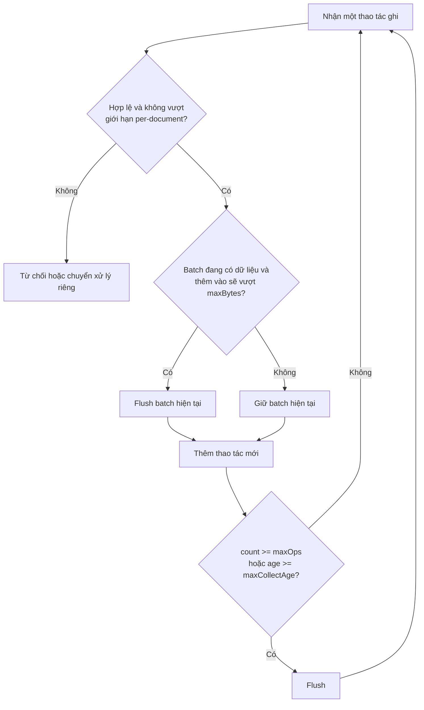
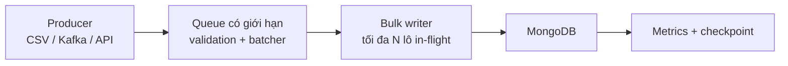

# Chia lô theo số lượng, dung lượng và thời gian xử lý

## 1. Vì sao ghi hàng loạt cũng cần chia lô?

Trong **Spring Data MongoDB**, `MongoTemplate.bulkOps(...)` giúp gom nhiều thao tác insert, update, upsert hoặc delete để thực hiện bằng cơ chế **bulk write** của MongoDB. Bulk write có thể giảm chi phí giao tiếp so với gửi từng thao tác một, nhưng một lô quá lớn vẫn gây nhiều vấn đề: tăng bộ nhớ phía ứng dụng, kéo dài thời gian chờ, làm lỗi khó phục hồi và tạo áp lực lên MongoDB.

Ví dụ hệ thống thương mại điện tử nhận một luồng cập nhật giá cho **300.000 SKU**. Mỗi bản ghi gồm mã cửa hàng, SKU, giá mới và thời điểm cập nhật. Nếu gom hết 300.000 thay đổi thành **một** danh sách rồi mới gọi `execute()`, ứng dụng có thể:

- giữ rất nhiều object `Query`/`Update` trong heap;
- phải chờ gom hết dữ liệu mới ghi được lô đầu tiên;
- tạo một request/chuỗi request driver rất lớn, khó biết phần nào đã thành công khi lỗi;
- tranh chấp tài nguyên MongoDB và kéo dài độ trễ của các request khác;
- gặp hạn chế kích thước BSON hoặc batch do MongoDB/driver áp đặt.

Ở chiều ngược lại, gửi **một lần ghi cho mỗi SKU** thường có quá nhiều round trip và chi phí lập lịch. Bài toán là chọn kích thước lô vừa đủ để cân bằng **throughput, latency, memory, độ tin cậy**.

Ba ngưỡng chia lô cốt lõi:

| Ngưỡng | Ví dụ để bắt đầu đo | Tác dụng |
| --- | --- | --- |
| **Số thao tác** (`maxOps`) | 500 update/upsert | Không để danh sách operation tăng vô hạn |
| **Dung lượng** (`maxEstimatedBytes`) | 4 MiB ngân sách ước tính/lô | Giữ bộ nhớ và payload dự kiến trong ngưỡng vận hành |
| **Thời gian gom lô** (`maxCollectAge`) | 500 ms | Không để bản ghi đầu tiên chờ quá lâu trước khi bắt đầu flush |

Các giá trị 500, 4 MiB, 500 ms **chỉ là ví dụ khởi đầu, không phải cấu hình tối ưu chung**. Chúng phải được điều chỉnh theo kích thước document, loại thao tác, tốc độ producer, network, khả năng chịu tải của MongoDB và SLO của ứng dụng.

**Mục tiêu học tập:** biết thiết kế một cơ chế chia lô phát lệnh khi *một trong ba ngưỡng* bị chạm, thực thi bằng Spring Data MongoDB, đọc kết quả bulk write và xây cơ chế theo dõi/thử lại mà không làm hỏng tính nhất quán dữ liệu.

## 2. Bulk write trong Spring Data MongoDB

`MongoTemplate` cung cấp `BulkOperations` với hai chế độ:

- **`BulkMode.ORDERED`:** giữ thứ tự thực hiện các thao tác theo batch; khi gặp lỗi ghi, phần còn lại theo thứ tự có thể không được thực hiện.
- **`BulkMode.UNORDERED`:** MongoDB/driver có thể thực hiện các thao tác không theo thứ tự khai báo và cố gắng xử lý những thao tác khác khi một thao tác lỗi. Không được suy ra thứ tự kết quả hay thứ tự side effect từ danh sách đầu vào.

Ví dụ một lô nhỏ cập nhật giá:

```java
import org.springframework.data.mongodb.core.BulkOperations;
import org.springframework.data.mongodb.core.query.Criteria;
import org.springframework.data.mongodb.core.query.Query;
import org.springframework.data.mongodb.core.query.Update;

BulkOperations operations = mongoTemplate.bulkOps(
    BulkOperations.BulkMode.UNORDERED,
    SkuPrice.class
);

operations.upsert(
    Query.query(Criteria.where("id").is("SHOP-A:BOOK-101")),
    new Update()
        .set("priceMinor", 120_000L)
        .set("updatedAt", java.time.Instant.now())
        .setOnInsert("tenantId", "SHOP-A")
        .setOnInsert("sku", "BOOK-101")
);

operations.upsert(
    Query.query(Criteria.where("id").is("SHOP-A:BOOK-202")),
    new Update()
        .set("priceMinor", 180_000L)
        .set("updatedAt", java.time.Instant.now())
        .setOnInsert("tenantId", "SHOP-A")
        .setOnInsert("sku", "BOOK-202")
);

com.mongodb.bulk.BulkWriteResult result = operations.execute();
```

Trong ví dụ, `bulkOps` tạo một đối tượng gom thao tác; **`execute()` mới gửi lô tới MongoDB**. `BulkWriteResult` cho biết số insert, matched, modified, deleted, upsert... khi lệnh được xác nhận thành công.

### Bulk write **không phải** một transaction mặc định

MongoDB bảo đảm tính nguyên tử của một thao tác ghi trên **một document**. Nhưng một bulk gồm 500 cập nhật không có nghĩa **cả 500 cùng commit hoặc cùng rollback**. Một số thao tác có thể đã thành công trong khi thao tác khác thất bại. Chế độ `ORDERED` hay `UNORDERED` là chính sách thực thi khi gặp lỗi, **không thay thế transaction nhiều document**.

Nếu nghiệp vụ cần tất cả cập nhật nhiều document cùng thành công, phải xem xét transaction MongoDB với hạ tầng hỗ trợ, hoặc thiết kế bù/idempotency. Không nên dùng một bulk khổng lồ để giả lập transaction.

## 3. Giới hạn kỹ thuật MongoDB và giới hạn vận hành

Hai loại giới hạn thường bị nhầm:

1. **Giới hạn giao thức/BSON của MongoDB:** một document có kích thước BSON tối đa khoảng **16 MiB**; một lệnh hoặc thông điệp wire protocol và một write batch cũng có giới hạn do server/driver công bố.
2. **Giới hạn ứng dụng tự chọn:** số thao tác, tổng bytes dự kiến, thời gian gom và thời gian thực thi mà hệ thống có thể chấp nhận.

Trong các phiên bản MongoDB thông dụng, những giá trị thường gặp là `maxBsonObjectSize = 16 MiB`, `maxMessageSizeBytes ≈ 48 MiB` và `maxWriteBatchSize = 100.000`. **Không hardcode các con số này làm cam kết cho mọi phiên bản/triển khai**: khả năng cụ thể được server công bố trong handshake/`hello`, và driver áp dụng những giới hạn giao thức tương ứng.

### Driver có thể tự chia batch nhưng chưa giải quyết bài toán ứng dụng

MongoDB Java Driver có cơ chế tách một bulk lớn thành các write batch phù hợp các giới hạn truyền tải. Tuy vậy, nếu ứng dụng đã giữ 300.000 thao tác trong `BulkOperations`, **heap và thời gian gom lô vẫn bị tiêu tốn trước khi driver gửi mạng**. Các lô nhỏ, có kiểm soát còn giúp ghi log, đo latency, retry và xác định phạm vi dữ liệu lỗi dễ hơn.

### Kích thước một document khác tổng kích thước lô

Không thể “cứ chia nhỏ batch” để ghi một document BSON riêng lẻ vượt **16 MiB**. Nếu một record đơn lẻ quá lớn, cần **đổi mô hình dữ liệu** (tách document, lưu tệp riêng bằng GridFS khi phù hợp, hoặc giảm payload); chia lô không làm document đó hợp lệ.

Đối với **tổng dung lượng lô**, phải tính đến:

- BSON của mỗi filter (`q`), update document (`u`) hoặc document insert;
- tên field, kiểu BSON và metadata đi kèm;
- envelope của thao tác, flag upsert và cấu trúc lệnh;
- overhead wire protocol, session/transaction và chính sách driver.

**Độ dài JSON, `String.length()` hay số ký tự Java không bằng kích thước BSON thật.** Một String UTF-8 có ký tự tiếng Việt chiếm nhiều byte hơn số ký tự nhìn thấy; BSON còn có type tags, độ dài, tên field và phần định dạng.

Vì thế, hãy đặt ngân sách ứng dụng **thấp hơn đáng kể** giới hạn kỹ thuật, đo từ payload gần với dữ liệu thật và chừa headroom cho metadata. Không tự khẳng định một lô “4 MiB tính từ JSON” sẽ luôn có message BSON đúng 4 MiB.

## 4. Tính số lượng, bytes và thời gian: ba trục độc lập

Giả sử bộ gom lô đang có `N` thao tác, ngân sách ước tính `B` bytes và thời gian từ bản ghi đầu tiên là `T`. Quy tắc tổng quát:

\[
\operatorname{flush} \iff
(N \ge N_{\max})\;\lor\;
(B \ge B_{\max})\;\lor\;
(T \ge T_{\max})
\]

Ngoài ba ngưỡng trên, hệ thống còn flush khi **kết thúc nguồn dữ liệu**, khi shutdown có kiểm soát hoặc khi cần bàn giao checkpoint. Không flush một lô trống.

| Tình huống | Ngưỡng có thể chạm trước | Hành động |
| --- | --- | --- |
| 500 thao tác nhỏ, producer rất nhanh | `maxOps` | Flush dù chưa đủ bytes hay thời gian |
| 80 thao tác nhưng mỗi thao tác lớn | `maxEstimatedBytes` | Flush trước khi vượt ngân sách dung lượng |
| Chỉ 12 thay đổi trong 500 ms | `maxCollectAge` | Flush sớm để giảm thời gian chờ |
| Producer ngừng và không còn record | Kết thúc nguồn | Flush phần dư |
| Một thao tác đơn lẻ lớn hơn ngân sách ứng dụng | Ngưỡng per-operation | Từ chối/chuyển sang đường xử lý riêng; không tạo vòng lặp flush rỗng |

### Ngưỡng bytes nên được kiểm tra **trước khi thêm thao tác mới**

Giả sử lô hiện có 3,9 MiB và thao tác tiếp theo 0,3 MiB, trong khi ngân sách là 4 MiB. Nếu thêm trước rồi mới kiểm tra, bộ gom đã vượt ngưỡng. Tốt hơn:

```text
if batch không rỗng và bytesHiệnTại + bytesMới > maxBytes:
    flush(batch)
thêm thao tác mới vào batch
if count >= maxOps hoặc elapsed >= maxCollectAge:
    flush(batch)
```

Cần dùng phép toán không gây tràn số (`long` cho bytes, hoặc so bằng `bytesMới > maxBytes - bytesHiệnTại` sau khi xác thực), và kiểm tra thao tác đơn lẻ đủ nhỏ **trước** khi tạo batch.

### Thời gian gom khác thời gian thực thi

**`maxCollectAge`** là thời gian từ lúc lô nhận bản ghi đầu đến lúc bắt đầu flush. Nó không tự giới hạn thời gian `execute()` đang chờ server. Khi đo, nên tách:

- `collectDuration`: thời gian tích lũy record;
- `executeDuration`: thời gian gọi bulk và nhận kết quả hoặc lỗi;
- `endToEndLag`: độ trễ từ lúc nhận record tới lúc record được xác nhận ghi.

Nếu một luồng `for` đồng bộ chỉ kiểm tra đồng hồ khi record mới tới, **lô sẽ không tự flush khi producer tạm ngừng**. Với ingestion nhận sự kiện không liên tục, cần timer/scheduler hoặc cơ chế reactive time window để thực thi flush khi đến hạn, ngay cả khi không có record tiếp theo.



## 5. Mô hình nhập dữ liệu giá: entity và quy tắc định danh

Để minh họa một luồng bulk write, ta sử dụng collection `sku_prices`. Mỗi document chứa giá hiện tại của **một SKU trong một cửa hàng**:

```javascript
{
  _id: "SHOP-A:BOOK-101",
  tenant_id: "SHOP-A",
  sku: "BOOK-101",
  price_minor: NumberLong("120000"),
  updated_at: ISODate("2026-11-20T08:00:00Z")
}
```

Trong bản demo, ứng dụng chọn ID từ `tenantId + ":" + sku`. Hệ thống thật phải **chuẩn hóa ID, xác thực định dạng và tránh va chạm delimiter**. Một phương án khác là ID kỹ thuật kết hợp unique index trên `(tenant_id, sku)`.

Entity `SkuPrice` dùng Java 17 và Spring Data MongoDB:

```java
package com.example.pricing;

import java.time.Instant;
import org.springframework.data.mongodb.core.mapping.Document;
import org.springframework.data.mongodb.core.mapping.Field;
import org.springframework.data.mongodb.core.mapping.FieldType;
import org.springframework.data.mongodb.core.mapping.MongoId;

@Document(collection = "sku_prices")
public class SkuPrice {
    @MongoId(FieldType.STRING)
    private String id;

    @Field("tenant_id")
    private String tenantId;

    private String sku;

    @Field("price_minor")
    private long priceMinor;

    @Field("updated_at")
    private Instant updatedAt;

    protected SkuPrice() {}

    public String getId() { return id; }
    public String getTenantId() { return tenantId; }
    public String getSku() { return sku; }
    public long getPriceMinor() { return priceMinor; }
    public Instant getUpdatedAt() { return updatedAt; }
}
```

Một thay đổi giá từ nguồn ngoài được biểu diễn bằng `record`:

```java
package com.example.pricing;

import java.time.Instant;

public record PriceChange(
    String tenantId,
    String sku,
    long priceMinor,
    Instant observedAt
) {}
```

Mỗi `PriceChange` sẽ tạo một thao tác **upsert theo ID**. Nếu document đã tồn tại, cập nhật `price_minor`/`updated_at`; nếu chưa tồn tại, chèn document cùng `tenant_id`/`sku`. Giá lưu theo **đơn vị tiền nhỏ nhất** bằng `long` để tránh sự nhập nhằng của số thực dấu phẩy động.

**Giả định bài học:** không có hai sự kiện cho cùng `(tenantId, sku)` trong một batch. Với `BulkMode.UNORDERED`, thứ tự áp dụng các upsert lên cùng một document không được bảo đảm. Ngay cả qua nhiều batch/instance, sự kiện giá cũ có thể ghi đè sự kiện mới; phải gộp theo khóa hoặc có `eventVersion`/sequence và điều kiện ngăn ghi lùi phiên bản.

## 6. Đo gần đúng dung lượng BSON của một thao tác

`String.length()` hoặc độ dài JSON không đo đúng BSON: tên field, type tags, độ dài String theo UTF-8, số nguyên và ngày tháng đều được mã hóa theo cấu trúc BSON. Để ước tính một upsert, có thể dựng một `org.bson.Document` đại diện cho **query** và **update** rồi mã hóa bằng MongoDB Java Driver:

```java
package com.example.pricing;

import java.util.Date;
import org.bson.BsonBinaryWriter;
import org.bson.Document;
import org.bson.codecs.DocumentCodec;
import org.bson.codecs.EncoderContext;
import org.bson.io.BasicOutputBuffer;

public final class BulkSizeEstimate {
    private BulkSizeEstimate() {}

    public static String idFor(PriceChange item) {
        return item.tenantId() + ":" + item.sku();
    }

    public static long estimateUpsertBytes(PriceChange item) {
        Document match = new Document("_id", idFor(item));
        Document change = new Document("$set",
            new Document("price_minor", item.priceMinor())
                .append("updated_at", Date.from(item.observedAt()))
        ).append("$setOnInsert",
            new Document("tenant_id", item.tenantId())
                .append("sku", item.sku())
        );

        Document operation = new Document("q", match)
            .append("u", change)
            .append("upsert", true);

        BasicOutputBuffer output = new BasicOutputBuffer();
        try (BsonBinaryWriter writer = new BsonBinaryWriter(output)) {
            new DocumentCodec().encode(
                writer, operation, EncoderContext.builder().build());
            return output.toByteArray().length + 128L;
        }
    }
}
```

Phép tính có xét bytes BSON cho những giá trị thật (`long`, `Date`, `String`) và cộng thêm **128 byte dự phòng minh họa**. Tuy nhiên, đây vẫn là **ước tính**, không phải kích thước chính xác của thông điệp MongoDB thực tế: còn có overhead của command, session, transaction, mapping/converter và những tùy chọn như collation hay arrayFilters. Nếu hệ thống sử dụng các kiểu update khác, phải mở rộng hàm ước tính hoặc đo từ BSON sau quá trình serialize gần với driver hơn.

### Phân biệt per-operation và per-document

Trước khi thêm thao tác mới vào lô, hãy kiểm tra `estimatedOperationBytes <= maxEstimatedBytes`. Nhưng một lệnh insert có **document đích** quá giới hạn BSON 16 MiB vẫn không hợp lệ dù chỉ có một operation trong batch. Đối với insert, hãy đo hoặc kiểm tra chính document được lưu, và xử lý bằng thay đổi mô hình dữ liệu nếu quá lớn.

## 7. Service chia lô theo cả ba ngưỡng

Ví dụ `PriceBulkImportService` dưới đây nhận một `Iterable<PriceChange>` và gom các record trong **một luồng đồng bộ**. Nó flush khi đủ số operations, ước lượng dung lượng gần ngưỡng, quá thời gian gom khi có record mới, hoặc nguồn kết thúc.

Kết quả nhập:

```java
package com.example.pricing;

public record ImportSummary(
    long submittedOperations,
    long matchedDocuments,
    long modifiedDocuments,
    long insertedByUpsert,
    int flushedBatches
) {}
```

Implementation:

```java
package com.example.pricing;

import java.util.ArrayList;
import java.util.List;
import java.util.concurrent.TimeUnit;
import com.mongodb.bulk.BulkWriteResult;
import org.springframework.data.mongodb.core.BulkOperations;
import org.springframework.data.mongodb.core.MongoTemplate;
import org.springframework.data.mongodb.core.query.Criteria;
import org.springframework.data.mongodb.core.query.Query;
import org.springframework.data.mongodb.core.query.Update;
import org.springframework.stereotype.Service;

@Service
public class PriceBulkImportService {

    private static final int MAX_OPS = 500;
    private static final long MAX_ESTIMATED_BYTES =
        4L * 1024 * 1024;
    private static final long MAX_COLLECT_NANOS =
        TimeUnit.MILLISECONDS.toNanos(500);

    private final MongoTemplate template;

    public PriceBulkImportService(MongoTemplate template) {
        this.template = template;
    }

    public ImportSummary importChanges(Iterable<PriceChange> source) {
        if (source == null) {
            throw new IllegalArgumentException("Thiếu nguồn dữ liệu");
        }

        List<PriceChange> batch = new ArrayList<>();
        Counters counters = new Counters();
        long estimatedBytes = 0;
        long batchStartedAt = 0;

        for (PriceChange item : source) {
            validate(item);
            long opBytes =
                BulkSizeEstimate.estimateUpsertBytes(item);

            if (opBytes > MAX_ESTIMATED_BYTES) {
                throw new IllegalArgumentException(
                    "Một thao tác vượt ngân sách batch");
            }

            long now = System.nanoTime();
            boolean overflow = !batch.isEmpty()
                && opBytes > MAX_ESTIMATED_BYTES - estimatedBytes;
            boolean expired = !batch.isEmpty()
                && now - batchStartedAt >= MAX_COLLECT_NANOS;

            if (overflow || expired) {
                flush(batch, counters);
                estimatedBytes = 0;
            }

            if (batch.isEmpty()) {
                batchStartedAt = System.nanoTime();
            }
            batch.add(item);
            estimatedBytes += opBytes;

            if (batch.size() >= MAX_OPS
                    || estimatedBytes >= MAX_ESTIMATED_BYTES) {
                flush(batch, counters);
                estimatedBytes = 0;
            }
        }

        flush(batch, counters); // Không bỏ phần dư cuối nguồn.
        return counters.asSummary();
    }

    private void flush(
            List<PriceChange> batch, Counters counters) {
        if (batch.isEmpty()) {
            return;
        }

        BulkOperations bulk = template.bulkOps(
            BulkOperations.BulkMode.UNORDERED, SkuPrice.class);

        for (PriceChange item : batch) {
            Query key = Query.query(Criteria.where("id").is(
                BulkSizeEstimate.idFor(item)));

            Update update = new Update()
                .set("priceMinor", item.priceMinor())
                .set("updatedAt", item.observedAt())
                .setOnInsert("tenantId", item.tenantId())
                .setOnInsert("sku", item.sku());

            bulk.upsert(key, update);
        }

        long started = System.nanoTime();
        BulkWriteResult result = bulk.execute();
        long elapsedMillis = TimeUnit.NANOSECONDS.toMillis(
            System.nanoTime() - started);

        // Trong production nên xuất metric, không log từng SKU.
        System.out.println("bulk.ops=" + batch.size()
            + ", bulk.execute.ms=" + elapsedMillis);

        counters.submitted += batch.size();
        counters.matched += result.getMatchedCount();
        counters.modified += result.getModifiedCount();
        counters.upserts += result.getUpserts().size();
        counters.flushed++;

        batch.clear();
    }

    private static void validate(PriceChange item) {
        if (item == null
                || item.tenantId() == null
                || item.tenantId().isBlank()
                || item.tenantId().contains(":")
                || item.sku() == null || item.sku().isBlank()
                || item.sku().contains(":")
                || item.priceMinor() < 0
                || item.observedAt() == null) {
            throw new IllegalArgumentException(
                "PriceChange không hợp lệ");
        }
    }

    private static final class Counters {
        long submitted;
        long matched;
        long modified;
        long upserts;
        int flushed;

        ImportSummary asSummary() {
            return new ImportSummary(
                submitted, matched, modified, upserts, flushed);
        }
    }
}
```

### Đọc quy tắc chia lô trong mã

1. **Validate:** từ chối record không hợp lệ trước khi tạo thao tác ghi.
2. **Ước tính bytes:** kiểm tra operation đơn lẻ; nếu thêm sẽ vượt ngân sách, flush lô hiện có trước.
3. **Thời gian gom:** nếu đã quá `MAX_COLLECT_NANOS` khi có record tiếp, flush lô cũ.
4. **Số lượng:** flush ngay khi đạt `MAX_OPS`; không chờ thêm record.
5. **Dung lượng:** flush khi chạm `MAX_ESTIMATED_BYTES`.
6. **Kết thúc nguồn:** flush lô cuối chưa đủ các ngưỡng.
7. **Bộ gom có giới hạn:** mỗi flush tạo một `BulkOperations` mới và xóa những `PriceChange` đã được xác nhận ghi.

**Hạn chế quan trọng của ví dụ:** vì đây là vòng lặp đồng bộ, khi producer đứng yên và iterator bị chặn trong `next()`, không có timer riêng để flush tại đúng mốc 500 ms. Cơ chế giới hạn thời gian được kiểm tra tại lần nhận record tiếp theo hoặc khi nguồn kết thúc. Nếu cần flush ngay cả lúc không có record, phải có scheduler/timer và phối hợp an toàn giữa bộ đệm với worker ghi.

Ở chiều ngược lại, khi `bulk.execute()` đang chờ, luồng không đọc thêm input: đây là dạng **backpressure tự nhiên** cho một pipeline đồng bộ. Với ingest nhiều thread/instance, không nên dùng chung một mutable `BulkOperations` hoặc danh sách batch không có đồng bộ hóa phù hợp.

### Hiểu chính xác các bộ đếm

`submittedOperations` đếm số upsert đã **gửi và được bulk xác nhận thành công toàn lô** trong đường chạy bình thường. `matchedDocuments` đếm tổng lượt update khớp; `modifiedDocuments` có thể thấp hơn vì update không làm đổi giá trị; `insertedByUpsert` đếm số thao tác upsert đã tạo document. Không suy ra tất cả các con số này bằng nhau hoặc bằng số document khác nhau.

Nếu `execute()` ném exception, phương thức ví dụ **dừng và không trả `ImportSummary`**. Đó là hành vi cố ý để tránh báo hoàn tất giả khi một lô đã thành công một phần; quy trình production cần thêm cơ chế checkpoint/reconciliation trước khi retry.

## 8. Phân biệt thời gian gom lô với latency xử lý lô

Ba ngưỡng trong bộ gom là **quy tắc quyết định khi bắt đầu gửi**. Chúng không bảo đảm MongoDB hoàn tất lô trong 500 ms. Một lô 500 thao tác có thể chạy rất nhanh trong môi trường test nhưng chậm khi collection có nhiều index, ổ đĩa bận hoặc nhiều writer tranh chấp.

Giả sử SLO vận hành là **p95 thời gian execute một lô không quá 800 ms**. Đó là một mục tiêu cần quan sát và điều chỉnh, **không phải giá trị `maxCollectAge`**.

Ví dụ bảng đo trên dữ liệu giả định:

| Kịch bản | Operations/lô | Bytes ước tính/lô | p95 execute | Ý nghĩa |
| --- | ---: | ---: | ---: | --- |
| A | 100 | 0,5 MiB | 90 ms | Rất nhanh nhưng overhead nhiều lô có thể lớn |
| B | 500 | 2,4 MiB | 310 ms | Cân bằng tốt trong phép đo ví dụ |
| C | 2.000 | 9,7 MiB | 1.250 ms | Vượt mục tiêu p95 và khó retry hơn |

**Đây không phải benchmark MongoDB thật**. Mục đích của bảng là chỉ ra rằng không thể suy ra kích thước lô tối ưu chỉ từ một giới hạn bytes cố định.

### Điều chỉnh thích nghi `maxOps`

Một quy tắc điều chỉnh thử nghiệm có thể là:

1. Bắt đầu `maxOps = 500`, ngân sách bytes = 4 MiB.
2. Đo `executeDuration` theo histogram qua nhiều lô cùng loại dữ liệu.
3. Nếu p95 vượt mục tiêu, thử giảm `maxOps` có kiểm soát (ví dụ giảm 20%, không thấp hơn 50) và đo lại. Nếu queue depth tăng, trước tiên xác định nguyên nhân: giảm kích thước lô có thể làm throughput **tệ hơn** khi overhead cố định đang chiếm ưu thế.
4. Nếu p95 thấp hơn nhiều so với mục tiêu, MongoDB còn dư tài nguyên và overhead batch lớn, tăng thử `maxOps` từng bước nhỏ (ví dụ 10%) nhưng không vượt trần cấu hình. Khi queue tăng mà p95 vẫn thấp, cũng cần xem xét năng lực writer/in-flight và tốc độ producer.
5. Giữ riêng `maxEstimatedBytes` và `maxCollectAge`; mọi phép điều chỉnh phải tôn trọng các ngưỡng cứng và loại dữ liệu.

Không nên thay đổi cấu hình sau **một lô** có latency bất thường. Có thể một node MongoDB đang chuyển primary, một index đang được tạo hoặc sự cố mạng tạm thời. Khi workload biến thiên mạnh, phân nhóm metrics theo loại thao tác và khoảng kích thước BSON để tránh tối ưu nhầm.

### Thời gian thực thi phụ thuộc cả áp lực đồng thời

Gửi 20 lô `500` thao tác **song song** không nhất thiết nhanh hơn gửi 4 lô song song. Độ cạnh tranh ghi, bộ nhớ đệm, lượng kết nối, write concern và các index khiến MongoDB có thể chậm đi. Ngoài giới hạn operations và bytes, cần đặt **số lô in-flight tối đa**, tránh producer đẩy vô hạn vào queue.

## 9. Khi producer nhanh hơn consumer: backpressure và bộ nhớ

Một hệ thống bulk write thường có ba chặng:



Nếu producer tạo 50.000 thay đổi/giây nhưng writer chỉ xác nhận được 20.000 thay đổi/giây, **chênh lệch 30.000/giây phải đi đâu đó**. Nếu cứ thêm vào một hàng đợi RAM không giới hạn, ứng dụng cuối cùng có thể hết bộ nhớ. Cần một trong các cơ chế:

- **Backpressure:** làm chậm producer hoặc ngừng đọc message khi số lô chưa hoàn tất đạt ngưỡng.
- **Queue có giới hạn:** khi đầy, chặn/ghi ra lưu trữ bền vững/trả lỗi quá tải theo hợp đồng.
- **Đọc nguồn có checkpoint:** chỉ xác nhận offset Kafka hoặc vị trí file sau khi các lô liên quan được ghi và xác minh theo chính sách.
- **Giới hạn in-flight:** ví dụ bắt đầu với 2–4 lô đang chạy và đo, không mặc định càng nhiều càng tốt.
- **Phân vùng theo khóa:** tránh hai worker đồng thời xử lý những bản cập nhật có phụ thuộc thứ tự của cùng một SKU.

Không có lựa chọn nào tự đem lại exactly-once end-to-end. Một event có thể được đọc lại sau crash; cơ chế deduplication hoặc điều kiện version ở database mới là phần quan trọng của thiết kế độ tin cậy.

### Dung lượng queue khác dung lượng một lô

Giả sử đặt `maxEstimatedBytes = 4 MiB` nhưng cho phép queue chứa 1.000 lô. Dung lượng dữ liệu chưa ghi theo ước tính có thể lên tới **khoảng 4 GiB**, chưa tính Java objects và metadata. Vì vậy cần đồng thời giới hạn:

\[
\text{maxBufferedBytes} \approx
\text{maxBatchBytes} \times \text{maxBufferedBatches}
\]

Đây chỉ là ước tính bậc lớn. Bộ nhớ Java thực tế có thể cao hơn nhiều do `List`, `Query`, `Update`, String và object header. Nên đo heap, allocation rate và số bytes đang chờ ghi thay vì chỉ đếm item.

## 10. ORDERED hay UNORDERED khi chia thành nhiều batch?

Chế độ `BulkMode.ORDERED` thường phù hợp khi các thao tác **phụ thuộc thứ tự** trong phạm vi một bulk hoặc cần dừng ở lỗi đầu tiên. `BulkMode.UNORDERED` có thể tăng throughput và cho phép các thao tác độc lập khác tiếp tục khi gặp lỗi.

| Đặc tính | `ORDERED` | `UNORDERED` |
| --- | --- | --- |
| Thứ tự trong cùng bulk | Có ý nghĩa theo thứ tự khai báo | Không nên giả định thứ tự |
| Khi gặp lỗi ghi | Dừng phần tiếp theo theo semantics ordered | Có thể tiếp tục những operation độc lập |
| Trường hợp phù hợp | Cập nhật có quan hệ thứ tự trong một bulk | Nhiều ID/SKU khác nhau, mỗi operation độc lập |
| Có rollback tất cả không? | **Không** | **Không** |
| Có bảo đảm thứ tự **giữa nhiều batch/instance** không? | **Không**, nếu hệ thống chạy song song không kiểm soát | **Không** |

Đối với feed giá, `UNORDERED` chỉ an toàn theo ý định khi từng operation độc lập và **giá trị mới nhất được xác định qua version hoặc quy tắc nghiệp vụ riêng**. Chuyển từ `UNORDERED` sang `ORDERED` không giải quyết được race giữa hai instance cùng ghi một SKU.

### Không gom thao tác phụ thuộc vào một bulk tùy tiện

Ví dụ muốn tăng số tồn rồi sau đó trừ số tồn của **cùng một document**, hoặc muốn thao tác 2 chỉ chạy nếu thao tác 1 thành công. Đặt hai update cùng một bulk không tạo một transaction nghiệp vụ. Nên thiết kế **một conditional atomic update** trên document cho bất biến chung; nếu là nhiều document, cân nhắc transaction hay saga thay vì trông chờ thứ tự của bulk.

### Batch tách nhỏ vẫn có thể gây kết quả “mới trước, cũ sau”

Giả sử hai sự kiện cùng `SHOP-A:BOOK-101` có version 10 và 11. Nếu batch A chứa version 10 nhưng thực thi chậm, batch B chứa version 11 thực thi trước, batch A hoàn tất sau có thể **ghi lùi giá**. Giải pháp thường là lưu thêm `last_event_version` và cập nhật có điều kiện theo version (hoặc tổ chức phân vùng theo SKU với thứ tự được bảo đảm trong toàn pipeline).

Khi dùng upsert với điều kiện `last_event_version < incomingVersion`, cần xử lý cẩn thận trường hợp **document đã tồn tại nhưng filter không khớp**: upsert có thể cố insert một document cùng `_id` và gặp duplicate key. Không nên dùng `upsert(true)` cùng filter version mà không định nghĩa rõ quy trình tạo mới/xung đột. Với ingestion quan trọng, thiết kế quy tắc create riêng, update có version riêng và xử lý duplicate/older events như một kết quả nghiệp vụ.

## 11. Lỗi từng phần: bulk thất bại không có nghĩa mọi thao tác chưa ghi

Các lỗi có thể gặp:

| Lỗi | Ví dụ | Tác động thường gặp |
| --- | --- | --- |
| Duplicate key | Hai job cùng upsert ID chưa tồn tại hoặc sai unique key | Một operation thất bại, các operation khác có thể đã thành công |
| Schema validation | Document vi phạm validator của MongoDB | Một hoặc nhiều operation bị từ chối |
| Sai kiểu BSON | `$inc` trên field String thay vì Number | Operation đó lỗi |
| Network timeout | Đứt kết nối sau khi gửi | Kết quả của một số thao tác có thể **không chắc chắn** |
| Write concern error | Không đạt mức xác nhận yêu cầu | Không thể suy ra đơn giản là tất cả chưa ghi |
| Bulk quá lớn | Document/command vượt giới hạn hoặc payload ước tính sai | Có thể bị driver/server từ chối hoặc driver phải tự tách |
| Quá tải tài nguyên | Nhiều batch chạy đồng thời, contention cao | Latency tăng, retry nhiều, queue dồn |

Trong Java Driver, lỗi bulk có thể chứa thông tin về index operation lỗi và kết quả những thao tác đã được xử lý. Spring Data có thể dịch lỗi sang exception thuộc `DataAccessException` hoặc exception bulk chuyên biệt tùy phiên bản/API.

**Không viết logic như sau:**

```java
try {
    bulk.execute();
} catch (Exception ex) {
    // SAI: giả định không operation nào thành công rồi retry nguyên batch.
    retryAllWithoutCheckingAnything();
}
```

Vì những operation đã thành công có thể bị chạy lần nữa. Với `$set` cùng giá trị và khóa ổn định, kết quả dữ liệu có thể vẫn đúng trong nhiều trường hợp; với `$inc`, `$push`, phát sự kiện hay timestamp thay đổi, retry có thể tạo kết quả khác.

### Quy trình xử lý lỗi đề xuất

1. Ghi nhận **batch ID**, khoảng checkpoint/offset của nguồn và tổng số operations.
2. Khi bulk thành công được xác nhận, cập nhật checkpoint theo cơ chế có tính bền vững.
3. Khi bulk ném lỗi, phân loại **lỗi chắc chắn của từng operation** và **kết quả chưa rõ** (network, timeout, write concern).
4. Ghi log/metric **không lộ giá trị nhạy cảm**, nhưng đủ tương quan với ID hoặc idempotency key.
5. Với lỗi validation vĩnh viễn, cách ly record vào dead-letter queue thay vì retry vô hạn.
6. Với lỗi tạm thời, retry có giới hạn, backoff và jitter; thực hiện **reconciliation** hoặc kiểm tra idempotency trước khi gửi lại.
7. Chỉ xác nhận checkpoint sau khi đáp ứng chính sách thành công của job, không coi “đã gửi request” là “đã ghi bền vững”.

**Đặc biệt:** một `BulkWriteResult` thành công không có nghĩa đã thực hiện một **transaction**. Và một lỗi giữa bulk không có nghĩa mọi document trước đó được rollback. Đó là lý do batch nên có kích thước đủ nhỏ để dễ theo dõi, nhưng đủ lớn để hiệu quả.

## 12. Idempotency và cách tránh ghi đúp khi retry

Đối với upsert giá trong bài, khóa `_id` ổn định và sử dụng `$set` thường giúp việc **gửi lại cùng một event** không làm nhân đôi document. Tuy nhiên, vẫn cần:

- giá trị update lấy từ chính event (ví dụ `observedAt`), không dùng `Instant.now()` mới mỗi lần retry nếu muốn replay cùng payload;
- unique key thực sự phù hợp nghiệp vụ;
- cơ chế chặn event cũ ghi sau event mới;
- phân biệt retry của **cùng event** với một event mới có giá giống nhau;
- quy tắc xử lý tác dụng phụ ngoài database (message, webhook, email).

### `$inc` và `$push` thường không idempotent

```javascript
// Lặp lệnh sẽ tiếp tục tăng số lượng.
db.stock.updateOne(
  { _id: "BOOK-101" },
  { $inc: { reserved: NumberLong("2") } }
)
```

Ngay cả khi chia thành batch 100 thao tác, retry cùng một lệnh `$inc` có thể tăng bộ đếm hai lần. Không nên đưa nguyên batch `$inc` trở lại hàng đợi mà chưa có idempotency key, điều kiện chuyển trạng thái, transaction hoặc cơ chế ghi dấu bảo đảm chỉ áp dụng một lần cho từng yêu cầu.

### Kiểu kết quả không tự xác định “event mới nhất”

`BulkWriteResult.getMatchedCount()` và `getModifiedCount()` không phân biệt một bản cập nhật giá mới hợp lệ với một bản cập nhật giá cũ vô tình được áp dụng. Cần lưu `eventVersion` và kiểm tra điều kiện theo phiên bản, hoặc quy tắc dedupe/coalesce có tính bền vững. Đừng dùng chỉ số “modified lớn” như dấu hiệu tính đúng của business state.

## 13. Batch và pipeline reactive: giới hạn theo số lượng, thời gian

Khi ứng dụng dùng `ReactiveMongoTemplate`, có thể tạo một luồng bulk write không chặn thread xử lý request. Reactor hỗ trợ `bufferTimeout(maxSize, maxTime)`, vốn gom và phát buffer khi đạt số phần tử hoặc quá thời gian.

Ví dụ minh họa **chỉ hai ngưỡng count/time**, chưa có giới hạn bytes:

```java
package com.example.pricing;

import java.time.Duration;
import com.mongodb.bulk.BulkWriteResult;
import org.springframework.data.mongodb.core.BulkOperations;
import org.springframework.data.mongodb.core.ReactiveBulkOperations;
import org.springframework.data.mongodb.core.ReactiveMongoTemplate;
import org.springframework.data.mongodb.core.query.Criteria;
import org.springframework.data.mongodb.core.query.Query;
import org.springframework.data.mongodb.core.query.Update;
import reactor.core.publisher.Flux;

public class ReactivePriceImport {

    private final ReactiveMongoTemplate template;

    public ReactivePriceImport(ReactiveMongoTemplate template) {
        this.template = template;
    }

    public Flux<BulkWriteResult> importStream(
            Flux<PriceChange> source) {
        return source
            .bufferTimeout(500, Duration.ofMillis(500))
            .filter(batch -> !batch.isEmpty())
            .concatMap(batch -> {
                ReactiveBulkOperations bulk = template.bulkOps(
                    BulkOperations.BulkMode.UNORDERED,
                    SkuPrice.class);

                for (PriceChange item : batch) {
                    Query key = Query.query(
                        Criteria.where("id").is(
                            BulkSizeEstimate.idFor(item)));

                    Update change = new Update()
                        .set("priceMinor", item.priceMinor())
                        .set("updatedAt", item.observedAt())
                        .setOnInsert("tenantId", item.tenantId())
                        .setOnInsert("sku", item.sku());

                    bulk.upsert(key, change);
                }
                return bulk.execute();
            });
    }
}
```

`concatMap` thực hiện lần lượt những bulk được tạo bởi từng buffer, giúp hạn chế số bulk chạy đồng thời trên nhánh này và giữ thứ tự phát kết quả. **Nó không bảo đảm trình tự các operation trong một bulk `UNORDERED`**, không bảo vệ các luồng/instance khác và không thay thế cơ chế version theo SKU.

**Ba điểm cần sửa trước khi dùng production:**

1. **Bổ sung ngân sách bytes:** `bufferTimeout` không biết một PriceChange nặng bao nhiêu byte. Có thể thêm một tầng batcher theo bytes hoặc một bộ gom có state và timer, rồi mới gọi `ReactiveBulkOperations`. Không coi snippet này là bản hoàn chỉnh của chiến lược ba ngưỡng.
2. **Xác thực input:** kiểm tra tenant, SKU, price, thời gian, ID trùng và giới hạn per-operation trước khi thêm bulk, giống service đồng bộ.
3. **Kiểm soát luồng và lỗi:** queue giữa producer và MongoDB phải có giới hạn; khi `bulk.execute()` lỗi, stream có thể dừng và cần một chính sách retry/reconcile phù hợp. Không dùng `onErrorContinue` để âm thầm bỏ lô thất bại.

Với nguồn liên tục, `bufferTimeout` có thể phát một buffer đang có dữ liệu khi timer hết hạn mà không cần đợi record tiếp theo. Tuy nhiên, cách backpressure và buffering thực tế còn phụ thuộc operator, phiên bản Reactor và loại source; một nguồn nóng không tôn trọng backpressure vẫn phải có chiến lược quá tải rõ ràng.

### Đừng trộn API đồng bộ vào luồng reactive một cách vô ý

Một `Flux` không biến `MongoTemplate.bulkOps(...).execute()` thành lời gọi non-blocking. Nếu ứng dụng reactive thật sự, ưu tiên `ReactiveMongoTemplate`. Nếu phải gọi một API blocking do yêu cầu tích hợp, cần tách sang scheduler dành cho blocking và giới hạn concurrency; đó là phương án tình thế, không thay thế API reactive.

## 14. Giám sát để chọn ngưỡng đúng

Không có một kích thước batch tốt cho mọi hệ thống. Nên đo các số liệu sau theo **từng batch** và tổng hợp theo loại thao tác:

| Metric | Cách sử dụng |
| --- | --- |
| `bulk_batch_ops` | Phân bố số operation thực tế mỗi lô |
| `bulk_batch_estimated_bytes` | Phát hiện lô thường xuyên sát ngưỡng dung lượng |
| `bulk_collect_duration_ms` | Độ trễ chờ gom, nhất là khi lưu lượng thấp |
| `bulk_execute_duration_ms` | Latency ghi MongoDB, theo p50/p95/p99 |
| `bulk_ops_per_second` | Throughput đã được xác nhận, không chỉ đã gửi |
| `bulk_in_flight` | Số lô đang chạy đồng thời |
| `bulk_queue_depth` / `bulk_buffered_bytes` | Nguy cơ đầy queue và tăng memory |
| `bulk_write_errors` | Số lỗi phân loại theo nguyên nhân |
| `bulk_retries` / `bulk_dead_letter` | Tần suất retry, số bản ghi bị cách ly |
| `bulk_checkpoint_lag` | Độ trễ từ nguồn tới dữ liệu đã ghi và checkpoint |
| `mongo_write_concern_errors` | Rủi ro xác nhận ghi chưa đạt yêu cầu |

Hãy gắn các metric với **job ID, batch ID và khoảng nguồn**, nhưng không gắn từng SKU làm label metric có cardinality lớn. Với log lỗi chi tiết, có thể lưu record ID đã được giới hạn/ẩn dữ liệu nhạy cảm và correlation ID trong hệ thống theo chính sách bảo mật.

### Thí nghiệm chọn ba ngưỡng

Một phép thử có kiểm soát nên cố định **cùng tập dữ liệu**, phân bố kích thước/loại operation và mức concurrency:

1. Bắt đầu với 100, 500 và 1.000 thao tác/lô, cùng ngân sách bytes và time.
2. Thử ngân sách 1 MiB, 4 MiB, 8 MiB trên dữ liệu có kích thước biến thiên; không vượt giới hạn kỹ thuật/heap.
3. Thử `maxCollectAge` 100 ms, 500 ms, 2 giây để xem ảnh hưởng lên latency khi nguồn thưa.
4. Đo throughput, p95/p99 execute, bytes/queue, CPU/heap/GC và độ trễ đầu-cuối.
5. Tăng số batch in-flight một cách có kiểm soát; quan sát contention và ảnh hưởng đến request khác.
6. Thử lỗi mạng, duplicate key, mongod restart/failover trong môi trường test để biết phạm vi retry.
7. Chọn cấu hình có **dư địa an toàn**, không chỉ tối đa operations/second trong một lần benchmark.

Không dùng số liệu từ collection vài bản ghi để kết luận batch 500 luôn tốt hơn batch 100. Index, kích thước document, write concern, shard key và tốc độ thiết bị lưu trữ đều tác động đến kết quả.

## 15. Kiểm thử tích hợp bằng MongoDB thật

Các lỗi chia lô, upsert và conversion BSON cần được kiểm tra với MongoDB thật trong môi trường test cô lập, ví dụ Testcontainers. `@DataMongoTest` cung cấp các thành phần Spring Data cho kiểm thử tầng dữ liệu; hạ tầng MongoDB test cần được cấu hình riêng.

### Kiểm thử ngưỡng operations và flush phần dư

Ví dụ sau tạo **1.001 SKU**. Với ngưỡng `MAX_OPS = 500`, cần **ít nhất ba lần flush** (khi có time/bytes threshold, có thể nhiều hơn). Kiểm thử không giả định đúng bằng ba lô vì máy chạy test có thể chậm đến mức thời gian gom vượt ngưỡng.

```java
package com.example.pricing;

import java.time.Instant;
import java.util.List;
import java.util.stream.IntStream;
import org.junit.jupiter.api.BeforeEach;
import org.junit.jupiter.api.Test;
import org.springframework.beans.factory.annotation.Autowired;
import org.springframework.boot.test.autoconfigure.data.mongo.DataMongoTest;
import org.springframework.data.mongodb.core.MongoTemplate;
import org.springframework.data.mongodb.core.query.Query;

import static org.assertj.core.api.Assertions.assertThat;
import static org.assertj.core.api.Assertions.assertThatThrownBy;

@DataMongoTest
class PriceBulkImportTest {

    @Autowired
    MongoTemplate template;

    PriceBulkImportService importer;

    @BeforeEach
    void setUp() {
        // Chỉ trên database test cô lập!
        template.dropCollection(SkuPrice.class);
        importer = new PriceBulkImportService(template);
    }

    @Test
    void splitsLargeInputAndFlushesRemainingRecords() {
        Instant observedAt =
            Instant.parse("2026-11-20T08:00:00Z");

        List<PriceChange> changes = IntStream.range(0, 1001)
            .mapToObj(i -> new PriceChange(
                "SHOP-A", "SKU-" + i, 1000L + i, observedAt))
            .toList();

        ImportSummary summary = importer.importChanges(changes);

        assertThat(summary.submittedOperations()).isEqualTo(1001);
        assertThat(summary.insertedByUpsert()).isEqualTo(1001);
        assertThat(summary.flushedBatches()).isGreaterThanOrEqualTo(3);
        assertThat(template.count(
            new Query(), SkuPrice.class)).isEqualTo(1001);

        SkuPrice last = template.findById(
            "SHOP-A:SKU-1000", SkuPrice.class);
        assertThat(last).isNotNull();
        assertThat(last.getPriceMinor()).isEqualTo(2000L);
    }

    @Test
    void replayOfSameValuesDoesNotCreateSecondDocument() {
        PriceChange event = new PriceChange(
            "SHOP-A", "BOOK-101", 120_000L,
            Instant.parse("2026-11-20T08:00:00Z"));

        importer.importChanges(List.of(event));
        ImportSummary replay = importer.importChanges(List.of(event));

        assertThat(replay.insertedByUpsert()).isZero();
        assertThat(template.count(
            new Query(), SkuPrice.class)).isEqualTo(1);
    }

    @Test
    void invalidPriceIsRejectedBeforeWrite() {
        PriceChange invalid = new PriceChange(
            "SHOP-A", "BOOK-101", -1L,
            Instant.parse("2026-11-20T08:00:00Z"));

        assertThatThrownBy(() ->
            importer.importChanges(List.of(invalid)))
            .isInstanceOf(IllegalArgumentException.class);

        assertThat(template.count(
            new Query(), SkuPrice.class)).isZero();
    }
}
```

**Cảnh báo:** `template.dropCollection(SkuPrice.class)` xóa toàn bộ collection `sku_prices` của database đang kết nối. Chỉ sử dụng khi MongoDB dành riêng cho bài test; tuyệt đối không thực hiện trên production hoặc database dùng chung.

### Kiểm thử ngưỡng bytes và thời gian đúng cách

Vì service minh họa đang dùng các hằng số cố định và `System.nanoTime()`, việc viết test dựa vào thời gian thực dễ không ổn định. Trong dự án production, nên tách phần batcher thành một lớp nhận cấu hình:

```java
public record BatchLimits(
    int maxOps,
    long maxEstimatedBytes,
    java.time.Duration maxCollectAge
) {}
```

Sau đó **inject một clock/ticker có thể giả lập** và một callback flush giả trong unit test. Ví dụ: đặt `maxOps = 3`, `maxEstimatedBytes = 300`, clock tăng theo bước xác định, rồi kiểm tra các lô được phát đúng ngưỡng mà không cần thực sự chờ 500 ms. Bộ test cần bảo đảm:

1. Đạt số thao tác → flush đúng ngưỡng.
2. Gần vượt dung lượng → flush lô cũ **trước** khi thêm operation mới.
3. Một operation vượt ngân sách → báo lỗi, không flush lô rỗng vô hạn.
4. Tuổi lô vượt ngưỡng → flush khi ticker vượt thời gian; với nguồn idle có scheduler thực thì phải có test flush khi không có record mới.
5. Nguồn kết thúc → flush phần dư đúng một lần.
6. `execute()` ném lỗi giữa lô → checkpoint không được đánh dấu thành công.
7. Lỗi một record không làm những record khác mất dấu, và retry không áp lại tác dụng phụ không idempotent.
8. Nhiều event cùng SKU trong/qua các batch → áp dụng quy tắc version/ordering đã chọn.

Kiểm thử concurrency và network fault nên dùng môi trường tích hợp riêng. Một unit test hàm chia lô không thể chứng minh MongoDB giữ tính nguyên tử hay hệ thống có exactly-once.

## 16. Những sai lầm thường gặp

| Dấu hiệu | Nguyên nhân khả dĩ | Cách xử lý |
| --- | --- | --- |
| Một bulk hàng trăm nghìn thao tác làm tăng RAM | Gom cả file vào `BulkOperations` trước khi execute | Chia lô từ nguồn streaming, giới hạn số operation và bytes |
| Đã có driver tự chia batch nhưng ứng dụng vẫn hết heap | Driver chia khi gửi, object đã được tích lũy phía Java | Giới hạn bộ gom ở tầng ứng dụng trước khi dựng bulk |
| Lô có nhiều record dài gây lỗi kích thước | Chỉ giới hạn số thao tác, không đo bytes | Đo BSON/ước tính payload và flush theo dung lượng |
| Một document đơn lẻ vượt giới hạn BSON | Nhầm giới hạn document với kích thước batch | Sửa mô hình dữ liệu, không cố giảm số operations/lô |
| Nguồn thưa phải chờ rất lâu mới thấy dữ liệu | Chỉ flush theo số lượng | Thêm maxCollectAge và timer flush khi idle |
| `execute()` mất vài giây dù maxCollectAge = 500 ms | Nhầm thời gian gom với thời gian MongoDB xử lý | Đo execute latency riêng, giảm batch/in-flight, kiểm tra MongoDB |
| Một lỗi làm kết quả bulk không đầy đủ | Bulk không phải transaction; có thành công từng phần | Phân loại lỗi, checkpoint/reconcile, retry an toàn |
| Giá cũ ghi đè giá mới | Các event cùng SKU bị đảo thứ tự giữa bulk/instance | Version/sequence guard, partition theo khóa hoặc coalesce |
| Retry ghi số tồn hai lần | Dùng `$inc` không có idempotency | Ghi dấu request/điều kiện CAS, transaction hoặc reconciliation |
| Mỗi update làm update time thay đổi khi replay | Dùng `Instant.now()` thay vì timestamp của event | Giữ payload ổn định khi retry nếu nghiệp vụ cho phép |
| Nhiều batch đồng thời càng làm hệ thống chậm | Quá nhiều in-flight, contention, I/O bão hòa | Giới hạn concurrency, đo queue depth và p95/p99 |
| Một vài operation mất dữ liệu khi dừng ứng dụng | Không flush phần dư hoặc checkpoint trước khi ghi xong | Flush khi kết thúc, shutdown có kiểm soát, checkpoint sau xác nhận |
| Báo cáo `modified=0` mặc dù match | `$set` cùng giá trị cũ, no-op hợp lệ | Phân biệt matched, modified, upserted theo yêu cầu |
| `@Version`/auditing không hoạt động như `save` | Bulk API không có cùng mọi lifecycle/optimistic locking semantics | Thiết kế explicit version/update timestamp, kiểm tra API/phiên bản |
| Lô bị mất khi mạng lỗi sau khi gửi | Kết quả thực thi không chắc chắn | Dùng event ID, idempotency, reconciliation và retry giới hạn |

Một lưu ý Spring Data: **không nên giả định `BulkOperations` tự kích hoạt toàn bộ lifecycle callbacks, auditing hay optimistic locking giống cách lưu từng entity qua repository `save`**. Các thao tác bulk dựa nhiều vào update BSON tường minh. Nếu nghiệp vụ yêu cầu version, timestamp hay validation cụ thể, hãy xác định và kiểm thử chúng ngay trong đường bulk write, hoặc chọn API khác phù hợp.

### Upsert không tự bảo đảm kiểm soát thứ tự sự kiện

Với hai event giá cùng SKU, `$set` trên một ID có thể tạo kết quả khác nhau tùy thứ tự thực thi. Dùng `ORDERED` trong một batch sẽ hữu ích khi thao tác thật sự cần thứ tự, nhưng các instance/batch song song vẫn có thể giao nhau. Một hệ thống có yêu cầu “luôn là bản giá mới nhất” cần **quy tắc version rõ ràng** và ghi có điều kiện tại MongoDB, hoặc một nguồn sự kiện có thứ tự bền vững theo khóa.

### Có cần transaction cho toàn bộ bulk không?

Không nên mặc định bọc hàng trăm nghìn cập nhật vào một transaction lớn. Transaction MongoDB nhiều document cần replica set/sharded cluster tương thích và có giới hạn tài nguyên/thời gian; một transaction khổng lồ có thể làm tăng contention và công việc retry. Nếu cần tính nhất quán, hãy tìm **ranh giới nghiệp vụ nhỏ nhất** cần nguyên tử; thường batch nhập giá có thể chịu được eventual consistency với checkpoint/idempotency, còn một đơn đặt hàng cần transaction nhỏ hoặc mô hình document được thiết kế tốt.

## 17. Checklist triển khai batch writer trong production

1. **Xác định tính độc lập của thao tác.** Hai update có thể tác động cùng document hay không? Nếu có, có thứ tự/version guard chưa?
2. **Chọn API đúng.** `BulkOperations.ORDERED`/`UNORDERED` theo semantics; không suy bulk là transaction.
3. **Giới hạn document đơn lẻ.** Không để dữ liệu vượt giới hạn BSON; validate trước khi ghi.
4. **Đo ước tính bytes phù hợp operation thật.** Không dùng độ dài JSON/chuỗi như kích thước BSON chính xác.
5. **Đặt ba ngưỡng.** `maxOps`, `maxEstimatedBytes`, `maxCollectAge` — flush khi một ngưỡng chạm.
6. **Flush phần dư và khi shutdown.** Không bỏ record cuối; xác định cách xử lý khi process bị kill.
7. **Tách collect time và execute time.** Theo dõi p95/p99, không dùng một timer gom lô để hứa hẹn thời gian xử lý.
8. **Giới hạn queue và in-flight.** Ngăn producer đẩy vô hạn vào bộ nhớ.
9. **Xác nhận và checkpoint đúng thời điểm.** Chỉ xác nhận nguồn theo chính sách sau kết quả ghi đã được xử lý.
10. **Thiết kế retry và idempotency.** Ghi lại key/event ID, xử lý lỗi từng phần và outcome không chắc chắn.
11. **Cẩn trọng với upsert và unique index.** Chuẩn hóa ID, xử lý race insert và không ghi lùi version.
12. **Đo tải MongoDB.** Index, write concern, lock contention, replication và tác động đến request trực tuyến.
13. **Kiểm thử ngưỡng có thể tái lập.** Inject cấu hình/clock giả cho batcher, test MongoDB thật cho đường ghi.
14. **Phân quyền và bảo mật.** Tenant, collection, field và nguồn dữ liệu phải hợp lệ; không log raw dữ liệu giá/khách hàng nhạy cảm.

## 18. Bài tập thực hành

### Bài tập 1. Ngưỡng nào khiến batch được gửi?

Một bộ gom cấu hình `maxOps = 500`, `maxEstimatedBytes = 4 MiB`, `maxCollectAge = 500 ms`. Sau 300 ms, bộ gom đã có 500 thao tác, tổng 1 MiB. **Hỏi:** có flush không?

**Đáp án:** Có. `maxOps` đã đạt; không cần đợi ngưỡng dung lượng hay thời gian.

### Bài tập 2. Kiểm tra dung lượng trước khi thêm

Batch đang có 3,8 MiB, record tiếp theo 0,4 MiB; ngân sách 4 MiB. **Hỏi:** hành động nào đúng?

**Đáp án:** Flush batch hiện tại trước, sau đó đưa record mới vào batch kế tiếp. Không thêm trước rồi để batch vượt 4 MiB.

### Bài tập 3. Đủ thời gian nhưng không có record mới

Một `for` đồng bộ đọc record đầu tiên rồi iterator chặn trong lúc chờ record thứ hai. Sau 500 ms, batch có tự được flush không?

**Đáp án:** Không, nếu code chỉ kiểm tra `System.nanoTime()` khi mỗi record đến. Cần timer/scheduler riêng hoặc cơ chế time-based buffer của reactive stream có hỗ trợ để flush khi idle.

### Bài tập 4. Nguyên tử và rollback

Một bulk `UNORDERED` có 200 upsert; operation 80 gây duplicate key. **Hỏi:** có chắc 199 operation còn lại đều rollback không?

**Đáp án:** Không. Những operation khác có thể đã thực hiện thành công. Cần đọc lỗi và kết quả được xác nhận, xử lý partial success; bulk mặc định không phải transaction.

### Bài tập 5. Chia batch có bảo đảm giá mới nhất không?

Giá SKU `X` cập nhật theo version 10 rồi 11. Hai batch chạy song song và batch chứa version 10 hoàn tất sau. **Hỏi:** chỉ dùng `ORDERED` hoặc batch size nhỏ có đủ không?

**Đáp án:** Không. Cần version/sequence guard hoặc bảo đảm thứ tự từ nguồn tới MongoDB cho cùng khóa. `ORDERED` chỉ điều khiển trình tự operations trong một bulk, không bảo vệ mọi luồng ghi.

### Bài tập 6. Timeout và retry

Client không nhận response của lô có `$inc` tồn kho. **Hỏi:** nên retry nguyên lô ngay không?

**Đáp án:** Không được tùy tiện; lô có thể đã ghi một phần hoặc toàn bộ. Cần idempotency key, reconciliation và chính sách retry có giới hạn để không áp dụng tăng/giảm hai lần.

### Bài tập 7. Chọn kích thước lô

Benchmark giả định cho thấy batch 100 có p95 90 ms, batch 500 có p95 310 ms, batch 2.000 có p95 1.250 ms. API đặt mục tiêu p95 dưới 800 ms. **Hỏi:** nên chọn batch 2.000 chỉ vì ít round trip hơn?

**Đáp án:** Không. Batch 2.000 vượt mục tiêu p95 trong phép đo và có thể làm tăng latency, memory và phạm vi retry. Cần cân nhắc throughput, queue, bytes, điều kiện tải và thử các cấu hình như 500 với headroom.

### Bài tập 8. Reactive và giới hạn ba ngưỡng

`Flux.bufferTimeout(500, Duration.ofMillis(500))` đã đủ để giới hạn lô theo bytes chưa?

**Đáp án:** Chưa. Operator này gom theo số phần tử và thời gian, không biết kích thước BSON của từng operation. Cần thêm một bộ gom theo bytes và kiểm tra kích thước document riêng.

## 19. Kết luận

Trong **Spring Data MongoDB**, chia lô bulk write hiệu quả không chỉ là chọn một con số cố định cho `BulkOperations.execute()`. Cần kết hợp **giới hạn số thao tác**, **ngân sách dung lượng BSON ước tính** và **thời gian gom lô**, đồng thời đo riêng **thời gian thực thi** và **độ trễ từ nguồn tới lúc xác nhận ghi**.

Một batcher tốt phải flush trước khi vượt ngân sách bytes, flush khi đủ count hoặc hết thời hạn, xử lý phần dư cuối nguồn và không giữ queue vô hạn. Nhưng hiệu năng chỉ là một phần: bulk có thể thành công từng phần, retry có thể lặp tác dụng phụ, và `UNORDERED` không bảo đảm event mới nhất thắng. Vì vậy, để vận hành đáng tin cậy, hãy kết hợp **unique key, idempotency, version/ordering, checkpoint, giám sát và kiểm thử MongoDB thật**. Chọn kích thước lô dựa trên số liệu đo được, không nhầm giới hạn giao thức của driver với giới hạn vận hành của ứng dụng.

