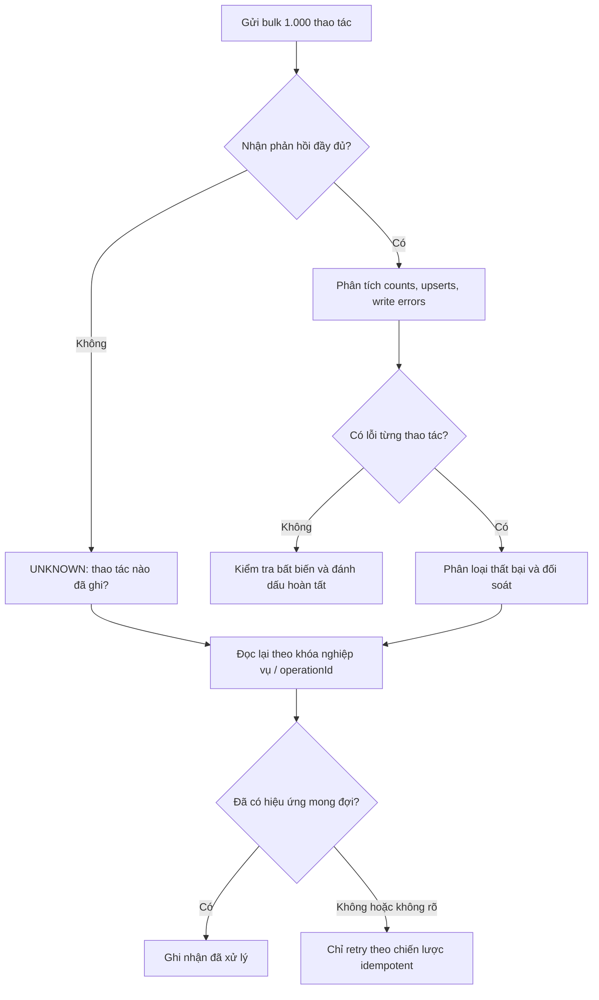
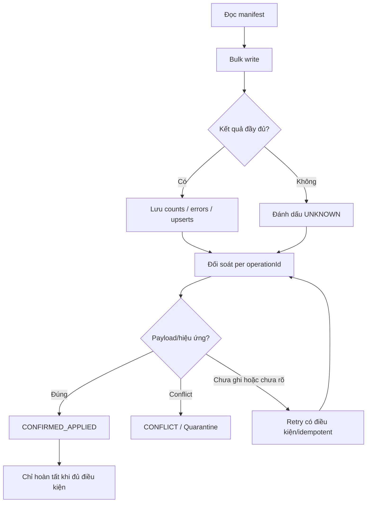

# Idempotency và thử lại khi không biết chắc thao tác nào đã thành công

## 1. Vấn đề thực tế: mất phản hồi không đồng nghĩa ghi thất bại

Một hệ thống nhập kho sử dụng **Spring Data MongoDB** để nhận 1.000 dòng dữ liệu từ đối tác và cập nhật nhiều document trong collection `inventory`. Để giảm số lượt trao đổi với MongoDB, ứng dụng dùng **bulk write** thay vì gọi `save(...)` cho từng dòng.

Giả sử trình tự như sau:

```text
T1  Ứng dụng gửi 1.000 thao tác ghi trong một bulk.
T2  MongoDB thực hiện một số hoặc tất cả thao tác.
T3  Kết nối bị ngắt trước khi ứng dụng nhận đủ phản hồi.
T4  Ứng dụng chỉ thấy timeout / network exception.
T5  Job quyết định gửi lại cả 1.000 thao tác.
```

Điều gì xảy ra nếu thao tác 27 là:

```javascript
{
  updateOne: {
    filter: { _id: "sku-27" },
    update: { $inc: { available: 5 } }
  }
}
```

Nếu lần đầu MongoDB **đã cộng 5** nhưng phản hồi bị mất, lần thử lại có thể **cộng thêm 5**, khiến kho sai 5 đơn vị. Ngược lại, nếu ứng dụng cho rằng toàn bộ đã thành công và không thử lại, những dòng chưa được thực hiện có thể bị bỏ sót.

Bài học thuộc chương **Ghi hàng loạt** của module **SPRING_DATA_MONGODB**. Dịch vụ học cách kết nối, ánh xạ document và thao tác MongoDB qua `MongoTemplate` hoặc repository, xây query/update, kiểm tra index, transaction, reactive access, kiểm thử và hiệu năng. Ở đây trọng tâm là:

- Phân biệt **thao tác thành công**, **thao tác thất bại** và **thao tác chưa rõ kết quả**.
- Hiểu bulk `ORDERED`, `UNORDERED` và giới hạn của `BulkWriteResult`.
- Thiết kế **idempotency key** và các update có thể gửi lại an toàn.
- Biết lúc nào có thể retry, lúc nào cần **đọc lại để đối soát**.
- Phân biệt retry của MongoDB Driver với retry ở ứng dụng/job.
- Kiểm thử duplicate, lỗi từng phần, mất kết nối, concurrency và lỗi commit không rõ kết quả.

**Nguyên tắc quan trọng nhất:** *không nhận được acknowledgement không phải bằng chứng MongoDB chưa ghi*. Một thao tác không nên được gửi lại chỉ vì client không thấy kết quả, trừ khi việc gửi lại có tính idempotent hoặc đã được đối soát theo định danh nghiệp vụ.

## 2. Idempotency là gì?

Một phép biến đổi được gọi là **idempotent** nếu áp dụng nó nhiều lần cho cùng đầu vào có kết quả trạng thái cuối giống như áp dụng một lần.

Với giá trị hiện tại `available = 10`:

| Update | Gọi một lần | Gọi lại cùng input | Idempotent về trạng thái? |
| --- | --- | --- | --- |
| `$set: {available: 15}` | 15 | 15 | Có, nếu các tiền điều kiện và giá trị không đổi |
| `$inc: {available: 5}` | 15 | 20 | **Không** |
| `$push: {events: "e-1"}` | Thêm một phần tử | Thêm phần tử trùng | **Không** |
| `$addToSet: {tags: "mongodb"}` | Có tag | Vẫn một tag | Thường có, theo phép so sánh phần tử của MongoDB |
| `$unset: {obsolete: ""}` | Field bị xóa | Vẫn không có field | Có |
| `deleteOne({_id: id})` | Document bị xóa | Không còn document | Trạng thái cuối idempotent, nhưng kết quả `deletedCount` có thể khác |
| `insertOne({_id: id, ...})` | Tạo document | Duplicate key | Không idempotent ở **kết quả lệnh**, nhưng có thể xây semantics nghiệp vụ hiệu quả-một-lần bằng kiểm tra trùng |

Cần phân biệt:

- **Idempotent về trạng thái**: gửi lại không làm thay đổi giá trị cuối.
- **Idempotent về kết quả API**: ứng dụng có thể trả cùng một trạng thái nghiệp vụ khi request lặp, dù MongoDB trả `matchedCount` hoặc lỗi khác.
- **Exactly once về hiệu ứng nghiệp vụ**: mỗi sự kiện nhập kho hoặc thanh toán tác động **tối đa một lần** và không bị bỏ sót, trong giới hạn hợp đồng đã chọn. Đây là yêu cầu mạnh, **không phải thuộc tính tự có** của `bulkOps`.
- **At least once delivery**: client có thể gửi lại sau timeout; phải giả định một sự kiện có thể tới nhiều lần.
- **At most once application**: cần ràng buộc/chốt định danh để không áp dụng hiệu ứng trùng.

Ví dụ `$set` có thể lặp an toàn với cùng payload, nhưng nếu bản ghi nguồn mới hơn đã sửa giá sau lần đầu, việc replay một `$set` **cũ** sẽ ghi đè giá mới. Vì vậy idempotency của một update **không tự đảm bảo thứ tự phiên bản dữ liệu nghiệp vụ**.

## 3. Kết quả bulk write có thể mơ hồ ở đâu?

Một bulk gồm nhiều lệnh, không nhất thiết là một transaction bao trùm tất cả document. Tùy chế độ bulk, loại thao tác, deployment và loại lỗi, một phần có thể đã được áp dụng khi client nhận exception.



Các trạng thái trong bảng điều phối nên được hiểu như sau:

| Trạng thái | Bằng chứng | Hành động điển hình |
| --- | --- | --- |
| `CONFIRMED_APPLIED` | Đã đọc được marker hoặc trạng thái mong muốn cùng fingerprint | Không áp dụng hiệu ứng lần nữa |
| `CONFIRMED_NOT_APPLIED` | Có đủ điều kiện chứng minh chưa áp dụng và chưa bị tiến trình khác ghi | Thử lại theo quy tắc phù hợp |
| `REJECTED` | Lỗi nghiệp vụ/validation cố định, payload không hợp lệ | Sửa dữ liệu, không retry mù |
| `CONFLICT` | Cùng operationId nhưng payload khác, hoặc version không hợp lệ | Báo xung đột, không nuốt lỗi |
| `UNKNOWN` | Timeout, mất phản hồi, lỗi không thể xác định per-item outcome | Đối soát; tránh cập nhật không idempotent |

**Đừng gán `CONFIRMED_NOT_APPLIED` chỉ vì `BulkWriteResult` không về được.** Việc không có result không chứng minh MongoDB chưa xử lý.

## 4. `ORDERED` và `UNORDERED` không phải mức đảm bảo atomic

Spring Data MongoDB cung cấp `BulkOperations.BulkMode.ORDERED` và `BulkOperations.BulkMode.UNORDERED`.

### 4.1. ORDERED

Trong chế độ ordered, các thao tác được xét theo thứ tự đã khai báo và bulk thường **dừng ở lỗi ghi đầu tiên** được MongoDB báo. Những thao tác trước lỗi có thể đã thành công. Điều đó **không** làm toàn bộ các thao tác trước lỗi tự rollback.

```text
Operations: A, B, C, D, E
A → thành công
B → thành công
C → duplicate key
D, E → không tiếp tục trong chuỗi ordered thông thường
```

Điểm cần nhớ: nếu client mất kết nối trước khi biết lỗi xuất hiện ở đâu, **không thể kết luận thao tác cuối cùng đã được áp dụng từ phía client**. Thông tin nào server đã gửi và client đã nhận mới là bằng chứng ở thời điểm đó.

### 4.2. UNORDERED

Trong chế độ unordered, MongoDB có thể thực hiện các thao tác **không theo thứ tự đầu vào** và có thể tiếp tục xử lý các thao tác khác sau khi một thao tác bị lỗi:

```text
Operations: A, B, C, D, E
C → duplicate key
A, E, B, D → có thể vẫn được thử và ghi thành công
```

Điều này hữu ích cho các thao tác độc lập như nhập danh mục sản phẩm, nhưng không phù hợp nếu B phải đọc hiệu ứng của A theo thứ tự nghiêm ngặt.

| Tiêu chí | ORDERED | UNORDERED |
| --- | --- | --- |
| Thứ tự thực hiện | Theo thứ tự logic của bulk | Không được dựa vào thứ tự đầu vào |
| Khi một thao tác lỗi | Thường dừng ở lỗi đầu | Có thể tiếp tục những thao tác khác |
| Phụ thuộc giữa các thao tác | Dễ dự đoán hơn, nhưng **không transaction** | Không nên có phụ thuộc theo thứ tự |
| Kết quả khi đứt kết nối | Vẫn có thể mơ hồ | Vẫn có thể mơ hồ |
| Dùng cho | Chuỗi có yêu cầu dừng sớm, cần kiểm soát | Các ghi độc lập có thể phân tán/nhóm lại |

**Cả ORDERED và UNORDERED đều không có nghĩa “all-or-nothing”.** Nếu nghiệp vụ yêu cầu tất cả document cùng commit/rollback thì phải xem xét transaction đa document trên deployment MongoDB hỗ trợ, cùng với chiến lược chống retry trùng.

## 5. Mô hình và định danh ổn định

Một hệ thống nhập sản phẩm có thể nhận dữ liệu:

```json
{
  "batchId": "supplier-A-2026-11-20",
  "items": [
    {
      "itemId": "line-0001",
      "sku": "KB-87",
      "name": "Bàn phím cơ",
      "active": true,
      "sourceVersion": 8
    },
    {
      "itemId": "line-0002",
      "sku": "MS-24",
      "name": "Chuột không dây",
      "active": true,
      "sourceVersion": 3
    }
  ]
}
```

**Không tạo ID ngẫu nhiên mới cho mỗi lần retry.** Cần có các định danh:

| Định danh | Công dụng |
| --- | --- |
| `batchId` | Nhận diện một lần giao lô từ hệ thống nguồn |
| `itemId` | Nhận diện một dòng/sự kiện trong lô |
| `operationId = batchId + ":" + itemId` | Nhận diện **hiệu ứng nghiệp vụ cần thực hiện đúng một lần** |
| `sku` | Khóa nghiệp vụ của document đích |
| `sourceVersion` | Thứ tự phiên bản từ hệ thống nguồn, nếu có |
| `payloadHash` | Dấu vân tay của payload canonical để phát hiện cùng key nhưng nội dung khác |

Có thể dùng `_id = sku` cho collection sản phẩm nếu SKU là khóa toàn cục, bất biến và không đổi. Nếu có nhiều tenant/supplier có SKU trùng, hãy đặt khóa gồm tenant, ví dụ `tenantId + ":" + sku`, hoặc unique compound index phù hợp.

Định danh **idempotency key** phải ổn định qua timeout, worker restart và retry của job. Một UUID sinh mới ở mỗi lần gửi không giải quyết được ghi trùng.

### 5.1. Payload hash phải canonical

Giả sử cùng `operationId` được gửi với hai payload khác nhau:

```json
{ "operationId": "b1:line-1", "sku": "KB-87", "delta": 5 }
```

và:

```json
{ "operationId": "b1:line-1", "sku": "KB-87", "delta": 50 }
```

Không được bỏ qua lần thứ hai chỉ vì thấy key đã tồn tại. Đó là **xung đột dữ liệu**. Trước khi đánh dấu “đã xử lý”, phải so sánh payload được chuẩn hóa hoặc hash đáng tin cậy của các trường có ý nghĩa nghiệp vụ.

Quy tắc canonical phải cố định: thứ tự field không có nghĩa phải giống nhau khi input JSON được sắp khác; số tiền `1.0` và `1.00` có được coi giống hay không phải theo schema/precision của nghiệp vụ. Hash không thay thế việc kiểm tra danh tính/nguồn sự kiện.

## 6. Trường hợp dễ retry nhất: ghi trạng thái mong muốn bằng `$set`

Nếu hệ thống nguồn gửi **trạng thái hiện tại** của một sản phẩm, ta có thể xây cập nhật để một payload được áp dụng nhiều lần vẫn cho cùng kết quả.

### 6.1. Document sản phẩm

```javascript
{
  _id: "KB-87",
  name: "Bàn phím cơ",
  active: true,
  sourceVersion: 8,
  createdAt: ISODate("2026-11-20T01:00:00Z")
}
```

### 6.2. Idempotent upsert với ID cố định

Trong `mongosh`:

```javascript
db.products.updateOne(
  { _id: "KB-87" },
  {
    $set: {
      name: "Bàn phím cơ",
      active: true,
      sourceVersion: 8
    },
    $setOnInsert: {
      createdAt: ISODate("2026-11-20T01:00:00Z")
    }
  },
  { upsert: true }
);
```

Nếu gọi lại y hệt, giá trị cuối vẫn như cũ. `$setOnInsert` chỉ áp dụng nếu MongoDB thực hiện upsert thành insert; nó không đổi `createdAt` ở bản ghi tồn tại. Timestamp trong ví dụ là **giá trị cố định từ sự kiện nguồn**; không dùng `Instant.now()` khác nhau ở mỗi lần retry nếu cần trạng thái hoàn toàn giống nhau.

**Hạn chế quan trọng:** một update idempotent theo cùng payload vẫn có thể **ghi lùi dữ liệu** nếu phiên bản 9 đã tới trước, rồi job retry phiên bản 8 sau đó. Cần tách hai vấn đề:

1. **Không áp dụng cùng một yêu cầu hai lần**.
2. **Không cho yêu cầu cũ ghi đè phiên bản mới**.

Nếu dữ liệu có nguồn version, hãy xác định một cơ chế kiểm soát phiên bản ở query có điều kiện, pipeline update hoặc transaction, và xử lý xung đột/duplicate key tương ứng. Không mặc định `$set` theo `_id` giải quyết out-of-order delivery.

### 6.3. Ví dụ `BulkOperations.upsert`

Trong một ứng dụng dùng Spring Data MongoDB, định nghĩa entity:

```java
import java.time.Instant;

import org.springframework.data.mongodb.core.mapping.Document;
import org.springframework.data.mongodb.core.mapping.FieldType;
import org.springframework.data.mongodb.core.mapping.MongoId;

@Document(collection = "products")
public record ProductDocument(
    @MongoId(FieldType.STRING) String id,
    String name,
    boolean active,
    long sourceVersion,
    Instant createdAt
) {}
```

Một method thực thi bulk các trạng thái đã được xác nhận:

```java
import java.time.Instant;
import java.util.List;

import com.mongodb.bulk.BulkWriteResult;
import org.springframework.data.mongodb.core.BulkOperations;
import org.springframework.data.mongodb.core.MongoTemplate;
import org.springframework.data.mongodb.core.query.Criteria;
import org.springframework.data.mongodb.core.query.Query;
import org.springframework.data.mongodb.core.query.Update;

public record ProductSnapshot(
    String sku,
    String name,
    boolean active,
    long sourceVersion,
    Instant createdAt
) {}

public BulkWriteResult upsertSnapshots(
    MongoTemplate template,
    List<ProductSnapshot> snapshots
) {
    if (snapshots.isEmpty()) {
        throw new IllegalArgumentException(
            "Không tạo bulk rỗng"
        );
    }

    BulkOperations bulk = template.bulkOps(
        BulkOperations.BulkMode.UNORDERED,
        ProductDocument.class
    );

    for (ProductSnapshot item : snapshots) {
        Query filter = Query.query(
            Criteria.where("_id").is(item.sku())
        );

        Update changes = new Update()
            .set("name", item.name())
            .set("active", item.active())
            .set("sourceVersion", item.sourceVersion())
            .setOnInsert("createdAt", item.createdAt());

        bulk.upsert(filter, changes);
    }

    return bulk.execute();
}
```

Trong ví dụ này, `bulkOps(...).upsert(query, update).execute()` thực hiện các upsert qua bulk, dùng `@Document` và mapping entity `ProductDocument`. Nếu có nhiều operation cùng SKU trong **một unordered bulk**, thứ tự áp dụng không được bảo đảm; phải gom/dedupe hoặc quyết định bản nào thắng **trước khi** thực hiện bulk.

Ví dụ là một kỹ thuật cho những *snapshot có thứ tự đầu vào đã được xử lý*. Nó **chưa** có phiên bản-guard chống ghi lùi. Trong production, phải test trường hợp sourceVersion không theo thứ tự.

## 7. Insert có khóa ổn định: duplicate key không mặc nhiên là thất bại nghiệp vụ

Một cách nhập sự kiện hoặc record bất biến là gán `_id` cố định:

```javascript
db.imported_events.insertOne({
  _id: "supplier-A:line-0001",
  sku: "KB-87",
  quantityDelta: 5,
  payloadHash: "canonical-hash-1"
});
```

Lần retry có thể nhận lỗi **duplicate key** (MongoDB error code 11000), vì insert thứ nhất đã tạo bản ghi.

Điều này có thể trở thành semantics nghiệp vụ “đã nhận” **chỉ khi**:

1. `_id` tương ứng đúng một operation có ý nghĩa.
2. Dữ liệu hiện có được kiểm tra theo `sku`, `quantityDelta`, `payloadHash` hoặc các trường nghiệp vụ bắt buộc.
3. Document đã ghi thể hiện **hiệu ứng đã hoàn tất**, hoặc được phối hợp với hiệu ứng qua cùng ranh giới atomic/transaction.

Không viết logic kiểu:

```java
// Nguy hiểm: mọi duplicate đều được coi thành công.
try {
    repository.insert(event);
} catch (DuplicateKeyException ignored) {
    return;
}
```

Nếu một client gửi cùng ID với payload khác, lỗi duplicate là **xung đột**. Nếu marker sự kiện được insert nhưng hiệu ứng tồn kho nằm ở document khác và **chưa cập nhật**, marker tồn tại cũng không chứng minh công việc hoàn tất.

## 8. `$inc` và `$push` không idempotent: xử lý bằng operation marker trong cùng document

Dạng khó hơn là **thêm lượng tồn kho**:

```javascript
{ $inc: { available: 5 } }
```

Muốn tránh áp dụng cùng một `operationId` hai lần mà vẫn chỉ sửa **một document**, có thể phối hợp **điều kiện chưa có marker** với **`$inc` và `$addToSet` trong cùng một update nguyên tử**.

### 8.1. Mô hình một document

```javascript
{
  _id: "KB-87",
  available: NumberLong(10),
  appliedOperationIds: []
}
```

Lần đầu cập nhật:

```javascript
db.inventory.updateOne(
  {
    _id: "KB-87",
    appliedOperationIds: { $ne: "b1:line-1" }
  },
  {
    $inc: { available: NumberLong(5) },
    $addToSet: { appliedOperationIds: "b1:line-1" }
  }
);
```

Kết quả:

```javascript
{
  _id: "KB-87",
  available: NumberLong(15),
  appliedOperationIds: ["b1:line-1"]
}
```

Lần retry **cùng operationId** sẽ không khớp filter `$ne`, do mảng đã chứa marker. Vì cả `$inc` và `$addToSet` nằm trong **cùng thao tác ghi trên một document**, MongoDB áp dụng chúng nguyên tử: không có trạng thái đã cộng mà thiếu marker do chỉ một phần của cùng update được ghi.

### 8.2. Vì sao `$addToSet` đứng một mình chưa đủ?

Giả sử dùng filter chỉ theo `_id`:

```javascript
db.inventory.updateOne(
  { _id: "KB-87" },
  {
    $inc: { available: NumberLong(5) },
    $addToSet: { appliedOperationIds: "b1:line-1" }
  }
);
```

Khi retry, `$addToSet` không thêm marker trùng, **nhưng `$inc` vẫn chạy lại**. Vì vậy phải có điều kiện trong **filter** để ngăn cả update khi marker đã tồn tại.

### 8.3. Entity và bulk update có điều kiện

```java
import java.util.List;
import org.springframework.data.mongodb.core.mapping.Document;
import org.springframework.data.mongodb.core.mapping.FieldType;
import org.springframework.data.mongodb.core.mapping.MongoId;

@Document(collection = "inventory")
public record InventoryDocument(
    @MongoId(FieldType.STRING)
    String id,
    long available,
    List<String> appliedOperationIds
) {}
```

Một DTO mô tả sự kiện cộng/trừ số lượng:

```java
public record StockDelta(
    String operationId,
    String sku,
    long delta
) {}
```

Thực thi các update độc lập bằng bulk:

```java
import java.util.List;

import com.mongodb.bulk.BulkWriteResult;
import org.springframework.data.mongodb.core.BulkOperations;
import org.springframework.data.mongodb.core.MongoTemplate;
import org.springframework.data.mongodb.core.query.Criteria;
import org.springframework.data.mongodb.core.query.Query;
import org.springframework.data.mongodb.core.query.Update;

public BulkWriteResult applyDeltas(
    MongoTemplate template,
    List<StockDelta> items
) {
    if (items.isEmpty()) {
        throw new IllegalArgumentException("Bulk rỗng");
    }

    BulkOperations bulk = template.bulkOps(
        BulkOperations.BulkMode.UNORDERED,
        InventoryDocument.class
    );

    for (StockDelta item : items) {
        if (item.operationId() == null
                || item.operationId().isBlank()
                || item.delta() == 0) {
            throw new IllegalArgumentException(
                "Operation không hợp lệ"
            );
        }

        Query filter = Query.query(
            Criteria.where("_id").is(item.sku())
                .and("appliedOperationIds")
                .ne(item.operationId())
        );

        Update update = new Update()
            .inc("available", item.delta())
            .addToSet(
                "appliedOperationIds",
                item.operationId()
            );

        bulk.updateOne(filter, update);
    }

    return bulk.execute();
}
```

**Hiệu ứng:** khi một operation đã áp dụng, lần retry với cùng ID không cộng thêm. Hai operation khác nhau cùng tác động một SKU vẫn có thể cộng/trừ nối tiếp, dù bulk unordered không bảo đảm thứ tự. Nếu doanh nghiệp yêu cầu không cho tồn kho âm, cần thêm filter theo số lượng và quy tắc nghiệp vụ phù hợp; marker chỉ giải quyết chống lặp, **không tự kiểm tra số lượng hợp lệ**.

**Không kết luận `matchedCount=0` là “đã áp dụng”**. Có ít nhất ba khả năng: document SKU không tồn tại, operationId đã tồn tại, hoặc điều kiện nghiệp vụ khác không khớp. Phải đọc lại document/marker để phân loại. Nếu cùng operationId được dùng với delta khác, chỉ một marker string không đủ để nhận biết xung đột; cần thêm ledger hoặc payloadHash tương ứng.

### 8.4. Chi phí lưu marker không giới hạn

`appliedOperationIds` sẽ tăng theo số sự kiện. MongoDB có giới hạn kích thước BSON document thông thường 16 MiB; một mảng marker dài cũng làm tăng chi phí đọc/ghi.

Vì vậy mẫu marker trong cùng document phù hợp khi số key nhỏ hoặc retention có giới hạn rõ. Với lịch sử dài:

- Tạo **collection ledger** riêng với unique index trên `operationId` hoặc `(tenantId, operationId)`.
- Bảo đảm marker ledger và hiệu ứng trên document đích được cập nhật cùng transaction khi cần nhất quán mạnh.
- Cân nhắc phân vùng/snapshot/compaction dựa trên chính sách **không cho phép retry sau khi key đã bị loại khỏi lịch sử**.
- Không xóa marker chỉ vì array lớn nếu client vẫn có thể retry operation cũ.

**TTL không phải dedup vĩnh viễn.** Khi key hết hạn và bị xóa, một retry quá muộn có thể áp dụng hiệu ứng lại. Hợp đồng API phải quy định rõ cửa sổ idempotency.

## 9. Ledger tách collection: chỉ đúng nếu marker và hiệu ứng nhất quán

Giả sử mỗi operation có một document:

```javascript
{
  _id: "b1:line-1",
  sku: "KB-87",
  delta: NumberLong(5),
  payloadHash: "canonical-hash-1",
  status: "COMPLETED"
}
```

Một unique index trên `_id` ngăn hai document ledger cùng operationId. Nhưng nếu thực thi:

```text
1. insert ledger: status=COMPLETED
2. update inventory: $inc +5
```

và tiến trình chết sau bước 1, ledger nói đã xong nhưng inventory **chưa được cập nhật**. Nếu đảo:

```text
1. update inventory: $inc +5
2. insert ledger: status=COMPLETED
```

và tiến trình chết sau bước 1, retry có thể **cộng thêm 5** trước khi gặp trùng ledger.

### 9.1. Giải pháp transaction đa document

Nếu yêu cầu cả ledger và inventory cùng commit/rollback, dùng **MongoDB multi-document transaction** trên môi trường hỗ trợ (replica set/sharded cluster được cấu hình phù hợp):

```text
BEGIN TRANSACTION
    insert ledger với _id = operationId, payloadHash
    update inventory với delta
    ghi trạng thái hoàn tất trong transaction
COMMIT
```

Cùng operationId được insert lần nữa sẽ va chạm unique key hoặc bị phát hiện trong luồng kiểm tra, tùy concurrency và thứ tự thực thi. Nếu commit thất bại rõ ràng, rollback các hiệu ứng thuộc transaction. Nếu **không nhận được kết quả commit**, không được mặc định transaction đã rollback: phải đối soát ledger và trạng thái, cân nhắc retry commit/transaction theo hướng dẫn driver và thiết kế idempotency.

**Không dùng transaction làm câu trả lời duy nhất cho exactly-once:** driver/client có thể retry, request có thể tới lại ở phiên làm việc khác, và hệ thống bên ngoài MongoDB (email, cổng thanh toán, broker) không nằm trong cùng MongoDB transaction.

### 9.2. Spring Data `@Transactional`

Cấu hình cơ bản:

```java
import org.springframework.context.annotation.Bean;
import org.springframework.context.annotation.Configuration;
import org.springframework.data.mongodb.MongoDatabaseFactory;
import org.springframework.data.mongodb.MongoTransactionManager;

@Configuration
class MongoTxConfig {

    @Bean
    MongoTransactionManager mongoTransactionManager(
        MongoDatabaseFactory factory
    ) {
        return new MongoTransactionManager(factory);
    }
}
```

Một service có thể mở transaction cho một đơn vị nghiệp vụ:

```java
import org.springframework.stereotype.Service;
import org.springframework.transaction.annotation.Transactional;

@Service
public class InventoryOperationService {

    private final MongoTemplate template;

    public InventoryOperationService(MongoTemplate template) {
        this.template = template;
    }

    @Transactional(
        transactionManager = "mongoTransactionManager"
    )
    public void applyOperation(StockDelta item) {
        // 1. Chèn ledger {_id: operationId, payloadHash}.
        // 2. Cập nhật tồn kho trong cùng MongoDB transaction.
        // 3. Không nuốt exception rồi trả thành công.
    }
}
```

Đoạn trên là **khung ranh giới transaction**, không phải implementation hoàn chỉnh vì thiếu schema ledger, canonical hash và xử lý duplicate/commit ambiguity. Nó minh họa transaction ở **service**, không nên hiểu rằng mọi repository/bulk method tự dùng transaction theo mặc định.

Spring proxy, transaction manager, cùng database factory và ngữ cảnh session phải được cấu hình đúng. Với application reactive, cần `ReactiveMongoTransactionManager` thay vì manager imperative.

## 10. Retryable writes của MongoDB Driver khác retry nghiệp vụ

MongoDB Java Driver hỗ trợ **retryable writes** cho các thao tác đủ điều kiện, tùy deployment, session, cấu hình `retryWrites` và loại lệnh.

Ví dụ một số thao tác **một document** có thể thuộc nhóm retryable:

- `insertOne`, `updateOne`, `replaceOne` và `deleteOne` khi đáp ứng yêu cầu.
- Một bulk chỉ gồm các thao tác một document có thể được driver xử lý qua cơ chế retryable writes phù hợp.
- Một số thao tác `findAndModify` theo điều kiện driver/server.

Các lệnh **updateMany** hoặc **deleteMany** không có cùng bảo đảm retryable write ở cấp statement như update một document. Trong một bulk trộn thao tác đủ điều kiện với thao tác không đủ điều kiện, **không mặc định toàn bộ lô được retry tự động**.

### 10.1. Driver retry có thể dùng thông tin phiên làm việc

Khi retryable writes được hỗ trợ, driver/server có thể dùng session và định danh statement/transaction number để nhận ra việc gửi lại cùng thao tác trong phạm vi cơ chế retry. Điều này khác về bản chất với một job đã crash rồi một worker mới khởi động, tạo request/bulk mới sau vài phút hoặc vài ngày.

**Không biến `retryWrites=true` thành lời hứa exactly once trên toàn hệ thống.** Nó không thay thế operationId/payloadHash bền vững của ứng dụng và không bảo vệ mọi thao tác hoặc mọi loại lỗi.

### 10.2. Retry ba tầng

| Tầng | Ai có thể retry? | Điểm cần nhớ |
| --- | --- | --- |
| **MongoDB Driver** | Driver tự động retry thao tác đủ điều kiện | Phụ thuộc loại operation, server, session và cấu hình |
| **Spring/service** | Annotation/code retry khi exception | Có thể tạo **lời gọi mới**, phải có idempotency |
| **Job queue / batch orchestrator** | Gửi lại một job hoặc toàn bộ batch sau timeout | Thường vượt quá vòng đời session cũ; phải lưu checkpoint |

Một thao tác có thể được retry nhiều tầng. Nếu không có thiết kế chống trùng, cùng một sự kiện có thể tác động dữ liệu nhiều lần dù mỗi tầng retry “hợp lý” nếu xét riêng.

## 11. Đọc `BulkWriteResult` nhưng không suy ra trạng thái từng dòng

Khi `BulkOperations.execute()` hoàn tất và trả kết quả được acknowledged, `BulkWriteResult` cho các bộ đếm như:

```java
import com.mongodb.bulk.BulkWriteResult;

BulkWriteResult result = bulk.execute();

if (!result.wasAcknowledged()) {
    throw new IllegalStateException(
        "Bulk không được acknowledged"
    );
}
```

Phương thức `wasAcknowledged()` của `BulkWriteResult` cho biết driver có nhận acknowledgement hay không. Với kết quả unacknowledged, không được suy ra các bộ đếm bên dưới hoặc trạng thái từng operation. Khi triển khai, kiểm tra phiên bản MongoDB Java Driver đang dùng để sử dụng đúng API.

Đối với result acknowledged, có thể kiểm tra:

```java
int inserted = result.getInsertedCount();
int matched = result.getMatchedCount();
int modified = result.getModifiedCount();
int deleted = result.getDeletedCount();
int upserted = result.getUpserts().size();

System.out.printf(
    "inserted=%d matched=%d modified=%d deleted=%d upserted=%d%n",
    inserted, matched, modified, deleted, upserted
);
```

Các bộ đếm này mô tả **kết quả tổng hợp**, không tự cung cấp trạng thái thành công/thất bại chi tiết cho **mỗi operation**. Ví dụ:

- `matchedCount` có thể lớn hơn `modifiedCount` vì `$set` ghi lại cùng giá trị.
- Một update có filter không khớp có thể là do marker đã tồn tại hoặc document thiếu, không thể suy ra chỉ từ count.
- `getUpserts()` có thể chứa index của các upsert đã insert mới và ID tương ứng; không phải bản đồ đầy đủ cho tất cả updateOne thành công.
- Nếu operation thất bại hoặc client không nhận được reply hoàn chỉnh, **có thể không có BulkWriteResult đầy đủ** để dựa vào.

### 11.1. Acknowledgement và write concern

MongoDB write concern ảnh hưởng điều kiện để server xác nhận ghi, ví dụ `w:1` hoặc `w:"majority"` tùy yêu cầu durability. Dùng acknowledgement phù hợp giúp ứng dụng có bằng chứng mạnh hơn về việc ghi đã được chấp nhận/bền vững theo cơ chế MongoDB.

Nhưng:

- `w:"majority"` **không giải quyết** mất phản hồi trước khi client nhận acknowledgement.
- `w:0`/unacknowledged writes không phù hợp khi ứng dụng cần quyết định per-item success; nhiều số đếm không khả dụng.
- Write concern timeout không phải bằng chứng một thao tác đã được rollback.
- Cần cấu hình read concern/read preference thích hợp khi **đọc đối soát**, tránh đọc bản replica quá trễ rồi kết luận chưa ghi.

Đừng đồng nhất **durability**, **atomicity**, **idempotency** và **end-to-end exactly-once**; chúng là những thuộc tính khác nhau.

## 12. Lỗi từng thao tác và thông tin `writeErrors`

Khi MongoDB đã phản hồi một lỗi bulk được cấu trúc, driver thường cung cấp thông tin như:

- Các lỗi ở từng operation, bao gồm **index** của operation trong danh sách đầu vào.
- Mã lỗi, ví dụ 11000 cho duplicate key.
- Các số đếm thành công mà server có thể báo trong phản hồi.
- Lỗi write concern nếu có.

Với MongoDB Java Driver, có các exception như `MongoBulkWriteException`; qua Spring Data MongoDB chúng có thể được chuyển thành một exception Spring như `BulkOperationException` hoặc ngoại lệ tầng data access khác tùy đường gọi/phiên bản.

**Đừng bắt một loại exception duy nhất rồi suy rằng mọi lỗi đều có cùng shape.** Một lỗi mạng đột ngột có thể không có `writeErrors` đầy đủ; một lỗi validation hoặc duplicate key thường có thông tin operation index khi server đã phản hồi.

### 12.1. Chỉ số lỗi phản ánh yêu cầu ban đầu, không nhất thiết thứ tự hoàn thành

Ví dụ operation index:

```text
0 → update sku-01
1 → insert sku-02
2 → update sku-03
3 → insert sku-04
4 → update sku-05
```

Nếu server báo lỗi ở index 3, ta biết operation thứ tư theo **danh sách đầu vào** bị lỗi. Trong mode `UNORDERED`, điều đó **không có nghĩa** chỉ có các operation 0–2 đã chạy, vì các operation khác có thể được thực hiện không theo thứ tự.

**Cần lưu bảng mapping** `index → operationId → sku → payloadHash` ngay từ lúc tạo batch. Không dựa vào thứ tự kết quả hoặc đoán SKU từ tổng `modifiedCount`.

### 12.2. Phân loại exception trước khi quyết định retry

| Loại lỗi | Có nên retry ngay không? |
| --- | --- |
| Duplicate key trên `_id=operationId` | **Không retry mù**; đọc record hiện có và so payload/hash |
| Validation/schema mismatch | Thường cần sửa dữ liệu hoặc migration |
| Stale sourceVersion | Không ghi lùi; xem record mới hơn là trạng thái hợp lệ hay conflict |
| Network timeout / connection reset | **UNKNOWN**; đối soát marker/trạng thái trước |
| Write conflict/transient transaction error | Có thể retry trong chiến lược có giới hạn, cần idempotency |
| Unknown transaction commit result | Không giả định rollback; kiểm tra dấu vết commit hoặc retry commit theo hướng dẫn |
| Permission/authentication failure | Khắc phục cấu hình/quyền; retry liên tục không ích |
| Server overload hoặc throttling | Backoff, giới hạn concurrency, cân nhắc chia nhỏ batch |

Chính sách retry nên dựa trên **khả năng phục hồi của lỗi và tính idempotent của operation**, không dựa vào quy tắc đơn giản “bất kỳ exception nào cũng retry 3 lần”.

## 13. Quy trình đối soát sau lỗi mơ hồ

Một thuật toán thực tế cho bulk có nhiều operation độc lập:

### Bước 1 — Ghi manifest ổn định trước khi gửi

Manifest chứa:

```json
{
  "batchId": "supplier-A-2026-11-20",
  "operations": [
    {
      "index": 0,
      "operationId": "supplier-A-2026-11-20:line-0001",
      "sku": "KB-87",
      "payloadHash": "hash-001"
    },
    {
      "index": 1,
      "operationId": "supplier-A-2026-11-20:line-0002",
      "sku": "MS-24",
      "payloadHash": "hash-002"
    }
  ]
}
```

Đây là ví dụ cấu trúc; `hash-001` là giá trị tượng trưng, chưa phải hash thật. Manifest nên được lưu bền vững theo thiết kế hệ thống trước khi có rủi ro gửi lại, không chỉ giữ trong RAM của worker.

### Bước 2 — Gửi batch có giới hạn

Chọn `ORDERED` hoặc `UNORDERED` theo mức độc lập của thao tác. Giới hạn kích thước batch theo số thao tác, dữ liệu BSON và tải MongoDB/ứng dụng; không gom hàng triệu operation vào một lệnh và kỳ vọng dễ phục hồi.

### Bước 3 — Đánh giá phản hồi

- Nếu có kết quả acknowledged, ghi nhận counts/IDs/upserts và kiểm tra bất biến.
- Nếu có write errors theo index, lưu lại thông tin lỗi của từng operation được báo.
- Nếu lỗi mạng hoặc kết quả không đủ, đánh dấu những operation thiếu bằng chứng là **`UNKNOWN`**, không tự gắn “failed”.

### Bước 4 — Đọc lại theo operationId hoặc khóa đích

- Với insert immutable: tra `_id` cố định, so sánh payloadHash.
- Với upsert desired-state: đọc giá trị `name`/`active`/`sourceVersion`; phân biệt version cao hơn với version cần áp dụng.
- Với `$inc`: đọc marker `appliedOperationIds` hoặc ledger transaction, **không** suy ra hiệu ứng từ lượng tồn kho hiện tại khi có nhiều thao tác đồng thời.
- Khi đọc ledger, xác minh trạng thái và fingerprint; **marker tồn tại nhưng không được ghi nguyên tử với hiệu ứng** không đủ để xác nhận thành công.

### Bước 5 — Chia nhóm kết quả và retry có kiểm soát

| Nhóm | Hành động |
| --- | --- |
| Đã có đúng hiệu ứng | Không gửi lại |
| Có record cùng ID nhưng payload khác | Báo conflict, cần can thiệp |
| Chưa thấy hiệu ứng và thao tác đã được thiết kế idempotent | Gửi lại cùng operationId/payload |
| Không xác định được vì dữ liệu đổi đồng thời | Giữ UNKNOWN, retry/đối soát theo hợp đồng chặt hơn |
| Dữ liệu sai định dạng hoặc permission lỗi | Đưa vào dead-letter/quarantine hoặc sửa nguồn |

### Bước 6 — Chỉ xác nhận batch hoàn thành khi đạt điều kiện nghiệp vụ

Không đánh dấu lô `COMPLETED` chỉ vì một lời gọi `execute()` không ném exception. Nếu batch cần mọi operation thành công, hãy đảm bảo mọi operation đã được xác nhận theo logic nghiệp vụ. Một số dòng có thể được chấp nhận là `SKIPPED_AS_OLD_VERSION`; đây cần là một trạng thái nghiệp vụ tường minh, không được lẫn với thất bại.



## 14. Checkpoint, chunking và thứ tự dữ liệu

### 14.1. Chia lô nhỏ hơn để phục hồi được

Với 100.000 dòng nhập kho, thường dễ vận hành hơn nếu chia thành nhiều chunk có giới hạn, ví dụ 500 operation/chunk, thay vì một tập khổng lồ. **500 chỉ là con số minh họa**, không phải ngưỡng tối ưu cho mọi deployment.

Mỗi chunk nên có:

- `batchId` và `chunkId` ổn định.
- Danh sách `operationId` và payloadHash.
- Trạng thái `PENDING`/`IN_PROGRESS`/`RECONCILING`/`COMPLETED`/`FAILED`.
- Thời điểm thử lại, số lần retry, nguyên nhân lỗi.
- Checkpoint thể hiện **đã xác minh**, không chỉ “đã gửi tới driver”.

**Checkpoint sai:** lưu “đã xử lý đến dòng 500” ngay sau khi gọi `execute()` nhưng chưa biết phản hồi/hiệu ứng. Nếu crash, job bỏ qua những thao tác chưa được ghi.

**Checkpoint đúng:** chỉ tăng vị trí hoàn tất sau khi xác minh tất cả operation thuộc phạm vi checkpoint đã được áp dụng, bị skip hợp lệ hoặc được xử lý theo chính sách nghiệp vụ đã định.

### 14.2. UNORDERED và nhiều operation cùng document

Nếu một bulk có:

```text
Operation A: $set name="A" trên SKU-X
Operation B: $set name="B" trên SKU-X
```

Mode `UNORDERED` không cam kết B sẽ là giá trị cuối chỉ vì nó đứng sau trong input. Giải pháp là **chọn bản ghi cuối mong muốn trước bulk**, dùng sourceVersion, hoặc tách luồng update theo khóa với thứ tự rõ.

Ngay cả `ORDERED` chỉ tạo trật tự trong một bulk; khi nhiều worker gửi những bulk khác nhau đồng thời, vẫn cần xử lý cạnh tranh và version.

### 14.3. Các thao tác không giao hoán

`$inc` với delta +5 và -2 trên cùng document có thể giao hoán về tổng trạng thái **nếu cả hai được áp dụng đúng một lần và không có điều kiện nghiệp vụ khác**. Nhưng nếu có quy tắc tồn kho không âm, thứ tự có thể quyết định thao tác nào được chấp nhận.

`$set` từ hai snapshot khác nhau không giao hoán về giá trị cuối. `$push` vào array giữ thứ tự cũng không giao hoán. Vì vậy việc chọn `UNORDERED` phải tính đến semantics từng operation, không chỉ performance.

## 15. Write concern, atomicity và transaction

### 15.1. Một document

Một lệnh `updateOne` trên một document nguyên tử, kể cả `$inc` cùng `$addToSet` marker trong cùng update. Nhưng một bulk 100 thao tác updateOne trên 100 document **không tự trở thành transaction 100 document**.

### 15.2. Nhiều document

Nếu business invariant yêu cầu ghi các phần tử trong ledger, tồn kho và phiếu nhập cùng commit/rollback, có thể dùng transaction đa document trên deployment MongoDB hỗ trợ. Một số điều cần tính:

- Transaction cần replica set hoặc sharded cluster phù hợp, không dùng MongoDB standalone thông thường.
- Transaction có chi phí, giới hạn thời gian/tài nguyên và khả năng write conflict.
- Collection và index nên được provision trước theo khả năng server để không phát sinh thao tác DDL ngoài dự kiến trong transaction.
- Khi commit outcome không rõ, ứng dụng cần đối soát; không mặc định rollback hay commit.
- Transaction không bao trùm HTTP bên ngoài hoặc message broker.

Với một job nhập dữ liệu rất lớn, không nên mở một transaction kéo dài hàng giờ chỉ để gom mọi chunk. Chọn phạm vi transaction đủ nhỏ theo bất biến nghiệp vụ, có checkpoint bền vững bên ngoài.

### 15.3. Write concern và đọc đối soát

Nếu hệ thống yêu cầu khả năng chịu sự cố máy chủ, cấu hình write concern như `majority` có thể cải thiện durability theo semantics MongoDB. Nhưng một phản hồi có thể bị mất sau khi server xác nhận; vấn đề ambiguous outcome vẫn tồn tại.

Khi đối soát cần chú ý **read preference**: đọc từ secondary còn chậm replica có thể chưa thấy bản ghi mới rồi kết luận sai “chưa áp dụng”. Hãy chọn read concern và nơi đọc thích hợp với yêu cầu nhất quán của hệ thống.

## 16. Reactive bulk và retry trong Reactor

Spring Data MongoDB hỗ trợ reactive bulk qua `ReactiveMongoTemplate`. Về bản chất, một `Mono<BulkWriteResult>` có thể hoàn tất hoặc báo lỗi; nếu báo lỗi do mất kết nối, vẫn phải coi hiệu ứng server là có thể đã xảy ra.

Ví dụ dùng model `ProductDocument` ở mục 6:

```java
import java.util.List;

import com.mongodb.bulk.BulkWriteResult;
import org.springframework.data.mongodb.core.BulkOperations;
import org.springframework.data.mongodb.core.ReactiveMongoTemplate;
import org.springframework.data.mongodb.core.query.Criteria;
import org.springframework.data.mongodb.core.query.Query;
import org.springframework.data.mongodb.core.query.Update;
import reactor.core.publisher.Mono;

public Mono<BulkWriteResult> reactiveUpsertProducts(
    ReactiveMongoTemplate template,
    List<ProductSnapshot> snapshots
) {
    return Mono.defer(() -> {
        if (snapshots.isEmpty()) {
            return Mono.error(
                new IllegalArgumentException("Bulk rỗng")
            );
        }

        var bulk = template.bulkOps(
            BulkOperations.BulkMode.UNORDERED,
            ProductDocument.class
        );

        for (ProductSnapshot item : snapshots) {
            bulk.upsert(
                Query.query(
                    Criteria.where("_id").is(item.sku())
                ),
                new Update()
                    .set("name", item.name())
                    .set("active", item.active())
                    .set("sourceVersion", item.sourceVersion())
                    .setOnInsert("createdAt", item.createdAt())
            );
        }

        return bulk.execute();
    });
}
```

Ví dụ dùng `Mono.defer` để xây bulk khi được subscribe, không dựng một instance có thể bị tái sử dụng ngoài ý muốn cho nhiều lần subscription. Tuy nhiên, `Mono.defer` **không tự tạo idempotency**: nếu caller `retry(...)` hoặc subscription xảy ra lại, thao tác sẽ được gửi lại.

### 16.1. Không dùng `retryWhen` như một chiến lược hoàn chỉnh

```java
// NGUY HIỂM nếu operations có $inc/$push không được chống trùng.
return reactiveBulk.execute()
    .retry(3);
```

Nếu lỗi là timeout sau khi server đã cộng kho, retry trực tiếp có thể cộng thêm. Ngay cả khi dùng những update desired-state có `$set`, cần chống ghi lùi phiên bản, xung đột cùng operationId và giới hạn số lần retry/backoff.

Trong WebFlux, không gọi `block()` trong event loop để đối soát. Dùng các API reactive cho bước đọc marker/trạng thái và build pipeline quyết định retry dựa trên bằng chứng.

### 16.2. Transaction reactive

Nếu cần ledger và effect trên nhiều document theo transaction, dùng `ReactiveMongoTransactionManager` hoặc `TransactionalOperator` với reactive transaction context. Không dùng manager imperative rồi giả định `Flux/Mono` đang cùng transaction. Tương tự imperative, vẫn phải xử lý kết quả commit không rõ và idempotency key ở mức nghiệp vụ.

## 17. Kiểm thử: chạy lại cùng bulk và xác minh trạng thái

Unit test mock `MongoTemplate` chỉ chứng minh code gọi `bulkOps`, không thể chứng minh update operator và cơ chế chống retry trùng hoạt động trên MongoDB thật.

### 17.1. Test marker cùng một document

Ví dụ dùng `@DataMongoTest` và MongoDB test riêng (có thể là Testcontainers). Để nhìn rõ thao tác thật, test có helper tạo bulk cùng logic với `applyDeltas` ở mục 8. Trong dự án thực tế, nên inject và gọi service sản xuất thay vì duy trì bản sao helper trong test.

```java
import static org.assertj.core.api.Assertions.assertThat;

import java.util.List;

import org.junit.jupiter.api.Test;
import org.springframework.beans.factory.annotation.Autowired;
import org.springframework.boot.test.autoconfigure.data.mongo.DataMongoTest;
import org.springframework.data.mongodb.core.BulkOperations;
import org.springframework.data.mongodb.core.MongoTemplate;
import org.springframework.data.mongodb.core.query.Criteria;
import org.springframework.data.mongodb.core.query.Query;
import org.springframework.data.mongodb.core.query.Update;

@DataMongoTest
class BulkIdempotencyIntegrationTest {

    @Autowired MongoTemplate template;

    @Test
    void repeatingSameDeltaDoesNotIncrementTwice() {
        String sku = "sku-bulk-idempotency-001";

        template.insert(new InventoryDocument(
            sku, 10L, List.of()
        ));

        StockDelta operation = new StockDelta(
            "batch-1:line-1",
            sku,
            5L
        );

        applyDeltas(template, List.of(operation));
        applyDeltas(template, List.of(operation));

        InventoryDocument actual = template.findById(
            sku, InventoryDocument.class
        );

        assertThat(actual).isNotNull();
        assertThat(actual.available()).isEqualTo(15L);
        assertThat(actual.appliedOperationIds())
            .containsExactly("batch-1:line-1");
    }

    private void applyDeltas(
        MongoTemplate mongo,
        List<StockDelta> deltas
    ) {
        BulkOperations bulk = mongo.bulkOps(
            BulkOperations.BulkMode.UNORDERED,
            InventoryDocument.class
        );

        for (StockDelta item : deltas) {
            Query filter = Query.query(
                Criteria.where("_id").is(item.sku())
                    .and("appliedOperationIds")
                    .ne(item.operationId())
            );

            Update update = new Update()
                .inc("available", item.delta())
                .addToSet(
                    "appliedOperationIds",
                    item.operationId()
                );

            bulk.updateOne(filter, update);
        }

        bulk.execute();
    }
}
```

Test minh họa đường ghi bulk thực, nhưng **chưa được chạy** ở bước soạn bài STEP 4. Dự án cần cô lập database/collection test hoặc dùng ID duy nhất tránh duplicate khi chạy lại. Khi đưa bài vào ứng dụng thật, gọi service sản xuất để kiểm tra đầy đủ cấu hình và hành vi thực.

Một test bổ sung nên khẳng định `matchedCount`/marker trước và sau retry. Khi có hai operationId khác nhau trên cùng SKU, cả hai phải được áp dụng đúng một lần theo quy tắc nghiệp vụ.

### 17.2. Các trường hợp kiểm thử bắt buộc

| Tình huống | Kết quả kỳ vọng |
| --- | --- |
| Gửi cùng operationId/delta hai lần | Số lượng chỉ đổi một lần |
| Gửi hai operationId khác nhau | Hai hiệu ứng được áp dụng nếu đều hợp lệ |
| Cùng operationId nhưng payloadHash khác | `CONFLICT`, không tự coi retry hợp lệ |
| Đọc marker sau timeout | Nếu marker tồn tại đúng payload, xác nhận đã xử lý |
| SKU không tồn tại | Không suy rằng matched=0 nghĩa là đã xử lý |
| Document có `appliedOperationIds: null` | Có lỗi schema hoặc cần migration, không tự ép |
| Một bulk ordered gặp duplicate ở giữa | Các operation trước có thể đã ghi, sau lỗi có thể chưa thử |
| Một bulk unordered có duplicate | Các operation khác có thể vẫn ghi |
| Timeout ngay sau khi bulk hoàn tất | Đối soát trước khi replay |
| Hai worker xử lý cùng operationId đồng thời | Một hiệu ứng duy nhất trên document |
| Ledger insert nhưng inventory update lỗi | Transaction rollback cả hai |
| Transaction commit result không rõ | Đọc ledger/marker và xử lý theo trạng thái xác minh |
| Retry snapshot cũ sau snapshot mới | Không ghi lùi version |
| Batch có nhiều operation cùng SKU | Không dựa vào thứ tự unordered |
| Driver trả partial write errors | Map index lỗi về operationId, không suy counts thành per-item success |
| Job restart giữa chunk | Checkpoint không bỏ sót và không áp dụng hai lần |

### 17.3. Kiểm thử lỗi mạng/commit không rõ

Để kiểm tra thực tế, có thể dùng một môi trường test MongoDB được kiểm soát với công cụ gây lỗi mạng/failpoint (nếu deployment và quyền cho phép). Mục tiêu là tạo tình huống **server có thể đã ghi, nhưng client không nhận phản hồi**.

Kiểm tra các kết quả sau, không chỉ exception:

1. OperationId nằm ở đâu sau lỗi?
2. Trạng thái BSON có đúng không?
3. Gửi lại cùng payload có tạo hiệu ứng lần hai không?
4. Nếu một operation lỗi, các operation khác có bị bỏ qua không?
5. Checkpoint đã chuyển trạng thái quá sớm chưa?
6. Job restart có đọc manifest, đối soát và tiếp tục đúng không?

**Không** gây ngắt kết nối hoặc bật failpoint trên production chỉ để thử. Một bài test có failpoint cần chạy trên môi trường cô lập và được điều khiển có kiểm soát.

## 18. Chẩn đoán hiệu năng và tính đúng

### 18.1. Index giúp query và upsert nhưng không thay idempotency

Các đường đối soát thường truy vấn:

- `inventory._id` hoặc `products._id`: có index `_id` mặc định.
- `ledger._id = operationId`: unique index `_id` giúp bảo vệ trùng.
- `batchId`, `status`, `createdAt`: có thể cần index cho job quét trạng thái chưa hoàn tất.
- `tenantId + externalOperationId`: có thể cần unique compound index nếu key không toàn cục.

Ví dụ index:

```javascript
db.bulk_ledger.createIndex(
  { tenantId: 1, externalOperationId: 1 },
  { unique: true, name: "uniq_tenant_operation" }
);

db.bulk_ledger.createIndex({
  status: 1,
  updatedAt: 1
});
```

**Ràng buộc unique cần có trước khi nhận concurrent writes**; nếu đã có duplicate trong dữ liệu cũ, migration index có thể thất bại. Ngoài ra, index không làm biến mất tình huống mất phản hồi.

### 18.2. Dùng `explain` đúng chỗ

Để đánh giá đường tìm kiếm khi đối soát:

```javascript
db.bulk_ledger.find({
  status: "UNKNOWN"
}).sort({ updatedAt: 1 })
  .limit(100)
  .explain("executionStats");
```

Quan sát `totalKeysExamined`, `totalDocsExamined` và `IXSCAN`/`COLLSCAN`. Đừng dùng một phép `explain` cho query đọc để kết luận toàn bộ bulk write sẽ nhanh: bulk có chi phí mạng, ghi, index maintenance, write conflict và journal/replication riêng.

### 18.3. Chỉ số vận hành quan trọng

| Chỉ số | Mục tiêu quan sát |
| --- | --- |
| Số operation trong mỗi chunk | Chunk có quá lớn, dễ phục hồi không? |
| Tỷ lệ `UNKNOWN` sau timeout | Có quá nhiều lần phải đối soát? |
| Số `CONFLICT` cùng operationId khác payload | Có lỗi tái sử dụng key ở upstream không? |
| Số retry và khoảng backoff | Có retry quá nhanh làm tăng tải? |
| Số duplicate key | Là retry hợp lệ hay lỗi định danh? |
| `modifiedCount` / `matchedCount` / `upserts` | Tín hiệu tổng hợp, không thay per-item verification |
| Số ledger đang `PENDING`/`RECONCILING` | Có operation bị kẹt? |
| Thời gian đối soát p95/p99 | Có index và batch read hợp lý? |
| Write conflict/transaction abort | Có quá nhiều cạnh tranh trên cùng SKU? |
| Replication lag/write concern timeout | Ảnh hưởng việc xác nhận và đọc đối soát |
| Kích thước marker/ledger | Có nguy cơ tăng trưởng không giới hạn? |

Nếu mỗi retry tạo thêm nhiều hoạt động vận hành, hãy nhìn toàn bộ pipeline **gửi → ghi → nhận phản hồi → đối soát → checkpoint**, không chỉ thời gian `bulk.execute()`.

## 19. Những sai lầm phổ biến

**Sai lầm 1: “Timeout nghĩa là MongoDB chưa ghi.”** Không đúng. Client có thể mất phản hồi sau khi server hoàn tất.

**Sai lầm 2: “ORDERED sẽ rollback các thao tác trước lỗi.”** Không đúng khi chạy ngoài transaction; ordered thường chỉ dừng ở lỗi đầu được báo.

**Sai lầm 3: “UNORDERED có thể replay toàn batch an toàn.”** Không. Các thao tác khác có thể đã chạy sau lỗi, và thứ tự không được bảo đảm.

**Sai lầm 4: “`modifiedCount=10` nghĩa là biết chính xác 10 operationId thành công.”** Counts chỉ là tổng hợp; phải có mapping và đối soát per-item.

**Sai lầm 5: “Cứ bắt `DuplicateKeyException` là thành công.”** Chỉ đúng khi ID/payload khớp và hiệu ứng nghiệp vụ đã hoàn tất trong cùng ranh giới tin cậy.

**Sai lầm 6: “`$addToSet` marker kết hợp `$inc` luôn chống retry dù filter chỉ theo ID.”** Sai. Phải lọc marker chưa tồn tại để không chạy `$inc` lần hai.

**Sai lầm 7: “Viết ledger COMPLETED trước rồi cập nhật kho là an toàn.”** Không. Crash ở giữa tạo marker sai; cần transaction hoặc mô hình trạng thái có thể phục hồi.

**Sai lầm 8: “Driver `retryWrites` tự giải quyết idempotency của job.”** Không. Worker restart hoặc retry ngoài session có thể tạo một yêu cầu mới.

**Sai lầm 9: “`$set` lúc nào cũng an toàn.”** Cùng payload idempotent về trạng thái nhưng retry snapshot cũ có thể ghi lùi dữ liệu mới.

**Sai lầm 10: “BulkOperations hỗ trợ lifecycle và optimistic locking giống repository.save.”** Bulk APIs không nên được giả định chạy đầy đủ auditing/entity callbacks hay xử lý `@Version` như từng entity `save`; cần kiểm tra semantics và tự quản lý version/bất biến khi cần.

**Sai lầm 11: “Có transaction là exactly once với cổng thanh toán.”** MongoDB transaction không rollback được hệ thống bên ngoài; cần outbox, idempotency và bù trừ.

**Sai lầm 12: “Xóa key idempotency sau 24 giờ không có tác dụng phụ.”** Nếu client retry muộn hơn, key bị xóa có thể cho phép hiệu ứng chạy lần hai. Phải quy định và thực thi retention window.

## 20. Quy trình thực hành

1. Tạo collection `products` và `inventory` trên MongoDB test; kiểm tra ID BSON string.
2. Dùng `MongoTemplate.bulkOps(UNORDERED, ProductDocument.class)` để gửi ba snapshot với `upsert`, chạy lại cùng payload và đối chiếu giá trị cuối.
3. Đưa một snapshot có `sourceVersion` cũ vào sau snapshot mới; nhận diện nguy cơ ghi lùi và thiết kế version guard.
4. Tạo một document tồn kho `available=10, appliedOperationIds=[]`.
5. Gọi `$inc + $addToSet` **có filter marker chưa tồn tại** cho operationId cố định, gọi lại và xác minh số lượng chỉ tăng một lần.
6. Thử bỏ điều kiện marker khỏi filter để thấy retry cộng hai lần.
7. Tạo một bulk ordered có lỗi duplicate key ở giữa; xác minh các document trước/sau.
8. Tạo một bulk unordered có lỗi duplicate key; xác minh các thao tác độc lập khác vẫn có thể thành công.
9. Lưu manifest ánh xạ index → operationId và đối chiếu với các write errors.
10. Mô phỏng mất phản hồi trên môi trường cô lập; sau lỗi đọc lại marker/ledger trước khi retry.
11. Thử hai worker xử lý cùng operationId; khẳng định hiệu ứng tối đa một lần.
12. Dùng transaction ledger + inventory trên replica set test khi nghiệp vụ cần nhiều document cùng commit.
13. Thực hành reactive bulk và quan sát việc resubscribe/retry có thể gửi lại operation.
14. Dùng `explain("executionStats")` cho truy vấn đối soát và đo p95/p99 cùng tỷ lệ UNKNOWN.

## 21. Checklist khi triển khai production

| Câu hỏi | Điều kiện cần xác minh |
| --- | --- |
| Mỗi hiệu ứng có `operationId` ổn định? | Không sinh key mới cho mỗi retry |
| Cùng key nhưng payload khác được phát hiện? | Có fingerprint/canonical hash hoặc so field nghiệp vụ |
| Bulk có operation phụ thuộc thứ tự? | Chọn ORDERED hoặc tách/điều phối theo khóa |
| Mọi thao tác có idempotent? | Phân loại `$set`, `$inc`, `$push`, insert, delete |
| Marker và hiệu ứng có nguyên tử? | Cùng một document hoặc cùng transaction phù hợp |
| Có rủi ro ghi lùi version? | Guard theo sourceVersion, conflict policy |
| Có duplicate key? | Chỉ coi thành công sau verify đúng payload và hiệu ứng |
| Có thể mất kết quả commit/response? | Có trạng thái UNKNOWN và quy trình đối soát |
| `BulkWriteResult` đủ để xác nhận per item? | Không; dùng operation mapping và marker/ledger |
| Retry theo driver/service/job có chồng nhau? | Giới hạn số lần, backoff và kiểm soát idempotency |
| Có ghi lại manifest/checkpoint bền vững? | Không đánh dấu chunk hoàn tất khi mới gửi |
| Write concern/read preference phù hợp? | Không đọc đối soát từ bản sao chưa bắt kịp |
| Marker/ledger có tăng mãi không? | Có retention contract và giới hạn dữ liệu |
| API reactive có resubscribe ngoài ý muốn? | Mỗi subscription có thể gửi lại bulk |
| Đã có integration test lỗi một phần? | Ordered/unordered, duplicate, timeout, concurrency |
| Có monitoring hiệu năng và tính đúng? | Tỷ lệ UNKNOWN, conflict, retry, aborted tx, p95/p99 |

## 22. Tài liệu chính thức để đối chiếu API và semantics

Các hành vi retry, transaction và bulk phụ thuộc vào MongoDB Server, Java Driver và phiên bản Spring Data MongoDB. Trước khi triển khai, đối chiếu với **dependency và deployment thực tế**, đặc biệt nếu dùng `retryWrites`, write concern, sharded cluster hoặc transaction.

- [Spring Data MongoDB — BulkOperations Javadoc](https://docs.spring.io/spring-data/mongodb/reference/api/java/org/springframework/data/mongodb/core/BulkOperations.html)
- [Spring Data MongoDB — Bulk operations](https://docs.spring.io/spring-data/mongodb/reference/mongodb/template-crud-operations.html)
- [MongoDB Manual — Bulk write operations](https://www.mongodb.com/docs/manual/core/bulk-write-operations/)
- [MongoDB Manual — Retryable writes](https://www.mongodb.com/docs/manual/core/retryable-writes/)
- [MongoDB Manual — Single-document atomicity](https://www.mongodb.com/docs/manual/core/write-operations-atomicity/)
- [MongoDB Manual — Transactions](https://www.mongodb.com/docs/manual/core/transactions/)
- [MongoDB Manual — Write concern](https://www.mongodb.com/docs/manual/reference/write-concern/)
- [MongoDB Java Driver — Bulk writes](https://www.mongodb.com/docs/drivers/java/sync/current/crud/bulk/)

**Kết luận:** Bulk write giúp giảm số lần gọi MongoDB nhưng **không tự bảo đảm tất cả thao tác cùng thành công**, và một lỗi mạng có thể để lại **kết quả chưa rõ**. Để retry an toàn, mỗi hiệu ứng phải có **operationId ổn định**, các update phải **idempotent hoặc có ràng buộc chống lặp nguyên tử**, và ứng dụng phải **đối soát trạng thái thật** trước khi áp dụng lại. `ORDERED`/`UNORDERED` chỉ quyết định cách xử lý thứ tự/lỗi của bulk, không thay thế transaction; `BulkWriteResult` chỉ là dữ liệu tổng hợp. Khi kết hợp manifest, marker/ledger, version guard, write concern, checkpoint, monitoring và kiểm thử lỗi có kiểm soát, Spring Data MongoDB có thể xử lý các lô ghi **phục hồi được sau timeout** mà không đánh đổi tính đúng của dữ liệu.

