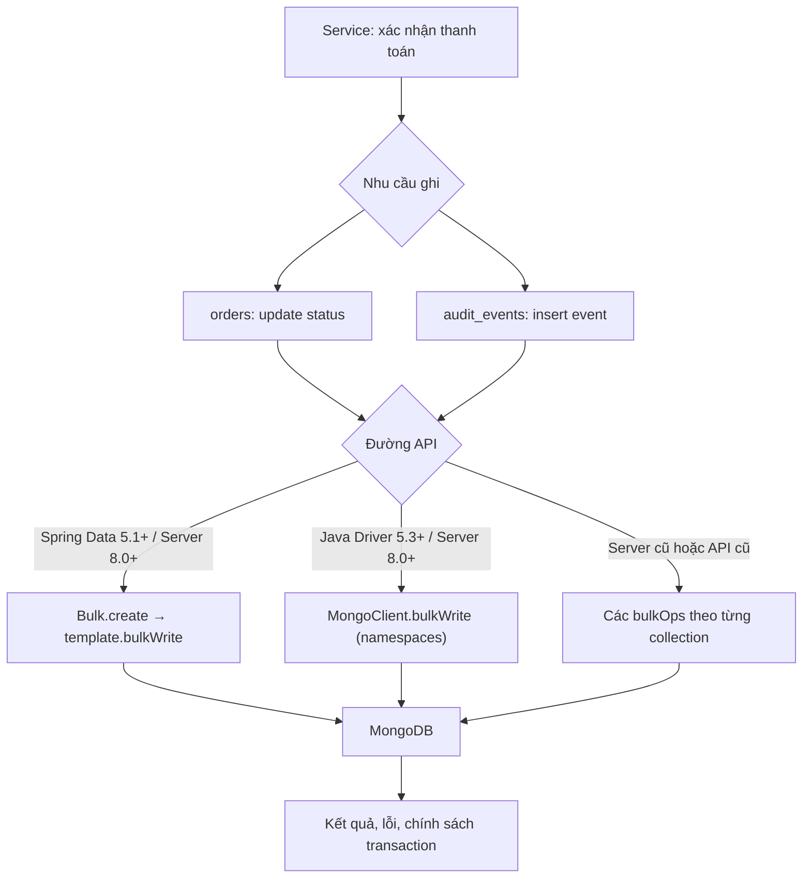

# Bulk nhiều collection trong phiên bản server và API hỗ trợ

Trong **Spring Data MongoDB**, “bulk write” thường được hiểu là gom nhiều lệnh `insert`, `update` hoặc `delete` vào một đợt xử lý để giảm overhead gọi MongoDB. Tuy nhiên, có **hai phạm vi khác nhau**: bulk ghi vào **một collection** và bulk ghi qua **nhiều collection / namespace**. Không phải mọi phiên bản MongoDB Server, Java Driver và Spring Data đều hỗ trợ hai phạm vi giống nhau.

Bài này thuộc chương **Ghi hàng loạt** của module **SPRING_DATA_MONGODB**. Trọng tâm là điều kiện phiên bản, cách chọn `MongoTemplate.bulkOps(...)` và `MongoTemplate.bulkWrite(Bulk, BulkWriteOptions)`, cách dùng `MongoClient.bulkWrite(...)` của Java Driver, semantics ordered/unordered, giới hạn kết quả ghi, transaction, retry và integration test. Các khía cạnh mapping document, repository, index, reactive access và chẩn đoán hiệu năng được liên hệ trực tiếp với tình huống ghi hàng loạt.

## 1. Bài toán: cập nhật orders và ghi audit_events

Giả sử một hệ thống đơn hàng có hai collection trong database `shop`:

```javascript
// shop.orders
{
  _id: ObjectId("674000000000000000000101"),
  tenant_id: "T1",
  status: "NEW",
  total_vnd: NumberLong("350000")
}

// shop.audit_events
{
  _id: ObjectId("674000000000000000000201"),
  tenant_id: "T1",
  order_id: ObjectId("674000000000000000000101"),
  kind: "ORDER_PAID",
  createdAt: ISODate("2026-11-20T02:00:00Z")
}
```

Một luồng nghiệp vụ cần:

1. Đổi trạng thái đơn hàng `NEW → PAID` trong `shop.orders`, có lọc theo tenant.
2. Tạo sự kiện audit `ORDER_PAID` trong `shop.audit_events`.
3. Theo dõi số thao tác thành công, xử lý lỗi và quyết định có cần **nguyên tử trên cả hai collection** hay không.

Nếu gửi hai lệnh ghi độc lập, ứng dụng có thể phải chịu hai lần gọi cơ sở dữ liệu. Một bulk đa collection có thể giảm round trip, nhưng **chỉ gom vào một lời gọi không đồng nghĩa hai thay đổi sẽ cùng thành công hoặc cùng rollback**.



**Namespace** là tên đầy đủ dạng `database.collection`, ví dụ `shop.orders` hoặc `shop.audit_events`. Một `MongoClient` có thể thao tác với các namespace trong cùng deployment phù hợp; còn `MongoTemplate` gắn với một `MongoDatabaseFactory` và thường một database đã cấu hình. Không nên nhầm namespace với loại entity Java.

## 2. Ma trận phiên bản và ba đường API

Điểm mốc lớn nhất là **MongoDB Server 8.0**: bản này bổ sung lệnh `bulkWrite` cấp server để nhận các thao tác trên **nhiều namespace** trong một request. Các server cũ hơn có bulk ghi cho **một collection** nhưng chưa có lệnh đa namespace này.

| Lớp/API | Phạm vi bulk | Yêu cầu để dùng |
| --- | --- | --- |
| `MongoTemplate.bulkOps(BulkMode, Entity.class)` | **Một collection** cho mỗi builder | API Spring Data MongoDB lâu đời; dùng được với server cũ có hỗ trợ collection bulk |
| `MongoCollection.bulkWrite(List<WriteModel<...>>)` | **Một collection** | MongoDB Java Driver collection API, không bắt buộc server 8.0 |
| `MongoTemplate.bulkWrite(Bulk, BulkWriteOptions)` | Một hoặc **nhiều collection** theo cấu hình builder | API **Spring Data MongoDB 5.1+**; khi nhắm **nhiều collection** cần **MongoDB Server 8.0+** |
| `MongoClient.bulkWrite(List<ClientNamespacedWriteModel>)` | **Nhiều collection**, có thể thuộc **nhiều database trong cùng cluster** | Java Sync Driver **5.3+** và **MongoDB Server 8.0+** |
| `Mongo.bulkWrite(...)` trong mongosh | **Nhiều namespace** | MongoDB Server 8.0+ và mongosh hỗ trợ phương thức này |

**Đừng chỉ kiểm tra phiên bản Spring Boot.** Kiểm tra dependency Spring Data MongoDB thực tế, phiên bản MongoDB Java Driver trên classpath, và phiên bản **server mà client đang kết nối**. API có thể biên dịch trên driver mới nhưng thất bại khi server không hỗ trợ lệnh.

Trong Spring Data 5.1+, API `bulkWrite(Bulk, ...)` có thể nhắm một collection và sử dụng đường tương thích với server cũ; điểm **bắt buộc 8.0+ là tính năng nhiều collection**. Với những dự án chưa nâng Spring Data, có thể vẫn dùng `bulkOps` theo từng collection.

Ví dụ kiểm tra server trong mongosh:

```javascript
db.version();
db.adminCommand({ buildInfo: 1 }).version;
```

Kiểm tra dependency từ hệ thống build đang sử dụng (Gradle/Maven) và đối chiếu với Javadoc **đúng phiên bản**, không sao chép signature của release mới vào codebase cũ.

## 3. Collection-level bulk trong Spring Data: bulkOps(...)

API truyền thống bắt đầu bằng một `BulkOperations` được **gắn sẵn với một entity type hoặc collection name**:

```java
import org.springframework.data.mongodb.core.BulkOperations;
import org.springframework.data.mongodb.core.MongoTemplate;
import org.springframework.data.mongodb.core.query.Criteria;
import org.springframework.data.mongodb.core.query.Query;
import org.springframework.data.mongodb.core.query.Update;
import com.mongodb.bulk.BulkWriteResult;

// template đã được inject vào service.
BulkWriteResult result = template.bulkOps(
        BulkOperations.BulkMode.ORDERED,
        PurchaseOrder.class
    )
    .updateOne(
        Query.query(Criteria.where("tenantId").is("T1")
                            .and("status").is("NEW")),
        new Update().set("status", "PAID")
    )
    .execute();
```

`PurchaseOrder.class` xác định collection `orders` và metadata ánh xạ. Mọi thao tác được ghép vào builder trên đều nhắm **cùng collection orders**. Thêm một model `AuditEvent` vào builder ấy không tự chuyển target sang `audit_events`.

Nếu cần cập nhật `orders` rồi thêm `audit_events` với API cũ, thông thường phải tạo **hai bulk builders/lời gọi riêng**:

```java
template.bulkOps(BulkOperations.BulkMode.ORDERED, PurchaseOrder.class)
    .updateOne(orderFilter, new Update().set("status", "PAID"))
    .execute();

template.bulkOps(BulkOperations.BulkMode.ORDERED, AuditEvent.class)
    .insert(auditEvent)
    .execute();
```

`orderFilter` và `auditEvent` trong ví dụ là các biến nghiệp vụ đã dựng trước đó. Hai lần `execute()` không được tự gom thành một request đa collection, kể cả khi chúng chạy kế tiếp trong cùng service.

### BulkOperations một collection vẫn có giá trị

Đây vẫn là API phù hợp khi một tác vụ nhập 50.000 products vào **một collection**, cập nhật một tập documents có cùng schema, hoặc khi ứng dụng chạy trên server cũ hơn 8.0. Không phải cứ có API mới là phải chuyển toàn bộ `bulkOps` cũ: chọn công cụ theo phạm vi và độ tương thích cần thiết.

## 4. Chuẩn bị entity cho Spring Data multi-collection bulk

Ta định nghĩa hai domain type riêng:

```java
import org.bson.types.ObjectId;
import org.springframework.data.annotation.Id;
import org.springframework.data.mongodb.core.mapping.Document;
import org.springframework.data.mongodb.core.mapping.Field;

@Document("orders")
public class PurchaseOrder {
    @Id
    private ObjectId id;

    @Field("tenant_id")
    private String tenantId;

    private String status;

    @Field("total_vnd")
    private long totalVnd;

    public PurchaseOrder() {}

    public PurchaseOrder(
            ObjectId id, String tenantId,
            String status, long totalVnd) {
        this.id = id;
        this.tenantId = tenantId;
        this.status = status;
        this.totalVnd = totalVnd;
    }

    public ObjectId getId() { return id; }
    public String getTenantId() { return tenantId; }
    public String getStatus() { return status; }
    public long getTotalVnd() { return totalVnd; }
}
```

```java
import java.time.Instant;
import org.bson.types.ObjectId;
import org.springframework.data.annotation.Id;
import org.springframework.data.mongodb.core.mapping.Document;
import org.springframework.data.mongodb.core.mapping.Field;

@Document("audit_events")
public class AuditEvent {
    @Id
    private ObjectId id;

    @Field("tenant_id")
    private String tenantId;

    @Field("order_id")
    private ObjectId orderId;

    private String kind;
    private Instant createdAt;

    public AuditEvent() {}

    public AuditEvent(
            ObjectId id, String tenantId,
            ObjectId orderId, String kind, Instant createdAt) {
        this.id = id;
        this.tenantId = tenantId;
        this.orderId = orderId;
        this.kind = kind;
        this.createdAt = createdAt;
    }

    public ObjectId getId() { return id; }
    public String getTenantId() { return tenantId; }
    public ObjectId getOrderId() { return orderId; }
    public String getKind() { return kind; }
    public Instant getCreatedAt() { return createdAt; }
}
```

Đây là hai **collection độc lập**. `@Document` chọn collection theo domain type; `@Id` map tới BSON `_id`; `@Field` map `tenantId` thành `tenant_id` và `orderId` thành `order_id`.

Dùng cả **tenant** và **ID** khi sửa/xóa trên ứng dụng đa tenant. Nếu audit event mang ID cố định theo một yêu cầu nghiệp vụ, unique index `_id` có thể hỗ trợ phát hiện insert lặp; việc thiết kế idempotency sẽ được bàn ở phần sau.

## 5. Spring Data MongoDB 5.1+: Bulk.create và template.bulkWrite

Đây là đường API mới giúp mô tả nhiều collection **trong một đối tượng Bulk**:

```java
import java.time.Instant;
import org.bson.types.ObjectId;
import org.springframework.data.mongodb.core.MongoTemplate;
import org.springframework.data.mongodb.core.bulk.Bulk;
import org.springframework.data.mongodb.core.bulk.BulkWriteOptions;
import org.springframework.data.mongodb.core.bulk.BulkWriteResult;
import org.springframework.data.mongodb.core.query.Criteria;
import org.springframework.data.mongodb.core.query.Query;
import org.springframework.data.mongodb.core.query.Update;

public class PaymentBulkService {
    private final MongoTemplate template;

    public PaymentBulkService(MongoTemplate template) {
        this.template = template;
    }

    public BulkWriteResult markPaidAndAudit(
            ObjectId orderId, String tenantId, ObjectId eventId) {

        Query target = Query.query(
            Criteria.where("id").is(orderId)
                .and("tenantId").is(tenantId)
                .and("status").is("NEW")
        );

        AuditEvent event = new AuditEvent(
            eventId, tenantId, orderId,
            "ORDER_PAID", Instant.now()
        );

        Bulk bulk = Bulk.create(builder -> builder
            .inCollection(PurchaseOrder.class, spec -> spec
                .updateOne(target, new Update().set("status", "PAID")))
            .inCollection(AuditEvent.class, spec -> spec
                .insert(event))
        );

        return template.bulkWrite(
            bulk, BulkWriteOptions.ordered()
        );
    }
}
```

**Đọc từng thành phần:**

- `Bulk.create(...)` tạo một tập các thao tác; bản thân nó chưa ghi MongoDB.
- `inCollection(PurchaseOrder.class, ...)` quy định các thao tác trong nhánh đó nhắm collection của `PurchaseOrder` (ở đây `orders`).
- `updateOne(target, ...)` cập nhật **tối đa một order** khớp `_id + tenant + status`; phần còn lại của document được giữ nguyên.
- `inCollection(AuditEvent.class, ...)` chuyển sang namespace collection `audit_events`; `insert(event)` thêm một document audit.
- `template.bulkWrite(bulk, BulkWriteOptions.ordered())` thực thi các thao tác theo mode ordered và trả kết quả tổng hợp.

Điều kiện phiên bản: **Spring Data MongoDB 5.1+** cho API `Bulk`; **MongoDB Server 8.0+** khi nhắm hai collection ở đây. Spring Data tự áp dụng domain mapping theo type của mỗi nhánh, thay vì buộc mọi thao tác dùng raw BSON.

### Kết quả trả về của Spring Data

`BulkWriteResult` ở `org.springframework.data.mongodb.core.bulk` **khác** `com.mongodb.bulk.BulkWriteResult` của collection-level driver:

```java
BulkWriteResult result = paymentBulkService.markPaidAndAudit(
    orderId, "T1", eventId
);

boolean acknowledged = result.acknowledged();
long inserted = result.insertCount();
long matched = result.matchedCount();
long modified = result.modifiedCount();
long deleted = result.deleteCount();
long upserted = result.upsertCount();
```

Đây là các **bộ đếm tổng hợp**, không phải bằng chứng mọi điều kiện nghiệp vụ đã đúng. Trong ví dụ, **`matched == 0` không tự tạo write error**. Nếu order không còn `NEW`, update có thể chỉ không khớp, nhưng lệnh insert audit vẫn được thực thi. Đây là lý do “ordered” **không** đồng nghĩa “chỉ insert audit nếu update order thành công”.

Đối với một workflow yêu cầu “chỉ ghi audit khi trạng thái thực sự chuyển thành PAID”, phải kết hợp **transaction và kiểm tra matchedCount** rồi abort khi invariant không đạt, hoặc thiết kế một cơ chế business/outbox đáng tin cậy khác.

## 6. Tại sao BULK không tự là một transaction?

Trong MongoDB, mỗi thao tác ghi lên **một document** có tính nguyên tử ở cấp document. Bulk write nhiều thao tác — dù **trong một request** — không mặc nhiên tạo transaction nguyên tử cho cả hai collection.

```text
Bulk ordered:
  1. UPDATE shop.orders (_id=A)           → có thể thành công
  2. INSERT shop.audit_events (_id=E)     → có thể lỗi duplicate key
  => UPDATE trước đó không tự rollback

Bulk unordered:
  Các thao tác độc lập có thể chạy không theo thứ tự đã khai báo;
  những thao tác hợp lệ có thể được thực thi dù thao tác khác lỗi.
```

Một request chỉ giảm overhead truyền lệnh. Nó không thay thế các yêu cầu của **giao dịch nhiều document** như đồng nhất thay đổi, chống ghi đè, điều kiện nghiệp vụ và phục hồi.

| Điều mong muốn | Bulk đơn thuần | Phương án cần xem xét |
| --- | --- | --- |
| Ít round trip hơn | Có thể | Bulk là lựa chọn phù hợp |
| Có cùng kết quả thành công hoặc thất bại trên hai collection | **Không mặc định** | Transaction nếu nghiệp vụ thực sự cần atomicity |
| Update chỉ khi order còn `NEW` | Có thể bằng filter | `status = NEW` + kiểm tra kết quả |
| Audit chỉ tồn tại nếu update thực sự thành công | **Không tự bảo đảm** | Transaction + kiểm tra matched; hoặc thiết kế outbox/invariant |
| Đảm bảo request retry không tạo event lặp | Không tự bảo đảm | ID/event key cố định và unique index |
| Xóa hoặc rollback lệnh trước khi lệnh sau bị lỗi | Không mặc định | Transaction hỗ trợ bởi MongoDB |

Ghi nhớ: **Ordered kiểm soát thứ tự và dừng khi lỗi ghi; transaction kiểm soát commit/rollback theo ranh giới giao dịch.** Đây là hai tính năng khác nhau.

## 7. Ordered và unordered: khác biệt về lỗi và phụ thuộc

### Ordered

`BulkWriteOptions.ordered()` yêu cầu các thao tác được xử lý theo thứ tự logic đã khai báo và dừng khi phát sinh write error. Những thao tác **đã thành công trước lỗi** vẫn có thể được giữ lại nếu không nằm trong transaction.

Ví dụ: cập nhật order trước, insert audit sau; nếu audit trùng `_id` và bị từ chối, order có thể đã là `PAID`.

### Unordered

`BulkWriteOptions.unordered()` cho phép server/driver thực thi theo thứ tự khác để tăng throughput và tiếp tục các thao tác độc lập khi có write error. **Không sử dụng unordered khi một thao tác phụ thuộc kết quả của thao tác khác trong cùng bulk.**

```java
BulkWriteResult result = template.bulkWrite(
    bulk, BulkWriteOptions.unordered()
);
```

Mode unordered thường phù hợp cho các update độc lập của những khóa riêng biệt hoặc batch import mà từng record có thể xử lý lỗi tách biệt. Nhưng *unordered* không đồng nghĩa được phép bỏ qua exception: cần thu thập các lỗi và quyết định từng record được retry/báo cáo như thế nào.

**Lưu ý trường hợp transaction:** nếu write error xảy ra trong một transaction MongoDB, transaction có thể bị abort; không được dựa vào unordered để tiếp tục và commit những thay đổi đã thất bại. Luôn kiểm tra ngữ nghĩa transaction và kiểu exception của driver đang dùng.

## 8. Dùng transaction với Spring Data khi cần hai collection cùng commit

Trong một service có **`MongoTransactionManager` đã cấu hình** và MongoDB topology hỗ trợ transaction (replica set hoặc sharded cluster phù hợp), có thể thực thi multi-collection bulk trong ranh giới `@Transactional`:

```java
import org.springframework.stereotype.Service;
import org.springframework.transaction.annotation.Transactional;
import org.springframework.data.mongodb.core.bulk.BulkWriteResult;

@Service
public class PaymentApplicationService {
    private final PaymentBulkService bulk;

    public PaymentApplicationService(PaymentBulkService bulk) {
        this.bulk = bulk;
    }

    @Transactional
    public void confirm(
            ObjectId orderId, String tenantId, ObjectId eventId) {

        BulkWriteResult result =
            bulk.markPaidAndAudit(orderId, tenantId, eventId);

        // Ví dụ Bulk chỉ có 1 updateOne order + 1 insert audit.
        if (result.matchedCount() != 1 || result.insertCount() != 1) {
            throw new IllegalStateException(
                "Đơn không còn ở trạng thái NEW hoặc audit chưa được tạo");
        }
    }
}
```

Nếu phương thức `confirm(...)` thực sự được gọi qua Spring proxy để kích hoạt `@Transactional` và các MongoDB operations tham gia cùng transaction, exception trước commit có thể khiến toàn bộ thay đổi trong transaction được rollback. Cần **đảm bảo cấu hình**, không chỉ đặt annotation rồi cho rằng chắc chắn có transaction.

Đặc biệt, điều kiện `matchedCount` là **tổng số matches của các update** trong bulk; cách kiểm tra `== 1` chỉ thích hợp vì ví dụ này có **chính một update**. Với bulk phức tạp có nhiều update, cần thiết kế cách xác định kết quả từng nghiệp vụ, không lấy một số tổng hợp để suy ra chính xác operation nào thành công.

### Cấu hình transaction tối thiểu

Ứng dụng đồng bộ có thể khai báo transaction manager:

```java
import org.springframework.context.annotation.Bean;
import org.springframework.context.annotation.Configuration;
import org.springframework.data.mongodb.MongoDatabaseFactory;
import org.springframework.data.mongodb.MongoTransactionManager;

@Configuration
class MongoTxConfiguration {
    @Bean
    MongoTransactionManager mongoTransactionManager(
            MongoDatabaseFactory factory) {
        return new MongoTransactionManager(factory);
    }
}
```

Trong một dự án có nhiều transaction manager hoặc nhiều database factory, cần chọn đúng manager và ngữ cảnh; tránh nhầm transaction của RDBMS với MongoDB. Với distributed workflows liên hệ nhiều hệ thống ngoài MongoDB (thanh toán, email, Kafka…), transaction MongoDB không tự bao trùm các tác dụng bên ngoài.

**Không mở transaction dài chỉ để tiết kiệm network.** Nếu các thao tác thực sự độc lập, multi-collection bulk không transaction có thể là phương án nhẹ hơn. Nếu cần event thật sự phản ánh thay đổi đơn hàng, hãy đảm bảo business invariant bằng transaction hoặc outbox pattern được thiết kế có kiểm soát.

## 9. Java Driver 5.3+: MongoClient.bulkWrite nhiều namespace

Nếu ứng dụng cần ghi trực tiếp vào **nhiều database/collection trong cùng cluster** hoặc không dùng `Bulk` abstraction của Spring Data, Java Sync Driver từ **5.3** cung cấp `MongoClient.bulkWrite(...)` với danh sách `ClientNamespacedWriteModel`.

Ví dụ ghi vào `shop.orders` và `shop.audit_events` bằng **BSON Document**:

```java
import java.time.Instant;
import java.util.Date;
import java.util.List;

import com.mongodb.MongoNamespace;
import com.mongodb.client.MongoClient;
import com.mongodb.client.model.Filters;
import com.mongodb.client.model.Updates;
import com.mongodb.client.model.bulk.ClientBulkWriteResult;
import com.mongodb.client.model.bulk.ClientNamespacedWriteModel;
import org.bson.Document;
import org.bson.types.ObjectId;

MongoNamespace orders = new MongoNamespace("shop", "orders");
MongoNamespace audit = new MongoNamespace("shop", "audit_events");

ObjectId orderId = new ObjectId("674000000000000000000101");
ObjectId eventId = new ObjectId();

List<ClientNamespacedWriteModel> writes = List.of(
    ClientNamespacedWriteModel.updateOne(
        orders,
        Filters.and(
            Filters.eq("_id", orderId),
            Filters.eq("tenant_id", "T1"),
            Filters.eq("status", "NEW")
        ),
        Updates.set("status", "PAID")
    ),
    ClientNamespacedWriteModel.insertOne(
        audit,
        new Document("_id", eventId)
            .append("tenant_id", "T1")
            .append("order_id", orderId)
            .append("kind", "ORDER_PAID")
            .append("createdAt", Date.from(Instant.now()))
    )
);

// mongoClient là MongoClient sync được inject/tạo ở nơi quản lý lifecycle.
ClientBulkWriteResult result = mongoClient.bulkWrite(writes);
```

Trái với `template.bulkWrite`, đường **native driver** trên sử dụng **tên BSON thật**: `tenant_id`, `order_id`, `_id`. Nó **không tự gọi MappingMongoConverter, @Field, auditing callback hoặc @Version của Spring Data**. Khi build BSON thủ công, phải tự bảo đảm kiểu ID, ngày giờ, validation, phân quyền và chiến lược idempotency.

Ví dụ này dùng constructor `MongoNamespace("shop", "orders")`; có thể thay `"shop"` bằng database thứ hai trên **cùng MongoDB deployment** nếu người dùng được cấp quyền tương ứng và server hỗ trợ. Một `MongoClient.bulkWrite` **không phải distributed transaction giữa nhiều cluster độc lập**.

Theo mặc định các API driver có chế độ ordered, và driver có thể cung cấp các tùy chọn client bulk riêng. Không trộn type `ClientBulkWriteResult` với `com.mongodb.bulk.BulkWriteResult` hoặc type `BulkWriteResult` của Spring Data: đây là các lớp riêng cho hai cấp API.

## 10. MongoDB 8.0: lệnh bulkWrite và mongosh

Ở cấp server, lệnh mới nhận:

- `ops`: danh sách các insert/update/delete, mỗi thao tác chỉ định **chỉ số namespace**.
- `nsInfo`: danh sách các namespace ứng với chỉ số đó.
- Các tùy chọn như `ordered`, write concern, comment, v.v.

Ví dụ lệnh minh họa ở mức thấp:

```javascript
db.adminCommand({
  bulkWrite: 1,
  ops: [
    {
      update: 0,
      filter: {
        _id: ObjectId("674000000000000000000101"),
        tenant_id: "T1",
        status: "NEW"
      },
      updateMods: { $set: { status: "PAID" } },
      multi: false
    },
    {
      insert: 1,
      document: {
        _id: ObjectId("674000000000000000000201"),
        tenant_id: "T1",
        order_id: ObjectId("674000000000000000000101"),
        kind: "ORDER_PAID"
      }
    }
  ],
  nsInfo: [
    { ns: "shop.orders" },
    { ns: "shop.audit_events" }
  ],
  ordered: true
});
```

Phần tử `ops[0].update = 0` tham chiếu `nsInfo[0]`; `ops[1].insert = 1` tham chiếu `nsInfo[1]`. Trên ứng dụng Java, **ưu tiên API driver/Spring Data** để driver quản lý giới hạn batch, mã hóa BSON, lỗi và kết quả thay vì xây lệnh `db.adminCommand` thủ công.

Mongosh với MongoDB 8.0+ còn có đường tiện ích `Mongo.bulkWrite(...)`, ví dụ:

```javascript
db.getMongo().bulkWrite(
  [
    {
      namespace: "shop.orders",
      name: "updateOne",
      filter: {
        _id: ObjectId("674000000000000000000101"),
        tenant_id: "T1"
      },
      update: { $set: { status: "PAID" } }
    },
    {
      namespace: "shop.audit_events",
      name: "insertOne",
      document: {
        _id: ObjectId("674000000000000000000201"),
        tenant_id: "T1",
        kind: "ORDER_PAID"
      }
    }
  ],
  { ordered: true }
);
```

**Đừng nhầm `Mongo.bulkWrite(...)` với `db.collection.bulkWrite(...)`**: phương thức trên `db.collection` chỉ xử lý một collection, kể cả khi server là 8.0+. Trong một transaction mở bằng mongosh, tài liệu MongoDB yêu cầu dùng API gắn với session (`Session.bulkWrite(...)`) để thao tác tham gia đúng session.

## 11. Reactive bulkWrite trong Spring Data

Từ API Spring Data MongoDB hỗ trợ multi-collection bulk, `ReactiveMongoTemplate` cũng có phương thức `bulkWrite(Bulk, BulkWriteOptions)` trả publisher:

```java
import org.springframework.data.mongodb.core.ReactiveMongoTemplate;
import org.springframework.data.mongodb.core.bulk.Bulk;
import org.springframework.data.mongodb.core.bulk.BulkWriteOptions;
import org.springframework.data.mongodb.core.bulk.BulkWriteResult;
import reactor.core.publisher.Mono;

Mono<BulkWriteResult> writeReactively(
        ReactiveMongoTemplate template,
        PurchaseOrder order,
        AuditEvent event) {

    Bulk bulk = Bulk.create(builder -> builder
        .inCollection(PurchaseOrder.class, spec -> spec.insert(order))
        .inCollection(AuditEvent.class, spec -> spec.insert(event))
    );

    return template.bulkWrite(bulk, BulkWriteOptions.ordered());
}
```

Đoạn này minh họa **hai insert độc lập**. Nó sẽ tạo lỗi duplicate key nếu `_id` của entity đã tồn tại. Cũng như đồng bộ, multi-collection trong ví dụ cần **server 8.0+** và Spring Data đủ mới.

- `Mono<BulkWriteResult>` mô tả công việc; truy vấn thường chạy **khi được subscribe**.
- Không gọi `block()` trong WebFlux event loop hoặc tự `subscribe()` rồi đánh mất lỗi.
- Transaction reactive cần `ReactiveMongoTransactionManager` và Reactor Context được truyền trong cùng publisher chain.
- Nếu cần chỉ insert audit sau khi update thành công, không thể dựa vào hình thức `Mono` tự tạo thứ tự nghiệp vụ; phải thiết kế invariant và kiểm tra kết quả như đường đồng bộ.

## 12. Giới hạn kích thước batch và round trip thực tế

Lợi ích dễ thấy của multi-collection bulk là giảm overhead **khi nhiều thao tác được gửi chung**. Tuy nhiên, **một lời gọi Java không luôn tương đương chính xác một wire message** với mọi kích thước input:

- MongoDB có giới hạn `maxWriteBatchSize`, `maxBsonObjectSize` và `maxMessageSizeBytes`.
- Driver có trách nhiệm chia input thành các lệnh/batch phù hợp khi vượt giới hạn; nhiều lệnh có thể phát sinh từ một lần gọi API.
- Một document BSON vẫn chịu **giới hạn 16 MiB**.
- Một bulk cực lớn có thể tốn heap để dựng danh sách models, tăng thời gian xử lý lỗi và gây áp lực connection pool.
- Nếu các collection đặt trên shard khác nhau, chi phí server và mạng nội bộ còn tùy routing/placement.

**Không hứa rằng 100.000 operations luôn hoàn tất trong đúng một round trip.** Với workload rất lớn, chia theo kích thước dữ liệu (bytes), số operations và yêu cầu latency là cách thận trọng hơn.

So sánh hiệu năng cần dựa trên cùng workload, cùng write concern, cùng index, cùng topology và mức cạnh tranh. Bulk giảm chi phí điều phối; nó **không làm một update có filter không index trở nên miễn phí**.

## 13. Lỗi từng operation và kết quả từng batch

Những lỗi thường gặp:

| Lỗi | Ví dụ | Ảnh hưởng khi không có transaction |
| --- | --- | --- |
| Duplicate key `11000` | Insert audit cùng `_id` | Insert đó thất bại; thao tác trước đó có thể đã thành công |
| Schema validation | Insert thiếu field bắt buộc | Operation không hợp lệ bị từ chối |
| Cast/BSON mapping | Sai kiểu ObjectId hoặc Date | Có thể thất bại trước khi gửi hoặc khi server đánh giá |
| Unauthorized namespace | User không được ghi `shop.audit_events` | Bulk lỗi; thao tác trước có thể đã tác động |
| Write concern / timeout | Mất xác nhận từ replica hoặc mạng | Có thể không rõ một số thao tác đã áp dụng hay chưa |
| Filter không match | Order không còn `NEW` | **Không nhất thiết là write error**; update count có thể bằng 0 |

Ordered dừng ở write error đầu tiên; unordered cố tiếp tục các operation có thể thực thi. Khi lỗi xuất hiện, **không nên chỉ đọc `exception.getMessage()` rồi retry cả bulk**.

Với Java Driver client-level, lỗi có thể được biểu diễn bằng `ClientBulkWriteException` và thông tin chi tiết từng operation; với collection-level thường là `MongoBulkWriteException`. Spring Data có thể bọc hoặc chuyển đổi exception sang họ Spring DataAccessException, nên cần quan sát **cause** và error indexes theo đường thực thi.

```java
// Phác thảo xử lý theo nghiệp vụ, không nuốt lỗi:
try {
    BulkWriteResult outcome =
        template.bulkWrite(bulk, BulkWriteOptions.ordered());

    if (!outcome.acknowledged()) {
        throw new IllegalStateException("Bulk chưa được xác nhận");
    }
} catch (org.springframework.dao.DataAccessException ex) {
    // Log batch ID / namespace / logical operation index;
    // xác định những thao tác đã thành công trước khi retry.
    throw ex;
}
```

Không log payload nhạy cảm, thông tin thẻ thanh toán hoặc token truy cập. Với dữ liệu quan trọng, cần ghi nhận một **batch/job ID** và trạng thái đối soát theo từng business key.

## 14. Retry an toàn và thiết kế idempotency

Một bulk có thể thất bại **sau khi** một số thao tác được server áp dụng. Retry toàn bộ batch một cách ngây thơ có thể:

- Chèn trùng dữ liệu nếu mỗi lần tạo `_id` mới.
- Bị duplicate key nếu retry cố định ID nhưng không xử lý lỗi đã tồn tại.
- Tăng hai lần bộ đếm khi dùng `$inc`.
- Ghi audit sai dù order không đổi vì filter không còn khớp.

Chiến lược tốt hơn:

1. Mỗi business operation có **idempotency key** (ví dụ `paymentId` hoặc `eventId`) ổn định giữa các lần retry.
2. Tạo **unique index** phù hợp: `{tenant_id:1, event_key:1}` hoặc unique `_id` cho audit events.
3. Dùng `$set` và `$setOnInsert`/upsert cho những field có ý nghĩa idempotent; không dùng `$inc` khi chưa thiết kế chống lặp.
4. Chỉ retry những operation mà ứng dụng xác định được là an toàn; khi trạng thái không chắc chắn, **đối soát bằng khóa nghiệp vụ**.
5. Có chính sách xử lý cả “đã có từ trước” và “chưa có” thay vì coi tất cả duplicate key là lỗi không thể phục hồi.

Ví dụ unique index cho audit:

```javascript
db.audit_events.createIndex(
  { tenant_id: 1, event_key: 1 },
  { unique: true, name: "audit_tenant_event_key" }
);
```

Nếu entity `AuditEvent` dùng thêm `eventKey`, phải mở rộng model/mapping tương ứng; đoạn index trên minh họa thiết kế sản phẩm, không phải index có sẵn trong entity mẫu. Đừng dùng cùng một event key cho các nghiệp vụ khác nhau.

## 15. Index, mapping, lifecycle và @Version trong bulk

Bulk có thể giảm chi phí số lần gọi, nhưng hiệu năng mỗi thao tác vẫn dựa trên **filter và index**. Truy vấn update theo `_id` tận dụng index `_id`; truy vấn theo `tenant_id + status` trên nhiều đơn có thể cần compound index:

```javascript
db.orders.createIndex(
  { tenant_id: 1, status: 1 },
  { name: "orders_by_tenant_status" }
);
```

Đặc biệt đối với `BulkOperations` và các bulk APIs:

- **Lifecycle callbacks/events có giới hạn.** Đừng giả định auditing, validation hoặc các listener được chạy giống mỗi lần `repository.save(entity)`.
- **Optimistic locking không tự có đầy đủ.** Javadoc `BulkOperations` cổ điển ghi rõ các cơ chế cần kết quả từng thao tác như `@Version` **không được hỗ trợ** theo cách `save` từng entity.
- Nếu cần cập nhật dựa trên version, nên đưa **expectedVersion** vào filter và thiết kế cách kiểm tra chính xác kết quả từng business operation.
- Với API native driver, `@Field`, `@Version`, `@CreatedDate` của Spring Data không tự được áp dụng vì thao tác làm việc bằng BSON `Document`.
- **Replacement** có thể làm mất những field không có trong document thay thế; `Update.set(...)` chỉ thay field chỉ định. Lựa chọn write model phải phù hợp với ý định.

Ví dụ filter optimistic locking khi cập nhật order qua bulk:

```java
Query guarded = Query.query(
    Criteria.where("id").is(orderId)
        .and("tenantId").is("T1")
        .and("version").is(3L)
);

Update patch = new Update()
    .set("status", "PAID")
    .inc("version", 1L);

// Phải xác minh chính sách version tự động của đúng API/phiên bản,
// không tăng version hai lần nếu framework đã xử lý.
```

Một bulk trả tổng `matchedCount` không luôn cho biết operation thứ ba thất bại vì stale version; nếu ứng dụng yêu cầu phân biệt, cần lên kế hoạch về verbose per-op results, các truy vấn kiểm tra có điều kiện hoặc API phù hợp hơn.

## 16. Chọn giải pháp trên server cũ hơn 8.0

Nếu hệ thống chưa thể nâng MongoDB Server lên 8.0:

**Phương án A — hai collection-level bulks.** Chạy `bulkOps(...)` cho từng collection. Đây **không phải một request** nhưng là đường tương thích đơn giản và giữ được mapping từng entity.

```java
template.bulkOps(BulkOperations.BulkMode.ORDERED, PurchaseOrder.class)
    .updateOne(orderFilter, new Update().set("status", "PAID"))
    .execute();

template.bulkOps(BulkOperations.BulkMode.ORDERED, AuditEvent.class)
    .insert(auditEvent)
    .execute();
```

**Phương án B — transaction khi cần nguyên tử**, nếu server/topology hỗ trợ transaction. Dù vẫn là hai lệnh bulk riêng, chúng có thể tham gia **một giao dịch** nếu MongoDB/Spring transaction manager đã được cấu hình và được gọi trong đúng ranh giới. Điều đó giải quyết yêu cầu atomicity, nhưng **không đồng nghĩa chúng được truyền trong một request**.

**Phương án C — thay đổi mô hình dữ liệu.** Nếu order và audit thực chất là một aggregate rất nhỏ, có thể nhúng sự kiện hoặc trạng thái vào cùng document khi access pattern/giới hạn kích thước cho phép. Tuy nhiên, không nên nhúng toàn bộ lịch sử sự kiện vô hạn vào một document.

**Phương án D — outbox/eventual consistency.** Nếu cần đồng bộ với hệ thống bên ngoài hoặc nhiều cluster, thiết kế outbox và worker xử lý lại có idempotency có thể phù hợp hơn cố duy trì một transaction phân tán.

## 17. Kiểm thử tích hợp trên đúng server và đúng API

Một bài test thành công khi mock `MongoTemplate` **không chứng minh** server hỗ trợ multi-namespace bulk, driver có thể binding field đúng hay behavior ordered/unordered ra sao. Cần tích hợp với **MongoDB 8.0+ thật** trong môi trường test cô lập, ví dụ Testcontainers với image 8.0.x phù hợp.

### Test 1 — Spring Data multi-collection bulk đọc/ghi đúng

```java
import static org.assertj.core.api.Assertions.assertThat;

import java.time.Instant;
import org.bson.types.ObjectId;
import org.junit.jupiter.api.Test;
import org.springframework.beans.factory.annotation.Autowired;
import org.springframework.boot.test.context.SpringBootTest;
import org.springframework.data.mongodb.core.MongoTemplate;
import org.springframework.data.mongodb.core.bulk.Bulk;
import org.springframework.data.mongodb.core.bulk.BulkWriteOptions;
import org.springframework.data.mongodb.core.bulk.BulkWriteResult;
import org.springframework.data.mongodb.core.query.Criteria;
import org.springframework.data.mongodb.core.query.Query;
import org.springframework.data.mongodb.core.query.Update;

@SpringBootTest
class MultiCollectionBulkIntegrationTest {
    @Autowired MongoTemplate template;

    @Test
    void writesOrderAndAuditAcrossCollections() {
        ObjectId orderId = new ObjectId();
        ObjectId eventId = new ObjectId();
        String tenant = "test-" + orderId.toHexString();

        template.insert(new PurchaseOrder(
            orderId, tenant, "NEW", 350_000L
        ));

        AuditEvent event = new AuditEvent(
            eventId, tenant, orderId,
            "ORDER_PAID", Instant.now()
        );

        Bulk bulk = Bulk.create(builder -> builder
            .inCollection(PurchaseOrder.class, spec -> spec
                .updateOne(
                    Query.query(Criteria.where("id").is(orderId)
                        .and("tenantId").is(tenant)
                        .and("status").is("NEW")),
                    new Update().set("status", "PAID")))
            .inCollection(AuditEvent.class, spec -> spec.insert(event))
        );

        BulkWriteResult result =
            template.bulkWrite(bulk, BulkWriteOptions.ordered());

        assertThat(result.acknowledged()).isTrue();
        assertThat(result.matchedCount()).isEqualTo(1);
        assertThat(result.insertCount()).isEqualTo(1);

        PurchaseOrder changed =
            template.findById(orderId, PurchaseOrder.class);
        AuditEvent recorded =
            template.findById(eventId, AuditEvent.class);

        assertThat(changed).isNotNull();
        assertThat(changed.getStatus()).isEqualTo("PAID");
        assertThat(recorded).isNotNull();
        assertThat(recorded.getOrderId()).isEqualTo(orderId);
    }
}
```

Test giả định ứng dụng đã cấu hình repository/template và **MongoDB test deployment chạy 8.0+**. Không sử dụng database production. Để tránh data pollution, có thể dùng một database test riêng cho mỗi test suite, dọn dữ liệu theo job/test IDs hoặc để Testcontainers hủy container sau khi chạy.

### Test 2 — ordered không tự rollback

Trong một test khác trên database riêng:

1. Insert order có `status=NEW`.
2. Insert trước một audit event có `_id=E`.
3. Tạo bulk ordered gồm `update order` rồi `insert audit(_id=E)` để gây duplicate key.
4. Bắt lỗi bulk và đọc lại document order.
5. Xác minh **không thể giả định** order trở lại `NEW` khi bulk **không có transaction**; update trước lỗi có thể đã được áp dụng.

Nếu cần bảo đảm order trở lại `NEW`, viết một test tương đương **trong transaction thực sự** với MongoTransactionManager, rồi xác minh rollback. Không chạy test kiểu này trên shared database vì nó cố ý tạo lỗi và ghi trạng thái.

### Test 3 — kiểm tra tương thích phiên bản

Dùng cùng source code với cấu hình server 7.x (môi trường test riêng) để quan sát multi-namespace bulk **bị từ chối/không hỗ trợ**. Trên server 7.x, các collection-level bulks vẫn có thể hoạt động. Test version matrix giúp tránh trường hợp CI dùng MongoDB 8 nhưng production còn ở 7.x.

### Test 4 — lỗi từng operation

Tạo nhiều operations ordered và unordered trên các document test; so sánh tập kết quả sau khi có một operation duplicate key. Dùng command monitoring để quan sát số batch/command thực tế, không tự suy đoán một lần gọi API = một wire request. Đọc và đối chiếu thông tin lỗi, số successful operations và retry behavior với Java Driver/Spring Data version đang dùng.

## 18. Checklist triển khai và chẩn đoán

| Triệu chứng | Khả năng | Hướng kiểm tra |
| --- | --- | --- |
| `bulkWrite(Bulk,...)` không có trong classpath | Spring Data MongoDB chưa đủ mới | Kiểm tra phiên bản; API được giới thiệu từ 5.1 |
| `MongoClient.bulkWrite(...)` không có | MongoDB Java Driver cũ | Kiểm tra driver Sync từ 5.3 trở lên |
| Có API nhưng lỗi unsupported command | Server trước 8.0 hoặc đường kết nối tới node không hỗ trợ | Kiểm tra server version/FCV/topology |
| `BulkOperations` chỉ ghi vào một collection | Đây là phạm vi của API cổ điển | Dùng `Bulk.create` + `template.bulkWrite` hoặc driver client-level |
| Ghi order thành công, audit thất bại | Ordered không rollback lệnh trước | Transaction hoặc workflow có compensation/outbox |
| Audit được insert dù update matched=0 | Filter không match **không phải write error** | Kiểm tra invariant, abort transaction khi cần |
| Mất field sau replace | Replacement thay document, không chỉ `$set` | Dùng update operators cho partial update |
| `@Field` không được áp dụng khi dùng native driver | Driver không dùng Spring mapping | Dùng tên BSON và kiểm tra raw document |
| Performance không cải thiện | Query thiếu index, batch quá lớn, sharding hoặc write concern cao | Index/explain, metrics, command monitoring |
| Lỗi trùng key khi retry | Không có idempotency/reconciliation | Stable event key, unique index và retry có điều kiện |
| Lệnh xóa vượt phạm vi tenant | Filter quá rộng hoặc trust client input | Tenant từ auth, index và test isolation |
| Kết quả tổng không nói operation nào fail | Result tổng hợp, error handling thiếu chi tiết | Track logical operation index, log cause, verbose result khi phù hợp |

## 19. Câu hỏi tự kiểm tra

**1.** MongoDB Server từ phiên bản nào có `bulkWrite` đa namespace trong một request?  
**Đáp án:** **8.0**.

**2.** `MongoTemplate.bulkOps(BulkMode.ORDERED, PurchaseOrder.class)` có thể tự chuyển sang `audit_events` trong cùng builder không?  
**Đáp án:** không; builder cổ điển gắn với một collection.

**3.** API nào của Spring Data MongoDB hỗ trợ `Bulk.create(...).inCollection(...)`?  
**Đáp án:** `MongoTemplate.bulkWrite(Bulk, BulkWriteOptions)`, từ **Spring Data MongoDB 5.1**; multi-collection cần server **8.0+**.

**4.** Java Driver cần ít nhất phiên bản nào cho `MongoClient.bulkWrite(...)` đa namespace?  
**Đáp án:** Java Sync Driver **5.3** theo release notes, và server **8.0+**.

**5.** Nếu ordered bulk có operation thứ hai lỗi duplicate key, operation đầu có được rollback tự động không?  
**Đáp án:** không, nếu **không có transaction**. Ordered chỉ dừng lệnh sau lỗi.

**6.** `updateOne` với `status=NEW` không khớp rồi `insert audit` ở operation tiếp theo có bị chặn tự động không?  
**Đáp án:** không. Matched=0 thường không phải write error, cần quy tắc nghiệp vụ/transaction riêng.

**7.** Một lần gọi Java với danh sách rất lớn có luôn đúng một wire message không?  
**Đáp án:** không; driver có thể chia thành nhiều batch theo giới hạn server và kích thước payload.

**8.** Tại sao không thể tin Spring `@Version` và auditing callback được thực thi đầy đủ trên native `MongoClient.bulkWrite`?  
**Đáp án:** API native làm việc trực tiếp với BSON/model của driver, bỏ qua các tầng ánh xạ/callback của Spring Data.

**9.** Khi server còn 7.x nhưng hai collection phải cùng commit/rollback, chọn gì?  
**Đáp án:** có thể dùng các lệnh bulk/ghi riêng theo collection **trong một MongoDB transaction được cấu hình đúng** trên topology hỗ trợ; đó vẫn không phải bulk đa namespace một request.

**10.** Khi cần ghi các document ở **hai cluster độc lập** thì `MongoClient.bulkWrite` giải quyết được không?  
**Đáp án:** không; nó nhắm các namespace trong một deployment kết nối bởi MongoClient. Cần kiến trúc khác cho giao dịch/hệ thống phân tán.

## 20. Bài thực hành và tài liệu tham khảo

**Bài thực hành:** dựng môi trường MongoDB 8.0+ và Spring Data MongoDB 5.1+ dành riêng cho test. Tạo hai entity `PurchaseOrder`, `AuditEvent`; chạy ví dụ `Bulk.create` và kiểm tra raw BSON ở hai collection. Sau đó cố tình tạo duplicate event, so sánh ordered/unordered, chạy lại trong một transaction đúng cấu hình, và thêm kiểm thử trường hợp update matched=0. Đo số command bằng driver CommandListener, thay đổi kích thước batch, kiểm tra index của filter update, rồi đối chiếu với hai lần `bulkOps` cổ điển.

**Tài liệu chính thức để đối chiếu API theo phiên bản:**

- [MongoDB Server — Bulk Write Operations](https://www.mongodb.com/docs/v8.0/core/bulk-write-operations/)
- [MongoDB Server — lệnh bulkWrite (8.0)](https://www.mongodb.com/docs/v8.0/reference/command/bulkwrite/)
- [MongoDB Java Sync Driver — Bulk Write Operations](https://www.mongodb.com/docs/drivers/java/sync/current/crud/bulk/)
- [MongoDB Java Driver — release notes 5.3](https://www.mongodb.com/docs/drivers/java/sync/current/reference/release-notes/)
- [Spring Data MongoDB — Saving, Updating, and Removing Documents](https://docs.spring.io/spring-data/mongodb/reference/mongodb/template-crud-operations.html)
- [Spring Data MongoDB — BulkOperations API](https://docs.spring.io/spring-data/mongodb/reference/api/java/org/springframework/data/mongodb/core/BulkOperations.html)

**Kết luận:** ghi bulk nhiều collection **phụ thuộc đồng thời vào phiên bản server và API phía Java**. Với MongoDB 8.0+ và Spring Data MongoDB 5.1+, `Bulk.create` kết hợp `template.bulkWrite(...)` cho phép mô tả các thao tác qua nhiều collection; Java Driver 5.3+ có `MongoClient.bulkWrite(...)` cho nhiều namespace. Với hệ thống cũ, `bulkOps(...)` vẫn hữu ích nhưng **theo một collection**. Dù dùng API nào, **bulk không tự là transaction**: phải tự thiết kế ordered/unordered, điều kiện nghiệp vụ, idempotency, index, kết quả ghi và kiểm thử đúng phiên bản để tránh biến tối ưu round trip thành lỗi nhất quán dữ liệu.

