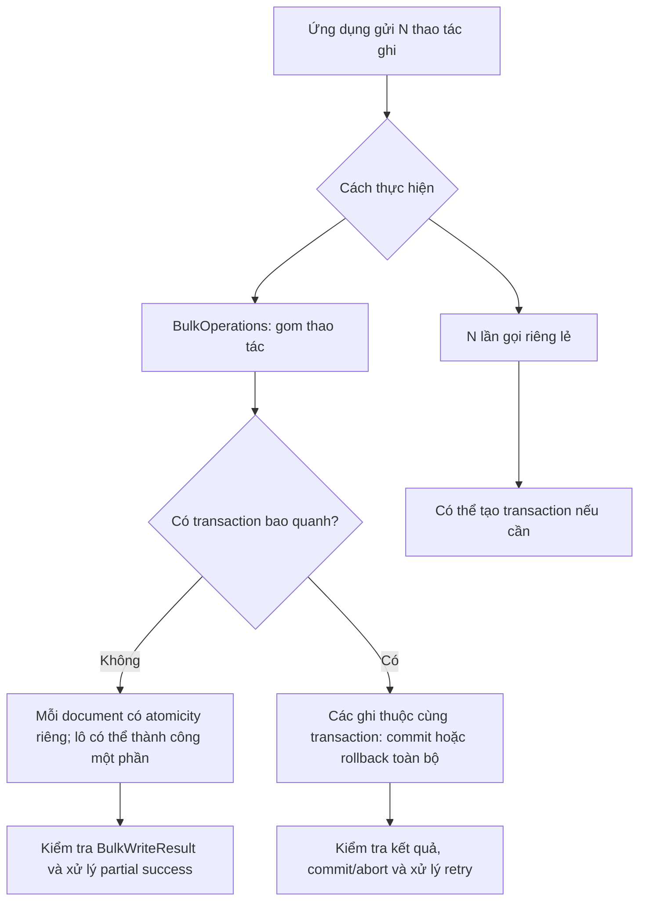

# Phân biệt giảm lượt truyền lệnh với giao dịch nguyên tử toàn bộ lô

## 1. Một lô ghi nhanh hơn không đồng nghĩa một giao dịch

Trong **Spring Data MongoDB**, tính năng **bulk write** gom nhiều yêu cầu ghi vào một đợt thực thi: thêm document, cập nhật document, upsert hoặc xóa document. Nó giúp giảm overhead khi ứng dụng phải thực hiện rất nhiều thao tác ghi độc lập. Tuy nhiên, một lô bulk **không tự động** có ngữ nghĩa *all-or-nothing*: nếu thao tác thứ ba lỗi, những thao tác đã thành công trước đó có thể vẫn tồn tại.

Giả sử hệ thống nhập ba sản phẩm:

```javascript
[
  { _id: "product-A", tenantId: "shop-01", sku: "A", stock: 10 },
  { _id: "product-A", tenantId: "shop-01", sku: "DUPLICATE", stock: 5 },
  { _id: "product-C", tenantId: "shop-01", sku: "C", stock: 8 }
]
```

Hai document đầu có cùng `_id`. Vì MongoDB bảo đảm `_id` duy nhất, thao tác chèn thứ hai sẽ gây lỗi duplicate key. Câu hỏi quan trọng không chỉ là “bulk có nhanh không?” mà còn là:

- Nếu **ordered bulk**, document `product-A` đã chèn có bị tự động rollback không?
- Nếu **unordered bulk**, thao tác chèn `product-C` có thể vẫn được thực hiện không?
- Nếu yêu cầu nghiệp vụ là “nhập đủ ba document hoặc không nhập cái nào”, phải làm gì?
- Nếu bulk không ném lỗi nhưng có một update **không match** document nào, làm sao phát hiện lô không hoàn tất yêu cầu nghiệp vụ?

Đáp án ngắn: **bulk write tối ưu việc gửi và thực hiện các thao tác; giao dịch đa document mới cung cấp ranh giới commit/abort cho toàn bộ nhóm thao tác được đặt trong transaction**. Hai khái niệm có thể kết hợp, nhưng không thay thế nhau.

Bài thuộc chương **Ghi hàng loạt** của module **SPRING_DATA_MONGODB**. Nội dung tập trung vào `MongoTemplate.bulkOps`, `BulkOperations`, chế độ `ORDERED`/`UNORDERED`, kết quả/ngoại lệ, bảo đảm nguyên tử trên một document, cấu hình MongoDB transaction, idempotency, nhánh reactive, kiểm thử và chẩn đoán hiệu năng.

## 2. Ba tầng bảo đảm thường bị nhầm lẫn



| Khái niệm | Phạm vi bảo đảm | Không bảo đảm |
| --- | --- | --- |
| **Batching / bulk write** | Gom nhiều thao tác để giảm chi phí gọi và hỗ trợ thực thi theo lô | Mọi document cùng thành công hoặc cùng rollback |
| **Atomicity của một document** | Một lệnh cập nhật hợp lệ trên một document được áp dụng nguyên tử | Tất cả document trong `updateMany` hay bulk cùng nguyên tử |
| **Multi-document transaction** | Các thao tác trong cùng transaction được commit hoặc abort như một nhóm | Tự bảo đảm idempotency của request hay rollback dịch vụ ngoài MongoDB |
| **Write concern** | Mức xác nhận ghi/durability theo cấu hình MongoDB | Tạo ra giao dịch all-or-nothing trên toàn bulk |
| **Ordered bulk** | Thực hiện các thao tác theo thứ tự và dừng khi gặp lỗi ghi trong lô, theo ngữ nghĩa bulk | Rollback các thao tác đã thành công |
| **Unordered bulk** | Không bảo đảm thứ tự thực hiện; tiếp tục những thao tác có thể thực hiện khi có lỗi riêng lẻ | Mọi thao tác đều thành công, hoặc kết quả áp dụng theo thứ tự đầu vào |

**Nguyên tắc:** Đừng suy luận từ “một lần gọi `bulk.execute()`” thành “một giao dịch”. Driver có thể phải chia một bulk lớn thành nhiều batch/command theo giới hạn server và kích thước BSON. Ngay cả khi chỉ gửi một command, một bulk thông thường vẫn không phải transaction đa document.

## 3. ORDERED và UNORDERED khi một thao tác thất bại

### 3.1. Ordered: dừng tại lỗi, không tự hoàn tác phần đã ghi

Giả sử collection thử đang rỗng. Trong mongosh:

```javascript
db.bulk_demo_ordered.insertMany(
  [
    { _id: "A", value: 1 },
    { _id: "A", value: 2 }, // Trùng _id -> duplicate key.
    { _id: "C", value: 3 }
  ],
  { ordered: true }
);
```

Lệnh báo lỗi duplicate key ở thao tác thứ hai. Trong tình huống minh họa:

- Document `A` của thao tác đầu đã được chèn.
- Thao tác thứ hai thất bại vì `_id` trùng.
- Thao tác thứ ba không được thực hiện vì ordered bulk dừng tại lỗi.
- **Document `A` vẫn tồn tại** nếu không có transaction bao quanh.

```javascript
db.bulk_demo_ordered.find().sort({ _id: 1 });
// Có thể quan sát: { _id: "A", value: 1 }
```

Không dùng chế độ `ORDERED` như cơ chế rollback. Nó chỉ thể hiện ràng buộc **thứ tự thực hiện và dừng khi lỗi**, không phải tính nguyên tử của toàn danh sách.

### 3.2. Unordered: có thể tiếp tục các thao tác độc lập

Với collection thử khác và cùng dữ liệu:

```javascript
db.bulk_demo_unordered.insertMany(
  [
    { _id: "A", value: 1 },
    { _id: "A", value: 2 }, // Trùng _id.
    { _id: "C", value: 3 }
  ],
  { ordered: false }
);
```

Lệnh vẫn có thể báo lỗi duplicate key, nhưng MongoDB có thể thực hiện các thao tác còn lại. Nếu không có lỗi nào khác, collection thử thường có cả `A` và `C`. **Không được dựa vào thứ tự thực thi hay thứ tự các document được ghi trong unordered bulk.**

| Tình huống | Ordered, ngoài transaction | Unordered, ngoài transaction |
| --- | --- | --- |
| Một thao tác giữa lô gặp duplicate key | Dừng tại lỗi theo thứ tự thao tác | Các thao tác độc lập khác có thể tiếp tục |
| Thao tác thành công trước lỗi | Đã ghi và không tự rollback | Đã ghi và không tự rollback |
| Có thể có partial success | Có | Có |
| Phù hợp khi các thao tác phụ thuộc thứ tự | Có thể phù hợp, nhưng vẫn không nguyên tử toàn lô | Không phù hợp nếu logic phụ thuộc thứ tự |
| Bảo đảm all-or-nothing | **Không** | **Không** |

Với dữ liệu phụ thuộc nhau (ví dụ tạo account rồi dùng account đó làm nguồn cập nhật), cần thiết kế thứ tự, điều kiện và giao dịch phù hợp. Unordered không phải lựa chọn an toàn chỉ vì thông lượng có thể tốt hơn.

### 3.3. Bulk có thể lỗi ngoài duplicate key

Các lỗi khác gồm schema validation, vi phạm unique index, kiểu dữ liệu không hợp lệ cho `$inc`, quyền ghi không đủ, timeout, mạng bị ngắt, giới hạn kích thước document hoặc xung đột ghi. Một số lỗi khiến driver/server không thể tiếp tục lô bình thường; **không nên viết logic ứng dụng giả định mọi lỗi unordered đều cho phép phần còn lại chạy**.

Khi có exception, cần xem loại lỗi và những thao tác nào đã được xác nhận thành công. Với mất kết nối, ứng dụng còn phải đối mặt với trường hợp **không chắc server đã thực thi đến đâu**; xem phần idempotency và retry.

## 4. Dùng MongoTemplate.bulkOps trong Spring Data

### 4.1. Khai báo entity mẫu

```java
package example.bulk;

import org.springframework.data.mongodb.core.mapping.Document;
import org.springframework.data.mongodb.core.mapping.FieldType;
import org.springframework.data.mongodb.core.mapping.MongoId;

@Document(collection = "inventory_items")
public record InventoryItem(
    @MongoId(FieldType.STRING) String id,
    String tenantId,
    String sku,
    int stock,
    String state
) {}
```

Đường dẫn `@MongoId(FieldType.STRING)` thể hiện chủ đích lưu ID dưới BSON String, dù chuỗi có thể mang hình thức giống ObjectId. Trong typed query của `MongoTemplate`, thuộc tính `id` được ánh xạ sang field BSON `_id`.

Định nghĩa dữ liệu một yêu cầu trừ tồn kho:

```java
package example.bulk;

public record StockReservation(
    String itemId,
    int quantity
) {}
```

Trong hệ thống đa tenant, `tenantId` phải đến từ security context đáng tin cậy. Client có thể gửi item ID và quantity, nhưng không được tự khẳng định mình sở hữu tenant đó.

### 4.2. BulkOperations và BulkMode

```java
import org.springframework.data.mongodb.core.BulkOperations;
import org.springframework.data.mongodb.core.BulkOperations.BulkMode;

BulkOperations bulk = mongoTemplate.bulkOps(
    BulkMode.ORDERED, InventoryItem.class
);
```

Sau đó lần lượt thêm các operation vào builder:

```java
bulk.insert(new InventoryItem(
    "item-101", "shop-01", "SKU-A", 10, "ACTIVE"
));

bulk.updateOne(
    Query.query(
        Criteria.where("id").is("item-102")
            .and("tenantId").is("shop-01")
    ),
    new Update().inc("stock", 3)
);

bulk.upsert(
    Query.query(
        Criteria.where("id").is("item-103")
            .and("tenantId").is("shop-01")
    ),
    new Update()
        .setOnInsert("sku", "SKU-C")
        .setOnInsert("tenantId", "shop-01")
        .setOnInsert("state", "ACTIVE")
        .inc("stock", 1)
);

bulk.remove(
    Query.query(
        Criteria.where("id").is("item-legacy")
            .and("tenantId").is("shop-01")
    )
);

com.mongodb.bulk.BulkWriteResult result = bulk.execute();
```

Đoạn mã là **minh họa một lô thao tác khác loại**, cần các import `Query`, `Criteria` và `Update` từ `org.springframework.data.mongodb.core.query`. Nó không phải một transaction: operation được thêm vào `BulkOperations` chưa làm thay đổi database; các thao tác được gửi khi gọi `execute()`.

Ở ứng dụng thật, tránh dùng `upsert` không có khóa duy nhất rõ ràng để tạo dữ liệu nghiệp vụ: nhiều request đồng thời có thể cùng cho rằng bản ghi chưa tồn tại. Cần unique index phù hợp với identity dữ liệu, xử lý duplicate key và kiểm soát retry.

### 4.3. Bulk không nhất thiết nhanh hơn mọi kiểu ghi

Bulk có lợi khi nhiều thao tác **có thể được gộp**, giảm overhead giao tiếp và tăng thông lượng trên workload phù hợp. Nhưng nếu mỗi lô chỉ có một update đơn giản, hoặc nếu lô rất lớn gây tranh chấp index/document, bulk có thể không cải thiện đáng kể latency. Phải đo bằng workload thực tế chứ không dựa vào số method Java.

## 5. Ví dụ chính: trừ tồn kho của nhiều sản phẩm bằng bulk

Giả sử người dùng đặt một đơn có ba sản phẩm khác nhau. Muốn giảm stock của từng sản phẩm nếu còn đủ, nhưng **chưa** yêu cầu all-or-nothing ở bước này.

### 5.1. Điều kiện an toàn trên từng document

Với mỗi sản phẩm:

```javascript
db.inventory_items.updateOne(
  {
    _id: "item-101",
    tenantId: "shop-01",
    state: "ACTIVE",
    stock: { $gte: 2 }
  },
  { $inc: { stock: -2 } }
);
```

MongoDB kiểm tra điều kiện và giảm stock trong một thao tác nguyên tử **cho document đó**. Điều kiện `stock >= 2` giúp tránh stock âm, nhưng nếu một sản phẩm không đủ hàng, nó chỉ làm **operation tương ứng không match**; các update sản phẩm khác trong bulk vẫn có thể thành công.

### 5.2. Service triển khai bulk có kết quả tổng hợp

```java
package example.bulk;

import java.util.HashSet;
import java.util.List;
import java.util.Set;
import com.mongodb.bulk.BulkWriteResult;
import org.springframework.data.mongodb.core.BulkOperations;
import org.springframework.data.mongodb.core.BulkOperations.BulkMode;
import org.springframework.data.mongodb.core.MongoTemplate;
import org.springframework.data.mongodb.core.query.Criteria;
import org.springframework.data.mongodb.core.query.Query;
import org.springframework.data.mongodb.core.query.Update;
import org.springframework.stereotype.Service;

@Service
public class BulkStockService {

    private final MongoTemplate template;

    public BulkStockService(MongoTemplate template) {
        this.template = template;
    }

    public record BulkSummary(
        int requested,
        long matched,
        long modified
    ) {}

    public BulkSummary reserveBestEffort(
            String authorizedTenantId,
            List<StockReservation> reservations) {

        validate(authorizedTenantId, reservations);

        BulkOperations bulk = buildBulk(
            authorizedTenantId, reservations
        );
        BulkWriteResult result = bulk.execute();

        if (!result.wasAcknowledged()) {
            throw new IllegalStateException(
                "Không có xác nhận kết quả bulk write"
            );
        }

        return new BulkSummary(
            reservations.size(),
            result.getMatchedCount(),
            result.getModifiedCount()
        );
    }

    private BulkOperations buildBulk(
            String tenantId,
            List<StockReservation> reservations) {

        BulkOperations bulk = template.bulkOps(
            BulkMode.ORDERED,
            InventoryItem.class
        );

        for (StockReservation entry : reservations) {
            Query query = Query.query(
                Criteria.where("id").is(entry.itemId())
                    .and("tenantId").is(tenantId)
                    .and("state").is("ACTIVE")
                    .and("stock").gte(entry.quantity())
            );

            Update update = new Update()
                .inc("stock", -entry.quantity());

            bulk.updateOne(query, update);
        }

        return bulk;
    }

    private static void validate(
            String tenantId, List<StockReservation> reservations) {

        if (tenantId == null || tenantId.isBlank()) {
            throw new IllegalArgumentException("tenantId không hợp lệ");
        }
        if (reservations == null || reservations.isEmpty()) {
            throw new IllegalArgumentException("Danh sách rỗng");
        }
        if (reservations.size() > 100) {
            throw new IllegalArgumentException(
                "Tối đa 100 sản phẩm trong một lô"
            );
        }

        Set<String> ids = new HashSet<>();
        for (StockReservation entry : reservations) {
            if (entry == null
                    || entry.itemId() == null
                    || entry.itemId().isBlank()
                    || entry.quantity() <= 0) {
                throw new IllegalArgumentException(
                    "itemId và quantity phải hợp lệ"
                );
            }
            if (!ids.add(entry.itemId())) {
                throw new IllegalArgumentException(
                    "Lô minh họa không cho phép itemId trùng"
                );
            }
        }
    }
}
```

Trong service này, `buildBulk` và `validate` là phương thức private. Chúng giúp bảo đảm ví dụ có **mỗi itemId đúng một lần**, vì `matchedCount` của bulk được tính theo **các operation match**, không phải tự động đếm số document duy nhất.

Với mã đang viết:

- **Một document:** `$inc` và điều kiện `stock >= quantity` có tính nguyên tử.
- **Nhiều document:** kết quả có thể chỉ một phần sản phẩm đã trừ stock.
- **Không có lỗi nhưng matched ít hơn requested:** ít nhất một operation không tìm thấy document thỏa điều kiện.
- **Có exception giữa chừng:** vẫn có thể đã sửa những document trước đó.

Hàm `reserveBestEffort` vì vậy phải được hiểu là **best effort**, không phải “đã đặt trước đủ mọi hàng”. Trước khi xác nhận đơn hàng với người dùng, ứng dụng cần quyết định xử lý những dòng không được trừ tồn kho. Nếu nghiệp vụ yêu cầu mọi dòng cùng thành công, xem phần transaction.

## 6. BulkWriteResult: có xác nhận không nghĩa là toàn bộ nghiệp vụ thành công

Kết quả của `BulkOperations.execute()` trong API đồng bộ thường là `com.mongodb.bulk.BulkWriteResult`.

```java
BulkWriteResult result = bulk.execute();

if (result.wasAcknowledged()) {
    System.out.println("inserted=" + result.getInsertedCount());
    System.out.println("matched=" + result.getMatchedCount());
    System.out.println("modified=" + result.getModifiedCount());
    System.out.println("deleted=" + result.getDeletedCount());
    System.out.println("upserts=" + result.getUpserts().size());
}
```

| Thông số | Nội dung | Điểm cần thận trọng |
| --- | --- | --- |
| `wasAcknowledged()` | Lệnh được xác nhận theo write concern | Không nói rằng mọi thao tác mong muốn đều match |
| `getInsertedCount()` | Số thao tác insert thành công được ghi nhận | Không nói gì về update bị bỏ qua |
| `getMatchedCount()` | Số lần operation update match document | Có thể bằng 0 dù không xảy ra lỗi |
| `getModifiedCount()` | Số document được ghi nhận có thay đổi | Không nhất thiết bằng matched khi update là no-op |
| `getDeletedCount()` | Số document bị xóa | Khác số operation remove nếu một operation xóa nhiều document |
| `getUpserts()` | Thông tin các upsert chèn mới được trả về | Upsert match document sẵn có không nằm trong nhóm insert mới |

Ví dụ lô gồm ba thao tác `updateOne` lên ba ID riêng:

```text
item-A: stock 10, yêu cầu trừ 2 -> match 1, stock còn 8
item-B: stock  1, yêu cầu trừ 5 -> match 0, stock vẫn 1
item-C: stock  7, yêu cầu trừ 3 -> match 1, stock còn 4

BulkWriteResult: matched=2, modified=2, không nhất thiết có exception.
```

**Điểm then chốt:** Một operation không match là kết quả hợp lệ của MongoDB update, **không phải lỗi ghi**. Do đó, transaction chỉ tự abort khi có lỗi/rollback được kích hoạt; nếu ứng dụng yêu cầu cả ba sản phẩm phải đủ stock, nó phải **tự kiểm tra matchedCount và chủ động abort** khi ít hơn số operation mong đợi.

Kết quả tổng hợp không tự liệt kê itemId nào có `matched=0`. Với API phải phản hồi chính xác từng dòng, thiết kế thêm một cơ chế lấy kết quả theo từng item hoặc workflow hai pha phù hợp; không suy đoán item lỗi chỉ từ một con số tổng.

### 6.1. Write concern và kết quả không được xác nhận

Với write concern không yêu cầu acknowledgement, một số thông tin đếm có thể không khả dụng và lời gọi accessor có thể không hợp lệ. Đừng báo hoàn thành dựa vào số liệu không được xác nhận. Chọn write concern, timeout và chính sách độ bền dữ liệu phù hợp với mức quan trọng của thao tác ghi.

Ngay cả acknowledgement thành công cũng không biến lô thành một transaction. Nó chỉ nói về xác nhận và độ bền của ghi theo cấu hình, không phải all-or-nothing trên các document.

## 7. Lỗi giữa lô: exception không có nghĩa chưa ghi gì

Đối với bulk ngoài transaction, có thể xảy ra:

```text
Operation 0: insert A -> thành công
Operation 1: insert B -> thành công
Operation 2: insert C -> duplicate key
Operation 3: update D -> chưa chạy (ORDERED)
```

Khi `execute()` ném exception, hai thao tác đầu **đã thành công**, trừ khi có transaction rollback chúng. Nếu service tự bắt ngoại lệ, trả HTTP 500 rồi client gửi lại nguyên lô, thao tác insert A/B có thể bị duplicate key ở lần sau; với `$inc`, retry mù quáng còn có nguy cơ cộng/trừ bộ đếm lần nữa.

Các ngoại lệ thường gặp tùy driver/Spring Data version gồm lỗi bulk write, duplicate key và lỗi truy cập dữ liệu được Spring chuyển đổi. Cần xem:

- Lỗi xảy ra ở operation nào, loại lỗi và message/code;
- Chế độ `ORDERED` hay `UNORDERED`;
- Thao tác nào có thể đã được server thực hiện;
- Việc lô có được chia thành nhiều batch/command hay không;
- Có transaction bao quanh hay không, và transaction đã commit/abort chưa;
- Client có nhận được xác nhận cuối cùng của server không.

Không viết:

```java
// MẪU SAI: coi exception là chứng minh mọi ghi đã rollback.
try {
    bulk.execute();
} catch (RuntimeException ex) {
    // Không được kết luận: "database chưa thay đổi gì".
}
```

Nếu không có transaction, hãy dùng chiến lược xử lý partial success: ghi nhận định danh từng thao tác, truy vấn đối chiếu kết quả, retry idempotent hoặc bù trừ theo nghiệp vụ.

## 8. Atomicity ở mức một document vẫn tồn tại trong bulk

Bulk có thể gồm các operation như:

```javascript
db.inventory_items.bulkWrite(
  [
    {
      updateOne: {
        filter: {
          _id: "item-A",
          tenantId: "shop-01",
          stock: { $gte: 2 }
        },
        update: { $inc: { stock: -2 } }
      }
    },
    {
      updateOne: {
        filter: {
          _id: "item-B",
          tenantId: "shop-01",
          stock: { $gte: 3 }
        },
        update: { $inc: { stock: -3 } }
      }
    }
  ],
  { ordered: true }
);
```

Mỗi `updateOne` ở trên đánh giá điều kiện và áp dụng cập nhật trên document tương ứng một cách nguyên tử. Điều này ngăn hai request đồng thời làm stock của **cùng một document** âm khi cả hai đều tuân thủ điều kiện. Nhưng giữa `item-A` và `item-B`, một thao tác thành công không buộc thao tác còn lại thành công.

Ngay cả `updateMany` là một operation đơn trong bulk cũng không biến tất cả document được cập nhật thành một đơn vị atomic chung: MongoDB áp dụng tính nguyên tử ở từng document, trừ khi đặt các thay đổi trong một transaction hỗ trợ đa document.

**Bất biến một document** và **bất biến nhiều document** khác nhau. Nếu một đơn hàng chỉ được xác nhận khi đủ tồn kho ở *mọi* dòng, yêu cầu toàn cục cần một transaction hoặc một workflow đặt trước/bù trừ được thiết kế rõ.

## 9. Transaction đa document: ranh giới all-or-nothing thực sự

### 9.1. Yêu cầu môi trường

MongoDB hỗ trợ transaction đa document trên các topology được hỗ trợ, như **replica set** hoặc **sharded cluster**, với phiên bản server/driver và cấu hình phù hợp. Không mặc định standalone MongoDB trong môi trường phát triển hỗ trợ multi-document transaction.

Để Spring Data tham gia transaction, cần cấu hình transaction manager và để các thao tác MongoDB đi qua **cùng session gắn với transaction**. Chỉ thêm annotation `@Transactional` mà không có manager MongoDB phù hợp không đủ.

### 9.2. Cấu hình MongoTransactionManager

Ví dụ cho ứng dụng Spring Boot dùng `MongoTemplate`:

```java
package example.bulk;

import org.springframework.context.annotation.Bean;
import org.springframework.context.annotation.Configuration;
import org.springframework.data.mongodb.MongoDatabaseFactory;
import org.springframework.data.mongodb.MongoTransactionManager;

@Configuration(proxyBeanMethods = false)
public class MongoTransactionConfiguration {

    @Bean("mongoTransactionManager")
    MongoTransactionManager mongoTransactionManager(
            MongoDatabaseFactory databaseFactory) {
        return new MongoTransactionManager(databaseFactory);
    }
}
```

Nếu ứng dụng đã có transaction manager được khai báo phù hợp, không nên vô tình tạo nhiều manager rồi để `@Transactional` chọn sai. Với hệ thống có cả JDBC và MongoDB, hãy **chỉ rõ transaction manager** dành cho MongoDB ở service hoặc cấu hình transaction boundary rõ ràng.

### 9.3. Chạy bulk trong @Transactional

Ví dụ dưới đây là **một phương thức bổ sung vào class `BulkStockService` ở phần 5**, sử dụng lại `buildBulk` và `validate`:

```java
import com.mongodb.bulk.BulkWriteResult;
import org.springframework.transaction.annotation.Transactional;

@Transactional("mongoTransactionManager")
public BulkSummary reserveAllOrNothing(
        String authorizedTenantId,
        List<StockReservation> reservations) {

    validate(authorizedTenantId, reservations);

    BulkWriteResult result = buildBulk(
        authorizedTenantId, reservations
    ).execute();

    if (!result.wasAcknowledged()) {
        throw new IllegalStateException(
            "Bulk không được xác nhận"
        );
    }

    if (result.getMatchedCount() != reservations.size()) {
        throw new IllegalStateException(
            "Không đủ hàng hoặc có item không hợp lệ: " +
            "matched=" + result.getMatchedCount() +
            ", requested=" + reservations.size()
        );
    }

    return new BulkSummary(
        reservations.size(),
        result.getMatchedCount(),
        result.getModifiedCount()
    );
}
```

Khi service method được gọi **qua Spring proxy có transaction hoạt động**, Spring Data MongoDB sử dụng session giao dịch phù hợp cho những lệnh qua `MongoTemplate`. Nếu tất cả operation match, method hoàn tất và transaction được commit. Nếu ít nhất một operation không match, code **ném `IllegalStateException` trước commit**; Spring transaction manager sẽ abort transaction theo cơ chế rollback runtime exception.

Giả sử stock ban đầu là:

```text
item-A: stock=10, yêu cầu trừ 2 -> có thể match
item-B: stock=1,  yêu cầu trừ 5 -> không match
item-C: stock=7,  yêu cầu trừ 3 -> có thể match
```

Trong transaction, nếu tổng `matchedCount` thấp hơn 3 và code ném lỗi, **các cập nhật item-A và item-C thuộc cùng transaction cũng bị rollback**; không document nào bị trừ stock sau một lần abort thành công. Đó là khác biệt trọng yếu với `reserveBestEffort` ngoài transaction.

### 9.4. Những điều kiện để ví dụ thật sự all-or-nothing

Không bỏ qua các điểm sau:

1. `@Transactional` phải thực sự có hiệu lực: lời gọi từ bean khác đi qua Spring proxy; tự gọi `this.reserveAllOrNothing(...)` trong cùng class có thể bỏ qua proxy với cơ chế proxy mặc định.
2. Transaction manager phải là **MongoTransactionManager** cho `MongoTemplate` đang dùng, không phải một manager JDBC tình cờ được chọn.
3. Mọi operation cần thuộc cùng MongoDB session/transaction; một raw driver call dùng client/session khác có thể nằm **ngoài** transaction.
4. Nếu code bắt và nuốt exception, transaction có thể không được đánh dấu rollback như mong muốn. Đừng tiếp tục và commit sau một write error.
5. Kiểm tra **kết quả nghiệp vụ** trong transaction: `matchedCount < expected` không tự ném exception.
6. Các bước gọi REST API, gửi email, publish Kafka hoặc ghi file **không tự rollback** theo transaction của MongoDB.
7. Việc commit có thể gặp timeout/kết quả không xác định. Cần cơ chế retry và kiểm tra trạng thái nghiệp vụ thay vì mặc định “timeout = chưa commit”.

**Transaction là công cụ bảo đảm tính nhất quán, không phải kỹ thuật tăng thông lượng.** Transaction có overhead, giới hạn tài nguyên và yêu cầu vận hành riêng. Không mở transaction dài chỉ để gộp hàng trăm nghìn thao tác nếu có thể phân chia nghiệp vụ và dùng một workflow khác.

## 10. Kết hợp ORDERED/UNORDERED với transaction

Một transaction có thể chứa các thao tác bulk hợp lệ, nhưng sự khác biệt ordered/unordered vẫn **không** thay thế chính sách commit/abort.

| Tình huống | Không transaction | Có transaction đúng cấu hình |
| --- | --- | --- |
| Bulk ordered gặp duplicate key | Các thao tác trước lỗi có thể đã ghi; không rollback | Ghi trong transaction phải bị abort nếu muốn all-or-nothing |
| Bulk unordered gặp lỗi riêng lẻ | Một số thao tác khác có thể vẫn được thực hiện | Không dựa vào khả năng “tiếp tục sau lỗi” để commit một transaction lỗi |
| Một operation có `matchedCount=0` mà không có lỗi | Các update khác có thể đã ghi | **Phải tự phát hiện và yêu cầu rollback** nếu tất cả phải match |
| Tất cả operations hợp lệ | Các document được ghi thành công theo kết quả | Có thể commit nguyên tử nhóm thay đổi thuộc transaction |
| Lỗi mạng khi commit | Khó xác định chính xác trạng thái toàn lô | Có thể có kết quả commit không xác định; cần đối chiếu/retry đúng quy tắc |

Trong transaction, nếu một lỗi ghi xảy ra, xử lý theo hướng **abort** và retry toàn giao dịch khi thích hợp; đừng coi ordered hoặc unordered là cơ chế kiểm soát tính nhất quán nghiệp vụ.

### 10.1. Transaction không tự xử lý sai dữ liệu đầu vào

Nếu ứng dụng yêu cầu cập nhật ba sản phẩm nhưng vô tình gửi hai operation vào **cùng** một product ID, transaction có thể commit cả hai thao tác và vẫn không đạt nghĩa “ba sản phẩm khác nhau”. Vì vậy ví dụ `validate` ở phần 5 từ chối itemId trùng.

Tương tự, nếu lệnh update có một điều kiện quá rộng và match nhầm document, transaction có thể commit **những thay đổi sai** một cách nguyên tử. Transaction không thay thế validation, authorization và kiểm thử query.

## 11. Idempotency: yêu cầu tách biệt với atomicity

`$inc` là phép cộng/trừ nguyên tử trên một document, nhưng không phải phép lặp an toàn:

```javascript
// Nếu chạy hai lần, stock giảm tổng cộng 4.
db.inventory_items.updateOne(
  { _id: "item-A", stock: { $gte: 2 } },
  { $inc: { stock: -2 } }
);
```

Nếu client gửi một yêu cầu, server thực thi xong nhưng phản hồi bị mất, client có thể retry. Ngay cả khi mỗi lần retry đều chạy trong transaction, hai transaction thành công nối tiếp vẫn có thể trừ stock **hai lần**.

Phải phân biệt:

- **Atomicity:** một transaction hoặc một update được áp dụng trọn vẹn trong phạm vi đã cam kết.
- **Idempotency:** cùng một yêu cầu nghiệp vụ gửi lại không gây tác động lặp ngoài ý muốn.
- **Retryability:** client/driver có thể thử lại khi gặp lỗi tạm thời theo điều kiện cho phép.

### 11.1. Gắn operationId với yêu cầu nghiệp vụ

Một cách thường dùng là tạo định danh `reservationId` hoặc `requestId` ổn định cho yêu cầu. Hệ thống lưu một document ghi nhận yêu cầu đã xử lý, với unique index trên cặp (`tenantId`, `requestId`); việc tạo bản ghi idempotency và trừ stock nên thuộc **cùng transaction** nếu bắt buộc all-or-nothing.

```javascript
db.reservation_requests.createIndex(
  { tenantId: 1, requestId: 1 },
  { unique: true, name: "uk_tenant_request" }
);
```

Quy trình minh họa:

1. Nhận `requestId` do hệ thống quy định hoặc client cung cấp theo hợp đồng an toàn; xác minh người gọi/tenant.
2. Trong transaction, ghi nhận request duy nhất và thực hiện bulk giảm tồn kho.
3. Nếu request đã được xử lý, trả kết quả cũ theo chính sách thay vì giảm tiếp.
4. Khi transaction abort, ghi nhận request và giảm tồn kho đều không được commit.
5. Với kết quả commit không xác định, truy vấn trạng thái request theo ID để quyết định có cần retry.

Không phải mọi lỗi duplicate key đều có nghĩa “đây là retry hợp lệ”: nếu cùng requestId nhưng payload khác, phải từ chối hoặc điều tra để tránh chấp nhận dữ liệu mâu thuẫn.

### 11.2. Retryable writes không thay thế idempotency nghiệp vụ

MongoDB driver có cơ chế retryable writes cho một số loại thao tác khi topology và cấu hình cho phép. Điều này **không tự bảo đảm mọi chuỗi bulk nghiệp vụ hoặc mọi lần client gửi lại HTTP request chỉ được thực hiện một lần**. Cũng không nên viết vòng retry vô hạn quanh `bulk.execute()` khi chưa biết các operation đã thực thi tới đâu.

Đối với transaction, driver/framework có thể cần retry commit hoặc cả giao dịch theo các nhãn lỗi phù hợp. Lựa chọn retry phải dựa trên tài liệu phiên bản driver, ranh giới giao dịch và idempotency của workflow; không thử lại mọi exception theo một quy tắc chung.

## 12. Giới hạn batch và thiết kế hiệu năng

### 12.1. Bulk không có nghĩa một network round trip

MongoDB driver và server có các giới hạn về số lượng operation trong batch và kích thước BSON. Một lô lớn có thể được chia thành **nhiều batch/command** để tuân thủ giới hạn. Vì vậy:

- `bulk.execute()` là một lời gọi API phía ứng dụng, không phải cam kết chỉ có đúng một gói tin mạng.
- Mỗi document vẫn phải nằm trong giới hạn kích thước BSON của MongoDB.
- Một bulk quá lớn có thể làm memory, thời gian phản hồi hoặc xử lý lỗi trở nên khó kiểm soát.
- Thứ tự và các phần đã thực thi khi lỗi cần được đánh giá theo mode và thông tin driver.

### 12.2. Chọn batch size theo workload

Trong ví dụ học, service giới hạn tối đa 100 dòng để dễ kiểm soát. Con số này là **quy ước minh họa**, không phải giới hạn kỹ thuật chung cho mọi ứng dụng.

Trong production, nên benchmark nhiều batch size phù hợp, dựa trên:

| Yếu tố | Cách ảnh hưởng |
| --- | --- |
| Số operation/batch | Nhiều hơn có thể giảm overhead, nhưng tăng kích thước lô |
| Kích thước mỗi document/update | Chi phối dung lượng BSON và network payload |
| Index và unique constraints | Có thể tăng chi phí ghi, gây duplicate key/conflict |
| Nhiều update vào cùng document | Tăng contention của document nóng |
| Ordered vs unordered | Có thể ảnh hưởng throughput và ý nghĩa phụ thuộc thứ tự |
| Transaction vs không transaction | Thêm chi phí quản lý session, commit, tài nguyên transaction |
| Write concern | Ảnh hưởng latency và mức xác nhận/durability |
| Mạng và topology MongoDB | Độ trễ, replication và shard placement |
| Retry và xử lý lỗi | Lô quá lớn khó xác định/bù trừ trạng thái từng dòng |

Đo **throughput (operations/second)**, p50/p95/p99 latency, CPU, I/O, network, lock/contention, số lỗi, matched/modified, server metrics và thời gian commit. Không chỉ đo “thời gian chạy một lời gọi Java” mà bỏ qua các thao tác không match hoặc chưa được commit.

### 12.3. Không nên mở transaction dài cho import khổng lồ

Với import hàng triệu record, “bọc toàn bộ import vào một transaction” có thể tạo gánh nặng lớn, rủi ro transaction vượt giới hạn thời gian/tài nguyên và làm khó retry.

Nếu nghiệp vụ không bắt buộc all-or-nothing toàn import, có thể chia thành các chunk độc lập, mỗi chunk có `importId`, checkpoint và trạng thái rõ ràng. Nếu cần công bố dữ liệu như một tập nhất quán sau khi import xong, cân nhắc staging collection/dataset version và chuyển trạng thái công bố theo một điểm quyết định được thiết kế riêng. Cách này không tự động tương đương transaction; phải quy định khả năng nhìn thấy dữ liệu một phần và xử lý lỗi chuyển trạng thái.

## 13. Write concern, durability và visibility

Giả sử bulk ngoài transaction báo acknowledged. Điều đó **không** có nghĩa người đọc ở mọi node hoặc mọi read preference nhìn thấy cùng dữ liệu ngay lập tức. MongoDB có các cấu hình write concern, read concern và read preference với ngữ nghĩa riêng.

Với transaction đa document, lựa chọn write concern tại commit và read concern có thể ảnh hưởng độ bền/khả năng quan sát sau commit. Ứng dụng cần chọn theo yêu cầu nhất quán và topology, không tự giả định mọi môi trường đều dùng majority.

**Không nhầm bốn câu hỏi:**

1. Server đã nhận/đồng ý lệnh chưa?
2. Lệnh nào trong bulk đã match và sửa document?
3. Nhóm thay đổi có được commit/abort như một transaction không?
4. Một client khác đọc ở thời điểm/topology cụ thể sẽ thấy trạng thái nào?

`BulkWriteResult` chủ yếu phục vụ câu hỏi số 1 và 2, còn transaction manager và chính sách đọc/ghi điều khiển các câu còn lại.

## 14. Bulk và các chức năng mapping của Spring Data

`MongoTemplate.bulkOps` sử dụng metadata ánh xạ của entity cho nhiều đường dẫn/giá trị theo cơ chế Spring Data, nhưng đường bulk có **đặc điểm khác** so với một vòng `repository.save(entity)` hoặc `MongoTemplate.save(entity)`.

Một số phiên bản/đường bulk không cung cấp đầy đủ những cơ chế lifecycle events, entity callbacks, auditing hoặc optimistic locking tự động như phương thức save từng entity. Đặc biệt, **không nên giả định annotation `@Version` tự bảo vệ bulk update**. Nếu cần điều kiện phiên bản trên từng document, hãy đưa version vào **filter** và tăng version có chủ đích trong update, rồi kiểm tra số operation match.

```java
// Ví dụ field version được quản lý THỦ CÔNG cho đường bulk:
bulk.updateOne(
    Query.query(
        Criteria.where("id").is(itemId)
            .and("tenantId").is(authorizedTenantId)
            .and("version").is(expectedVersion)
    ),
    new Update()
        .set("state", "RESERVED")
        .inc("version", 1L)
);
```

Đoạn ví dụ yêu cầu entity/schema có field `version` thích hợp, chưa có trong `InventoryItem` ở phần 4. Khi entity thật gắn `@Version`, cần kiểm tra cách Spring Data xử lý phiên bản trên API cụ thể để tránh tự tăng hai lần. Đây là trường hợp phải **kiểm thử tích hợp raw BSON và xung đột đồng thời**, không chỉ đọc annotation.

### 14.1. Bulk insert khác save entity có @Id

Với `bulk.insert`, nếu ID đã tồn tại và có unique index, lệnh chèn gặp duplicate key; nó không biến thành update chỉ vì object có ID. `save` theo ID và `insert` là hai hợp đồng thao tác khác nhau.

Với `bulk.upsert`, operation có thể cập nhật document sẵn có hoặc chèn khi không match; cần xác định cách điền các field bắt buộc, chỉ số uniqueness và trường hợp nhiều request cùng upsert.

### 14.2. Raw driver khác typed MongoTemplate

Nếu dùng `db.collection.bulkWrite(...)` từ mongosh hoặc MongoDB driver trực tiếp, các annotation ánh xạ `@Field` của Spring Data không tự được áp dụng cho raw `Document` đã xây thủ công. Khi trộn typed bulk và raw driver, phải thống nhất tên BSON, kiểu ID, tiền/Decimal128 và quy tắc converter.

## 15. Reactive bulk writes và transaction

Spring Data MongoDB reactive có API `ReactiveBulkOperations`. Cách chọn chế độ và thêm các operation tương tự ý tưởng đồng bộ, nhưng `execute()` trả publisher:

```java
import com.mongodb.bulk.BulkWriteResult;
import org.springframework.data.mongodb.core.BulkOperations.BulkMode;
import org.springframework.data.mongodb.core.ReactiveBulkOperations;
import reactor.core.publisher.Mono;

ReactiveBulkOperations bulk = reactiveTemplate.bulkOps(
    BulkMode.ORDERED, InventoryItem.class
);

bulk.updateOne(
    Query.query(
        Criteria.where("id").is("item-A")
            .and("tenantId").is("shop-01")
            .and("stock").gte(2)
    ),
    new Update().inc("stock", -2)
);

Mono<BulkWriteResult> write = bulk.execute();
```

Ví dụ giả định `reactiveTemplate` đã được inject và các import `Query`, `Criteria`, `Update` đã có. Cần subscribe vào publisher trong dòng reactive của ứng dụng; không gọi `block()` trong service WebFlux chỉ để ép lệnh chạy đồng bộ.

### 15.1. Reactive transaction phải bao cả kiểm tra kết quả

Trong mô hình reactive, dùng `ReactiveMongoTransactionManager` và `TransactionalOperator` (hoặc cơ chế `@Transactional` reactive phù hợp). Phần **kiểm tra số lượng match** phải nằm **bên trong** transaction:

```java
import com.mongodb.bulk.BulkWriteResult;
import org.springframework.data.mongodb.core.BulkOperations.BulkMode;
import org.springframework.data.mongodb.core.ReactiveBulkOperations;
import org.springframework.transaction.reactive.TransactionalOperator;
import reactor.core.publisher.Mono;

// reactiveTemplate và transactionalOperator đã được inject.
Mono<BulkWriteResult> workflow = Mono.defer(() -> {
    ReactiveBulkOperations ops = reactiveTemplate.bulkOps(
        BulkMode.ORDERED, InventoryItem.class
    );
    ops.updateOne(
        Query.query(
            Criteria.where("id").is("item-A")
                .and("tenantId").is("shop-01")
                .and("stock").gte(2)
        ),
        new Update().inc("stock", -2)
    );
    ops.updateOne(
        Query.query(
            Criteria.where("id").is("item-B")
                .and("tenantId").is("shop-01")
                .and("stock").gte(3)
        ),
        new Update().inc("stock", -3)
    );

    return ops.execute().flatMap(result -> {
        if (result.getMatchedCount() != 2) {
            return Mono.error(new IllegalStateException(
                "Một trong hai item không đủ stock"
            ));
        }
        return Mono.just(result);
    });
});

Mono<BulkWriteResult> atomicWorkflow =
    workflow.as(transactionalOperator::transactional);
```

Ví dụ này chỉ thể hiện **ranh giới reactive transaction**; nó cần một bean `ReactiveMongoTransactionManager` cấu hình đúng cho `ReactiveMongoDatabaseFactory` và MongoDB replica set/sharded cluster phù hợp. `transactionalOperator` phải dùng manager tương ứng.

Không dùng `onErrorResume(e -> Mono.empty())` **bên trong transaction** để nuốt mọi lỗi ghi rồi để pipeline hoàn tất thành công. Nếu workflow cần rollback, để lỗi truyền tới transaction boundary hoặc đánh dấu rollback theo cơ chế framework.

Reactive hay đồng bộ đều không thay đổi sự thật: bulk không có transaction vẫn có partial success; transaction bảo vệ nhóm thay đổi nhưng không tự tạo idempotency.

## 16. Kiểm thử: một lô lỗi phải được quan sát đúng

Một bộ kiểm thử tốt nên tách **hai loại yêu cầu**:

1. **Bulk best-effort không transaction:** khi lô lỗi, vẫn có thể có document đã được ghi.
2. **Bulk trong transaction:** nếu một operation không match hoặc một lỗi ghi khiến workflow abort, mọi thay đổi thuộc transaction phải rollback.

Không kiểm thử hai ý nghĩa này bằng cùng một assertion “lô thành công” mơ hồ.

### 16.1. Test ordered bulk không tự rollback

Ví dụ JUnit 5 dùng Spring Boot MongoDB test slice. `_id` có unique index mặc định nên không cần tạo một index khác cho test duplicate key:

```java
package example.bulk;

import static org.junit.jupiter.api.Assertions.*;

import java.util.UUID;
import org.junit.jupiter.api.Test;
import org.springframework.beans.factory.annotation.Autowired;
import org.springframework.boot.test.autoconfigure.data.mongo.DataMongoTest;
import org.springframework.data.mongodb.core.BulkOperations;
import org.springframework.data.mongodb.core.BulkOperations.BulkMode;
import org.springframework.data.mongodb.core.MongoTemplate;

@DataMongoTest
class BulkPartialSuccessTest {

    @Autowired
    MongoTemplate template;

    @Test
    void orderedBulkDoesNotRollbackEarlierInsert() {
        String suffix = UUID.randomUUID().toString();
        String firstId = "a-" + suffix;
        String thirdId = "c-" + suffix;
        String tenant = "t-" + suffix;

        BulkOperations bulk = template.bulkOps(
            BulkMode.ORDERED, InventoryItem.class
        );

        bulk.insert(new InventoryItem(
            firstId, tenant, "SKU-A", 10, "ACTIVE"
        ));
        bulk.insert(new InventoryItem(
            firstId, tenant, "SKU-DUPLICATE", 2, "ACTIVE"
        ));
        bulk.insert(new InventoryItem(
            thirdId, tenant, "SKU-C", 8, "ACTIVE"
        ));

        assertThrows(RuntimeException.class, bulk::execute);

        assertNotNull(template.findById(
            firstId, InventoryItem.class
        ));
        assertNull(template.findById(
            thirdId, InventoryItem.class
        ));
    }
}
```

Test này phải chạy trên một MongoDB test database **không được bọc transaction** và có write concern xác nhận thông thường. Nó minh họa: lỗi ở thao tác thứ hai **không tự hoàn tác** insert đầu, và ordered bulk không chạy thao tác thứ ba.

Trong test thật, có thể assert loại exception chính xác của phiên bản Spring Data/driver đang dùng và xem write error code; `RuntimeException` ở đây chỉ giúp ví dụ không phụ thuộc vào tên lớp ngoại lệ thay đổi theo phiên bản.

### 16.2. Test matchedCount thấp hơn requested mà không có exception

Thêm vào test class một method khác, hoặc tạo test riêng:

```java
@Test
void noMatchIsNotAutomaticallyAWriteError() {
    String suffix = UUID.randomUUID().toString();
    String tenant = "t-" + suffix;
    String itemA = "stock-a-" + suffix;
    String itemB = "stock-b-" + suffix;

    template.save(new InventoryItem(
        itemA, tenant, "A", 10, "ACTIVE"
    ));
    template.save(new InventoryItem(
        itemB, tenant, "B", 1, "ACTIVE"
    ));

    BulkOperations bulk = template.bulkOps(
        BulkMode.ORDERED, InventoryItem.class
    );
    bulk.updateOne(
        org.springframework.data.mongodb.core.query.Query.query(
            org.springframework.data.mongodb.core.query.Criteria
                .where("id").is(itemA)
                .and("tenantId").is(tenant)
                .and("stock").gte(2)
        ),
        new org.springframework.data.mongodb.core.query.Update()
            .inc("stock", -2)
    );
    bulk.updateOne(
        org.springframework.data.mongodb.core.query.Query.query(
            org.springframework.data.mongodb.core.query.Criteria
                .where("id").is(itemB)
                .and("tenantId").is(tenant)
                .and("stock").gte(5)
        ),
        new org.springframework.data.mongodb.core.query.Update()
            .inc("stock", -5)
    );

    var result = bulk.execute();
    assertEquals(1L, result.getMatchedCount());

    assertEquals(
        8,
        template.findById(itemA, InventoryItem.class).stock()
    );
    assertEquals(
        1,
        template.findById(itemB, InventoryItem.class).stock()
    );
}
```

Đây là tình huống **không có write error**, nhưng không thể xác nhận đơn hàng chứa cả A và B đã được đặt trước thành công. `matchedCount == 1` là dấu hiệu nghiệp vụ chưa đạt yêu cầu toàn lô.

### 16.3. Test rollback thật sự phải dùng transaction-capable MongoDB

Test transaction cần môi trường MongoDB **replica set** hoặc sharded deployment hỗ trợ transaction, không chỉ `@DataMongoTest` trên standalone server.

Một integration test minh họa với `@SpringBootTest` và service phần 5/9:

```java
package example.bulk;

import static org.junit.jupiter.api.Assertions.*;

import java.util.List;
import java.util.UUID;
import org.junit.jupiter.api.Test;
import org.springframework.beans.factory.annotation.Autowired;
import org.springframework.boot.test.context.SpringBootTest;
import org.springframework.data.mongodb.core.MongoTemplate;

@SpringBootTest
class BulkTransactionTest {

    @Autowired
    MongoTemplate template;

    @Autowired
    BulkStockService service;

    @Test
    void transactionRollsBackWhenOneItemCannotMatch() {
        String suffix = UUID.randomUUID().toString();
        String tenant = "t-" + suffix;
        String itemA = "tx-a-" + suffix;
        String itemB = "tx-b-" + suffix;

        template.save(new InventoryItem(
            itemA, tenant, "A", 10, "ACTIVE"
        ));
        template.save(new InventoryItem(
            itemB, tenant, "B", 1, "ACTIVE"
        ));

        assertThrows(IllegalStateException.class, () ->
            service.reserveAllOrNothing(
                tenant,
                List.of(
                    new StockReservation(itemA, 2),
                    new StockReservation(itemB, 5)
                )
            )
        );

        // itemA đã match trong lô, nhưng toàn transaction abort.
        assertEquals(
            10,
            template.findById(itemA, InventoryItem.class).stock()
        );
        assertEquals(
            1,
            template.findById(itemB, InventoryItem.class).stock()
        );
    }
}
```

Để test thực sự có giá trị:

- Context phải import/scan `MongoTransactionConfiguration`, có bean `mongoTransactionManager`.
- `BulkStockService.reserveAllOrNothing` phải được gọi **qua proxy Spring**, như injection trong test trên.
- MongoDB phải chạy với topology hỗ trợ transaction; Testcontainers MongoDB có thể được cấu hình để khởi tạo replica set tùy phiên bản.
- Test không được vô tình chạy trong một outer transaction khác khiến trạng thái kiểm tra sau rollback bị hiểu sai.
- Cần kiểm soát dữ liệu test và các thao tác khác chạy đồng thời.

Ví dụ cho mục tiêu học tập, không phải bằng chứng rằng project hiện tại đã thực thi các test này. Theo quy trình soạn tài liệu, bước nội dung này **không chạy Gradle hay kiểm thử thực tế**.

## 17. Khi nào chọn bulk đơn thuần, transaction hay một workflow khác?

| Yêu cầu thực tế | Hướng thiết kế | Lý do |
| --- | --- | --- |
| Nhập dữ liệu thống kê, có thể bỏ qua bản ghi lỗi và tổng hợp báo cáo | Bulk theo chunk, có thể `UNORDERED` | Chấp nhận partial success, tối ưu thông lượng và xử lý lỗi từng dòng |
| Ghi nhiều log độc lập | Bulk không transaction | Log thất bại một phần có thể retry/bù trừ, không đòi all-or-nothing |
| Trừ stock cho mọi dòng của **một đơn hàng** rồi mới xác nhận | Transaction + kiểm tra toàn bộ matchedCount | Chỉ xác nhận khi các điều kiện trên mọi sản phẩm đều đạt |
| Chuyển tiền giữa hai tài khoản lưu ở hai document | Transaction nếu yêu cầu consistency xuyên document | Không thể để chỉ debit hoặc chỉ credit |
| Cập nhật một counter trong một document | `$inc` nguyên tử, không cần transaction đa document | Bản thân updateOne đã có atomicity phù hợp |
| Import hàng triệu bản ghi, công bố dữ liệu sau kiểm tra | Chia chunk, staging/checkpoint và cơ chế publish có chủ đích | Một transaction khổng lồ có thể quá đắt hoặc không khả thi |
| Ghi DB và đồng thời gửi sự kiện ra hệ thống ngoài | Outbox/workflow đáng tin cậy | MongoDB transaction không tự rollback message đã gửi ngoài |
| Client có thể retry cùng yêu cầu | Idempotency key + unique index / lưu kết quả yêu cầu | Transaction không ngăn hai lần gọi độc lập đều commit |

### Quy trình quyết định

1. Xác định **bất biến dữ liệu**: “một document hợp lệ” hay “tất cả document phải đổi cùng nhau”?
2. Nếu các thao tác độc lập, xem xét bulk và chọn `ORDERED`/`UNORDERED` đúng nhu cầu.
3. Nếu tất cả phải thành công, chọn transaction được topology hỗ trợ và **kiểm tra kết quả nghiệp vụ trước commit**.
4. Đặt giới hạn kích thước lô, timeout, write concern, unique index và validation.
5. Thiết kế idempotency trước khi cho phép retry.
6. Kiểm thử partial success, no-match, duplicate key, rollback và trạng thái sau timeout.
7. Benchmark cả throughput lẫn chi phí transaction trên dữ liệu và tải đại diện.

## 18. Lỗi thường gặp và cách chẩn đoán

| Triệu chứng | Nguyên nhân có thể | Cách khắc phục |
| --- | --- | --- |
| Bulk báo lỗi nhưng vài document vẫn tồn tại | Không có transaction; thao tác trước lỗi đã ghi | Thiết kế partial success hoặc bọc transaction khi cần |
| `ORDERED` bị hiểu nhầm là all-or-nothing | Nhầm “dừng ở lỗi” với “rollback” | Phân biệt lệnh batch và transaction |
| `UNORDERED` cập nhật không theo thứ tự mong đợi | Không có cam kết thứ tự thực thi | Không dùng unordered cho operation phụ thuộc thứ tự |
| `execute()` thành công nhưng nghiệp vụ thiếu sản phẩm | Update có `matched=0`, không phải write error | Kiểm tra matchedCount trong transaction |
| Transaction không rollback | Không có MongoTransactionManager, self-invocation hoặc nuốt exception | Xác minh proxy, manager, session và propagation |
| Transaction báo unsupported | MongoDB standalone hoặc topology/version không hỗ trợ | Dùng replica set/sharded cluster được hỗ trợ |
| Retry làm tồn kho giảm hai lần | `$inc` không idempotent | Request ID/unique index và workflow idempotent |
| Upsert tạo bản ghi trùng | Không có unique index cho khóa nghiệp vụ | Tạo ràng buộc uniqueness và xử lý race |
| Bulk nhanh nhưng API mất dữ liệu | Bỏ qua matched/modified/errors | Log/metrics theo từng lô và đối chiếu |
| Query update chậm | Thiếu index hoặc lô gây contention | `explain` cho filter, xem profiler và benchmark |
| Transaction quá lâu | Lô quá lớn hoặc tranh chấp dữ liệu | Chia chunk / thiết kế lại yêu cầu nguyên tử |
| Auditing hoặc versioning không chạy như save | Bulk đi qua đường mapping khác | Kiểm thử callbacks/version, tự quản lý có chủ đích |
| Kết quả commit mơ hồ sau timeout | Mất phản hồi commit hoặc network | Tra cứu requestId và retry theo quy tắc transaction |
| Nhầm write concern với rollback | Xác nhận ghi không tương đương atomicity đa document | Chọn transaction khi cần all-or-nothing |

### Checklist chẩn đoán một bulk write

1. Xác định cụ thể các operation: insert, updateOne, updateMany, upsert, remove và thứ tự được khai báo.
2. Kiểm tra `BulkMode.ORDERED` hay `UNORDERED` và liệu operation có phụ thuộc nhau không.
3. Xác minh có transaction thực sự đang hoạt động, dùng đúng MongoDB session và manager không.
4. Đọc kết quả `inserted/matched/modified/deleted/upserted`, không chỉ nhìn có exception hay không.
5. Đối chiếu raw BSON, document ID, unique indexes và filter tenant/stock/version.
6. Nếu lỗi, xác định trạng thái từng operation đã xác nhận hoặc trạng thái không chắc chắn do mạng.
7. Kiểm tra retry, requestId/idempotency, lượng dữ liệu batch và chi phí index.
8. Đo hiệu năng và thử lại trên staging/test data tương đồng production trước khi thay đổi chiến lược.

## 19. Bài tập thực hành

### Bài 1 — Bulk ordered và duplicate key

Tạo collection thử rỗng, chạy `insertMany` với ba document có `_id` lần lượt A, A, C và `ordered: true`. Sau khi lệnh lỗi, kiểm tra document còn lại. Giải thích tại sao sự tồn tại của A không vi phạm tính nguyên tử trên một document, nhưng cho thấy bulk không all-or-nothing.

### Bài 2 — Bulk unordered và partial success

Chạy cùng dữ liệu trên collection thử khác với `ordered: false`. Ghi lại lỗi và các document thực tế đã được chèn. Giải thích tại sao không được dựa vào thứ tự các thao tác, và tại sao unordered không thể thay thế transaction.

### Bài 3 — Update không match

Tạo ba sản phẩm có stock 10, 1, 8. Bulk trừ lần lượt 2, 5, 3 với điều kiện `stock >= requested`. Dự đoán `matchedCount` và `modifiedCount`, kiểm tra raw BSON. Có exception không? Có thể xác nhận đơn hàng đủ ba sản phẩm không?

### Bài 4 — Transaction rollback

Đặt `reserveAllOrNothing` trong một bean Spring có `MongoTransactionManager` và chạy test trên MongoDB replica set. Gây một operation `matched=0`, ném exception trước commit rồi đọc lại stock. So sánh với `reserveBestEffort` ngoài transaction.

### Bài 5 — Idempotency khi timeout

Thiết kế `requestId` cho thao tác đặt trước hàng, có unique index theo tenant/request. Mô tả cách ghi nhận request và trừ stock trong cùng transaction, cách trả lại kết quả khi client gửi lại, và cách kiểm tra payload có thay đổi giữa hai lần gửi hay không.

### Bài 6 — Benchmark và chia chunk

Với bộ dữ liệu lớn thử nghiệm, so sánh throughput của: nhiều lời gọi updateOne riêng, bulk ordered, bulk unordered và bulk trong transaction. Thay đổi batch size, đo latency/CPU/index contention. Giải thích khi nào transaction không phù hợp chỉ để cải thiện throughput.

### Câu hỏi tự kiểm tra

- Một lời gọi `bulk.execute()` có luôn tương ứng đúng một network round trip không?
- `ORDERED` có tự rollback thao tác thành công trước lỗi không?
- `UNORDERED` có cam kết thực thi đúng thứ tự thêm operation không?
- Vì sao `matchedCount < requested` không nhất thiết làm bulk ném exception?
- Atomicity một document có nghĩa gì khi bulk sửa nhiều document?
- Cần điều kiện nào để `@Transactional` thực sự bao quanh lệnh `MongoTemplate.bulkOps`?
- Nếu có một update không match trong transaction, ứng dụng cần làm gì để tránh commit lô không đầy đủ?
- Vì sao transaction không tự giải quyết việc client gửi lại cùng request sau timeout?
- Bulk có thể bỏ qua hoặc khác gì về `@Version`, lifecycle callbacks hay auditing so với `save`?
- Khi nào chia import thành nhiều chunk/staging tốt hơn một transaction rất lớn?

## Ghi nhớ

**Bulk write và multi-document transaction giải quyết hai nhu cầu khác nhau.** Bulk write trong Spring Data MongoDB giúp gom thao tác và có thể giảm overhead, nhưng **ORDERED chỉ dừng khi gặp lỗi, UNORDERED có thể tiếp tục; cả hai đều có thể thành công một phần nếu không có transaction**. Mỗi update trên một document vẫn có tính nguyên tử riêng. Khi nghiệp vụ yêu cầu **toàn bộ lô cùng thành công hoặc cùng thất bại**, hãy sử dụng MongoDB transaction đúng topology/session, kiểm tra cả `BulkWriteResult` và **số operation match** trước commit, chủ động rollback nếu không đạt yêu cầu. Bổ sung unique index, idempotency key, retry có kiểm soát và kiểm thử thực tế để xử lý lỗi mạng, ghi đồng thời, partial success và hiệu năng.

## Tài liệu tham khảo

- [Spring Data MongoDB Reference — Bulk Operations](https://docs.spring.io/spring-data/mongodb/reference/mongodb/template-crud-operations.html)
- [Spring Data MongoDB API — BulkOperations](https://docs.spring.io/spring-data/mongodb/docs/current/api/org/springframework/data/mongodb/core/BulkOperations.html)
- [Spring Data MongoDB Reference — MongoDB Transactions](https://docs.spring.io/spring-data/mongodb/reference/mongodb/client-session-transactions.html)
- [MongoDB Manual — Bulk Write Operations](https://www.mongodb.com/docs/manual/core/bulk-write-operations/)
- [MongoDB Manual — Transactions](https://www.mongodb.com/docs/manual/core/transactions/)
- [MongoDB Manual — Atomicity and Transactions](https://www.mongodb.com/docs/manual/core/write-operations-atomicity/)
