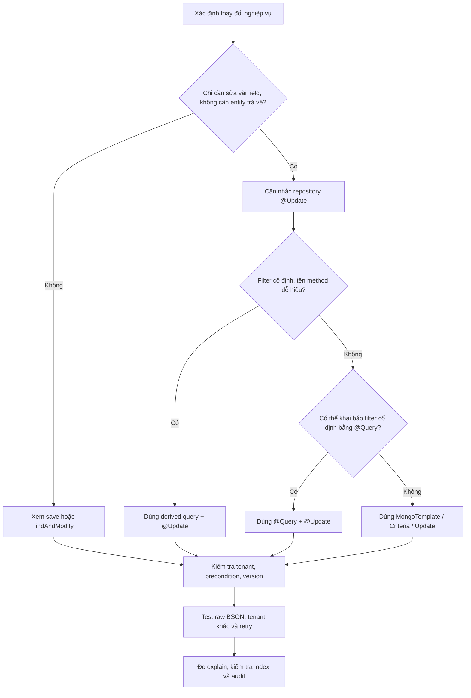

# Khai báo @Update kết hợp truy vấn suy diễn

Trong **Spring Data MongoDB**, một repository không chỉ hỗ trợ `save(...)`, `findBy...` hay `deleteBy...`. Khi cần sửa một vài field mà không muốn đọc toàn bộ document rồi lưu lại, bạn có thể khai báo **phương thức cập nhật ngay trong interface repository** bằng annotation `@Update`. Điểm đặc biệt là **điều kiện tìm document vẫn có thể được suy diễn từ tên phương thức** (*derived query*), trong khi **nội dung cập nhật** được mô tả bằng toán tử MongoDB như `$set`, `$inc` hoặc một update pipeline.

Ví dụ, với giỏ hàng có tenant, SKU và bộ đếm lượt xem, ứng dụng có thể định nghĩa:

```java
@Update("{ '$inc': { 'viewCount': 1 } }")
long findAndIncrementViewsByTenantIdAndSku(
    String tenantId, String sku);
```

Spring Data phân tích phần `ByTenantIdAndSku` để xác định **document nào được sửa**; `@Update` mô tả **thay đổi nào được áp dụng**. Phương thức không trả về entity vừa cập nhật: `long` thể hiện số document được cập nhật theo hợp đồng API này.

Bài thuộc chương **Ghi qua repository** của module **SPRING_DATA_MONGODB**. Nội dung kết nối việc xây truy vấn bằng repository với MongoDB update operators, `MongoTemplate`, optimistic locking, kiểm thử và chẩn đoán hiệu năng. Trọng tâm là **cách dùng `@Update` kết hợp truy vấn suy diễn** chứ không phải thay mọi thao tác ghi bằng annotation.

Sau bài học, bạn có thể:

1. Giải thích vai trò khác nhau của **derived predicate** và **update document**.
2. Khai báo đúng `org.springframework.data.mongodb.repository.Update` với `$inc`, `$set`, `$unset` và một số toán tử array.
3. Bind tham số vào `@Update` qua `?0`, `?1` mà không ghép JSON từ đầu vào.
4. Kết hợp `@Update` với `@Query` khi tên phương thức không diễn đạt được nhóm điều kiện cần thiết.
5. Hiểu phạm vi cập nhật một/nhiều document, kiểu trả về, sự khác biệt với `save` và `MongoTemplate.updateFirst`.
6. Bảo vệ thao tác ghi bằng điều kiện tenant, trạng thái và version; nhận biết giới hạn auditing/lifecycle callbacks.
7. Kiểm tra kết quả bằng raw BSON, `mongosh`, integration test và `explain`.

## 1. Phân biệt hai phần: tìm document và sửa document

Một lệnh MongoDB update luôn cần trả lời hai câu hỏi:

- **Filter**: document nào khớp và được phép sửa?
- **Update**: các field nào sẽ bị thay đổi, bằng toán tử gì?

Ví dụ raw:

```javascript
db.inventory_repository_updates_lab.updateMany(
  {
    tenantId: "T1",
    status: "ACTIVE",
    deleted: false
  },
  {
    $inc: { viewCount: 1 }
  }
);
```

Trong repository, chúng được phân chia thành:

```java
@Update("{ '$inc': { 'viewCount': 1 } }")
long findAndIncrementViewsByTenantIdAndStatusAndDeletedFalse(
    String tenantId, String status);
```

| Thành phần | Nguồn định nghĩa | Ý nghĩa |
| --- | --- | --- |
| `findAndIncrementViews` trước `By` | Tên mô tả phương thức | Giúp người đọc hiểu mục đích; **không** có nghĩa phải trả entity |
| `TenantIdAndStatusAndDeletedFalse` | Derived query parser | Tạo điều kiện theo property Java |
| `tenantId` và `status` | Tham số method | Giá trị so sánh trong filter |
| `@Update("{ '$inc': ... }")` | Annotation cập nhật | Tăng `viewCount` lên 1 trên document khớp |
| `long` | Kiểu trả về repository update method | Số document cập nhật, không phải danh sách entity |

**Lưu ý:** tiền tố tên method có thể mang từ ngữ mô tả như `findAndIncrementViews`, nhưng khi kèm `@Update`, mục tiêu thực tế là **update**, không phải `findOne` rồi `save`. Đừng thiết kế API dựa vào chữ `find` để mong method trả về một đối tượng.

### 1.1. So sánh nhanh ba cách ghi

| Cách ghi | Đặc điểm | Khi phù hợp |
| --- | --- | --- |
| `repository.save(entity)` | Ghi entity thông qua mapping; có thể là insert hoặc save tùy ID/trạng thái entity | Tạo mới, lưu aggregate với lifecycle mapping |
| Repository method với `@Update` | Filter suy diễn/khai báo, update document cố định hoặc có tham số; không phải luồng đọc entity trước | Cập nhật field hoặc bộ đếm ở nhiều document cùng điều kiện |
| `MongoTemplate.updateFirst/updateMulti` | Query và Update được dựng bằng Java API; có `UpdateResult` chi tiết | Cần logic query động, sửa một document hay kiểm soát kết quả chi tiết |

Đừng nghĩ `@Update` là một phép thay thế entity nguyên vẹn giống `save`. Nếu annotation chứa `$set: {status: "ACTIVE"}`, các field khác của document sẽ **không bị thay thế** chỉ vì ứng dụng không gửi chúng.

## 2. Entity ví dụ: quản lý hàng tồn của nhiều tenant

Để kiểm chứng trên MongoDB, sử dụng entity đơn giản với thông tin SKU và tồn kho:

```java
import java.time.Instant;
import org.bson.types.ObjectId;
import org.springframework.data.annotation.Id;
import org.springframework.data.annotation.Version;
import org.springframework.data.mongodb.core.mapping.Document;

@Document(collection = "inventory_repository_updates_lab")
public class InventoryItem {
    @Id
    private ObjectId id;

    private String labRun;
    private String tenantId;
    private String sku;
    private String status;
    private boolean deleted;
    private long viewCount;
    private long stock;
    private long reserved;
    private Instant lastViewedAt;

    @Version
    private Long version;

    protected InventoryItem() {}

    public InventoryItem(
            String labRun, String tenantId, String sku,
            String status, long stock, long reserved) {
        this.labRun = labRun;
        this.tenantId = tenantId;
        this.sku = sku;
        this.status = status;
        this.stock = stock;
        this.reserved = reserved;
        this.deleted = false;
        this.viewCount = 0;
    }

    public ObjectId getId() { return id; }
    public String getLabRun() { return labRun; }
    public String getTenantId() { return tenantId; }
    public String getSku() { return sku; }
    public String getStatus() { return status; }
    public boolean isDeleted() { return deleted; }
    public long getViewCount() { return viewCount; }
    public long getStock() { return stock; }
    public long getReserved() { return reserved; }
    public Instant getLastViewedAt() { return lastViewedAt; }
    public Long getVersion() { return version; }
}
```

Một document BSON điển hình:

```javascript
{
  _id: ObjectId("665f1f2a4b6c7d8e9f001234"),
  labRun: "demo-run",
  tenantId: "T1",
  sku: "BK-001",
  status: "ACTIVE",
  deleted: false,
  viewCount: NumberLong("0"),
  stock: NumberLong("20"),
  reserved: NumberLong("3"),
  version: NumberLong("0")
}
```

`@Id` ánh xạ Java property `id` sang BSON `_id`. `@Version` là metadata để phục vụ optimistic locking trong các đường ghi Spring Data phù hợp, **không có nghĩa mọi phương thức `@Update` tự nhận biết version mà một client đã đọc**. Ví dụ còn lược bỏ `_class` và các khác biệt BSON type có thể phát sinh theo converter/cấu hình ứng dụng.

Tên collection có hậu tố `_lab` nhằm thể hiện dữ liệu minh họa. Trong thực hành, chỉ sử dụng database thử nghiệm và marker `labRun` riêng để tránh trộn kết quả giữa nhiều lần chạy.

## 3. Khai báo `@Update` với derived query

### 3.1. Import đúng annotation

Trong interface repository, sử dụng:

```java
import org.springframework.data.mongodb.repository.Update;
```

Đây là **annotation** `@Update`, không phải lớp fluent:

```java
// Lớp dùng cho MongoTemplate, không phải annotation.
import org.springframework.data.mongodb.core.query.Update;
```

Hai loại có cùng tên nhưng vai trò khác nhau. Nếu code có cả repository và `MongoTemplate`, cần tránh import nhầm.

### 3.2. Tăng bộ đếm bằng `$inc`

```java
import org.bson.types.ObjectId;
import org.springframework.data.mongodb.repository.MongoRepository;
import org.springframework.data.mongodb.repository.Update;

public interface InventoryItemRepository
        extends MongoRepository<InventoryItem, ObjectId> {

    @Update("{ '$inc': { 'viewCount': 1 } }")
    long findAndIncrementViewsByTenantIdAndSkuAndDeletedFalse(
        String tenantId, String sku);
}
```

Ví dụ gọi:

```java
long affected = repository
    .findAndIncrementViewsByTenantIdAndSkuAndDeletedFalse(
        trustedTenantId, "BK-001"
    );
```

Điều kiện suy diễn tương đương ý tưởng:

```javascript
{
  tenantId: "T1",
  sku: "BK-001",
  deleted: false
}
```

Phần update được chỉ rõ:

```javascript
{
  $inc: { viewCount: 1 }
}
```

`$inc` tăng trực tiếp giá trị trong document, thay vì đọc `viewCount` ở Java rồi gán lại một số đã tính từ dữ liệu có thể cũ. Nếu nhiều request cùng tăng một bộ đếm của **cùng một document**, update `$inc` trên document đó có tính nguyên tử; tuy nhiên giá trị bộ đếm không tự đại diện một sự kiện nghiệp vụ đã được xử lý đúng một lần nếu client gửi lại request.

### 3.3. Vì sao một method có thể sửa nhiều document?

Nếu một tenant có ba document cùng `sku` (ví dụ hệ thống cho phép nhiều lô hàng), filter `tenantId + sku + deleted = false` có thể khớp cả ba. Một repository update method có thể cập nhật **nhiều document phù hợp**.

**Không suy ra rằng `findAnd...` chỉ cập nhật một document.** Nếu chỉ muốn sửa một record, thêm `id` duy nhất vào predicate hoặc chuyển sang `MongoTemplate.updateFirst` với bộ lọc được kiểm soát. Không dựa vào tên `First`/`Top` như một hàng rào an toàn nếu chưa xác nhận hành vi đúng với phiên bản và method cụ thể.

Đối với nghiệp vụ có thể thay đổi nhiều document, nên đặt tên method và định nghĩa API thể hiện rõ ý định, ví dụ `incrementViewsForActiveItems` ở lớp service gọi repository method tương ứng. Một method tồn tại trong repository không tự cấp quyền cho client thực thi một bulk update tùy ý.

### 3.4. Kết hợp nhiều derived keywords

Spring Data MongoDB hỗ trợ những từ khóa predicate thường dùng như:

| Từ khóa trong tên | Ý nghĩa điều kiện ví dụ |
| --- | --- |
| `And` | Giao hai điều kiện |
| `Or` | Hợp các nhánh điều kiện, cần chú ý nhóm |
| `In` | Giá trị field nằm trong tập giá trị |
| `LessThan` / `GreaterThan` | So sánh với giá trị tham số |
| `True` / `False` | So sánh với boolean không cần tham số |
| `IsNull` / `IsNotNull` | Kiểm tra null theo semantics của hệ thống |

Ví dụ cập nhật các mặt hàng ACTIVE còn stock thấp:

```java
@Update("{ '$set': { 'status': 'LOW_STOCK' } }")
long findAndMarkLowStockByTenantIdAndStatusAndStockLessThanAndDeletedFalse(
    String tenantId, String status, long threshold);
```

Một lời gọi `findAndMarkLowStockByTenantIdAndStatusAndStockLessThanAndDeletedFalse("T1", "ACTIVE", 5L)` nhắm những mặt hàng T1 có `status = ACTIVE`, `stock < 5` và `deleted = false`. Đây là một **bulk transition**, không tự tính lại khi stock thay đổi sau đó. Nếu logic cần xét `stock - reserved`, chỉ dùng `StockLessThan` không diễn đạt được phép tính giữa hai field; cần query với `$expr` hoặc cơ chế khác phù hợp.

## 4. Truyền tham số vào nội dung `@Update`

Giá trị dùng để **tìm document** và giá trị dùng để **cập nhật document** là hai mục đích riêng, dù cùng xuất hiện trong danh sách tham số của một method. `@Update` hỗ trợ biểu thức update có các placeholder được bind từ tham số Java.

### 4.1. Đổi trạng thái từ giá trị cũ sang giá trị mới

```java
@Update("{ '$set': { 'status': ?3 } }")
long findAndChangeStatusByTenantIdAndSkuAndStatusAndDeletedFalse(
    String tenantId,
    String sku,
    String expectedStatus,
    String newStatus);
```

Thứ tự tham số ở ví dụ này:

| Chỉ số | Biến Java | Vai trò |
| --- | --- | --- |
| `?0` | `tenantId` | Predicate `TenantId` |
| `?1` | `sku` | Predicate `Sku` |
| `?2` | `expectedStatus` | Predicate `Status` |
| `?3` | `newStatus` | Giá trị trong `@Update` |

Gọi:

```java
long updated = repository
    .findAndChangeStatusByTenantIdAndSkuAndStatusAndDeletedFalse(
        trustedTenantId,
        "BK-001",
        "DRAFT",
        "ACTIVE"
    );
```

Bộ lọc tương đương:

```javascript
{
  tenantId: "T1",
  sku: "BK-001",
  status: "DRAFT",
  deleted: false
}
```

Phần cập nhật:

```javascript
{ $set: { status: "ACTIVE" } }
```

**Lợi ích:** chỉ document còn ở trạng thái `DRAFT` tại lúc update mới có thể chuyển sang `ACTIVE`. Nếu một request khác đã chuyển trạng thái trước đó, filter không còn khớp. Đây là kiểu **conditional update** giúp tránh vòng đọc-sửa-lưu với dữ liệu cũ.

**Giới hạn:** nếu nhiều document cùng tenant/SKU/trạng thái, tất cả document khớp có thể được cập nhật. Nếu mỗi SKU phải duy nhất theo tenant, hãy bảo vệ ràng buộc đó bằng mô hình dữ liệu và unique index phù hợp; code Java không tự tạo unique constraint chỉ vì phương thức truyền một SKU.

### 4.2. Binding không phải ghép chuỗi JSON

Đừng xây update JSON bằng cách nối trực tiếp input:

```java
// SAI: không xây JSON query/update từ văn bản không tin cậy.
String updateJson =
    "{ '$set': { 'status': '" + requestedStatus + "' } }";
```

Nếu giá trị chứa dấu nháy đơn, dấu gạch chéo ngược hay ký tự JSON đặc biệt, code dễ sinh cú pháp sai. Nguy hiểm hơn, nếu API cho client tự cung cấp toàn bộ BSON update document, client có thể chọn các toán tử hoặc field ngoài hợp đồng.

Với:

```java
@Update("{ '$set': { 'status': ?3 } }")
```

Spring Data xử lý `newStatus` như **giá trị** được bind vào cấu trúc update đã định nghĩa. Vì vậy, chuỗi có nội dung giống `{"$ne":"ACTIVE"}` không tự biến thành toán tử `$ne`. Tuy vậy, ứng dụng vẫn nên xác thực trạng thái mới theo các quy tắc nghiệp vụ.

Ví dụ service kiểm tra trạng thái:

```java
import java.util.Set;

private static final Set<String> ALLOWED_STATUSES =
    Set.of("DRAFT", "ACTIVE", "LOW_STOCK", "ARCHIVED");

public long activateSku(
        String trustedTenantId,
        String sku,
        InventoryItemRepository repository) {

    if (sku == null || sku.isBlank() || sku.length() > 64) {
        throw new IllegalArgumentException("SKU không hợp lệ");
    }

    String desired = "ACTIVE";
    if (!ALLOWED_STATUSES.contains(desired)) {
        throw new IllegalStateException("Trạng thái chưa hỗ trợ");
    }

    return repository
        .findAndChangeStatusByTenantIdAndSkuAndStatusAndDeletedFalse(
            trustedTenantId, sku, "DRAFT", desired
        );
}
```

`trustedTenantId` là tenant đã được server xác thực hoặc kiểm tra quyền. Ở API thật, transition `DRAFT -> ACTIVE` còn có thể cần nhiều ràng buộc như đủ stock, đã duyệt hoặc dữ liệu hợp lệ; ví dụ chỉ minh họa parameter binding và điều kiện trạng thái.

### 4.3. Thời gian và các kiểu dữ liệu khác

Bạn có thể bind `Instant`, `ObjectId`, số và collection từ tham số Java phù hợp, thay vì chuyển chúng thành chuỗi JSON.

Ví dụ cập nhật thời điểm xem:

```java
import java.time.Instant;

@Update("{ '$set': { 'lastViewedAt': ?2 }, '$inc': { 'viewCount': 1 } }")
long findAndRecordViewByTenantIdAndIdAndDeletedFalse(
    String tenantId, ObjectId id, Instant viewedAt);
```

Ở đây `?2` là thời điểm ứng dụng đã xác định. Khi thông tin thời gian phải đến từ server, service tạo `Instant.now()` hoặc dùng một chính sách timestamp thống nhất. Chú ý BSON Date có độ phân giải mili giây, không bảo toàn nanosecond từ mọi `Instant` Java.

### 4.4. Đừng dùng placeholder làm tên field hoặc toán tử

Một phép bind như `?2` thể hiện **giá trị**, không phải lời mời để client tùy ý chọn:

```text
field   = "$where"
update  = "$unset"
payload = "{ ... raw JSON ... }"
```

Nếu sản phẩm thật sự cần cho phép lựa chọn field hoặc loại cập nhật, hãy dùng **allowlist** ở server, ánh xạ lựa chọn hợp lệ thành một trong các method hoặc các đối tượng `Update` đã định nghĩa. Không nhận một `Map<String,Object>` hoặc một raw JSON update do client gửi rồi áp dụng thẳng vào MongoDB.

## 5. `@Update` và `@Query`: khi predicate không nên để suy diễn

Derived query phù hợp khi filter đơn giản. Nếu cần nhóm có dấu ngoặc, `$expr`, điều kiện trên nested document hoặc yêu cầu an toàn khó diễn đạt bằng tên method, bạn có thể khai báo filter bằng `@Query` bên cạnh `@Update`.

### 5.1. Ví dụ với `$expr` tính tồn kho thực

Một sản phẩm cần được đánh dấu `LOW_STOCK` khi:

```text
stock - reserved < 5
```

MongoDB query tương đương:

```javascript
{
  tenantId: "T1",
  status: "ACTIVE",
  deleted: false,
  $expr: {
    $lt: [
      { $subtract: ["$stock", "$reserved"] },
      5
    ]
  }
}
```

Repository:

```java
import org.springframework.data.mongodb.repository.Query;
import org.springframework.data.mongodb.repository.Update;

// Hai method được khai báo bên trong InventoryItemRepository.
@Query("{ 'tenantId': ?0, 'status': 'ACTIVE', 'deleted': false, " +
       "  '$expr': { '$lt': [ { '$subtract': [ '$stock', '$reserved' ] }, ?1 ] } }")
@Update("{ '$set': { 'status': 'LOW_STOCK' } }")
long flagLowStock(String tenantId, long minimumAvailable);
```

Khi kết hợp hai annotation, **`@Query` xác định filter**, **`@Update` xác định sửa đổi**. Bộ lọc không còn phải được suy ra từ phần `By...`. Đây là một lựa chọn khác với tiêu điểm derived query của bài, nhưng rất quan trọng để biết lúc nào **không nên cố nhồi mọi logic vào tên method**.

`?0` là tenant được bind, `?1` là ngưỡng tồn kho. Không có raw string concatenation từ input. Các biểu thức dùng `$stock` và `$reserved` dưới dạng tên field BSON; nếu đổi tên BSON bằng `@Field`, hãy kiểm chứng biểu thức thực tế và sửa/ánh xạ đúng.

### 5.2. Sai nhóm `And` và `Or` có thể sửa nhầm tenant

Một phương thức nguy hiểm:

```java
@Update("{ '$set': { 'status': 'ARCHIVED' } }")
long findAndArchiveByTenantIdAndStatusOrSku(
    String tenantId, String status, String sku);
```

Theo cách phân tích derived query, bộ lọc là:

```text
(tenantId = T1 AND status = INACTIVE)
    OR
(sku = BK-001)
```

Nhánh `sku` có thể khớp document của **tenant khác**. Cách sửa an toàn:

```java
@Query("{ 'tenantId': ?0, '$or': [ " +
       "    { 'status': ?1 }, { 'sku': ?2 } ] }")
@Update("{ '$set': { 'status': 'ARCHIVED' } }")
long archiveWithinTenant(
    String tenantId, String status, String sku);
```

Tương đương:

```javascript
{
  tenantId: "T1",
  $or: [
    { status: "INACTIVE" },
    { sku: "BK-001" }
  ]
}
```

Điều kiện tenant áp dụng cho **cả hai nhánh**. Với update, lỗi nhóm điều kiện còn nghiêm trọng hơn query đọc vì nó làm biến đổi dữ liệu người khác. Nên bổ sung điều kiện `deleted = false` hoặc trạng thái bắt buộc ở cấp ngoài theo hợp đồng nghiệp vụ.

### 5.3. Khi nào viết repository method, khi nào dùng `MongoTemplate`?

| Nhu cầu | Ưu tiên cân nhắc |
| --- | --- |
| Tăng bộ đếm cố định cho các document khớp predicate ngắn | Derived `@Update` |
| Chuyển trạng thái với vài điều kiện cố định | Derived `@Update` có parameter binding |
| Filter phức tạp nhưng cú pháp ổn định | `@Query` + `@Update` |
| Filter/update thay đổi theo nhiều tùy chọn runtime | `MongoTemplate` với `Criteria`/`Update` |
| Chỉ sửa **một** document theo quy tắc chọn/sort và cần `UpdateResult` | `MongoTemplate.updateFirst` hoặc `findAndModify` |
| Cần trả document trước/sau sửa | `findAndModify` với tùy chọn trả kết quả phù hợp |
| Ghi entity và cần entity callbacks/auditing theo vòng đời | Xem xét `save`/đường ghi phù hợp; không dựa vào update query tự chạy callbacks |

## 6. Update document với `$set`, `$inc`, `$unset` và array operators

`@Update` chứa phần **update document** tương ứng với MongoDB. Một số thao tác điển hình:

| Toán tử | Công dụng | Ví dụ update JSON |
| --- | --- | --- |
| `$set` | Gán một hoặc nhiều field | `{ '$set': { 'status': 'ACTIVE' } }` |
| `$inc` | Tăng/giảm giá trị số | `{ '$inc': { 'viewCount': 1 } }` |
| `$unset` | Loại một field khỏi document | `{ '$unset': { 'lastViewedAt': '' } }` |
| `$addToSet` | Thêm giá trị vào array nếu chưa có phần tử bằng nó | `{ '$addToSet': { 'tags': 'featured' } }` |
| `$pull` | Xóa mọi phần tử array khớp giá trị/điều kiện | `{ '$pull': { 'tags': 'obsolete' } }` |
| `$currentDate` | Gán ngày/giờ hiện tại phía MongoDB | `{ '$currentDate': { 'lastTouchedAt': true } }` |

Trong repository, hãy định nghĩa **những thay đổi hợp lệ** thay vì cho phép client gửi tên toán tử tùy ý.

### 6.1. Kết hợp `$inc` và `$set` trong một lệnh

```java
@Update("{ '$inc': { 'viewCount': 1 }, " +
        "  '$set': { 'lastViewedAt': ?2 } }")
long findAndTrackViewByTenantIdAndIdAndDeletedFalse(
    String tenantId, ObjectId id, Instant viewedAt);
```

Trên một document phù hợp, hai thay đổi được áp dụng trong **một thao tác cập nhật document**. Điều này nhất quán hơn việc chạy `$inc` và `$set` thành hai request MongoDB riêng rồi chấp nhận khoảng hở giữa chúng.

Nếu hệ thống cần thời gian từ MongoDB server, cân nhắc `$currentDate` khi field/semantics phù hợp:

```java
@Update("{ '$inc': { 'viewCount': 1 }, " +
        "  '$currentDate': { 'lastViewedAt': true } }")
long findAndTrackServerTimeByTenantIdAndIdAndDeletedFalse(
    String tenantId, ObjectId id);
```

`$currentDate` sẽ lấy thời điểm phía server, còn `Instant.now()` lấy thời điểm phía JVM. Chọn một nguồn thời gian nhất quán cho hợp đồng API; không mặc định các máy có đồng hồ hoàn toàn trùng nhau.

### 6.2. Sửa array mà không ghi lại toàn bộ document

Giả sử entity bổ sung `tags: List<String>`, bạn có thể khai báo:

```java
@Update("{ '$addToSet': { 'tags': ?2 } }")
long findAndAddTagByTenantIdAndIdAndDeletedFalse(
    String tenantId, ObjectId id, String tag);

@Update("{ '$pull': { 'tags': ?2 } }")
long findAndRemoveTagByTenantIdAndIdAndDeletedFalse(
    String tenantId, ObjectId id, String tag);
```

Mỗi method chỉ thay field `tags` của document phù hợp. `$pull` loại **mọi lần xuất hiện** của tag đó; `$addToSet` tránh thêm phần tử trùng theo so sánh của MongoDB nhưng không tự dọn các bản sao đã tồn tại từ trước. Trước khi áp dụng, bổ sung `tags` vào entity/mapping và kiểm tra BSON thực.

### 6.3. Không dùng `$unset` cho field bắt buộc mà chưa có migration

`$unset` xóa **field khỏi document BSON**, khác việc đặt giá trị thành `null`. Nếu một field được service khác coi là bắt buộc, loại field có thể khiến deserialization hoặc logic nghiệp vụ gặp lỗi. Với dữ liệu đa phiên bản, nên có chiến lược migration và compatibility trước khi xóa field lưu trữ.

## 7. Update pipeline trong `@Update`

Không phải mọi cập nhật đều là `$set` một hằng số. Đôi khi giá trị mới phải được **tính từ các field hiện tại** trong MongoDB. Các phiên bản Spring Data MongoDB hỗ trợ `@Update(pipeline = {...})` cho update dạng aggregation pipeline.

Ví dụ, mô hình bổ sung field `available` để ghi `stock - reserved`:

```java
// Đặt trong InventoryItemRepository nếu entity có field available.
@Update(pipeline = {
    "{ '$set': { 'available': { '$subtract': [ '$stock', '$reserved' ] } } }"
})
long findAndRefreshAvailableByTenantIdAndStatusAndDeletedFalse(
    String tenantId, String status);
```

Đây là update pipeline một stage có toán tử `$set` của **aggregation pipeline**. Biểu thức `'$stock'` và `'$reserved'` biểu thị giá trị field trong document hiện tại. Nó khác với cách `@Update("{ '$set': { 'available': 10 } }")` gán một hằng số.

MongoDB raw tương đương:

```javascript
db.inventory_repository_updates_lab.updateMany(
  { tenantId: "T1", status: "ACTIVE", deleted: false },
  [
    {
      $set: {
        available: { $subtract: ["$stock", "$reserved"] }
      }
    }
  ]
);
```

**Lưu ý:**

- Một pipeline update hỗ trợ tập stage được MongoDB cho phép trong update, không phải mọi aggregation stage đều hợp lệ.
- `available` là dữ liệu **dẫn xuất**. Nếu các đường ghi stock/reserved khác không tính lại available, field này có thể trở nên lỗi thời.
- `$stock`/`$reserved` ở pipeline raw phải trỏ đúng tên field BSON; đặc biệt kiểm tra khi entity dùng `@Field` đổi tên.
- Pipeline không tự bảo đảm optimistic locking dựa trên version mà client đã đọc; nếu có yêu cầu concurrency phải thiết kế filter/version.
- Kiểm tra khả năng hỗ trợ và cú pháp `@Update(pipeline=...)` theo phiên bản Spring Data MongoDB của dự án.

Không cần pipeline cho một cập nhật đơn giản như `$inc`; sử dụng hình thức dễ hiểu nhất đáp ứng yêu cầu.

## 8. Version, cập nhật có điều kiện và các worker đồng thời

### 8.1. Tại sao `@Version` không phải hàng rào tự động cho mọi repository update?

Với `save(entity)`, optimistic locking có thể dùng `@Version` trên object đã đọc để phát hiện document bị thay đổi. Nhưng một update method dựa trên **query** không nhận một entity đầy đủ đã đọc. Nếu filter chỉ là `tenantId + sku`, nó **không biết** phiên bản mà client nghĩ document đang có.

Vì vậy, nếu nghiệp vụ yêu cầu *“chỉ sửa nếu document vẫn ở version 3”*, phải kiểm tra version **ngay trong filter** và quản lý việc tăng version nhất quán:

```java
@Update("{ '$set': { 'status': ?4 }, " +
        "  '$inc': { 'version': 1 } }")
long findAndTransitionByTenantIdAndIdAndStatusAndVersionAndDeletedFalse(
    String tenantId,
    ObjectId id,
    String expectedStatus,
    Long expectedVersion,
    String nextStatus);
```

Ví dụ gọi:

```java
long updated = repository
    .findAndTransitionByTenantIdAndIdAndStatusAndVersionAndDeletedFalse(
        trustedTenantId, itemId, "DRAFT", 3L, "ACTIVE"
    );
```

Phần filter:

```javascript
{
  tenantId: "T1",
  _id: ObjectId("665f1f2a4b6c7d8e9f001234"),
  status: "DRAFT",
  version: NumberLong("3"),
  deleted: false
}
```

Phần update:

```javascript
{
  $set: { status: "ACTIVE" },
  $inc: { version: 1 }
}
```

Khi một request khác đã chuyển version sang 4, filter `version = 3` không còn khớp. Lệnh không được phép âm thầm sửa document phiên bản mới. Ví dụ cố ý nêu rõ `$inc` cho `version` để hợp đồng cập nhật có thể được quan sát trong BSON; ứng dụng cần thống nhất cách tăng version của **mọi đường ghi**, tránh double increment hoặc bỏ sót khi dùng API/config khác.

### 8.2. Phân biệt cập nhật một và nhiều document

Ví dụ trên lọc theo `_id` duy nhất nên có thể sửa **tối đa một document**. Nếu bỏ `id` khỏi tên method và giữ các điều kiện chung `status`/`tenantId`/`version`, một số document có thể cùng khớp và đều được sửa.

| Tình huống | Kết quả cần phân tích |
| --- | --- |
| Filter theo đúng `_id` và tenant | Tối đa một document; phù hợp cho CAS |
| Filter theo status và tenant | Có thể rất nhiều document cùng thay đổi |
| Status hoặc version đã bị cập nhật | Không còn match |
| Update gán lại đúng giá trị hiện có | Có thể có match nhưng không đổi field nghiệp vụ |
| Phương thức trả `long = 0` | Không đủ thông tin để phân biệt mọi nguyên nhân nếu không có hợp đồng rõ |

Để phân biệt chi tiết số document **matched** và **modified**, `MongoTemplate` có `UpdateResult`:

```java
import com.mongodb.client.result.UpdateResult;
import org.springframework.data.mongodb.core.query.Criteria;
import org.springframework.data.mongodb.core.query.Query;
import org.springframework.data.mongodb.core.query.Update;

Query filter = Query.query(
    Criteria.where("id").is(itemId)
        .and("tenantId").is(trustedTenantId)
        .and("status").is("DRAFT")
        .and("version").is(3L)
);

Update changes = new Update()
    .set("status", "ACTIVE")
    .inc("version", 1);

UpdateResult result = mongoTemplate.updateFirst(
    filter, changes, InventoryItem.class
);

long matchedCount = result.getMatchedCount();
long modifiedCount = result.getModifiedCount();
```

`UpdateResult` hữu ích khi nghiệp vụ thực sự cần phân biệt **document không khớp** với **khớp nhưng không thay đổi BSON**, hoặc cần loại thao tác update rõ ràng (`updateFirst` thay vì cập nhật nhiều).

### 8.3. Đừng dùng bulk update như transaction nhiều document

Một lần repository update có thể sửa nhiều document. MongoDB bảo đảm tính nguyên tử **theo từng document**, nhưng **không tự coi toàn bộ danh sách document khớp là một transaction**. Nếu yêu cầu “hoặc tất cả SKU thuộc đơn hàng được cập nhật và ghi audit, hoặc không SKU nào đổi”, phải cân nhắc transaction trên deployment hỗ trợ hoặc workflow bù/đối soát.

Việc đồng thời gọi HTTP, gửi message hoặc ghi hệ thống khác cũng không tự được rollback cùng MongoDB chỉ vì một repository update method thành công.

## 9. Lifecycle callbacks, auditing và cập nhật trực tiếp

Một `@Update` chạy ở mức update query không giống việc nạp entity vào Java rồi gọi `save`. Không nên giả định các logic dựa trên **entity callbacks, auditing field hoặc validation ở setter** sẽ tự chạy y hệt mọi đường ghi.

Những quy tắc dễ bị bỏ sót:

- `@LastModifiedDate`: không mặc định được cập nhật đúng khi một update query chỉ có `$inc`.
- `@Version`: không tự bảo đảm so khớp phiên bản client khi filter không chứa expected version.
- Domain invariant: nếu một setter Java từ chối trạng thái chuyển đổi không hợp lệ, query update không nhất thiết gọi setter đó.
- Entity listeners/callbacks: đường ghi trực tiếp không tương đương lifecycle của `save(entity)`.
- Cache hoặc object Java đang giữ: update trong MongoDB **không sửa object đã load nằm trong bộ nhớ ứng dụng**.

Khi cần ghi thời gian sửa, có thể đặt nó trong **chính update**:

```java
@Update("{ '$set': { 'status': ?3 }, " +
        "  '$currentDate': { 'lastUpdatedAt': true } }")
long findAndChangeStatusWithTimestampByTenantIdAndSkuAndStatusAndDeletedFalse(
    String tenantId, String sku, String oldStatus, String newStatus);
```

Đảm bảo entity/schema thực sự có `lastUpdatedAt` theo hợp đồng dữ liệu. `$currentDate` là một cách tạo timestamp phía MongoDB; nó không đồng nghĩa đã thay thế toàn bộ cơ chế auditing của Spring Data.

**Nguyên tắc kiểm thử:** đối với những field có callback/annotation, kiểm tra **raw BSON sau repository update**; đừng suy luận từ việc class đã có annotation.

## 10. Thực hành `mongosh`: quan sát filter và update riêng biệt

Để thấy rõ ý nghĩa của derived query + `@Update`, ta thực thi bộ lọc và update BSON tương đương trên MongoDB. Bài tập dùng database `spring_data_training` và collection `inventory_repository_updates_lab`. Mỗi phiên tạo marker `labRun` riêng, không sửa dữ liệu production.

### 10.1. Tạo dữ liệu gồm nhiều trạng thái và tenant

Mở `mongosh` trên MongoDB **thử nghiệm**, chạy liên tiếp:

```javascript
use spring_data_training

const lab = db.getCollection("inventory_repository_updates_lab");
const runId = "repository-writes-001-" + new ObjectId().toHexString();
const t1 = runId + "-T1";
const t2 = runId + "-T2";

const inserted = lab.insertMany([
  {
    labRun: runId, tenantId: t1, label: "A",
    sku: "BK-01", status: "DRAFT", deleted: false,
    viewCount: NumberLong("0"), stock: NumberLong("10"),
    reserved: NumberLong("2"), version: NumberLong("0")
  },
  {
    labRun: runId, tenantId: t1, label: "B",
    sku: "BK-02", status: "ACTIVE", deleted: false,
    viewCount: NumberLong("5"), stock: NumberLong("4"),
    reserved: NumberLong("1"), version: NumberLong("0")
  },
  {
    labRun: runId, tenantId: t1, label: "C",
    sku: "BK-03", status: "ACTIVE", deleted: false,
    viewCount: NumberLong("2"), stock: NumberLong("1"),
    reserved: NumberLong("1"), version: NumberLong("1")
  },
  {
    labRun: runId, tenantId: t1, label: "D",
    sku: "BK-04", status: "ACTIVE", deleted: true,
    viewCount: NumberLong("10"), stock: NumberLong("0"),
    reserved: NumberLong("0"), version: NumberLong("0")
  },
  {
    labRun: runId, tenantId: t2, label: "E",
    sku: "BK-03", status: "ACTIVE", deleted: false,
    viewCount: NumberLong("4"), stock: NumberLong("1"),
    reserved: NumberLong("1"), version: NumberLong("0")
  },
  {
    labRun: runId, tenantId: t1, label: "F",
    sku: "BK-05", status: "DRAFT", deleted: false,
    viewCount: NumberLong("0"), stock: NumberLong("2"),
    reserved: NumberLong("1"), version: NumberLong("2")
  },
  {
    labRun: runId, tenantId: t1, label: "G",
    sku: "BK-06", status: "ACTIVE", deleted: false,
    viewCount: NumberLong("1"), stock: NumberLong("3"),
    reserved: NumberLong("2"), version: NumberLong("0")
  }
]);

printjson({
  runId: runId,
  tenant1: t1,
  tenant2: t2
});
print(lab.countDocuments({ labRun: runId })); // 7
```

Các biến `runId`, `t1`, `t2` chỉ tồn tại trong phiên shell này. Nếu thoát shell, cần ghi lại giá trị hoặc tạo một phiên bài tập mới; đừng lấy marker mới rồi xóa dữ liệu của marker cũ bằng filter rỗng.

Hàm nhỏ giúp đọc kết quả theo nhãn:

```javascript
function inspectLab() {
  return lab.find(
    { labRun: runId },
    {
      _id: 0, label: 1, tenantId: 1,
      sku: 1, status: 1, deleted: 1,
      viewCount: 1, stock: 1,
      reserved: 1, version: 1
    }
  ).sort({ label: 1 }).toArray();
}

printjson(inspectLab());
```

### 10.2. Tương đương `@Update("$inc")` kết hợp derived query

Method:

```java
@Update("{ '$inc': { 'viewCount': 1 } }")
long findAndIncrementViewsByTenantIdAndStatusAndDeletedFalse(
    String tenantId, String status);
```

Tương đương thao tác raw:

```javascript
const viewsResult = lab.updateMany(
  {
    labRun: runId,
    tenantId: t1,
    status: "ACTIVE",
    deleted: false
  },
  {
    $inc: { viewCount: NumberLong("1") }
  }
);

printjson({
  matched: viewsResult.matchedCount,
  modified: viewsResult.modifiedCount
});
// Dự kiến: matched = 3, modified = 3.

printjson(inspectLab().map(d => ({
  label: d.label,
  viewCount: d.viewCount
})));
// B: 6; C: 3; G: 2.
// A/F là DRAFT, D đã deleted, E thuộc tenant2 — không đổi.
```

Field `labRun` là điều kiện cách ly **chỉ có trong ví dụ raw**; repository method ở mục 3 không chứa điều kiện này, vì thế khi chạy repository với dữ liệu thực, phải đảm bảo tenant/ID và phạm vi phù hợp. Để dùng chính dữ liệu lab qua repository mà vẫn cô lập, có thể bổ sung `LabRun` vào tên method dành riêng cho test.

### 10.3. Transition có điều kiện `DRAFT -> ACTIVE`

```javascript
const activate = lab.updateMany(
  {
    labRun: runId,
    tenantId: t1,
    sku: "BK-01",
    status: "DRAFT",
    deleted: false
  },
  {
    $set: { status: "ACTIVE" }
  }
);

printjson({
  matched: activate.matchedCount,
  modified: activate.modifiedCount
});
// Dự kiến: 1, 1. Document A chuyển từ DRAFT sang ACTIVE.

const repeatActivation = lab.updateMany(
  {
    labRun: runId,
    tenantId: t1,
    sku: "BK-01",
    status: "DRAFT",
    deleted: false
  },
  {
    $set: { status: "ACTIVE" }
  }
);

printjson({
  matched: repeatActivation.matchedCount,
  modified: repeatActivation.modifiedCount
});
// Dự kiến: 0, 0. A không còn trạng thái DRAFT.
```

Đây là ví dụ của **precondition trong filter**: cập nhật không phải chỉ là gán field status, mà còn kiểm tra trạng thái hiện tại. Nó tránh một lần retry vô tình lặp lại một bước chuyển trạng thái đã hoàn tất, với điều kiện dữ liệu không bị một luồng khác chuyển ngược về DRAFT ở giữa.

### 10.4. Compare-and-set theo version

Document F ban đầu có version 2. Thử chuyển nó sang ACTIVE khi version còn 2:

```javascript
const changeWithVersion = lab.updateOne(
  {
    labRun: runId,
    tenantId: t1,
    sku: "BK-05",
    status: "DRAFT",
    version: NumberLong("2")
  },
  {
    $set: { status: "ACTIVE" },
    $inc: { version: NumberLong("1") }
  }
);

printjson(changeWithVersion);
// Dự kiến: matchedCount = 1, modifiedCount = 1.

const staleVersion = lab.updateOne(
  {
    labRun: runId,
    tenantId: t1,
    sku: "BK-05",
    version: NumberLong("2")
  },
  { $set: { status: "ARCHIVED" } }
);

printjson(staleVersion);
// Dự kiến: matchedCount = 0; F hiện đã ở version 3.
```

Đây là **cơ chế compare-and-set** nhờ đặt expected version trong filter. Nếu thiếu điều kiện version, request cũ vẫn có thể sửa bản ghi đã được luồng khác cập nhật.

### 10.5. Biểu thức tính từ hai field trong `@Query`

```javascript
const lowAvailable = lab.find(
  {
    labRun: runId,
    tenantId: t1,
    status: "ACTIVE",
    deleted: false,
    $expr: {
      $lt: [
        { $subtract: ["$stock", "$reserved"] },
        NumberLong("2")
      ]
    }
  },
  { _id: 0, label: 1, sku: 1 }
).toArray();

printjson(lowAvailable);
// Dự kiến: C và G; số hàng có thể theo thứ tự bất kỳ nếu không sort.
```

Bạn có thể thử `updateMany` với cùng filter để đặt `status = LOW_STOCK` sau khi xác nhận tập kết quả. Mục đích bước này là minh họa filter `$expr` được developer định nghĩa trong `@Query` và có thể kết hợp cùng `@Update`; nó **không phải** derived predicate chỉ từ tên phương thức.

### 10.6. Vì sao cần kiểm tra tenant ở mọi nhánh `Or`?

Kiểm tra **read-only** một query cố tình sai nhóm:

```javascript
const unsafeScope = lab.find(
  {
    labRun: runId,
    $or: [
      { tenantId: t1, status: "ACTIVE" },
      { sku: "BK-03" }
    ]
  },
  { _id: 0, label: 1, tenantId: 1 }
).toArray();

printjson(unsafeScope);
// Document E thuộc t2 có thể xuất hiện vì SKU BK-03.
```

Nếu chuyển cùng filter này thành update, bạn có thể sửa nhầm document của T2. Vì vậy, không chạy lệnh update có phạm vi sai; sửa filter thành `tenantId: t1` ở cấp ngoài `$or`, hoặc phân phối tenant vào mọi nhánh.

### 10.7. Cleanup chỉ những document của phiên

```javascript
const remaining = lab.countDocuments({ labRun: runId });
print("Số document của phiên cần dọn: " + remaining);

const cleanup = lab.deleteMany({ labRun: runId });
printjson({ deletedCount: cleanup.deletedCount });

print(lab.countDocuments({ labRun: runId })); // 0.
```

Không thay `{ labRun: runId }` bằng `{}`. Bài tập chỉ có quyền đối với dữ liệu vừa tạo, không được xóa toàn collection để tiết kiệm vài dòng.

## 11. Kiểm thử tích hợp repository update

Truy vấn suy diễn được tạo từ **tên Java method** tại thời điểm framework khởi tạo repository. Một unit test chỉ đọc string của `@Update` chưa chắc phát hiện:

- Tên property trong method không khớp entity.
- Số thứ tự `?0`/`?3` bị nhầm.
- Kết quả update chạy với phạm vi không mong đợi.
- Entity mapping chuyển một field sang tên hoặc BSON type khác.
- `@Version`/auditing có hành vi khác giả định.

Vì vậy, cần **integration test trên MongoDB thật hoặc Testcontainers** với Spring Data Repository đã được cấu hình như ứng dụng. Một test tốt phải chứng minh không chỉ document được sửa mà còn **document không được phép sửa vẫn giữ nguyên**.

### 11.1. Ma trận ca kiểm thử

| Ca kiểm thử | Dữ liệu thử | Điều cần khẳng định |
| --- | --- | --- |
| `$inc` trên một SKU | T1/SKU-A, T2/SKU-A, T1/SKU-B | Chỉ document đúng tenant/SKU bị tăng |
| Derived `StatusAndDeletedFalse` | Một ACTIVE, một DRAFT, một deleted=true | Chỉ bản ghi thỏa cả hai điều kiện bị sửa |
| Transition trạng thái | DRAFT -> ACTIVE | Lần đầu cập nhật, gọi lại với expected DRAFT không còn match |
| Tham số update-only | `newStatus` ở cuối danh sách | Giá trị `?3` thực sự được ghi vào BSON status |
| Hai bản ghi cùng filter | Hai SKU/batch phù hợp | Hiểu rằng method có thể sửa nhiều document |
| Version cũ | Expected version 2, DB đang 3 | Không sửa document |
| Pipeline | `stock = 8`, `reserved = 3` | Field dẫn xuất bằng 5 nếu pipeline được khai báo |
| Field alias | Property Java khác tên BSON | Query và update sử dụng đúng field thực |
| Không có document khớp | Sai tenant hoặc ID | Không ghi dữ liệu, xử lý số trả về phù hợp |
| Callback/auditing | Entity có `@LastModifiedDate` | Không giả định tự động; assert raw BSON theo hợp đồng của đường ghi |

### 11.2. Ví dụ JUnit 5 với `@DataMongoTest`

Ví dụ sau giả định project Spring Boot có kết nối tới MongoDB **riêng cho test**. Entity và repository đã được khai báo ở mục 2–4, các phương thức được bổ sung vào **cùng interface** `InventoryItemRepository`. Import của test slice có thể cần điều chỉnh theo phiên bản Spring Boot thực tế.

```java
import static org.junit.jupiter.api.Assertions.*;
import static com.mongodb.client.model.Filters.eq;

import java.util.List;
import java.util.UUID;
import org.bson.Document;
import org.bson.types.ObjectId;
import org.junit.jupiter.api.Test;
import org.springframework.beans.factory.annotation.Autowired;
import org.springframework.boot.test.autoconfigure.data.mongo.DataMongoTest;
import org.springframework.data.mongodb.core.MongoTemplate;
import org.springframework.data.mongodb.core.query.Criteria;
import org.springframework.data.mongodb.core.query.Query;

@DataMongoTest
class InventoryRepositoryUpdateTest {
    @Autowired
    InventoryItemRepository repository;

    @Autowired
    MongoTemplate template;

    private InventoryItem insert(
            String run, String tenant,
            String sku, String status) {
        return repository.insert(new InventoryItem(
            run, tenant, sku, status, 20L, 2L
        ));
    }

    private Document raw(InventoryItem item) {
        Document stored = template
            .getCollection("inventory_repository_updates_lab")
            .find(eq("_id", item.getId()))
            .first();
        assertNotNull(stored);
        return stored;
    }

    private void cleanup(String run) {
        template.remove(
            Query.query(Criteria.where("labRun").is(run)),
            InventoryItem.class
        );
    }

    @Test
    void incrementMustMatchTenantAndSku() {
        String run = UUID.randomUUID().toString();
        String t1 = run + "-T1";
        String t2 = run + "-T2";
        String sku = run + "-SKU";

        InventoryItem target =
            insert(run, t1, sku, "ACTIVE");
        InventoryItem crossTenant =
            insert(run, t2, sku, "ACTIVE");
        InventoryItem otherSku =
            insert(run, t1, run + "-OTHER", "ACTIVE");

        try {
            long affected = repository
                .findAndIncrementViewsByTenantIdAndSkuAndDeletedFalse(
                    t1, sku
                );
            assertEquals(1L, affected);

            assertEquals(1L,
                ((Number) raw(target).get("viewCount")).longValue());
            assertEquals(0L,
                ((Number) raw(crossTenant).get("viewCount")).longValue());
            assertEquals(0L,
                ((Number) raw(otherSku).get("viewCount")).longValue());
        } finally {
            cleanup(run);
        }
    }

    @Test
    void updateValueIsBoundAndTransitionHasPrecondition() {
        String run = UUID.randomUUID().toString();
        String tenant = run + "-T1";
        String otherTenant = run + "-T2";
        String sku = run + "-SKU";

        InventoryItem target =
            insert(run, tenant, sku, "DRAFT");
        InventoryItem crossTenant =
            insert(run, otherTenant, sku, "DRAFT");

        try {
            long first = repository
                .findAndChangeStatusByTenantIdAndSkuAndStatusAndDeletedFalse(
                    tenant, sku, "DRAFT", "ACTIVE"
                );
            assertEquals(1L, first);

            assertEquals("ACTIVE",
                raw(target).getString("status"));
            assertEquals("DRAFT",
                raw(crossTenant).getString("status"));

            long repeated = repository
                .findAndChangeStatusByTenantIdAndSkuAndStatusAndDeletedFalse(
                    tenant, sku, "DRAFT", "ACTIVE"
                );
            assertEquals(0L, repeated);
        } finally {
            cleanup(run);
        }
    }

    @Test
    void rejectsStaleVersionInDerivedPredicate() {
        String run = UUID.randomUUID().toString();
        String tenant = run + "-T1";
        InventoryItem target =
            insert(run, tenant, run + "-SKU", "DRAFT");

        try {
            Number initialVersion =
                (Number) raw(target).get("version");
            assertNotNull(initialVersion);
            long expected = initialVersion.longValue();

            long first = repository
                .findAndTransitionByTenantIdAndIdAndStatusAndVersionAndDeletedFalse(
                    tenant, target.getId(),
                    "DRAFT", expected, "ACTIVE"
                );
            assertEquals(1L, first);

            long stale = repository
                .findAndTransitionByTenantIdAndIdAndStatusAndVersionAndDeletedFalse(
                    tenant, target.getId(),
                    "ACTIVE", expected, "ARCHIVED"
                );
            assertEquals(0L, stale);

            assertEquals("ACTIVE",
                raw(target).getString("status"));
        } finally {
            cleanup(run);
        }
    }
}
```

Trong test version, đọc giá trị **raw BSON** giúp tránh giả định version khởi tạo phải luôn là một số cố định cho mọi phiên bản Spring Data. Test xác minh cả trạng thái sau cập nhật và việc request cũ không thể ghi tiếp khi expected version đã lỗi thời.

**Quan trọng:** Đây là mã tài liệu hướng dẫn thực hành; test **chưa được chạy** khi viết bài. Cần có môi trường MongoDB test và phiên bản Spring Boot/Spring Data MongoDB tương thích. Khi tích hợp vào source thật, các method repository dùng trong test phải được thêm đầy đủ vào interface, và một số import/thiết lập phiên bản có thể cần điều chỉnh.

### 11.3. Thêm test cho deleted và bulk update

Để kiểm tra `DeletedFalse` thực sự có hiệu lực, tạo một InventoryItem rồi đánh dấu `deleted = true` qua đường update được kiểm soát. Gọi method `findAndIncrementViews...AndDeletedFalse` với đúng tenant/SKU và xác nhận `viewCount` của document đã xóa mềm không đổi.

Đối với bulk update, tạo hai document cùng tenant/trạng thái và một document ở tenant khác. Chạy method `findAndIncrementViewsByTenantIdAndStatusAndDeletedFalse`, xác minh cả hai document hợp lệ đều tăng count còn tenant khác không thay đổi.

### 11.4. Tại sao cần đọc raw BSON?

Khi gọi `repository.findById(...)`, Spring Data thực hiện mapping và có thể chuyển BSON type sang Java type. Nhưng một lỗi schema có thể bị che khuất nếu conversion vẫn đọc lại thành công. Đối với timestamp, version hoặc decimal field, cần kiểm tra BSON thực tế:

```java
Document stored = template
    .getCollection("inventory_repository_updates_lab")
    .find(eq("_id", itemId))
    .first();

assertNotNull(stored);
assertEquals("ACTIVE", stored.getString("status"));
```

Với một field mới như `available` tính bằng pipeline, nên xác minh BSON type cũng như giá trị và xem có phù hợp với mapping Java đã khai báo không.

## 12. Index, hiệu năng và phạm vi bulk update

Một repository update method thực hiện hai công việc: **tìm document phù hợp** và **thay đổi document đó**. Nếu query không có index thích hợp, MongoDB có thể phải duyệt rất nhiều document trước khi áp dụng update.

### 12.1. Index cho truy vấn theo tenant và SKU

Mẫu filter phổ biến:

```javascript
{
  tenantId: "T1",
  sku: "BK-001",
  deleted: false
}
```

Có thể cân nhắc:

```javascript
db.inventory_repository_updates_lab.createIndex(
  { tenantId: 1, sku: 1 },
  { name: "idx_tenant_sku" }
);
```

Khi nghiệp vụ **bắt buộc mỗi tenant chỉ có một record cho mỗi SKU**, nên cân nhắc **unique compound index**, sau khi đã kiểm tra/migration các dữ liệu trùng:

```javascript
// Chỉ tạo unique index nếu hợp đồng dữ liệu thực sự yêu cầu
// và dữ liệu hiện tại không có cặp tenantId/SKU bị trùng.
db.inventory_repository_updates_lab.createIndex(
  { tenantId: 1, sku: 1 },
  { unique: true, name: "uniq_tenant_sku" }
);
```

Không tạo **cả** hai index trên cùng bộ field trong ví dụ vận hành mà không đánh giá sự trùng lặp và cần thiết. Với hệ thống có nhiều lô hàng cùng SKU, unique index này sẽ không phù hợp; thay vào đó cần ID của từng lô để cập nhật đúng document.

### 12.2. Index cho update theo trạng thái

Nếu thường update tất cả item ACTIVE/chưa xóa mềm của một tenant:

```javascript
{
  tenantId: "T1",
  status: "ACTIVE",
  deleted: false
}
```

thì một ứng viên index:

```javascript
db.inventory_repository_updates_lab.createIndex(
  { tenantId: 1, status: 1, deleted: 1 },
  { name: "idx_tenant_status_deleted" }
);
```

Đây không phải cấu hình bắt buộc. Index có chi phí lưu trữ và làm tăng công việc cập nhật khi các field được index thay đổi. Cần quyết định dựa trên phân bố dữ liệu, tần suất đọc/ghi, kích thước tenant, số lượng tài liệu khớp và workload tổng thể.

### 12.3. Dùng `explain` để kiểm tra bước chọn document

Với truy vấn đọc tương đương predicate update:

```javascript
db.inventory_repository_updates_lab.find({
  tenantId: "TENANT_THUC_TE",
  status: "ACTIVE",
  deleted: false
}).explain("executionStats");
```

Thay tenant bằng một giá trị có dữ liệu đại diện. Kiểm tra:

| Trường | Ý nghĩa thực hành |
| --- | --- |
| `winningPlan` | Có `IXSCAN` hay `COLLSCAN`? Có dùng index dự kiến không? |
| `totalKeysExamined` | Số entry index đã xem xét |
| `totalDocsExamined` | Số document engine cần đọc |
| `nReturned` | Số document match với truy vấn đọc tương đương |
| `executionTimeMillis` | Chỉ số thời gian một lần chạy, cần thêm số liệu thực tế |

Đừng đo hiệu năng của hệ thống hàng triệu document bằng bảy document trong bài thực hành. Mặt khác, kế hoạch **đọc** không phản ánh toàn bộ chi phí **ghi** như cập nhật index, replication, lock contention hoặc journal.

### 12.4. Bulk update và giới hạn vận hành

Một phương thức repository có filter rộng có thể cập nhật hàng trăm nghìn document. Khi đó cần xem xét:

- Quyền gọi method: ai được chạy thao tác bulk, áp dụng cho tenant nào?
- Phạm vi: cần bổ sung status, ngày, batch ID hay điều kiện khác không?
- Dry-run: có thể dùng `count`/`find` để ước lượng trước, nhưng **count và update là hai thao tác tách biệt**, không tạo giới hạn nguyên tử.
- Tải: cập nhật nhiều document có thể ảnh hưởng latency, CPU, I/O, bộ nhớ cache và replication.
- Giám sát: đo số document sửa, lỗi, thời gian và tương tác với tác vụ khác.
- Phục hồi: nếu job dừng, có chiến lược retry, checkpoint hoặc bù trừ không?

Với một workflow phức tạp theo batch, `MongoTemplate` hoặc giải pháp job chuyên dụng thường dễ kiểm soát phạm vi/tiến trình hơn một method `@Update` đơn lẻ.

## 13. Khả năng mở rộng, reactive access và phân tách trách nhiệm

### 13.1. Khi nào nên giữ câu cập nhật trong repository?

Một method như:

```java
@Update("{ '$inc': { 'viewCount': 1 } }")
long findAndIncrementViewsByTenantIdAndIdAndDeletedFalse(
    String tenantId, ObjectId id);
```

có hợp đồng nhỏ, dễ gọi và dễ kiểm thử: chọn record theo tenant/ID rồi tăng count. Nó thích hợp để đặt trong repository, còn **service** chịu trách nhiệm xác định tenant, xác thực quyền, giới hạn tần suất và diễn giải kết quả.

Ngược lại, nếu API phải nhận mười bộ lọc tùy chọn, sắp xếp, tham số update động và kiểm soát version phức tạp, một tên method cực dài sẽ khó bảo trì. Hãy dùng `MongoTemplate` và một lớp tạo filter có kiểu rõ ràng.

### 13.2. Reactive MongoDB không thay đổi quy tắc về atomicity

Trong ứng dụng reactive dùng `ReactiveMongoRepository` hoặc `ReactiveMongoTemplate`, kiểu trả về là reactive publisher phù hợp (chẳng hạn `Mono`), thay vì `long` đồng bộ. Khả năng hỗ trợ annotation update và các kiểu trả về cụ thể phải được xác minh theo phiên bản Spring Data MongoDB.

Nhưng nguyên tắc nghiệp vụ không đổi: filter phải scoped theo tenant, không giả định update nhiều document là transaction toàn tập, không gửi input JSON thô thành toán tử, và cần kiểm thử BSON thực sau ghi. Reactive execution không tự giải quyết mất cập nhật hoặc idempotency.

### 13.3. Query update không phải nơi đặt toàn bộ business workflow

Nên chia rõ:

| Thành phần | Trách nhiệm |
| --- | --- |
| Controller/API boundary | Validate cú pháp input, giới hạn kích thước payload |
| Authentication/authorization | Xác minh user và tenant được phép truy cập |
| Service/domain | Kiểm tra transition nghiệp vụ, quyết định idempotency và xử lý conflict |
| Repository `@Update` | Định nghĩa filter/update cố định, thực thi update có điều kiện |
| MongoDB | Thực thi filter/update nguyên tử trên từng document |
| Audit/outbox | Ghi nhận thay đổi và phát sự kiện theo yêu cầu nhất quán |
| Monitoring | Ghi nhận số document thay đổi, độ trễ, lỗi và phạm vi job |

Việc một method cập nhật thành công không chứng minh email đã được gửi hoặc dữ liệu ở hệ thống khác đã đồng bộ. Nếu các side effect quan trọng cần bảo đảm, phải có workflow audit/outbox/transaction hoặc cơ chế retry riêng.

## 14. Những lỗi thường gặp

| Hiện tượng | Nguyên nhân | Hướng khắc phục |
| --- | --- | --- |
| Code không nhận `@Update` như annotation | Import nhầm `core.query.Update` | Dùng `org.springframework.data.mongodb.repository.Update` |
| Method không chạy query như mong đợi | Phần `By...` không tương ứng property hoặc keyword được parser hiểu khác | Viết rõ derived predicate, kiểm tra context startup và test |
| Dùng `@Update` rồi mong nhận entity đã sửa | Repository update method không phải entity fetch | Dùng kiểu trả về phù hợp; nếu cần entity, cân nhắc `findAndModify` |
| Số bản ghi cập nhật lớn hơn dự kiến | Filter theo tenant/SKU không duy nhất hoặc status quá rộng | Thêm `id`/unique constraint, xem lại bulk intent |
| Một trường được gán sai giá trị | Placeholder `?0`/`?1`/`?3` nhầm thứ tự | Lập bảng mapping tham số và test raw BSON |
| Status update thành công nhưng dữ liệu tenant khác bị sửa | Nhóm `Or` thiếu tenant ở một nhánh | Đưa tenant ra ngoài `$or`, test cross-tenant |
| Update chạy lại dù trạng thái đã đổi | Không đặt expected status trong filter | Thêm precondition trạng thái, thiết kế idempotency |
| Version cũ vẫn sửa được document | Filter không có expected version | Đưa `Version` vào predicate hoặc dùng CAS query |
| Field `lastModifiedAt` không thay đổi | Query update không tự vận hành auditing như `save` | Ghi timestamp rõ ràng trong update và test |
| Setter/validator không chạy | Update tác động trực tiếp ở database, không dựng entity đầy đủ | Validate ở API/service, bổ sung schema validation khi cần |
| Kết quả `long = 0` gây hiểu nhầm “không tồn tại” | Không phân biệt được không match, no-op hoặc điều kiện nghiệp vụ | Xác định semantics và dùng `UpdateResult`/query phù hợp |
| String trông như JSON gây query lỗi | Tự nối input vào annotation hoặc `Document.parse` raw | Bind tham số giá trị, giữ cấu trúc query ở server |
| Pipeline tính sai giá trị | Dùng tên field Java thay vì BSON, phép toán sai kiểu | Kiểm tra `@Field`, raw BSON và test |
| Bộ đếm tăng hai lần | Client gửi lại yêu cầu nghiệp vụ, `$inc` bị thực thi hai lần | Thiết kế idempotency key hoặc chống xử lý trùng ở service |
| Bulk update chậm | Filter thiếu index, phạm vi quá lớn | Đọc `explain`, tối ưu chỉ mục và chia batch |
| Một lần ghi thành công nhưng nhiều document chưa đồng bộ | Không có transaction/cơ chế bù cho nhiều record/collection | Thiết kế transaction hoặc workflow phục hồi |
| Dữ liệu sau update không hiển thị trên entity cũ | Object Java đã load không tự được đồng bộ sau direct update | Đọc lại document hoặc làm mới cache theo thiết kế |

### 14.1. Đặc biệt: không nhầm **modified count** với **matched count**

Đối với `MongoTemplate.updateFirst/updateMulti`, `UpdateResult` cho phép xem cả hai thông tin:

```java
if (!result.wasAcknowledged()) {
    throw new IllegalStateException(
        "Write concern không xác nhận update"
    );
}

long matched = result.getMatchedCount();
long modified = result.getModifiedCount();
```

Với repository `@Update` trả `long`, bạn không có toàn bộ `UpdateResult` để phân tích. Một giá trị đếm không chứa ID nào đã sửa, không phải entity và không phải bảo đảm audit. Nếu nghiệp vụ đòi hỏi matched/modified khác nhau, dùng API cho phép truy cập hai con số cùng kiểm thử integration.

### 14.2. Không xem tên method là cơ chế bảo mật

`findAndUpdateByTenantId...` có chữ `TenantId` trong tên nhưng ứng dụng vẫn có thể sai quyền nếu truyền vào `tenantId` do client tự chọn. **Giá trị tenant phải được lấy từ server-side trusted context** và kiểm tra quyền phù hợp. Tên method chỉ mô tả điều kiện query, không xác minh nguồn gốc tham số.

## 15. Quy trình lựa chọn giữa derived `@Update` và cách khác



Tự kiểm tra trước khi đưa method vào production:

1. **Filter thực sự là gì?** Ghi ra BSON tương đương từ tên method.
2. **Cần update một hay nhiều?** Có ID duy nhất hoặc ràng buộc không trùng không?
3. **Các tham số có thứ tự nào?** Placeholder trong `@Update` có trỏ đúng biến?
4. **Các toán tử ghi có phù hợp?** `$inc`, `$set`, `$unset`, pipeline hay thao tác array?
5. **Điều kiện bảo vệ?** Tenant, trạng thái, soft delete, expected version có áp dụng mọi trường hợp?
6. **Có yêu cầu callback/audit?** Nếu có, đã thiết kế rõ ở đường ghi chưa?
7. **Kết quả method có đủ?** Nếu cần entity hoặc matched count, có phải dùng API khác?
8. **Có test âm tính?** T2, version cũ, trạng thái không khớp, input đặc biệt, retry?
9. **Có index hợp lý?** Một bulk update có quét nhiều document không?
10. **Có chiến lược phục hồi?** Khi cập nhật nhiều record hoặc side effect ngoài database thất bại?

## 16. Bài tập tự luyện

**Bài 1 — Tách filter và update.** Phân tích:

```java
@Update("{ '$inc': { 'viewCount': 1 } }")
long findAndIncrementViewsByTenantIdAndStatusAndDeletedFalse(
    String tenantId, String status);
```

Viết bộ lọc BSON và phần update tương đương. Nếu tenant có bốn document ACTIVE và một document deleted=true, dự đoán phạm vi được sửa.

**Bài 2 — Import đúng.** Viết interface `MongoRepository` có method `@Update` và nêu đường dẫn import chính xác của annotation. So sánh với lớp `Update` dùng cho `MongoTemplate`.

**Bài 3 — Bind trạng thái mới.** Viết method cập nhật từ `DRAFT` sang một trạng thái truyền qua tham số Java, filter gồm tenant, SKU, expected status và deleted=false. Dùng `?3` cho trạng thái mới. Kiểm thử chuỗi chứa dấu nháy hoặc ký tự giống JSON không trở thành operator.

**Bài 4 — Xử lý số nhiều.** Cho một tenant có hai lô hàng cùng SKU. Gọi method update theo `TenantIdAndSku` và quan sát cả hai thay đổi. Hãy đề xuất cách chuyển sang filter theo `_id` khi chỉ muốn sửa một lô.

**Bài 5 — `And`/`Or` và tenant.** Một method `findAndArchiveByTenantIdAndStatusOrSku` có thể sửa sai tenant như thế nào? Viết `@Query` với tenant ở cấp ngoài `$or` rồi dùng `@Update` để cập nhật trạng thái.

**Bài 6 — Compare-and-set.** Tạo document version 3. Viết method repository có filter `tenantId`, `id`, `status`, `version` và `deleted = false`. Trong update, đặt status mới và tăng version. Thử lại với version cũ, xác minh không match.

**Bài 7 — `@Query` với `$expr`.** Tìm các item có `stock - reserved < minimumAvailable` rồi đặt status LOW_STOCK. Viết filter `@Query` và update `@Update`. Giải thích vì sao `StockLessThan` không đại diện được phép trừ giữa hai field.

**Bài 8 — Pipeline update.** Bổ sung field `available`, viết `@Update(pipeline = ...)` tính từ `stock - reserved`. Kiểm tra raw BSON sau khi cập nhật và thảo luận bất lợi của việc lưu một field dẫn xuất khi có nhiều đường ghi.

**Bài 9 — Version và auditing.** Entity có `@Version` và `@LastModifiedDate`. Chạy repository update rồi đọc BSON: kiểm tra version, thời gian sửa và so sánh với hành vi của `save`. Đề xuất cách đảm bảo nhất quán nếu method hiện tại chưa cập nhật những field cần thiết.

**Bài 10 — Integration test.** Viết `@DataMongoTest` tạo ba document: T1/SKU-A, T2/SKU-A, T1/SKU-B. Chạy method tăng lượt xem cho T1/SKU-A, assert đúng một document tăng, các document còn lại không đổi.

**Bài 11 — Retry `$inc`.** Client ghi nhận lượt xem bằng `$inc` nhưng request HTTP timeout rồi gửi lại như một yêu cầu mới. Giải thích vì sao bộ đếm có thể tăng hai lần và đề xuất cơ chế idempotency nếu hệ thống đếm giao dịch quan trọng.

**Bài 12 — Quan sát hiệu năng.** Đề xuất index cho truy vấn theo `tenantId`, `status`, `deleted`. Dùng `explain("executionStats")` để quan sát kế hoạch lọc và giải thích tại sao index không tự khiến bulk update nhiều document trở thành transaction.

**Bài 13 — Chọn API.** Với từng use case — tạo entity mới, tăng bộ đếm, chuyển trạng thái có expected version, lấy document đã cập nhật, filter động mười điều kiện và ghi audit nhiều collection — chọn `save`, derived `@Update`, `@Query` + `@Update`, `MongoTemplate` hoặc workflow transaction/outbox, kèm lý do.

### Ghi nhớ

**`@Update` kết hợp truy vấn suy diễn** chia trách nhiệm rõ ràng: **tên phương thức sau `By` quyết định filter**, còn **`@Update` mô tả sửa đổi MongoDB**. Sử dụng `?0`, `?1`,... để bind giá trị, chọn `$set`/`$inc`/array operators hoặc pipeline theo nhu cầu và **không mong đợi entity được trả về** như một truy vấn đọc.

Một repository update method có thể tác động **nhiều document** nếu filter khớp nhiều. Trước khi ghi, phải xác nhận tenant đáng tin cậy, trạng thái, soft delete, expected version và phạm vi query. Khi cần matched/modified chi tiết, chọn một document có sort, làm việc với entity lifecycle hoặc filter động, hãy cân nhắc `MongoTemplate`/`findAndModify` hay đường ghi phù hợp khác. Dùng integration test và raw BSON để chứng minh cả **document được sửa đúng** lẫn **document không được phép sửa vẫn nguyên vẹn**.


