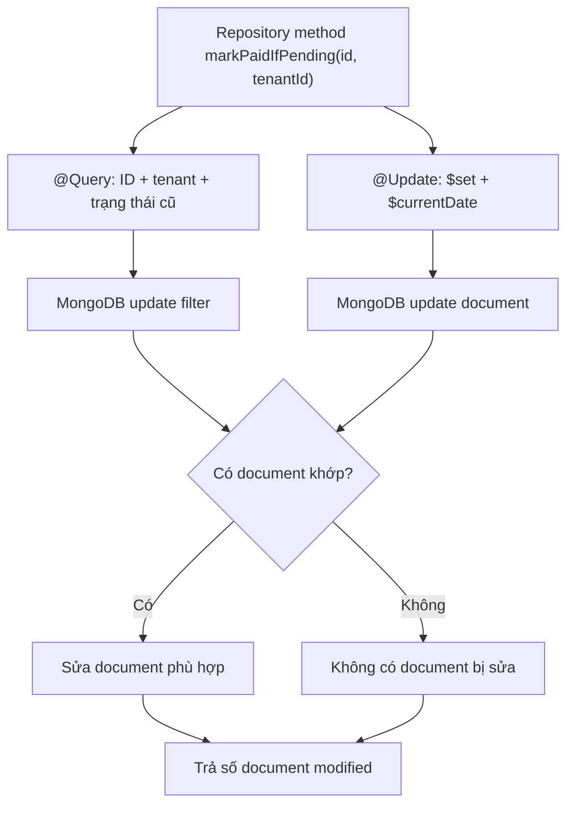
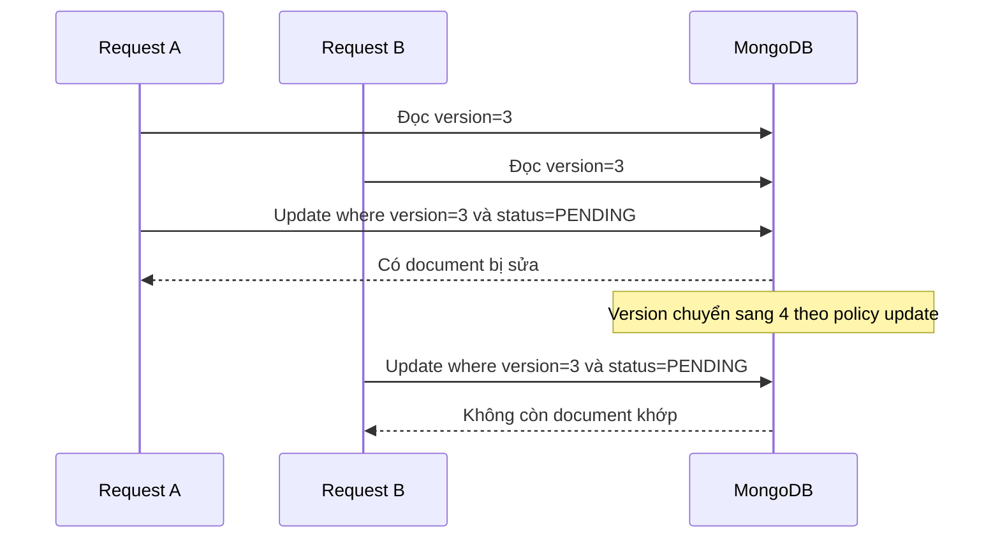

# Kết hợp @Query với @Update cho điều kiện riêng

> **Chương:** Ghi qua repository  
> **Module:** `SPRING_DATA_MONGODB` — kết nối, ánh xạ document và thao tác MongoDB qua repository hoặc `MongoTemplate`. Bài này hướng dẫn viết **repository update method** dùng `@Query` để khai báo **điều kiện lọc riêng** và `@Update` để khai báo **lệnh cập nhật**. Đồng thời phân tích số bản ghi bị sửa, quy tắc an toàn khi cập nhật nhiều document, mảng nhúng, kiểm soát đồng thời, index, transaction, reactive access và kiểm thử.

## 1. Vì sao cần kết hợp hai annotation?

Với repository Spring Data MongoDB, nhiều thao tác đọc chỉ cần tên method:

```java
List<Order> findByStatus(String status);
```

Nhưng cập nhật có điều kiện thường cần nhiều yếu tố hơn một phép gán:

- Chỉ xử lý đơn **thuộc tenant đang đăng nhập**.
- Chỉ đổi trạng thái khi đơn **đang `PENDING`** và chưa bị xóa mềm.
- Ghi thời điểm xử lý hoặc tăng bộ đếm bằng **update operator MongoDB**, thay vì tải document về, sửa rồi gọi `save`.
- Trả về **số document đã được sửa** để quyết định có phát sự kiện nghiệp vụ hay không.

Spring Data MongoDB hỗ trợ repository method kết hợp:

```java
@Query("{ '_id': ?0, 'tenantId': ?1, 'status': 'PENDING', 'deleted': false }")
@Update("{ '$set': { 'status': 'PAID' }, '$currentDate': { 'paidAt': true } }")
long markPaidIfPending(String orderId, String tenantId);
```

Trong method này:

| Thành phần | Vai trò | Dữ liệu ví dụ |
| --- | --- | --- |
| `@Query` | Định nghĩa **filter**: document nào được phép cập nhật | `_id`, `tenantId`, `status=PENDING` và `deleted=false` |
| `@Update` | Định nghĩa **update document**: thay đổi những field nào bằng operator nào | `$set status=PAID` và `$currentDate paidAt` |
| `?0`, `?1` | Gắn tham số method lần lượt theo chỉ số 0, 1 | `orderId`, `tenantId` |
| `long` | Số document bị sửa theo cơ chế repository update | Dùng để biết có thao tác thay đổi thành công |

Điểm mấu chốt là **điều kiện phải nằm trong chính lệnh ghi**, không chỉ được kiểm tra bằng một lần đọc trước đó. Nếu trạng thái đã thay đổi giữa hai request, filter `status=PENDING` ngăn lần cập nhật muộn ghi đè trạng thái mới.



**Phân biệt:** `@Query` không phải “query đọc rồi mới update”. Nó là **selector** được đưa vào thao tác ghi. `@Update` cũng không tương đương `MongoRepository.save(entity)`; update theo operator không yêu cầu ánh xạ toàn bộ document thành một entity trước khi sửa.

## 2. Domain model và BSON phục vụ ví dụ

Giả sử nền tảng quản lý đơn hàng nhiều khách hàng doanh nghiệp (multi-tenant). Mỗi đơn có một ID nghiệp vụ, tenant, trạng thái, cờ xóa mềm, số lần thử và thời điểm thanh toán.

```java
package demo.orders;

import java.time.Instant;
import org.springframework.data.annotation.Id;
import org.springframework.data.mongodb.core.mapping.Document;
import org.springframework.data.mongodb.core.mapping.Field;

@Document(collection = "orders")
public record Order(
    @Id String id,
    String tenantId,
    @Field("customer_code") String customerCode,
    String status,
    boolean deleted,
    long attempts,
    Instant paidAt
) {}
```

Một document MongoDB có thể ở dạng:

```json
{
  "_id": "ORD-001",
  "tenantId": "TENANT-A",
  "customer_code": "CUS-42",
  "status": "PENDING",
  "deleted": false,
  "attempts": 0
}
```

`paidAt` chưa có vì đơn chưa thanh toán. Trong Java, record `Order` có component `paidAt` có thể được ánh xạ thành `null` khi BSON không có field.

**Ba tầng tên cần phân biệt:**

1. Property Java: `id`, `customerCode`.
2. Field BSON: `_id`, `customer_code` do `@Id` và `@Field`.
3. Tên repository method: `markPaidIfPending`, không bắt buộc chứa toàn bộ filter khi đã khai báo `@Query`.

Spring Data có metadata mapping cho query và update, nhưng trong ví dụ JSON khai báo, ta dùng **tên BSON đích rõ ràng** để dễ kiểm tra bằng `mongosh` và Java Driver.

### 2.1. Repository với hai annotation

Lưu ý hai annotation thuộc package repository:

```java
import org.springframework.data.mongodb.repository.Query;
import org.springframework.data.mongodb.repository.Update;
import org.springframework.data.mongodb.repository.MongoRepository;
```

Đừng nhầm `org.springframework.data.mongodb.repository.Update` (annotation) với **`org.springframework.data.mongodb.core.query.Update`** (builder của `MongoTemplate`).

```java
package demo.orders;

import org.springframework.data.mongodb.repository.MongoRepository;
import org.springframework.data.mongodb.repository.Query;
import org.springframework.data.mongodb.repository.Update;

public interface OrderRepository extends MongoRepository<Order, String> {

    @Query("{ '_id': ?0, 'tenantId': ?1, " +
           "'status': 'PENDING', 'deleted': false }")
    @Update("{ '$set': { 'status': 'PAID' }, " +
            "'$currentDate': { 'paidAt': true } }")
    long markPaidIfPending(String orderId, String tenantId);

    @Query("{ 'tenantId': ?0, 'status': 'PENDING', 'deleted': false }")
    @Update("{ '$inc': { 'attempts': ?1 } }")
    long increaseAttemptsForPending(String tenantId, long increment);

    @Query("{ 'tenantId': ?0, 'customer_code': ?1, 'deleted': false }")
    @Update("{ '$set': { 'status': ?2 } }")
    long setStatusForCustomer(
        String tenantId, String customerCode, String status
    );
}
```

Ba method thể hiện ba mục đích khác nhau:

- `markPaidIfPending`: cập nhật **một ID cụ thể** nếu còn ở trạng thái cũ.
- `increaseAttemptsForPending`: áp dụng `$inc` cho **tất cả đơn phù hợp** của tenant.
- `setStatusForCustomer`: đặt trạng thái theo tenant + mã khách hàng; **có thể sửa nhiều đơn**.

**Không sao chép method thứ ba vào nghiệp vụ sản xuất khi chưa kiểm tra quyền và phạm vi:** nếu một khách hàng có nhiều đơn, method sẽ thay đổi nhiều document. `@Update` trên repository không mặc định có nghĩa là `updateFirst`.

## 3. @Query là selector, @Update là update document

### 3.1. Hai phần hợp thành một MongoDB update

Với lời gọi:

```java
long changed =
    orderRepository.markPaidIfPending("ORD-001", "TENANT-A");
```

Ý nghĩa MongoDB tương đương về filter và phép sửa:

```javascript
db.orders.updateMany(
  {
    _id: "ORD-001",
    tenantId: "TENANT-A",
    status: "PENDING",
    deleted: false
  },
  {
    $set: { status: "PAID" },
    $currentDate: { paidAt: true }
  }
);
```

Trong repository update method, Spring Data MongoDB hướng thao tác tới **các document khớp filter** (cập nhật nhiều document); ở đây selector `_id` duy nhất khiến phạm vi thực tế tối đa **một** document. Không suy rằng lệnh Java tương ứng chính xác với mọi trường trong packet wire protocol của một phiên bản driver, nhưng **ngữ nghĩa phạm vi filter** phải được giữ.

Một khi document `ORD-001` đã chuyển sang `PAID`, gọi lại method với cùng ID/tenant sẽ không khớp `status=PENDING` và không sửa thêm.

### 3.2. Nếu chỉ có @Update thì sao?

Spring Data MongoDB còn cho phép truy vấn suy diễn từ tên method:

```java
@Update("{ '$inc': { 'attempts': 1 } }")
long findAndIncrementAttemptsByStatus(String status);
```

Khi không có `@Query`, bộ phận trước/sau `By` trong tên method được dùng để suy filter theo quy tắc derived query. Trong ví dụ này, `Status` dẫn tới property `status` và phép sửa tăng `attempts`.

Tuy nhiên, nếu nghiệp vụ cần tenant, xóa mềm, điều kiện trạng thái, mốc thời gian hoặc logic `$elemMatch` phức tạp, tên method có thể trở nên khó đọc và dễ sai. Khi đó, **`@Query` khai báo filter một cách tường minh** hữu ích hơn.

### 3.3. Có @Query thì tên method có còn phải bắt đầu findBy?

Một method có declared `@Query` thường có thể mang tên mô tả **hành động nghiệp vụ** như `markPaidIfPending` hoặc `increaseAttemptsForPending`. Điều kiện được lấy từ JSON filter, không phụ thuộc parser có thể suy diễn toàn bộ tên method hay không.

Điều này **không** cho phép đặt tên mơ hồ hoặc bỏ kiểm thử. Khi người đọc chỉ nhìn interface, tên method nên phản ánh hiệu ứng và phạm vi: `markPaidIfPending` an toàn hơn `doUpdate`, và `increaseAttemptsForPending` nói rõ phép sửa có thể ảnh hưởng nhiều document.

### 3.4. Không kết hợp như hai câu lệnh rời

Mẫu có rủi ro:

```java
// PHẢN VÍ DỤ: kiểm tra rồi ghi riêng, có time-of-check/time-of-use race.
boolean pending = orderRepository.existsById("ORD-001");
if (pending) {
    // Nếu trạng thái hoặc tenant thay đổi sau existsById,
    // thao tác ghi chỉ theo ID sẽ không còn bảo vệ điều kiện ban đầu.
}
```

Khi điều kiện cần bảo vệ là `status=PENDING`, **đặt trực tiếp nó vào filter update** để MongoDB đánh giá tại thời điểm ghi, thay vì rely vào dữ liệu đọc trước đó.

## 4. Binding tham số: ?0, ?1, ?2 được tính như thế nào?

Hai annotation cùng tham chiếu **các tham số của một method** theo chỉ số **bắt đầu từ 0**:

```java
@Query("{ 'tenantId': ?0, 'customer_code': ?1, 'deleted': false }")
@Update("{ '$set': { 'status': ?2 } }")
long setStatusForCustomer(
    String tenantId,      // ?0
    String customerCode,  // ?1
    String status         // ?2
);
```

Trong Java, chú thích ở các tham số chỉ để minh họa. Tham số `?2` có thể xuất hiện **chỉ trong `@Update`** mà không dùng trong `@Query`; không có yêu cầu tất cả parameter đều xuất hiện ở cả hai annotation.

### 4.1. Đừng đặt placeholder bên trong chuỗi literal một cách mơ hồ

```java
// Dùng placeholder làm giá trị; Spring Data/driver bind đúng kiểu.
@Update("{ '$set': { 'status': ?2 } }")
```

Không tạo JSON query bằng cách nối `tenantId`, `status` hoặc chuỗi đầu vào vào annotation (annotation cũng phải là hằng biên dịch), và không tạo raw query string từ input tại runtime nếu không có cơ chế parameter binding đáng tin cậy.

```java
// PHẢN VÍ DỤ về cách ghép raw JSON động trong service:
String unsafe = "{ 'tenantId': '" + userInput + "' }";
```

Trong repository annotation, placeholder giúp framework xử lý escaping/type conversion của giá trị; việc này **không thay thế** xác thực tenant từ principal, kiểm tra quyền và validation giá trị trạng thái.

### 4.2. Kiểu ngày giờ và dữ liệu đặc thù

Nếu method cần mốc thời gian:

```java
@Query("{ 'tenantId': ?0, 'createdAt': { '$lt': ?1 }, 'deleted': false }")
@Update("{ '$set': { 'status': 'EXPIRED' } }")
long expireOlderThan(String tenantId, java.time.Instant cutoff);
```

`Instant` cần được mapping tới BSON Date phù hợp với schema. Khi dùng `BigDecimal`/Decimal128, UUID hay custom converter, phải kiểm tra kiểu BSON thực tế để tránh query nhầm type. **Spring Data không tự chuyển mọi String trông giống ngày/số thành đúng BSON type** nếu dữ liệu cũ đã lưu sai.

### 4.3. Cảnh báo giá trị operator do client cung cấp

Nếu truyền một số `increment` tới `$inc`:

```java
@Query("{ 'tenantId': ?0, 'status': 'PENDING' }")
@Update("{ '$inc': { 'attempts': ?1 } }")
long increaseAttemptsForPending(String tenantId, long increment);
```

Service nên chặn giá trị âm, quá lớn hoặc vượt giới hạn nghiệp vụ (nếu chỉ cho phép tăng). Placeholder làm đầu vào an toàn về cú pháp query, **không bảo đảm cập nhật đúng nghiệp vụ**.

## 5. Điều kiện cập nhật riêng cho một document: compare-and-set theo trạng thái

### 5.1. Mục tiêu chuyển trạng thái một lần

Giả sử nghiệp vụ muốn chuyển đơn `PENDING → PAID`, không cho phép chuyển lại nếu đơn đã `CANCELLED` hoặc `PAID`. Dùng filter chứa đầy đủ:

```java
@Query("{ '_id': ?0, 'tenantId': ?1, " +
       "'status': 'PENDING', 'deleted': false }")
@Update("{ '$set': { 'status': 'PAID' }, " +
        "'$currentDate': { 'paidAt': true } }")
long markPaidIfPending(String orderId, String tenantId);
```

Với ID duy nhất, nếu lần đầu thành công:

```text
Trước: _id=ORD-001, tenantId=TENANT-A, status=PENDING
Sau:   _id=ORD-001, tenantId=TENANT-A, status=PAID, paidAt=BSON Date
Số document sửa: 1
```

Lần thứ hai:

```text
Filter yêu cầu status=PENDING nhưng document hiện status=PAID.
Số document sửa: 0
```

**Số 0 chưa thể phân biệt nguyên nhân.** Nó có thể có nghĩa không tồn tại ID, sai tenant, đã xóa mềm hoặc trạng thái không còn `PENDING`. Đối với API, không tự xem `changed=0` luôn là `404 Not Found`.

### 5.2. Cần tách lỗi 404 và 409 như thế nào?

Nếu contract API yêu cầu phân biệt:

- `404`: ID không tồn tại hoặc không thuộc tenant hiện tại;
- `409`: đơn tồn tại nhưng không thể chuyển trạng thái;
- `200/204`: phép chuyển trạng thái thành công hoặc đã đạt trạng thái đích theo quy tắc idempotency;

thì sau khi update trả 0, service có thể đọc lại **trong đúng phạm vi tenant/permission** để phân loại lỗi. Lần đọc thêm vẫn có thể gặp race; cần xác định semantics xử lý cạnh tranh và thông tin nào được phép tiết lộ.

Không truy vấn bỏ tenant để “kiểm tra ID có tồn tại ở đâu đó” khi ứng dụng phục vụ nhiều tenant. Điều đó có thể rò rỉ sự tồn tại của tài nguyên thuộc khách hàng khác.

### 5.3. Atomicity: một document, không phải toàn bộ workflow

MongoDB bảo đảm cập nhật **nguyên tử ở cấp một document**. Filter trạng thái và phép `$set` được xử lý trong một thao tác update trên document đó.

Nhưng chuyển trạng thái và gửi email/HTTP event là **hai việc khác nhau**. Nếu ứng dụng phát event rồi update thất bại, hoặc update thành công nhưng phát event thất bại, kết quả workflow không còn đồng bộ. Với yêu cầu đảm bảo phát sự kiện, cân nhắc **transactional outbox**, event ID/idempotency và quy trình retry thay vì chỉ nhìn giá trị return của repository update.

## 6. Cập nhật nhiều document: khi filter quá rộng

Theo semantics repository update method, một annotated update được áp dụng cho **mọi document phù hợp**. Không mặc định một lệnh chỉ sửa một document vì tên method có từ `find` hay vì return type là `long`.

```java
@Query("{ 'tenantId': ?0, 'status': 'PENDING', 'deleted': false }")
@Update("{ '$inc': { 'attempts': ?1 } }")
long increaseAttemptsForPending(String tenantId, long increment);
```

Ví dụ tenant A có ba đơn đang `PENDING`:

```javascript
{ _id: "A-1", tenantId: "TENANT-A", status: "PENDING", deleted: false, attempts: 1 }
{ _id: "A-2", tenantId: "TENANT-A", status: "PENDING", deleted: false, attempts: 2 }
{ _id: "A-3", tenantId: "TENANT-A", status: "PENDING", deleted: false, attempts: 0 }
```

Gọi:

```java
long changed =
    orderRepository.increaseAttemptsForPending("TENANT-A", 1L);
```

Cả ba đơn được tăng `attempts` một đơn vị nếu filter khớp và lệnh thành công; return count thường là **3**. Nếu có đơn khác trong tenant B, nó **không** được sửa vì có điều kiện `tenantId`.

### 6.1. Nhiều document không phải một transaction

Một lệnh cập nhật nhiều document không tự có tính atomic **cho cả tập document**. MongoDB áp dụng tính nguyên tử ở từng document; với cạnh tranh ghi hoặc lỗi giữa chừng, cần hiểu mức thành công riêng theo server/write concern. Nếu nghiệp vụ yêu cầu tất cả cùng commit hoặc cùng rollback, dùng transaction trên topology hỗ trợ, với chi phí tương ứng.

### 6.2. Bảo vệ khỏi cập nhật nhầm toàn collection

Đối với lệnh cập nhật hàng loạt, nên có:

1. **Tenant ID, owner ID hoặc shard key** phù hợp với phạm vi quyền.
2. Điều kiện trạng thái và cờ xóa mềm khi nghiệp vụ yêu cầu.
3. Giới hạn miền tham số: ví dụ `increment > 0` và mức tối đa cho phép.
4. Unique ID nếu thực chất chỉ muốn sửa **một** document.
5. Integration test có document của tenant khác và document bị loại.
6. Logging/metrics theo số document sửa nhưng **không** ghi thông tin riêng tư.

Đừng lầm `@Query("{}")` là “không áp dụng filter gì” một cách vô hại: nếu ghép với `@Update`, một filter rỗng có thể cập nhật rất nhiều document của collection.

## 7. Kết quả trả về: số lượng sửa, không phải entity mới

Repository update method thường hỗ trợ **`void` hoặc kiểu số** (chẳng hạn `long`/`int`) để cho biết số document được cập nhật theo API và phiên bản Spring Data MongoDB đang dùng.

```java
@Query("{ 'tenantId': ?0, 'status': 'PENDING' }")
@Update("{ '$set': { 'status': 'EXPIRED' } }")
long expirePending(String tenantId);

@Query("{ '_id': ?0, 'tenantId': ?1 }")
@Update("{ '$set': { 'deleted': true } }")
void softDeleteWithoutCount(String orderId, String tenantId);
```

Không định nghĩa method annotated update rồi kỳ vọng trả entity đã cập nhật:

```java
// PHẢN VÍ DỤ: không dùng return entity như findAndModify.
@Query("{ '_id': ?0 }")
@Update("{ '$set': { 'status': 'PAID' } }")
Order updateAndReturnOrder(String id);
```

**Nếu cần lấy document trước hoặc sau khi sửa**, dùng `MongoTemplate.findAndModify(…)` với `FindAndModifyOptions.returnNew(true)` hoặc API tương đương, chứ không bắt một repository update method trả một entity.

### 7.1. Số lượng sửa và matchedCount khác nhau

Java Driver có `UpdateResult`:

```java
result.wasAcknowledged();
result.getMatchedCount();
result.getModifiedCount();
result.getUpsertedId();
```

Đây là những **thông tin tách biệt**:

- `matchedCount`: số document thỏa filter.
- `modifiedCount`: số document thực sự thay đổi.
- `upsertedId`: ID của document mới được chèn khi upsert.
- `wasAcknowledged`: thao tác được xác nhận theo write concern hay không.

Repository update method trả **số** thường chỉ cung cấp **số document bị sửa**; nó **không** đưa cho bạn toàn bộ `UpdateResult`. Nếu cần phân biệt “không có document khớp” với “khớp nhưng `$set` cùng giá trị” bằng hai số riêng, dùng `MongoTemplate.updateFirst`/`updateMulti` để nhận `UpdateResult`.

**Đối chiếu loại numeric return và semantics của nó với phiên bản Spring Data MongoDB đang triển khai**; không dùng một lệnh cập nhật chưa được xác nhận để khẳng định chắc chắn kết quả ghi.

### 7.2. No-op không đồng nghĩa lỗi

```javascript
// Document đã có status = PAID.
db.orders.updateOne(
  { _id: "ORD-001" },
  { $set: { status: "PAID" } }
);
```

Đây là no-op thông thường: có document match nhưng giá trị không đổi. Khi method trả số modified = 0, đừng mặc định tài nguyên không tồn tại.

Nếu nghiệp vụ đòi biết **số document khớp** bất kể có đổi giá trị, hoặc cần số insert/upsert, hãy chọn API template/driver rõ ràng. Giá trị trả về của repository update không phải một báo cáo ghi đầy đủ.

### 7.3. @Update không phải @Delete hoặc @Modifying của JPA

Đừng áp dụng nguyên quy tắc của Spring Data JPA `@Modifying` cho MongoDB. MongoDB dùng annotation repository `@Update` cho update JSON/pipeline, `@Query` cho filter; delete methods có API riêng. Cách mapping write concern, số kết quả và vòng đời entity khác với SQL/JPA.

## 8. Tại sao không dùng save(entity) cho mọi phép sửa?

Repository `save(entity)` thường làm việc với **toàn bộ entity** theo cơ chế insert/save của Spring Data MongoDB. Nếu ứng dụng chỉ muốn tăng bộ đếm, ghi flag hoặc đổi trạng thái có điều kiện, việc đọc rồi save có thể:

- Phát sinh thêm một lượt đọc dữ liệu.
- Tăng nguy cơ ghi đè các field đã được request khác cập nhật nếu không có optimistic locking.
- Materialize nhiều field không cần thiết.
- Không thể hiện rõ phép sửa nguyên tử như `$inc`, `$set`, `$addToSet` trên server.

```java
// Phương án read-modify-save cần xem xét concurrency:
Order order = orderRepository.findById("ORD-001").orElseThrow();
// Tạo entity mới với attempts+1 rồi save.
```

Trong khi:

```java
@Query("{ '_id': ?0, 'tenantId': ?1 }")
@Update("{ '$inc': { 'attempts': 1 } }")
long incrementAttempt(String orderId, String tenantId);
```

`$inc` tăng trên server ở cấp document, phù hợp khi không cần đọc tất cả field. **Nhưng `$inc` không idempotent** nếu một request nghiệp vụ được gửi lại; cần chính sách retry hoặc idempotency token nếu việc tăng chỉ được phép một lần cho mỗi sự kiện.

Repository update cũng có **đánh đổi**: không đi qua toàn bộ lifecycle của `save`, không trả entity hoàn chỉnh, và các quy tắc version/auditing cần xem xét riêng.

## 9. @Version, optimistic locking và điều kiện phiên bản

### 9.1. Không tự cho rằng @Update kiểm tra @Version như save

Giả sử entity:

```java
import org.springframework.data.annotation.Id;
import org.springframework.data.annotation.Version;
import org.springframework.data.mongodb.core.mapping.Document;

@Document(collection = "versioned_orders")
public record VersionedOrder(
    @Id String id,
    String tenantId,
    @Version Long version,
    String status
) {}
```

Repository `save` trên versioned entity có cơ chế **optimistic locking** riêng và có thể ném `OptimisticLockingFailureException` khi version không còn khớp.

Một repository method `@Query` + `@Update` không nên được xem là tự động mang toàn bộ semantics đó. Nếu muốn kiểm tra version cũ, **đưa version dự kiến vào filter**:

```java
@Query("{ '_id': ?0, 'tenantId': ?1, 'version': ?2, 'status': 'PENDING' }")
@Update("{ '$set': { 'status': 'PAID' } }")
long markPaidAtVersion(
    String orderId, String tenantId, long expectedVersion
);
```

Khi một request khác đã đổi version hoặc status, filter này sẽ không khớp. Tuy nhiên còn phải tính **cách version được tăng**.

### 9.2. Quy tắc version và cập nhật trực tiếp

Với các template update operations trên entity versioned, Spring Data MongoDB có hỗ trợ **tự tăng `@Version` khi update definition không đề cập trường version**, tùy API/version. Nhưng **đừng dựa vào giả định đó mà bỏ kiểm tra**:

- Query đã có **version kỳ vọng** chưa?
- Update payload có tự sửa version không?
- Phiên bản Spring Data có tự tăng version cho kiểu repository update này không?
- Việc đọc lại document cho thấy version thay đổi như dự kiến không?

Nếu cần một quy tắc compare-and-set rõ ràng xuyên hệ thống, có thể triển khai `MongoTemplate` với filter chứa version và update tăng version theo hợp đồng phù hợp. **Không cộng version hai lần** khi framework đã xử lý tự động; phải kiểm chứng behavior trên phiên bản đang sử dụng.

### 9.3. Hai request cạnh tranh



Đây là mục tiêu của **conditional update**. Nếu method chỉ lọc `_id` mà không kiểm tra version/trạng thái, cả hai request vẫn có thể ghi thay đổi.

## 10. Update operator thông dụng trong @Update

`@Update` khai báo **update document** theo cú pháp operator MongoDB. Những operator thường dùng:

| Operator | Ý nghĩa | Tình huống |
| --- | --- | --- |
| `$set` | Gán giá trị field | Đổi `status`, `deleted`, metadata |
| `$unset` | Xóa field khỏi BSON | Bỏ field không còn áp dụng |
| `$inc` | Cộng giá trị số | Số lần thử, counters |
| `$currentDate` | Gán ngày giờ hiện tại phía server | `paidAt`, `updatedAt` |
| `$addToSet` | Thêm phần tử nếu chưa tồn tại | Danh sách tag |
| `$push` | Thêm phần tử vào array | Nhật ký nhỏ, có giới hạn |
| `$pull` | Xóa các phần tử mảng thỏa điều kiện | Bỏ tag |
| `$setOnInsert` | Chỉ áp dụng khi **upsert chèn mới** | Metadata tạo mới; không có tác dụng insert nếu không bật upsert |

Ví dụ gắn tag vào document theo tenant:

```java
@Query("{ '_id': ?0, 'tenantId': ?1, 'deleted': false }")
@Update("{ '$addToSet': { 'tags': ?2 } }")
long addTagIfMissing(String orderId, String tenantId, String tag);
```

Khi tag đã có, `$addToSet` có thể là **no-op** và số document modified bằng 0 dù document vẫn khớp filter. Ngược lại, `$push` có thể thêm phần tử trùng và tăng kích thước array theo thời gian.

### 10.1. $unset khác $set:null

```java
// Xóa hẳn field trong BSON:
@Update("{ '$unset': { 'paidAt': 1 } }")

// Giữ field tồn tại nhưng gán BSON Null:
@Update("{ '$set': { 'paidAt': null } }")
```

Đây là hai cách diễn đạt khác nhau; nếu chỉ yêu cầu “chưa thanh toán”, chọn một quy ước schema rõ ràng trước khi viết filter `$exists`/`$type`.

### 10.2. @Update với aggregation pipeline

Một số phiên bản Spring Data MongoDB hỗ trợ thuộc tính `pipeline` của annotation `@Update` để định nghĩa update bằng **aggregation pipeline**, ví dụ tính lại field từ chính giá trị hiện tại:

```java
@Query("{ '_id': ?0, 'tenantId': ?1 }")
@Update(pipeline = {
    "{ '$set': { 'attempts': { '$add': [ '$attempts', ?2 ] } } }"
})
long addAttemptsWithPipeline(
    String orderId, String tenantId, long increment
);
```

Ví dụ giả định field `attempts` đã có và là BSON number. Nếu field thiếu hoặc null, cần dùng `$ifNull` hoặc migration phù hợp; pipeline không tự biến mọi dữ liệu cũ thành số.

**Không trộn bừa update operator document và pipeline**. Pipeline sử dụng stage `$set` với biểu thức aggregation, trong khi update document dùng `$set` với giá trị gán. Chọn cú pháp được phiên bản MongoDB/Spring Data hỗ trợ và kiểm thử trong database thật.

## 11. Điều kiện phức tạp: $and, $or, $in và array $elemMatch

### 11.1. Kết hợp nhiều trạng thái hợp lệ

Giả sử chỉ muốn khóa đơn ở trạng thái `PENDING` hoặc `REVIEW`:

```java
@Query("{ 'tenantId': ?0, 'deleted': false, " +
       "'status': { '$in': ['PENDING', 'REVIEW'] } }")
@Update("{ '$set': { 'status': 'LOCKED' } }")
long lockPendingOrReview(String tenantId);
```

Một document `PAID` hay `CANCELLED` không khớp. Vì filter **không có ID**, method có thể cập nhật **nhiều đơn trong tenant**. Đây là hành vi có chủ ý ở ví dụ bulk, không được coi là một thao tác single-order.

### 11.2. Lọc theo mảng nhúng cùng phần tử

Nếu một đơn chứa `lines` và muốn đánh dấu đơn có **dòng SKU X với quantity tối thiểu**:

```java
@Query("{ 'tenantId': ?0, 'deleted': false, " +
       "'lines': { '$elemMatch': { 'sku': ?1, " +
       "'quantity': { '$gte': ?2 } } } }")
@Update("{ '$set': { 'requiresReview': true } }")
long flagOrdersContainingQualifiedLine(
    String tenantId, String sku, int minQuantity
);
```

`$elemMatch` yêu cầu `sku` và `quantity` **trong cùng một phần tử** của `lines`. Hai dotted predicates độc lập có thể khớp từ hai phần tử khác nhau và tạo false positive.

Lưu ý `@Update` trên ở ví dụ này chỉ sửa **field root `requiresReview`**, không sửa phần tử trong `lines`. Nếu mục tiêu là sửa **tất cả phần tử array** thỏa điều kiện, cần các positional operator `$`/`$[identifier]` và `arrayFilters`; `MongoTemplate` hoặc Java Driver thường cho phép thể hiện các tùy chọn này rõ ràng và linh hoạt hơn.

### 11.3. Truy vấn theo reference không phải join

Nếu `customer` trong `Order` là `@DocumentReference` hoặc `@DBRef`, BSON root có thể chỉ chứa reference/ID. Filter `'customer.name': ?0` **không tự join** sang collection `customers`. Khi cần lọc theo field ở document khác, cân nhắc thiết kế schema, lookup hai bước hoặc aggregation `$lookup` — không kéo dài `@Query` với giả định MongoDB tự tìm entity liên quan.

## 12. Những điều @Update repository **không tự giải quyết**

### 12.1. Không tự upsert khi không khớp

Khi `@Query` không tìm thấy document, một repository update method thông thường **không tự tạo document mới**. Đừng đặt `$setOnInsert` vào `@Update` rồi mặc định nó sẽ làm upsert.

Nếu muốn **update hoặc insert**, dùng `MongoTemplate.upsert(…)` để thể hiện cờ upsert tường minh:

```java
// Trong service dùng MongoTemplate, không phải annotation @Update:
org.springframework.data.mongodb.core.query.Query query =
    org.springframework.data.mongodb.core.query.Query.query(
        org.springframework.data.mongodb.core.query.Criteria
            .where("id").is("ORD-NEW-001")
    );

org.springframework.data.mongodb.core.query.Update update =
    new org.springframework.data.mongodb.core.query.Update()
        .set("status", "PENDING")
        .setOnInsert("attempts", 0L);

com.mongodb.client.result.UpdateResult result =
    mongoTemplate.upsert(query, update, Order.class);
```

Đoạn trên cố ý dùng **tên class đầy đủ** để phân biệt `core.query.Update` (builder) với `repository.Update` (annotation). Nếu thao tác chèn mới, `result.getUpsertedId()` sẽ có ID BSON của document được upsert; không suy việc chèn mới chỉ từ `getModifiedCount()`.

### 12.2. Không trả lại document mới

Nếu cần sửa và trả entity vừa sửa, dùng `MongoTemplate.findAndModify`:

```java
import org.springframework.data.mongodb.core.FindAndModifyOptions;

Order updated = mongoTemplate.findAndModify(
    query,
    new org.springframework.data.mongodb.core.query.Update()
        .set("status", "PAID"),
    FindAndModifyOptions.options().returnNew(true),
    Order.class
);
```

Ở đây `query` cần là selector đúng với yêu cầu nghiệp vụ (ID, tenant, trạng thái cũ...). `findAndModify` có lựa chọn trước/sau, upsert và sort theo API; không tự giả định `returnNew(true)` làm thao tác trả về một entity khi filter không khớp.

### 12.3. Lifecycle callbacks và auditing

Repository update methods không thực hiện cùng **chu trình load–mutate–save** của entity. Các persistence/lifecycle events và entity callbacks gắn với `save` thường **không chạy như khi save(entity)** cho mỗi document bị cập nhật bằng operator.

Nếu hệ thống dựa vào `@LastModifiedDate`, `@CreatedBy`, validation callback hoặc business event lúc save, hãy:

- Bổ sung field cập nhật một cách **tường minh** trong update payload (ví dụ `$currentDate updatedAt`, actor ID đã xác thực).
- Bảo đảm validation nghiệp vụ ở service và/hoặc MongoDB schema validation.
- Không mặc định audit callback sẽ tự bổ sung metadata cho mỗi update.
- Thêm integration test xác nhận chính xác dữ liệu được ghi.

**Chú ý:** `$currentDate` dùng thời gian ở phía MongoDB server. Nếu domain yêu cầu thời gian từ clock khác hoặc trace ID của request, quyết định nguồn dữ liệu rõ ràng.

### 12.4. Không tự có transaction nhiều document

Một repository update method có thể sửa nhiều document nhưng không tự cung cấp tính nguyên tử trên **toàn bộ tập**. Nếu cần kết hợp update trên nhiều collections thành một giao dịch, dùng MongoDB transaction trên topology được hỗ trợ, cấu hình `MongoTransactionManager` và thực hiện trong service. Tránh transaction kéo dài cho job update hàng triệu document vì chi phí vận hành.

## 13. Khi nào phải chuyển sang MongoTemplate?

| Nhu cầu | Repository `@Query` + `@Update` | `MongoTemplate`/driver |
| --- | --- | --- |
| Filter JSON tĩnh + operator update đơn giản | **Phù hợp** | Cũng làm được |
| Filter có tenant/trạng thái cố định | **Phù hợp** | Cũng làm được |
| Nhiều điều kiện tùy chọn do user chọn | Dễ thành nhiều method/JSON cồng kềnh | **Nên dùng `Criteria` động** |
| Muốn rõ `updateFirst` thay vì update nhiều | Không phù hợp cho việc chọn first theo API thường dùng | **`updateFirst`** |
| Cần upsert | Không phải lựa chọn mặc định | **`upsert`** |
| Cần `matchedCount`, `modifiedCount`, `upsertedId` | Numeric return không đủ | **`UpdateResult`** |
| Cần document trước/sau cập nhật | Không trực tiếp trả entity | **`findAndModify`** |
| Array filter động `$[id]` | Khó biểu diễn/giới hạn tùy phiên bản | **`Update.filterArray`** |
| Bulk write hỗn hợp nhiều thao tác | Không thuận tiện | **`BulkOperations`** |
| Aggregation update pipeline cố định | Có thể dùng `@Update(pipeline=...)` theo phiên bản | Template/driver linh hoạt hơn |
| Transaction nhiều thao tác | Đặt vào service transaction nếu hỗ trợ | Dùng phối hợp với transaction manager |

### 13.1. Ví dụ MongoTemplate.updateFirst có UpdateResult

```java
import com.mongodb.client.result.UpdateResult;
import org.springframework.data.mongodb.core.query.Criteria;
import org.springframework.data.mongodb.core.query.Query;
// Dùng tên đầy đủ cho Update builder để tránh nhầm annotation.

Query filter = Query.query(
    Criteria.where("id").is("ORD-001")
        .and("tenantId").is("TENANT-A")
        .and("status").is("PENDING")
        .and("deleted").is(false)
);

UpdateResult result = mongoTemplate.updateFirst(
    filter,
    new org.springframework.data.mongodb.core.query.Update()
        .set("status", "PAID")
        .currentDate("paidAt"),
    Order.class
);

if (!result.wasAcknowledged()) {
    throw new IllegalStateException("Write not acknowledged");
}

long matched = result.getMatchedCount();
long modified = result.getModifiedCount();
```

Ví dụ này thể hiện rõ **chỉ cập nhật document đầu tiên** nếu filter khớp; vì `id` duy nhất nên phạm vi tương đương single-document trong nghiệp vụ. Nếu `matched=1, modified=0`, đó có thể là no-op; nếu `matched=0`, filter không khớp. Repository numeric return thường không cho phân biệt hai tình huống theo cách này.

## 14. Ghi đồng thời, write concern và retry

### 14.1. Acknowledged không đồng nghĩa majority durable

Khi gọi repository update, một giá trị số trả về chỉ hữu ích nếu thao tác đã thành công theo **write concern** đang cấu hình. `w:1` và `majority` đều có thể được acknowledged nhưng có bảo đảm replication/durability khác nhau.

Repository numeric return **không nói cho bạn** write concern đã được cấu hình thế nào. Với cập nhật nhạy cảm (thanh toán, tồn kho, số dư), thiết kế mức write concern, idempotency và xử lý exception phù hợp.

### 14.2. Lỗi không phải lúc nào cũng trả số 0

Các tình huống như duplicate key, validation error, write concern timeout, network interruption hoặc server selection failure có thể làm method **ném exception** thay vì trả numeric count.

Khi kết nối mất sau khi đã gửi update, client có thể không xác định chắc server đã áp dụng thay đổi chưa. Đừng dùng logic “có lỗi nghĩa là chưa cập nhật, cứ gửi lại” cho mọi operator.

### 14.3. $set và $inc khác nhau về idempotency

```java
@Update("{ '$set': { 'deleted': true } }")
// Gán cùng giá trị có thể là no-op ở lần gọi sau.

@Update("{ '$inc': { 'attempts': 1 } }")
// Mỗi lần thực thi thành công có thể tăng thêm 1.
```

Với `$inc`, nếu request bị gửi lặp vì retry ở tầng API, bộ đếm có thể tăng nhiều lần. Driver có retryable writes hỗ trợ một số trường hợp, nhưng không thay thế **idempotency ở cấp nghiệp vụ** khi cùng event được gửi lại như một request mới.

### 14.4. Không coi @Query là phân quyền tự động

`@Query("{'tenantId':?0}")` chỉ có ý nghĩa bảo mật nếu `tenantId` đến từ **ngữ cảnh xác thực được tin cậy**, không phải một giá trị client được tùy ý giả mạo.

Nếu tenant ID lấy trực tiếp từ request body mà không xác thực quyền, method vẫn có thể cập nhật dữ liệu của tenant khác. Hãy lấy tenant từ principal/security context và kiểm tra domain authorization ở service trước khi gọi repository.

## 15. Index và hiệu năng của filter cập nhật

`@Query` sẽ được thực thi như selector ở MongoDB; đúng điều kiện chưa đủ nếu filter phải quét collection lớn.

### 15.1. Cập nhật theo ID

Với method `markPaidIfPending` lọc `_id` và tenant:

```javascript
{ _id: "ORD-001", tenantId: "TENANT-A",
  status: "PENDING", deleted: false }
```

MongoDB đã có unique index trên `_id`. Việc tìm một document theo `_id` thường rất chọn lọc; không nhất thiết cần tạo index tổng hợp chỉ cho method này.

### 15.2. Bulk update theo tenant và trạng thái

Với `increaseAttemptsForPending`, filter:

```javascript
{ tenantId: "TENANT-A", status: "PENDING", deleted: false }
```

Ứng viên index:

```javascript
db.orders.createIndex({
  tenantId: 1,
  status: 1,
  deleted: 1
});
```

Để đánh giá phần **tìm document**, có thể xem query plan của filter tương đương:

```javascript
db.orders.find({
  tenantId: "TENANT-A",
  status: "PENDING",
  deleted: false
}).explain("executionStats");
```

Xem `winningPlan`, `totalDocsExamined`, `totalKeysExamined` và phân bố dữ liệu. **Explain trên find không đo toàn bộ chi phí ghi** của update, như sửa index entries, journaling, replication và lock contention; cần quan sát write latency/throughput thực tế.

### 15.3. Update nhiều document có thể gây tải lớn

Một lệnh lọc `status=PENDING` trên tenant lớn có thể thay đổi hàng trăm nghìn document. Nếu update thêm field indexed hoặc `$inc` các field thường xuyên được ghi, chi phí I/O và replication có thể rất lớn.

Với migration/backfill, cân nhắc:

- Chia thành các chunk có điều kiện và checkpoint.
- Giới hạn số job/worker chạy đồng thời.
- Theo dõi write concern errors, replica lag và connection pool.
- Duy trì filter tenant và trạng thái mong muốn khi retry.
- Chấp nhận rằng `modifiedCount` của mỗi chunk là số document, không phải độ bền hoặc tính nhất quán tổng thể.

## 16. Reactive repository với @Query và @Update

Spring Data MongoDB hỗ trợ lập trình reactive qua `ReactiveMongoRepository` và `ReactiveMongoTemplate`. Với phiên bản hỗ trợ **reactive repository update methods**, tư duy về filter và update không thay đổi; chỉ khác kiểu trả về và thời điểm thực thi.

```java
import org.springframework.data.mongodb.repository.Query;
import org.springframework.data.mongodb.repository.Update;
import org.springframework.data.mongodb.repository.ReactiveMongoRepository;
import reactor.core.publisher.Mono;

public interface ReactiveOrderRepository
        extends ReactiveMongoRepository<Order, String> {

    @Query("{ '_id': ?0, 'tenantId': ?1, 'status': 'PENDING' }")
    @Update("{ '$set': { 'status': 'PAID' } }")
    Mono<Long> markPaidIfPending(String orderId, String tenantId);
}
```

Trong service:

```java
Mono<Boolean> changed = reactiveOrderRepository
    .markPaidIfPending("ORD-001", "TENANT-A")
    .map(count -> count == 1L);
```

**Chú ý phiên bản:** kiểu trả về được hỗ trợ và chi tiết API repository update reactive có thể khác theo thế hệ Spring Data. Kiểm tra tài liệu đúng dependency và dùng integration test thật. Nếu phiên bản không hỗ trợ annotated reactive update với numeric publisher như trên, chuyển sang `ReactiveMongoTemplate.updateFirst(…)` hoặc `updateMulti(…)` để nhận `Mono<UpdateResult>`.

Không gọi `block()` trên event loop chỉ để đọc số count. Không tự động `retry(3)` với `$inc` nếu chưa có idempotency. Reactive không tự mang đến transaction, không làm query index nhanh hơn và không thay đổi ý nghĩa `$elemMatch`.

## 17. Kiểm thử integration: chứng minh đúng filter và đúng phạm vi

### 17.1. Không đủ nếu chỉ kiểm tra “method chạy không lỗi”

Một test tốt phải có **document nên bị sửa** và **document không được phép bị sửa**. Tạo ít nhất các bản ghi:

| ID | tenant | status | deleted | attempts | Kỳ vọng khi markPaidIfPending("ORD-A", "TENANT-A") |
| --- | --- | --- | :---: | ---: | --- |
| `ORD-A` | TENANT-A | PENDING | false | 0 | Chuyển thành PAID, có paidAt. |
| `ORD-B` | TENANT-A | PENDING | true | 0 | Không bị sửa. |
| `ORD-C` | TENANT-B | PENDING | false | 0 | Không bị sửa vì khác tenant. |
| `ORD-D` | TENANT-A | CANCELLED | false | 0 | Không bị sửa vì sai trạng thái. |
| `ORD-E` | TENANT-A | PENDING | false | 2 | Chỉ bị sửa khi gọi bulk increment đúng tenant. |

### 17.2. Mẫu test với MongoDB thật

Ví dụ Spring Boot 3.x sử dụng `@DataMongoTest` và JUnit 5 (các phiên bản Boot khác cần đối chiếu package annotation). MongoDB phải được cung cấp bởi Testcontainers hoặc một server/database **riêng cho test**; slice test không tự tạo server:

```java
package demo.orders;

import static org.assertj.core.api.Assertions.assertThat;

import java.util.List;
import org.bson.Document;
import org.junit.jupiter.api.BeforeEach;
import org.junit.jupiter.api.Test;
import org.springframework.beans.factory.annotation.Autowired;
import org.springframework.boot.test.autoconfigure.data.mongo.DataMongoTest;
import org.springframework.data.mongodb.core.MongoTemplate;

@DataMongoTest
class OrderRepositoryUpdateTest {

    @Autowired OrderRepository repository;
    @Autowired MongoTemplate mongoTemplate;

    @BeforeEach
    void seed() {
        // Chỉ trên collection DATABASE TEST cô lập.
        mongoTemplate.getCollection("orders").deleteMany(new Document());
        mongoTemplate.getCollection("orders").insertMany(List.of(
            order("ORD-A", "TENANT-A", "PENDING", false, 0),
            order("ORD-B", "TENANT-A", "PENDING", true, 0),
            order("ORD-C", "TENANT-B", "PENDING", false, 0),
            order("ORD-D", "TENANT-A", "CANCELLED", false, 0),
            order("ORD-E", "TENANT-A", "PENDING", false, 2)
        ));
    }

    private Document order(String id, String tenant, String status,
                           boolean deleted, int attempts) {
        return new Document("_id", id)
            .append("tenantId", tenant)
            .append("status", status)
            .append("deleted", deleted)
            .append("attempts", attempts);
    }

    @Test
    void paidOnlyWhenSameTenantAndPending() {
        long first = repository.markPaidIfPending("ORD-A", "TENANT-A");
        long second = repository.markPaidIfPending("ORD-A", "TENANT-A");
        long wrongTenant = repository.markPaidIfPending("ORD-C", "TENANT-A");

        assertThat(first).isEqualTo(1L);
        assertThat(second).isZero();
        assertThat(wrongTenant).isZero();

        Document updated = mongoTemplate.getCollection("orders")
            .find(new Document("_id", "ORD-A")).first();
        assertThat(updated).isNotNull();
        assertThat(updated.getString("status")).isEqualTo("PAID");
        assertThat(updated.getDate("paidAt")).isNotNull();
    }

    @Test
    void incrementMatchesAllPendingButNotDeleted() {
        long modified = repository.increaseAttemptsForPending(
            "TENANT-A", 1L
        );

        // ORD-A và ORD-E; ORD-B deleted=true, ORD-D CANCELLED.
        assertThat(modified).isEqualTo(2L);

        Document a = mongoTemplate.getCollection("orders")
            .find(new Document("_id", "ORD-A")).first();
        Document e = mongoTemplate.getCollection("orders")
            .find(new Document("_id", "ORD-E")).first();
        Document b = mongoTemplate.getCollection("orders")
            .find(new Document("_id", "ORD-B")).first();
        Document c = mongoTemplate.getCollection("orders")
            .find(new Document("_id", "ORD-C")).first();

        assertThat(((Number) a.get("attempts")).longValue()).isEqualTo(1L);
        assertThat(((Number) e.get("attempts")).longValue()).isEqualTo(3L);
        assertThat(((Number) b.get("attempts")).longValue()).isZero();
        assertThat(((Number) c.get("attempts")).longValue()).isZero();
    }
}
```

Trong Java Driver, phép `$inc` với `?1` kiểu `long` có thể duy trì/biến đổi kiểu BSON của field tùy kiểu toán hạng và dữ liệu hiện có. Vì thế, test so sánh **giá trị số học** qua `((Number) raw.get("attempts")).longValue()` thay vì ép cứng kiểu `Integer` hay `Long`. Nếu ứng dụng yêu cầu một loại BSON số cụ thể, cần có assertion riêng trên raw BSON type. Các assertion không nên phụ thuộc thứ tự mặc định khi truy vấn không có sort.

### 17.3. Bộ case nên bao phủ

| Test | Kết quả cần xác minh |
| --- | --- |
| ID đúng, tenant đúng, status=PENDING | Có sửa; field đích nhận giá trị mới. |
| Gọi lần hai | Filter trạng thái cũ không còn khớp, số sửa = 0. |
| ID đúng nhưng tenant sai | Không sửa, không lộ dữ liệu tenant khác. |
| Document soft-deleted | Không sửa khi filter có `deleted=false`. |
| Bulk update nhiều bản ghi | Số document sửa đúng, không sửa tenant khác. |
| `$set` trùng giá trị | Nhận biết no-op theo số modified. |
| `$inc` với increment âm/0 | Validation ở service và kết quả thực thi đúng chính sách. |
| Field alias `customer_code` | Selector sử dụng đúng field BSON. |
| `$elemMatch` trên mảng | Các điều kiện phải cùng phần tử, không false positive. |
| Version/stale update | Lệnh có filter version không ghi đè dữ liệu mới. |
| Exception/timeout | Không coi lỗi là count=0; log/cảnh báo đúng. |
| Reactive | Trả count qua publisher, không blocking. |

### 17.4. Chẩn đoán query được gửi tới MongoDB

Trong môi trường test, bật logging/command monitoring phù hợp để quan sát **selector** và **update document** thực tế (không ghi thông tin nhạy cảm). Ngoài kết quả Java, đọc raw `Document` sau ghi để xác nhận field alias, BSON type và trạng thái.

Với bulk selector, dùng `find(...).explain("executionStats")` để đánh giá index trước khi tăng kích thước dataset. Không chạy thử một update hàng loạt không giới hạn trong production chỉ để “đo hiệu năng”.

## 18. Lỗi thường gặp

| Triệu chứng | Nguyên nhân khả dĩ | Cách xử lý |
| --- | --- | --- |
| Method sửa nhiều đơn thay vì một | `@Update` áp dụng cho mọi document khớp; filter không có ID duy nhất. | Thêm unique ID hoặc dùng `MongoTemplate.updateFirst` theo yêu cầu. |
| Gọi method trả số 0 dù đơn tồn tại | Trạng thái cũ, tenant, cờ deleted không khớp, hoặc update là no-op. | Kiểm tra filter và kết quả dữ liệu thực; dùng `UpdateResult` nếu cần phân biệt matched/modified. |
| `@Query` dùng sai tên field | Java property có `@Field("customer_code")` nhưng BSON query viết tên khác. | Đối chiếu raw BSON và mapping entity. |
| Method tên findBy... khiến hiểu nhầm là SELECT | Có `@Update` nên thực hiện update, không trả document. | Đặt tên hành động rõ và test write effect. |
| Phương thức trông như updateFirst nhưng sửa nhiều document | Repository update method không tự giới hạn một document. | Filter bằng ID duy nhất hoặc chuyển template. |
| Ghi không thấy updatedAt/audit metadata | Repository update bỏ qua lifecycle save callbacks. | Ghi trường audit trong update payload, test thực tế. |
| Upsert không chèn document mới | `@Update` không tự bật upsert. | Dùng `MongoTemplate.upsert` với điều kiện/unique index. |
| Method khai báo trả Order mới nhưng lỗi | Repository update không phải `findAndModify`. | Dùng numeric/void return hoặc template `findAndModify`. |
| Có race khi hai request cùng update | Filter chỉ theo ID, thiếu trạng thái/version kỳ vọng. | Đưa compare-and-set vào `@Query`. |
| `$inc` tăng hai lần khi request retry | Update không idempotent khi request nghiệp vụ bị gửi lại. | Dùng idempotency key, version hoặc event ledger. |
| `@Query` với `lines.sku` và `lines.quantity` lọc sai | Hai điều kiện có thể khớp hai phần tử khác nhau. | Dùng `$elemMatch`. |
| MongoDB update chậm | Filter rộng, thiếu index, bulk lớn hoặc write contention. | Đo find explain và write metrics, chia chunk khi cần. |
| Annotation `@Update` không compile | Nhập nhầm `core.query.Update` builder. | Import đúng `repository.Update` cho annotation. |
| Transaction trả count nhưng commit thất bại | Count của thao tác không chứng minh transaction đã commit. | Kiểm tra commit/exception và chính sách retry giao dịch. |

**Quy trình debug:** (1) đọc tên method và hai annotation; (2) phân tách filter `@Query` với payload `@Update`; (3) kiểm tra thứ tự `?0`/`?1`/…; (4) đối chiếu field BSON, tenant và trạng thái; (5) đọc count và xác định no-op; (6) xem raw document; (7) kiểm tra exceptions/write concern; (8) xem index/query plan khi chậm.

## 19. Bài thực hành: bảo vệ cập nhật trạng thái đơn hàng

**Bối cảnh:** một hệ thống đơn hàng đa tenant cần đánh dấu thanh toán, tăng số lần thử, khóa đơn cũ và cập nhật flag review dựa trên những dòng hàng cụ thể.

1. Tạo entity `Order` với `id`, `tenantId`, `customerCode`, `status`, `deleted`, `attempts` và `paidAt`. Map `customerCode` thành `customer_code`.
2. Tạo `OrderRepository` với `@Query` + `@Update` cho method `markPaidIfPending`. Filter phải bao gồm `_id`, tenant, trạng thái `PENDING` và `deleted=false`.
3. Seed đơn đúng và đơn sai tenant, sai trạng thái, deleted. Kiểm tra **chỉ đơn đúng điều kiện được sửa**.
4. Gọi `markPaidIfPending` hai lần. Giải thích vì sao lượt đầu có thể trả 1 nhưng lượt thứ hai trả 0.
5. Viết `increaseAttemptsForPending`, truyền increment bằng `?1`. Test cập nhật nhiều document và không thay đổi tenant khác.
6. Thử `$set` cùng giá trị hiện tại và so sánh với `$inc`; giải thích modified count và idempotency.
7. Viết filter mảng `lines` với `$elemMatch`, cập nhật flag ở root. Chứng minh hai dotted path có thể tạo false positive.
8. Cần upsert ID chưa tồn tại: **không** cố biến method repository thành upsert; viết service dùng `MongoTemplate.upsert` và kiểm tra `upsertedId`.
9. Cần trả document sau update: dùng `MongoTemplate.findAndModify` với `returnNew(true)` và so sánh với numeric return của repository.
10. Thêm entity `@Version`, viết filter chứa version cũ. Test hai request dùng cùng expected version; xác định cơ chế tăng version thực tế.
11. Tạo index cho truy vấn bulk `tenantId + status + deleted` và dùng `explain` để đo kế hoạch lọc.
12. Thử phiên bản reactive và thiết kế retry/idempotency; không chặn event loop bằng `block()`.
13. Viết integration test với dataset phân biệt rõ và xác nhận raw BSON sau khi sửa.

### Câu hỏi tự kiểm tra

- `@Query` quyết định phần nào của một lệnh cập nhật MongoDB?
- `@Update` quyết định phần nào? Nó có tự lấy document về rồi `save` không?
- Vì sao hai annotation dùng chung chỉ số placeholder `?0`, `?1`?
- Khi filter không có ID duy nhất, repository update có thể sửa bao nhiêu document?
- Tại sao method trả `long` không tương đương nhận đầy đủ `UpdateResult`?
- Số modified bằng 0 có chứng minh ID không tồn tại không?
- Vì sao điều kiện tenant phải xuất phát từ ngữ cảnh xác thực?
- Khi nào chọn `MongoTemplate.updateFirst`, `upsert` hoặc `findAndModify`?
- Repository update có tự kích hoạt auditing callbacks giống `save` không?
- Filter version kỳ vọng và việc tăng `@Version` liên quan như thế nào?
- Vì sao `$inc` dễ gây sai lệch khi một request nghiệp vụ bị gửi lại?
- Khi update nhiều document, MongoDB có tự tạo transaction cho toàn bộ tập không?
- `$elemMatch` cần thiết thế nào nếu một order có nhiều embedded lines?

## 20. Ghi nhớ và tài liệu đối chiếu

- **`@Query` là selector**, quyết định document nào được cập nhật; **`@Update` là payload**, quyết định operator và giá trị thay đổi.
- Hai annotation dùng **chung tham số method** với placeholder `?0`, `?1`…; bind giá trị thay vì ghép raw JSON.
- Repository update method thường cập nhật **mọi document khớp**; nếu chỉ muốn một, lọc bằng ID duy nhất hoặc dùng `MongoTemplate.updateFirst`.
- **Numeric return** phù hợp khi chỉ cần số document sửa; khi cần matched/modified/upsertedId riêng, dùng `MongoTemplate` với `UpdateResult`.
- **Không mặc định có upsert, entity readback, lifecycle callbacks hoặc transaction** chỉ vì có `@Update`.
- **Filter có tenant, trạng thái và version dự kiến** giúp ngăn cập nhật nhầm, không thay thế kiểm tra quyền ở service.
- `$set` cùng giá trị có thể no-op; `$inc` không idempotent khi nghiệp vụ gửi request lại. Cần thiết kế retry/idempotency.
- Với mảng nhúng, dùng `$elemMatch` để buộc điều kiện trong cùng một phần tử. Muốn sửa phần tử array, phải thiết kế positional update/arrayFilters riêng.
- Dùng **integration test với dữ liệu phân biệt**, kiểm tra BSON, count, error và query plan trước khi đưa method update vào production.

Tài liệu chính thức nên đối chiếu theo phiên bản ứng dụng:

- [Spring Data MongoDB — Repository Query Methods](https://docs.spring.io/spring-data/mongodb/reference/mongodb/repositories/query-methods.html)
- [Spring Data MongoDB — Repository @Update annotation API](https://docs.spring.io/spring-data/mongodb/reference/api/java/org/springframework/data/mongodb/repository/Update.html)
- [Spring Data MongoDB — Repository @Query annotation API](https://docs.spring.io/spring-data/mongodb/reference/api/java/org/springframework/data/mongodb/repository/Query.html)
- [Spring Data MongoDB — Template CRUD Operations](https://docs.spring.io/spring-data/mongodb/reference/mongodb/template-crud-operations.html)
- [MongoDB — updateMany](https://www.mongodb.com/docs/manual/reference/method/db.collection.updateMany/)
- [MongoDB — Update Operators](https://www.mongodb.com/docs/manual/reference/operator/update/)
- [MongoDB — Atomicity and Transactions](https://www.mongodb.com/docs/manual/core/write-operations-atomicity/)
- [MongoDB — Write Concern](https://www.mongodb.com/docs/manual/reference/write-concern/)
