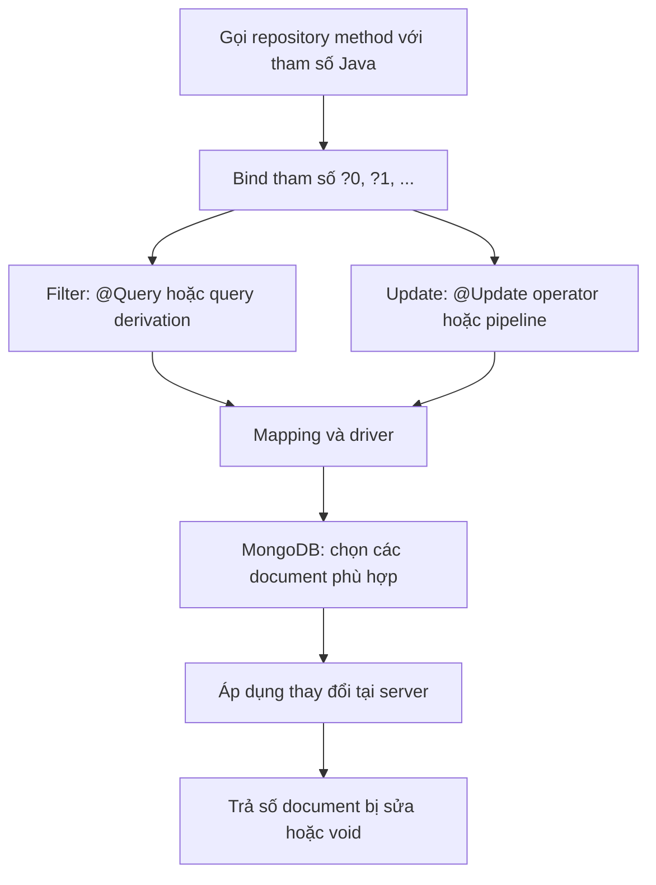

# Bind tham số trong toán tử cập nhật và update pipeline

## 1. Bài toán và mục tiêu

Một ứng dụng dùng Spring Data MongoDB để quản lý đơn hàng. Giao diện nghiệp vụ không muốn tải toàn bộ document, thay vài thuộc tính trong Java rồi gọi `save(...)` chỉ để cập nhật trạng thái, số lần thử xử lý hoặc giá tiền. Một thao tác như vậy có thể gây thêm lượt đọc, ghi đè dữ liệu đã thay đổi ở luồng khác và khiến quy tắc chuyển trạng thái bị phân tán trong các service.

Spring Data MongoDB hỗ trợ **repository update methods** bằng annotation `@Update`. Developer có thể đặt **điều kiện chọn document** trong `@Query` (hoặc derived query) và **biểu thức thay đổi** trong `@Update`. Tham số của method được bind vào filter và update, giúp tạo một thao tác ghi có chủ đích, không cần gửi nguyên entity trở lại MongoDB.

Ví dụ:

```java
@Query("{ 'tenantId': ?0, '_id': ?1, 'status': ?2 }")
@Update("{ '$set': { 'status': 'SHIPPED', 'updatedAt': ?3 } }")
long markShipped(
    String tenantId, String orderId,
    String expectedStatus, Instant now
);
```

Trong ví dụ này, `?0` đến `?3` là **tham số có chỉ số bắt đầu từ 0**. Filter yêu cầu đúng tenant, ID và trạng thái cũ; phần update chỉ thay trạng thái và thời điểm. Giá trị tham số được binding qua Spring Data, **không phải ghép chuỗi JSON thủ công**.

Bài thuộc chương **Ghi qua repository** của module **SPRING_DATA_MONGODB**. Phạm vi học của module là kết nối, ánh xạ document và thao tác MongoDB qua `MongoTemplate` hoặc repository; thiết kế query, aggregation, index, transaction, reactive access, kiểm thử và chẩn đoán hiệu năng dữ liệu. Ở đây, trọng tâm là **bind tham số trong toán tử update và update pipeline**, cùng khác biệt về semantics, phiên bản và an toàn dữ liệu.

Sau bài, bạn có thể:

1. Viết repository `@Query` kết hợp `@Update` với tham số positional `?0`, `?1` và kiểu BSON đúng.
2. Phân biệt **update operator document** với **aggregation update pipeline**.
3. Dùng `@Update(pipeline = {...})` để tính giá trị dựa trên field hiện tại bằng `$add`, `$ifNull`, `$cond` hoặc biểu thức tương ứng.
4. Nhận ra những tình huống cần `$literal`, giới hạn SpEL và cách tránh query injection.
5. Hiểu giới hạn về số document bị sửa, kiểu trả về, callbacks, auditing và version.
6. Chọn repository update hay `MongoTemplate` khi cần nhiều tùy chọn thao tác hơn, kiểm tra index và integration test hai nhánh xử lý.

## 2. Mô hình dữ liệu xuyên suốt

### 2.1. Document BSON mẫu

Giả sử collection `orders` có các document:

```javascript
db.orders.insertMany([
  {
    _id: "ord-101",
    tenantId: "tenant-a",
    status: "PAID",
    retryCount: 0,
    totalAmountVnd: NumberLong("150000"),
    customer: { display_name: "An" },
    note: "Đã thanh toán",
    createdAt: ISODate("2026-11-19T08:00:00Z"),
    updatedAt: ISODate("2026-11-19T08:00:00Z"),
    version: NumberLong("0")
  },
  {
    _id: "ord-102",
    tenantId: "tenant-a",
    status: "PAID",
    retryCount: 2,
    totalAmountVnd: NumberLong("200000"),
    customer: { display_name: "Ân" },
    note: "Chờ xác nhận",
    createdAt: ISODate("2026-11-19T09:00:00Z"),
    updatedAt: ISODate("2026-11-19T09:00:00Z"),
    version: NumberLong("3")
  },
  {
    _id: "ord-103",
    tenantId: "tenant-a",
    status: "CANCELLED",
    retryCount: 0,
    totalAmountVnd: NumberLong("50000"),
    customer: { display_name: "Bình" },
    createdAt: ISODate("2026-11-19T10:00:00Z"),
    updatedAt: ISODate("2026-11-19T10:00:00Z"),
    version: NumberLong("1")
  },
  {
    _id: "ord-201",
    tenantId: "tenant-b",
    status: "PAID",
    retryCount: 0,
    totalAmountVnd: NumberLong("300000"),
    customer: { display_name: "An" },
    createdAt: ISODate("2026-11-19T11:00:00Z"),
    updatedAt: ISODate("2026-11-19T11:00:00Z"),
    version: NumberLong("0")
  }
]);
```

Các giá trị trên chỉ dành cho **database thực hành**. Không chạy script lên production hoặc collection đang có ID trùng.

### 2.2. Domain Java

```java
import java.time.Instant;
import org.springframework.data.annotation.Version;
import org.springframework.data.mongodb.core.mapping.Document;
import org.springframework.data.mongodb.core.mapping.Field;
import org.springframework.data.mongodb.core.mapping.FieldType;
import org.springframework.data.mongodb.core.mapping.MongoId;

@Document(collection = "orders")
public record OrderDocument(
    @MongoId(FieldType.STRING) String id,
    String tenantId,
    String status,
    int retryCount,
    long totalAmountVnd,
    CustomerSnapshot customer,
    String note,
    Instant createdAt,
    Instant updatedAt,
    @Version Long version
) {}

record CustomerSnapshot(
    @Field("display_name") String displayName
) {}
```

`@MongoId(FieldType.STRING)` giúp dùng BSON String cho `_id`, còn `@Version` thể hiện ý định optimistic locking. Trong Java, `customer.displayName` tương ứng với đường dẫn BSON `customer.display_name`.

**Phân biệt:** Model Java được dùng để giải thích query mapping. Không phải mọi thao tác update ở repository sẽ dựng entity, chạy constructor, validator hoặc callback như đường `save(entity)`.

## 3. Hai phần của một repository write

Một repository write method cần trả lời hai câu hỏi độc lập:

1. **Chọn document nào?** — filter JSON do `@Query`, derived method name hoặc custom query định nghĩa.
2. **Thay đổi gì trên document đã chọn?** — nội dung `@Update`.



Trong thế hệ Spring Data MongoDB hỗ trợ `@Update` trên repository, các phương thức này được thiết kế để **thực hiện update**, không phải để lấy entity mới và đưa vào bộ nhớ. Việc method có tiền tố `find...` trong tên không nên khiến bạn nghĩ nó luôn thực hiện một lệnh `find` rồi `save`.

### 3.1. @Query làm filter

```java
@Query("{ 'tenantId': ?0, '_id': ?1 }")
```

Với arguments `("tenant-a", "ord-101")`, filter mong đợi tương đương:

```javascript
{ tenantId: "tenant-a", _id: "ord-101" }
```

### 3.2. @Update làm biến đổi

```java
@Update("{ '$set': { 'note': ?2 } }")
```

Với argument thứ ba `"Đã kiểm tra"`, update mong đợi:

```javascript
{ $set: { note: "Đã kiểm tra" } }
```

Cả `@Query` và `@Update` cùng tham chiếu tới **một danh sách tham số của method**, không có hai hệ thống đánh số độc lập.

## 4. Bind tham số positional: ?0, ?1, ?2

### 4.1. Một ví dụ đầy đủ

```java
import java.time.Instant;
import org.springframework.data.mongodb.repository.Query;
import org.springframework.data.mongodb.repository.Update;
import org.springframework.data.repository.Repository;

public interface OrderWriteRepository
    extends Repository<OrderDocument, String> {

    @Query("{ 'tenantId': ?0, '_id': ?1, 'status': ?2 }")
    @Update("{ '$set': { 'status': ?3, 'updatedAt': ?4 } }")
    long changeStatus(
        String tenantId,        // ?0
        String orderId,         // ?1
        String expectedStatus,  // ?2
        String newStatus,       // ?3
        Instant now             // ?4
    );
}
```

Ở đây `@Update` là annotation trong package **`org.springframework.data.mongodb.repository`**. Không nhầm annotation này với class **`org.springframework.data.mongodb.core.query.Update`** dùng khi xây lệnh với `MongoTemplate`.

Nếu service gọi:

```java
long modified = orderWriteRepository.changeStatus(
    authenticatedTenantId,
    "ord-101",
    "PAID",
    "READY_TO_SHIP",
    Instant.now()
);
```

thì filter gồm ID, tenant và trạng thái cũ; phần update chỉ gán trạng thái mới và thời gian. `authenticatedTenantId` phải lấy từ **authentication/authorization context đáng tin cậy**, không truyền thẳng một tenantId do client tự chọn.

### 4.2. Vì sao không đặt placeholder trong dấu nháy thủ công?

Tham số typed được bind thành giá trị BSON. Cú pháp nên dùng:

```java
@Query("{ 'tenantId': ?0 }")
@Update("{ '$set': { 'note': ?1 } }")
```

Không viết thành một chuỗi ghép kiểu:

```java
// KHÔNG phải một chiến lược binding đúng.
// String json = "{ '$set': { 'note': '" + untrustedNote + "' } }";
```

Ghép chuỗi có thể làm sai escaping, phá JSON hoặc tạo điều kiện cho query/update injection. Placeholder đưa giá trị vào **vị trí giá trị**, không biến dữ liệu người dùng thành tên toán tử hoặc đoạn mã JSON theo ý muốn.

### 4.3. Thứ tự đối số là một phần của hợp đồng

Sai lầm dễ gặp:

```java
// Query đang tìm ID bằng giá trị newStatus, một lỗi rất khó phát hiện.
@Query("{ 'tenantId': ?0, '_id': ?3 }")
@Update("{ '$set': { 'status': ?1 } }")
long broken(String tenantId, String newStatus, String id, String other);
```

Đoạn trên chỉ minh họa **mapping sai vị trí tham số**, không nên dùng. Một method có nhiều String dễ đảo nhầm đối số; giảm rủi ro bằng tên biến rõ ràng, service wrapper theo use case và integration test kiểm tra đúng ID/trạng thái.

### 4.4. Kiểu dữ liệu và BSON

Các tham số như `Instant`, enum, `ObjectId`, `UUID` hoặc value object có thể trải qua conversion/mapping khi được đưa vào query/update. Kiểm tra:

| Java argument | BSON kỳ vọng | Lỗi phổ biến |
| --- | --- | --- |
| `String` ID theo `@MongoId(FieldType.STRING)` | BSON String `_id` | Dữ liệu cũ lại lưu ObjectId |
| `Instant` | BSON Date | Document cũ lưu timestamp bằng String |
| `long` | Numeric BSON tương ứng | Collection trộn Int32/Int64/Double |
| `enum` | Thường là tên String | Custom converter đổi biểu diễn |
| `UUID` | Tùy UUID representation | Subtype 3/4 không khớp |
| `null` | BSON Null hoặc hành vi binding theo API | Nhầm null với missing/không cập nhật |

Vì vậy, chỉ chạy unit test cho method signature là chưa đủ. Hãy kiểm tra **BSON thực tế và kết quả** với phiên bản Spring Data, driver và server đang sử dụng.

## 5. Update operator document: $set, $inc, $unset, $setOnInsert

### 5.1. Dùng $set cập nhật field

```java
@Query("{ 'tenantId': ?0, '_id': ?1 }")
@Update("{ '$set': { 'note': ?2 } }")
long replaceNote(String tenantId, String orderId, String note);
```

Operator `$set` sửa trường `note` của document phù hợp. Nó không thay nguyên entity. Với record hiện hữu, những field khác như `createdAt`, `totalAmountVnd` vẫn được giữ nguyên trừ khi có thao tác khác sửa.

**Lưu ý:** `$set: { note: null }` là **ghi BSON Null**, không đồng nghĩa «bỏ qua field không được gửi»; `$unset` là thao tác **xóa field**.

### 5.2. Dùng $inc tính trên giá trị hiện tại

```java
@Query("{ 'tenantId': ?0, '_id': ?1, 'status': 'PAID' }")
@Update("{ '$inc': { 'retryCount': ?2 } }")
long addRetryCount(String tenantId, String orderId, int delta);
```

Nếu `retryCount = 2` và `delta = 1`, giá trị mới là 3. Server thực hiện phép cộng trên giá trị hiện tại, tránh pattern đọc 2 vào Java rồi ghi 3 bằng `$set` sau khi một luồng khác cũng đã tăng.

Nhưng **`$inc` không idempotent**: request bị gửi lại có thể tăng thêm lần nữa. Nếu cần «mỗi event logic chỉ được tính một lần», thiết kế idempotency key/expected state riêng.

### 5.3. Dùng $unset có điều kiện

```java
@Query("{ 'tenantId': ?0, '_id': ?1, 'status': 'NEW' }")
@Update("{ '$unset': { 'note': '' } }")
long clearDraftNote(String tenantId, String orderId);
```

Giá trị cho `$unset` chỉ là ký hiệu thao tác, không mang ý nghĩa chuỗi rỗng nghiệp vụ. Trường `note` sẽ **không còn** trong BSON nếu update thực hiện được; nó khác với `note: null`.

### 5.4. $setOnInsert và upsert

`$setOnInsert` chỉ gán giá trị khi một **upsert** tạo document mới. Trong một repository update method thông thường, đừng suy ra `@Update` tự bật upsert:

```javascript
// Đây là cú pháp mongosh minh họa một upsert thật sự.
db.orders.updateOne(
  { tenantId: "tenant-a", externalKey: "ext-1" },
  {
    $set: { lastSeenAt: new Date() },
    $setOnInsert: { status: "NEW", createdAt: new Date() }
  },
  { upsert: true }
);
```

Nếu business cần upsert, dùng `MongoOperations.upsert(Query, Update, EntityClass)` hoặc API tương ứng được phiên bản hỗ trợ, với unique index theo khóa nghiệp vụ. Không tự thêm `$setOnInsert` vào một `@Update` rồi mong nó biến thao tác thành upsert.

## 6. Derived query và @Query: chọn cách xác định document

Repository update method có thể dùng **query derivation** khi phương thức và phiên bản hỗ trợ hoặc kết hợp `@Query` để chỉ rõ filter.

Ví dụ có filter tường minh, dễ kiểm tra:

```java
@Query("{ 'tenantId': ?0, 'status': ?1 }")
@Update("{ '$set': { 'note': ?2 } }")
long setNoteForStatus(
    String tenantId, String status, String note
);
```

Với method này, **nhiều document** trong tenant có thể khớp filter. Tên `setNoteForStatus` không mang ý định «chỉ một document». Trong các phiên bản hỗ trợ repository `@Update`, cần kiểm thử phạm vi **multi-document update**, không dựa vào tên method hay kiểu trả về để nghĩ đây là `updateFirst`.

Một derived query minh họa trong những phiên bản hỗ trợ:

```java
@Update("{ '$inc': { 'retryCount': ?2 } }")
long findAndIncrementRetryCountByTenantIdAndId(
    String tenantId, String id, int delta
);
```

Tên method là cách biểu đạt predicate trên `tenantId` và `id`; `?2` là tham số cập nhật. Khả năng phân tích method name cho repository writes và giới hạn của từng thế hệ Spring Data phải được xác minh bằng **test khởi tạo repository**. Nếu tên method quá khó đọc hoặc predicate phức tạp, dùng `@Query` tường minh.

**Không nên tạo một repository rộng chỉ để thêm update:** Kế thừa `Repository<OrderDocument,String>` và chỉ khai báo những command mà nghiệp vụ cho phép. Điều đó tránh phơi bày `deleteAll()`, `saveAll()` hoặc update không có tenant filter.

## 7. Kiểu trả về của repository update

Một annotated update method thường hỗ trợ:

- `void` khi caller không cần số bản ghi bị thay đổi.
- Kiểu số được hỗ trợ như `long`/`Long` để biểu diễn **số document thực sự được sửa**.

Ví dụ:

```java
@Query("{ 'tenantId': ?0, '_id': ?1 }")
@Update("{ '$set': { 'note': ?2 } }")
long updateNoteCount(String tenantId, String id, String note);
```

**Không nên khai báo** kiểu trả về `OrderDocument` hoặc `Optional<OrderDocument>` rồi mặc định framework sẽ trả entity sau update:

```java
// KHÔNG phải hợp đồng trả entity được @Update bảo đảm.
// OrderDocument updateAndReturn(String tenantId, String id, String note);
```

### 7.1. Long/long đếm gì?

Giả sử:

```javascript
{ _id: "ord-101", tenantId: "tenant-a", note: "A" }
```

Nếu gọi `$set` để ghi lại `"A"`, document có thể khớp filter nhưng **không có thay đổi thực tế**. Một giá trị kiểu số trả về không nên được hiểu là «số document khớp» nếu contract trả số modified documents; xác minh behavior của phiên bản được sử dụng.

| Khái niệm | Ý nghĩa |
| --- | --- |
| Matched count | Số document phù hợp filter |
| Modified count | Số document có dữ liệu bị thay đổi |
| Number of array elements | Không được suy ra từ modified count |
| New entity | Không được trả tự động bởi repository `@Update` |

Nếu business cần **phân biệt matched và modified**, hoặc cần trả document sau cập nhật, hãy cân nhắc `MongoOperations.updateFirst(...)` trả `UpdateResult` hoặc `findAndModify(...)` trong một command adapter.

### 7.2. Vì sao update method thường không gọi lifecycle như save?

Repository `@Update` là **direct update operation**; nó không dựng đầy đủ entity mới rồi gọi cùng đường `save(entity)`. Vì thế không nên mặc định:

- Bean Validation chạy cho mọi field của entity.
- `BeforeSaveCallback`/`AfterSaveCallback` chạy như khi save.
- Auditing tự điền `updatedAt`.
- Domain event từ entity được phát như khi save.
- Constructor của entity sinh giá trị mặc định cho field thiếu.

Hãy tự gán những field cần thay đổi trong update và dùng validation ở đúng tầng nghiệp vụ hoặc schema validation của MongoDB.

## 8. Khi toán tử update thông thường chưa đủ

### 8.1. Mục tiêu tính lại từ chính document

Giả sử cần:

- Tăng `totalAmountVnd` dựa trên **giá trị hiện tại**.
- Nếu giá trị cũ bị thiếu/null thì coi là 0 theo quy tắc đã phê duyệt.
- Ghi thêm `updatedAt`.

Classic update operator hỗ trợ `$inc`; nhưng khi công thức phức tạp hơn, chẳng hạn «lấy max hiện tại», «tính theo các field khác nhau», «rẽ nhánh theo trạng thái», một **aggregation update pipeline** có thể phù hợp.

MongoDB hỗ trợ update bằng **aggregation pipeline** từ server phiên bản **4.2**. Tính năng này khác với lệnh `aggregate(...)` trả kết quả phân tích dữ liệu, dù chia sẻ nhiều aggregation expressions.

### 8.2. So sánh hai hình thức update

Classic update document:

```javascript
db.orders.updateOne(
  { _id: "ord-101", tenantId: "tenant-a" },
  { $inc: { retryCount: 1 } }
);
```

Aggregation update pipeline:

```javascript
db.orders.updateOne(
  { _id: "ord-101", tenantId: "tenant-a" },
  [
    {
      $set: {
        retryCount: {
          $add: [
            { $ifNull: ["$retryCount", 0] },
            1
          ]
        }
      }
    }
  ]
);
```

Hai câu lệnh đều làm `retryCount` tăng 1 trong dữ liệu mẫu, nhưng **đại diện hai cơ chế khác nhau**:

| Classic update document | Aggregation update pipeline |
| --- | --- |
| JSON object chứa các update operators như `$inc`, `$set` | Array các stage như `$set`, `$unset` |
| `$inc` tự xử lý phép tăng | Phải dùng biểu thức `$add` trong stage |
| `$set: {x: 1}` gán giá trị 1 | Pipeline `$set: {x: {$add: [...]}}` tính biểu thức |
| Thường đơn giản cho thay đổi một phần | Linh hoạt cho tính toán từ field hiện tại |
| Không phải aggregation stages | Chỉ dùng các stage được phép trong update pipeline |

## 9. Bind tham số trong @Update(pipeline = {...})

### 9.1. Ví dụ repository pipeline

Trong thế hệ Spring Data MongoDB có hỗ trợ thuộc tính `pipeline` của annotation `@Update`, **mỗi phần tử của mảng `pipeline` phải là một stage JSON hoàn chỉnh**, không phải những đoạn chuỗi JSON được tự động nối nhau. Ví dụ dưới đây giả định đã import `java.time.Instant`, `org.springframework.data.mongodb.repository.Query` và `org.springframework.data.mongodb.repository.Update` trong một repository interface:

```java
@Query("{ 'tenantId': ?0, '_id': ?1, 'status': 'PAID' }")
@Update(pipeline = {
    "{ '$set': { 'totalAmountVnd': { '$add': [ { '$ifNull': [ '$totalAmountVnd', 0 ] }, ?2 ] }, 'updatedAt': ?3 } }"
})
long addAmountByPipeline(
    String tenantId, String orderId,
    long amountDelta, Instant now
);
```

Khi gọi với `amountDelta = 25000L`, `?2` được bind vào một **giá trị số**, còn `"$totalAmountVnd"` trong pipeline là **biểu thức tham chiếu field của document hiện tại**.

**Giải thích từng thành phần:**

- `@Query`: chọn document đúng tenant/ID/trạng thái.
- `@Update(pipeline = {...})`: khai báo một array các stage update.
- `$ifNull: ["$totalAmountVnd", 0]`: khi field null/missing, dùng 0 thay thế.
- `$add: [..., ?2]`: tính giá trị mới bằng field hiện tại cộng delta.
- `updatedAt: ?3`: gán ngày giờ được caller cung cấp.

Nếu tổng tiền không được phép âm hoặc không được chỉnh khi đơn đã khóa, thêm validation/điều kiện nghiệp vụ; không coi việc tính trên server là đủ bảo đảm mọi invariant.

### 9.2. Hai stage trong pipeline

Một pipeline update có thể chứa nhiều stage được cho phép. Ví dụ mongosh:

```javascript
db.orders.updateOne(
  { _id: "ord-101", tenantId: "tenant-a" },
  [
    {
      $set: {
        retryCount: {
          $add: [{ $ifNull: ["$retryCount", 0] }, 1]
        }
      }
    },
    {
      $set: { retryFlag: { $gte: ["$retryCount", 3] } }
    }
  ]
);
```

Ở stage thứ hai, biểu thức đọc `retryCount` **sau khi stage trước đã thay đổi nó**, nên có thể tính flag từ giá trị mới. Đây là điểm khác với một update document thông thường, vốn không được dùng như một chuỗi stage phụ thuộc nhau.

Tương ứng trong repository, mỗi phần tử của `pipeline` phải là một JSON stage:

```java
@Query("{ 'tenantId': ?0, '_id': ?1 }")
@Update(pipeline = {
    "{ '$set': { 'retryCount': { '$add': [ { '$ifNull': [ '$retryCount', 0 ] }, ?2 ] } } }",
    "{ '$set': { 'retryFlag': { '$gte': [ '$retryCount', ?3 ] } } }"
})
long increaseAndFlag(
    String tenantId, String orderId,
    int delta, int threshold
);
```

### 9.3. Các stage được phép trong update pipeline

MongoDB update pipeline không cho phép tùy ý dùng mọi aggregation stage. Các stage phổ biến được hỗ trợ trong update pipeline gồm:

- `$set` (alias `$addFields`).
- `$unset` (alias `$project` trong những trường hợp phù hợp).
- `$replaceRoot` và `$replaceWith`.

Những stage như `$group`, `$lookup`, `$out`, `$merge` không phải stage cập nhật được dùng tự do trong update pipeline. Các update operators như `$inc` và `$push` cũng **không phải** pipeline stage: nếu muốn tăng số trong pipeline, dùng `$set` với `$add`.

## 10. $set trong classic update khác $set trong pipeline

Tên `$set` xuất hiện ở hai nơi dễ gây nhầm:

```javascript
// Classic update: đặt nguyên giá trị document con.
db.orders.updateOne(
  { _id: "ord-101" },
  { $set: { "stats": { current: 5 } } }
);

// Pipeline update: giá trị bên phải là aggregation expression.
db.orders.updateOne(
  { _id: "ord-101" },
  [
    { $set: {
        "stats.current": {
          $add: [ { $ifNull: ["$stats.current", 0] }, 1 ]
        }
    } }
  ]
);
```

Classic `$set` gán giá trị đã được gửi trong update. Pipeline `$set` có thể **đánh giá biểu thức** dựa trên document đang cập nhật. Nếu copy `{ $add: [...] }` từ pipeline vào classic `$set`, không thể mặc định server sẽ tính nó; có nguy cơ lưu object không đúng dữ liệu hoặc gặp lỗi schema.

### 10.1. Vì sao dùng pipeline?

| Use case | Cách thường đủ |
| --- | --- |
| Gán trạng thái cố định | Classic `$set` |
| Tăng bộ đếm | Classic `$inc` |
| Xóa field | Classic `$unset` |
| Cộng số A với một tham số | `$inc` nếu chỉ là phép cộng đơn |
| Tính field từ nhiều field hiện tại | Pipeline với `$add`, `$multiply`, `$cond` |
| Gán giá trị theo điều kiện trong document | Pipeline với `$cond` |
| Đồng thời chuẩn hóa thiếu/null và tính toán | Pipeline có `$ifNull`, với quy tắc nghiệp vụ rõ |

Không cần đưa mọi phép cập nhật đơn giản vào pipeline. Classic operator thường ngắn và dễ review hơn.

## 11. Bind chuỗi bắt đầu bằng $: khi cần $literal

Trong **aggregation expression**, String bắt đầu bằng `$` có thể được hiểu là **tham chiếu field** hoặc biến, không phải chuỗi cần lưu.

Giả sử người dùng nhập ghi chú:

```text
$discount
```

Khi đặt nó vào biểu thức pipeline, cần bảo đảm MongoDB nhận đúng một chuỗi literal, không cố đọc một field tên `discount`.

### 11.1. Cách dùng $literal

Trong mongosh:

```javascript
db.orders.updateOne(
  { _id: "ord-101", tenantId: "tenant-a" },
  [
    { $set: {
        note: { $literal: "$discount" }
    } }
  ]
);
```

Trong repository pipeline, có thể bind tham số vào `$literal`:

```java
@Query("{ 'tenantId': ?0, '_id': ?1 }")
@Update(pipeline = {
    "{ '$set': { 'note': { '$literal': ?2 } } }"
})
long writeLiteralNote(
    String tenantId, String orderId, String note
);
```

Ở đây `?2` vẫn được bind theo kiểu giá trị, không phải chuỗi JSON ghép tay. `$literal` bảo vệ **ngữ nghĩa của aggregation expression**: dữ liệu đầu vào được xem là giá trị, kể cả khi có dấu `$` ở đầu.

### 11.2. Không dùng $literal để sửa query injection do ghép chuỗi

Nếu developer xây một chuỗi JSON bằng cách nối input chưa tin cậy, `$literal` không tự giải quyết mọi vấn đề escaping hay operator injection. Trước hết cần sử dụng **parameter binding**, giới hạn field/operation được phép và không nhận một pipeline tùy ý từ client.

### 11.3. Giá trị null trong pipeline

```java
@Update(pipeline = {
    "{ '$set': { 'note': { '$ifNull': [ ?2, 'Chưa có ghi chú' ] } } }"
})
```

Biểu thức này chọn fallback khi tham số là null; đó là **quy tắc chủ động của ứng dụng**, không phải quy tắc mặc định của Spring Data. Đừng tự biến mọi giá trị null thành một chuỗi hoặc trạng thái nghiệp vụ nếu dữ liệu thiếu có ý nghĩa khác. Với optional input, có thể cần phân biệt «không được gửi» và «yêu cầu ghi null».

## 12. SpEL trong repository update: chỉ dùng khi có lý do

Spring Data có hỗ trợ **SpEL** trong một số chuỗi JSON query/update bằng cú pháp dạng `?#{...}`. Biểu thức được Spring Data đánh giá ở **phía ứng dụng** trước khi tạo truy vấn, không phải một toán tử MongoDB được server thực thi.

Ví dụ minh họa cách tham chiếu tham số của method:

```java
@Query("{ 'tenantId': ?#{[0]}, '_id': ?#{[1]} }")
@Update("{ '$set': { 'note': ?#{[2]} } }")
long updateUsingSpel(
    String tenantId, String orderId, String note
);
```

Trong trường hợp này, positional binding `?0`/`?1`/`?2` đã đủ và **dễ đọc hơn**. SpEL nên dùng khi cần một biểu thức client-side thực sự, và phải kiểm tra API/extension support trong phiên bản của dự án.

### 12.1. Không dùng SpEL để cho client chọn tên toán tử

Không nên cho client truyền `"$set"`, `"$unset"` hay một đoạn JSON để ứng dụng ráp vào annotation:

```text
Nguy hiểm về thiết kế:
  client chọn operator + field path + raw JSON update
  → repository vô tình trở thành API thay đổi document tùy ý.
```

Nếu API cho phép chọn kiểu thay đổi, dùng **allowlist nghiệp vụ**:

- `markShipped(orderId)`: trạng thái `READY_TO_SHIP → SHIPPED`.
- `replaceNote(orderId, note)`: chỉ sửa field `note`.
- `incrementRetryCount(orderId)`: chỉ tăng bộ đếm khi trạng thái phù hợp.

SpEL có thể tăng mức linh hoạt nhưng cũng làm query khó review và có thể gây lỗi bảo mật khi xử lý biểu thức đầu vào không tin cậy. Không đánh giá chuỗi expression do người dùng gửi như mã lệnh.

### 12.2. Không nhầm SpEL với aggregation expression

| Cú pháp | Ai đánh giá? | Ví dụ |
| --- | --- | --- |
| `?0` | Spring Data binding | Giá trị method argument |
| `?#{[0]}` | SpEL phía ứng dụng | Chọn/biến đổi giá trị argument |
| `"$totalAmountVnd"` | MongoDB trong aggregation expression | Tham chiếu field hiện tại |
| `"$$NOW"` | MongoDB trong aggregation expression | Biến thời gian hệ thống trong context phù hợp |
| `$add` | MongoDB trong aggregation expression | Tính toán số |
| `$literal` | MongoDB trong aggregation expression | Trả literal, không diễn giải expression bên trong |

Đây là hai **thời điểm xử lý khác nhau**. Dùng SpEL để tính trên **giá trị field hiện tại của document trên server** là nhầm mô hình: biểu thức SpEL của repository không có document MongoDB hiện tại để đọc.

## 13. Mapping @Field, ID và đường dẫn lồng nhau

### 13.1. Field Java và BSON

Model có:

```java
record CustomerSnapshot(
    @Field("display_name") String displayName
) {}
```

Vì vậy:

| Java property path | BSON field path |
| --- | --- |
| `id` | `_id` |
| `customer.displayName` | `customer.display_name` |
| `totalAmountVnd` | `totalAmountVnd` |
| `updatedAt` | `updatedAt` |

Trong `@Query`, một số cơ chế mapping Spring Data có thể dịch tên field theo entity metadata. Tuy nhiên, khi nhúng **chuỗi JSON update/pipeline**, hãy kiểm tra **BSON cuối**; không mặc định mọi trường hợp trong aggregation expression `"$customer.displayName"` sẽ được ánh xạ giống `Criteria.where("customer.displayName")`.

Để minh họa field vật lý rõ ràng:

```java
@Query("{ 'tenantId': ?0, '_id': ?1 }")
@Update("{ '$set': { 'customer.display_name': ?2 } }")
long updateCustomerDisplayName(
    String tenantId, String orderId, String displayName
);
```

Ở đây phần update chỉ ra **đường dẫn BSON** mà schema mẫu đã quy định. Khi dự án dùng annotation field mapping phức tạp hoặc custom converter, thực hiện integration test để xác minh đường dẫn thực tế.

### 13.2. Thay một field con khác thay cả subdocument

Classic update:

```javascript
{ $set: { "customer.display_name": "Tên mới" } }
```

khác với:

```javascript
{ $set: { customer: { display_name: "Tên mới" } } }
```

Cách thứ hai thay cả giá trị subdocument `customer`, có thể làm mất những field khác của customer snapshot. Khi bind một object phức tạp vào `?2`, phải xác định đó là **thay toàn bộ object** hay chỉ cập nhật một field con.

### 13.3. Mảng document và positional update

Nếu domain có `items` chứa SKU, không thể an toàn chọn «một dòng duy nhất» chỉ bằng method parameter SKU khi cùng SKU có thể lặp trong mảng. Cập nhật mảng có thể cần `$[line]` và `arrayFilters`.

Annotated `@Update` phù hợp với operator update ngắn, nhưng khi cần truyền filter array, nhiều option, optimistic version và write result chi tiết, `MongoTemplate`/`MongoOperations` thường tạo contract dễ kiểm soát hơn. Đừng mặc định cú pháp repository update cung cấp mọi option của driver.

## 14. Giới hạn về phiên bản và API

Khả năng sử dụng các ví dụ phụ thuộc vào nhiều lớp:

| Lớp | Cần xác minh |
| --- | --- |
| MongoDB server | Có hỗ trợ update aggregation pipeline không? Mốc server 4.2 |
| MongoDB Java driver | Có thể gửi update kiểu BSON document hoặc list of stages không? |
| Spring Data MongoDB | Annotation `@Update`, phần tử `value`/`pipeline`, repository write semantics |
| Spring Data Commons | Cơ chế query method, parameter binding và SpEL |
| Spring Boot | Dependency version thực tế, repository scanning và converter |
| Domain schema | BSON type, aliases, unique/index, validation |

### 14.1. Quy trình kiểm tra

1. Xác định chính xác version MongoDB server, Spring Boot, Spring Data MongoDB và driver mà ứng dụng đang dùng.
2. Mở chữ ký của **`org.springframework.data.mongodb.repository.Update`** trong dependency thực tế: có `pipeline()` không, nhận `String[]` như thế nào?
3. Viết một test khởi tạo repository chứa `@Query + @Update`.
4. Test cả operator update và pipeline update trên MongoDB server của dự án.
5. Đọc BSON trước/sau, kiểm tra return type và số document bị sửa.
6. Thử null, string bắt đầu bằng `$`, lỗi kiểu BSON, trạng thái không khớp.

Không lấy ví dụ của phiên bản mới hơn làm cam kết rằng một dự án đang dùng framework cũ sẽ biên dịch được. Nếu API repository không hỗ trợ expression mong muốn, **chuyển sang `MongoTemplate`**, không cố tạo phép biến đổi String mơ hồ.

## 15. Return count, multi-document update và phạm vi nghiệp vụ

### 15.1. Một query rộng có thể sửa nhiều document

```java
@Query("{ 'tenantId': ?0, 'status': 'PAID' }")
@Update("{ '$set': { 'note': ?1 } }")
long updateAllPaidNotes(String tenantId, String note);
```

Method không truyền `orderId`, nên có thể có **nhiều document khớp**. Trong các thế hệ Spring Data MongoDB hỗ trợ annotated repository updates theo cơ chế cập nhật nhiều document, phải xem thao tác như một **bulk-like operation về phạm vi**, không phải «find một object rồi sửa».

Rủi ro:

- Sửa hàng nghìn đơn trong một request chỉ vì filter quá rộng.
- Tác động nhầm tenant nếu tenant parameter do client tự cung cấp.
- Tốn index maintenance và replication.
- Lầm tưởng giá trị return `1` là «sửa một field», thay vì «sửa một document».

Nếu business chỉ sửa **một** đơn, filter nên chứa tenant + ID và expected status/version phù hợp. API chỉ nên phơi bày command có nghĩa nghiệp vụ.

### 15.2. Query thiếu điều kiện nào là nguy hiểm?

```java
// Rủi ro khi dùng trong dữ liệu nhiều tenant:
@Query("{ 'status': 'PAID' }")
@Update("{ '$set': { 'note': ?0 } }")
long updatePaidAcrossTenants(String note);
```

Ví dụ này là **anti-pattern**. Trong kiến trúc multi-tenant, mọi command không thuộc tác vụ quản trị xuyên tenant đã được phê duyệt phải ràng buộc đúng tenant và authorization.

### 15.3. Atomicity

MongoDB bảo đảm tính nguyên tử cho thay đổi **trên một document**. Một repository update tác động nhiều document **không tự trở thành một transaction chung**. Khi ghi nhiều document và một thao tác thất bại giữa chừng, phải có chính sách retry, đối soát hoặc transaction nếu bất biến bắt buộc.

## 16. Concurrency, expected state và @Version

### 16.1. State transition bằng filter có điều kiện

Ví dụ chuyển `PAID → READY_TO_SHIP`:

```java
@Query("{ 'tenantId': ?0, '_id': ?1, 'status': 'PAID' }")
@Update("{ '$set': { 'status': 'READY_TO_SHIP', 'updatedAt': ?2 } }")
long prepareForShipping(
    String tenantId, String orderId, Instant now
);
```

MongoDB tìm và cập nhật trong một operation, nên hai request cạnh tranh đều phải xét lại điều kiện `status: 'PAID'` khi thực hiện. Thao tác thành công đầu tiên làm trạng thái đổi; thao tác sau thường không match điều kiện trạng thái cũ.

### 16.2. @Version không phải phép màu

`@Version` cung cấp cơ chế optimistic locking cho những đường persistence được hỗ trợ. Nhưng một repository update annotation không có nghĩa:

- Nó đã tải entity và biết expected version của request.
- Nó tự từ chối ghi nếu người dùng đã đọc version cũ.
- Mọi cách update đều gọi các callback/validation như save.

Khi cần kiểm tra version, đặt **expected version** vào filter và xử lý số document modified:

```java
@Query("{ 'tenantId': ?0, '_id': ?1, 'version': ?2, 'status': 'PAID' }")
@Update("{ '$set': { 'status': 'READY_TO_SHIP', 'updatedAt': ?3 }, '$inc': { 'version': 1 } }")
long prepareWithExpectedVersion(
    String tenantId, String orderId,
    long expectedVersion, Instant now
);
```

Đoạn minh họa **tự chỉ rõ** việc tăng version; kiểm tra liệu framework phiên bản dự án có quy tắc tự tăng `@Version` trong update operation hay không để tránh hai cơ chế tác động không mong muốn. Với thiết kế concurrency, cần test kết quả của hai thao tác đồng thời chứ không chỉ unit test trên một luồng.

### 16.3. Retry không mặc định idempotent

`$set` cùng giá trị thường có tính idempotent về field được gán; `$inc` và pipeline `$add` không có tính này nếu request được thực hiện lại. Nếu request upsert/update có side effect như email hoặc message, cần idempotency/outbox phù hợp và kiểm tra retryable writes/transaction của driver trong kiến trúc thật.

## 17. Khi repository update không đủ: MongoOperations và MongoTemplate

Trong ứng dụng thực tế, những trường hợp sau thường nên dùng `MongoOperations` hoặc `MongoTemplate`:

- Cần `UpdateResult` để phân biệt matched/modified/upserted ID.
- Cần `arrayFilters`, collation, hint, write options hoặc query được dựng động.
- Muốn `findAndModify` trả document sau update.
- Cần pipeline xây từ nhiều stage động, tránh annotation JSON quá dài.
- Muốn kiểm soát rõ session/transaction, retry và concurrency.

### 17.1. Classic update với Query và Update

```java
import java.time.Instant;
import com.mongodb.client.result.UpdateResult;
import org.springframework.data.mongodb.core.MongoOperations;
import org.springframework.data.mongodb.core.query.Criteria;
import org.springframework.data.mongodb.core.query.Query;
import org.springframework.data.mongodb.core.query.Update;

public final class OrderCommandGateway {
    private final MongoOperations mongo;

    public OrderCommandGateway(MongoOperations mongo) {
        this.mongo = mongo;
    }

    public UpdateResult markPrepared(
        String tenantId, String orderId, Instant now
    ) {
        Query query = Query.query(
            Criteria.where("tenantId").is(tenantId)
                .and("id").is(orderId)
                .and("status").is("PAID")
        );

        Update update = new Update()
            .set("status", "READY_TO_SHIP")
            .set("updatedAt", now);

        return mongo.updateFirst(query, update, OrderDocument.class);
    }
}
```

Ở đây `Update` là **class** thuộc `core.query`, không phải annotation `repository.Update`. Type `OrderDocument.class` giúp ánh xạ property Java/ID. Giá trị `tenantId` phải được service xác thực trước khi gọi gateway.

### 17.2. Pipeline update với AggregationUpdate

Các thế hệ Spring Data MongoDB hiện đại có thể hỗ trợ `AggregationUpdate` để xây pipeline bằng Java API. Một ví dụ khái niệm:

```java
import org.springframework.data.mongodb.core.aggregation.AggregationUpdate;

AggregationUpdate update = AggregationUpdate.update()
    .set("retryCount")
    .toValue(
        org.springframework.data.mongodb.core.aggregation
            .ArithmeticOperators.Add.valueOf("retryCount").add(1)
    );
```

Ví dụ này nhấn mạnh **cách biểu diễn update pipeline bằng API**, nhưng các method chain và cách xử lý field null phụ thuộc phiên bản; hãy xác minh chữ ký thực tế. Một cách khác là dùng `BasicUpdate`/driver pipeline có kiểm soát với BSON đã được kiểm thử.

**Lưu ý:** Nếu `retryCount` có thể null/missing, biểu thức đơn giản `Add.valueOf(...)` không tự hiện thực toàn bộ `$ifNull` của ví dụ repository. Phải bổ sung biểu thức null handling tương ứng.

## 18. Reactive repository writes và transactional boundary

Trong Spring Data MongoDB reactive, developer có thể viết reactive repository và template, nhưng **khả năng annotated repository update và kiểu trả về reactive** cần được xác minh theo phiên bản. Không giả định có thể chỉ đổi `long` thành `Mono<Long>` trên mọi thế hệ thư viện.

Khi update phức tạp, dùng `ReactiveMongoOperations` tương ứng:

```java
import reactor.core.publisher.Mono;
import com.mongodb.client.result.UpdateResult;
import org.springframework.data.mongodb.core.ReactiveMongoOperations;
import org.springframework.data.mongodb.core.query.Criteria;
import org.springframework.data.mongodb.core.query.Query;
import org.springframework.data.mongodb.core.query.Update;

public final class ReactiveOrderCommandGateway {
    private final ReactiveMongoOperations mongo;

    public ReactiveOrderCommandGateway(ReactiveMongoOperations mongo) {
        this.mongo = mongo;
    }

    public Mono<UpdateResult> markPrepared(
        String tenantId, String orderId
    ) {
        Query query = Query.query(
            Criteria.where("tenantId").is(tenantId)
                .and("id").is(orderId)
                .and("status").is("PAID")
        );
        Update update = new Update()
            .set("status", "READY_TO_SHIP");

        return mongo.updateFirst(query, update, OrderDocument.class);
    }
}
```

Trong stack reactive, `Mono<UpdateResult>` biểu diễn kết quả bất đồng bộ. Không dùng `block()` tùy tiện trong đường xử lý non-blocking; transaction manager và session cũng phải tương thích reactive.

### 18.1. Transaction không sửa filter sai

Nếu repository update không có tenant filter hoặc pipeline thay sai trường, đưa nó vào `@Transactional` **không sửa được sai lầm đó**. Transaction cần cho bất biến xuyên nhiều document/collection, còn một state transition trên một document thường được bảo vệ bằng filter có điều kiện và atomic update.

## 19. Index, query shape và chẩn đoán hiệu năng

### 19.1. Index theo cách chọn document

Một method cập nhật theo `tenantId + _id` thường tận dụng index mặc định trên `_id` để tìm document, rồi kiểm tra tenant. Không cần tạo index tổng hợp chỉ vì method có hai điều kiện.

Với một command được phê duyệt chạy hàng loạt theo `tenantId + status`:

```javascript
db.orders.createIndex(
  { tenantId: 1, status: 1 },
  { name: "ix_orders_tenant_status" }
);
```

Index này là **ứng viên**; cần kiểm tra workload và chi phí index maintenance. Khi update thay field đã được index, MongoDB phải duy trì khóa index tương ứng.

### 19.2. Dùng explain để xem filter

```javascript
db.orders.find({
  tenantId: "tenant-a",
  status: "PAID"
}).explain("executionStats");
```

Đây là cách khảo sát kế hoạch chọn document tương ứng, **không phải benchmark đầy đủ chi phí update/pipeline write**. Quan sát `winningPlan`, `IXSCAN`/`COLLSCAN`, `totalKeysExamined`, `totalDocsExamined` và `nReturned`.

### 19.3. Pipeline không đồng nghĩa nhanh hơn

Một pipeline update có thể tránh lượt read-modify-save giữa application và server, nhưng biểu thức phức tạp vẫn tiêu thụ CPU, index maintenance và băng thông replication. Benchmark cần so sánh:

| Phương án | Chi phí quan trọng |
| --- | --- |
| Repository classic `$inc` | Một update, phép tăng đơn giản |
| Repository pipeline `$set + $add` | Một update, đánh giá biểu thức |
| `find → save` ở Java | Có thêm lượt đọc, rủi ro ghi đè và mapping entity |
| MongoTemplate update với options | Linh hoạt, thêm trách nhiệm viết/kiểm thử |

Không lấy một bài test với bốn document làm kết luận tối ưu cho hàng triệu document. Đo với dữ liệu và query shapes đại diện, nhiều tenant, trạng thái phổ biến và điều kiện concurrency thực tế.

## 20. Kiểm thử binding: phải kiểm cả BSON và kết quả

### 20.1. Ma trận test bắt buộc

| Kịch bản | Kỳ vọng |
| --- | --- |
| Bind đúng tenant/ID | Chỉ document tương ứng được sửa |
| Sai tenant | Không sửa record thuộc tenant khác |
| Sai expected status | Không tự chuyển trạng thái |
| `$set` với String chứa dấu nháy | Bind không làm vỡ JSON |
| `$set` với giá trị null | Xác minh BSON Null và chính sách nghiệp vụ |
| `$inc` với delta > 0 | Tăng đúng, không ghi đè field khác |
| Gọi `$inc` lại | Tăng lần nữa; test idempotency nếu cần |
| Pipeline `$add` | Tính từ giá trị field hiện tại |
| Pipeline với field null/missing | `$ifNull` theo đúng rule |
| Pipeline bind String bắt đầu `$` | Dùng `$literal` để giữ giá trị |
| Hai stage pipeline | Stage sau đọc giá trị đã xử lý của stage trước |
| Alias `@Field` | Field BSON đúng, không sinh field Java alias sai |
| Repository return `long` | Hiểu đó là modified docs theo version |
| Concurrency với version | Không ghi đè khi expected version cũ |
| Update nhiều document | Chỉ trong phạm vi tenant/filter |
| Callback/auditing | Không tự giả định chạy giống save |

### 20.2. Integration test cho operator update

Khung JUnit 5 dưới đây giả định đã cấu hình MongoDB test và inject repository/`MongoOperations`. Nó minh họa mục tiêu, **không phải class có thể chạy độc lập chỉ bằng copy**:

```java
import static org.junit.jupiter.api.Assertions.*;
import java.time.Instant;
import org.junit.jupiter.api.Test;
import org.springframework.data.mongodb.core.MongoOperations;
import org.springframework.data.mongodb.core.query.Criteria;
import org.springframework.data.mongodb.core.query.Query;

class OrderWriteRepositoryIntegrationTest {
    OrderWriteRepository repository;  // Inject từ test context.
    MongoOperations mongo;            // Inject từ test context.

    @Test
    void updateMustNotTouchOtherTenant() {
        Instant when = Instant.parse("2026-11-20T08:00:00Z");
        long modified = repository.changeStatus(
            "tenant-b", "ord-101", "PAID", "READY_TO_SHIP", when
        );
        assertEquals(0, modified);

        var query = Query.query(
            Criteria.where("tenantId").is("tenant-a")
                .and("id").is("ord-101")
        );
        var saved = mongo.findOne(query, OrderDocument.class);
        assertNotNull(saved);
        assertEquals("PAID", saved.status());
    }
}
```

Test cần seed lại fixture và cleanup giữa các lần chạy; nếu record `ord-101` đã đổi trạng thái ở bài test khác, assertion không còn đáng tin. Kiểm tra cả field không đổi, thời gian, version và kiểu BSON thực tế.

### 20.3. Integration test cho update pipeline

```java
@Test
void pipelineAddsToCurrentAmount() {
    Instant when = Instant.parse("2026-11-20T09:00:00Z");
    long modified = repository.addAmountByPipeline(
        "tenant-a", "ord-101", 25000L, when
    );
    assertEquals(1, modified);

    OrderDocument current = mongo.findOne(
        Query.query(
            Criteria.where("tenantId").is("tenant-a")
                .and("id").is("ord-101")
        ),
        OrderDocument.class
    );
    assertNotNull(current);
    assertEquals(175000L, current.totalAmountVnd());
}
```

Method `addAmountByPipeline` trong đoạn này giả định được khai báo đúng như **phiên bản hoàn chỉnh** tại mục 9.1; khi ghép vào test class thực tế, bổ sung imports, test fixtures, repository bean và cơ sở dữ liệu test riêng. Nếu field có số liệu cũ khác 150000, expected result phải được thay đổi theo fixture.

### 20.4. Kiểm tra BSON document vật lý

```javascript
db.orders.findOne(
  { _id: "ord-101", tenantId: "tenant-a" },
  {
    status: 1,
    totalAmountVnd: 1,
    updatedAt: 1,
    customer: 1,
    version: 1
  }
);
```

Không chỉ assert entity Java. Đọc BSON để xác minh:

- `_id` vẫn là String.
- `totalAmountVnd` còn đúng kiểu số.
- `updatedAt` được ghi dạng BSON Date.
- Pipeline không sinh field sai do mapping `@Field`.
- `status` và `version` đúng như điều kiện/update đã quyết định.

## 21. Các lỗi thường gặp

| Triệu chứng | Nguyên nhân có thể | Hướng xử lý |
| --- | --- | --- |
| Query không sửa document nào | Đảo `?0`/`?1`, sai ID, tenant hoặc expected status | Kiểm tra binding và BSON filter |
| JSON trong `@Update` không parse được | Thiếu ngoặc/nháy, stage pipeline không hoàn chỉnh | Test khởi tạo repository, dùng JSON stage đầy đủ |
| Giá trị ngày giờ thành String | Bind kiểu sai hoặc converter tùy biến | Kiểm tra BSON Date và type mapping |
| Pipeline tính sai field | Dùng tên Java alias thay vì BSON path trong expression | Xác minh `@Field` và BSON cuối |
| String `"$discount"` bị hiểu là field | Thiếu `$literal` trong aggregation expression | Bọc giá trị bằng `$literal` |
| `$inc` không hoạt động trong pipeline | Nhầm update operator với aggregation stage | Dùng `$set + $add` |
| Thêm `$group` vào update pipeline | Stage không được hỗ trợ cho update | Dùng các stage được phép |
| Method trả `long=0` nhưng record có tồn tại | No-op hoặc expected state không khớp | Phân biệt matched/modified qua MongoTemplate |
| Annotation update không chạy auditing callback | Direct update không đi qua save entity | Gán `updatedAt`/audit theo policy rõ |
| Version vẫn ghi đè | Không kiểm tra expected version, hoặc dựa sai vào auto version handling | Thêm version predicate, test concurrency |
| Sửa nhiều tenant | Filter thiếu tenant hoặc tenant từ client không đáng tin | Authorization và tenant scoping |
| Trùng tác dụng sau retry | `$inc`/pipeline `$add` không idempotent | Idempotency key, retry policy |
| `@Update(pipeline=...)` không biên dịch | Phiên bản Spring Data chưa có API | Đối chiếu dependency, dùng MongoTemplate |
| Repository bị trả entity ngoài mong đợi | Coi annotated update là find-and-modify | Dùng findAndModify hoặc đọc lại có điều kiện |
| SpEL expression phức tạp lỗi | Sai context, tạo JSON không an toàn | Ưu tiên positional binding; test SpEL |
| Thao tác chậm | Filter thiếu index, pipeline phức tạp, update nhiều docs | Kiểm tra filter/explain và đo write |

## 22. Bài thực hành có lời giải

### Bài 1 — Đánh số tham số đúng

**Đề bài:** Viết repository method nhận `tenantId`, `id` và `note`, chỉ đổi note của đúng đơn.

**Lời giải:**

```java
@Query("{ 'tenantId': ?0, '_id': ?1 }")
@Update("{ '$set': { 'note': ?2 } }")
long updateNote(
    String tenantId, String id, String note
);
```

`?0` là tenant, `?1` là ID, `?2` là note. Không đặt `?2` trong dấu nháy như một chuỗi JSON đã được ghép tay.

### Bài 2 — Ghi ngày sửa, không thay ngày tạo

**Đề bài:** Chỉ cập nhật `updatedAt` và `status` khi đơn đang `PAID`.

**Lời giải:**

```java
@Query("{ 'tenantId': ?0, '_id': ?1, 'status': 'PAID' }")
@Update("{ '$set': { 'status': 'READY_TO_SHIP', 'updatedAt': ?2 } }")
long prepare(String tenantId, String id, Instant now);
```

Không gán lại `createdAt`. Khi status đã thay đổi hoặc không đúng tenant, update không được phép sửa.

### Bài 3 — $inc hay pipeline?

**Đề bài:** Tăng bộ đếm `retryCount` thêm một số nguyên do application service cung cấp. Nên dùng gì?

**Lời giải:** Nếu chỉ cộng một số vào field numeric hợp lệ, classic `$inc` đơn giản hơn:

```java
@Query("{ 'tenantId': ?0, '_id': ?1 }")
@Update("{ '$inc': { 'retryCount': ?2 } }")
long increment(String tenantId, String id, int delta);
```

Khi cần thêm công thức từ nhiều field và quy tắc null handling, cân nhắc pipeline. Cả hai cách cộng đều có thể bị tăng lặp nếu request retry không được kiểm soát.

### Bài 4 — Bind trong pipeline $add

**Đề bài:** Tăng tổng tiền thêm `delta` bằng giá trị hiện tại cộng tham số, nếu field null/missing thì coi như 0 theo yêu cầu nghiệp vụ.

**Lời giải:**

```java
@Query("{ 'tenantId': ?0, '_id': ?1 }")
@Update(pipeline = {
    "{ '$set': { 'totalAmountVnd': { '$add': [ { '$ifNull': [ '$totalAmountVnd', 0 ] }, ?2 ] } } }"
})
long addTotal(String tenantId, String id, long delta);
```

`"$totalAmountVnd"` là field reference của MongoDB, `?2` là tham số được bind từ Java. Hãy kiểm tra delta hợp lệ và kiểu số BSON.

### Bài 5 — Chuỗi bắt đầu bằng $

**Đề bài:** Người dùng gửi ghi chú `"$discount"`; khi ghi note bằng pipeline, làm sao bảo đảm lưu literal?

**Lời giải:**

```java
@Query("{ 'tenantId': ?0, '_id': ?1 }")
@Update(pipeline = {
    "{ '$set': { 'note': { '$literal': ?2 } } }"
})
long writeNote(String tenantId, String id, String note);
```

`$literal` giúp MongoDB không xem `"$discount"` là field reference trong aggregation expression.

### Bài 6 — Phát hiện nguy cơ multi-document

**Đề bài:** Method chỉ lọc `tenantId + status` và dùng `$set`. Một tenant có 5.000 đơn `PAID`. Có thể coi method chỉ sửa một đơn không?

**Lời giải:** Không. Filter có thể khớp 5.000 document. Annotated repository update theo phạm vi matching query có thể sửa nhiều document. Nếu nghiệp vụ chỉ cho sửa một đơn, thêm ID và expected status/version vào filter; review authorization và load.

### Bài 7 — Vì sao entity callback không chạy?

**Đề bài:** Domain sử dụng callback đặt `updatedAt` khi `save(entity)`. Sau `@Update`, `updatedAt` không thay đổi. Nguyên nhân?

**Lời giải:** Repository annotated update là direct update, không nhất thiết đi qua entity lifecycle như save. Đặt `updatedAt` rõ trong `$set` hoặc pipeline, và kiểm thử cơ chế auditing thật của dự án.

### Bài 8 — Expected version

**Đề bài:** Chỉ cập nhật khi `version` vẫn bằng giá trị người dùng đọc. Một request khác đã tăng version. Viết hướng xử lý.

**Lời giải:** Đưa `version: ?2` vào `@Query`; update các field cần sửa và tăng version theo contract đã kiểm chứng:

```java
@Query("{ 'tenantId': ?0, '_id': ?1, 'version': ?2 }")
@Update("{ '$set': { 'note': ?3 }, '$inc': { 'version': 1 } }")
long updateIfVersionMatches(
    String tenantId, String id,
    long expectedVersion, String note
);
```

Kết quả modified count bằng 0 có thể là xung đột version, không tồn tại hoặc sai tenant. Không tiết lộ record ngoài tenant; xác minh cơ chế auto version của framework trước khi dùng manual increment cùng annotation.

### Bài 9 — Khi nào bỏ @Update để dùng MongoTemplate?

**Đề bài:** Service cần biết cả `matchedCount` và `modifiedCount`, gắn `arrayFilters`, cho phép collation và đôi lúc trả document sau update.

**Lời giải:** Ưu tiên command adapter dùng `MongoOperations.updateFirst(...)`, `Update.filterArray(...)` hoặc `findAndModify(...)` theo đúng use case. Repository `@Update` với return count không cung cấp toàn bộ các tùy chọn và kết quả chi tiết đó như một hợp đồng mặc định.

### Bài 10 — Viết integration test thay vì chỉ mock

**Đề bài:** Một unit test xác nhận service đã gọi method `addAmountByPipeline(...)`. Đã đủ để tin tổng tiền được tăng đúng chưa?

**Lời giải:** Chưa. Cần seed MongoDB test với tổng 150000, gọi delta 25000, đọc document để xác nhận tổng 175000, kiểu BSON numeric và các field khác giữ nguyên. Test thêm tenant sai, trạng thái không khớp, null/missing, concurrency và string literal bắt đầu bằng `$`.

## 23. Checklist bàn giao

| Câu hỏi review | Bằng chứng hoàn thành |
| --- | --- |
| Filter xác định đúng document? | `@Query`/derived query được integration test |
| Tham số đánh số đúng? | `?0`, `?1`, ... và arguments test |
| Có nối input vào JSON update? | Không; dùng parameter binding |
| Repository update chọn một hay nhiều document? | Contract và test scope |
| Có ràng buộc tenant và authorization? | Tenant từ security context, không từ client tùy ý |
| Classic operator hay pipeline đúng use case? | `$inc` vs `$set + $add` được phân biệt |
| Pipeline stage có hợp lệ? | Chỉ dùng các stage update được hỗ trợ |
| String bắt đầu bằng $ có được giữ nguyên? | Test `$literal` |
| Null/missing có chính sách hợp lệ? | Test `$ifNull` và BSON |
| @Field aliases có được map đúng? | Đọc document và command BSON |
| ID/Date/numeric BSON có đúng type? | Integration test với database thật |
| Đã phân biệt modified và matched? | Return count hoặc UpdateResult từ MongoTemplate |
| Có xử lý retry và idempotency? | Test `$inc`/`$add` lặp |
| Có expected status/version? | Conditional update và concurrency test |
| Auditing/callback có được hiểu đúng? | Không dựa vào save lifecycle mặc định |
| Khi cần arrayFilters/hint/collation thì làm gì? | Cân nhắc MongoTemplate |
| Version MongoDB hỗ trợ pipeline update? | Server 4.2+ và dependency thực tế |
| Có index đúng filter? | `getIndexes()`, `explain("executionStats")` |
| Có đo ảnh hưởng update nhiều document? | Metric write throughput và latency |
| Có test reactive/transaction nếu dùng? | Stack và manager phù hợp |

### Ghi nhớ

1. **`@Query` chọn document**, **`@Update` xác định biến đổi**. Placeholder `?0`, `?1`... tham chiếu **cùng danh sách tham số method**, được bind theo kiểu dữ liệu thay vì tự ghép JSON.
2. **Classic update** dùng các toán tử như `$set`, `$inc`, `$unset`. **Update pipeline** là **mảng các aggregation stages** cho phép tính dựa trên field hiện tại.
3. Với pipeline, `$add` và `$ifNull` dùng để tính toán; chuỗi bắt đầu bằng `$` cần lưu nguyên văn có thể bọc trong `$literal`.
4. Repository update thường **không trả entity mới**, không kích hoạt cùng entity lifecycle như `save` và có thể tác động **nhiều document** nếu filter rộng.
5. Filter nghiệp vụ phải có **tenant, ID, expected state/version** theo yêu cầu. Kiểm soát retry với các phép cộng không idempotent.
6. Khi cần `UpdateResult` đầy đủ, `arrayFilters`, collation, hint, pipeline động hoặc trả entity sau update, chọn **`MongoOperations`/`MongoTemplate`** và kiểm thử kỹ.
7. **Version support, BSON mapping, integration test và kế hoạch index** quan trọng không kém cú pháp annotation. Bài viết mới chỉ hoàn thành bước soạn Markdown; vòng QA học thuật/refactor thuộc bước tiếp theo.
