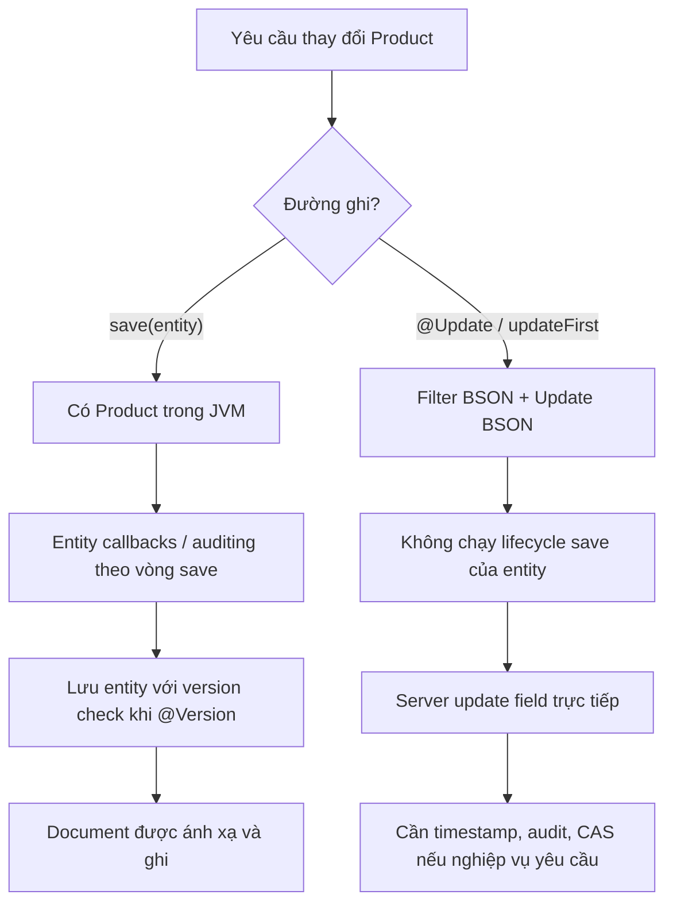

# Giới hạn callback, auditing và version khi dùng truy vấn ghi trực tiếp

## 1. Vì sao chủ đề này quan trọng?

Trong **Spring Data MongoDB**, không phải mọi lệnh ghi dữ liệu đều đi qua cùng một vòng đời của entity. Với một `Product` thuộc ứng dụng **Mini Commerce**, có thể cập nhật tên sản phẩm bằng hai cách rất giống về kết quả nhìn thấy:

```java
// Cách A: đọc entity rồi lưu lại.
Product product = productRepository.findById(productId)
    .orElseThrow();
product.setName("Bàn phím Mini V2");
productRepository.save(product);

// Cách B: cập nhật trực tiếp bằng câu query.
productRepository.findAndSetNameBySku(
    "KBD-001", "Bàn phím Mini V2");
```

Nhưng cách A và B **không tương đương về callbacks, auditing, optimistic locking, phạm vi field và hành vi cạnh tranh**. Cách A đưa entity qua mapping/lifecycle của một lần save, có thể kích hoạt `BeforeConvertCallback`, `BeforeSaveCallback`, auditing và kiểm tra phiên bản bằng `@Version`. Cách B là một lệnh update vào MongoDB: nó **không nạp toàn bộ entity để chạy callback** và không thể mặc nhiên dựa vào cùng cơ chế xác thực phiên bản khi lưu entity.

Bài thuộc chương **Ghi qua repository** của SPRING_DATA_MONGODB. Trọng tâm là phân biệt:

- `MongoRepository.save/insert/delete(entity)` theo vòng đời entity.
- Phương thức repository sử dụng `@Update` và `@Query` để ghi **trực tiếp**.
- Phương thức repository `delete…By`/`remove…By` với kiểu trả về khác nhau.
- `MongoTemplate.updateFirst`, `updateMulti`, `findAndModify` và raw MongoDB driver.
- Những giới hạn của **entity callbacks, auditing, @Version** và cách bổ sung kiểm soát nghiệp vụ một cách tường minh.

Mô hình xuyên suốt là **Product–Customer–Order**: dịch vụ catalog sửa tên/giá, dịch vụ kho giảm stock, dịch vụ đơn hàng cập nhật trạng thái, và một luồng xử lý ngoài tính điểm chất lượng sản phẩm. Từ đó ta liên hệ với truy vấn, index, transaction, reactive access, kiểm thử và quan sát dữ liệu.

### Mục tiêu học tập

Sau bài học, bạn có thể:

1. Giải thích tại sao `@Update` không kích hoạt `BeforeSaveCallback` hay auditing trên entity như `save`.
2. Viết repository update có filter được suy diễn từ tên phương thức hoặc định nghĩa bằng `@Query`.
3. Tránh giả định sai rằng `@Version` tự bảo vệ mọi update trực tiếp khỏi **lost update**.
4. Thiết kế **compare-and-set (CAS)** theo `_id` + `version` và diễn giải kết quả khi query không khớp.
5. Cập nhật `updatedAt`, người thực hiện và audit trail đúng với loại lệnh ghi.
6. Chọn đúng đường xóa theo entity/version hoặc xóa trực tiếp theo ID/điều kiện.
7. Kiểm thử callback, auditing và version trên **MongoDB thật**, kiểm tra BSON và phát hiện sự sai khác giữa các đường ghi.
8. Biết khi nào nên dùng `save`, `@Update`, `MongoTemplate`, transaction hoặc cơ chế outbox.

**Kiến thức đầu vào:** Java 17+, Spring Boot, `spring-boot-starter-data-mongodb`, `@Document`/`@Id`, `MongoRepository`, `MongoTemplate`, `Query`/`Criteria`, BSON, `@Version` và transaction cơ bản. Các ví dụ phần chính sử dụng synchronous MongoDB; nhánh reactive xuất hiện ở cuối bài. Một số chi tiết API thay đổi theo phiên bản Spring Data; hãy đối chiếu BOM Spring Boot và chạy integration test trên phiên bản dự án đang dùng.

## 2. Hai đường ghi: lưu entity và cập nhật trực tiếp



| Đường ghi | Có entity đầu vào? | Save lifecycle callbacks | Auditing tự động qua save | Kiểm soát version |
| --- | --- | --- | --- | --- |
| `repository.save(entity)` | Có | Có khi callback được đăng ký | Có nếu auditing đã bật | `@Version` được kiểm tra trên save, với write concern phù hợp |
| `repository.insert(entity)` | Có | Có vòng insert/save tương ứng | Có nếu auditing đã bật | Khởi tạo version theo loại field/vòng đời |
| `@Update` repository method | Không bắt buộc nạp entity | **Không** phát save/persistence lifecycle events | **Không** tự chạy auditing callback trên entity | Không mặc nhiên kiểm tra **expected version** từ DTO |
| `MongoTemplate.updateFirst/updateMulti` | Không cần entity object | Không đi qua cùng vòng `save(entity)` | Không tự chạy auditing save callback | Một số API có thể **tự tăng version**, nhưng query cần CAS nếu muốn so khớp phiên bản |
| `MongoTemplate.findAndModify` | Filter + Update | Không phải save lifecycle | Nên set audit fields tường minh | Cần filter version nếu muốn compare-and-set |
| Raw driver `updateOne/updateMany` | BSON | Không có Spring callbacks | Không có Spring auditing | Phải tự quản lý điều kiện và `version` |
| `repository.delete(entity)` | Có | Hành vi delete theo entity, không đồng nhất callbacks save | Không phải update timestamp của entity | Có thể kiểm tra `@Version` khi xóa entity |
| `repository.deleteById(id)` | ID | Không phải save lifecycle | Không tự ghi audit trail | **Không** tương đương delete entity có version check |

Đây là bảng tư duy, **không** thay thế bảng hợp đồng API chi tiết của từng phiên bản. `@Version` có hai khía cạnh phải tách: **tăng số version** và **so khớp expected version trong filter**. Một cách ghi chỉ tăng version không tự động ngăn được stale write khi client không cung cấp expected version.

## 3. Mini Commerce: entity có callback, auditing và version

Để thấy rõ sự khác biệt, ta dùng `Product` có tên, SKU, giá, tồn kho, version, thời điểm tạo/sửa và điểm chấm ngoài.

```java
package com.example.minicommerce.domain;

import java.math.BigDecimal;
import java.time.Instant;

import org.springframework.data.annotation.CreatedDate;
import org.springframework.data.annotation.Id;
import org.springframework.data.annotation.LastModifiedDate;
import org.springframework.data.annotation.ReadOnlyProperty;
import org.springframework.data.annotation.Version;
import org.springframework.data.mongodb.core.mapping.Document;
import org.springframework.data.mongodb.core.mapping.Field;
import org.springframework.data.mongodb.core.mapping.FieldType;

@Document(collection = "products")
public class Product {

    @Id
    private String id;

    private String sku;
    private String name;
    private String category;
    private boolean active;
    private int stock;

    @Field(name = "unit_price", targetType = FieldType.DECIMAL128)
    private BigDecimal price;

    @Version
    private Long version;

    @CreatedDate
    private Instant createdAt;

    @LastModifiedDate
    private Instant updatedAt;

    @ReadOnlyProperty
    @Field("external_score")
    private BigDecimal externalScore;

    public Product() {}

    public Product(String id, String sku, String name,
                   String category, boolean active, int stock,
                   BigDecimal price) {
        this.id = id;
        this.sku = sku;
        this.name = name;
        this.category = category;
        this.active = active;
        this.stock = stock;
        this.price = price;
    }

    public String getId() { return id; }
    public void setId(String id) { this.id = id; }
    public String getSku() { return sku; }
    public void setSku(String sku) { this.sku = sku; }
    public String getName() { return name; }
    public void setName(String name) { this.name = name; }
    public String getCategory() { return category; }
    public void setCategory(String category) {
        this.category = category;
    }
    public boolean isActive() { return active; }
    public void setActive(boolean active) { this.active = active; }
    public int getStock() { return stock; }
    public void setStock(int stock) { this.stock = stock; }
    public BigDecimal getPrice() { return price; }
    public void setPrice(BigDecimal price) { this.price = price; }
    public Long getVersion() { return version; }
    public Instant getCreatedAt() { return createdAt; }
    public Instant getUpdatedAt() { return updatedAt; }
    public BigDecimal getExternalScore() { return externalScore; }
}
```

Giải thích:

- `@Id` map `id` sang BSON `_id`.
- `@Field(name = "unit_price", targetType = DECIMAL128)` map giá `BigDecimal` thành đúng khóa/kiểu BSON.
- `@Version Long` là cơ chế hỗ trợ optimistic locking cho **các đường ghi có hợp đồng kiểm tra version**.
- `@CreatedDate` và `@LastModifiedDate` được Spring Data auditing xử lý khi entity đi qua vòng đời được hỗ trợ.
- `@ReadOnlyProperty` có thể được đọc từ BSON nhưng không được mapping để ghi; nó **không bảo vệ** field khỏi bị xóa nếu cả document bị thay thế.

Ví dụ BSON sau khi insert qua mapping (rút gọn):

```json
{
  "_id": "prod-001",
  "sku": "KBD-001",
  "name": "Bàn phím Mini",
  "category": "phu-kien",
  "active": true,
  "stock": 20,
  "unit_price": { "$numberDecimal": "129900.00" },
  "version": 0,
  "createdAt": { "$date": "2026-11-20T02:00:00Z" },
  "updatedAt": { "$date": "2026-11-20T02:00:00Z" }
}
```

Timestamp và số version ở đây là **ví dụ**; `@Version Long` thường được khởi tạo từ 0, còn auditing cần cấu hình bật mới được điền. Không giả định các field trên tự xuất hiện nếu ứng dụng chưa bật auditing hoặc đang ghi bằng raw driver.

## 4. Bật auditing: annotation chưa đủ

Để Spring Data MongoDB điền `@CreatedDate`/`@LastModifiedDate` trên những đường ghi được hỗ trợ, thường cần bật auditing:

```java
package com.example.minicommerce.config;

import org.springframework.context.annotation.Configuration;
import org.springframework.data.mongodb.config.EnableMongoAuditing;

@Configuration
@EnableMongoAuditing
public class MongoAuditConfig {
}
```

Nếu lưu cả người thực hiện bằng `@CreatedBy`/`@LastModifiedBy`, phải cung cấp `AuditorAware<T>` thích hợp (hoặc `ReactiveAuditorAware<T>` trong ứng dụng reactive), cùng quy tắc định danh người dùng/system job. Date auditing và auditor identity là hai khả năng khác nhau.

**Không hiểu nhầm:** `@EnableMongoAuditing` đăng ký hạ tầng auditing; nó không biến mọi lệnh `$set`, `$inc`, `@Update`, bulk write hoặc raw driver thành một lần **save entity**.

### 4.1. Tạo entity qua repository

```java
Product product = new Product(
    "prod-001",
    "KBD-001",
    "Bàn phím Mini",
    "phu-kien",
    true,
    20,
    new BigDecimal("129900.00")
);

Product created = productRepository.insert(product);

System.out.println(created.getVersion());
System.out.println(created.getCreatedAt());
System.out.println(created.getUpdatedAt());
```

Đoạn trên giả định `ProductRepository` được inject; `insert` thực hiện tạo mới, không âm thầm ghi đè document cùng ID. Khi auditing hoạt động, timestamp được đặt trong các điểm tích hợp lifecycle tương ứng.

### 4.2. Tại sao callback có thể thay đổi dữ liệu?

Một `BeforeConvertCallback<Product>` có thể chuẩn hóa tên trước khi convert entity thành BSON:

```java
package com.example.minicommerce.config;

import org.springframework.context.annotation.Bean;
import org.springframework.context.annotation.Configuration;
import org.springframework.data.mongodb.core.mapping.event.BeforeConvertCallback;

import com.example.minicommerce.domain.Product;

@Configuration
public class ProductCallbackConfig {
    @Bean
    BeforeConvertCallback<Product> normalizeName() {
        return (product, collection) -> {
            if (product.getName() != null) {
                product.setName(product.getName().trim());
            }
            return product;
        };
    }
}
```

Với `productRepository.save(product)`, callback này có thể sửa `name` trước khi ghi. Nhưng với repository method `@Update("{ '$set' : { 'name' : ?1 } }")`, giá trị `?1` **không được nạp vào Product rồi truyền qua BeforeConvertCallback**. Nếu service tin rằng mọi tên đều được trim nhờ callback, dữ liệu lưu qua lệnh trực tiếp có thể chứa khoảng trắng đầu/cuối.

**Giải pháp:** chuẩn hóa và validate tại boundary/service hoặc trong một cơ chế database-level phù hợp, áp dụng thống nhất trên **mọi đường ghi**. Callback vẫn hữu ích, nhưng không nên là nơi duy nhất giữ những invariant phải đúng bất kể cách ghi.

## 5. Save đi qua entity lifecycle, nhưng có rủi ro replacement

`MongoRepository.save(entity)` phù hợp khi ứng dụng sở hữu aggregate đầy đủ và mong muốn lưu trạng thái entity hiện tại:

```java
Product product = productRepository.findById("prod-001")
    .orElseThrow();
product.setName("Bàn phím Mini V2");

Product saved = productRepository.save(product);
```

Đường save có thể kích hoạt:

- `BeforeConvertCallback` và các callback ánh xạ/ghi phù hợp.
- Auditing như `@LastModifiedDate` nếu đã bật.
- Kiểm tra version kỳ vọng và tăng `@Version` theo hợp đồng của `save`.
- Mapping entity sang BSON, gồm field alias, converter và các property có/không được lưu.

Tuy nhiên, một lần `save` trên document đã tồn tại thường là **thay thế document được tạo từ entity**, không phải chỉ sửa property vừa set. Nếu entity chỉ được đọc một phần qua projection, hoặc document có field ngoài class (`external_score`, `warehouse`), bản thay thế có thể **làm mất** chúng. `@ReadOnlyProperty` không phải cách giữ nguyên field cũ trong replacement.

Do đó: **save có lifecycle mạnh hơn nhưng phạm vi ghi rộng hơn**. Ngược lại, **direct update giữ phạm vi field hẹp hơn nhưng bỏ qua nhiều hook lifecycle**. Chọn dựa trên quyền sở hữu dữ liệu và invariant.

## 6. @Update trong MongoRepository: filter được suy diễn từ method

Spring Data MongoDB hỗ trợ khai báo thao tác ghi trực tiếp bằng `org.springframework.data.mongodb.repository.Update`:

```java
package com.example.minicommerce.repository;

import org.springframework.data.mongodb.repository.MongoRepository;
import org.springframework.data.mongodb.repository.Query;
import org.springframework.data.mongodb.repository.Update;

import com.example.minicommerce.domain.Product;

public interface ProductRepository
        extends MongoRepository<Product, String> {

    @Update("{ '$set' : { 'name' : ?1 } }")
    long findAndSetNameBySku(String sku, String newName);

    @Update("{ '$inc' : { 'stock' : ?1 } }")
    long findAndIncrementStockBySku(String sku, int delta);

    @Query("{ 'sku' : ?0, 'active' : true }")
    @Update("{ '$set' : { 'name' : ?1 } }")
    long updateNameOfActiveProduct(String sku, String newName);
}
```

Phần **query để chọn document** được suy diễn từ tên `findAndSetNameBySku` hoặc được khai báo rõ với `@Query`. Phần **hành động ghi** là JSON update của `@Update`. `?0`/`?1` là placeholder theo thứ tự tham số method, **không tự nối chuỗi JSON bằng tay**.

Chữ `find` ở đầu method là một quy ước parse filter; nó **không có nghĩa** phương thức sẽ tìm `Product` rồi đưa entity qua `save`. Ví dụ `findAndSetNameBySku` là **lệnh update**, không trả `Product`.

### 6.1. Phạm vi cập nhật: tất cả document khớp filter

Theo tài liệu Spring Data MongoDB, repository update method **áp dụng cho tất cả document phù hợp**, không dùng `Pageable` hoặc `First`/`Top` để giới hạn số document được sửa. Ví dụ:

```java
@Update("{ '$set' : { 'active' : false } }")
long findAndDeactivateByCategory(String category);
```

Nếu có 10.000 sản phẩm trong danh mục, lệnh có thể tác động tới rất nhiều document. Dùng tên method “find…” không mặc định giới hạn chỉ một record. Nếu chỉ muốn sửa **một** sản phẩm, filter phải dựa trên khóa duy nhất như `_id` hoặc SKU có unique index, hoặc dùng API kiểm soát một bản ghi (`MongoTemplate.updateFirst`).

### 6.2. Giá trị trả về

Repository update method thường cho phép kiểu `void` hoặc số như `long` để mô tả số document bị cập nhật theo hợp đồng của module. Giá trị số **không phải entity đã được tải lại** và không cung cấp đủ `matchedCount` lẫn `modifiedCount` như `UpdateResult`.

```java
long count = productRepository.findAndSetNameBySku(
    "KBD-001", "Bàn phím Mini V2");
```

Không suy ra từ `count` rằng callback đã chạy, audit timestamp đã thay đổi, hay phiên bản kỳ vọng của client đã được kiểm tra. Nếu nghiệp vụ cần phân biệt **document không khớp** và **document khớp nhưng giá trị không đổi**, dùng `MongoTemplate.updateFirst` nhận `UpdateResult` hoặc đọc lại dữ liệu.

### 6.3. @Update khác @Query thuần

`@Query` chủ yếu khai báo **filter/query**. Nó không tự biến một method thành update chỉ vì method bắt đầu bằng `update...`. Khi dùng tên không theo cú pháp derived filter như `updateNameOfActiveProduct`, cần kết hợp một `@Query` phù hợp với `@Update`.

Đối với query phức tạp trên mảng, có thể dùng BSON `$elemMatch` trong `@Query` rồi update phù hợp; nhưng phải phân biệt điều kiện chọn **document** với điều kiện chọn **phần tử array**.

## 7. @Update không kích hoạt save callbacks

Đây là giới hạn trung tâm: **repository update methods không phát persistence/mapping lifecycle events** theo hợp đồng của Spring Data MongoDB.

### 7.1. Những hook thường bị hiểu nhầm

| Hook/feature | Khi `save(Product)` | Khi repository `@Update` |
| --- | --- | --- |
| `BeforeConvertCallback<Product>` | Có thể được gọi | Không đưa entity qua vòng convert-save |
| `BeforeSaveCallback<Product>` | Có thể được gọi | Không được phát như save |
| `AfterSaveCallback<Product>` | Có thể được gọi | Không được phát như save |
| `BeforeSaveEvent`/`AfterSaveEvent` | Có thể được công bố nếu lifecycle events bật | Không được phát từ repository update |
| `@CreatedDate`/`@LastModifiedDate` | Auditing có thể đặt khi save | Không có entity audit callback tự động |
| `@CreatedBy`/`@LastModifiedBy` | Dựa trên auditor context/callback | Không tự tra auditor rồi ghi BSON |
| Bean validation gắn vào callback | Có thể chạy nếu được cấu hình | Không mặc nhiên chạy |
| Domain event gắn vào aggregate/save | Phụ thuộc repository infrastructure và đường gọi | Không xem `@Update` là lưu aggregate sinh event |

**Chú ý:** một callback đã đăng ký không bảo đảm mọi đường save đều gọi y hệt nhau nếu sử dụng raw driver, bulk, API reactive so với imperative, hoặc cấu hình tùy biến. Lựa chọn callback cần dựa trên lifecycle contract thực tế.

### 7.2. Hệ quả với logic trim tên

Giả sử `BeforeConvertCallback` chuẩn hóa:

```java
product.setName(product.getName().trim());
```

Lệnh sau có thể lưu **nguyên giá trị có khoảng trắng**:

```java
productRepository.findAndSetNameBySku(
    "KBD-001", "  Bàn phím mới  ");
```

Nếu cần bảo đảm tên không có khoảng trắng biên, service phải gọi `trim`/validation **trước** `@Update`:

```java
public void renameProduct(String sku, String rawName) {
    if (rawName == null || rawName.isBlank()) {
        throw new IllegalArgumentException("Name required");
    }

    String normalized = rawName.trim();
    if (normalized.length() > 120) {
        throw new IllegalArgumentException("Name too long");
    }

    productRepository.findAndSetNameBySku(sku, normalized);
}
```

Trong hệ thống thật, cần kiểm tra permission/tenant/unique SKU và kết quả cập nhật. Ví dụ này chỉ minh họa cách đưa invariant ra khỏi callback.

### 7.3. Tránh giả định event đồng nghĩa cập nhật BSON đã commit

Ngay cả ở đường save, một số event có thể phát **trước** thao tác MongoDB hoặc ngoài thời điểm transaction commit. Nếu nghiệp vụ cần gửi email, gọi thanh toán hoặc phát event tích hợp, không nên phát một side effect không thể rollback chỉ vì `BeforeSaveEvent` được gọi.

Với yêu cầu **event sau commit và giao nhận đáng tin cậy**, cân nhắc transactional outbox, change streams hoặc cơ chế phối hợp phù hợp; thiết kế idempotent consumer. `@Update` không thể mặc nhiên được “vá” bằng một callback chỉ nhận entity.

## 8. Auditing: field updatedAt không tự thay đổi bởi direct update

Giả sử Product đã có:

```javascript
{
  _id: "prod-001",
  sku: "KBD-001",
  name: "Bàn phím Mini",
  updatedAt: ISODate("2026-11-20T02:00:00Z")
}
```

Chạy:

```java
productRepository.findAndSetNameBySku(
    "KBD-001", "Bàn phím Mini V2");
```

Filter/update logic:

```javascript
db.products.updateMany(
  { sku: "KBD-001" },
  { $set: { name: "Bàn phím Mini V2" } }
);
```

Field `updatedAt` **không tự đổi** chỉ vì entity đánh dấu `@LastModifiedDate`. Dữ liệu có thể trở thành “đã sửa tên nhưng timestamp vẫn cũ”.

### 8.1. Giải pháp: cập nhật timestamp tường minh trong @Update

```java
@Update(
  "{ '$set' : { 'name' : ?1 }, " +
  "  '$currentDate' : { 'updatedAt' : true } }"
)
long findAndRenameWithTimestampBySku(
    String sku, String newName);
```

MongoDB logic:

```javascript
db.products.updateMany(
  { sku: "KBD-001" },
  {
    $set: { name: "Bàn phím Mini V2" },
    $currentDate: { updatedAt: true }
  }
);
```

`$currentDate` dùng thời gian do server MongoDB đặt, không phải thời gian JVM. Nó tạo BSON Date tương ứng khi dùng `true`. Khi cần một timestamp từ ứng dụng, có thể bind giá trị `Instant` đã được chuẩn hóa theo mapping, nhưng phải xác định thống nhất nguồn thời gian giữa các writer.

### 8.2. Auditing danh tính người sửa

Giả sử có trường `lastModifiedBy` do `@LastModifiedBy` quản lý khi save. Direct update không tự gọi `AuditorAware` rồi điền trường đó. Service phải xác định actor đã xác thực và truyền vào câu update:

```java
@Query("{ 'sku' : ?0 }")
@Update(
  "{ '$set' : { 'name' : ?1, 'lastModifiedBy' : ?2 }, " +
  "  '$currentDate' : { 'updatedAt' : true } }"
)
long updateNameWithActor(
    String sku, String newName, String actorId);
```

**Không lấy `actorId` tùy ý từ request body** rồi tin đó là người thực hiện. Actor phải đến từ security context, service account đã xác thực hoặc cơ chế tin cậy tương ứng. Batch migration có thể gắn actor kiểu `system-catalog-import` và operation ID.

### 8.3. Audit timestamp không phải audit trail đầy đủ

`updatedAt` và `lastModifiedBy` cho biết thông tin **lần cập nhật cuối**, không trả lời:

- Giá cũ là gì?
- Trường nào đã thay đổi?
- Request nào, nguồn nào và vì sao thực hiện?
- Có thao tác không thành công trước đó không?

Nếu yêu cầu audit trail có tính pháp lý/tài chính, xây bản ghi thay đổi append-only, outbox hoặc công cụ quan sát thích hợp, có quyền truy cập/retention rõ ràng. Không dựa chỉ vào `@LastModifiedDate` cho hệ thống đặt hàng/thanh toán.

## 9. @Version: tăng phiên bản không đồng nghĩa với kiểm tra phiên bản

Trong Spring Data MongoDB, `@Version` dùng để hỗ trợ **optimistic locking** khi lưu entity qua các đường ghi có kiểm tra version, ví dụ `save(entity)`:

```java
Product first = productRepository.findById("prod-001")
    .orElseThrow();
Product stale = productRepository.findById("prod-001")
    .orElseThrow();

first.setName("Đổi tên bởi A");
productRepository.save(first);

stale.setName("Đổi tên bởi B");
productRepository.save(stale);
// Khi version của stale đã cũ:
// OptimisticLockingFailureException (với acknowledged write).
```

Cơ chế save so sánh version đang có của entity với version trong document. Nếu document đã được ghi bởi người khác và version đổi, lần save dựa trên version cũ thất bại thay vì âm thầm ghi đè.

### 9.1. Direct update có thể tự tăng version, nhưng chưa chắc có CAS

Tài liệu `MongoTemplate.updateFirst/updateMulti/findAndModify` mô tả rằng `@Version` **có thể được framework tự tăng nếu không có trong Update**. Đây là một hành vi hữu ích để các lần `save(entity)` đang giữ version cũ có thể phát hiện document đã thay đổi.

Nhưng ví dụ:

```java
mongoTemplate.updateFirst(
    Query.query(Criteria.where("id").is("prod-001")),
    new Update().set("name", "Tên mới"),
    Product.class);
```

không mang **expected version** từ một request/client trong filter. Ngay cả nếu version được tăng tự động, hai direct updates không kiểm tra trạng thái mà client đã đọc trước đó có thể cùng thành công và **last write wins** cho cùng field.

**Với repository `@Update`, không nên suy đoán cơ chế tăng version/optimistic lock chỉ từ annotation `@Version`.** Hãy xem implementation/version đang chạy và integration test raw BSON. Muốn CAS chắc chắn, ghi điều kiện version vào filter và xử lý kết quả 0.

### 9.2. Compare-and-set theo id và expectedVersion

Một phương thức repository update có thể dùng `@Query` để kiểm tra version kỳ vọng và `@Update` để tăng version **trong chính lệnh ghi**:

```java
@Query("{ '_id' : ?0, 'version' : ?1 }")
@Update(
  "{ '$set' : { 'name' : ?2 }, " +
  "  '$inc' : { 'version' : 1 }, " +
  "  '$currentDate' : { 'updatedAt' : true } }"
)
long compareAndSetName(
    String productId, long expectedVersion, String newName);
```

Tương đương BSON (giả sử version hiện tại là 7):

```javascript
db.products.updateMany(
  { _id: "prod-001", version: NumberLong(7) },
  {
    $set: { name: "Bàn phím Mini V2" },
    $inc: { version: 1 },
    $currentDate: { updatedAt: true }
  }
);
```

Vì `_id` là duy nhất, dù repository update áp dụng “all matching”, filter này chỉ có thể match tối đa **một** document. Nếu version không còn bằng 7, lệnh **không** cập nhật document. `$inc` version ở đây là **protocol tường minh của ứng dụng**; không kết hợp mù quáng với các cơ chế tự tăng version khác khi bạn đã ghi version trực tiếp trong update.

### 9.3. Phân loại kết quả CAS

```java
public void renameSafely(
        String productId, long expectedVersion, String rawName) {

    if (rawName == null || rawName.isBlank()) {
        throw new IllegalArgumentException("Name required");
    }

    long updated = productRepository.compareAndSetName(
        productId,
        expectedVersion,
        rawName.trim());

    if (updated == 0) {
        // Có thể không có product, bị xóa, hoặc version đã đổi.
        // Đọc thêm khi cần phân loại lỗi cho API.
        throw new IllegalStateException(
            "Product not found or concurrent update");
    }
}
```

Trong ví dụ này, mỗi lần match sẽ tăng version nên một document thật sự được sửa khi CAS thành công, kể cả tên mới trùng tên cũ. Tuy nhiên kiểu trả về số của repository nên được kiểm tra với Spring Data version đang dùng. Với quy trình cần biết **matchedCount** và **modifiedCount** riêng biệt, dùng `MongoTemplate.updateFirst(...)` và `UpdateResult`.

**Không gộp “không tìm thấy” và “version conflict” thành 404 khi API cần phản hồi khác nhau.** Có thể đọc lại theo ID để phân biệt, nhưng dữ liệu có thể tiếp tục thay đổi giữa hai thao tác; thiết kế semantics HTTP 404/409/412 theo hợp đồng nhất quán.

### 9.4. Dùng MongoTemplate để đọc UpdateResult

```java
import com.mongodb.client.result.UpdateResult;
import org.springframework.data.mongodb.core.query.Criteria;
import org.springframework.data.mongodb.core.query.Query;
import org.springframework.data.mongodb.core.query.Update;

Query filter = Query.query(
    Criteria.where("id").is("prod-001")
        .and("version").is(7L));

Update changes = new Update()
    .set("name", "Bàn phím Mini V2")
    .inc("version", 1L)
    .currentDate("updatedAt");

UpdateResult result =
    mongoTemplate.updateFirst(filter, changes, Product.class);

if (result.getMatchedCount() == 0) {
    throw new IllegalStateException(
        "Not found or version conflict");
}
```

Trong `Update` đã **đề cập tường minh** `version`, do đó tránh đặt thêm một bước tự tăng version khác ở service. Nếu cần kiểm tra giá trị tăng thật sự, đọc raw BSON trong integration test.

### 9.5. Optimistic locking yêu cầu write acknowledgment

Spring Data MongoDB lưu ý optimistic locking cần **acknowledged write concern** để nhận biết xung đột. Với `WriteConcern.UNACKNOWLEDGED`, thông tin thất bại có thể không được phản ánh như mong đợi.

Nếu ứng dụng cần bảo vệ ghi đơn hàng, tồn kho, thanh toán hoặc audit, không tắt acknowledgment để tăng throughput rồi giả định version checks vẫn có tác dụng.

## 10. Hai người cùng sửa: lost update trong truy vấn ghi trực tiếp

Giả sử product có:

```text
name    = "Bàn phím Mini"
version = 7
```

Hai màn hình quản trị cùng tải phiên bản 7:

```text
Admin A đọc version=7
Admin B đọc version=7

Admin A: @Update chỉ theo sku -> name="Tên A"  (thành công)
Admin B: @Update chỉ theo sku -> name="Tên B"  (thành công)

Giá trị cuối có thể là "Tên B"; cập nhật của A bị ghi đè.
```

Thay bằng CAS theo version:

```text
Admin A: filter {_id, version: 7}; $set name A, $inc version -> 8
Admin B: filter {_id, version: 7}; không match -> báo conflict
```

Đây là khác biệt giữa **atomicity của một update document** và **optimistic concurrency theo phiên bản người dùng đã đọc**. MongoDB có thể đảm bảo từng update là atomic trên một document nhưng vẫn có lost update nếu filter của các request không mang điều kiện xung đột thích hợp.

### 10.1. Tồn kho: $inc có điều kiện tốt hơn read-modify-save

Với số lượng tồn kho, không nhất thiết dùng version cho mọi phép trừ. Một update nguyên tử có filter đủ hàng là cách diễn đạt trực tiếp:

```java
@Query(
  "{ 'sku' : ?0, 'active' : true, " +
  "  'stock' : { '$gte' : ?1 } }"
)
@Update(
  "{ '$inc' : { 'stock' : ?2 }, " +
  "  '$currentDate' : { 'updatedAt' : true } }"
)
long decreaseStockIfEnough(
    String sku, int requiredQuantity, int negativeDelta);
```

Một service kiểm tra:

```java
public boolean reserve(String sku, int quantity) {
    if (quantity <= 0) {
        throw new IllegalArgumentException(
            "Quantity must be positive");
    }
    return productRepository.decreaseStockIfEnough(
        sku, quantity, -quantity) == 1;
}
```

BSON logic:

```javascript
db.products.updateMany(
  {
    sku: "KBD-001",
    active: true,
    stock: { $gte: 2 }
  },
  {
    $inc: { stock: -2 },
    $currentDate: { updatedAt: true }
  }
);
```

**Điều kiện cần:** SKU phải có unique index nếu nghiệp vụ đòi một Product duy nhất; nếu không, repository update có thể giảm stock trên **nhiều** document cùng SKU. Trong thực tế nên chọn filter `_id` hoặc unique business key được bảo vệ.

**$inc không idempotent.** Nếu client retry cùng một reservation sau timeout, stock có thể giảm hai lần. Với luồng Order, cần order/reservation ID, unique constraint, checkpoint hoặc transaction/outbox phù hợp; `@Version` hay callback không tự giải quyết retry trùng.

### 10.2. Update đồng thời không đồng nghĩa nhiều-document transaction

Tạo một `Order` có hai dòng hàng cần giảm tồn của hai `Product` và ghi đơn. Mỗi update theo `stock >= quantity` là atomic trên Product riêng. Nếu yêu cầu cả hai giảm tồn và Order được lưu **all-or-nothing**, dùng MongoDB transaction trên topology hỗ trợ và transaction management của Spring. Transaction không thay thế CAS hoặc idempotency; chúng xử lý những loại rủi ro khác nhau.

## 11. Đường xóa trong repository cũng khác nhau

Spring Data MongoDB hỗ trợ nhiều hình thức xóa:

```java
// Có sẵn từ MongoRepository / CrudRepository:
productRepository.delete(entity);
productRepository.deleteById(productId);

// Derived delete:
long deleteProductByCategory(String category);

// Hoặc lấy các entity khớp rồi xóa:
List<Product> deleteByCategory(String category);
```

Hai phương thức cuối là **hai ví dụ chữ ký**, cần khai báo riêng trong repository, không phải gọi trực tiếp nếu chưa khai báo:

```java
long deleteProductByCategory(String category);

List<Product> deleteByCategory(String category);
```

Theo tài liệu MongoDB-specific repository:

- Derived delete trả **numeric count** trực tiếp xóa document khớp filter và trả số lượng đã xóa.
- Derived delete trả **List<Product>** có đường đi truy xuất các entity phù hợp rồi xóa, cho phép trả các entity đó về caller.
- Vì hai đường có hành vi nội bộ khác nhau, không gán cho chúng cùng bảo đảm callback/auditing/version chỉ từ phần tên `delete…By`.

### 11.1. delete(entity) và deleteById(id) khi có @Version

Với entity versioned, đường `delete(entity)` có thể kiểm tra phiên bản của instance được truyền vào. Nếu document đã đổi version, Spring Data có thể báo `OptimisticLockingFailureException` khi write được xác nhận.

Ngược lại, `deleteById(id)` thường được dùng để xóa theo ID **bỏ qua optimistic locking theo phiên bản đang giữ trong entity**. Đây là khác biệt rất quan trọng:

```java
Product stale = productRepository.findById("prod-001")
    .orElseThrow();

// Người khác ghi làm version tăng.

productRepository.delete(stale); // Có thể thất bại vì stale version.
productRepository.deleteById(stale.getId()); // Xóa theo ID, không kiểm tra stale.version.
```

Không dùng `deleteById` chỉ để “né conflict” trong quy trình cần bảo đảm người dùng xóa đúng phiên bản mình đã kiểm duyệt. Nếu cần CAS khi xóa, dùng filter `_id + version` (ví dụ `MongoTemplate.remove(Query, Product.class)`) và kiểm tra `DeleteResult.getDeletedCount()`.

### 11.2. Xóa trực tiếp và audit

Xóa cứng document không tự lưu một record audit chứa “ai xóa, lúc nào, lý do” trong MongoDB. Nếu nghiệp vụ cần truy vết, cân nhắc:

- **Soft delete** với `deletedAt`, `deletedBy`, `status` và query exclude deleted.
- Audit log/outbox record cùng transaction khi có yêu cầu nhất quán.
- Quy tắc retention, khôi phục và quyền truy cập phù hợp.

Tuy nhiên soft delete bằng direct update cũng **không tự chạy `@LastModifiedDate` hay callback**: timestamp/actor phải được đặt tường minh trong update.

## 12. Projection và @ReadOnlyProperty: lý do direct update thường hữu ích

Giả sử màn hình danh sách Product chỉ lấy:

```java
Query q = Query.query(Criteria.where("active").is(true));
q.fields().include("sku").include("name");

List<Product> summary = mongoTemplate.find(q, Product.class);
```

Các Product từ projection có thể không chứa `stock`, `price`, `version` hoặc các field khác. Gọi `save(summary.get(0))` có nguy cơ làm mất những field không có trong bản entity đọc một phần hoặc gặp vấn đề version.

Nếu chỉ đổi tên sản phẩm, **direct update theo ID/SKU** giữ nguyên các field không bị nhắm tới:

```javascript
db.products.updateOne(
  { _id: "prod-001" },
  {
    $set: { name: "Bàn phím mới" },
    $currentDate: { updatedAt: true }
  }
);
```

Tương tự, nếu Product lưu thêm `external_score` do dịch vụ khác quản lý và Java có `@ReadOnlyProperty`, một lệnh `$set("name")` sẽ **không đụng** `external_score`. Ngược lại, `save` dạng full replacement có thể khiến field không được ánh xạ để ghi biến mất.

**Đánh đổi:** direct update giữ phạm vi field hẹp nhưng cần explicit auditing/CAS/validation; save có lifecycle đầy đủ hơn nhưng ghi rộng hơn. Đó là lý do cần phân quyền sở hữu field giữa các service và chọn update phù hợp.

## 13. Cập nhật object nhúng và array không chạy entity callbacks

`Order` của Mini Commerce có `shippingAddressSnapshot` và mảng `lines`. Giả sử chỉ sửa một field trong địa chỉ:

```java
@Query("{ '_id' : ?0 }")
@Update(
  "{ '$set' : { 'shippingAddressSnapshot.city' : ?1 }, " +
  "  '$currentDate' : { 'updatedAt' : true } }"
)
long updateShippingCity(String orderId, String city);
```

BSON:

```javascript
db.orders.updateMany(
  { _id: "order-001" },
  {
    $set: { "shippingAddressSnapshot.city": "Da Nang" },
    $currentDate: { updatedAt: true }
  }
);
```

Lệnh trên chỉ đổi `city`, giữ `recipient`, `street`, `country` nếu chúng có sẵn. Nhưng nó không tải `Order` để chạy một `BeforeSaveCallback<Order>` kiểm tra tính hợp lệ của địa chỉ, cũng không tự thêm audit trail. Nếu city thay đổi chỉ được cho phép trước khi đơn chuyển sang `SHIPPED`, thêm điều kiện trạng thái vào **filter**, không chỉ kiểm tra trước bằng một lần read tách rời.

### 13.1. Cập nhật array: tránh điều kiện chéo phần tử

Giả sử một Order có nhiều `OrderLine`. Nếu cần sửa đúng một dòng hàng, tốt nhất định danh mỗi dòng bằng `lineId` và dùng `arrayFilters`:

```java
Update change = new Update()
    .set("lines.$[line].quantity", 3)
    .filterArray("line.lineId", "line-001")
    .currentDate("updatedAt");

UpdateResult result = mongoTemplate.updateFirst(
    Query.query(Criteria.where("id").is("order-001")),
    change,
    Order.class);
```

`Order.class` ở đây phải có nested `lines` và `lineId` tương ứng. Điều kiện array filter có cơ chế mapping riêng; hãy kiểm tra BSON với custom aliases. Nếu chỉ dựa trên SKU không duy nhất trong cùng Order, có thể vô tình sửa nhiều dòng.

Khi sửa quantity, các invariant như `totalAmount`/`lineTotal`/stock cũng cần được xử lý trong **một quy trình nghiệp vụ nhất quán**. Việc repository update bỏ qua callback không có nghĩa hệ thống được phép bỏ qua validation.

## 14. Validation, business invariants và transaction

### 14.1. Bean Validation không phải database constraint

Một entity có thể gắn:

```java
@NotBlank
private String name;
```

Annotation validation có giá trị khi cơ chế validation được gọi, nhưng **không tự bảo vệ mọi raw MongoDB update**. Một repository `@Update` không nên giả định Spring đã dựng entity để validate toàn bộ object.

Để bảo vệ dữ liệu, thiết kế thành nhiều lớp:

1. Validate DTO/request và business rule trong service.
2. Ràng buộc điều kiện an toàn **trong filter update** (stock đủ, đúng version, đúng tenant).
3. Sử dụng MongoDB JSON Schema validation/unique index khi invariant có thể được bảo vệ ở database.
4. Dùng transaction khi invariant phải trải qua **nhiều document**.
5. Viết integration test cho **mọi đường ghi**: repository save, `@Update`, template, raw driver, bulk và migration.

### 14.2. Transaction không làm callback tự chạy

`@Transactional` trên service có thể nhóm nhiều lệnh MongoDB khi đã có `MongoTransactionManager`/topology phù hợp, nhưng **không** biến một repository `@Update` thành một lần `save(entity)`.

```java
import org.springframework.transaction.annotation.Transactional;

@Transactional
public void placeOrder(PlaceOrderCommand command) {
    // 1. Giảm Product.stock có điều kiện, kèm idempotency.
    // 2. Tạo Order và OrderLine snapshot.
    // 3. Ghi outbox event nếu kiến trúc cần phát sau commit.
    // 4. Nếu có một bước thất bại, rollback transaction.
}
```

Đây là **khung ý tưởng**, không phải code hoàn chỉnh: `PlaceOrderCommand` và các thao tác bên trong cần được định nghĩa riêng. Bật transaction không tự đảm bảo rollback side effect ở hệ thống thanh toán/email bên ngoài MongoDB.

### 14.3. Quy tắc chung cho ghi trực tiếp

Nếu lệnh ghi thay đổi nghiệp vụ quan trọng, cần xác định:

- **Ai** có quyền ghi? Có filter `tenantId` và authorization không?
- **Đối tượng nào** được ghi? Unique `_id`/SKU/Order ID có đủ rõ không?
- **Điều kiện nào** phải đúng khi server thực thi? Stock, status, version?
- **Field nào** được phép đổi? Có vô tình reset field service khác quản lý không?
- **Khi nào** và **bởi ai**? Timestamp/actor trong BSON hoặc audit log?
- **Retry** có thể làm ghi lặp không? `$inc`/`$push` đặc biệt cần idempotency.
- **Kết quả** cần kiểm chứng? Count, `UpdateResult`, readback hoặc outbox?

## 15. Reactive repository: khác kiểu trả về, không khác giới hạn

Với `spring-boot-starter-data-mongodb-reactive`, repository có thể khai báo:

```java
import org.springframework.data.mongodb.repository.Query;
import org.springframework.data.mongodb.repository.ReactiveMongoRepository;
import org.springframework.data.mongodb.repository.Update;

import reactor.core.publisher.Mono;

public interface ReactiveProductRepository
        extends ReactiveMongoRepository<Product, String> {

    @Query("{ '_id' : ?0, 'version' : ?1 }")
    @Update(
      "{ '$set' : { 'name' : ?2 }, " +
      "  '$inc' : { 'version' : 1 }, " +
      "  '$currentDate' : { 'updatedAt' : true } }"
    )
    Mono<Long> compareAndSetName(
        String id, long version, String newName);
}
```

Trong reactive, thao tác được thực thi khi publisher có subscription. `Mono<Long>` chứa kết quả cập nhật theo hợp đồng repository. Không gọi `block()` trong WebFlux request pipeline chỉ để nhận count; sử dụng `map`, `flatMap` hoặc `switchIfEmpty` phù hợp.

**Cơ chế direct update vẫn không đi qua entity save callback**. Nếu dùng auditing identity, cần truyền actor đã xác thực theo reactive security context hoặc thiết kế service riêng; không trông chờ `ReactiveAuditorAware` tự chạy cho một update BSON không nạp entity.

### 15.1. ReactiveMongoTemplate và CAS

```java
Mono<UpdateResult> updated =
    reactiveMongoTemplate.updateFirst(
        Query.query(Criteria.where("id").is(productId)
            .and("version").is(expectedVersion)),
        new Update()
            .set("name", newName)
            .inc("version", 1L)
            .currentDate("updatedAt"),
        Product.class);
```

Đây là cùng một filter/update logic với `MongoTemplate`, nhưng trả `Mono<UpdateResult>`. Reactive I/O không tự làm CAS đúng nếu bỏ điều kiện `version` và không sửa được vấn đề duplicate retry nếu business operation không idempotent.

## 16. Kiểm thử: đừng chỉ mock repository

Unit test mock repository có thể xác nhận service gọi method đúng tham số, nhưng **không chứng minh được** `@Update` đã map ra BSON nào, callback có chạy hay không, `updatedAt` có được đặt hay `version` có thay đổi.

Cần có integration test chạy với **MongoDB thật hoặc Testcontainers**:

| Điều cần kiểm chứng | Cách đo |
| --- | --- |
| Repository `save` kích hoạt callback | Đếm `BeforeSaveCallback<Product>` trong test |
| Repository `@Update` không kích hoạt save callback | Ghi nhận counter trước/sau update |
| `@LastModifiedDate` trên save | Đọc raw BSON `updatedAt` |
| `@Update` không tự đặt `updatedAt` khi chỉ `$set name` | Đọc raw BSON timestamp cũ |
| `@Update` có `$currentDate` đặt timestamp | Kiểm tra giá trị BSON Date thay đổi |
| `@Version` trên save | Hai bản entity cùng version; save stale ném exception |
| CAS `_id + version` | Lần đầu match và tăng version; lần hai với version cũ không match |
| Đường xóa entity/version | Đọc lại và xác minh conflict / deleted count |
| Dữ liệu unknown field | So sánh `save` và partial update, kiểm tra BSON |
| Price alias `unit_price` | Query và cập nhật dùng đúng tên/kiểu BSON |
| Update stock có điều kiện | Không trừ âm và không match khi stock thiếu |
| Tenant và quyền truy cập | Lệnh của tenant A không sửa dữ liệu tenant B |

### 16.1. Một test callback tối thiểu

Ví dụ cấu hình probe callback trong test:

```java
package com.example.minicommerce;

import java.util.concurrent.atomic.AtomicInteger;

import org.springframework.boot.test.context.TestConfiguration;
import org.springframework.context.annotation.Bean;
import org.springframework.data.mongodb.core.mapping.event.BeforeSaveCallback;

import com.example.minicommerce.domain.Product;

@TestConfiguration
class ProductCallbackProbeConfig {

    @Bean
    AtomicInteger productSaveCallbackCount() {
        return new AtomicInteger();
    }

    @Bean
    BeforeSaveCallback<Product> countProductSave(
            AtomicInteger productSaveCallbackCount) {
        return (entity, document, collection) -> {
            productSaveCallbackCount.incrementAndGet();
            return entity;
        };
    }
}
```

Đây là **test configuration**, không được đem nguyên callback đếm vào production. Trong bộ test lớn có thể có những save khác chạy song song; dùng database/test context cô lập hoặc reset counter ngay trước kịch bản cần kiểm tra.

### 16.2. Integration test trực tiếp so sánh save và @Update

```java
package com.example.minicommerce;

import static org.junit.jupiter.api.Assertions.*;

import java.math.BigDecimal;
import java.time.Instant;
import java.util.concurrent.atomic.AtomicInteger;

import org.bson.Document;
import org.junit.jupiter.api.Test;
import org.springframework.beans.factory.annotation.Autowired;
import org.springframework.boot.test.context.SpringBootTest;
import org.springframework.context.annotation.Import;
import org.springframework.data.mongodb.core.MongoTemplate;

import com.example.minicommerce.domain.Product;
import com.example.minicommerce.repository.ProductRepository;

@SpringBootTest
@Import(ProductCallbackProbeConfig.class)
class RepositoryDirectWriteLifecycleTest {

    @Autowired ProductRepository repository;
    @Autowired MongoTemplate template;
    @Autowired AtomicInteger productSaveCallbackCount;

    @Test
    void saveRunsCallbackButDirectUpdateDoesNot() {
        String id = "repo-write-test-001";
        String sku = "REPO-WRITE-TEST-001";
        var raw = template.getCollection("products");
        raw.deleteOne(new Document("_id", id));

        try {
            Product initial = new Product(
                id, sku, "Tên ban đầu", "test",
                true, 5, new BigDecimal("100000.00"));

            productSaveCallbackCount.set(0);
            repository.insert(initial);
            int afterInsert = productSaveCallbackCount.get();
            assertTrue(afterInsert >= 1);

            Product loaded = repository.findById(id).orElseThrow();
            loaded.setName("Tên sau save");
            repository.save(loaded);
            int afterSave = productSaveCallbackCount.get();
            assertTrue(afterSave > afterInsert);

            long modified = repository.findAndSetNameBySku(
                sku, "  Tên trực tiếp  ");
            assertEquals(1L, modified);

            assertEquals(afterSave,
                productSaveCallbackCount.get());

            Document after =
                raw.find(new Document("_id", id)).first();
            assertNotNull(after);
            assertEquals(
                "  Tên trực tiếp  ", after.getString("name"));
        } finally {
            raw.deleteOne(new Document("_id", id));
        }
    }
}
```

Test trên cần `Product`, `ProductRepository` và `ProductCallbackProbeConfig` từ các đoạn trước, cấu hình MongoDB test riêng; các lớp đặt trong đúng package để Spring scan. Nó chứng minh rõ `save` kích hoạt callback và `@Update` không kích hoạt callback. Dữ liệu tên có khoảng trắng được giữ nguyên bởi direct update, bởi callback chuẩn hóa `BeforeConvertCallback` không được gọi.

### 16.3. Test auditing và CAS bằng raw BSON

Để không phụ thuộc hệ thống clock khi kiểm thử timestamp, có thể seed một BSON Date rõ ràng:

```java
var raw = template.getCollection("products");
String id = "repo-write-cas-001";
Instant oldTime = Instant.parse("2020-01-01T00:00:00Z");

raw.insertOne(new Document("_id", id)
    .append("sku", "CAS-001")
    .append("name", "Tên cũ")
    .append("version", 7L)
    .append("updatedAt", java.util.Date.from(oldTime)));

try {
    // Update không có $currentDate -> timestamp giữ nguyên.
    repository.findAndSetNameBySku("CAS-001", "Tên tạm");

    Document beforeCas =
        raw.find(new Document("_id", id)).first();
    assertNotNull(beforeCas);
    assertEquals(java.util.Date.from(oldTime),
        beforeCas.getDate("updatedAt"));

    // Đọc lại version vì một số đường update có thể tự tăng.
    long expected = beforeCas.get("version", Number.class)
        .longValue();

    long first = repository.compareAndSetName(
        id, expected, "Tên mới");
    long stale = repository.compareAndSetName(
        id, expected, "Tên ghi đè");

    assertEquals(1L, first);
    assertEquals(0L, stale);

    Document after = raw.find(
        new Document("_id", id)).first();
    assertNotNull(after);
    assertEquals("Tên mới", after.getString("name"));
    assertEquals(expected + 1,
        after.get("version", Number.class).longValue());
    assertTrue(after.getDate("updatedAt").after(
        java.util.Date.from(oldTime)));
} finally {
    raw.deleteOne(new Document("_id", id));
}
```

Đây là **đoạn thân test** để đặt trong một phương thức `@Test` của class đã inject `template` và `repository`. Trong dự án thực tế, bổ sung cleanup đầu test, kiểm soát database test và không chạy đồng thời trên cùng ID. Nó chủ động **đọc lại version trước CAS** để không phụ thuộc vào suy đoán liệu một đường direct update có tự tăng version theo version Spring Data đang dùng.

### 16.4. Test optimistic locking cho save

```java
Product a = repository.findById(id).orElseThrow();
Product b = repository.findById(id).orElseThrow();

a.setName("A");
repository.save(a);

b.setName("B");
assertThrows(
    org.springframework.dao.OptimisticLockingFailureException.class,
    () -> repository.save(b));
```

Đoạn này cần fixture entity versioned có ID `id` và acknowledged write concern; đặt trong test riêng với seed/cleanup phù hợp. Nó kiểm tra cơ chế khác với CAS trong `@Update`: ở đây phiên bản cũ đến từ **entity object** đang giữ trong JVM.

**Không chạy build/test trong bước soạn STEP 4 này**: các đoạn mã là nội dung hướng dẫn và cần được chạy/đối chiếu ở bước kiểm thử/QA tiếp theo.

## 17. Index và quan sát kết quả ghi

Với filter cập nhật theo `_id`, MongoDB có index `_id` mặc định; thêm `version` vào filter không nhất thiết buộc tạo compound index, vì `_id` đã chọn tối đa một document:

```javascript
db.products.find({
  _id: "prod-001",
  version: NumberLong(7)
}).explain("executionStats");
```

Với update theo SKU:

```javascript
db.products.createIndex(
  { sku: 1 },
  { unique: true }
);
```

Nếu filter theo tenant và SKU thì ràng buộc duy nhất có thể cần là `{ tenantId: 1, sku: 1 }` theo đúng mô hình multi-tenant; không tạo unique `sku` toàn cục nếu nghiệp vụ cho phép trùng giữa tenant.

Khi quan sát:

- `matchedCount == 0`: có thể không tồn tại, sai tenant, không đủ stock hoặc version conflict.
- `modifiedCount == 0`: document có thể đã khớp nhưng update đặt lại cùng giá trị; không tự kết luận lỗi.
- Repository update trả số không cung cấp mọi thông tin như `UpdateResult`.
- `@Update` áp dụng tất cả document khớp; kiểm tra filter unique và số lượng thực tế.
- `explain` trên truy vấn `find` có thể giúp kiểm tra index/filter shape, nhưng không mặc nhiên là plan chính xác của update; dùng command monitoring/profiler khi cần theo dõi lệnh ghi thực tế.

Không log toàn bộ BSON nhạy cảm của `Customer` hoặc `Order` để kiểm tra callback. Nên log operation ID, business ID, thời điểm, actor tin cậy, matched/modified count, version và nhóm lỗi với quy tắc bảo mật phù hợp.

## 18. Bảng lỗi thường gặp

| Hiện tượng | Nguyên nhân thường gặp | Hướng xử lý |
| --- | --- | --- |
| `@Update` ghi tên chưa trim | Callback chỉ chạy trên save | Chuẩn hóa trong service trước update |
| `updatedAt` không đổi | `@LastModifiedDate` không chạy trên direct update | `$currentDate`/đặt timestamp tường minh |
| `lastModifiedBy` trống | Direct update không hỏi `AuditorAware` | Truyền actor đã xác thực và set field |
| Hai admin ghi đè tên của nhau | Update theo SKU nhưng không có expected version | CAS theo `_id + version` |
| Version tăng nhưng vẫn lost update | Chỉ tăng version, không so khớp version cũ | Thêm expected version vào filter |
| Save stale không báo conflict | Version không được mapping, write concern không ACK, hoặc writer ngoài không tuân thủ protocol | Kiểm tra schema, write concern, integration test |
| `@Update` vô tình sửa nhiều sản phẩm | Filter SKU/category không unique, update method tác động mọi document khớp | Lọc `_id`/unique key, test số lượng |
| `Pageable` không giới hạn update | Repository update không hỗ trợ giới hạn theo page/top | Dùng filter unique/API riêng |
| `@Query` có tên update nhưng không ghi | Thiếu `@Update` | Khai báo hành động update tường minh |
| Delete theo ID bỏ qua kiểm tra version | `deleteById` khác `delete(entity)` | Dùng delete entity/CAS khi cần |
| Soft delete không ghi actor/time | Update trực tiếp không có audit callback | Thêm `deletedBy`/`deletedAt` và audit log |
| Save projection làm mất field | Lưu lại entity chỉ đọc một phần | Dùng DTO đọc + patch theo ID |
| @ReadOnlyProperty bị mất sau save | Full replacement không chứa field chỉ đọc | Partial update hoặc điều chỉnh ownership |
| Có callback nhưng raw driver vẫn ghi dữ liệu xấu | Driver không sử dụng Spring entity callbacks | Database validation/service invariants |
| MongoTemplate update version khác mong đợi | Auto-increment và explicit `$inc` bị hiểu lẫn | Kiểm tra API version và raw BSON; một owner cho version |
| Retry `$inc` làm stock giảm hai lần | Lệnh không idempotent | Reservation ID/ledger và retry an toàn |
| Transaction không làm auditing hoạt động | Transaction không thay đổi update lifecycle | Đặt audit field/record tường minh |
| Reactive flow chặn event loop | Gọi `block()` trong WebFlux | Compose `Mono`/`Flux` non-blocking |

## 19. Bài tập thực hành

**Bài tập 1 — Callback vs direct update.** Đăng ký `BeforeConvertCallback<Product>` trim tên và `BeforeSaveCallback<Product>` ghi nhận số lần được gọi. Chèn Product, sửa bằng `save` và bằng `@Update`; đối chiếu callback count cùng raw BSON.

**Bài tập 2 — Auditing.** Bật `@EnableMongoAuditing`, tạo Product có `createdAt` và `updatedAt`. Dùng `save`, sau đó `@Update` chỉ có `$set name` và xác nhận timestamp không tự thay. Bổ sung `$currentDate`, test lại.

**Bài tập 3 — Optimistic locking.** Nạp hai bản Product cùng version, save bản A rồi thử save bản B. Bắt `OptimisticLockingFailureException` với acknowledged write. Giải thích vì sao direct update theo SKU không tự tương đương.

**Bài tập 4 — CAS repository.** Viết `@Query` theo `_id + version`, `@Update` với `$set name`, `$inc version`, `$currentDate updatedAt`. Gọi hai lần với cùng expected version và kiểm tra lần sau không match.

**Bài tập 5 — Xóa và version.** Trên fixture riêng, thử `delete(entity)` với stale version và `deleteById(id)`. Quan sát khác biệt; đề xuất API xóa chỉ khi người dùng xác nhận đúng version.

**Bài tập 6 — Stock có điều kiện.** Đặt stock ban đầu 5 và hai request mua mỗi lần 3. Dùng `@Query` có `stock >= quantity` và `@Update` `$inc(stock, -quantity)`. Xác minh chỉ một request thành công; sau đó thử retry cùng request để thấy yêu cầu idempotency.

**Bài tập 7 — Projection và field ngoài entity.** Thêm raw BSON `external_score`, đọc Product bằng projection rồi `save` trên fixture tách biệt. So sánh với `$set name` để nhận biết field nào bị thay thế, field nào được giữ.

**Bài tập 8 — Batch/transaction/reactive.** Viết một luồng Order giảm tồn kho nhiều Product và ghi Order, xác định phần nào cần transaction, phần nào cần audit trail/outbox, rồi chuyển một update CAS sang `ReactiveMongoRepository`.

### Câu hỏi tự kiểm tra

1. `save(entity)` và `@Update` khác nhau thế nào về callback và phạm vi ghi?
2. Vì sao `@EnableMongoAuditing` không làm `updatedAt` tự đổi trong mọi direct update?
3. `BeforeConvertCallback` và `BeforeSaveCallback` dùng để làm gì; vì sao không thể làm lớp validation duy nhất?
4. Tại sao `@Version` tự tăng chưa chắc bảo đảm CAS?
5. Làm sao biểu diễn điều kiện expected version bằng `@Query` và `@Update`?
6. Vì sao kết quả update bằng 0 có thể là “không tồn tại” hoặc “version conflict”?
7. Repository update methods có được giới hạn bằng `Pageable` hoặc `Top1` không?
8. `delete(entity)` khác `deleteById(id)` ra sao với optimistic locking?
9. Vì sao direct update có thể giữ `external_score` còn save projection làm mất?
10. Khi nào cần MongoDB transaction/outbox và vì sao chúng không tự kích hoạt save callback?

**Kết quả mong đợi:** người học không còn xem mọi repository write như một lần `save(entity)`. Khi dùng `@Update`/`@Query`, người học chủ động thiết kế **validation, timestamp, actor, version CAS, unique filter, idempotency và kiểm thử raw BSON**; khi dùng `save`, hiểu rõ lợi ích của callback/auditing/optimistic locking nhưng cũng kiểm soát rủi ro replacement. Những nguyên tắc này giúp các module Product–Customer–Order hoạt động đúng khi nhiều người dùng và dịch vụ ghi đồng thời.

## Tài liệu tham khảo

- [Spring Data MongoDB — MongoDB-specific Data Manipulation Methods](https://docs.spring.io/spring-data/mongodb/reference/mongodb/repositories/modifying-methods.html): repository `@Update`, query binding, phạm vi cập nhật và giới hạn lifecycle events.
- [Spring Data MongoDB — Saving, Updating and Removing Documents](https://docs.spring.io/spring-data/mongodb/reference/mongodb/template-crud-operations.html): `save`, `updateFirst`, `updateMulti`, `findAndModify`, `@Version`, xóa theo entity và optimistic locking.
- [Spring Data MongoDB — Lifecycle Events and Entity Callbacks](https://docs.spring.io/spring-data/mongodb/reference/mongodb/lifecycle-events.html): `BeforeConvertCallback`, `BeforeSaveCallback` và các checkpoint vòng đời.
- [Spring Data MongoDB — Auditing](https://docs.spring.io/spring-data/mongodb/reference/mongodb/auditing.html): `@CreatedDate`, `@LastModifiedDate`, auditor và reactive auditing.
- [Spring Data MongoDB — Repository Query Methods](https://docs.spring.io/spring-data/mongodb/reference/mongodb/repositories/query-methods.html): cách định nghĩa method, filter, result và delete queries.
- [Spring Data MongoDB — MongoOperations API](https://docs.spring.io/spring-data/mongodb/docs/current/api/org/springframework/data/mongodb/core/MongoOperations.html): `UpdateResult`, version handling và contract các đường cập nhật/xóa.
- [MongoDB Manual — Update Documents](https://www.mongodb.com/docs/manual/tutorial/update-documents/): `$set`, `$inc` và cập nhật từng field.
- [MongoDB Manual — Atomicity and Transactions](https://www.mongodb.com/docs/manual/core/write-operations-atomicity/): điều kiện cập nhật nguyên tử, xung đột đồng thời và transaction nhiều document.
