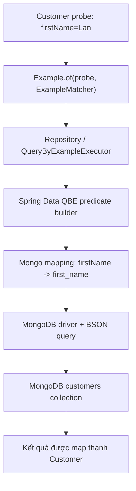
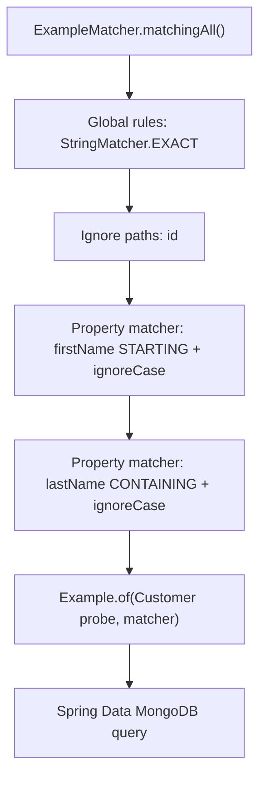
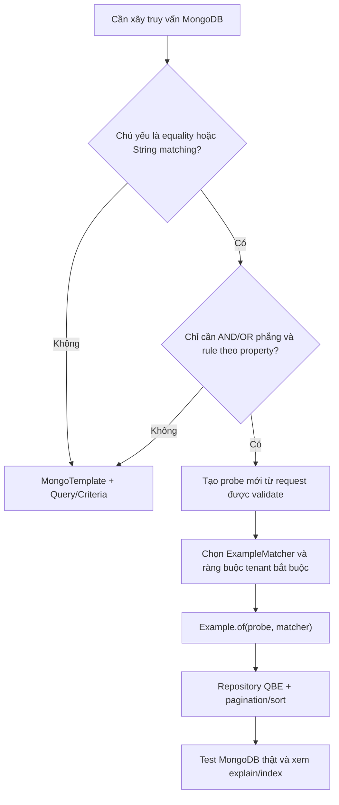

# Tạo đối tượng mẫu, Example và ExampleMatcher trong Spring Data MongoDB

## 1. Query by Example là gì và giải quyết bài toán nào?

Trong **Spring Data MongoDB**, ngoài derived query từ tên method, `MongoTemplate` với `Query`/`Criteria` và aggregation, ta còn có **Query by Example (QBE)**. Ý tưởng của QBE là: tạo một **đối tượng mẫu** (*probe*) cùng kiểu với entity, gán các thuộc tính muốn lọc, sau đó để Spring Data xây truy vấn dựa trên những giá trị ấy.

Một trang quản lý khách hàng có thể cho phép tìm theo tên, email, thành phố hoặc trạng thái hoạt động. Nếu chỉ có vài điều kiện equality và chuỗi đơn giản, bạn không nhất thiết phải viết một method repository mới cho mỗi tổ hợp:

```text
Người dùng chọn:
  firstName = "Lan"
  active = true

                 ↓
Probe Customer:
  firstName = "Lan"
  active = true
  các thuộc tính khác = null

                 ↓
Example.of(probe, matcher)

                 ↓
customerRepository.findAll(example)

                 ↓
Các document khớp điều kiện theo ExampleMatcher
```

Để hiểu QBE chính xác, cần phân biệt ba khái niệm:

| Thành phần | Vai trò | Ví dụ |
|---|---|---|
| **Probe** | Object chứa các giá trị mẫu dùng để lọc | `Customer` có `firstName = "Lan"` |
| **`Example<T>`** | Gói probe và quy tắc matching, mang thông tin về kiểu entity | `Example.of(probe, matcher)` |
| **`ExampleMatcher`** | Quy định thuộc tính nào tham gia, cách so khớp chuỗi, ignore case, xử lý null, kết hợp AND/OR | `matchingAll().withStringMatcher(CONTAINING)` |

QBE đặc biệt phù hợp cho **lọc theo các property của một domain object**, khi điều kiện chủ yếu là equality hoặc thao tác chuỗi có thể biểu diễn bằng matcher. Nó **không thay thế** toàn bộ MongoDB Query DSL: điều kiện range `$gt`/`$lt`, các nhóm AND/OR lồng nhau, `$elemMatch` phức tạp, aggregation và query có toán tử chuyên biệt thường phù hợp hơn với `Criteria` hoặc `@Query`.

### 1.1. Mục tiêu học tập

Sau bài học thuộc chương **Query by Example**, bạn cần:

1. Tạo probe bằng class entity và biết property nào thực sự tạo điều kiện.
2. Khởi tạo `Example.of(probe)` và `Example.of(probe, matcher)`.
3. Sử dụng `ExampleMatcher.matchingAll()`, `matchingAny()`, `withIgnorePaths(...)`, `withIncludeNullValues()`, `withStringMatcher(...)`, `withIgnoreCase(...)` và `withMatcher(...)`.
4. Hiểu sự khác nhau giữa so khớp **exact**, **containing**, **starting**, **ending** và **regex**.
5. Thực hiện QBE qua `MongoRepository`/`QueryByExampleExecutor` và biết lúc nào nên chuyển sang `MongoTemplate`/`Criteria`.
6. Kiểm thử đúng mapping BSON, type restriction, quyền tenant, phân trang và chi phí index.

## 2. Mô hình Customer dùng trong bài

### 2.1. Entity được ánh xạ vào MongoDB

Ví dụ Spring Boot dùng Spring Data MongoDB với Java 17 trở lên:

```java
import org.springframework.data.annotation.Id;
import org.springframework.data.mongodb.core.mapping.Document;
import org.springframework.data.mongodb.core.mapping.Field;

@Document(collection = "customers")
public class Customer {
    @Id
    private String id;

    @Field("tenant_id")
    private String tenantId;

    @Field("first_name")
    private String firstName;

    @Field("last_name")
    private String lastName;

    private String email;
    private String city;
    private Boolean active;
    private Integer age;

    public Customer() {}

    public String getId() { return id; }
    public void setId(String id) { this.id = id; }

    public String getTenantId() { return tenantId; }
    public void setTenantId(String tenantId) { this.tenantId = tenantId; }

    public String getFirstName() { return firstName; }
    public void setFirstName(String firstName) { this.firstName = firstName; }

    public String getLastName() { return lastName; }
    public void setLastName(String lastName) { this.lastName = lastName; }

    public String getEmail() { return email; }
    public void setEmail(String email) { this.email = email; }

    public String getCity() { return city; }
    public void setCity(String city) { this.city = city; }

    public Boolean getActive() { return active; }
    public void setActive(Boolean active) { this.active = active; }

    public Integer getAge() { return age; }
    public void setAge(Integer age) { this.age = age; }
}
```

Ở entity này:

- `@Document(collection = "customers")` chỉ định collection mặc định.
- `@Id` ánh xạ `id` với BSON `_id`.
- `@Field("first_name")`, `@Field("last_name")`, `@Field("tenant_id")` ánh xạ tên property Java sang tên field lưu trữ.
- `active` dùng **`Boolean`** thay vì `boolean` và `age` dùng **`Integer`** thay vì `int` để probe có thể phân biệt **không chọn filter** (null) với **lọc false/0**.

Đây là một entity cho mục tiêu giảng dạy QBE, không phải mô hình customer đầy đủ cho production. Trong ứng dụng thật, validation, uniqueness email, chính sách dữ liệu cá nhân và tenant isolation cần được thiết kế riêng.

### 2.2. Bộ dữ liệu ví dụ

Ta sẽ dùng năm khách hàng sau, được tạo **qua Spring Data repository** trong bài test để Spring Data có thể ghi metadata type như `_class` theo cấu hình mặc định:

| ID | tenantId | firstName | lastName | email | city | active | age |
|---|---|---|---|---|---|---|---:|
| C-101 | T-A | Lan | Nguyen | lan.nguyen@example.test | Hà Nội | true | 25 |
| C-102 | T-A | Lanh | Tran | lanh.tran@example.test | TP.HCM | true | 26 |
| C-103 | T-A | Minh Lan | Nguyen | minhlan@example.test | TP.HCM | false | 30 |
| C-104 | T-A | LAN | Le | lan.le@example.test | Đà Nẵng | true | 31 |
| C-201 | T-B | Lan | Nguyen | lan.other@example.test | Hà Nội | true | 36 |

Bộ dữ liệu có dụng ý:

- `Lan`, `Lanh` và `Minh Lan` phân biệt equality, prefix và substring.
- `LAN` kiểm tra chế độ ignore case.
- `active = false` kiểm tra khác biệt giữa null và false.
- `C-201` nằm ở tenant khác nhưng có `firstName = "Lan"`; đây là ca kiểm thử bắt buộc để không coi QBE là cơ chế phân quyền.
- Các tên field BSON như `first_name` khác tên property Java `firstName`.

Đừng dùng lệnh insert raw không có `_class` rồi mặc định rằng nó sẽ có cùng kết quả với repository QBE theo chế độ **typed matching**. Phần về kiểu và `_class` ở mục 10 sẽ giải thích điểm này.

## 3. Tạo probe và Example đơn giản nhất

### 3.1. Tạo đối tượng mẫu

Giả sử chỉ muốn tìm chính xác `firstName = "Lan"`:

```java
import org.springframework.data.domain.Example;

Customer probe = new Customer();
probe.setFirstName("Lan");

Example<Customer> example = Example.of(probe);
```

`probe` không phải một document “để lưu” mà là đối tượng chứa giá trị làm điều kiện. Nó vẫn dùng class entity `Customer`, để Spring Data biết mapping và kiểu. Trong trường hợp mặc định, những property reference có giá trị null thường **không tham gia** vào phép so khớp; `firstName` có giá trị sẽ tham gia.

Vì mặc định của một matcher có thể khác nhu cầu cụ thể và để bài test dễ hiểu, ví dụ có thể **khai báo rõ** exact matching:

```java
import org.springframework.data.domain.Example;
import org.springframework.data.domain.ExampleMatcher;

ExampleMatcher matcher = ExampleMatcher.matchingAll()
    .withStringMatcher(ExampleMatcher.StringMatcher.EXACT)
    .withIgnorePaths("id");

Example<Customer> exactExample = Example.of(probe, matcher);
```

Ví dụ này có ý nghĩa “tất cả các property được tính tới phải khớp”, và trong probe hiện chỉ có `firstName`. `withIgnorePaths("id")` bảo đảm trường ID không trở thành filter ngay cả khi ai đó vô tình gán ID vào probe.

### 3.2. QBE qua MongoRepository

Repository:

```java
import org.springframework.data.mongodb.repository.MongoRepository;

public interface CustomerRepository
        extends MongoRepository<Customer, String> {
}
```

Trong các phiên bản Spring Data MongoDB hỗ trợ QBE, repository cung cấp những thao tác của `QueryByExampleExecutor` như `findAll(example)`, `findOne(example)`, `count(example)` và `exists(example)`:

```java
import java.util.List;

List<Customer> matches = customerRepository.findAll(exactExample);

long count = customerRepository.count(exactExample);
boolean exists = customerRepository.exists(exactExample);
```

Với bộ dữ liệu ví dụ và typed metadata phù hợp, tìm chính xác `Lan` có thể trả `C-101` và `C-201`. **Chưa có tenant filter**, nên kết quả trộn hai tenant là hành vi đúng theo query nhưng **không phù hợp** với một API bắt buộc cô lập tenant.

### 3.3. Luồng xử lý từ probe tới BSON query



Trong trường hợp đơn giản, điều kiện tương đương về logic với:

```javascript
db.customers.find({ first_name: "Lan" });
```

**Không coi BSON minh họa trên là bản sao chắc chắn 100% của lệnh QBE thực tế.** Với typed matching, Spring Data MongoDB có thể thêm điều kiện giới hạn kiểu theo `_class` hoặc type metadata. Đường query cuối cùng còn phụ thuộc matcher, mapping context và phiên bản thư viện.

### 3.4. Tạo probe mới cho mỗi yêu cầu

`Example.of(...)` giữ tham chiếu đến probe; đừng dùng một `Customer` mutable dùng chung giữa nhiều request rồi lần lượt thay các property. Tình huống sai:

```java
// Không đặt mutable shared probe như thế này trong singleton service:
private final Customer sharedProbe = new Customer();
```

Các request đồng thời có thể ghi đè giá trị lọc của nhau. Nên tạo probe **theo từng lần tìm kiếm**, gán đúng các field cho request rồi tạo `Example` tương ứng. `ExampleMatcher` được thiết kế như cấu hình matcher có thể tái sử dụng/biến thể, còn probe là dữ liệu tìm kiếm cần cô lập.

## 4. ExampleMatcher: matchingAll và matchingAny

### 4.1. matchingAll: tất cả các điều kiện cùng đúng

`ExampleMatcher.matchingAll()` diễn đạt logic **AND** giữa những property được tính vào query.

```java
Customer probe = new Customer();
probe.setFirstName("Lan");
probe.setActive(true);

ExampleMatcher all = ExampleMatcher.matchingAll()
    .withStringMatcher(ExampleMatcher.StringMatcher.EXACT)
    .withIgnorePaths("id");

Example<Customer> example = Example.of(probe, all);
List<Customer> result = customerRepository.findAll(example);
```

Kỳ vọng là `firstName` đúng bằng `Lan` **và** `active` là true, vì vậy trong bộ dữ liệu minh họa có `C-101` và `C-201`. `C-104` không khớp vì `LAN` không giống `Lan` trong chế độ case-sensitive.

### 4.2. matchingAny: chỉ cần một điều kiện đúng

`ExampleMatcher.matchingAny()` diễn đạt **OR** giữa các property được đưa vào so khớp:

```java
Customer probe = new Customer();
probe.setFirstName("Lan");
probe.setActive(true);

ExampleMatcher any = ExampleMatcher.matchingAny()
    .withStringMatcher(ExampleMatcher.StringMatcher.EXACT);

Example<Customer> example = Example.of(probe, any);
List<Customer> result = customerRepository.findAll(example);
```

Theo logic OR, kết quả có các customer mang `firstName = Lan` **hoặc** `active = true`, gồm `C-101`, `C-102`, `C-104` và `C-201`. `C-103` có `active = false` và `firstName = "Minh Lan"` nên không khớp điều kiện exact.

### 4.3. Bảng đối chiếu

| Matcher | Điều kiện ví dụ | Ngữ nghĩa |
|---|---|---|
| `matchingAll()` | `firstName = "Lan"`, `active = true` | `firstName = Lan AND active = true` |
| `matchingAny()` | `firstName = "Lan"`, `active = true` | `firstName = Lan OR active = true` |
| `matching()` | Factory matcher thông thường | Mặc định diễn đạt all-matching trong Spring Data Commons hiện hành |

**Không dùng `matchingAny()` để ghép điều kiện tenant bắt buộc với các lựa chọn tự do của người dùng.** Ví dụ `tenantId = T-A OR firstName = Lan` sẽ cho phép customer `C-201` của `T-B` xuất hiện do khớp tên. Khi cần điều kiện an ninh phải đúng cho mọi nhánh, dùng `matchingAll()` cho các field thích hợp hoặc xây `Criteria` có cấu trúc AND bắt buộc bọc bên ngoài nhóm OR.

## 5. Quy định field tham gia: null và withIgnorePaths

### 5.1. QBE thường bỏ qua các property reference có giá trị null

Trong ví dụ:

```java
Customer probe = new Customer();
probe.setCity("Hà Nội");
// firstName, lastName, active, age... vẫn là null.

Example<Customer> example = Example.of(probe);
```

`city = "Hà Nội"` tham gia query, còn những reference field chưa gán có giá trị `null` mặc định không tạo điều kiện. Đây là lý do probe hữu ích cho form có các tùy chọn lọc không bắt buộc.

**Null trong probe có hai nghĩa dễ nhầm:**

1. “Người dùng không chọn điều kiện này” — phù hợp với hành vi bỏ qua null mặc định.
2. “Người dùng muốn tìm document có BSON null” — **không** thể biểu đạt bằng cùng cách bỏ qua null; cần matcher/configuration hoặc `Criteria` chuyên biệt.

Nếu phải phân biệt chính xác **field không tồn tại** với **field tồn tại và có giá trị null**, nên dùng MongoDB `$exists` và `$type`/`Criteria` phù hợp; QBE không phải công cụ lý tưởng để thể hiện mọi trạng thái BSON.

### 5.2. withIgnorePaths loại field bất kể giá trị

Giả sử probe lấy từ một object khác và chứa giá trị `id`, nhưng muốn tìm theo tên và không lọc ID:

```java
Customer probe = new Customer();
probe.setId("C-101");
probe.setLastName("Nguyen");
probe.setActive(true);

ExampleMatcher matcher = ExampleMatcher.matchingAll()
    .withIgnorePaths("id")
    .withStringMatcher(ExampleMatcher.StringMatcher.EXACT);

Example<Customer> example = Example.of(probe, matcher);
```

Điều kiện QBE sẽ tập trung vào `lastName = Nguyen` và `active = true`, dù `id` không null. Với dữ liệu mẫu, kết quả logic là `C-101` và `C-201`; `C-103` bị loại do inactive.

Ví dụ loại nhiều field:

```java
ExampleMatcher matcher = ExampleMatcher.matchingAll()
    .withIgnorePaths("id", "age", "email");
```

Khi một property bị ignore, giá trị tương ứng không còn là điều kiện truy vấn ngay cả khi probe đã gán. Hãy review danh sách ignored fields để tránh bỏ mất một điều kiện nghiệp vụ bắt buộc.

### 5.3. Primitive luôn có giá trị mặc định

Nếu entity khai báo:

```java
private boolean active; // false dù không gọi setActive(...)
private int age;        // 0 dù không gọi setAge(...)
```

thì probe mới tạo không thể dùng null để biểu đạt “chưa chọn filter”. Tùy cách QBE xử lý type, các field primitive mặc định như `false`, `0` có thể được đưa vào điều kiện và làm kết quả sai ý định.

Các phương án:

- Trong entity mẫu của bài, dùng `Boolean active` và `Integer age` để có trạng thái vắng mặt.
- Hoặc chỉ rõ `withIgnorePaths("active", "age")` nếu filter đó không được phép tham gia.
- Hoặc thay QBE bằng một request DTO và `Criteria` khi cần phân biệt nhiều trạng thái hoặc thực thi điều kiện range.

Ngược lại, **`false` và `0` phải được giữ** nếu người dùng thực sự chọn chúng. Không viết:

```java
if (Boolean.TRUE.equals(request.active())) {
    probe.setActive(true);
}
// Sai nếu người dùng muốn lọc active=false.
```

Mà nên viết:

```java
if (request.active() != null) {
    probe.setActive(request.active());
}
```

### 5.4. withIncludeNullValues và giới hạn của null trong MongoDB

`ExampleMatcher.withIncludeNullValues()` yêu cầu đưa giá trị null vào các điều kiện matching, thay vì bỏ qua chúng:

```java
Customer probe = new Customer();
probe.setFirstName("Lan");

ExampleMatcher matcher = ExampleMatcher.matchingAll()
    .withIncludeNullValues();

Example<Customer> example = Example.of(probe, matcher);
```

**Không dùng mẫu này để tìm `firstName = Lan` trên một entity còn nhiều field null:** matcher có thể đưa **mọi property null khác** vào điều kiện, khiến kết quả rất hẹp hoặc phụ thuộc dữ liệu missing/null. Nếu mục tiêu là “email bị thiếu” hoặc “email là BSON null”, dùng `Criteria.where("email").is(null)` hoặc `exists(...)` với ngữ nghĩa xác định rõ.

Trong MongoDB, điều kiện equality với `null` có thể khớp cả field chứa BSON null **và field không tồn tại**. Khi một trường có nhiều trạng thái dữ liệu, phải viết integration test kiểm tra đúng trường hợp `null`, missing, empty string và array rỗng; không coi chúng giống nhau.

## 6. StringMatcher: EXACT, STARTING, ENDING, CONTAINING, REGEX

### 6.1. Bộ từ khóa dành cho String

`ExampleMatcher.StringMatcher` quy định cách so khớp các property kiểu String:

| Giá trị | Ý định | Biểu diễn MongoDB tương đương về logic | Với probe `firstName = "Lan"` |
|---|---|---|---|
| `EXACT` | Bằng toàn bộ chuỗi | Equality hoặc regex được neo đầy đủ theo cơ chế mapper | `C-101`, `C-201` |
| `STARTING` | Bắt đầu bằng chuỗi | Regex kiểu `^Lan` | `C-101`, `C-102`, `C-201` |
| `ENDING` | Kết thúc bằng chuỗi | Regex kiểu `Lan$` | `C-101`, `C-103`, `C-201` |
| `CONTAINING` | Chứa chuỗi ở bất kỳ vị trí nào | Regex chứa đoạn literal `Lan` | `C-101`, `C-102`, `C-103`, `C-201` |
| `REGEX` | Coi giá trị probe là mẫu regex | Query `$regex` theo mẫu | Phụ thuộc pattern |
| `DEFAULT` | Hành vi matching mặc định của store/framework | Cần đối chiếu phiên bản và loại store | Không nên dùng khi cần hợp đồng tìm kiếm tường minh |

Các tập kết quả trên giả định **case-sensitive**, typed metadata đúng và chưa thêm tenant filter. `C-104` với `firstName = "LAN"` chỉ xuất hiện khi có case-insensitive tương ứng.

Các mẫu regex trong bảng nhằm diễn giải ý nghĩa; Spring Data có thể dùng `Pattern` và escape ký tự theo cách riêng. Không suy rằng JSON minh họa là biểu diễn byte-for-byte của lệnh query thực tế.

### 6.2. Global StringMatcher áp dụng cho nhiều property String

Ví dụ tìm khách hàng có `firstName` và `lastName` **đều chứa** những đoạn text nhập vào:

```java
Customer probe = new Customer();
probe.setFirstName("Lan");
probe.setLastName("Ng");

ExampleMatcher matcher = ExampleMatcher.matchingAll()
    .withStringMatcher(
        ExampleMatcher.StringMatcher.CONTAINING)
    .withIgnorePaths("id");

Example<Customer> example = Example.of(probe, matcher);
```

`CONTAINING` toàn cục áp dụng cho các String property được so khớp (trừ property có matcher riêng). Đối với dữ liệu mẫu và case-sensitive, `C-101`, `C-103`, `C-201` phù hợp với tên chứa `Lan` và họ chứa `Ng`.

**Cẩn trọng với field định danh:** Nếu probe đồng thời chứa `tenantId = "T-A"`, `CONTAINING` toàn cục có thể làm điều kiện tenant trở thành so khớp substring thay vì equality. Với điều kiện tenant hoặc mã quan trọng, đặt `EXACT` làm matcher toàn cục rồi chỉ dùng `CONTAINING` cho property tìm kiếm văn bản được cho phép.

### 6.3. ExampleMatcher.ignoreCase toàn cục

`withIgnoreCase()` yêu cầu so khớp không phân biệt chữ hoa/chữ thường cho các String property thích hợp:

```java
Customer probe = new Customer();
probe.setFirstName("lan");

ExampleMatcher matcher = ExampleMatcher.matchingAll()
    .withStringMatcher(
        ExampleMatcher.StringMatcher.CONTAINING)
    .withIgnoreCase();

Example<Customer> example = Example.of(probe, matcher);
```

Với `lan` và CONTAINING + ignore case, toàn bộ `C-101`, `C-102`, `C-103`, `C-104`, `C-201` phù hợp theo tên. Tuy nhiên đây **không phải** tìm kiếm không dấu hoặc full-text: `IgnoreCase` không tự bỏ dấu tiếng Việt, chuẩn hóa Unicode hay sửa lỗi gõ từ.

`IgnoreCase` dựa vào cơ chế case-insensitive của MongoDB matcher/regex tương ứng. Nó không có nghĩa truy vấn chắc chắn dùng được một index B-tree có collation case-insensitive hiệu quả; cần `explain` trên workload thật.

### 6.4. StringMatcher.REGEX và ranh giới tin cậy

`REGEX` cho phép coi giá trị probe là biểu thức chính quy. Ví dụ:

```java
Customer probe = new Customer();
probe.setFirstName("^Lan(h)?$");

ExampleMatcher matcher = ExampleMatcher.matchingAll()
    .withStringMatcher(
        ExampleMatcher.StringMatcher.REGEX);

Example<Customer> example = Example.of(probe, matcher);
```

Theo cú pháp regex, mẫu `^Lan(h)?$` khớp `Lan` và `Lanh`. Không nên chuyển input từ form tìm kiếm tự do sang `REGEX` một cách trực tiếp; dấu `.`, `*`, `[`, nhóm lặp và các metacharacter có thể đổi nghĩa hoặc tạo truy vấn rộng, chậm.

Với **chuỗi cần tìm literal**, dùng `CONTAINING`/`STARTING`/`ENDING` hoặc `Criteria` với `Pattern.quote(...)` khi tự tạo regex. Khi sản phẩm cho phép regex thật, phải giới hạn độ dài, quyền thực hiện, độ phức tạp, kết quả trả về và thời gian truy vấn; test rõ các edge case.

### 6.5. Bảng chọn matcher theo UX

| Chức năng UX | Matcher thường phù hợp | Ghi chú |
|---|---|---|
| Tra cứu mã khách hàng chính xác | `EXACT` | Không dùng `CONTAINING` cho identifier |
| Autocomplete tên theo tiền tố | `STARTING` | Kiểm tra index và case sensitivity |
| Tìm tên chứa đoạn text | `CONTAINING` | Regex substring có thể tốn nhiều tài nguyên |
| Tìm hậu tố tên miền/email | `ENDING` | Thường khó tối ưu bằng index B-tree thông thường |
| Truy vấn regex quản trị đã kiểm soát | `REGEX` | Không dùng trực tiếp cho input tự do |
| So khớp exact không phân biệt case | `EXACT` + `ignoreCase` | Cân nhắc field canonical/collation cho equality workload lớn |

## 7. Matcher riêng từng property: withMatcher và withIgnoreCase("...")

### 7.1. Vì sao matcher toàn cục chưa đủ?

Hệ thống thực tế thường muốn:

- `tenantId`: **exact** và không bỏ qua case theo định dạng mã.
- `firstName`: **starts with**, không phân biệt case.
- `lastName`: **contains**, không phân biệt case.
- `active`: **exact boolean**.

Với các yêu cầu khác nhau trên cùng probe, phải dùng matcher riêng theo property:

```java
import org.springframework.data.domain.Example;
import org.springframework.data.domain.ExampleMatcher;

Customer probe = new Customer();
probe.setTenantId("T-A");
probe.setFirstName("lan");
probe.setActive(true);

ExampleMatcher matcher = ExampleMatcher.matchingAll()
    .withStringMatcher(
        ExampleMatcher.StringMatcher.EXACT)
    .withMatcher("firstName",
        ExampleMatcher.GenericPropertyMatchers
            .startsWith().ignoreCase())
    .withIgnorePaths("id");

Example<Customer> example = Example.of(probe, matcher);
```

Kỳ vọng là:

```text
tenantId = T-A
  AND firstName startsWith("lan"), ignoreCase
  AND active = true
```

Trên dữ liệu mẫu, kết quả gồm `C-101`, `C-102`, `C-104`. `C-103` bắt đầu bằng `Minh` và active=false; `C-201` thuộc tenant `T-B` nên bị loại.

### 7.2. Tùy chỉnh nhiều property độc lập

```java
Customer probe = new Customer();
probe.setTenantId("T-A");
probe.setFirstName("la");
probe.setLastName("ng");

ExampleMatcher matcher = ExampleMatcher.matchingAll()
    .withStringMatcher(
        ExampleMatcher.StringMatcher.EXACT)
    .withMatcher("firstName",
        ExampleMatcher.GenericPropertyMatchers
            .startsWith().ignoreCase())
    .withMatcher("lastName",
        ExampleMatcher.GenericPropertyMatchers
            .contains().ignoreCase())
    .withIgnorePaths("id");

Example<Customer> example = Example.of(probe, matcher);
```

Ở đây `firstName` dùng prefix, `lastName` dùng substring. Các String property khác nếu có giá trị vẫn theo EXACT toàn cục. Đây là chiến lược tốt hơn việc đặt `CONTAINING + ignoreCase` cho **tất cả String property** khi entity có tenant ID, email hoặc mã định danh.

### 7.3. withIgnoreCase chỉ cho property cần thiết

Khi các String property cùng dùng kiểu match nhưng chỉ một field cần ignore case:

```java
ExampleMatcher matcher = ExampleMatcher.matchingAll()
    .withStringMatcher(
        ExampleMatcher.StringMatcher.EXACT)
    .withIgnoreCase("firstName")
    .withIgnorePaths("id");
```

`withIgnoreCase("firstName")` chỉ nhắm vào property được liệt kê. Nếu cần nhiều property, có thể truyền nhiều tên:

```java
ExampleMatcher matcher = ExampleMatcher.matchingAll()
    .withIgnoreCase("firstName", "lastName");
```

Đường dẫn truyền cho `withIgnorePaths`, `withMatcher` và `withIgnoreCase` là **property path theo domain Java**, không phải tên field BSON. Trong ví dụ, dùng `"firstName"`, **không** dùng `"first_name"`. `@Field` đảm nhiệm chuyển đổi sang tên lưu trữ khi thực thi query.

### 7.4. PropertyValueTransformer

`ExampleMatcher` còn cho phép biến đổi giá trị của một property trước khi tạo predicate. Ví dụ chỉ chuẩn hóa email ở probe:

```java
import java.util.Locale;
import org.springframework.data.domain.ExampleMatcher;

ExampleMatcher matcher = ExampleMatcher.matchingAll()
    .withTransformer(
        "email",
        source -> source.map(value ->
            (Object) value.toString().trim()
                .toLowerCase(Locale.ROOT)));
```

`PropertyValueTransformer` làm việc với giá trị của probe, **không sửa hàng loạt document đã lưu**. Nếu database lưu email ở mixed case nhưng transformer chỉ hạ case input rồi dùng exact comparison, kết quả có thể vẫn không khớp. Phải có quy tắc thống nhất lúc ghi dữ liệu, hoặc dùng một chiến lược case-insensitive thực sự phù hợp.

Trong hệ thống thông thường, nên chuẩn hóa các input cần thiết **trước khi tạo probe** để validation, logging và conversion có cùng cách diễn giải. Transformer hữu ích khi muốn đóng gói một quy tắc matching chuyên biệt và đã được kiểm thử.

### 7.5. Sơ đồ cấu hình từ toàn cục tới riêng property



Đừng thiết kế matcher phức tạp hơn yêu cầu nghiệp vụ. Nếu một filter cần nhiều loại toán tử MongoDB, khả năng diễn đạt bằng `ExampleMatcher` sẽ nhanh chóng đạt giới hạn và `Criteria` trở nên rõ ràng hơn.

## 8. QBE với repository: findAll, findOne, exists, count và pagination

### 8.1. Các API quen thuộc

Spring Data Commons định nghĩa `QueryByExampleExecutor<T>`. Repository MongoDB triển khai những khả năng QBE tương ứng, nên một `MongoRepository<Customer, String>` thông thường có thể gọi:

```java
Customer probe = new Customer();
probe.setEmail("lan.nguyen@example.test");

Example<Customer> example = Example.of(
    probe,
    ExampleMatcher.matchingAll()
        .withStringMatcher(
            ExampleMatcher.StringMatcher.EXACT)
);

var one = customerRepository.findOne(example);
var all = customerRepository.findAll(example);
var count = customerRepository.count(example);
var exists = customerRepository.exists(example);
```

| API | Giá trị trả về | Dùng trong tình huống nào? |
|---|---|---|
| `findOne(example)` | `Optional<Customer>` | Kỳ vọng **tối đa một** kết quả |
| `findAll(example)` | `List<Customer>` hoặc kiểu collection tương ứng | Tập nhỏ, đã có giới hạn hợp lý |
| `findAll(example, sort)` | Danh sách sắp xếp | Cần thứ tự rõ ràng |
| `findAll(example, pageable)` | `Page<Customer>` | Cần trang và tổng số kết quả |
| `count(example)` | `long` | Đếm document khớp |
| `exists(example)` | `boolean` | Kiểm tra ít nhất một kết quả |

**`findOne` không tự bảo đảm uniqueness.** Nếu probe khớp nhiều document, API có thể báo lỗi kích thước kết quả ngoài dự kiến thay vì chọn ngẫu nhiên một item. Nếu muốn email unique trong phạm vi tenant, phải thiết kế ràng buộc dữ liệu/index phù hợp; kiểm tra uniqueness bằng cách gọi `exists` rồi `insert` riêng lẻ vẫn có race.

### 8.2. Sort theo property Java

```java
import org.springframework.data.domain.Sort;

Sort sort = Sort.by(
    Sort.Order.asc("firstName"),
    Sort.Order.asc("id")
);

List<Customer> ordered = customerRepository.findAll(
    example, sort);
```

`firstName` là property của entity; Spring Data mapping sẽ chuyển sang BSON `first_name`. Thêm `id` giúp thứ tự ổn định khi nhiều customer cùng tên. Nếu không có sort, **không có bảo đảm về thứ tự kết quả** dù một bảng ví dụ liệt kê ID từ nhỏ đến lớn.

### 8.3. Phân trang kết quả

```java
import org.springframework.data.domain.Page;
import org.springframework.data.domain.PageRequest;
import org.springframework.data.domain.Pageable;
import org.springframework.data.domain.Sort;

Pageable pageable = PageRequest.of(
    0, 20,
    Sort.by(
        Sort.Order.asc("firstName"),
        Sort.Order.asc("id"))
);

Page<Customer> page = customerRepository.findAll(
    example, pageable);

System.out.println(page.getContent().size());
System.out.println(page.getTotalElements());
```

Tham số `PageRequest.of(...)` lấy chỉ số trang **bắt đầu từ 0**. `Page` thường cần thông tin total và có thể phát sinh count query, tốn tài nguyên với regex hoặc tập dữ liệu lớn. Nếu UI chỉ cần biết còn trang kế tiếp, xem xét `Slice` hoặc API truy vấn phù hợp, theo phiên bản Spring Data đang dùng.

Ở API public, người dùng **không được chọn page size tùy ý**. Hãy giới hạn `size`, offset và field sort từ một danh sách đã phê duyệt; tránh đưa property path do client gửi thẳng vào `Sort.by(...)`.

### 8.4. QBE với repository không phải MongoTemplate mặc định

QBE thường được dùng trực tiếp trên repository qua `QueryByExampleExecutor`. `MongoTemplate` phù hợp khi muốn viết `Query`/`Criteria`, chỉ định collection khác, projection đặc thù, cập nhật và kết hợp toán tử phức tạp.

Một số phiên bản Spring Data MongoDB hỗ trợ biến `Example` thành tiêu chí thông qua API `Criteria.alike(example)` hoặc cơ chế tương ứng. Nhưng **khi đã cần AND/OR lồng nhau, range, tenant policy và cấu hình index**, thường rõ ràng hơn nếu xây truy vấn tường minh bằng `Criteria` thay vì dùng QBE rồi cố thêm nhiều điều kiện rời rạc.

Đừng tự suy rằng một `Example` có thể truyền trực tiếp vào mọi overload của `MongoTemplate.find(...)`; method template và executor QBE có chữ ký/hợp đồng khác nhau.

### 8.5. Reactive QBE

Ứng dụng Spring Data MongoDB reactive có thể dùng các API `ReactiveQueryByExampleExecutor` tương ứng khi repository reactive và phiên bản framework hỗ trợ:

```java
import org.springframework.data.mongodb.repository.ReactiveMongoRepository;

public interface ReactiveCustomerRepository
        extends ReactiveMongoRepository<Customer, String> {
}
```

Ví dụ nghiệp vụ:

```java
Customer probe = new Customer();
probe.setFirstName("Lan");

Example<Customer> example = Example.of(probe);

reactor.core.publisher.Flux<Customer> result =
    reactiveCustomerRepository.findAll(example);
```

Ở đây `reactiveCustomerRepository` được inject và hạ tầng reactive MongoDB đã được cấu hình. Cách dựng `Example`/`ExampleMatcher` là cùng khái niệm, nhưng kiểu trả về reactive cần được subscribe/compose đúng cách; không gọi `block()` trong request pipeline reactive chỉ để biến kết quả thành list đồng bộ.

Tùy phiên bản Spring Data, có thể khai báo `ReactiveQueryByExampleExecutor<Customer>` trực tiếp hoặc kế thừa từ repository phù hợp. Khi triển khai, đối chiếu interface thực tế trong dependency của dự án.

## 9. Dựng probe từ form tìm kiếm một cách an toàn

### 9.1. Request DTO không phải entity

Không nên bind trực tiếp toàn bộ request JSON vào `Customer` rồi truyền nguyên object vào `Example.of(...)`. Entity có thể chứa ID, tenant, trạng thái nội bộ hoặc các field không được phép cho người dùng điều khiển. Thay vào đó, định nghĩa một request DTO chỉ chứa các filter công khai:

```java
public record CustomerSearchRequest(
    String firstNamePrefix,
    String lastNameContains,
    Boolean active,
    Integer age
) {}
```

Những giá trị sau có ý nghĩa khác nhau:

```text
firstNamePrefix = null    → không lọc tên
firstNamePrefix = ""      → coi là không nhập hoặc trả lỗi, theo hợp đồng API
active = null             → không lọc active
active = false            → lọc customer active=false
age = null                → không lọc tuổi
age = 0                   → lọc tuổi bằng 0 nếu nghiệp vụ cho phép
```

Quy tắc “chuỗi blank được bỏ qua” là một **quyết định API**. Có sản phẩm nên trả HTTP 400 cho giá trị blank để không gây query quá rộng; không dựa vào hành vi tình cờ của `StringMatcher` với chuỗi rỗng.

### 9.2. Mapper từ request sang probe mới

```java
import java.util.List;
import org.springframework.data.domain.Example;
import org.springframework.data.domain.ExampleMatcher;
import org.springframework.data.domain.Sort;
import org.springframework.stereotype.Service;

@Service
public class CustomerSearchService {
    private final CustomerRepository repository;

    public CustomerSearchService(CustomerRepository repository) {
        this.repository = repository;
    }

    public List<Customer> search(
            CustomerSearchRequest input,
            String trustedTenantId) {

        if (input == null || trustedTenantId == null
                || trustedTenantId.isBlank()) {
            throw new IllegalArgumentException("Missing search context");
        }
        validate(input);

        Customer probe = new Customer();
        probe.setTenantId(trustedTenantId);
        if (hasText(input.firstNamePrefix())) {
            probe.setFirstName(input.firstNamePrefix().trim());
        }
        if (hasText(input.lastNameContains())) {
            probe.setLastName(input.lastNameContains().trim());
        }
        if (input.active() != null) {
            probe.setActive(input.active());
        }
        if (input.age() != null) {
            probe.setAge(input.age());
        }

        ExampleMatcher matcher = ExampleMatcher.matchingAll()
            .withStringMatcher(ExampleMatcher.StringMatcher.EXACT)
            .withMatcher("firstName",
                ExampleMatcher.GenericPropertyMatchers
                    .startsWith().ignoreCase())
            .withMatcher("lastName",
                ExampleMatcher.GenericPropertyMatchers
                    .contains().ignoreCase())
            .withIgnorePaths("id");

        Example<Customer> example = Example.of(probe, matcher);

        return repository.findAll(
            example,
            Sort.by(
                Sort.Order.asc("firstName"),
                Sort.Order.asc("id"))
        );
    }

    private static boolean hasText(String value) {
        return value != null && !value.isBlank();
    }

    private static void validate(CustomerSearchRequest input) {
        if (input.firstNamePrefix() != null
                && input.firstNamePrefix().length() > 80) {
            throw new IllegalArgumentException("First name too long");
        }
        if (input.lastNameContains() != null
                && input.lastNameContains().length() > 80) {
            throw new IllegalArgumentException("Last name too long");
        }
        if (input.age() != null
                && (input.age() < 0 || input.age() > 150)) {
            throw new IllegalArgumentException("Age out of range");
        }
    }
}
```

Ví dụ để minh họa nên phương thức đang trả `List`, chưa đặt `Pageable`/limit. Với endpoint public trên collection lớn, phải bổ sung phân trang và rate limits trước khi triển khai; không coi `List` không giới hạn là mặc định phù hợp.

### 9.3. Vì sao tenantId phải do server cung cấp?

`trustedTenantId` phải đến từ security context hoặc nguồn đã xác thực/ủy quyền, **không lấy từ query parameter mà client tự chọn**. `ExampleMatcher.matchingAll()` kết hợp điều kiện `tenantId = trustedTenantId` với các filter còn lại theo AND.

Ngược lại, nếu sử dụng `matchingAny()` với cùng probe:

```text
(tenantId = T-A) OR (firstName bắt đầu bằng "lan")
```

thì customer `C-201` của `T-B` có thể được trả về. **Một lựa chọn matcher ảnh hưởng trực tiếp đến phân quyền dữ liệu**, không chỉ cú pháp tìm kiếm.

Để enforce tenant policy khó bị bỏ sót, có thể cân nhắc repository/service query factory dùng `Criteria` bắt buộc:

```java
import java.util.regex.Pattern;
import org.springframework.data.mongodb.core.query.Criteria;
import org.springframework.data.mongodb.core.query.Query;

Criteria tenant = Criteria.where("tenantId")
    .is(trustedTenantId);

Criteria name = Criteria.where("firstName")
    .regex(Pattern.compile(
        "^" + Pattern.quote("lan"),
        Pattern.CASE_INSENSITIVE));

Query query = Query.query(
    new Criteria().andOperator(tenant, name));

List<Customer> result =
    mongoTemplate.find(query, Customer.class);
```

Trong đoạn trên, `mongoTemplate` là bean đã được inject vào một service. `Criteria` làm rõ rằng tenant filter là điều kiện bắt buộc nằm ngoài mọi nhóm OR trong tương lai. Với QBE thuần, bảo đảm security policy phải được kiểm thử kỹ và không cho client quyết định matcher global.

### 9.4. Nếu người dùng chọn field tìm kiếm

QBE chỉ so khớp những property được gán vào probe, nhưng điều đó không tự biến nó thành API “tìm bất kỳ field nào”. Không dùng reflection hoặc `BeanUtils` để copy một `Map<String,Object>` từ request vào entity theo tên field tùy ý:

```java
// Anti-pattern:
// request.fields().forEach((key, value) ->
//     BeanUtils.setProperty(probe, key, value));
```

Hãy dùng **allowlist public field → setter cụ thể**. Ví dụ:

| Khóa public | Property Java được phép | Matcher |
|---|---|---|
| `firstName` | `firstName` | STARTING, ignoreCase |
| `lastName` | `lastName` | CONTAINING, ignoreCase |
| `active` | `active` | EXACT |
| `age` | `age` | EXACT |
| `tenantId` | **Không cho client chọn** | Equality bắt buộc từ server |
| `id` | Không mở như một filter tự do trong ví dụ | Ignore hoặc API lookup ID riêng |

Ngoài allowlist, cần validate kiểu, độ dài, số điều kiện tối đa và chính sách phân trang/sort. Nếu người dùng cần tự chọn toán tử `>`, `<=`, nhiều nhánh `OR` hoặc đường dẫn nested, hãy cân nhắc xây `Criteria` theo một ngôn ngữ filter nghiệp vụ được server kiểm soát thay vì ép QBE vào một bài toán không phù hợp.

## 10. Typed matching, _class và document legacy

### 10.1. MongoDB có metadata kiểu như thế nào?

Spring Data MongoDB thường lưu type hint của entity Java vào field BSON `_class` theo cấu hình mặc định, ví dụ:

```javascript
{
  _id: "C-101",
  tenant_id: "T-A",
  first_name: "Lan",
  last_name: "Nguyen",
  active: true,
  _class: "com.example.crm.Customer"
}
```

Tên type ở đây chỉ là **minh họa**; package Java và type alias thực tế phụ thuộc ứng dụng. `_class` có thể khác hoặc không tồn tại khi hệ thống sử dụng type aliases, custom `MongoTypeMapper`, dữ liệu raw driver hoặc migration từ hệ thống khác.

QBE trên Spring Data MongoDB có thể dùng **typed matching** để giới hạn kiểu document phù hợp với kiểu probe. Vì vậy một `Example<Customer>` không nhất thiết trả các document có field giống nhau nhưng mang `_class` của class khác hoặc thiếu type hint, tùy matcher/version/configuration.

### 10.2. Tại sao raw insert có thể cho kết quả khác?

Giả sử một document được insert trực tiếp qua `mongosh`:

```javascript
db.customers.insertOne({
  _id: "C-RAW",
  tenant_id: "T-A",
  first_name: "Lan",
  active: true
  // Không có _class
});
```

Một QBE có type restriction có thể không trả `C-RAW`, dù về hình dạng field nó trông khớp. Điều này **khác** với lỗi tên field hoặc lỗi `StringMatcher`. Cần xem truy vấn được sinh, type hints đã lưu, các subtype và custom mapping.

Một số phiên bản Spring Data MongoDB có `UntypedExampleMatcher` để tạo matcher không áp dụng ràng buộc kiểu theo `_class`. Ý tưởng sử dụng:

```java
// Minh họa khi phiên bản Spring Data MongoDB hỗ trợ
// UntypedExampleMatcher và import tương ứng.
ExampleMatcher matcher = UntypedExampleMatcher.matching()
    .withStringMatcher(ExampleMatcher.StringMatcher.EXACT);

Example<Customer> example = Example.of(probe, matcher);
```

Không nên chuyển sang untyped matcher theo phản xạ khi query trả rỗng: bỏ ràng buộc type có thể khiến query trả cả những document thuộc các subtype/schema khác, không đọc được vào `Customer` hoặc không được phép lộ ra API. Trước khi thay đổi, hãy kiểm tra tài liệu và API của **phiên bản Spring Data MongoDB** đang chạy, cùng hợp đồng schema/tenant của hệ thống.

### 10.3. Phân biệt matching theo class và lọc bằng tenant

`_class` mô tả thông tin ánh xạ kiểu Java; **nó không phải điều kiện authorization**. Hai customer của tenant khác nhau vẫn có cùng `_class`. Ngược lại, cùng tenant có thể có nhiều class/subtype.

Đừng dùng “typed QBE chỉ khớp class Customer” như một bằng chứng rằng API chỉ đọc đúng tenant. Điều kiện tenant/role phải được áp dụng độc lập và được kiểm thử với dữ liệu có `tenant_id` khác nhau.

### 10.4. Refactor class và schema cũ

Khi đổi tên package/class Java hoặc chuyển sang type alias, các document cũ có `_class` khác có thể cần conversion/migration hoặc matcher phù hợp. Không sửa dữ liệu hàng loạt chỉ để “chữa QBE” khi chưa biết ứng dụng còn dùng field `_class` cho polymorphic mapping hay không.

Kiểm tra cơ bản trong `mongosh`:

```javascript
db.customers.aggregate([
  {
    $group: {
      _id: { $type: "$_class" },
      count: { $sum: 1 }
    }
  }
]);
```

Kết quả cho thấy phân bố BSON type của `_class` (ví dụ String và missing), không cho biết class cụ thể. Nếu cần khảo sát các giá trị type hint, có thể nhóm theo `"$_class"` trong một môi trường được phép. Không đưa tên lớp nội bộ hoặc dữ liệu người dùng nhạy cảm vào log công khai.

## 11. Khi nào không nên dùng Query by Example?

QBE ưu tiên khả năng **xây equality/String matching từ object mẫu**, chứ không phải mọi tính năng của MongoDB query language.

| Yêu cầu | QBE thuần có phù hợp? | Cơ chế nên cân nhắc |
|---|---|---|
| Equality trên các thuộc tính đơn giản | Có | `Example.of(probe)` |
| Prefix, substring hoặc suffix một String | Có | `ExampleMatcher.StringMatcher` |
| Ignore case theo property | Có | `withIgnoreCase(...)`/`withMatcher(...)` |
| AND hoặc OR phẳng giữa các property | Có | `matchingAll()` hoặc `matchingAny()` |
| Khoảng ngày `[from, until)` | Không diễn đạt tự nhiên | `Criteria.gte(...).lt(...)` |
| `age >= 18` hoặc `total > 10000` | Không phải equality của QBE | `Criteria.gte/gt` |
| `A AND (B OR C)` | Khó/không diễn đạt đúng bằng matchingAll/Any phẳng | `Criteria.andOperator/orOperator` |
| Kiểm tra field missing/null chính xác | Hạn chế | `Criteria.is(null)`, `exists(...)`, `type(...)` |
| Query nhiều điều kiện trên cùng phần tử array | Không phù hợp | `Criteria.elemMatch(...)` |
| Array contains all/in với semantics rõ ràng | Không phù hợp làm query tự do | `Criteria.in/all` |
| Text search, aggregation, geo, vector search | Không | `MongoTemplate`/aggregation hoặc API chuyên biệt |
| Tìm nhiều collection hoặc routing database | Không do matcher quyết định | Template/factory và thiết kế routing |
| Multi-tenant với điều kiện OR phức tạp | Không nên dùng matcher tùy ý | Query factory với tenant AND bắt buộc |

### 11.1. QBE không phải bộ máy “đoán query”

Nếu probe có `age = 25`, nó diễn đạt **bằng 25**, không phải “lớn hơn 25” hay “gần 25”. Nếu probe có `firstName = "Lan"`, kết quả phụ thuộc matcher đã chọn; QBE không tự suy ý định người dùng như tìm gần đúng có trọng số, tìm không dấu hoặc fuzzy matching.

### 11.2. Nested object và collection cần kiểm thử đúng giới hạn

Đường dẫn property lồng nhau có thể được Spring Data xử lý theo metadata của domain tùy trường hợp, nhưng **không nên coi QBE là thay thế trực tiếp cho `$elemMatch`, `$all`, map key động hoặc nhóm toán tử lồng nhau**. Với embedded array như `addresses[]`, một probe chứa một object có thể có ngữ nghĩa khác với yêu cầu “có một phần tử thỏa cả điều kiện thành phố và quốc gia”.

Khi truy vấn phụ thuộc vào nhiều điều kiện của **cùng một phần tử array**, hãy viết `Criteria.where("addresses").elemMatch(...)` và kiểm thử bằng document có các điều kiện rơi vào hai phần tử khác nhau.

### 11.3. Khi nên chuyển hẳn sang Criteria

Giả sử UI cần:

> Chỉ customer tenant T-A; tuổi từ 18 đến 30; và (firstName bắt đầu bằng Lan hoặc city = Hà Nội).

Đây là cấu trúc logic cần biểu diễn tường minh:

```java
import java.util.regex.Pattern;
import org.springframework.data.mongodb.core.query.Criteria;
import org.springframework.data.mongodb.core.query.Query;

Query query = Query.query(
    new Criteria().andOperator(
        Criteria.where("tenantId").is("T-A"),
        Criteria.where("age").gte(18).lte(30),
        new Criteria().orOperator(
            Criteria.where("firstName").regex(
                Pattern.compile(
                    "^" + Pattern.quote("Lan"),
                    Pattern.CASE_INSENSITIVE)),
            Criteria.where("city").is("Hà Nội")
        )
    )
);

List<Customer> result =
    mongoTemplate.find(query, Customer.class);
```

Đây là ví dụ mã trong một service với `mongoTemplate` đã inject. Giá trị tenant thực tế phải lấy từ security context tin cậy. `Criteria` làm rõ mỗi nhóm điều kiện, cho phép kiểm tra query BSON, chọn index và quản lý timeout/pagination theo API.

**Nguyên tắc chọn công cụ:** dùng QBE khi câu hỏi nghiệp vụ giống “hãy tìm những document có các property giống object mẫu theo một vài quy tắc chuỗi”. Dùng `Criteria` khi câu hỏi cần **toán tử, nhóm điều kiện, phạm vi truy cập hoặc ràng buộc hiệu năng** mà QBE không diễn đạt rõ.

## 12. Index, regex và hiệu năng của ExampleMatcher

### 12.1. QBE không tự tạo index và không bảo đảm query nhanh

`ExampleMatcher` quy định **ngữ nghĩa matching**; nó không tự tạo index và không có cơ chế bí mật khiến một substring query chạy nhanh hơn `$regex` tương đương trong MongoDB.

| Loại matcher | Query tương đương về logic | Khả năng sử dụng index thông thường |
|---|---|---|
| `EXACT` trên String, case-sensitive | Equality | Thường có lợi nếu index phù hợp |
| `STARTING` trên String, case-sensitive | Anchored prefix regex | Có thể dùng index range hiệu quả |
| `CONTAINING` | Unanchored substring regex | Thường khó tận dụng index range |
| `ENDING` | Suffix regex | Thường khó tận dụng index range |
| `EXACT` + ignoreCase | So khớp case-insensitive, thường liên quan regex | Không mặc định hưởng lợi từ collation index |
| `CONTAINING` + ignoreCase | Substring regex với `i` | Có thể đòi hỏi quét rộng |
| `REGEX` phức tạp | Regex do người gọi quy định | Chi phí phụ thuộc prefix, flags và pattern |

Ví dụ khi đa số query lọc `tenantId` và tìm theo prefix `firstName`, một index đáng thử:

```javascript
db.customers.createIndex(
  { tenant_id: 1, first_name: 1, _id: 1 },
  { name: "ix_customer_tenant_first_name" }
);
```

Với query equality theo email trong phạm vi tenant:

```javascript
db.customers.createIndex(
  { tenant_id: 1, email: 1 },
  {
    unique: true,
    name: "ux_customer_tenant_email"
  }
);
```

Unique index ở ví dụ áp dụng theo **BSON equality và collation của index**. Nếu business yêu cầu email unique không phân biệt case, cần quy định canonical email hoặc collation thích hợp và migration dữ liệu, chứ không thể dựa vào `ExampleMatcher.withIgnoreCase()` để tạo ràng buộc unique.

### 12.2. Đọc explain để xác minh thiết kế

Query tương đương có thể kiểm tra trong `mongosh`:

```javascript
// Equality theo tenant và firstName.
db.customers.find({
  tenant_id: "T-A",
  first_name: "Lan"
}).explain("executionStats");

// Prefix case-sensitive.
db.customers.find({
  tenant_id: "T-A",
  first_name: /^Lan/
}).explain("executionStats");

// Substring case-insensitive.
db.customers.find({
  tenant_id: "T-A",
  first_name: /lan/i
}).explain("executionStats");
```

Với dataset chỉ có năm customer, MongoDB có thể chọn `COLLSCAN` vì collection quá nhỏ. Cần kiểm tra dữ liệu có quy mô, cardinality và phân bố gần với môi trường thật, thay vì kết luận từ một explain duy nhất.

Chú ý:

- `IXSCAN` nói rằng index được sử dụng, nhưng không chứng minh index scan đã đủ chọn lọc.
- `totalKeysExamined`, `totalDocsExamined` so với `nReturned` cho biết query phải xem nhiều hay ít dữ liệu.
- Tên field index là **BSON field** `first_name`, `tenant_id`; còn `ExampleMatcher.withMatcher("firstName", ...)` dùng **property Java**.
- Với typed QBE, query thực tế có thể chứa điều kiện kiểu theo `_class`; cân nhắc yếu tố này khi thiết kế index và đọc kế hoạch thực thi.

### 12.3. Case-insensitive regex không tương đương collation

MongoDB có **collation** giúp equality/sort theo locale và mức độ nhạy case/diacritics. Tuy nhiên, `$regex` không collation-aware như các phép equality/sort thông thường; một index case-insensitive dựa trên collation không có nghĩa QBE regex ignore-case sẽ dùng index đó hiệu quả.

Với workload chủ yếu tra cứu email hoặc mã không phân biệt case, có thể xem xét:

1. Lưu `emailLookup` đã chuẩn hóa theo quy tắc được định nghĩa và tạo index trên nó.
2. Dùng equality cùng collation/index thích hợp.
3. Giữ `email` gốc để hiển thị nếu phải bảo toàn định dạng người dùng.

Không biến mọi tên tiếng Việt thành lowercase rồi coi đã giải quyết tìm kiếm không dấu hoặc Unicode canonicalization; các yêu cầu này cần quy tắc rõ ràng và test ngôn ngữ thực.

### 12.4. Giới hạn tài nguyên với QBE

Khi dùng QBE cho trang tìm kiếm công khai:

- Giới hạn chiều dài chuỗi, số property được lọc và số kết quả một trang.
- Không nhận `REGEX` tùy ý nếu giao diện chỉ cần literal text.
- Có sort ổn định bằng một property phù hợp + `id` nếu phân trang.
- Kiểm tra những query thường gặp bằng `explain`, nhất là `CONTAINING + ignoreCase`.
- Theo dõi latency P95/P99, số query, số document examined và chi phí count.
- Bảo vệ quyền tenant độc lập với hình dạng matcher.

Nhiều vấn đề hiệu năng của QBE thực chất nằm ở **schema, MongoDB index và kiểu toán tử**. Tăng connection pool hoặc timeout không tự biến regex substring thành prefix query được index hỗ trợ.

## 13. Kiểm thử tích hợp Example và ExampleMatcher

### 13.1. Vì sao test cần MongoDB thật?

Mock `CustomerRepository.findAll(example)` chỉ kiểm tra service đã gọi repository, không kiểm chứng:

- `ExampleMatcher` sinh điều kiện AND/OR như mong muốn hay không.
- Property `firstName` được ánh xạ thành BSON `first_name`.
- Trường null bị bỏ qua hay tham gia.
- Kiểu `_class` có ảnh hưởng kết quả không.
- `CONTAINING`, `STARTING`, ignoreCase và regex được thực thi trên MongoDB như thế nào.
- Query của tenant `T-A` có vô tình trả customer `T-B` hay không.

Nên có integration test với MongoDB cô lập (ví dụ Testcontainers hoặc MongoDB test được cấu hình riêng) và seed qua **Spring Data repository**, để mapping/type metadata nhất quán với đường truy vấn được kiểm thử.

### 13.2. JUnit 5 + AssertJ: tạo dữ liệu qua repository

Đoạn test dưới đây dùng entity `Customer` từ mục 2 và repository `CustomerRepository` ở mục 3. Cấu hình database test phải được cô lập; lệnh `deleteAll()` sẽ xóa toàn bộ customer của **database test**:

```java
import java.util.List;

import org.junit.jupiter.api.BeforeEach;
import org.junit.jupiter.api.Test;
import org.springframework.beans.factory.annotation.Autowired;
import org.springframework.boot.test.autoconfigure.data.mongo.DataMongoTest;
import org.springframework.data.domain.Example;
import org.springframework.data.domain.ExampleMatcher;
import org.springframework.data.domain.PageRequest;
import org.springframework.data.domain.Sort;

import static org.assertj.core.api.Assertions.assertThat;

@DataMongoTest
class CustomerQueryByExampleTest {
    @Autowired
    CustomerRepository repository;

    @BeforeEach
    void seed() {
        repository.deleteAll(); // CHỈ dùng database test cô lập.
        repository.saveAll(List.of(
            customer("C-101", "T-A", "Lan", "Nguyen",
                "lan.nguyen@example.test", "Hà Nội", true, 25),
            customer("C-102", "T-A", "Lanh", "Tran",
                "lanh.tran@example.test", "TP.HCM", true, 26),
            customer("C-103", "T-A", "Minh Lan", "Nguyen",
                "minhlan@example.test", "TP.HCM", false, 30),
            customer("C-104", "T-A", "LAN", "Le",
                "lan.le@example.test", "Đà Nẵng", true, 31),
            customer("C-201", "T-B", "Lan", "Nguyen",
                "lan.other@example.test", "Hà Nội", true, 36)
        ));
    }

    private static Customer customer(
            String id, String tenant, String first, String last,
            String email, String city, boolean active, int age) {
        Customer c = new Customer();
        c.setId(id);
        c.setTenantId(tenant);
        c.setFirstName(first);
        c.setLastName(last);
        c.setEmail(email);
        c.setCity(city);
        c.setActive(active);
        c.setAge(age);
        return c;
    }

    @Test
    void exactNameMatchesOnlyExactCase() {
        Customer probe = new Customer();
        probe.setFirstName("Lan");

        ExampleMatcher matcher = ExampleMatcher.matchingAll()
            .withStringMatcher(
                ExampleMatcher.StringMatcher.EXACT);

        List<Customer> matched =
            repository.findAll(Example.of(probe, matcher));

        assertThat(matched)
            .extracting(Customer::getId)
            .containsExactlyInAnyOrder("C-101", "C-201");
    }

    @Test
    void ignoreCaseAndPrefixCanBeScopedPerProperty() {
        Customer probe = new Customer();
        probe.setTenantId("T-A");
        probe.setFirstName("lan");

        ExampleMatcher matcher = ExampleMatcher.matchingAll()
            .withStringMatcher(
                ExampleMatcher.StringMatcher.EXACT)
            .withMatcher("firstName",
                ExampleMatcher.GenericPropertyMatchers
                    .startsWith().ignoreCase());

        List<Customer> matched =
            repository.findAll(Example.of(probe, matcher));

        assertThat(matched)
            .extracting(Customer::getId)
            .containsExactlyInAnyOrder("C-101", "C-102", "C-104");
    }

    @Test
    void falseIsARealFilterValue() {
        Customer probe = new Customer();
        probe.setTenantId("T-A");
        probe.setActive(false);

        List<Customer> matched =
            repository.findAll(Example.of(probe));

        assertThat(matched)
            .extracting(Customer::getId)
            .containsExactly("C-103");
    }

    @Test
    void matchingAnyIsOrNotAnd() {
        Customer probe = new Customer();
        probe.setFirstName("Lan");
        probe.setActive(true);

        ExampleMatcher matcher = ExampleMatcher.matchingAny()
            .withStringMatcher(
                ExampleMatcher.StringMatcher.EXACT);

        List<Customer> matched =
            repository.findAll(Example.of(probe, matcher));

        assertThat(matched)
            .extracting(Customer::getId)
            .containsExactlyInAnyOrder(
                "C-101", "C-102", "C-104", "C-201");
    }

    @Test
    void exampleCanBePagedAndSorted() {
        Customer probe = new Customer();
        probe.setTenantId("T-A");
        probe.setFirstName("lan");

        ExampleMatcher matcher = ExampleMatcher.matchingAll()
            .withMatcher("firstName",
                ExampleMatcher.GenericPropertyMatchers
                    .startsWith().ignoreCase());

        var page = repository.findAll(
            Example.of(probe, matcher),
            PageRequest.of(0, 2,
                Sort.by(
                    Sort.Order.asc("firstName"),
                    Sort.Order.asc("id"))));

        assertThat(page.getContent()).hasSize(2);
        assertThat(page.getTotalElements()).isEqualTo(3);
    }
}
```

Các test này kiểm tra QBE thực thi trong môi trường Spring Data MongoDB, không khẳng định thứ tự danh sách khi method không truyền `Sort`. Với các framework version khác nhau, package `@DataMongoTest`/Testcontainers configuration có thể khác; đối chiếu dependency của dự án.

### 13.3. Các tình huống biên nên bổ sung

| Ca kiểm thử | Mục đích |
|---|---|
| Probe không có property nào khác null | Xác định chính sách không cho query quá rộng |
| `firstName = ""` hoặc whitespace | Không tự động tạo truy vấn “khớp tất cả” vì input rỗng |
| `active = false` và `age = 0` | Không bỏ qua giá trị mặc định có ý nghĩa |
| `withIgnorePaths("id")` khi ID đã được gán | Chứng minh ID không tham gia filter |
| `CONTAINING(".*")` | Kiểm tra khác biệt literal text và regex trong phiên bản đang dùng |
| `REGEX("^Lan(h)?$")` | Xác nhận pattern regex chủ ý |
| `withIncludeNullValues()` | Xác nhận null, missing và trường khác null đúng như schema |
| `matchingAny()` với tenant và name | Chứng minh vì sao OR không phải tenant security |
| Document thiếu hoặc thay đổi `_class` | Kiểm tra typed/untyped matching với dữ liệu legacy |
| `@Field("first_name")` | Xác nhận property Java được map đúng |
| Page/sort có nhiều tên trùng | Thứ tự ổn định và page total hợp lý |
| Tập dữ liệu lớn, matcher CONTAINING ignoreCase | Đo query planner và chi phí count |

### 13.4. Kiểm tra raw BSON và kiểu

Khi repository trả kết quả không như dự kiến, có thể dùng `MongoTemplate.getCollection("customers")` để đọc document BSON:

```java
import org.bson.Document;

Document raw = mongoTemplate
    .getCollection("customers")
    .find(new Document("_id", "C-101"))
    .first();

System.out.println(raw == null
    ? "(not found)"
    : raw.toJson());
```

Trong raw driver, field có tên `first_name`, không phải `firstName`. Nếu thấy `_class`, ghi nhận cách type được lưu. Trong test, kiểm tra trường BSON thực tế thay vì chỉ nhìn object Java. Không log toàn bộ thông tin cá nhân trong môi trường production.

## 14. Chẩn đoán Query by Example trả sai kết quả

### 14.1. Bảng lỗi thường gặp

| Biểu hiện | Nguyên nhân có thể | Cách kiểm tra |
|---|---|---|
| Probe chỉ gán tên nhưng không ra kết quả | Field primitive mặc định, typed `_class`, matcher quá chặt | Kiểm tra mọi property không null, type hints và BSON query |
| Kết quả có customer ngoài tenant | Quên `tenantId` hoặc dùng `matchingAny()` | Đặt tenant từ trusted context và dùng AND bắt buộc |
| `firstName = "lan"` không tìm thấy `Lan` | Matcher case-sensitive | `withIgnoreCase("firstName")` hoặc property matcher |
| `STARTING` cho quá ít kết quả | Người dùng thực ra muốn substring | Đổi sang `CONTAINING` có chủ đích, đo hiệu năng |
| `CONTAINING` trả quá rộng | Input ngắn, regex, bỏ qua tenant hoặc matchingAny | Validate input và phân tích predicate |
| `REGEX("A.B")` khớp cả `A0B` | Dấu `.` là regex wildcard | Dùng literal matcher hoặc escape đúng |
| `withIncludeNullValues()` làm kết quả rỗng | Các property null không liên quan bị thêm vào query | Quay lại ignore null hoặc dùng `Criteria` cho null cụ thể |
| `active = false` không được lọc | Request mapper chỉ gán khi true | Dùng `Boolean` và kiểm tra `!= null` |
| `id` có giá trị khiến query quá hẹp | Probe bị copy từ entity thật, ID tham gia filter | `withIgnorePaths("id")` hoặc tạo probe mới |
| `withMatcher("first_name",...)` không áp dụng đúng | Dùng BSON field thay vì Java property | Dùng `"firstName"` theo domain model |
| `findOne(example)` báo nhiều kết quả | Nhiều document khớp một probe không unique | Dùng `findAll` hoặc thiết kế unique index phù hợp |
| Có document trong mongosh nhưng QBE không đọc được | Raw document thiếu `_class`, schema hoặc kiểu không đúng | Kiểm tra typed/untyped, custom converters và legacy data |
| Query quá chậm dù đã phân trang | `CONTAINING`/ignoreCase gây scan rộng; count đắt | `explain`, index, search strategy, Page vs Slice |
| Truy vấn raw driver ra kết quả khác | QBE dùng Spring mapping/type metadata, raw driver không tự dùng | So sánh API, field names và type metadata |
| Chọn property từ input không được phép | Copy raw map vào probe hoặc matcher | Dùng allowlist public key và setter cụ thể |

### 14.2. Quy trình điều tra theo từng tầng

1. **Input và probe:** kiểm tra chuẩn hóa input; xem property nào khác null, kể cả `false`, `0` và giá trị mặc định.
2. **ExampleMatcher:** kiểm tra `matchingAll`/`matchingAny`, global `StringMatcher`, ignore-case, ignored paths và property matchers.
3. **Entity mapping:** kiểm tra `@Document`, `@Field`, `@Id`, nested types và custom conversions.
4. **Type restriction:** kiểm tra `_class` của document, typed/untyped matching và đường ghi dữ liệu qua Spring hoặc raw driver.
5. **Query thực tế:** bật MongoDB command monitoring hoặc logging trong môi trường test để xem BSON query, tránh ghi dữ liệu nhạy cảm.
6. **Index và kết quả:** chạy query tương đương trong `mongosh`, dùng `explain("executionStats")`.
7. **Regression test:** tái hiện input gây lỗi bằng dữ liệu cố định gồm khác case, missing/null, hai tenant và các field có `@Field`.

**Không sửa lỗi QBE bằng cách bỏ điều kiện tenant, nới matcher global thành CONTAINING hoặc vô hiệu hóa type restriction mà chưa hiểu hậu quả.** Các thay đổi này có thể làm query có kết quả nhưng sai hợp đồng hoặc lộ dữ liệu.

### 14.3. Phân biệt ba trạng thái chuỗi

```text
firstName = null   → mặc định bỏ qua điều kiện
firstName = ""     → chuỗi rỗng có mặt; hành vi phụ thuộc matcher
firstName = "Lan"  → thêm điều kiện theo matcher
```

Với `CONTAINING` hoặc `STARTING`, chuỗi rỗng có thể tạo pattern khớp rất nhiều giá trị. Không chấp nhận query quá rộng theo cách ngầm định chỉ vì string không null. Trước khi tạo probe, thống nhất chính sách: trim, bỏ qua blank hoặc từ chối request; kiểm tra giới hạn độ dài tối thiểu nếu autocomplete cần.

## 15. Bài thực hành: tạo màn hình tìm kiếm khách hàng bằng QBE

### 15.1. Bối cảnh

Một ứng dụng Spring Data MongoDB cung cấp màn hình tìm khách hàng trong phạm vi tenant đã đăng nhập. UI cho phép:

- Tên bắt đầu bằng một chuỗi, không phân biệt chữ hoa/chữ thường.
- Họ chứa một chuỗi, không phân biệt chữ hoa/chữ thường.
- Trạng thái hoạt động bằng true hoặc false.
- Tuổi bằng một giá trị cụ thể.
- Sắp xếp theo tên, phân trang tối đa 20 khách hàng một trang.

Điều kiện tenant **bắt buộc**, không phải field tùy chọn và không thể bị chuyển thành OR do người dùng chọn.

### 15.2. Các bước thực hiện

1. Tạo collection `customers` và entity `Customer` từ mục 2; kiểm tra `@Field("tenant_id")`, `@Field("first_name")` và `@Field("last_name")`.
2. Tạo `CustomerRepository extends MongoRepository<Customer, String>`. Seed năm customer qua repository trong database test cô lập.
3. Tạo probe chỉ có `firstName = Lan` và `Example.of(probe)`. So sánh với matcher EXACT khai báo tường minh.
4. Thêm `active = true`. So sánh `matchingAll()` và `matchingAny()`, giải thích tập kết quả.
5. Đặt `firstName = "lan"`; thử `EXACT`, `STARTING`, `CONTAINING` và `withIgnoreCase("firstName")`.
6. Đặt `tenantId = T-A` từ security context. Thử `matchingAny()` để chứng minh vì sao OR không thể bảo vệ tenant; sau đó chuyển lại `matchingAll()`.
7. Thêm `withMatcher("firstName", startsWith().ignoreCase())` và `withMatcher("lastName", contains().ignoreCase())`; giữ global EXACT cho mã tenant.
8. Dùng `Boolean active` trong request. Kiểm tra `active = false` và `active = null` không bị đồng nhất.
9. Thử `withIgnorePaths("id")` khi probe vô tình có ID.
10. Thử `withIncludeNullValues()` trong test để hiểu vì sao nó không phù hợp khi chỉ muốn lọc một field null cụ thể.
11. Thêm `PageRequest` với page size tối đa 20 và sort theo `firstName` rồi `id`.
12. Tạo index thử nghiệm `{ tenant_id: 1, first_name: 1, _id: 1 }`; so sánh EXACT, prefix case-sensitive và CONTAINING ignore-case bằng `explain("executionStats")`.
13. Thêm document raw không có `_class` trong database test riêng. So sánh typed QBE với raw BSON; chỉ xem xét untyped matching khi hiểu schema và type safety.
14. Viết integration test cho `@Field`, ignore-case, matchingAll/Any, null/false, type restriction và tenant isolation.
15. Đặt yêu cầu mới: `age >= 18` và `(firstName startsWith Lan OR city = Hà Nội)`. Giải thích vì sao cần chuyển sang `Criteria`.

### 15.3. Tiêu chí hoàn thành

Người học đạt yêu cầu khi có thể:

- Xác định đúng **probe**, **`Example<T>`** và **`ExampleMatcher`**.
- Giải thích `matchingAll`, `matchingAny` và ảnh hưởng đến quyền tenant.
- Dùng StringMatcher, ignoreCase và property-specific matching đúng ý nghĩa sản phẩm.
- Không vô tình lọc theo primitive default, ID hoặc property nhạy cảm.
- Phân biệt null/missing và type restriction trong MongoDB.
- Gọi `findAll`, `findOne`, `count`, `exists`, sort và page.
- Phát hiện ảnh hưởng của `_class`, `@Field` và việc raw driver ghi document.
- Chọn `Criteria` khi cần range, nested AND/OR, array semantics hoặc aggregation.
- Kiểm thử với MongoDB thật, không chỉ dựa vào mock.

## 16. Bảng ghi nhớ và nguyên tắc lựa chọn

| API / khái niệm | Cần nhớ |
|---|---|
| Probe | Object cùng domain type, chứa những giá trị cần lọc |
| `Example.of(probe)` | Tạo Example với matcher mặc định |
| `Example.of(probe, matcher)` | Tạo Example với quy tắc được chỉ định |
| `matchingAll()` | AND giữa các property được so khớp |
| `matchingAny()` | OR giữa các property; **không dùng tùy ý với tenant** |
| Null reference | Mặc định bị bỏ qua trong probe |
| Primitive `false` / `0` | Không thể biểu đạt không chọn filter bằng null |
| `withIgnorePaths(...)` | Loại property khỏi query kể cả khi có giá trị |
| `withIncludeNullValues()` | Đưa null vào matching; cẩn thận BSON null/missing |
| `StringMatcher.EXACT` | Equality theo chuỗi |
| `StringMatcher.STARTING` | Prefix matching |
| `StringMatcher.ENDING` | Suffix matching |
| `StringMatcher.CONTAINING` | Substring matching |
| `StringMatcher.REGEX` | Regex có chủ ý, cần ranh giới tin cậy |
| `withIgnoreCase()` | Bỏ qua case rộng theo matcher |
| `withIgnoreCase("firstName")` | Bỏ qua case chỉ cho property cụ thể |
| `withMatcher("firstName", ...)` | Matcher riêng theo tên property **Java** |
| `withTransformer(...)` | Biến đổi giá trị probe, không sửa data trong MongoDB |
| `MongoRepository.findAll(example)` | Dùng QBE qua repository |
| `Pageable` / `Sort` | Giới hạn và sắp xếp, dùng tên Java property |
| `_class` | Type hint có thể ảnh hưởng typed QBE |
| `Criteria` | Phù hợp hơn cho range, nested logic, array và null/missing đặc thù |

### Quy tắc quyết định



**Kết luận:** Query by Example giúp **biến một đối tượng mẫu thành điều kiện tìm kiếm**, giảm số lượng repository methods cho các bộ lọc tùy chọn đơn giản. Tuy nhiên, việc tạo probe, xác định matcher, bảo vệ phạm vi dữ liệu và giới hạn tài nguyên vẫn là trách nhiệm của ứng dụng. Không nên coi QBE là ngôn ngữ tìm kiếm tùy ý, cơ chế phân quyền hay giải pháp hiệu năng tự động cho MongoDB.

**Tài liệu tham khảo theo phiên bản:** [Spring Data MongoDB — Query by Example](https://docs.spring.io/spring-data/mongodb/reference/mongodb/repositories/query-by-example.html), [Spring Data Commons — Query by Example](https://docs.spring.io/spring-data/commons/reference/query-by-example.html), [Spring Data Commons — ExampleMatcher Javadoc](https://docs.spring.io/spring-data/commons/docs/current/api/org/springframework/data/domain/ExampleMatcher.html), [MongoDB — Query Documents](https://www.mongodb.com/docs/manual/tutorial/query-documents/), [MongoDB — Explain](https://www.mongodb.com/docs/manual/reference/command/explain/). Khi triển khai, kiểm tra đúng API, package, type matching, regex behavior và auto-configuration của Spring Data MongoDB/Java Driver đang sử dụng.
